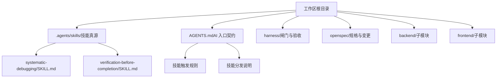
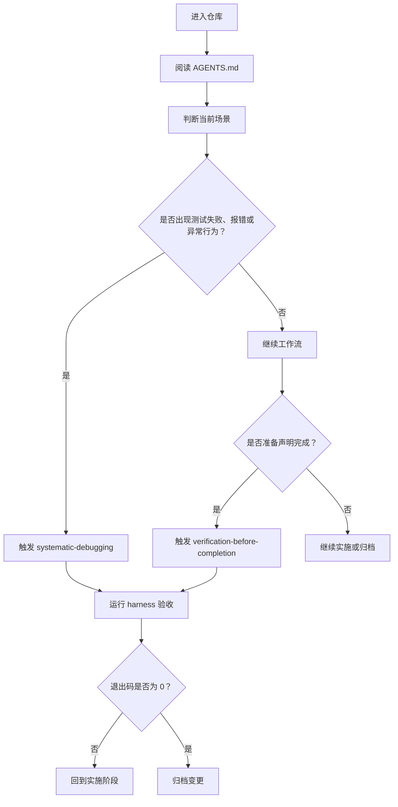
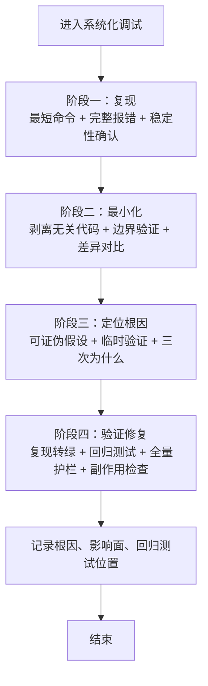
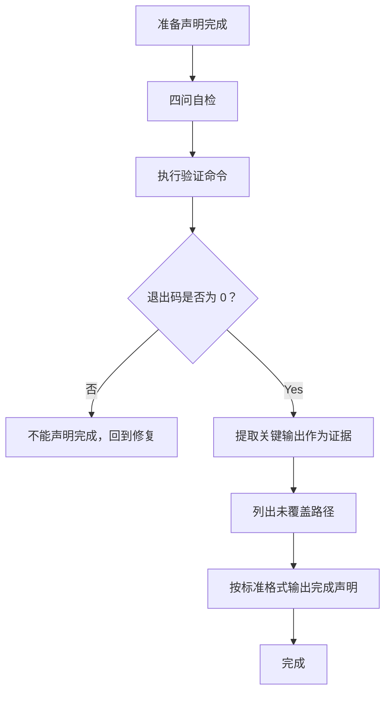
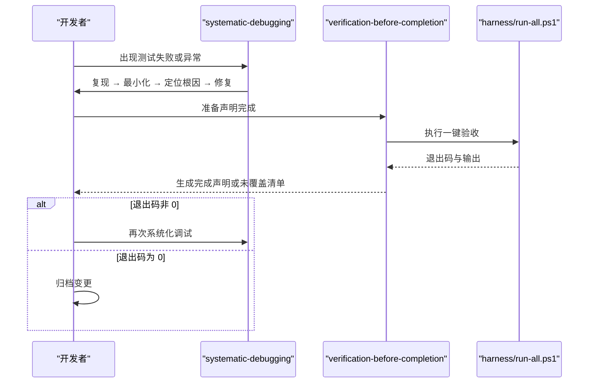
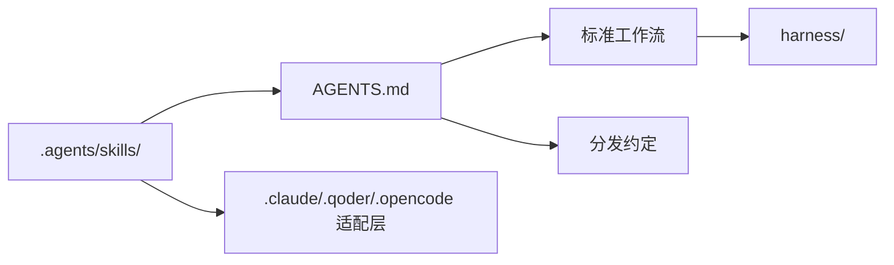

# AI 技能系统

<cite>
**本文引用的文件**   
- [AGENTS.md](file://AGENTS.md)
- [README.md](file://README.md)
- [systematic-debugging/SKILL.md](file://.agents\skills\systematic-debugging\SKILL.md)
- [verification-before-completion/SKILL.md](file://.agents\skills\verification-before-completion\SKILL.md)
</cite>

## 目录
1. [引言](#引言)
2. [项目结构](#项目结构)
3. [核心组件](#核心组件)
4. [架构总览](#架构总览)
5. [详细组件分析](#详细组件分析)
6. [依赖关系分析](#依赖关系分析)
7. [性能与可维护性考虑](#性能与可维护性考虑)
8. [故障排查指南](#故障排查指南)
9. [结论](#结论)
10. [附录：自定义技能规范](#附录自定义技能规范)

## 引言
本仓库把“AI 编码如何被约束”沉淀为三层骨架：**工件层（规格）**、**能力层（护栏）**、**行为层（技能）**。其中，行为层通过 `.agents/skills/` 下的技能文件，固化最佳实践和行为指导，解决 AI 不知道「怎么做才对」的问题。

两个自研内置技能分别是：
- `systematic-debugging`：系统化调试，用四阶段根因法处理 bug、测试失败和异常行为。
- `verification-before-completion`：完成前验证，强制在宣布完成之前提供命令、退出码和输出证据。

这两个技能不是建议，而是工作流的一部分；跳过它们等同于跳过检查。

**章节来源**
- [AGENTS.md:1-24](file://AGENTS.md#L1-L24)
- [README.md:1-19](file://README.md#L1-L19)

## 项目结构
技能系统位于工作区的“行为层”，真源是 `.agents/skills/`，并通过分发机制同步到各 AI 工具适配层。

**图表来源**
- [AGENTS.md:72-119](file://AGENTS.md#L72-L119)
- [README.md:70-81](file://README.md#L70-L81)

**章节来源**
- [AGENTS.md:72-119](file://AGENTS.md#L72-L119)
- [README.md:70-81](file://README.md#L70-L81)

## 核心组件
技能系统的核心由三部分构成：
1. **技能定义文件**：每个技能一个目录，包含 `SKILL.md`，描述名称、用途、触发条件、执行纪律和收尾要求。
2. **入口契约**：`AGENTS.md` 规定何时必须触发哪些技能，以及技能与工作流的关系。
3. **分发与适配层**：将 `.agents/skills/` 中的真源同步到 `.claude/skills/`、`.qoder/skills/`、`.opencode/skills/`，让不同 AI 工具获得一致的行为强化。

| 组件 | 位置 | 职责 |
|---|---|---|
| 技能真源 | `.agents/skills/` | 编写、修订、版本控制行为的唯一权威来源 |
| 入口契约 | `AGENTS.md` | 定义技能触发规则、工作流顺序、分发约定 |
| 分发副本 | `.claude/skills/`、`.qoder/skills/`、`.opencode/skills/` | 供各 AI 工具读取的逐字节副本 |
| 内置技能 | `systematic-debugging`、`verification-before-completion` | 解决“怎么干才专业”的行为问题 |

**章节来源**
- [AGENTS.md:60-70](file://AGENTS.md#L60-L70)
- [AGENTS.md:113-118](file://AGENTS.md#L113-L118)

## 架构总览
技能系统在工作流中承担“行为约束”的角色，与规格和护栏形成乘法关系。

**图表来源**
- [AGENTS.md:37-56](file://AGENTS.md#L37-L56)
- [AGENTS.md:60-70](file://AGENTS.md#L60-L70)

**章节来源**
- [AGENTS.md:37-56](file://AGENTS.md#L37-L56)
- [AGENTS.md:60-70](file://AGENTS.md#L60-L70)

## 详细组件分析

### 系统化调试技能：systematic-debugging
该技能用于处理非预期行为，强调“先复现、再最小化、再定位根因、最后验证修复”，禁止靠猜测改代码。

#### 关键要点
- **触发场景**：测试失败、启动报错、接口返回不符合预期；已经修过一次但问题仍在；现象不稳定或反复出现。
- **核心纪律**：没有证据的改动视为噪声；猜测即失败。
- **四阶段流程**：
  - 复现：找到最短复现路径，记录完整错误输出，确认稳定。
  - 最小化：剥离无关代码，优先验证边界条件，对比差异缩小嫌疑范围。
  - 定位根因：提出可证伪假设，用日志或断点验证，追问三次“为什么”。
  - 验证修复：原复现由红转绿，补充回归测试，跑全量护栏，检查副作用。
- **反模式**：吞掉异常、调大超时重试、注释断言、一次改多处、重启就好等。
- **收尾要求**：在对应 OpenSpec change 中记录根因、影响面和回归测试位置。

**图表来源**
- [.agents\skills\systematic-debugging\SKILL.md:18-63](file://.agents\skills\systematic-debugging\SKILL.md#L18-L63)

**章节来源**
- [.agents\skills\systematic-debugging\SKILL.md:1-65](file://.agents\skills\systematic-debugging\SKILL.md#L1-L65)
- [AGENTS.md:60-68](file://AGENTS.md#L60-L68)

### 完成前验证技能：verification-before-completion
该技能用于在宣布“做完了”之前强制取证据，避免凭感觉交付。

#### 关键要点
- **触发场景**：想说已完成、已修复、应该没问题；想让用户自己试一下；认为改动很小不用验证。
- **铁律**：没有跑过的验证等于没验证；只有命令输出和退出码是证据。
- **四问自检**：
  1. 实际执行了什么命令？
  2. 退出码是多少？
  3. 输出证明了什么？
  4. 有没有未覆盖的路径？
- **本项目验证顺序**：推荐一步到位运行 `harness\run-all.ps1`，分步排查时按编译、测试、静态红线顺序执行。
- **常见借口与事实**：小改动也可能引入编译错误；之前的过与现在代码无关；不能把验证成本转移给用户。
- **完成声明标准格式**：必须包含改动、验证命令、证据片段和未覆盖部分。
- **与 Harness 的关系**：Harness 提供否决权，本技能保证主动请求否决；跳过一键验收不算完成。

**图表来源**
- [.agents\skills\verification-before-completion\SKILL.md:20-62](file://.agents\skills\verification-before-completion\SKILL.md#L20-L62)

**章节来源**
- [.agents\skills\verification-before-completion\SKILL.md:1-70](file://.agents\skills\verification-before-completion\SKILL.md#L1-L70)
- [AGENTS.md:60-70](file://AGENTS.md#L60-L70)

### 技能组合使用
在实际工作流中，两个技能通常配合使用：
- 遇到异常时先走 `systematic-debugging`，定位并修复根因。
- 修复后不直接宣称完成，而是走 `verification-before-completion`，用 Harness 输出证明结果。
- 如果验证失败，回到调试阶段；如果验证成功，继续归档。

**图表来源**
- [.agents\skills\systematic-debugging\SKILL.md:44-63](file://.agents\skills\systematic-debugging\SKILL.md#L44-L63)
- [.agents\skills\verification-before-completion\SKILL.md:29-69](file://.agents\skills\verification-before-completion\SKILL.md#L29-L69)
- [AGENTS.md:48-56](file://AGENTS.md#L48-L56)

## 依赖关系分析
技能系统与仓库其他层的依赖关系如下：

**图表来源**
- [AGENTS.md:60-70](file://AGENTS.md#L60-L70)
- [AGENTS.md:72-119](file://AGENTS.md#L72-L119)

**章节来源**
- [AGENTS.md:60-70](file://AGENTS.md#L60-L70)
- [AGENTS.md:72-119](file://AGENTS.md#L72-L119)

## 性能与可维护性考虑
- **技能本身不消耗运行时资源**：它们是行为约束，不是服务进程。
- **主要成本在执行 Harness 时**：`harness\run-all.ps1` 会依次执行子模块检查、编译、测试、静态红线、前端构建与测试、改名演练等。
- **优化建议**：
  - 开发阶段可先运行单条检查脚本，快速定位问题。
  - 提交前始终运行一键验收，避免累积问题。
  - 新增技能时保持简洁，只写必要约束，避免冗长指令拖慢上下文。

[本节为通用指导，不直接分析具体文件]

## 故障排查指南
当技能无法触发或工作流卡住时，可按以下思路排查：

1. **确认入口契约**：先读 `AGENTS.md`，理解当前步骤是否应触发某个技能。
2. **检查技能真源是否存在**：确认 `.agents/skills/systematic-debugging/SKILL.md` 或 `.agents/skills/verification-before-completion/SKILL.md` 存在且未被误删。
3. **检查分发副本**：若使用的是 Claude、Qoder 或 OpenCode，确认对应 `.claude/skills/`、`.qoder/skills/`、`.opencode/skills/` 中存在逐字节一致的副本。
4. **检查 Harness 环境**：子模块未初始化会导致 00 闸门失败；网络或凭据不足会影响首次初始化。
5. **查看退出码**：完成判定只看退出码，不要以“看起来没报错”代替证据。

**章节来源**
- [AGENTS.md:58-59](file://AGENTS.md#L58-L59)
- [AGENTS.md:154-160](file://AGENTS.md#L154-L160)

## 结论
AI 技能系统通过 `.agents/skills/` 把“怎么做才对”固化为可执行的行为约束。`systematic-debugging` 解决“遇到异常怎么办”，`verification-before-completion` 解决“怎么证明真的完成了”。两者与 `AGENTS.md` 的工作流和 `harness/` 的闸门共同构成乘法式质量保障：任何一层失效，整体效果归零。

[本节为总结，不直接分析具体文件]

## 附录：自定义技能规范

### 技能设计原则
- **聚焦单一职责**：一个技能解决一类明确问题，例如系统化调试、完成前验证、需求提案等。
- **可触发**：明确“何时触发”，让 AI 能根据场景自动调用。
- **可执行**：给出步骤、判据和产出物，而不是空泛建议。
- **可验证**：尽量关联命令、退出码或输出证据，避免主观判断。
- **可归档**：重要修复或变更应在 OpenSpec change 中记录根因和影响面。

### 命名约定
- 目录名使用短横线分隔的小写英文，例如 `systematic-debugging`、`verification-before-completion`。
- 文件名固定为 `SKILL.md`。
- YAML front matter 至少包含 `name` 和 `description`。

### 文件结构与语法规范
- **YAML front matter**：
  - `name`：技能标识名。
  - `description`：一句话说明适用场景。
- **正文结构建议**：
  - 标题：技能名称。
  - 何时触发：列举典型场景。
  - 核心纪律：不可妥协的原则。
  - 执行步骤：分阶段或分步骤说明。
  - 产出物：每阶段应产出的可交付内容。
  - 反模式：常见错误及危害。
  - 收尾：归档、记录或通知要求。

### 创建步骤
1. 在 `.agents/skills/<skill-name>/` 下新建 `SKILL.md`。
2. 填写 `name`、`description` 和正文。
3. 在 `AGENTS.md` 的技能触发表中添加新技能。
4. 将真源同步到 `.claude/skills/`、`.qoder/skills/`、`.opencode/skills/`。
5. 用现有工作流验证：触发场景 → 执行技能 → 运行 Harness → 检查退出码。

### 测试方法
- **触发测试**：构造符合“何时触发”的场景，确认 AI 会调用该技能。
- **步骤测试**：检查技能是否引导出正确步骤和产出物。
- **反模式测试**：故意使用反模式，确认技能会拒绝或纠正。
- **集成测试**：结合 Harness 验证最终结果，确保技能不会绕过闸门。

### 常见场景示例
- **调试类技能**：适用于复杂 bug、间歇性失败、多模块联动问题。
- **验证类技能**：适用于提交前、发布前、交接前的质量门禁。
- **协作类技能**：适用于跨团队评审、变更记录、回滚策略。

**章节来源**
- [AGENTS.md:60-70](file://AGENTS.md#L60-L70)
- [AGENTS.md:113-118](file://AGENTS.md#L113-L118)
- [.agents\skills\systematic-debugging\SKILL.md:1-65](file://.agents\skills\systematic-debugging\SKILL.md#L1-L65)
- [.agents\skills\verification-before-completion\SKILL.md:1-70](file://.agents\skills\verification-before-completion\SKILL.md#L1-L70)