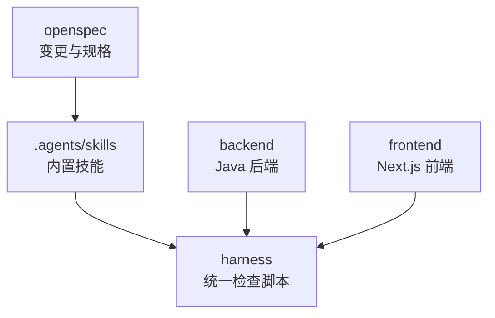
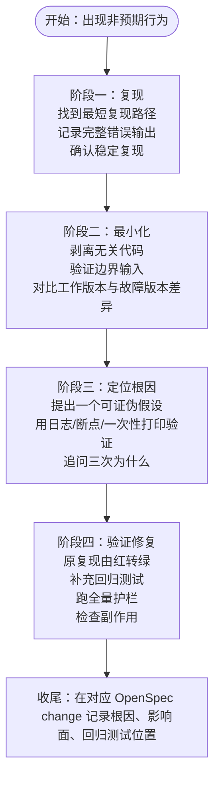
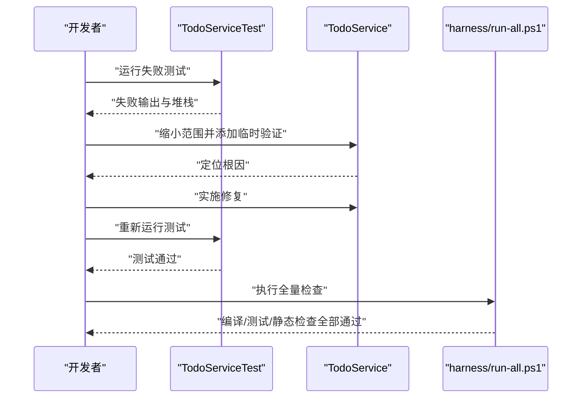
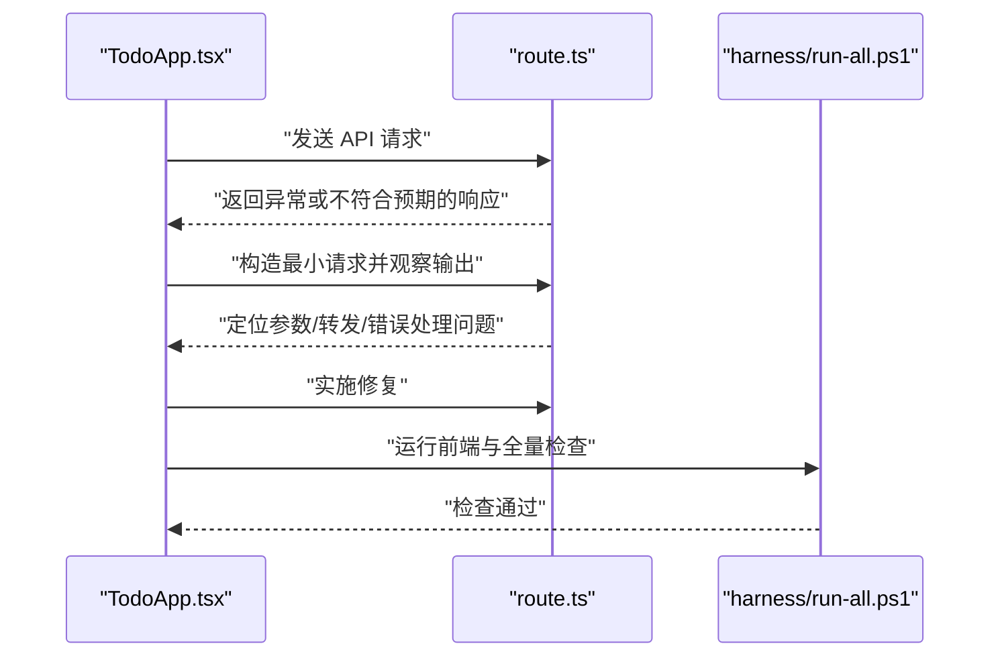
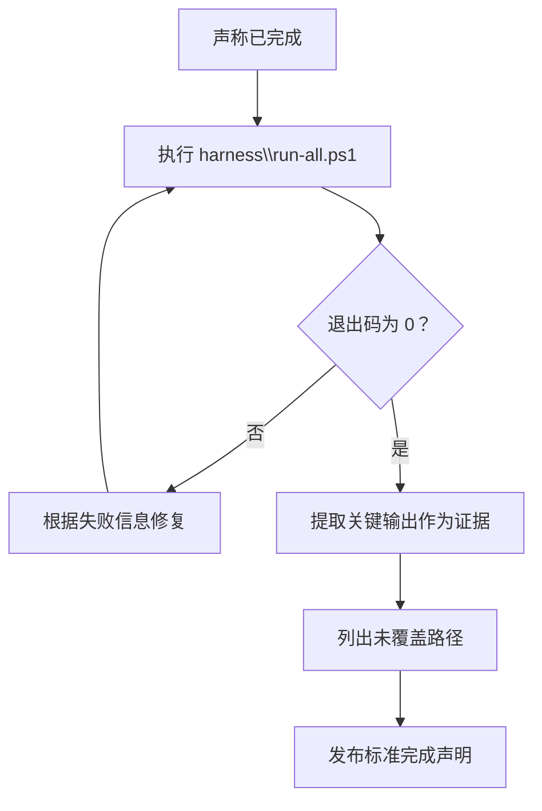
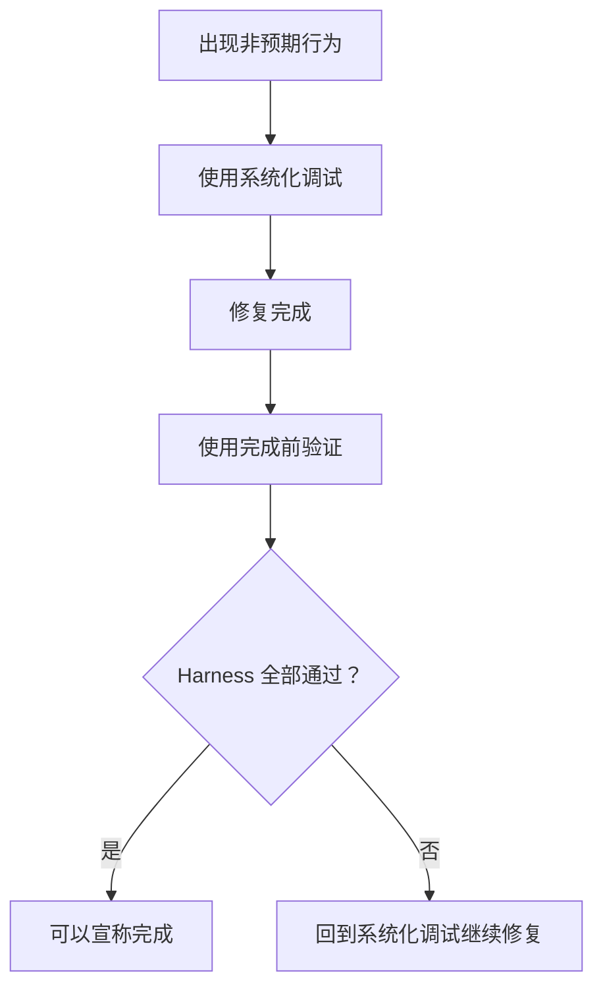
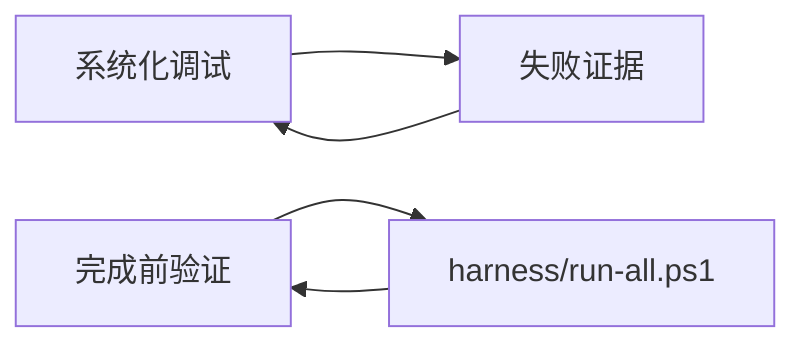

# 内置技能详解

<cite>
**本文引用的文件**   
- [systematic-debugging/SKILL.md](file://.agents\skills\systematic-debugging\SKILL.md)
- [verification-before-completion/SKILL.md](file://.agents\skills\verification-before-completion\SKILL.md)
- [harness/run-all.ps1](file://harness\run-all.ps1)
- [harness/checks/01-compile.ps1](file://harness\checks\01-compile.ps1)
- [harness/checks/02-test.ps1](file://harness\checks\02-test.ps1)
- [harness/checks/03-static-guard.ps1](file://harness\checks\03-static-guard.ps1)
- [backend/src/main/java/com/luyi/myfirst/domain/TodoService.java](file://backend\src\main\java\com\luyi\myfirst\domain\TodoService.java)
- [backend/src/test/java/com/luyi/myfirst/domain/TodoServiceTest.java](file://backend\src\test\java\com\luyi\myfirst\domain\TodoServiceTest.java)
- [frontend/app/api/[...path]/route.ts](file://frontend\app\api\[...path]\route.ts)
- [frontend/components/TodoApp.tsx](file://frontend\components\TodoApp.tsx)
</cite>

## 目录
1. [引言](#引言)
2. [项目结构](#项目结构)
3. [核心技能总览](#核心技能总览)
4. [系统化调试技能详解](#系统化调试技能详解)
5. [完成前验证技能详解](#完成前验证技能详解)
6. [实际使用场景与示例](#实际使用场景与示例)
7. [输出格式与结果解读](#输出格式与结果解读)
8. [技能组合选择指南](#技能组合选择指南)
9. [依赖关系分析](#依赖关系分析)
10. [性能与执行成本](#性能与执行成本)
11. [故障排查清单](#故障排查清单)
12. [结论](#结论)

## 引言
本文面向开发者、测试人员和技术负责人，系统说明仓库中两个内置技能的规范用法：  
- **系统化调试（四阶段根因法）**：用于处理 bug、测试失败、行为异常。  
- **完成前验证**：用于在宣布“已完成”之前强制提供可执行的证据。  

文档不仅解释技能规则，还结合后端 Java、前端 Next.js 以及 `harness` 自动化检查脚本，给出可落地的触发条件、流程、反模式、输出模板和组合策略。

## 项目结构
本仓库采用前后端分离 + 统一 Harness 校验的结构：
- `.agents/skills`：内置技能定义。
- `backend`：Java 后端服务与单元测试。
- `frontend`：Next.js 前端应用与组件测试。
- `harness`：统一的编译、测试、静态检查脚本。
- `openspec`：变更与规格管理。

**图表来源**
- [.agents/skills/systematic-debugging/SKILL.md:1-65](file://.agents\skills\systematic-debugging\SKILL.md#L1-L65)
- [.agents/skills/verification-before-completion/SKILL.md:1-70](file://.agents\skills\verification-before-completion\SKILL.md#L1-L70)
- [harness/run-all.ps1](file://harness\run-all.ps1)

**章节来源**
- [.agents/skills/systematic-debugging/SKILL.md:1-65](file://.agents\skills\systematic-debugging\SKILL.md#L1-L65)
- [.agents/skills/verification-before-completion/SKILL.md:1-70](file://.agents\skills\verification-before-completion\SKILL.md#L1-L70)

## 核心技能总览
| 技能 | 主要用途 | 关键纪律 | 典型触发 | 关键产出 |
|---|---|---|---|---|
| 系统化调试 | 定位并修复非预期行为 | 猜测即失败；先复现、再最小化、再定位根因、最后验证修复 | 测试失败、启动报错、接口异常、修一次没好 | 可粘贴的复现命令、最小用例、根因假设、回归测试 |
| 完成前验证 | 在宣布完成前提供证据 | 没有跑过的验证等于没验证；必须贴命令、退出码、输出 | 想宣称“已完成/已修复/应该没问题” | 标准完成声明、Harness 运行证据、未覆盖项 |

**章节来源**
- [.agents/skills/systematic-debugging/SKILL.md:1-65](file://.agents\skills\systematic-debugging\SKILL.md#L1-L65)
- [.agents/skills/verification-before-completion/SKILL.md:1-70](file://.agents\skills\verification-before-completion\SKILL.md#L1-L70)

## 系统化调试技能详解

### 适用边界与触发条件
- 测试变红、启动报错、接口返回不符合预期。
- 已经尝试修复但问题仍在，或换地方复现。
- 无法清晰解释“为什么这次能好使”，只能靠反复试错。

### 四阶段根因法流程

**图表来源**
- [.agents/skills/systematic-debugging/SKILL.md:8-63](file://.agents\skills\systematic-debugging\SKILL.md#L8-L63)

### 各阶段要点与产出
- **复现**：一条可粘贴的命令、一个测试用例或一个请求；完整堆栈；连续多次稳定复现。
- **最小化**：最小复现用例；优先空值、零、负数、超长、并发、编码等边界。
- **定位根因**：单一可证伪假设；临时验证后立即清理；不要边证伪边打补丁。
- **验证修复**：原复现由红转绿；新增回归测试；执行 `powershell -File harness\run-all.ps1`；检查相邻功能与边界输入是否受影响。

### 反模式清单
| 反模式 | 为什么有害 |
|---|---|
| 加 try-catch 吞掉异常 | 现象消失，根因留下 |
| 调大超时或重试次数 | 掩盖竞态，压力下必然复发 |
| 注释掉失败的断言 | 护栏被拆，等于没写测试 |
| 一次改五处 | 即使修好也说不清哪处生效 |
| “重启一下就好了” | 未解释的状态残留 |

**章节来源**
- [.agents/skills/systematic-debugging/SKILL.md:8-63](file://.agents\skills\systematic-debugging\SKILL.md#L8-L63)

## 完成前验证技能详解

### 适用边界与触发条件
- 想说“已完成”“已修复”“应该没问题了”。
- 让用户去试一下看看行不行。
- 认为改动很小，不跑也知道没事。

### 铁律与自检
- 铁律：**没有跑过的验证，等于没验证。**
- 四问自检：
  1. 我实际执行了什么命令？
  2. 退出码是多少？必须是 0。
  3. 输出证明了什么？
  4. 有没有我没覆盖的路径？

### 本项目验证顺序
- 一步到位：`powershell -File harness\run-all.ps1`，然后检查 `$LASTEXITCODE` 是否为 0。
- 分步排查：依次执行 `01-compile.ps1`、`02-test.ps1`、`03-static-guard.ps1`。

### 完成声明标准格式
> 改动：<一句话>  
> 验证：`<命令>` 退出码 0  
> 证据：<关键输出片段>  
> 未覆盖：<显式列出未验证的部分，没有就写“无”>

**章节来源**
- [.agents/skills/verification-before-completion/SKILL.md:1-70](file://.agents\skills\verification-before-completion\SKILL.md#L1-L70)

## 实际使用场景与示例

### 场景一：后端业务逻辑导致测试失败
**背景**：`TodoService` 的业务方法在处理任务时出现异常或返回不符合预期的状态，导致 `TodoServiceTest` 失败。

**系统化调试应用**
1. **复现**：直接运行后端测试，保留完整失败输出。
2. **最小化**：将失败收敛到单个测试用例，剔除无关上下文。
3. **定位根因**：对 `TodoService` 的处理分支提出假设，例如“空任务或非法状态未正确处理”，通过日志或断点验证。
4. **验证修复**：修复后确保该测试由红转绿，并补充回归测试；随后执行 Harness 全量检查。

**图表来源**
- [backend/src/test/java/com/luyi/myfirst/domain/TodoServiceTest.java](file://backend\src\test\java\com\luyi\myfirst\domain\TodoServiceTest.java)
- [backend/src/main/java/com/luyi/myfirst/domain/TodoService.java](file://backend\src\main\java\com\luyi\myfirst\domain\TodoService.java)
- [harness/run-all.ps1](file://harness\run-all.ps1)

**章节来源**
- [backend/src/test/java/com/luyi/myfirst/domain/TodoServiceTest.java](file://backend\src\test\java\com\luyi\myfirst\domain\TodoServiceTest.java)
- [backend/src/main/java/com/luyi/myfirst/domain/TodoService.java](file://backend\src\main\java\com\luyi\myfirst\domain\TodoService.java)
- [.agents/skills/systematic-debugging/SKILL.md:18-49](file://.agents\skills\systematic-debugging\SKILL.md#L18-L49)

### 场景二：前端 API 路由返回异常
**背景**：Next.js 前端调用 `/api/[...path]` 时，接口返回不符合预期，页面渲染异常或用户操作失败。

**系统化调试应用**
1. **复现**：构造最小请求，捕获响应体与状态码。
2. **最小化**：隔离前端组件与后端路由，确认是前端参数构造问题还是后端处理问题。
3. **定位根因**：检查 `route.ts` 的参数解析、转发逻辑与错误处理。
4. **验证修复**：修复后重新发起请求，确认响应符合预期；同时运行前端测试与 Harness。

**图表来源**
- [frontend/components/TodoApp.tsx](file://frontend\components\TodoApp.tsx)
- [frontend/app/api/[...path]/route.ts](file://frontend\app\api\[...path]\route.ts)
- [harness/run-all.ps1](file://harness\run-all.ps1)

**章节来源**
- [frontend/components/TodoApp.tsx](file://frontend\components\TodoApp.tsx)
- [frontend/app/api/[...path]/route.ts](file://frontend\app\api\[...path]\route.ts)
- [.agents/skills/systematic-debugging/SKILL.md:18-49](file://.agents\skills\systematic-debugging\SKILL.md#L18-L49)

### 场景三：完成前验证缺失导致误报
**背景**：开发者修改了少量代码，主观认为“应该没问题”，但未执行 Harness 检查就宣称完成。

**完成前验证应用**
1. 执行 `powershell -File harness\run-all.ps1`。
2. 检查 `$LASTEXITCODE` 是否为 0。
3. 从输出中找出关键通过信息，作为证据。
4. 明确写出未覆盖部分，例如“未验证某条边缘分支”。

**图表来源**
- [.agents/skills/verification-before-completion/SKILL.md:29-62](file://.agents\skills\verification-before-completion\SKILL.md#L29-L62)
- [harness/run-all.ps1](file://harness\run-all.ps1)

**章节来源**
- [.agents/skills/verification-before-completion/SKILL.md:14-62](file://.agents\skills\verification-before-completion\SKILL.md#L14-L62)

## 输出格式与结果解读

### 系统化调试输出模板
- **复现命令**：可直接粘贴执行的命令、测试或请求。
- **完整错误输出**：包含堆栈、状态码、响应体。
- **最小用例**：仅保留触发问题的必要代码或数据。
- **根因假设**：一句可证伪的因果陈述。
- **修复验证**：原复现由红转绿；回归测试存在；Harness 全量通过。
- **OpenSpec 记录**：根因、影响面、回归测试位置。

### 完成前验证输出模板
- **标准完成声明**：
  > 改动：<一句话>  
  > 验证：`<命令>` 退出码 0  
  > 证据：<关键输出片段>  
  > 未覆盖：<显式列出未验证的部分，没有就写“无”>

### 结果解读方法
- **测试失败**：优先看第一个失败用例，避免被后续噪声干扰。
- **编译失败**：先看第一条编译错误，通常后续错误由它引发。
- **静态检查失败**：按工具提示逐项修复，不要忽略警告。
- **Harness 整体失败**：先定位具体步骤失败原因，再决定是继续修复还是回滚。

**章节来源**
- [.agents/skills/systematic-debugging/SKILL.md:18-63](file://.agents\skills\systematic-debugging\SKILL.md#L18-L63)
- [.agents/skills/verification-before-completion/SKILL.md:29-62](file://.agents\skills\verification-before-completion\SKILL.md#L29-L62)

## 技能组合选择指南

### 何时只使用系统化调试
- 你正在处理明确的 bug 或异常行为。
- 你已经有了失败证据，但不知道根因。
- 目标是在提交前把问题彻底解决并留下回归测试。

### 何时只使用完成前验证
- 你的改动已经完成，需要对外宣称“已完成”。
- 你需要向评审者或用户提供可执行的证据。
- 你希望避免“看起来对”的主观判断。

### 何时组合使用
- 修复 bug 后，必须先用系统化调试验证修复有效，再用完成前验证证明整体质量。
- 复杂改动涉及前后端交互时，先分别用系统化调试定位问题，再用完成前验证保证全链路通过。

**图表来源**
- [.agents/skills/systematic-debugging/SKILL.md:8-63](file://.agents\skills\systematic-debugging\SKILL.md#L8-L63)
- [.agents/skills/verification-before-completion/SKILL.md:14-62](file://.agents\skills\verification-before-completion\SKILL.md#L14-L62)

**章节来源**
- [.agents/skills/systematic-debugging/SKILL.md:8-63](file://.agents\skills\systematic-debugging\SKILL.md#L8-L63)
- [.agents/skills/verification-before-completion/SKILL.md:14-62](file://.agents\skills\verification-before-completion\SKILL.md#L14-L62)

## 依赖关系分析

### 技能与 Harness 的关系
- 系统化调试依赖测试失败、启动失败、接口异常等真实证据。
- 完成前验证依赖 Harness 提供的编译、测试、静态检查能力。
- 两者共同构成“发现问题 → 定位问题 → 修复问题 → 证明问题已解决”的闭环。

**图表来源**
- [.agents/skills/systematic-debugging/SKILL.md:8-63](file://.agents\skills\systematic-debugging\SKILL.md#L8-L63)
- [.agents/skills/verification-before-completion/SKILL.md:29-67](file://.agents\skills\verification-before-completion\SKILL.md#L29-L67)
- [harness/run-all.ps1](file://harness\run-all.ps1)

**章节来源**
- [.agents/skills/systematic-debugging/SKILL.md:8-63](file://.agents\skills\systematic-debugging\SKILL.md#L8-L63)
- [.agents/skills/verification-before-completion/SKILL.md:29-67](file://.agents\skills\verification-before-completion\SKILL.md#L29-L67)

## 性能与执行成本
- 系统化调试强调“最小化”，目的是降低定位成本，而不是增加额外负担。
- 完成前验证推荐先执行全量 Harness，再按需分步排查，避免重复劳动。
- 不建议为了“快速过”而跳过 Harness；短期省时间，长期增加返工成本。

[本节为通用指导，不直接分析具体文件]

## 故障排查清单

### 系统化调试常见问题
- 无法稳定复现：先解决“不可复现”，不要继续推进。
- 临时日志未清理：污染提交，应删除一次性输出。
- 多处分批修改：无法确定哪个改动生效，违反“单一假设”原则。
- 只修表面症状：吞异常、调超时、注释断言都属于反模式。

### 完成前验证常见问题
- 只说“没报错”而不贴退出码。
- 只回忆命令而不贴实际执行命令。
- 忽略未覆盖路径，导致遗漏风险。
- 以环境问题为由跳过 Harness，把不确定当完成。

**章节来源**
- [.agents/skills/systematic-debugging/SKILL.md:51-63](file://.agents\skills\systematic-debugging\SKILL.md#L51-L63)
- [.agents/skills/verification-before-completion/SKILL.md:45-62](file://.agents\skills\verification-before-completion\SKILL.md#L45-L62)

## 结论
- **系统化调试**要求你用证据驱动修复，遵循“复现 → 最小化 → 定位根因 → 验证修复”的顺序，并用回归测试和 Harness 固化成果。
- **完成前验证**要求你在宣称完成前提供可执行的命令、退出码和输出证据，诚实列出未覆盖部分。
- 在实际项目中，建议将两个技能组合使用：先用系统化调试解决问题，再用完成前验证证明整体质量。
- 最终目标是让每次提交都具备可复现、可验证、可追溯的质量基础。

[本节为总结性内容，不直接分析具体文件]