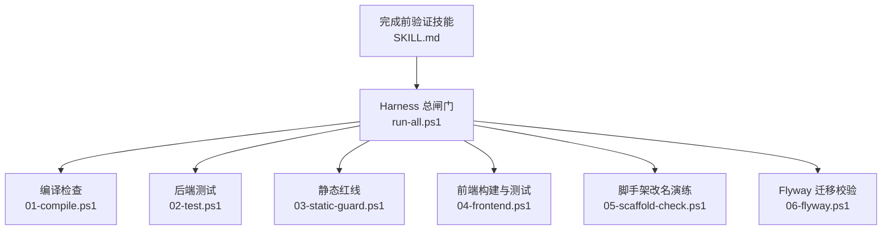
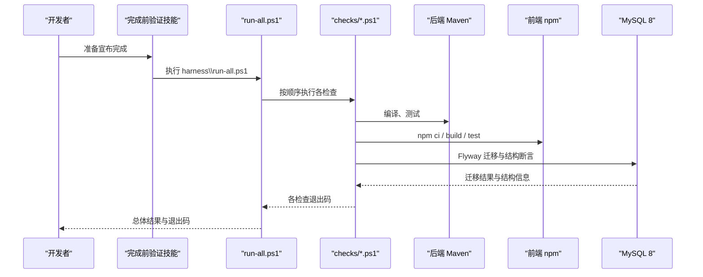
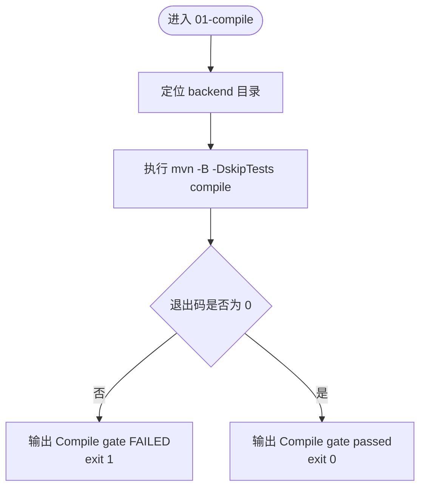
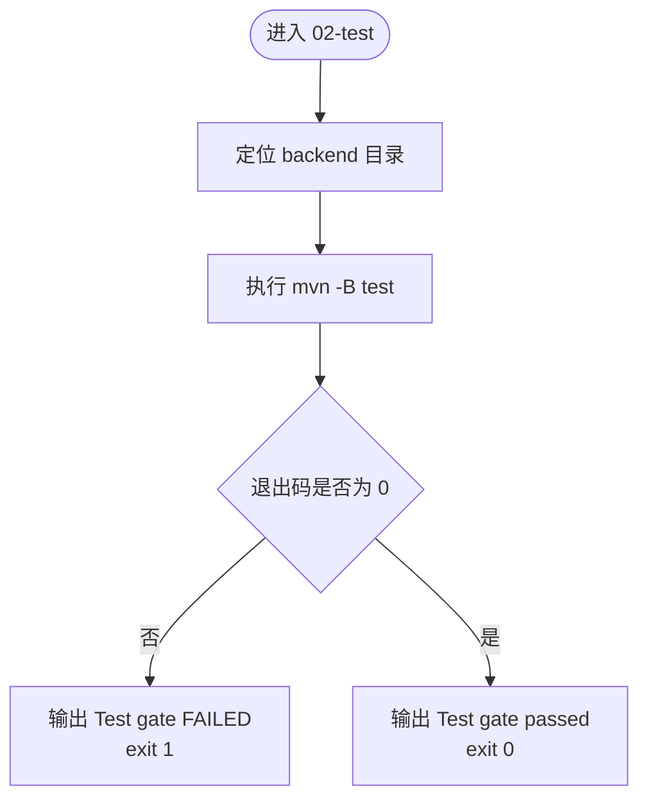
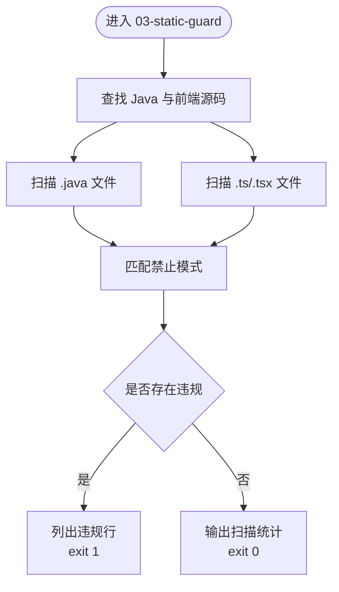
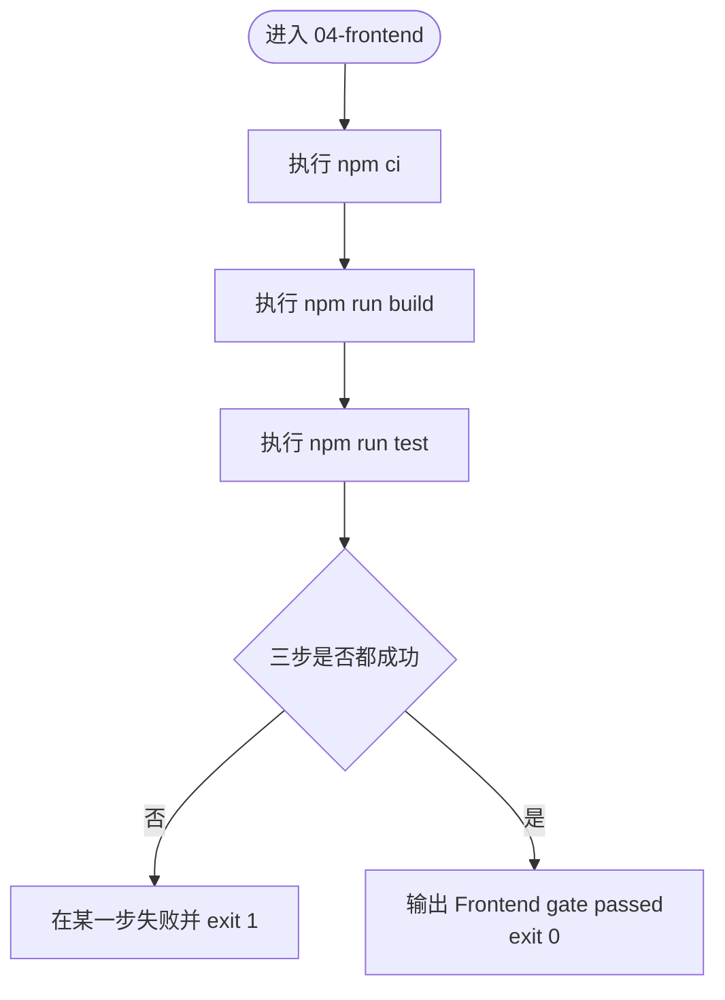
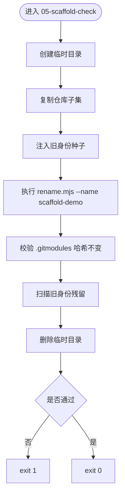
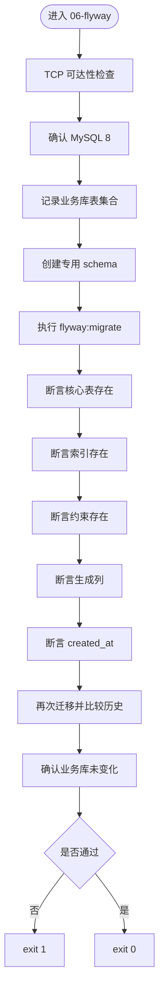
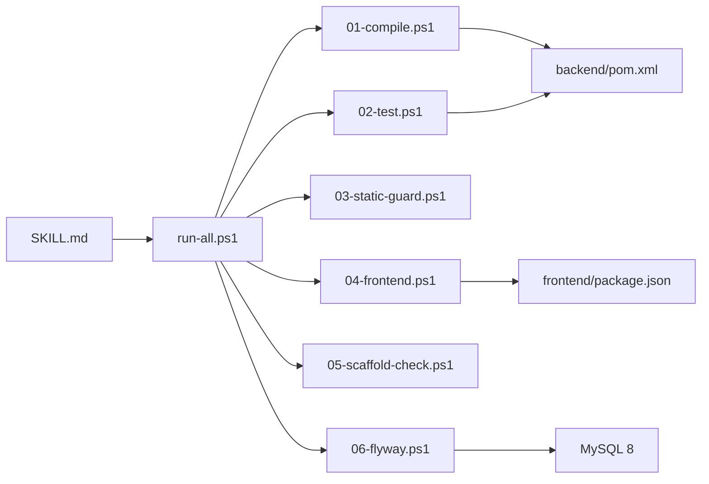

# 完成前验证技能

<cite>
**本文引用的文件**   
- [SKILL.md](file://.agents\skills\verification-before-completion\SKILL.md)
- [run-all.ps1](file://harness\run-all.ps1)
- [01-compile.ps1](file://harness\checks\01-compile.ps1)
- [02-test.ps1](file://harness\checks\02-test.ps1)
- [03-static-guard.ps1](file://harness\checks\03-static-guard.ps1)
- [04-frontend.ps1](file://harness\checks\04-frontend.ps1)
- [05-scaffold-check.ps1](file://harness\checks\05-scaffold-check.ps1)
- [06-flyway.ps1](file://harness\checks\06-flyway.ps1)
- [pom.xml](file://backend\pom.xml)
- [package.json](file://frontend\package.json)
</cite>

## 目录
1. [引言](#引言)
2. [项目结构](#项目结构)
3. [核心组件](#核心组件)
4. [架构总览](#架构总览)
5. [详细组件分析](#详细组件分析)
6. [依赖关系分析](#依赖关系分析)
7. [性能与质量要求](#性能与质量要求)
8. [开发工作流集成](#开发工作流集成)
9. [常见问题与解决方案](#常见问题与解决方案)
10. [结论](#结论)
11. [附录：命令与结果示例](#附录命令与结果示例)

## 引言
“完成前验证技能”是一个强制性的质量门禁方法：在宣布任务完成、修复完成或可以交付之前，必须先执行可重复的命令，收集退出码和输出作为证据。它不是“看起来对就行”，而是“跑过并留下证据”。

在本项目中，该技能与 Harness 闸门脚本配合使用：
- 技能负责“主动请求否决”，即必须运行验证命令并给出证据。
- Harness 负责“拥有否决权”，只有 `harness\run-all.ps1` 返回 0，才算真正通过。

因此，任何跳过 `harness\run-all.ps1` 的改动，无论看起来多正确，都不算完成。

**章节来源**
- [SKILL.md:1-70](file://.agents\skills\verification-before-completion\SKILL.md#L1-L70)

## 项目结构
本项目的验证体系由三层组成：
- 技能文档：定义行为规则、自检清单和完成声明格式。
- Harness 总闸门：按固定顺序执行所有检查，任一失败立即阻断。
- 分步检查脚本：分别负责编译、测试、静态红线、前端、脚手架改名演练、数据库迁移校验。



**图表来源**
- [SKILL.md:29-43](file://.agents\skills\verification-before-completion\SKILL.md#L29-L43)
- [run-all.ps1:1-21](file://harness\run-all.ps1#L1-L21)
- [01-compile.ps1:1-21](file://harness\checks\01-compile.ps1#L1-L21)
- [02-test.ps1:1-23](file://harness\checks\02-test.ps1#L1-L23)
- [03-static-guard.ps1:1-89](file://harness\checks\03-static-guard.ps1#L1-L89)
- [04-frontend.ps1:1-36](file://harness\checks\04-frontend.ps1#L1-L36)
- [05-scaffold-check.ps1:1-111](file://harness\checks\05-scaffold-check.ps1#L1-L111)
- [06-flyway.ps1:1-194](file://harness\checks\06-flyway.ps1#L1-L194)

**章节来源**
- [SKILL.md:29-43](file://.agents\skills\verification-before-completion\SKILL.md#L29-L43)
- [run-all.ps1:1-21](file://harness\run-all.ps1#L1-L21)

## 核心组件
### 完成前验证技能
技能的核心是“先证后宣布”，要求在宣布完成前回答四个问题：
1. 实际执行了什么命令？
2. 退出码是多少？
3. 输出证明了什么？
4. 有没有未覆盖的路径？

同时规定完成声明的标准格式，包括改动、验证命令、关键证据和未覆盖部分。

**章节来源**
- [SKILL.md:6-62](file://.agents\skills\verification-before-completion\SKILL.md#L6-L62)

### Harness 总闸门
`harness\run-all.ps1` 是最终裁决者：
- 自动发现 `harness\checks\*.ps1` 并按文件名排序执行。
- 每个检查在独立 PowerShell 进程中运行，避免退出码互相污染。
- 默认遇错即停；可通过 `-ContinueOnError` 继续执行全部检查。
- 汇总 PASS/FAIL 结果，有失败则返回非 0，全部通过则返回 0。

**章节来源**
- [run-all.ps1:1-91](file://harness\run-all.ps1#L1-L91)

### 后端 Maven 配置
后端使用 Spring Boot 3.5.5，Java 版本属性为 17，包含 Web Starter 和 Test Starter。构建阶段启用 Spring Boot Maven Plugin，并引入 Flyway Maven Plugin 用于迁移工具链（注释明确不引入运行时依赖）。

**章节来源**
- [pom.xml:1-74](file://backend\pom.xml#L1-L74)

### 前端 Node 配置
前端使用 Next.js 16.4.3，Node 引擎要求不低于 20.9.0。脚本提供 dev、build、start、test，其中 test 使用 Vitest。

**章节来源**
- [package.json:1-34](file://frontend\package.json#L1-L34)

## 架构总览
完成前验证的整体流程如下：



**图表来源**
- [SKILL.md:29-43](file://.agents\skills\verification-before-completion\SKILL.md#L29-L43)
- [run-all.ps1:37-63](file://harness\run-all.ps1#L37-L63)
- [01-compile.ps1:10-20](file://harness\checks\01-compile.ps1#L10-L20)
- [02-test.ps1:12-22](file://harness\checks\02-test.ps1#L12-L22)
- [04-frontend.ps1:10-35](file://harness\checks\04-frontend.ps1#L10-L35)
- [06-flyway.ps1:120-193](file://harness\checks\06-flyway.ps1#L120-L193)

## 详细组件分析

### 编译检查：01-compile.ps1
职责：只验证代码能否被编译，不验证业务逻辑是否正确。  
执行命令：在后端目录执行 Maven 编译，跳过测试。  
失败处理：退出码非 0 时输出红色提示并返回 1。



**图表来源**
- [01-compile.ps1:6-20](file://harness\checks\01-compile.ps1#L6-L20)

**章节来源**
- [01-compile.ps1:1-21](file://harness\checks\01-compile.ps1#L1-L21)

### 测试检查：02-test.ps1
职责：运行后端单元测试，并通过 Spring Boot 测试容器装配验证契约。  
执行命令：在后端目录执行 Maven 测试。  
重要约束：不允许跳过测试；跳过测试等于拆掉护栏。



**图表来源**
- [02-test.ps1:8-22](file://harness\checks\02-test.ps1#L8-L22)

**章节来源**
- [02-test.ps1:1-23](file://harness\checks\02-test.ps1#L1-L23)

### 静态红线检查：03-static-guard.ps1
职责：拦截 AI 编码中最常见的“假通过”行为，包括占位标记、调试输出、禁用测试等。  
扫描范围：
- Java 源码：`backend/src` 下的 `.java` 文件。
- 前端源码：`frontend` 下排除 `node_modules`、`.next`、`dist` 的 `.ts`、`.tsx` 文件。

禁止模式：
- TODO、FIXME、XXX 占位标记。
- Java 中使用 `System.out.print`。
- Java 中使用 `@Disabled` 跳过测试。
- 前端使用 `it.skip`、`describe.skip`、`test.skip`、`xit`、`xdescribe`。



**图表来源**
- [03-static-guard.ps1:14-87](file://harness\checks\03-static-guard.ps1#L14-L87)

**章节来源**
- [03-static-guard.ps1:1-89](file://harness\checks\03-static-guard.ps1#L1-L89)

### 前端检查：04-frontend.ps1
职责：确保前端依赖安装可复现、生产构建成功、组件与代理测试通过。  
执行步骤：
1. `npm ci`：从锁定文件安装依赖，保证可复现。
2. `npm run build`：Next.js 构建，内含 TypeScript 类型检查。
3. `npm run test`：Vitest + jsdom 运行测试。



**图表来源**
- [04-frontend.ps1:7-35](file://harness\checks\04-frontend.ps1#L7-L35)

**章节来源**
- [04-frontend.ps1:1-36](file://harness\checks\04-frontend.ps1#L1-L36)
- [package.json:9-14](file://frontend\package.json#L9-L14)

### 脚手架改名演练：05-scaffold-check.ps1
职责：在工作区改名能力上执行“演练而非改写”的检查，防止旧身份残留。  
主要流程：
- 在临时目录复制仓库子集。
- 注入旧工作区身份种子。
- 执行 `scaffold/rename.mjs` 改名演练。
- 校验 `.gitmodules` 未被修改。
- 扫描副本中是否仍存在旧身份残留。
- 清理临时目录。



**图表来源**
- [05-scaffold-check.ps1:44-110](file://harness\checks\05-scaffold-check.ps1#L44-L110)

**章节来源**
- [05-scaffold-check.ps1:1-111](file://harness\checks\05-scaffold-check.ps1#L1-L111)

### Flyway 迁移校验：06-flyway.ps1
职责：复用既有 MySQL 8 实例，在专用 schema 上验证 Flyway 迁移的正确性、幂等性和结构完整性。  
关键约束：
- 不启动容器，不修改业务库。
- 使用环境变量传递数据库连接参数。
- 校验表、索引、约束、生成列、审计时间列。
- 校验 Flyway 历史表中成功迁移数量且无失败记录。
- 再次执行迁移，确认幂等。



**图表来源**
- [06-flyway.ps1:47-193](file://harness\checks\06-flyway.ps1#L47-L193)

**章节来源**
- [06-flyway.ps1:1-194](file://harness\checks\06-flyway.ps1#L1-L194)

## 依赖关系分析
完成前验证技能的依赖关系如下：



**图表来源**
- [SKILL.md:29-43](file://.agents\skills\verification-before-completion\SKILL.md#L29-L43)
- [run-all.ps1:37-63](file://harness\run-all.ps1#L37-L63)
- [pom.xml:1-74](file://backend\pom.xml#L1-L74)
- [package.json:1-34](file://frontend\package.json#L1-L34)
- [06-flyway.ps1:9-13](file://harness\checks\06-flyway.ps1#L9-L13)

**章节来源**
- [run-all.ps1:37-63](file://harness\run-all.ps1#L37-L63)
- [pom.xml:1-74](file://backend\pom.xml#L1-L74)
- [package.json:1-34](file://frontend\package.json#L1-L34)

## 性能与质量要求
### 代码规范
- 禁止使用 TODO、FIXME、XXX 等占位标记。
- 禁止使用 `System.out.print` 等调试输出。
- 禁止通过 `@Disabled` 或前端 skip/x 系列 API 让测试静默。
- 这些规则由静态红线检查强制执行。

**章节来源**
- [03-static-guard.ps1:3-10](file://harness\checks\03-static-guard.ps1#L3-L10)
- [03-static-guard.ps1:50-75](file://harness\checks\03-static-guard.ps1#L50-L75)

### 性能考虑
- 编译与测试分离，便于快速定位编译错误与逻辑错误。
- 前端使用 `npm ci` 保证依赖安装可复现，减少环境差异导致的性能波动。
- Flyway 校验仅操作专用 schema，避免影响业务库性能。

**章节来源**
- [01-compile.ps1:2-4](file://harness\checks\01-compile.ps1#L2-L4)
- [04-frontend.ps1:2-5](file://harness\checks\04-frontend.ps1#L2-L5)
- [06-flyway.ps1:128-130](file://harness\checks\06-flyway.ps1#L128-L130)

### 安全性检查
- 数据库密码通过环境变量传递，避免出现在进程参数中。
- 仅允许专用 schema，禁止触碰业务库。
- 静态红线检查防止遗留调试输出泄露敏感信息。

**章节来源**
- [06-flyway.ps1:133-137](file://harness\checks\06-flyway.ps1#L133-L137)
- [06-flyway.ps1:186-190](file://harness\checks\06-flyway.ps1#L186-L190)
- [03-static-guard.ps1:53-54](file://harness\checks\03-static-guard.ps1#L53-L54)

## 开发工作流集成
### 本地开发
每次提交前，应执行完整验证：
```powershell
powershell -File harness\run-all.ps1
echo $LASTEXITCODE
```
如果只想排查某一步，可使用分步命令：
```powershell
powershell -File harness\checks\01-compile.ps1
powershell -File harness\checks\02-test.ps1
powershell -File harness\checks\03-static-guard.ps1
```

### 完成声明标准格式
在宣布完成前，必须填写：
- 改动：一句话描述。
- 验证：执行的命令及退出码。
- 证据：关键输出片段。
- 未覆盖：显式列出未验证的部分，若无则写“无”。

### 持续集成建议
- 将 `harness\run-all.ps1` 作为 CI 主入口。
- 保留 `-ContinueOnError` 选项用于批量报告多个检查失败。
- 将 Harness 退出码作为合并准入条件。

**章节来源**
- [SKILL.md:29-62](file://.agents\skills\verification-before-completion\SKILL.md#L29-L62)
- [run-all.ps1:23-26](file://harness\run-all.ps1#L23-L26)

## 常见问题与解决方案
### 常见借口与事实
- “改动很小，不用跑”：小改动引入编译错误是最常见的翻车方式。
- “测试之前是过的”：之前的过与现在的代码无关。
- “用户会自己验证”：把验证成本转移给用户，等于没做。
- “环境问题导致跑不了”：先解决环境，不能把不确定当完成。
- “只改了注释”：注释也可能破坏编译，成本只有 10 秒。

**章节来源**
- [SKILL.md:45-54](file://.agents\skills\verification-before-completion\SKILL.md#L45-L54)

### 编译失败
可能原因：
- Java 语法错误。
- 依赖缺失或版本冲突。
- Maven 环境异常。

解决步骤：
1. 单独执行 `01-compile.ps1`。
2. 查看 Maven 输出中的具体错误行。
3. 修复后重新运行完整 Harness。

**章节来源**
- [01-compile.ps1:10-20](file://harness\checks\01-compile.ps1#L10-L20)

### 测试失败
可能原因：
- 单元测试断言失败。
- Spring Boot 容器装配失败。
- 测试数据或外部依赖不可用。

解决步骤：
1. 单独执行 `02-test.ps1`。
2. 根据测试框架输出定位失败用例。
3. 修复逻辑或测试后重新运行完整 Harness。

**章节来源**
- [02-test.ps1:12-22](file://harness\checks\02-test.ps1#L12-L22)

### 静态红线触发
可能原因：
- 代码中存在 TODO/FIXME/XXX。
- 使用了 System.out.print。
- 使用了 @Disabled 或前端 skip/x 系列 API。

解决步骤：
1. 查看静态红线输出的违规文件与行号。
2. 移除占位标记或替换为正式实现。
3. 移除调试输出或改用日志系统。
4. 恢复被禁用的测试。

**章节来源**
- [03-static-guard.ps1:50-75](file://harness\checks\03-static-guard.ps1#L50-L75)

### 前端构建或测试失败
可能原因：
- Node 版本不符合要求。
- 依赖安装失败。
- TypeScript 类型检查失败。
- Vitest 测试失败。

解决步骤：
1. 确认 Node 版本满足 package.json 要求。
2. 单独执行 `04-frontend.ps1`。
3. 根据 npm 输出定位构建或测试失败点。
4. 修复后重新运行完整 Harness。

**章节来源**
- [04-frontend.ps1:10-35](file://harness\checks\04-frontend.ps1#L10-L35)
- [package.json:6-14](file://frontend\package.json#L6-L14)

### Flyway 迁移失败
可能原因：
- MySQL 8 不可达。
- 数据库密码未设置或无法从容器发现。
- 迁移脚本错误或结构断言失败。
- 幂等性检查失败。

解决步骤：
1. 确认 MySQL 8 在指定端口可达。
2. 设置 FLYWAY_DB_PASSWORD 或确保容器暴露端口且包含 MYSQL_ROOT_PASSWORD。
3. 单独执行 `06-flyway.ps1`。
4. 根据输出定位迁移或结构断言失败点。

**章节来源**
- [06-flyway.ps1:47-81](file://harness\checks\06-flyway.ps1#L47-L81)
- [06-flyway.ps1:133-184](file://harness\checks\06-flyway.ps1#L133-L184)

## 结论
“完成前验证技能”不是可选流程，而是交付质量的底线。它要求开发者在执行命令、观察退出码、贴出证据之后才能宣布完成。Harness 提供硬性否决权，两者结合形成完整的验证闭环。

在实际工作中，应始终遵循以下原则：
- 没有跑过的验证，等于没验证。
- 没有新鲜证据的完成声明，视为未完成。
- 跳过 `harness\run-all.ps1` 的改动，不算完成。
- 诚实写出未覆盖部分，比含糊宣称全绿更有价值。

**章节来源**
- [SKILL.md:14-18](file://.agents\skills\verification-before-completion\SKILL.md#L14-L18)
- [SKILL.md:64-70](file://.agents\skills\verification-before-completion\SKILL.md#L64-L70)

## 附录：命令与结果示例
### 完整验证命令
```powershell
powershell -File harness\run-all.ps1
echo $LASTEXITCODE
```
期望结果：
- 所有检查显示 PASS。
- 最后输出 ALL CHECKS PASSED。
- 退出码为 0。

### 分步排查命令
```powershell
powershell -File harness\checks\01-compile.ps1
powershell -File harness\checks\02-test.ps1
powershell -File harness\checks\03-static-guard.ps1
powershell -File harness\checks\04-frontend.ps1
powershell -File harness\checks\05-scaffold-check.ps1
powershell -File harness\checks\06-flyway.ps1
```

### 完成声明示例模板
> 改动：修复待办服务空指针异常  
> 验证：`powershell -File harness\run-all.ps1` 退出码 0  
> 证据：Compile gate passed、Test gate passed、Static guard passed、Frontend gate passed、05-scaffold-check PASSED、06-flyway PASSED  
> 未覆盖：无

**章节来源**
- [SKILL.md:29-62](file://.agents\skills\verification-before-completion\SKILL.md#L29-L62)
- [run-all.ps1:65-90](file://harness\run-all.ps1#L65-L90)