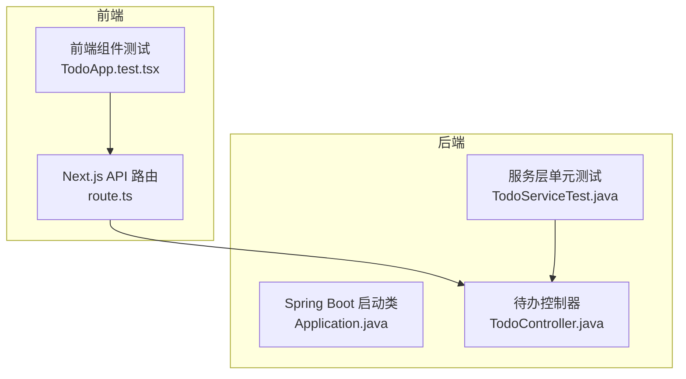
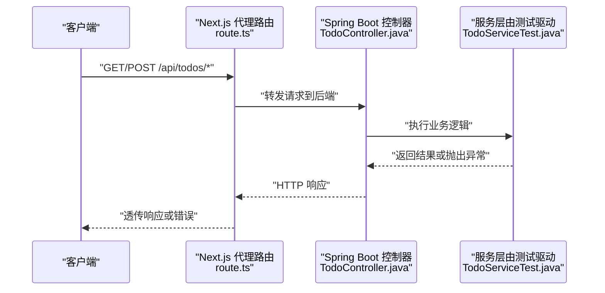
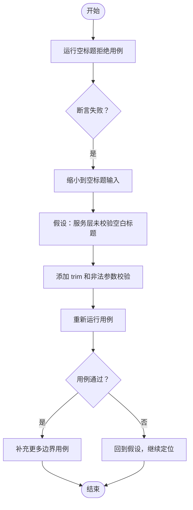
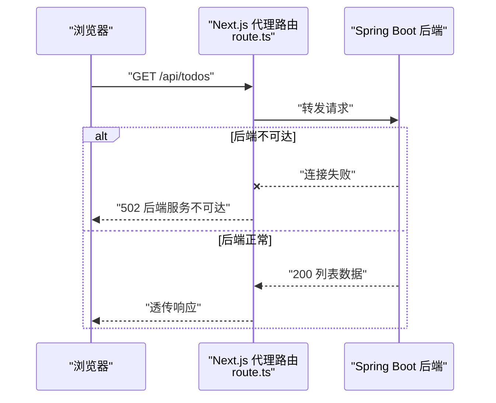
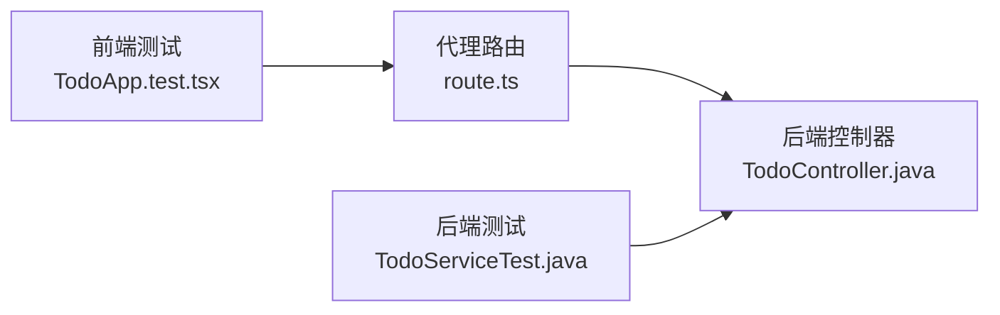
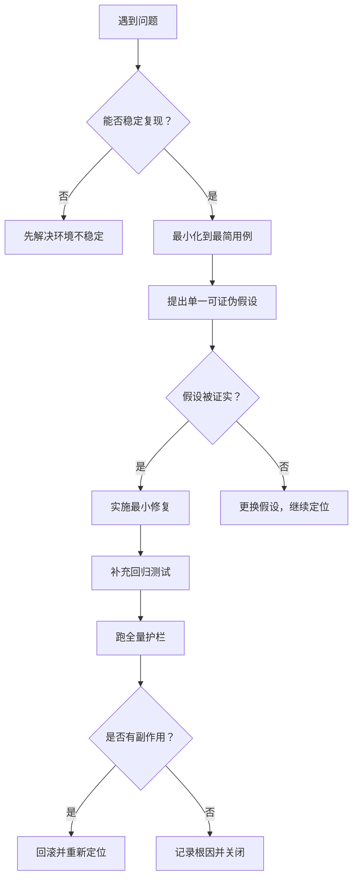

# 系统化调试技能

<cite>
**本文引用的文件**   
- [systematic-debugging SKILL.md](file://.agents\skills\systematic-debugging\SKILL.md)
- [Application.java](file://backend\src\main\java\com\luyi\myfirst\Application.java)
- [TodoController.java](file://backend\src\main\java\com\luyi\myfirst\web\TodoController.java)
- [TodoServiceTest.java](file://backend\src\test\java\com\luyi\myfirst\domain\TodoServiceTest.java)
- [route.ts](file://frontend\app\api\[...path]\route.ts)
- [TodoApp.test.tsx](file://frontend\components\TodoApp.test.tsx)
</cite>

## 目录
1. [引言](#引言)
2. [项目结构](#项目结构)
3. [核心组件](#核心组件)
4. [架构总览](#架构总览)
5. [详细组件分析](#详细组件分析)
6. [依赖关系分析](#依赖关系分析)
7. [性能与稳定性考虑](#性能与稳定性考虑)
8. [故障排查指南](#故障排查指南)
9. [结论](#结论)
10. [附录：OpenSpec change 记录模板](#附录openspec-change-记录模板)

## 引言
本文件面向实际工程中的问题排查，目标是把「系统化调试」从经验变成可复用的流程。文档围绕四阶段根因法展开：复现、最小化、定位根因、验证修复；并明确触发条件、核心纪律「猜测即失败」、反模式清单、产出物要求，以及如何在 OpenSpec change 中记录根因。

## 项目结构
本项目包含后端 Spring Boot 应用、前端 Next.js 代理路由和测试用例，适合演示从接口异常到单元测试失败的完整排障路径。

**图表来源**
- [route.ts:1-77](file://frontend\app\api\[...path]\route.ts#L1-L77)
- [TodoApp.test.tsx:1-81](file://frontend\components\TodoApp.test.tsx#L1-L81)
- [Application.java:1-13](file://backend\src\main\java\com\luyi\myfirst\Application.java#L1-L13)
- [TodoController.java:1-45](file://backend\src\main\java\com\luyi\myfirst\web\TodoController.java#L1-L45)
- [TodoServiceTest.java:1-64](file://backend\src\test\java\com\luyi\myfirst\domain\TodoServiceTest.java#L1-L64)

**章节来源**
- [systematic-debugging SKILL.md:1-65](file://.agents\skills\systematic-debugging\SKILL.md#L1-L65)

## 核心组件
- 系统化调试技能定义：明确何时触发、四阶段步骤、核心纪律、反模式和收尾要求。
- 后端入口与接口：Spring Boot 启动类与待办控制器暴露 REST 接口。
- 后端单元测试：覆盖创建、完成、空标题拒绝、未知 id 报错等场景。
- 前端代理路由：将前端请求转发到后端，并在不可达时返回统一错误响应。
- 前端组件测试：模拟网络调用，断言渲染、交互和错误展示。

**章节来源**
- [systematic-debugging SKILL.md:8-65](file://.agents\skills\systematic-debugging\SKILL.md#L8-L65)
- [Application.java:6-11](file://backend\src\main\java\com\luyi\myfirst\Application.java#L6-L11)
- [TodoController.java:16-44](file://backend\src\main\java\com\luyi\myfirst\web\TodoController.java#L16-L44)
- [TodoServiceTest.java:15-62](file://backend\src\test\java\com\luyi\myfirst\domain\TodoServiceTest.java#L15-L62)
- [route.ts:10-53](file://frontend\app\api\[...path]\route.ts#L10-L53)
- [TodoApp.test.tsx:23-79](file://frontend\components\TodoApp.test.tsx#L23-L79)

## 架构总览
下图展示了典型请求链路：前端发起请求，经过 Next.js 代理路由转发到后端控制器，再由服务层处理业务逻辑。

**图表来源**
- [route.ts:10-53](file://frontend\app\api\[...path]\route.ts#L10-L53)
- [TodoController.java:26-40](file://backend\src\main\java\com\luyi\myfirst\web\TodoController.java#L26-L40)
- [TodoServiceTest.java:15-62](file://backend\src\test\java\com\luyi\myfirst\domain\TodoServiceTest.java#L15-L62)

## 详细组件分析

### 四阶段根因法：复现（Reproduce）
目标：用最短命令稳定复现问题，保留完整错误输出。

- 触发条件
  - 测试失败：例如后端单元测试断言不通过。
  - 启动报错：Spring Boot 无法启动。
  - 接口异常：前端代理返回 502 或后端返回非预期状态码。
- 操作步骤
  - 找到最短复现路径：一条命令、一个测试用例、一个请求。
  - 记录完整堆栈和响应体，不要截断。
  - 连续运行三次确认稳定。
  - 若不可复现，先解决环境不稳定问题，再进入下一步。
- 产出
  - 一句可粘贴的复现命令 + 完整报错。

示例映射
- 后端单元测试失败：使用 `TodoServiceTest` 中的用例作为最小复现。
- 接口异常：通过 `route.ts` 的代理路由访问 `/api/todos`，观察 502 或业务错误。
- 启动报错：检查 `Application.java` 的启动入口。

**章节来源**
- [systematic-debugging SKILL.md:18-25](file://.agents\skills\systematic-debugging\SKILL.md#L18-L25)
- [TodoServiceTest.java:15-62](file://backend\src\test\java\com\luyi\myfirst\domain\TodoServiceTest.java#L15-L62)
- [route.ts:30-41](file://frontend\app\api\[...path]\route.ts#L30-L41)
- [Application.java:9-11](file://backend\src\main\java\com\luyi\myfirst\Application.java#L9-L11)

### 四阶段根因法：最小化（Minimize）
目标：剥离无关代码，得到最小复现集合，优先验证边界。

- 操作步骤
  - 逐步删除无关配置、日志、分支。
  - 优先验证空值、零、负数、超长、并发、编码等边界。
  - 对比工作版本与故障版本的差异，差异点即为嫌疑范围。
- 产出
  - 一份最小复现用例，能独立运行并稳定失败。

示例映射
- 针对“空标题必须被拒绝”的用例，直接聚焦参数校验逻辑。
- 针对“未知 id 报错”，只构造不存在 id 的请求。

**章节来源**
- [systematic-debugging SKILL.md:27-33](file://.agents\skills\systematic-debugging\SKILL.md#L27-L33)
- [TodoServiceTest.java:25-31](file://backend\src\test\java\com\luyi\myfirst\domain\TodoServiceTest.java#L25-L31)
- [TodoServiceTest.java:45-51](file://backend\src\test\java\com\luyi\myfirst\domain\TodoServiceTest.java#L45-L51)

### 四阶段根因法：定位根因（Root Cause）
目标：提出一个可证伪假设，用证据验证，而不是盲目打补丁。

- 操作步骤
  - 提出单一假设，例如“问题在 X 层，因为 Y 条件不满足”。
  - 用日志、断点或一次性打印验证，验证后立即删除临时输出。
  - 假设被证伪就换下一个，不要在证伪后继续叠加改动。
  - 追问三次“为什么”，直到到达不再需要解释的层次。
- 判据
  - 能说清“改这里为什么必须让现象消失”，而不是“改了之后好像好了”。

示例映射
- 如果前端代理返回“后端服务不可达”，先确认后端是否启动、端口是否正确。
- 如果后端抛出非法参数异常，先确认输入是否被正确 trim 和校验。

**章节来源**
- [systematic-debugging SKILL.md:35-43](file://.agents\skills\systematic-debugging\SKILL.md#L35-L43)
- [route.ts:30-41](file://frontend\app\api\[...path]\route.ts#L30-L41)
- [TodoController.java:31-40](file://backend\src\main\java\com\luyi\myfirst\web\TodoController.java#L31-L40)

### 四阶段根因法：验证修复（Verify Fix）
目标：确保原复现由红转绿，补充回归测试，跑全量护栏，检查副作用。

- 操作步骤
  - 原复现命令必须由红转绿。
  - 为 bug 补一个回归测试，且先在修复前确认失败。
  - 跑全量护栏：`powershell -File harness\run-all.ps1`。
  - 检查相邻功能、边界输入是否引入副作用。
- 产出
  - 回归测试通过 + 全量护栏通过 + 无副作用。

示例映射
- 新增“空标题拒绝”的回归用例，确保该行为长期受保护。
- 对“未知 id 报错”增加边界用例，避免后续重构破坏。

**章节来源**
- [systematic-debugging SKILL.md:44-50](file://.agents\skills\systematic-debugging\SKILL.md#L44-L50)
- [TodoServiceTest.java:25-31](file://backend\src\test\java\com\luyi\myfirst\domain\TodoServiceTest.java#L25-L31)
- [TodoServiceTest.java:45-51](file://backend\src\test\java\com\luyi\myfirst\domain\TodoServiceTest.java#L45-L51)

### 核心纪律：猜测即失败
含义
- 没有证据的改动一律视为噪声，即使它刚好让测试变绿。
- 任何“试一下”“重启一下就好了”都必须被解释清楚，否则不算修复。

实践方法
- 每次改动前先写假设和验证方式。
- 一次只改一处，便于归因。
- 临时日志、打印、注释掉断言的行为必须在验证后立即清理。
- 如果现象消失但原因未明，退回上一步重新最小化和定位。

**章节来源**
- [systematic-debugging SKILL.md:14-16](file://.agents\skills\systematic-debugging\SKILL.md#L14-L16)

### 反模式清单
| 反模式 | 为什么有害 | 如何避免 |
|---|---|---|
| 加 try-catch 把异常吞掉 | 现象消失，根因留下 | 捕获后记录上下文并向上抛出，或转换为明确的业务错误 |
| 调大超时 / 重试次数 | 掩盖竞态，压力下必然复发 | 先定位慢在哪里，优化实现或资源，再考虑合理超时 |
| 注释掉失败的断言 | 护栏被拆，等于没写测试 | 先理解失败原因，修复后再恢复断言 |
| 一次改五处 | 即使修好也说不清哪处生效 | 单点修改，逐次验证 |
| 「重启一下就好了」 | 未解释的状态残留 | 记录状态初始化、缓存、连接池等潜在残留点 |

**章节来源**
- [systematic-debugging SKILL.md:51-60](file://.agents\skills\systematic-debugging\SKILL.md#L51-L60)

### 实际项目中的应用示例

#### 场景一：测试失败——空标题未被拒绝
- 触发条件：`TodoServiceTest` 中“空标题必须被拒绝”用例失败。
- 复现：运行对应测试用例，观察断言失败信息。
- 最小化：仅保留空标题输入和断言。
- 定位根因：检查服务层是否对空白字符串进行 trim 和校验。
- 验证修复：用例由红转绿，并补充更多边界输入。

**图表来源**
- [TodoServiceTest.java:25-31](file://backend\src\test\java\com\luyi\myfirst\domain\TodoServiceTest.java#L25-L31)

**章节来源**
- [TodoServiceTest.java:25-31](file://backend\src\test\java\com\luyi\myfirst\domain\TodoServiceTest.java#L25-L31)

#### 场景二：接口异常——前端代理返回 502
- 触发条件：前端调用 `/api/todos` 返回“后端服务不可达”。
- 复现：通过浏览器或 curl 访问代理路由，观察 502 响应。
- 最小化：固定后端地址，构造最简 GET 请求。
- 定位根因：检查后端是否启动、端口是否为 8989、环境变量 `BACKEND_URL` 是否正确。
- 验证修复：代理路由成功转发，后端返回正常响应。

**图表来源**
- [route.ts:10-53](file://frontend\app\api\[...path]\route.ts#L10-L53)

**章节来源**
- [route.ts:1-6](file://frontend\app\api\[...path]\route.ts#L1-L6)
- [route.ts:30-41](file://frontend\app\api\[...path]\route.ts#L30-L41)

#### 场景三：启动报错——Spring Boot 无法启动
- 触发条件：运行 `Application.java` 主方法时报错。
- 复现：直接执行启动命令，保留完整堆栈。
- 最小化：关闭非必要自动配置，缩小到最小启动上下文。
- 定位根因：检查配置文件、数据库连接、端口冲突等。
- 验证修复：启动成功，健康检查通过。

**章节来源**
- [Application.java:6-11](file://backend\src\main\java\com\luyi\myfirst\Application.java#L6-L11)

#### 场景四：前端交互失败——完成按钮未更新状态
- 触发条件：点击完成按钮后 UI 未显示“已完成”。
- 复现：运行 `TodoApp.test.tsx` 中相关用例。
- 最小化：只保留完成交互和断言。
- 定位根因：检查 mock 返回值、UI 渲染逻辑、错误提示。
- 验证修复：用例通过，且错误场景也能展示 alert。

**章节来源**
- [TodoApp.test.tsx:54-79](file://frontend\components\TodoApp.test.tsx#L54-L79)

## 依赖关系分析
- 前端代理路由依赖后端地址配置，并在不可达时返回统一错误。
- 后端控制器依赖服务层，服务层由单元测试驱动设计。
- 前端组件测试依赖 mocked API，用于隔离网络不确定性。

**图表来源**
- [TodoApp.test.tsx:1-81](file://frontend\components\TodoApp.test.tsx#L1-L81)
- [route.ts:1-77](file://frontend\app\api\[...path]\route.ts#L1-L77)
- [TodoController.java:1-45](file://backend\src\main\java\com\luyi\myfirst\web\TodoController.java#L1-L45)
- [TodoServiceTest.java:1-64](file://backend\src\test\java\com\luyi\myfirst\domain\TodoServiceTest.java#L1-L64)

**章节来源**
- [TodoApp.test.tsx:1-81](file://frontend\components\TodoApp.test.tsx#L1-L81)
- [route.ts:1-77](file://frontend\app\api\[...path]\route.ts#L1-L77)
- [TodoController.java:1-45](file://backend\src\main\java\com\luyi\myfirst\web\TodoController.java#L1-L45)
- [TodoServiceTest.java:1-64](file://backend\src\test\java\com\luyi\myfirst\domain\TodoServiceTest.java#L1-L64)

## 性能与稳定性考虑
- 不要通过调大超时或重试次数来掩盖底层问题。
- 代理路由应保留清晰的错误响应，便于前端展示和用户反馈。
- 单元测试应覆盖边界和异常路径，避免只在“快乐路径”下通过。

[本节为通用指导，不直接分析具体文件]

## 故障排查指南

### 快速决策树

### 常见症状与定位要点
- 测试失败：优先看断言消息和堆栈，确认输入是否符合预期。
- 启动报错：查看完整堆栈，关注端口、配置、依赖注入。
- 接口异常：区分网络层错误和业务层错误，检查代理路由和后端日志。
- UI 不更新：检查 mock 数据、事件绑定、状态更新逻辑。

**章节来源**
- [systematic-debugging SKILL.md:8-65](file://.agents\skills\systematic-debugging\SKILL.md#L8-L65)

## 结论
系统化调试不是“试错”，而是以证据驱动的推理过程。坚持四阶段根因法和「猜测即失败」的核心纪律，配合最小化、回归测试和全量护栏，才能把偶发问题变成可防御的系统能力。

[本节为总结性内容，不直接分析具体文件]

## 附录：OpenSpec change 记录模板
问题解决后，在对应的 OpenSpec change 里记录以下信息：
- 根因：一句话说明根本原因。
- 影响面：受影响的功能、接口、用户场景。
- 回归测试位置：指向新增或修改的测试用例。
- 复现命令：可粘贴的最小复现命令或请求。
- 修复要点：简要说明关键改动，避免模糊描述。

示例字段
- 根因：服务层未对空白标题进行 trim 和校验。
- 影响面：创建待办接口、前端表单提交。
- 回归测试位置：`TodoServiceTest` 中空标题拒绝用例。
- 复现命令：运行对应单元测试用例。
- 修复要点：在服务层增加空白标题校验，抛出非法参数异常。

**章节来源**
- [systematic-debugging SKILL.md:61-65](file://.agents\skills\systematic-debugging\SKILL.md#L61-L65)