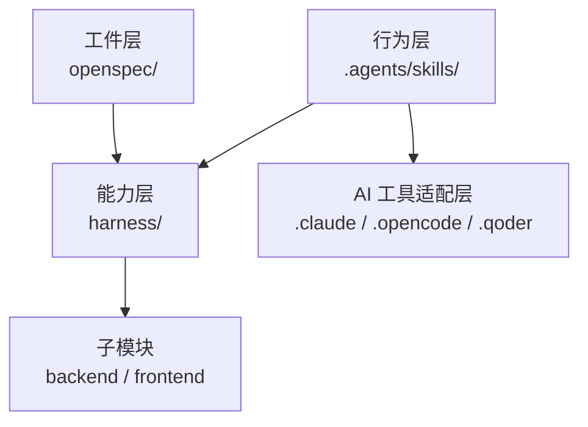
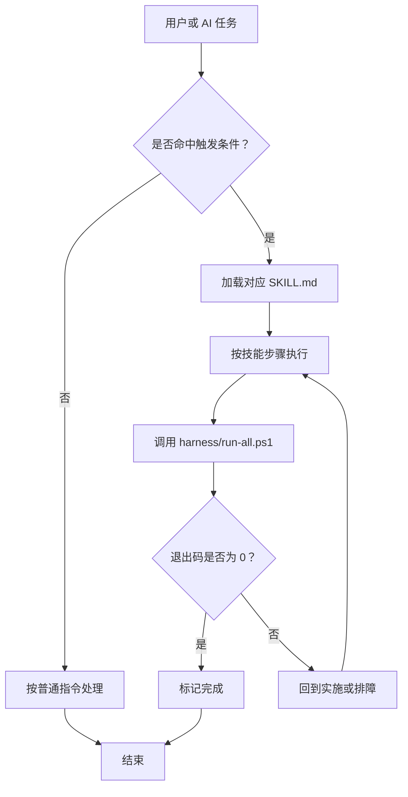
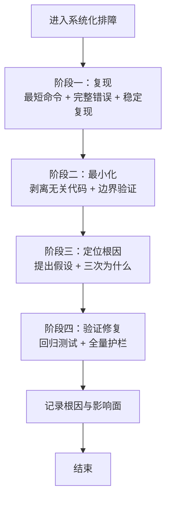
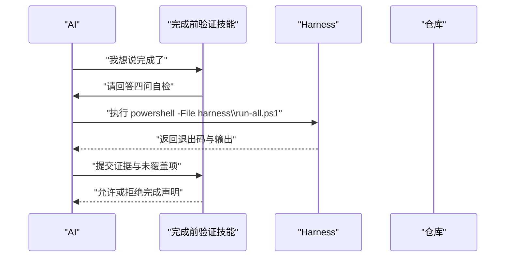
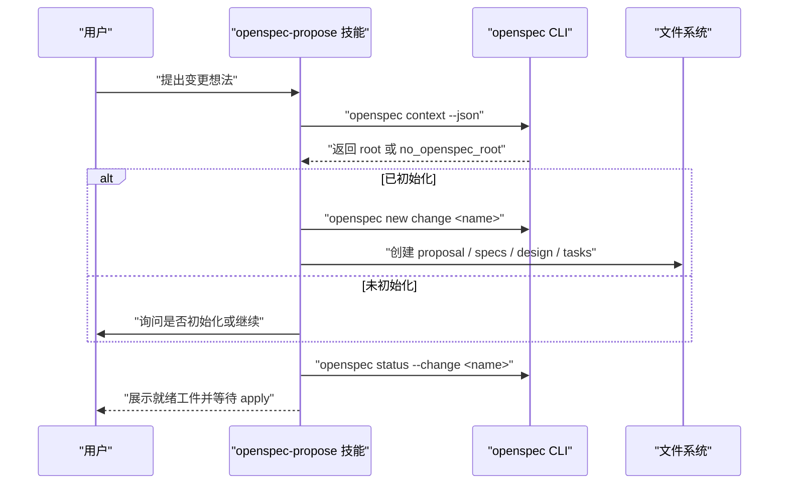
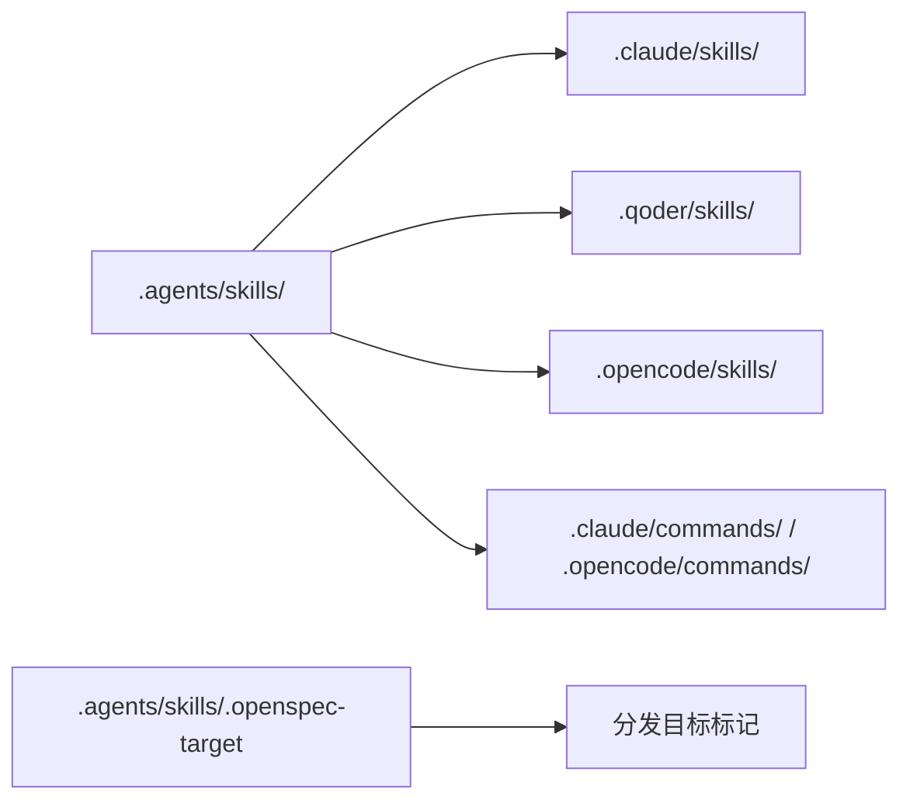
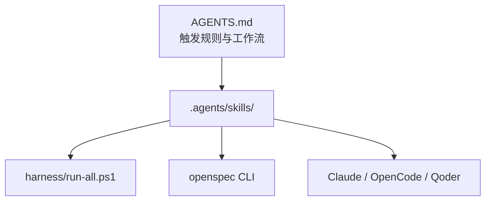

# 技能概念与架构

<cite>
**本文引用的文件**   
- [AGENTS.md](file://AGENTS.md)
- [.agents/skills/systematic-debugging/SKILL.md](file://.agents/skills/systematic-debugging/SKILL.md)
- [.agents/skills/verification-before-completion/SKILL.md](file://.agents/skills/verification-before-completion/SKILL.md)
- [.agents/skills/openspec-propose/SKILL.md](file://.agents/skills/openspec-propose/SKILL.md)
- [.agents/skills/.openspec-target](file://.agents/skills/.openspec-target)
- [.claude/skills/systematic-debugging/SKILL.md](file://.claude/skills/systematic-debugging/SKILL.md)
- [.opencode/commands/opsx/apply.md](file://.opencode/commands/opsx/apply.md)
</cite>

## 目录
1. [引言](#引言)
2. [项目结构中的技能定位](#项目结构中的技能定位)
3. [核心组件](#核心组件)
4. [架构总览](#架构总览)
5. [详细组件分析](#详细组件分析)
6. [依赖关系分析](#依赖关系分析)
7. [性能与可维护性考虑](#性能与可维护性考虑)
8. [故障排查指南](#故障排查指南)
9. [结论](#结论)
10. [附录：技能设计原则与最佳实践](#附录技能设计原则与最佳实践)

## 引言
本文件面向「AI 技能系统」的基础概念，解释什么是技能、它在整体架构中的作用、触发机制、执行流程、生命周期管理、标准文件结构，以及与 Claude、OpenCode 等 AI 工具的集成方式。

在这个仓库中，技能不是“建议”，而是行为层契约：它把固化的最佳实践和“怎么做才对”的决策规则交给 AI，让 AI 在不确定时知道该遵循哪条路径，而不是靠猜测或临时发挥。

## 项目结构中的技能定位
仓库采用三层分工：工件层（规格）、能力层（自动化验证 Harness）、行为层（技能）。技能位于 `.agents/skills/`，是 AI 行为的“操作手册”。

**图示来源**
- [AGENTS.md:16-26](file://AGENTS.md#L16-L26)
- [AGENTS.md:113-118](file://AGENTS.md#L113-L118)

**章节来源**
- [AGENTS.md:16-26](file://AGENTS.md#L16-L26)
- [AGENTS.md:113-118](file://AGENTS.md#L113-L118)

## 核心组件
- **系统化排障技能**：当测试失败、报错或行为异常时，强制使用四阶段根因法，禁止先改代码。
- **完成前验证技能**：在宣布完成前，强制收集命令输出和退出码作为证据。
- **OpenSpec 提议技能**：用于创建变更规划工件，包括 proposal、specs、design、tasks。
- **分发目标标记**：`.openspec-target` 表示技能真源的目标分发位置。

这些技能共同解决“AI 不知道怎么做才对”的问题：它们把经验沉淀为可执行的步骤，并把“跳过检查”视为流程违规。

**章节来源**
- [.agents/skills/systematic-debugging/SKILL.md:1-6](file://.agents/skills/systematic-debugging/SKILL.md#L1-L6)
- [.agents/skills/verification-before-completion/SKILL.md:1-6](file://.agents/skills/verification-before-completion/SKILL.md#L1-L6)
- [.agents/skills/openspec-propose/SKILL.md:1-11](file://.agents/skills/openspec-propose/SKILL.md#L1-L11)
- [.agents/skills/.openspec-target:1-2](file://.agents/skills/.openspec-target#L1-L2)

## 架构总览
技能系统由三个关键部分组成：

1. **技能真源**：位于 `.agents/skills/`，是唯一的编写入口。
2. **工具适配层**：Claude、OpenCode、Qoder 等工具通过各自目录下的 skills 或 commands 获得相同的行为约束。
3. **自动化验证层**：Harness 提供硬性验收；技能保证 AI 主动请求验收。

**图示来源**
- [AGENTS.md:60-70](file://AGENTS.md#L60-L70)
- [.agents/skills/verification-before-completion/SKILL.md:29-35](file://.agents/skills/verification-before-completion/SKILL.md#L29-L35)

**章节来源**
- [AGENTS.md:60-70](file://AGENTS.md#L60-L70)
- [.agents/skills/verification-before-completion/SKILL.md:29-35](file://.agents/skills/verification-before-completion/SKILL.md#L29-L35)

## 详细组件分析

### 系统化排障技能
系统化排障技能定义了一个不可跳过的排错流程：复现、最小化、定位根因、验证修复。它的核心纪律是“猜测即失败”，任何没有证据的改动都视为噪声。

**图示来源**
- [.agents/skills/systematic-debugging/SKILL.md:8-63](file://.agents/skills/systematic-debugging/SKILL.md#L8-L63)

**章节来源**
- [.agents/skills/systematic-debugging/SKILL.md:8-63](file://.agents/skills/systematic-debugging/SKILL.md#L8-L63)

### 完成前验证技能
完成前验证技能要求 AI 在宣布完成前回答四个问题：实际执行了什么命令、退出码是多少、输出证明了什么、有没有未覆盖路径。它明确区分“看起来对”和“有证据”。

**图示来源**
- [.agents/skills/verification-before-completion/SKILL.md:20-35](file://.agents/skills/verification-before-completion/SKILL.md#L20-L35)
- [.agents/skills/verification-before-completion/SKILL.md:55-67](file://.agents/skills/verification-before-completion/SKILL.md#L55-L67)

**章节来源**
- [.agents/skills/verification-before-completion/SKILL.md:20-35](file://.agents/skills/verification-before-completion/SKILL.md#L20-L35)
- [.agents/skills/verification-before-completion/SKILL.md:55-67](file://.agents/skills/verification-before-completion/SKILL.md#L55-L67)

### OpenSpec 提议技能
OpenSpec 提议技能负责在规划边界内生成变更工件，包括 proposal、specs、design、tasks。它强调“规划不等于实现”，并在首次写入前检查项目是否已初始化 OpenSpec。

**图示来源**
- [.agents/skills/openspec-propose/SKILL.md:13-25](file://.agents/skills/openspec-propose/SKILL.md#L13-L25)
- [.agents/skills/openspec-propose/SKILL.md:31-40](file://.agents/skills/openspec-propose/SKILL.md#L31-L40)
- [.agents/skills/openspec-propose/SKILL.md:92-148](file://.agents/skills/openspec-propose/SKILL.md#L92-L148)

**章节来源**
- [.agents/skills/openspec-propose/SKILL.md:13-25](file://.agents/skills/openspec-propose/SKILL.md#L13-L25)
- [.agents/skills/openspec-propose/SKILL.md:31-40](file://.agents/skills/openspec-propose/SKILL.md#L31-L40)
- [.agents/skills/openspec-propose/SKILL.md:92-148](file://.agents/skills/openspec-propose/SKILL.md#L92-L148)

### 技能文件标准结构
每个技能以 `SKILL.md` 形式存在，头部包含 YAML 元数据，正文使用 Markdown 描述触发条件、执行步骤、反模式和收尾要求。

典型头部字段：
- `name`：技能标识名。
- `description`：技能用途与触发语义。
- `allowed-tools`：允许调用的外部工具或命令集合。
- `license`：许可证。
- `compatibility`：运行前提，例如是否需要 openspec CLI。
- `metadata`：作者、版本、生成器等扩展信息。

正文通常包括：
- 何时触发
- 核心纪律
- 分阶段执行流程
- 产出物
- 反模式
- 收尾要求

**章节来源**
- [.agents/skills/systematic-debugging/SKILL.md:1-6](file://.agents/skills/systematic-debugging/SKILL.md#L1-L6)
- [.agents/skills/verification-before-completion/SKILL.md:1-6](file://.agents/skills/verification-before-completion/SKILL.md#L1-L6)
- [.agents/skills/openspec-propose/SKILL.md:1-11](file://.agents/skills/openspec-propose/SKILL.md#L1-L11)

### 技能分发与工具集成
技能真源位于 `.agents/skills/`，并通过分发机制同步到各 AI 工具适配层。Claude 和 OpenCode 等工具通过自身目录下的 skills 或 commands 获得相同内容，从而避免不同 agent 读到不一致的规则。

**图示来源**
- [AGENTS.md:113-118](file://AGENTS.md#L113-L118)
- [.agents/skills/.openspec-target:1-2](file://.agents/skills/.openspec-target#L1-L2)

**章节来源**
- [AGENTS.md:113-118](file://AGENTS.md#L113-L118)
- [.agents/skills/.openspec-target:1-2](file://.agents/skills/.openspec-target#L1-L2)

## 依赖关系分析
技能系统与仓库其他部分的依赖关系如下：

- 技能依赖 AGENTS.md 中的触发规则与工作流约定。
- 技能在执行阶段可能调用 Harness 脚本进行编译、测试、静态检查。
- OpenSpec 相关技能依赖 openspec CLI 及其配置。
- 分发机制依赖 `.agents/skills/` 作为唯一真源，确保多工具一致性。

**图示来源**
- [AGENTS.md:60-70](file://AGENTS.md#L60-L70)
- [.agents/skills/openspec-propose/SKILL.md:1-11](file://.agents/skills/openspec-propose/SKILL.md#L1-L11)

**章节来源**
- [AGENTS.md:60-70](file://AGENTS.md#L60-L70)
- [.agents/skills/openspec-propose/SKILL.md:1-11](file://.agents/skills/openspec-propose/SKILL.md#L1-L11)

## 性能与可维护性考虑
- **技能粒度**：每个技能聚焦一个明确场景，避免单文件承载过多职责。
- **触发成本**：触发规则应简单明确，减少误触发和上下文污染。
- **执行边界**：技能不应替代 Harness；它引导 AI 正确调用 Harness，而不是绕过验证。
- **分发一致性**：真源唯一，副本仅同步，降低多工具环境下的漂移风险。
- **文档可读性**：YAML 头部提供机器可读元数据，Markdown 正文提供人类可读流程。

[本节为通用指导，不直接分析具体文件]

## 故障排查指南
当技能无法触发或行为异常时，可按以下顺序排查：

1. **确认触发条件**：是否属于测试失败、报错、异常行为，或准备宣布完成。
2. **检查技能真源**：`.agents/skills/` 下是否存在对应技能的 `SKILL.md`。
3. **检查分发副本**：Claude、OpenCode 等工具目录下是否有对应副本。
4. **检查命令与退出码**：完成前验证必须依赖真实命令输出和退出码。
5. **检查 OpenSpec 环境**：OpenSpec 技能需要 CLI 可用且项目已初始化。

**章节来源**
- [.agents/skills/systematic-debugging/SKILL.md:8-16](file://.agents/skills/systematic-debugging/SKILL.md#L8-L16)
- [.agents/skills/verification-before-completion/SKILL.md:14-35](file://.agents/skills/verification-before-completion/SKILL.md#L14-L35)
- [.agents/skills/openspec-propose/SKILL.md:31-40](file://.agents/skills/openspec-propose/SKILL.md#L31-L40)

## 结论
技能系统是 AI 行为层的固化契约。它把“怎么做才对”从模糊建议变成可执行流程，并与规格驱动开发和自动化验证协同工作。通过明确的触发机制、分阶段执行流程和统一的分发模型，技能让 AI 在不确定时仍能做出符合仓库约定的决策。

[本节为总结性内容，不直接分析具体文件]

## 附录：技能设计原则与最佳实践
- **明确触发**：每个技能应有清晰的“何时使用”说明。
- **强制纪律**：用不可跳过的步骤替代“建议”。
- **证据优先**：完成声明必须附带命令、退出码和输出。
- **单一职责**：一个技能只解决一个问题域。
- **可验证**：技能最终应能落到 Harness 或可重复的命令。
- **可分发**：真源唯一，副本同步，避免多工具差异。
- **可审计**：变更记录、根因说明、回归测试位置应可追溯。

[本节为通用指导，不直接分析具体文件]