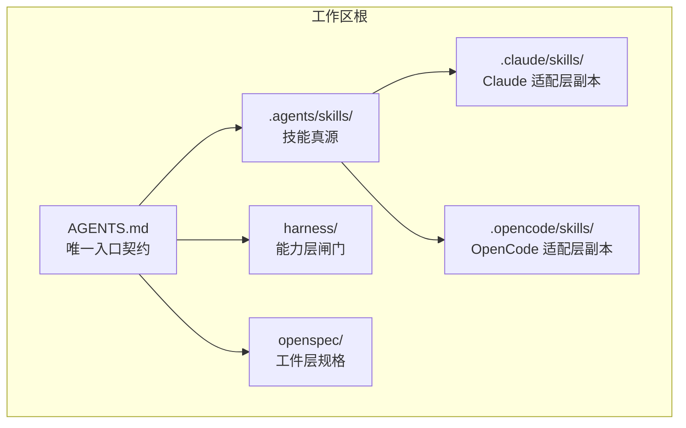
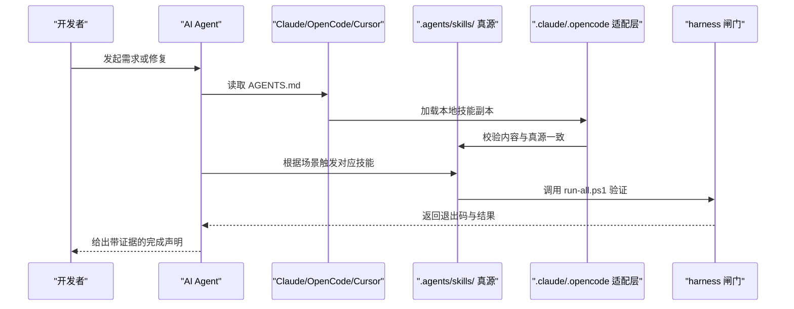
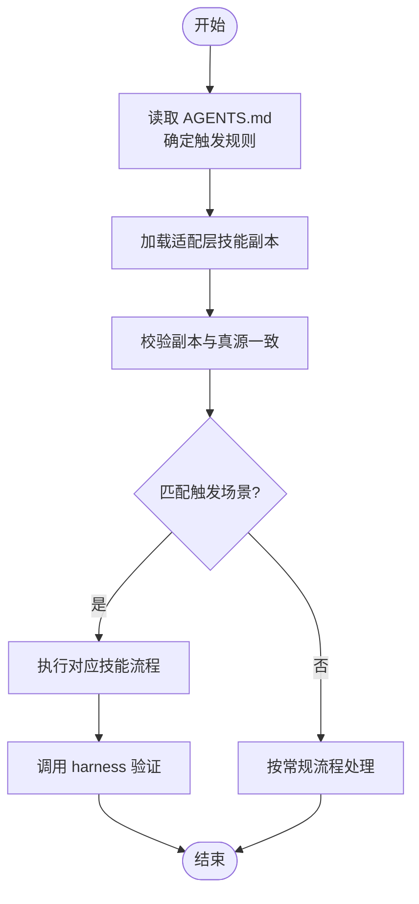
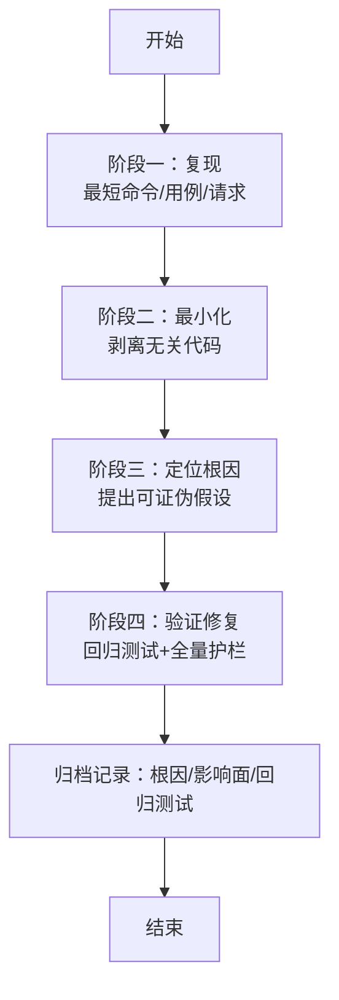
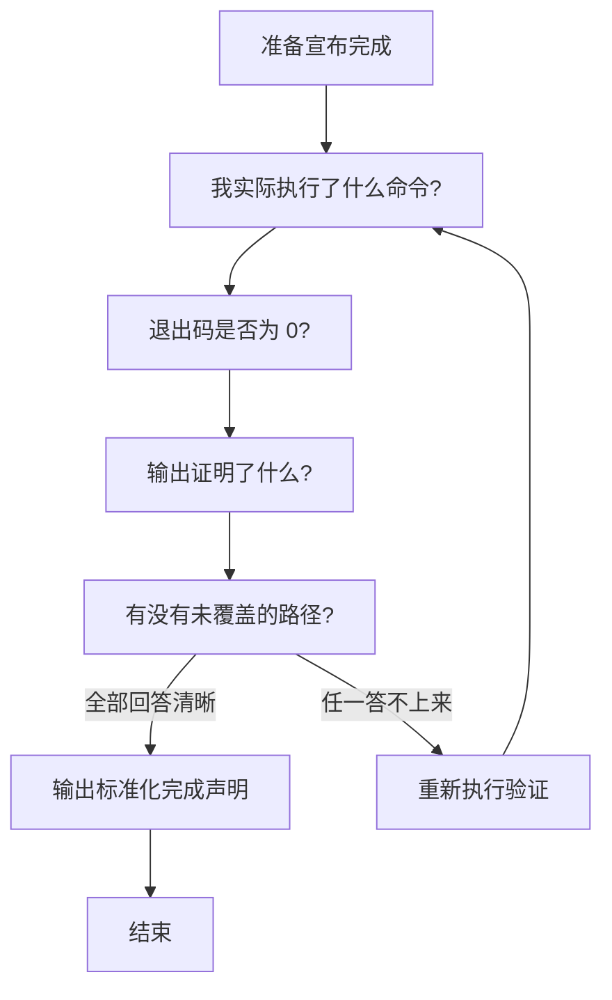
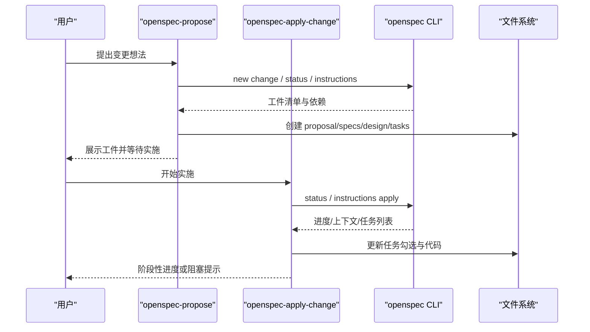
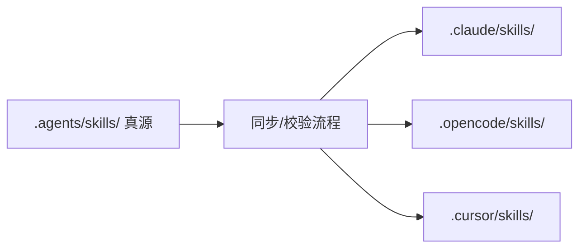
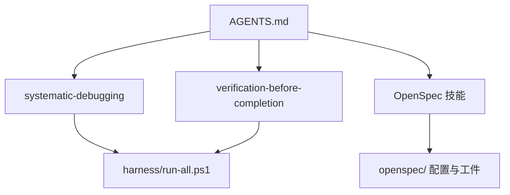

# 技能集成与配置

<cite>
**本文引用的文件**   
- [AGENTS.md](file://AGENTS.md)
- [.agents/skills/systematic-debugging/SKILL.md](file://.agents/skills/systematic-debugging/SKILL.md)
- [.agents/skills/verification-before-completion/SKILL.md](file://.agents/skills/verification-before-completion/SKILL.md)
- [.agents/skills/openspec-apply-change/SKILL.md](file://.agents/skills/openspec-apply-change/SKILL.md)
- [.agents/skills/openspec-propose/SKILL.md](file://.agents/skills/openspec-propose/SKILL.md)
- [.claude/skills/systematic-debugging/SKILL.md](file://.claude/skills/systematic-debugging/SKILL.md)
- [.opencode/skills/systematic-debugging/SKILL.md](file://.opencode/skills/systematic-debugging/SKILL.md)
</cite>

## 目录
1. [引言](#引言)
2. [项目结构](#项目结构)
3. [核心组件](#核心组件)
4. [架构总览](#架构总览)
5. [详细组件分析](#详细组件分析)
6. [依赖关系分析](#依赖关系分析)
7. [性能考虑](#性能考虑)
8. [故障排查指南](#故障排查指南)
9. [结论](#结论)
10. [附录](#附录)

## 引言
本文件面向“技能集成配置”，聚焦如何将技能（Skills）以统一、可审计的方式集成到 Claude Code、OpenCode、Cursor 等主流 AI 工具中，并说明技能加载机制、优先级规则、冲突解决策略、团队协作中的共享与管理方案，以及性能优化、监控日志与常见问题排查。本项目采用“真源 + 多适配层副本”的技能分发模式：自研技能在 `.agents/skills/` 下维护唯一真源，再同步到 `.claude/skills/`、`.qoder/skills/`、`.opencode/skills/` 等适配层，确保不同工具获得一致的行为约束与流程规范。

## 项目结构
仓库将“AI 编码如何被约束”沉淀为三层骨架：工件层（规格）、能力层（闸门 Harness）、行为层（技能 Skills）。技能是行为层的核心载体，既定义触发条件，也规定执行纪律与验收标准。

**图示来源**
- [AGENTS.md:16-26](file://AGENTS.md#L16-L26)
- [AGENTS.md:114-119](file://AGENTS.md#L114-L119)

**章节来源**
- [AGENTS.md:16-26](file://AGENTS.md#L16-L26)
- [AGENTS.md:114-119](file://AGENTS.md#L114-L119)

## 核心组件
- 行为层技能
  - 系统化排障（systematic-debugging）：四阶段根因法，禁止猜测式修改。
  - 先证后宣布（verification-before-completion）：完成前必须提供命令输出与退出码证据。
- OpenSpec 技能
  - openspec-propose：生成变更规划工件（proposal/specs/design/tasks）。
  - openspec-apply-change：按任务推进实现，状态机驱动（blocked/ready/all_done）。
- 适配层副本
  - .claude/skills、.opencode/skills 等目录下的同名 SKILL.md 为真源的逐字节副本，保证各工具一致性。

**章节来源**
- [.agents/skills/systematic-debugging/SKILL.md:1-65](file://.agents/skills/systematic-debugging/SKILL.md#L1-L65)
- [.agents/skills/verification-before-completion/SKILL.md:1-70](file://.agents/skills/verification-before-completion/SKILL.md#L1-L70)
- [.agents/skills/openspec-propose/SKILL.md:1-176](file://.agents/skills/openspec-propose/SKILL.md#L1-L176)
- [.agents/skills/openspec-apply-change/SKILL.md:1-207](file://.agents/skills/openspec-apply-change/SKILL.md#L1-L207)

## 架构总览
技能集成的总体思路是“单一真源 + 多工具适配层”。AGENTS.md 作为唯一入口契约，强制 agent 进入仓库后先阅读该文件；技能则通过 `.agents/skills/` 编写，再由构建或同步流程分发到各工具的 `.skills/` 目录。

**图示来源**
- [AGENTS.md:60-70](file://AGENTS.md#L60-L70)
- [AGENTS.md:114-119](file://AGENTS.md#L114-L119)
- [.agents/skills/systematic-debugging/SKILL.md:44-49](file://.agents/skills/systematic-debugging/SKILL.md#L44-L49)
- [.agents/skills/verification-before-completion/SKILL.md:29-43](file://.agents/skills/verification-before-completion/SKILL.md#L29-L43)

## 详细组件分析

### 技能加载机制与优先级
- 真源优先：所有自研技能的权威版本位于 `.agents/skills/`，修订顺序固定为“先改真源 → 再同步三处副本”，禁止直接编辑副本。
- 工具侧加载：Claude、OpenCode、Cursor 等工具从各自 `.skills/` 目录加载 SKILL.md；这些副本应与真源逐字节一致。
- 触发优先级：AGENTS.md 定义了“技能触发规则”，例如测试失败强制使用 systematic-debugging，宣称完成前强制使用 verification-before-completion。

**图示来源**
- [AGENTS.md:60-70](file://AGENTS.md#L60-L70)
- [AGENTS.md:114-119](file://AGENTS.md#L114-L119)

**章节来源**
- [AGENTS.md:60-70](file://AGENTS.md#L60-L70)
- [AGENTS.md:114-119](file://AGENTS.md#L114-L119)

### 系统化排障技能（systematic-debugging）
- 触发时机：测试失败、启动报错、接口异常、反复修不好。
- 四阶段：复现 → 最小化 → 定位根因 → 验证修复。
- 反模式：吞异常、调超时重试、注释断言、一次改多处、“重启就好”。
- 收尾要求：在对应 OpenSpec change 记录根因、影响面、回归测试位置。

**图示来源**
- [.agents/skills/systematic-debugging/SKILL.md:18-63](file://.agents/skills/systematic-debugging/SKILL.md#L18-L63)

**章节来源**
- [.agents/skills/systematic-debugging/SKILL.md:1-65](file://.agents/skills/systematic-debugging/SKILL.md#L1-L65)

### 先证后宣布技能（verification-before-completion）
- 铁律：没有跑过的验证等于没验证；只有命令输出和退出码是证据。
- 四问自检：实际执行的命令、退出码、输出证明、未覆盖路径。
- 完成声明格式：改动、验证命令及退出码、关键输出、未覆盖项。
- 与 Harness 的关系：Harness 提供否决权，本技能保证主动请求否决。

**图示来源**
- [.agents/skills/verification-before-completion/SKILL.md:14-62](file://.agents/skills/verification-before-completion/SKILL.md#L14-L62)

**章节来源**
- [.agents/skills/verification-before-completion/SKILL.md:1-70](file://.agents/skills/verification-before-completion/SKILL.md#L1-L70)

### OpenSpec 提议与实施技能
- propose：创建变更目录与规划工件（proposal/specs/design/tasks），遵循 schema 指令与模板，不直接写业务代码。
- apply：按 tasks 推进实现，读取 contextFiles，处理 blocked/ready/all_done 状态，逐步标记任务完成，必要时暂停并提示用户。

**图示来源**
- [.agents/skills/openspec-propose/SKILL.md:44-156](file://.agents/skills/openspec-propose/SKILL.md#L44-L156)
- [.agents/skills/openspec-apply-change/SKILL.md:30-130](file://.agents/skills/openspec-apply-change/SKILL.md#L30-L130)

**章节来源**
- [.agents/skills/openspec-propose/SKILL.md:1-176](file://.agents/skills/openspec-propose/SKILL.md#L1-L176)
- [.agents/skills/openspec-apply-change/SKILL.md:1-207](file://.agents/skills/openspec-apply-change/SKILL.md#L1-L207)

### 多工具适配层与权限控制
- 适配层目录：`.claude/skills/`、`.opencode/skills/` 等存放与各工具对应的技能副本。
- 权限控制建议：
  - 真源只读权限：仅受信任成员可修改 `.agents/skills/`。
  - 副本自动同步：通过 CI 或脚本比对真源与副本差异，避免手工篡改。
  - 工具级开关：在工具配置中启用/禁用特定技能，但默认应开启强制技能（如系统化排障、先证后宣布）。

[本图为概念性示意，无需图示来源]

## 依赖关系分析
- AGENTS.md 是全局入口契约，定义技能触发规则与目录地图。
- 行为层技能依赖 harness 闸门进行验证（run-all.ps1）。
- OpenSpec 技能依赖 openspec CLI 与 `openspec/` 目录结构。
- 适配层副本依赖真源的一致性，任何直接修改副本都会破坏一致性。

**图示来源**
- [AGENTS.md:60-70](file://AGENTS.md#L60-L70)
- [AGENTS.md:114-119](file://AGENTS.md#L114-L119)

**章节来源**
- [AGENTS.md:60-70](file://AGENTS.md#L60-L70)
- [AGENTS.md:114-119](file://AGENTS.md#L114-L119)

## 性能考虑
- 上下文管理
  - 减少不必要的文件扫描：仅在需要时读取 contextFiles 与依赖工件。
  - 限制探索范围：基于 changeRoot 与 planningHome 限定操作边界，避免跨目录误读。
- 缓存策略
  - 对 openspec CLI 的状态查询结果做短期缓存（如一次会话内），避免重复 status/instructions 调用。
  - 对频繁读取的项目上下文（config.yaml、context 字段）进行内存缓存，注意失效条件（文件变更、store 切换）。
- 执行效率
  - 分步验证：在大变更中优先运行局部检查（编译/单测），再跑全量 harness。
  - 并行化：在工具支持的前提下，并行执行独立检查脚本（如前端与后端检查）。
  - 避免无意义重试：遇到 blocked 状态应先修复前置工件，而非循环重试。

[本节为通用指导，不涉及具体文件分析]

## 故障排查指南
- 常见集成问题
  - 技能未触发：确认 AGENTS.md 是否被正确读取；检查适配层副本是否存在且与真源一致。
  - 副本不一致：比较 `.agents/skills/` 与 `.claude/skills/`、`.opencode/skills/` 的内容差异，恢复为真源副本。
  - OpenSpec 未初始化：当 root 为 null 且非 store 声明错误时，按显式请求决定是否执行 init；不要自动创建 root。
  - 验证失败：依据 verification-before-completion 的输出格式，明确未覆盖部分并补充验证。
- 日志与监控
  - 建议在 harness 脚本中输出结构化日志（步骤、耗时、退出码），便于回溯。
  - 在 CI 中保留完整命令与输出，以便复现环境问题。
  - 对 OpenSpec 状态变化（blocked/ready/all_done）进行告警，防止长时间停滞。

**章节来源**
- [.agents/skills/systematic-debugging/SKILL.md:44-63](file://.agents/skills/systematic-debugging/SKILL.md#L44-L63)
- [.agents/skills/verification-before-completion/SKILL.md:29-62](file://.agents/skills/verification-before-completion/SKILL.md#L29-L62)
- [.agents/skills/openspec-apply-change/SKILL.md:65-85](file://.agents/skills/openspec-apply-change/SKILL.md#L65-L85)

## 结论
本项目通过“真源 + 多适配层副本”的技能分发机制，将行为约束固化为可执行、可验证、可追溯的流程。AGENTS.md 作为入口契约，结合系统化排障与先证后宣布两大强制技能，配合 OpenSpec 的计划与实施流程，形成闭环。在多工具环境中，保持一致性与优先级是关键；通过权限控制、版本同步与性能优化，团队可在协作中稳定复用技能资产。

[本节为总结性内容，不涉及具体文件分析]

## 附录
- 快速核对清单
  - 是否已读取 AGENTS.md？
  - 是否使用系统化排障处理异常？
  - 是否在完成前执行 harness 并记录退出码？
  - 是否保持技能副本与真源一致？
  - 是否按 OpenSpec 流程创建与实施变更？

[本节为补充信息，不涉及具体文件分析]