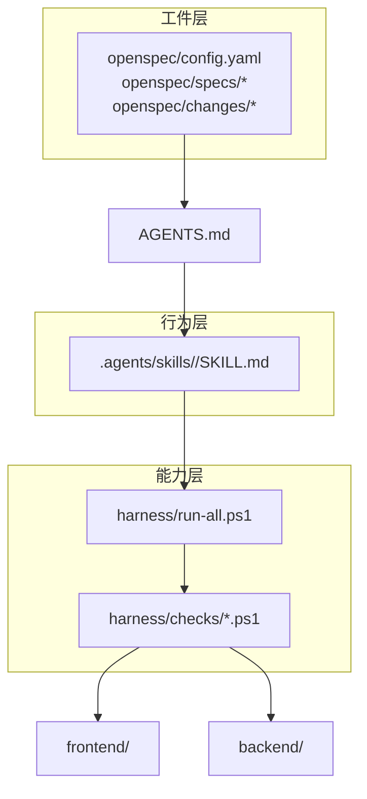
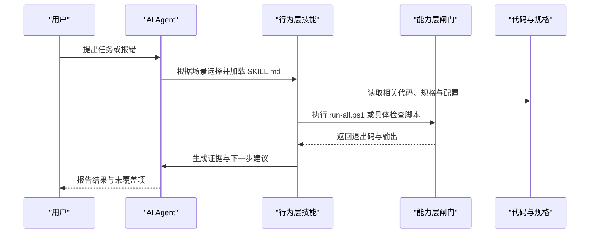
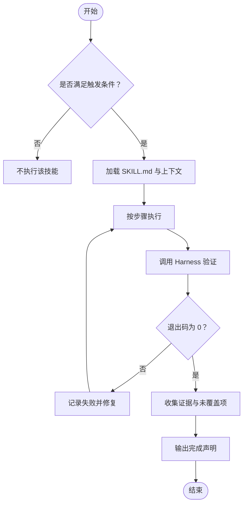
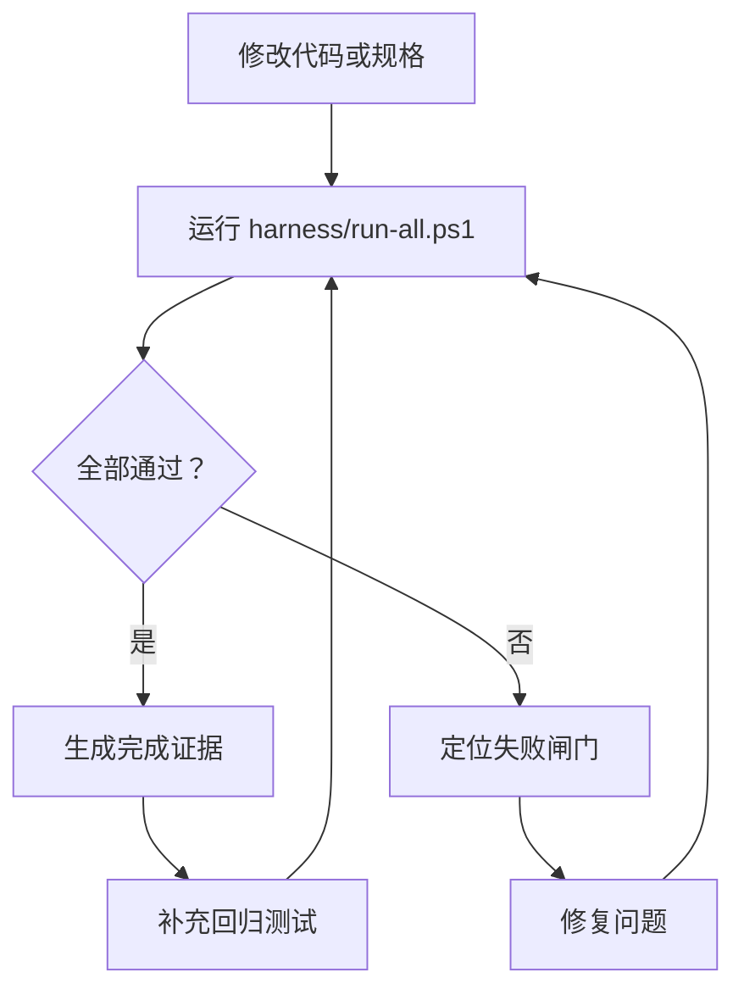
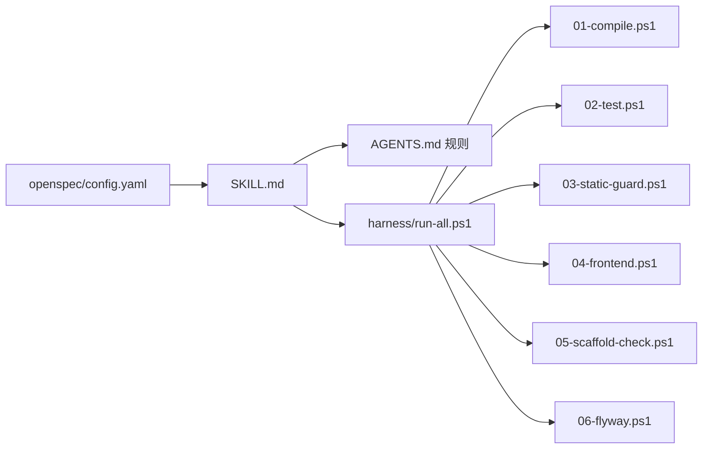

# 自定义技能开发

<cite>
**本文引用的文件**   
- [AGENTS.md](file://AGENTS.md)
- [.agents/skills/systematic-debugging/SKILL.md](file://.agents/skills/systematic-debugging/SKILL.md)
- [.agents/skills/verification-before-completion/SKILL.md](file://.agents/skills/verification-before-completion/SKILL.md)
- [.agents/skills/openspec-explore/SKILL.md](file://.agents/skills/openspec-explore/SKILL.md)
- [.agents/skills/openspec-propose/SKILL.md](file://.agents/skills/openspec-propose/SKILL.md)
- [harness/run-all.ps1](file://harness/run-all.ps1)
- [harness/checks/01-compile.ps1](file://harness/checks/01-compile.ps1)
- [harness/checks/02-test.ps1](file://harness/checks/02-test.ps1)
- [harness/checks/03-static-guard.ps1](file://harness/checks/03-static-guard.ps1)
- [harness/checks/04-frontend.ps1](file://harness/checks/04-frontend.ps1)
- [harness/checks/05-scaffold-check.ps1](file://harness/checks/05-scaffold-check.ps1)
- [harness/checks/06-flyway.ps1](file://harness/checks/06-flyway.ps1)
- [openspec/config.yaml](file://openspec/config.yaml)
</cite>

## 目录
1. [引言](#引言)
2. [项目结构](#项目结构)
3. [核心组件](#核心组件)
4. [架构总览](#架构总览)
5. [详细组件分析](#详细组件分析)
6. [依赖关系分析](#依赖关系分析)
7. [性能与可维护性](#性能与可维护性)
8. [故障排查指南](#故障排查指南)
9. [结论](#结论)
10. [附录：技能模板与最佳实践清单](#附录技能模板与最佳实践清单)

## 引言
本指南面向需要在本仓库中编写、分发和演进“自定义技能”的开发者。仓库将“行为层（Skills）”作为 AI 编码行为的强制约束来源，并通过 `.agents/skills/` 作为唯一真源，再同步到各 AI 工具适配层。本文从技能文件结构、语法规范、触发与执行流程、错误处理、测试策略、版本发布与兼容性等维度给出完整说明，并结合仓库内已有技能示例进行对照讲解。

## 项目结构
仓库采用三层分工：工件层（OpenSpec）、能力层（Harness）、行为层（Skills）。行为层技能以 Markdown 文件形式存在，并在头部使用 YAML Front Matter 声明元数据；能力层通过 PowerShell 闸门统一验收；工件层用 OpenSpec 管理需求与变更。

**图表来源**
- [AGENTS.md:16-26](file://AGENTS.md#L16-L26)
- [AGENTS.md:114-118](file://AGENTS.md#L114-L118)
- [AGENTS.md:149-158](file://AGENTS.md#L149-L158)

**章节来源**
- [AGENTS.md:16-26](file://AGENTS.md#L16-L26)
- [AGENTS.md:114-118](file://AGENTS.md#L114-L118)
- [AGENTS.md:149-158](file://AGENTS.md#L149-L158)

## 核心组件
- 行为层技能：位于 `.agents/skills/<skill-name>/SKILL.md`，以 YAML 头部 + Markdown 正文组织。
- 能力层闸门：位于 `harness/checks/NN-*.ps1`，由 `harness/run-all.ps1` 按文件名顺序编排。
- 工件层配置：位于 `openspec/config.yaml`，定义 OpenSpec 工作区根与 schema。
- 入口契约：`AGENTS.md` 规定 AI 进入仓库后的阅读顺序、硬规则、命令速查和技能分发约定。

**章节来源**
- [AGENTS.md:16-26](file://AGENTS.md#L16-L26)
- [AGENTS.md:122-147](file://AGENTS.md#L122-L147)
- [AGENTS.md:149-158](file://AGENTS.md#L149-L158)
- [openspec/config.yaml](file://openspec/config.yaml)

## 架构总览
技能的生命周期包括：发现与触发 → 读取上下文 → 执行步骤 → 调用 Harness 验证 → 输出证据 → 归档或继续迭代。

**图表来源**
- [AGENTS.md:60-70](file://AGENTS.md#L60-L70)
- [AGENTS.md:122-147](file://AGENTS.md#L122-L147)
- [.agents/skills/systematic-debugging/SKILL.md:44-49](file://.agents/skills/systematic-debugging/SKILL.md#L44-L49)
- [.agents/skills/verification-before-completion/SKILL.md:29-43](file://.agents/skills/verification-before-completion/SKILL.md#L29-L43)

## 详细组件分析

### 技能文件格式与语法规范
每个技能是一个独立目录，包含一个 `SKILL.md`。该文件采用 YAML Front Matter + Markdown 正文的结构：

- YAML 头部字段
  - `name`：技能标识，用于识别与引用。
  - `description`：一句话描述技能用途与适用场景。
  - `allowed-tools`：允许调用的外部工具范围（例如 OpenSpec CLI）。
  - `license`：许可证信息。
  - `compatibility`：运行环境依赖（例如要求安装 openspec CLI）。
  - `metadata`：作者、版本、生成器等扩展元数据。
- Markdown 正文
  - 标题与章节：明确“何时触发”“核心纪律”“执行步骤”“反模式”“收尾”。
  - 指令格式：使用编号步骤、表格、流程图、命令片段等结构化表达。
  - 约束声明：明确禁止行为、完成标准、证据要求。

示例参考路径：
- 自研排障技能：[systematic-debugging/SKILL.md](file://.agents/skills/systematic-debugging/SKILL.md)
- 自研完成前验证技能：[verification-before-completion/SKILL.md](file://.agents/skills/verification-before-completion/SKILL.md)
- OpenSpec 探索技能：[openspec-explore/SKILL.md](file://.agents/skills/openspec-explore/SKILL.md)
- OpenSpec 提案技能：[openspec-propose/SKILL.md](file://.agents/skills/openspec-propose/SKILL.md)

**章节来源**
- [.agents/skills/systematic-debugging/SKILL.md:1-4](file://.agents/skills/systematic-debugging/SKILL.md#L1-L4)
- [.agents/skills/verification-before-completion/SKILL.md:1-4](file://.agents/skills/verification-before-completion/SKILL.md#L1-L4)
- [.agents/skills/openspec-explore/SKILL.md:1-11](file://.agents/skills/openspec-explore/SKILL.md#L1-L11)
- [.agents/skills/openspec-propose/SKILL.md:1-11](file://.agents/skills/openspec-propose/SKILL.md#L1-L11)

### 触发条件与执行步骤设计
- 触发条件应清晰、可判断，避免模糊语义。例如：
  - “测试失败 / 启动报错 / 接口不符合预期”
  - “想说已完成 / 已修复 / 应该没问题了”
  - “需要写新规格 / 进入探索模式”
- 执行步骤应分阶段，每阶段有明确产出物与判据。例如系统化排障分为复现、最小化、定位根因、验证修复四阶段。
- 完成声明需包含命令、退出码、关键输出与未覆盖项。

**图表来源**
- [.agents/skills/systematic-debugging/SKILL.md:8-49](file://.agents/skills/systematic-debugging/SKILL.md#L8-L49)
- [.agents/skills/verification-before-completion/SKILL.md:8-62](file://.agents/skills/verification-before-completion/SKILL.md#L8-L62)

**章节来源**
- [.agents/skills/systematic-debugging/SKILL.md:8-49](file://.agents/skills/systematic-debugging/SKILL.md#L8-L49)
- [.agents/skills/verification-before-completion/SKILL.md:8-62](file://.agents/skills/verification-before-completion/SKILL.md#L8-L62)

### 错误处理与反模式
- 禁止吞异常、扩大超时重试、注释断言、一次改多处、“重启就好”等反模式。
- 必须补回归测试，并以全量护栏作为最终判据。
- 完成声明必须诚实列出未覆盖路径。

**章节来源**
- [.agents/skills/systematic-debugging/SKILL.md:51-64](file://.agents/skills/systematic-debugging/SKILL.md#L51-L64)
- [.agents/skills/verification-before-completion/SKILL.md:45-62](file://.agents/skills/verification-before-completion/SKILL.md#L45-L62)

### 技能测试方法
- 单元测试：针对后端 Java 服务与前端的组件逻辑，使用各自测试框架。
- 集成测试：通过 Harness 的编译、测试、静态红线、前端构建与测试等闸门串联。
- 回归测试：在系统化排障后补充回归用例，确保问题不再复发。
- 验收标准：以 `harness/run-all.ps1` 的退出码为准，非 0 即未完成。

**图表来源**
- [AGENTS.md:32-35](file://AGENTS.md#L32-L35)
- [AGENTS.md:149-158](file://AGENTS.md#L149-L158)
- [.agents/skills/systematic-debugging/SKILL.md:44-49](file://.agents/skills/systematic-debugging/SKILL.md#L44-L49)

**章节来源**
- [AGENTS.md:32-35](file://AGENTS.md#L32-L35)
- [AGENTS.md:149-158](file://AGENTS.md#L149-L158)
- [.agents/skills/systematic-debugging/SKILL.md:44-49](file://.agents/skills/systematic-debugging/SKILL.md#L44-L49)

### 技能版本管理与发布流程
- 命名约定：技能目录名建议使用小写连字符（kebab-case），与 OpenSpec change 命名风格一致。
- 文档要求：每个技能必须提供清晰的触发条件、执行步骤、反模式与收尾说明。
- 兼容性考虑：若技能依赖外部工具（如 OpenSpec CLI），需在 YAML 头部的 `compatibility` 字段声明。
- 发布流程：
  1. 在 `.agents/skills/` 下新增或更新技能目录与 `SKILL.md`。
  2. 同步副本到 `.claude/skills/`、`.qoder/skills/`、`.opencode/skills/`，保持内容逐字节一致。
  3. 运行 `harness/run-all.ps1` 验证整体质量。
  4. 提交变更并归档到 OpenSpec change（如需）。

**章节来源**
- [.agents/skills/openspec-explore/SKILL.md:1-11](file://.agents/skills/openspec-explore/SKILL.md#L1-L11)
- [.agents/skills/openspec-propose/SKILL.md:1-11](file://.agents/skills/openspec-propose/SKILL.md#L1-L11)
- [AGENTS.md:70-71](file://AGENTS.md#L70-L71)
- [AGENTS.md:114-118](file://AGENTS.md#L114-L118)

### 实际技能示例
- 系统化排障技能：强调先复现、再最小化、再定位根因、最后验证修复，禁止猜测式改动。
- 完成前验证技能：强制在执行命令、查看退出码、贴出输出后再宣布完成。
- OpenSpec 探索技能：以思考伙伴角色引导需求澄清与方案比较，不直接实现代码。
- OpenSpec 提案技能：一次性生成 proposal、specs、design、tasks 等规划工件。

**章节来源**
- [.agents/skills/systematic-debugging/SKILL.md:6-64](file://.agents/skills/systematic-debugging/SKILL.md#L6-L64)
- [.agents/skills/verification-before-completion/SKILL.md:6-69](file://.agents/skills/verification-before-completion/SKILL.md#L6-L69)
- [.agents/skills/openspec-explore/SKILL.md:13-356](file://.agents/skills/openspec-explore/SKILL.md#L13-L356)
- [.agents/skills/openspec-propose/SKILL.md:13-175](file://.agents/skills/openspec-propose/SKILL.md#L13-L175)

## 依赖关系分析
- 行为层技能依赖：
  - 仓库上下文：`AGENTS.md` 中的硬规则与工作流。
  - 能力层闸门：`harness/run-all.ps1` 与各子检查脚本。
  - 工件层配置：`openspec/config.yaml` 与 OpenSpec CLI（当技能涉及 OpenSpec）。
- 能力层闸门依赖：
  - 后端构建与测试：Maven、Java。
  - 前端构建与测试：npm、Next.js。
  - 数据库迁移：Flyway、MySQL（可选）。

**图表来源**
- [AGENTS.md:149-158](file://AGENTS.md#L149-L158)
- [harness/run-all.ps1](file://harness/run-all.ps1)
- [harness/checks/01-compile.ps1](file://harness/checks/01-compile.ps1)
- [harness/checks/02-test.ps1](file://harness/checks/02-test.ps1)
- [harness/checks/03-static-guard.ps1](file://harness/checks/03-static-guard.ps1)
- [harness/checks/04-frontend.ps1](file://harness/checks/04-frontend.ps1)
- [harness/checks/05-scaffold-check.ps1](file://harness/checks/05-scaffold-check.ps1)
- [harness/checks/06-flyway.ps1](file://harness/checks/06-flyway.ps1)
- [openspec/config.yaml](file://openspec/config.yaml)

**章节来源**
- [AGENTS.md:149-158](file://AGENTS.md#L149-L158)
- [openspec/config.yaml](file://openspec/config.yaml)

## 性能与可维护性
- 技能应保持小而专一，避免在一个 SKILL.md 中塞入过多职责。
- 使用结构化章节与表格提升可读性与可检索性。
- 对复杂流程使用流程图或序列图辅助理解。
- 所有外部依赖应在 YAML 头部显式声明，降低环境差异带来的不确定性。
- 通过 Harness 闸门保证技能产出的代码与规格始终可编译、可测试、无静态红线。

## 故障排查指南
- 当技能执行失败时，优先确认：
  - 是否满足触发条件。
  - 是否正确加载了 SKILL.md 与上下文。
  - Harness 闸门的退出码与输出是否被正确收集。
- 常见原因：
  - 子模块未初始化导致编译失败。
  - 前端依赖缺失导致构建失败。
  - 数据库连接不可达导致 Flyway 检查失败。
- 处理步骤：
  1. 使用系统化排障技能定位根因。
  2. 补充回归测试。
  3. 重新运行 `harness/run-all.ps1`。
  4. 在 OpenSpec change 中记录根因与影响面。

**章节来源**
- [.agents/skills/systematic-debugging/SKILL.md:18-49](file://.agents/skills/systematic-debugging/SKILL.md#L18-L49)
- [AGENTS.md:160-167](file://AGENTS.md#L160-L167)

## 结论
自定义技能是仓库“行为层”的核心载体，通过 YAML 头部与 Markdown 正文的组合，将 AI 的行为约束为可执行、可验证、可追溯的流程。配合 OpenSpec 工件层与 Harness 能力层，技能不仅能指导“怎么干”，还能确保“干得对”。建议在团队内推广统一的技能模板、触发规范与完成声明格式，并通过持续集成与回归测试保障长期质量。

## 附录：技能模板与最佳实践清单
- 技能目录结构
  - `.agents/skills/<skill-name>/SKILL.md`
- YAML 头部字段
  - `name`、`description`、`allowed-tools`、`license`、`compatibility`、`metadata`
- Markdown 正文建议
  - 何时触发
  - 核心纪律
  - 执行步骤（分阶段）
  - 反模式清单
  - 收尾与归档
- 最佳实践
  - 触发条件清晰可判断
  - 执行步骤有产出物与判据
  - 错误处理完整且可回归
  - 输出结果可验证
  - 版本与兼容性声明明确
  - 与 Harness 闸门联动验收