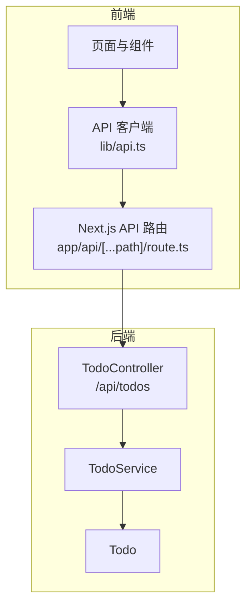
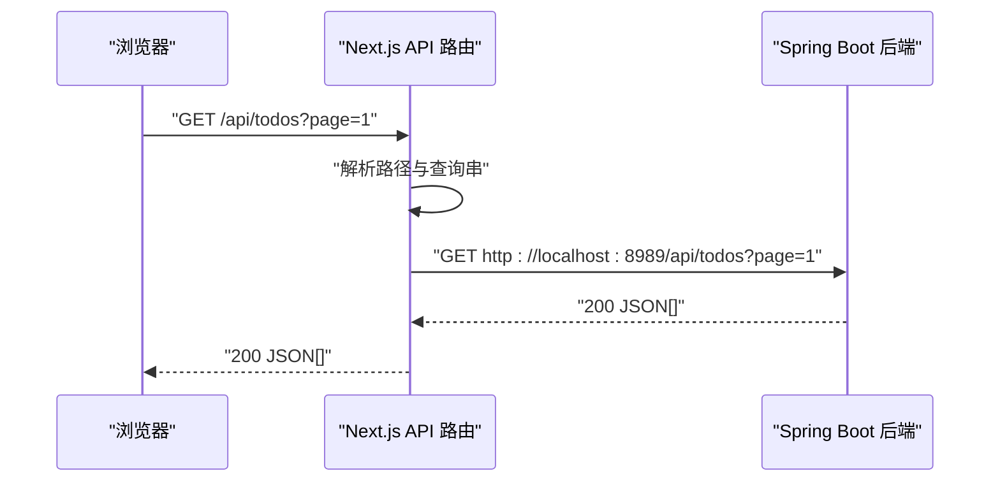
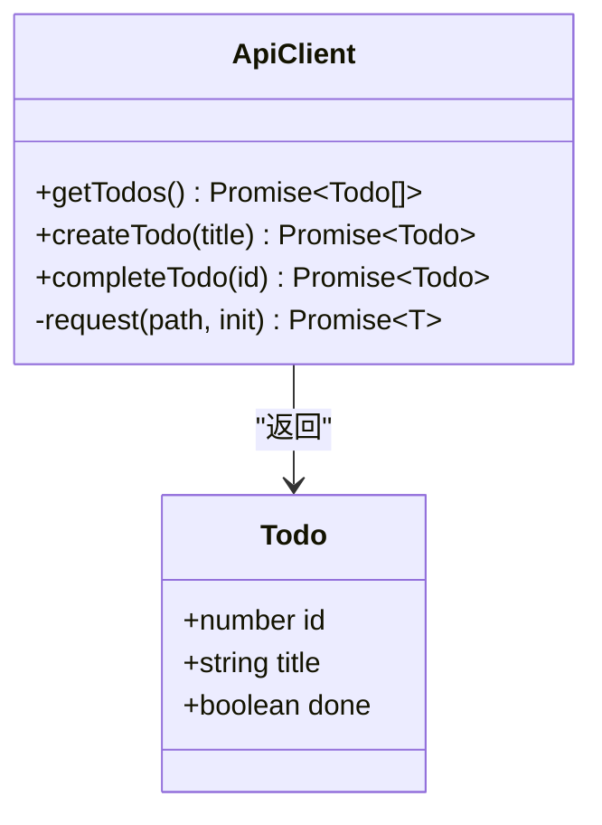
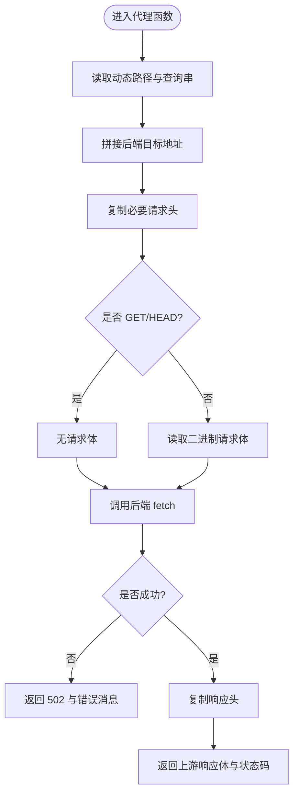
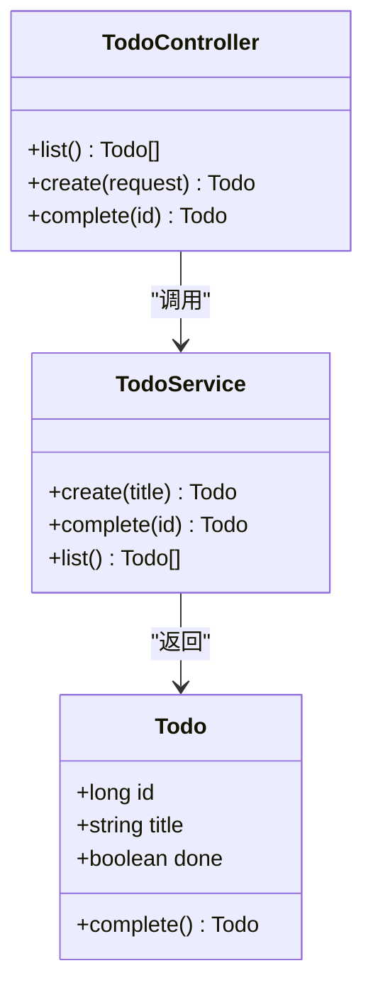
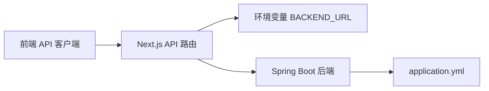

# API 集成与代理

<cite>
**本文引用的文件**   
- [frontend/app/api/[...path]/route.ts](file://frontend/app/api/[...path]/route.ts)
- [frontend/app/api/[...path]/route.test.ts](file://frontend/app/api/[...path]/route.test.ts)
- [frontend/lib/api.ts](file://frontend/lib/api.ts)
- [backend/src/main/java/com/luyi/myfirst/web/TodoController.java](file://backend/src/main/java/com/luyi/myfirst/web/TodoController.java)
- [backend/src/main/java/com/luyi/myfirst/domain/TodoService.java](file://backend/src/main/java/com/luyi/myfirst/domain/TodoService.java)
- [backend/src/main/java/com/luyi/myfirst/domain/Todo.java](file://backend/src/main/java/com/luyi/myfirst/domain/Todo.java)
- [backend/src/main/resources/application.yml](file://backend/src/main/resources/application.yml)
- [frontend/next.config.ts](file://frontend/next.config.ts)
</cite>

## 目录
1. [引言](#引言)
2. [项目结构](#项目结构)
3. [核心组件](#核心组件)
4. [架构总览](#架构总览)
5. [详细组件分析](#详细组件分析)
6. [依赖关系分析](#依赖关系分析)
7. [性能与可靠性考虑](#性能与可靠性考虑)
8. [API 客户端最佳实践](#api-客户端最佳实践)
9. [调试与排错指南](#调试与排错指南)
10. [结论](#结论)

## 引言
本文面向需要理解并扩展前端 Next.js 与后端 Spring Boot 之间 API 集成的开发者。文档聚焦以下目标：
- 说明前端 API 客户端封装的设计模式，包括请求拦截、响应处理、错误统一处理。
- 解释 Next.js API 路由的同源代理机制，如何将前端请求转发到后端服务。
- 梳理路由匹配规则、参数传递、响应格式转换等技术细节。
- 给出 API 调用的最佳实践、重试机制、超时处理的建议方案。
- 提供 API 客户端使用示例、调试方法与常见问题解决方案。

## 项目结构
本仓库采用前后端分离结构：
- 前端基于 Next.js，通过 `app/api/[...path]` 动态路由实现同源代理。
- 后端基于 Spring Boot，暴露 `/api/todos` 相关 REST 接口。
- 前端业务代码通过 `lib/api.ts` 封装统一的 fetch 调用。

**图表来源**
- [frontend/lib/api.ts:1-36](file://frontend/lib/api.ts#L1-L36)
- [frontend/app/api/[...path]/route.ts:1-77](file://frontend/app/api/[...path]/route.ts#L1-L77)
- [backend/src/main/java/com/luyi/myfirst/web/TodoController.java:1-45](file://backend/src/main/java/com/luyi/myfirst/web/TodoController.java#L1-L45)
- [backend/src/main/java/com/luyi/myfirst/domain/TodoService.java:1-44](file://backend/src/main/java/com/luyi/myfirst/domain/TodoService.java#L1-L44)
- [backend/src/main/java/com/luyi/myfirst/domain/Todo.java:1-13](file://backend/src/main/java/com/luyi/myfirst/domain/Todo.java#L1-L13)

**章节来源**
- [frontend/lib/api.ts:1-36](file://frontend/lib/api.ts#L1-L36)
- [frontend/app/api/[...path]/route.ts:1-77](file://frontend/app/api/[...path]/route.ts#L1-L77)
- [backend/src/main/java/com/luyi/myfirst/web/TodoController.java:1-45](file://backend/src/main/java/com/luyi/myfirst/web/TodoController.java#L1-L45)
- [backend/src/main/resources/application.yml:1-13](file://backend/src/main/resources/application.yml#L1-L13)

## 核心组件
- 前端 API 客户端：对 `fetch` 进行轻量封装，定义 Todo 数据模型与常用方法。
- Next.js API 路由：作为同源代理，将 `/api/*` 请求转发至后端服务地址。
- 后端控制器与服务：提供待办事项的查询、创建、完成等能力。
- 配置与环境变量：后端端口由配置文件指定；代理目标地址支持运行时环境变量覆盖。

**章节来源**
- [frontend/lib/api.ts:1-36](file://frontend/lib/api.ts#L1-L36)
- [frontend/app/api/[...path]/route.ts:1-77](file://frontend/app/api/[...path]/route.ts#L1-L77)
- [backend/src/main/java/com/luyi/myfirst/web/TodoController.java:1-45](file://backend/src/main/java/com/luyi/myfirst/web/TodoController.java#L1-L45)
- [backend/src/main/resources/application.yml:1-13](file://backend/src/main/resources/application.yml#L1-L13)

## 架构总览
下图展示一次典型的前端到后端的请求链路：浏览器发起同源请求，Next.js API 路由解析路径并转发到后端，后端返回结果后原样透传回前端。

**图表来源**
- [frontend/app/api/[...path]/route.ts:10-53](file://frontend/app/api/[...path]/route.ts#L10-L53)
- [backend/src/main/java/com/luyi/myfirst/web/TodoController.java:26-29](file://backend/src/main/java/com/luyi/myfirst/web/TodoController.java#L26-L29)

## 详细组件分析

### 前端 API 客户端设计
- 数据模型：定义 `Todo` 类型，包含 id、title、done 字段。
- 基础请求函数：封装 `fetch`，统一处理非 2xx 状态码并抛出错误。
- 业务方法：提供获取列表、创建任务、完成任务等方法。
- 同源约定：所有请求以 `/api/todos` 为前缀，交由 Next.js 路由代理。

**图表来源**
- [frontend/lib/api.ts:1-36](file://frontend/lib/api.ts#L1-L36)

**章节来源**
- [frontend/lib/api.ts:1-36](file://frontend/lib/api.ts#L1-L36)

### Next.js API 路由代理机制
- 动态路由：`app/api/[...path]` 捕获任意路径段，用于通用代理。
- 目标地址：默认后端地址为 `http://localhost:8989`，可通过环境变量 `BACKEND_URL` 在运行期覆盖。
- 路径拼接：将捕获的路径段逐段编码后拼接到后端基础 URL 之后，避免客户端绕过代理访问其他主机。
- 请求头透传：仅透传 `content-type` 与 `accept`，其余头部不直接透传，降低安全风险。
- 请求体处理：GET/HEAD 无请求体；其他方法读取二进制 body 并转发。
- 响应透传：透传上游响应的状态码与 `content-type`，并将上游响应体直接返回。
- 错误处理：当后端不可达时返回 502 与统一错误消息。

**图表来源**
- [frontend/app/api/[...path]/route.ts:10-53](file://frontend/app/api/[...path]/route.ts#L10-L53)

**章节来源**
- [frontend/app/api/[...path]/route.ts:1-77](file://frontend/app/api/[...path]/route.ts#L1-L77)
- [frontend/app/api/[...path]/route.test.ts:18-101](file://frontend/app/api/[...path]/route.test.ts#L18-L101)

### 后端 Spring Boot 接口
- 控制器：`TodoController` 暴露 `/api/todos` 的 GET、POST 以及 `/api/todos/{id}/complete` 的 POST 接口。
- 服务层：`TodoService` 维护内存中的待办集合，提供创建、完成、查询逻辑。
- 数据模型：`Todo` 使用 record 表示不可变实体，完成操作返回新实例。

**图表来源**
- [backend/src/main/java/com/luyi/myfirst/web/TodoController.java:16-44](file://backend/src/main/java/com/luyi/myfirst/web/TodoController.java#L16-L44)
- [backend/src/main/java/com/luyi/myfirst/domain/TodoService.java:14-43](file://backend/src/main/java/com/luyi/myfirst/domain/TodoService.java#L14-L43)
- [backend/src/main/java/com/luyi/myfirst/domain/Todo.java:7-11](file://backend/src/main/java/com/luyi/myfirst/domain/Todo.java#L7-L11)

**章节来源**
- [backend/src/main/java/com/luyi/myfirst/web/TodoController.java:1-45](file://backend/src/main/java/com/luyi/myfirst/web/TodoController.java#L1-L45)
- [backend/src/main/java/com/luyi/myfirst/domain/TodoService.java:1-44](file://backend/src/main/java/com/luyi/myfirst/domain/TodoService.java#L1-L44)
- [backend/src/main/java/com/luyi/myfirst/domain/Todo.java:1-13](file://backend/src/main/java/com/luyi/myfirst/domain/Todo.java#L1-L13)

## 依赖关系分析
- 前端 API 客户端依赖 Next.js 提供的同源 `/api` 路由。
- Next.js API 路由依赖 Node.js 环境下的 `fetch` 与运行时环境变量。
- 后端控制器依赖服务层，服务层依赖数据模型。
- 后端服务端口由配置文件指定。

**图表来源**
- [frontend/lib/api.ts:11-18](file://frontend/lib/api.ts#L11-L18)
- [frontend/app/api/[...path]/route.ts:1-6](file://frontend/app/api/[...path]/route.ts#L1-L6)
- [backend/src/main/resources/application.yml:1-13](file://backend/src/main/resources/application.yml#L1-L13)

**章节来源**
- [frontend/lib/api.ts:1-36](file://frontend/lib/api.ts#L1-L36)
- [frontend/app/api/[...path]/route.ts:1-77](file://frontend/app/api/[...path]/route.ts#L1-L77)
- [backend/src/main/resources/application.yml:1-13](file://backend/src/main/resources/application.yml#L1-L13)

## 性能与可靠性考虑
- 缓存策略：代理层设置 `cache: 'no-store'`，避免中间缓存导致的数据不一致。
- 重定向控制：代理层设置 `redirect: 'manual'`，防止自动重定向影响安全与可观测性。
- 错误处理：后端不可达时返回 502，便于前端识别基础设施故障。
- 可扩展性：通过环境变量切换后端地址，支持多后端或灰度发布。

[本节为通用指导，不直接分析具体文件]

## API 客户端最佳实践
- 统一错误处理：在客户端层对非 2xx 响应抛出明确错误，便于上层组件捕获与提示。
- 类型安全：使用 TypeScript 接口约束返回数据结构，减少运行时错误。
- 最小化耦合：客户端只关注业务方法，不关心底层网络细节。
- 同源约定：始终使用 `/api` 前缀，确保请求经过代理层，避免跨域与安全策略问题。

**章节来源**
- [frontend/lib/api.ts:1-36](file://frontend/lib/api.ts#L1-L36)

## 调试与排错指南
- 验证代理行为：
  - 检查动态路径是否正确拼接，例如 `/api/todos` 应映射到后端 `/api/todos`。
  - 确认查询串是否透传，例如 `?page=1` 应保留。
  - 校验请求头透传是否符合预期，尤其是 `content-type` 与 `accept`。
- 验证后端可达性：
  - 若返回 502，检查 `BACKEND_URL` 是否指向正确的后端服务。
  - 确认后端服务端口与配置一致（默认 8989）。
- 单元测试辅助：
  - 使用测试用例模拟 `fetch`，验证不同场景下的行为，如成功、失败、非 2xx 状态码、后端不可达等。

**章节来源**
- [frontend/app/api/[...path]/route.test.ts:18-101](file://frontend/app/api/[...path]/route.test.ts#L18-L101)
- [backend/src/main/resources/application.yml:1-13](file://backend/src/main/resources/application.yml#L1-L13)

## 结论
本项目通过 Next.js 的动态 API 路由实现了安全的同源代理，将前端请求透明地转发到 Spring Boot 后端。前端 API 客户端提供了简洁的类型化接口，配合统一的错误处理，提升了开发体验与可维护性。通过环境变量与测试用例，系统具备良好的可配置性与可验证性。建议在后续迭代中继续完善重试、超时、限流等可靠性机制，并逐步增强日志与监控能力。