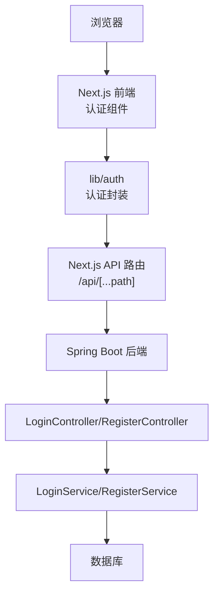
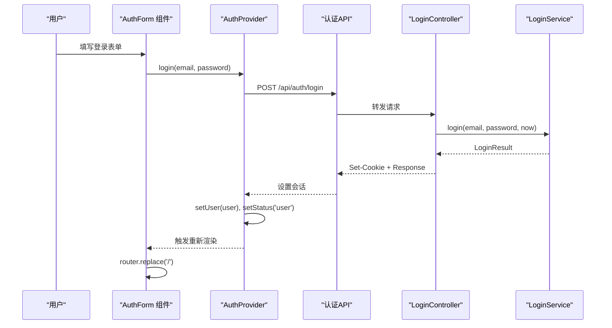
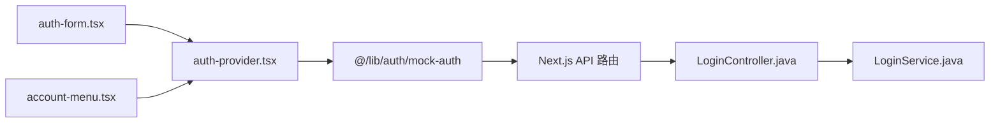
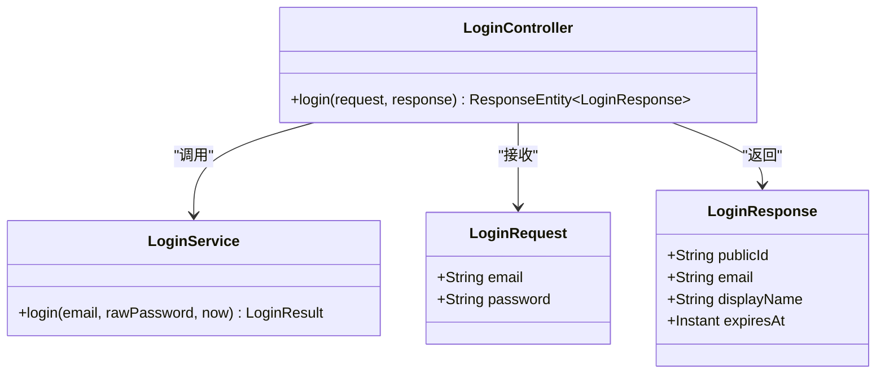

# Wanderchain 认证组件实现

<cite>
**本文引用的文件**   
- [frontend/components/auth/auth-form.tsx](file://frontend/components/auth/auth-form.tsx)
- [frontend/components/auth/account-menu.tsx](file://frontend/components/auth/account-menu.tsx)
- [frontend/components/auth/auth-provider.tsx](file://frontend/components/auth/auth-provider.tsx)
- [backend/src/main/java/com/luyi/myfirst/web/auth/LoginController.java](file://backend/src/main/java/com/luyi/myfirst/web/auth/LoginController.java)
- [backend/src/main/java/com/luyi/myfirst/service/auth/LoginService.java](file://backend/src/main/java/com/luyi/myfirst/service/auth/LoginService.java)
- [openspec/changes/archive/2026-10-27-remove-todo-demo/proposal.md](file://openspec/changes/archive/2026-10-27-remove-todo-demo/proposal.md)
</cite>

## 更新摘要
**变更内容**   
- 移除了所有 Todo 相关组件、服务和测试的引用
- 将焦点转向当前的 wanderchain 认证功能
- 更新了架构图和依赖关系以反映实际的认证流程
- 替换了示例代码和 API 契约说明

## 目录
1. [简介](#简介)
2. [项目结构](#项目结构)
3. [核心组件](#核心组件)
4. [架构总览](#架构总览)
5. [详细组件分析](#详细组件分析)
6. [依赖关系分析](#依赖关系分析)
7. [性能考虑](#性能考虑)
8. [故障排查指南](#故障排查指南)
9. [结论](#结论)
10. [附录](#附录)

## 简介
本文档面向 Wanderchain 应用的认证系统，系统性说明用户登录、注册、会话管理等核心功能的实现。认证系统采用前后端分离架构，前端使用 React + Next.js，后端使用 Spring Boot，通过 RESTful API 进行通信。文档涵盖组件状态管理、用户交互逻辑、数据绑定机制与错误处理策略，帮助开发者全面理解并扩展该认证功能模块。

## 项目结构
Wanderchain 认证系统位于 Next.js 前端应用，通过统一的 API 路由代理访问 Spring Boot 后端。整体链路为：浏览器 → Next.js 页面/组件 → lib/auth → Next.js API 路由 → Spring Boot Controller → Service → 数据库。



**图表来源**
- [frontend/components/auth/auth-form.tsx:1-139](file://frontend/components/auth/auth-form.tsx#L1-L139)
- [frontend/components/auth/auth-provider.tsx:1-77](file://frontend/components/auth/auth-provider.tsx#L1-L77)
- [backend/src/main/java/com/luyi/myfirst/web/auth/LoginController.java:1-48](file://backend/src/main/java/com/luyi/myfirst/web/auth/LoginController.java#L1-L48)
- [backend/src/main/java/com/luyi/myfirst/service/auth/LoginService.java:1-26](file://backend/src/main/java/com/luyi/myfirst/service/auth/LoginService.java#L1-L26)

## 核心组件
Wanderchain 认证系统包含三个核心组件：

### AuthForm 组件
负责用户登录和注册的表单处理，支持两种模式：
- 登录模式：邮箱和密码输入
- 注册模式：用户名、邮箱、密码和确认密码输入

关键功能：
- 表单验证（密码匹配检查）
- 异步提交处理
- 错误状态管理
- 加载状态控制

### AccountMenu 组件
显示用户账户菜单，根据认证状态动态渲染：
- 未认证：显示登录/注册链接
- 已认证：显示用户名、角色和登出按钮
- 加载中：显示占位符

### AuthProvider 组件
提供全局认证上下文，管理用户会话状态：
- 用户状态管理（loading/guest/user）
- 登录、注册、登出操作
- 本地会话存储

**章节来源**
- [frontend/components/auth/auth-form.tsx:9-139](file://frontend/components/auth/auth-form.tsx#L9-L139)
- [frontend/components/auth/account-menu.tsx:7-32](file://frontend/components/auth/account-menu.tsx#L7-L32)
- [frontend/components/auth/auth-provider.tsx:21-77](file://frontend/components/auth/auth-provider.tsx#L21-L77)

## 架构总览
前端采用"组件 + Context Provider"的分层方式；后端采用"控制器 + 服务"的清晰分层。



**图表来源**
- [frontend/components/auth/auth-form.tsx:25-46](file://frontend/components/auth/auth-form.tsx#L25-L46)
- [frontend/components/auth/auth-provider.tsx:52-56](file://frontend/components/auth/auth-provider.tsx#L52-L56)
- [backend/src/main/java/com/luyi/myfirst/web/auth/LoginController.java:37-46](file://backend/src/main/java/com/luyi/myfirst/web/auth/LoginController.java#L37-L46)
- [backend/src/main/java/com/luyi/myfirst/service/auth/LoginService.java:14-25](file://backend/src/main/java/com/luyi/myfirst/service/auth/LoginService.java#L14-L25)

## 详细组件分析

### AuthForm 组件详解
AuthForm 是一个受控表单组件，支持登录和注册两种模式。

#### Props 接口定义
```typescript
interface Props {
  mode: 'login' | 'register'
}
```

#### 状态管理
- email：用户邮箱地址
- password：用户密码
- name：用户名（仅注册模式）
- confirm：确认密码（仅注册模式）
- error：错误信息
- pending：提交中状态

#### 用户交互逻辑
- 表单提交：阻止默认行为，执行验证后调用认证方法
- 密码验证：注册模式下检查密码与确认密码是否匹配
- 路由跳转：认证成功后跳转到首页
- 错误处理：捕获异常并显示友好错误消息

**章节来源**
- [frontend/components/auth/auth-form.tsx:9-46](file://frontend/components/auth/auth-form.tsx#L9-L46)
- [frontend/components/auth/auth-form.tsx:48-139](file://frontend/components/auth/auth-form.tsx#L48-L139)

### AccountMenu 组件详解
AccountMenu 根据认证状态动态渲染不同的 UI。

#### 状态渲染逻辑
- 加载中：显示占位符元素
- 未认证：显示登录/注册链接
- 已认证：显示用户信息和登出按钮
- 管理员：额外显示编辑者角色标识

#### 无障碍支持
- 使用 aria-hidden 属性隐藏占位符
- 语义化的 HTML 结构

**章节来源**
- [frontend/components/auth/account-menu.tsx:7-32](file://frontend/components/auth/account-menu.tsx#L7-L32)

### AuthProvider 组件详解
AuthProvider 是整个认证系统的核心，提供全局状态管理。

#### 上下文接口
```typescript
export interface AuthContextValue {
  status: AuthStatus
  user: AuthUser | null
  login: (email: string, password: string) => Promise<void>
  register: (input: RegisterInput) => Promise<void>
  logout: () => void
}
```

#### 会话管理
- 初始会话读取：从本地存储恢复用户会话
- 状态同步：在用户登录后更新全局状态
- 会话持久化：使用 localStorage 存储认证信息

#### 性能优化
- 使用 useCallback 包装回调函数避免不必要的重渲染
- 使用 useMemo 缓存上下文值对象
- 条件渲染减少不必要的 DOM 操作

**章节来源**
- [frontend/components/auth/auth-provider.tsx:21-77](file://frontend/components/auth/auth-provider.tsx#L21-L77)

### 后端认证服务
后端提供完整的认证 API 接口。

#### LoginController
RESTful 控制器，处理登录请求：
- POST /api/auth/login：用户登录
- 设置认证 Cookie
- 返回用户基本信息

#### LoginService
业务逻辑层，定义认证接口：
- 凭证验证优先于状态检查
- 统一异常处理
- 令牌签发和管理

**章节来源**
- [backend/src/main/java/com/luyi/myfirst/web/auth/LoginController.java:1-48](file://backend/src/main/java/com/luyi/myfirst/web/auth/LoginController.java#L1-L48)
- [backend/src/main/java/com/luyi/myfirst/service/auth/LoginService.java:1-26](file://backend/src/main/java/com/luyi/myfirst/service/auth/LoginService.java#L1-L26)

## 依赖关系分析



**图表来源**
- [frontend/components/auth/auth-form.tsx:6-16](file://frontend/components/auth/auth-form.tsx#L6-L16)
- [frontend/components/auth/account-menu.tsx:4-8](file://frontend/components/auth/account-menu.tsx#L4-L8)
- [frontend/components/auth/auth-provider.tsx:12-19](file://frontend/components/auth/auth-provider.tsx#L12-L19)
- [backend/src/main/java/com/luyi/myfirst/web/auth/LoginController.java:3-6](file://backend/src/main/java/com/luyi/myfirst/web/auth/LoginController.java#L3-L6)

**章节来源**
- [frontend/components/auth/auth-form.tsx:1-139](file://frontend/components/auth/auth-form.tsx#L1-L139)
- [frontend/components/auth/account-menu.tsx:1-32](file://frontend/components/auth/account-menu.tsx#L1-L32)
- [frontend/components/auth/auth-provider.tsx:1-77](file://frontend/components/auth/auth-provider.tsx#L1-L77)
- [backend/src/main/java/com/luyi/myfirst/web/auth/LoginController.java:1-48](file://backend/src/main/java/com/luyi/myfirst/web/auth/LoginController.java#L1-L48)
- [backend/src/main/java/com/luyi/myfirst/service/auth/LoginService.java:1-26](file://backend/src/main/java/com/luyi/myfirst/service/auth/LoginService.java#L1-L26)

## 性能考虑
- 组件优化：使用 React.memo 包裹纯展示组件
- 状态管理：最小化状态更新范围，避免不必要的重渲染
- 网络请求：合理使用缓存策略，减少重复请求
- 会话管理：本地存储优化，避免频繁读写
- 后端优化：数据库查询优化，连接池配置

## 故障排查指南
- 登录失败：检查邮箱格式、密码正确性、网络连接
- 注册失败：确认用户名唯一性、密码强度要求
- 会话丢失：检查本地存储权限、Cookie 设置
- 权限问题：验证用户角色、访问控制配置
- 网络错误：查看 API 响应状态码、错误消息

## 结论
Wanderchain 认证系统通过清晰的组件分层和前后端分离架构，提供了安全可靠的用户认证功能。AuthForm、AccountMenu 和 AuthProvider 三个核心组件协同工作，实现了完整的用户认证流程。后端 LoginController 和 LoginService 提供了稳定的 API 接口，确保认证过程的安全性和一致性。整个系统设计简洁、易于维护和扩展。

## 附录

### API 契约与后端模型

#### 认证接口定义
- 用户登录：POST /api/auth/login
- 用户注册：POST /api/auth/register  
- 会话验证：GET /api/auth/session
- 用户登出：POST /api/auth/logout

#### 领域模型
- LoginRequest：登录请求体（email, password）
- LoginResponse：登录响应体（publicId, email, displayName, expiresAt）
- AuthUser：认证用户信息（name, role）
- RegisterInput：注册输入（email, password, name）



**图表来源**
- [backend/src/main/java/com/luyi/myfirst/web/auth/LoginController.java:25-46](file://backend/src/main/java/com/luyi/myfirst/web/auth/LoginController.java#L25-L46)
- [backend/src/main/java/com/luyi/myfirst/service/auth/LoginService.java:14-25](file://backend/src/main/java/com/luyi/myfirst/service/auth/LoginService.java#L14-L25)

**章节来源**
- [backend/src/main/java/com/luyi/myfirst/web/auth/LoginController.java:1-48](file://backend/src/main/java/com/luyi/myfirst/web/auth/LoginController.java#L1-L48)
- [backend/src/main/java/com/luyi/myfirst/service/auth/LoginService.java:1-26](file://backend/src/main/java/com/luyi/myfirst/service/auth/LoginService.java#L1-L26)

### 单元测试说明与测试策略

#### 前端测试（Vitest + Testing Library）
- 模拟认证上下文：mock useAuth hook
- 场景覆盖：
  - 登录表单提交成功
  - 注册表单验证失败
  - 账户菜单状态切换
  - 错误处理和用户反馈

#### 后端测试（JUnit + AssertJ）
- 验证登录流程：凭证验证、状态检查、令牌签发
- 拒绝无效请求：参数校验、异常处理
- 会话管理：Cookie 设置、过期时间验证
- 并发安全：多线程环境下的会话一致性

### 历史变更记录
Todo 模块已于 2026-10-27 完全移除，原因包括：
- Todo 是脚手架演示模块，已完成其使命
- 认证模块上线后，Todo 成为维护负担
- 简化项目结构，聚焦核心功能

**章节来源**
- [openspec/changes/archive/2026-10-27-remove-todo-demo/proposal.md:1-42](file://openspec/changes/archive/2026-10-27-remove-todo-demo/proposal.md#L1-L42)