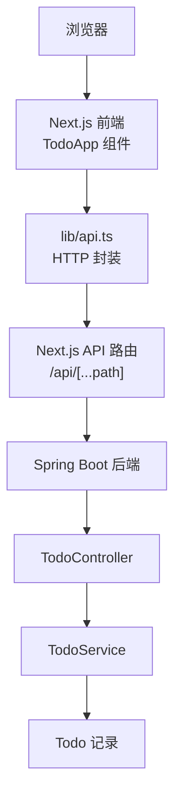
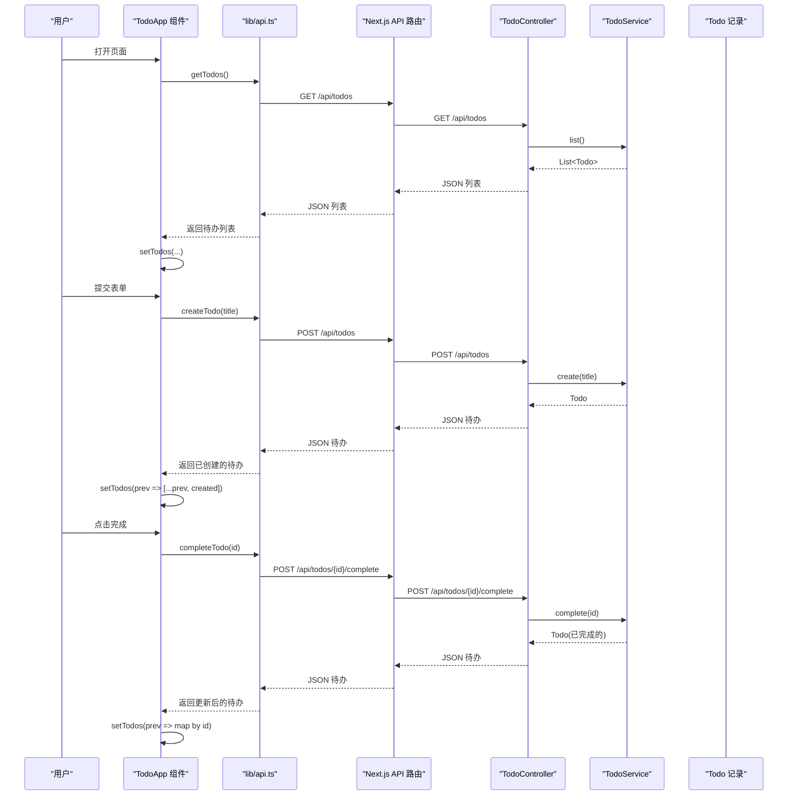
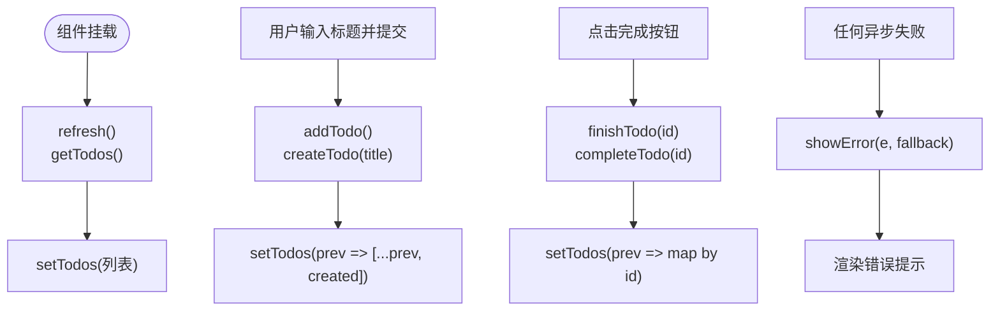
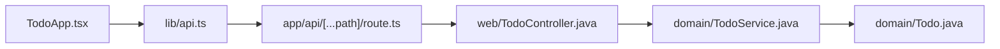
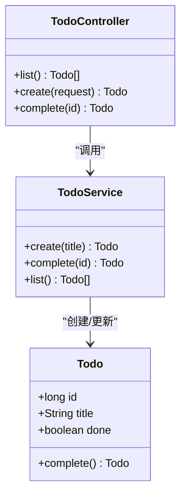
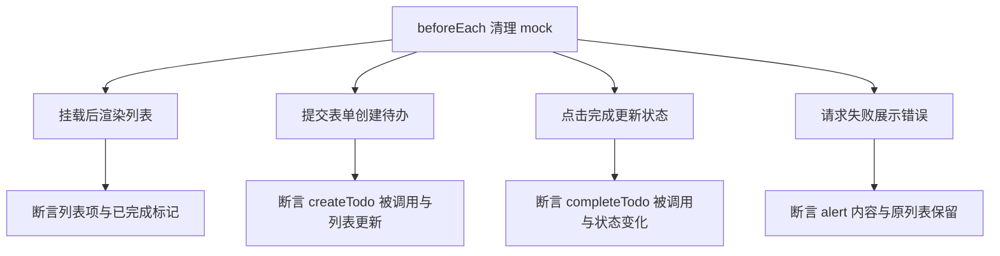

# Todo 组件实现

<cite>
**本文引用的文件**   
- [frontend/components/TodoApp.tsx](file://frontend/components/TodoApp.tsx)
- [frontend/components/TodoApp.test.tsx](file://frontend/components/TodoApp.test.tsx)
- [frontend/lib/api.ts](file://frontend/lib/api.ts)
- [frontend/app/api/[...path]/route.ts](file://frontend/app/api/[...path]/route.ts)
- [backend/src/main/java/com/luyi/myfirst/domain/Todo.java](file://backend/src/main/java/com/luyi/myfirst/domain/Todo.java)
- [backend/src/main/java/com/luyi/myfirst/domain/TodoService.java](file://backend/src/main/java/com/luyi/myfirst/domain/TodoService.java)
- [backend/src/main/java/com/luyi/myfirst/web/TodoController.java](file://backend/src/main/java/com/luyi/myfirst/web/TodoController.java)
- [backend/src/test/java/com/luyi/myfirst/domain/TodoServiceTest.java](file://backend/src/test/java/com/luyi/myfirst/domain/TodoServiceTest.java)
</cite>

## 目录
1. [简介](#简介)
2. [项目结构](#项目结构)
3. [核心组件](#核心组件)
4. [架构总览](#架构总览)
5. [详细组件分析](#详细组件分析)
6. [依赖关系分析](#依赖关系分析)
7. [性能考虑](#性能考虑)
8. [故障排查指南](#故障排查指南)
9. [结论](#结论)
10. [附录](#附录)

## 简介
本文件面向前端 TodoApp 组件，系统性说明其状态管理、用户交互逻辑、数据绑定机制与错误处理策略，并覆盖后端接口契约、代理层转发、领域模型与服务实现。文档同时给出可复用性设计、扩展点、使用示例、样式定制方法、性能优化技巧以及测试策略与用例说明，帮助读者从“怎么用”到“怎么改”全面掌握该功能模块。

## 项目结构
TodoApp 位于 Next.js 前端应用，通过统一的 API 路由代理访问 Spring Boot 后端。整体链路为：浏览器 → Next.js 页面/组件 → lib/api.ts → Next.js API 路由 → Spring Boot Controller → TodoService → Todo 记录。

**图表来源**
- [frontend/components/TodoApp.tsx:1-109](file://frontend/components/TodoApp.tsx#L1-L109)
- [frontend/lib/api.ts:1-36](file://frontend/lib/api.ts#L1-L36)
- [frontend/app/api/[...path]/route.ts:1-77](file://frontend/app/api/[...path]/route.ts#L1-L77)
- [backend/src/main/java/com/luyi/myfirst/web/TodoController.java:1-45](file://backend/src/main/java/com/luyi/myfirst/web/TodoController.java#L1-L45)
- [backend/src/main/java/com/luyi/myfirst/domain/TodoService.java:1-44](file://backend/src/main/java/com/luyi/myfirst/domain/TodoService.java#L1-L44)
- [backend/src/main/java/com/luyi/myfirst/domain/Todo.java:1-13](file://backend/src/main/java/com/luyi/myfirst/domain/Todo.java#L1-L13)

**章节来源**
- [frontend/components/TodoApp.tsx:1-109](file://frontend/components/TodoApp.tsx#L1-L109)
- [frontend/lib/api.ts:1-36](file://frontend/lib/api.ts#L1-L36)
- [frontend/app/api/[...path]/route.ts:1-77](file://frontend/app/api/[...path]/route.ts#L1-L77)
- [backend/src/main/java/com/luyi/myfirst/web/TodoController.java:1-45](file://backend/src/main/java/com/luyi/myfirst/web/TodoController.java#L1-L45)
- [backend/src/main/java/com/luyi/myfirst/domain/TodoService.java:1-44](file://backend/src/main/java/com/luyi/myfirst/domain/TodoService.java#L1-L44)
- [backend/src/main/java/com/luyi/myfirst/domain/Todo.java:1-13](file://backend/src/main/java/com/luyi/myfirst/domain/Todo.java#L1-L13)

## 核心组件
TodoApp 是一个客户端 React 组件，负责：
- 维护待办列表、新增输入框、加载与错误状态
- 在挂载时拉取待办列表
- 提交表单创建新待办
- 点击完成按钮切换待办完成状态
- 渲染空态、加载中、错误提示与已完成标记

关键状态字段：
- todos：待办事项数组
- newTitle：新增输入框的值
- loading：是否正在请求
- error：错误信息文本

**章节来源**
- [frontend/components/TodoApp.tsx:6-10](file://frontend/components/TodoApp.tsx#L6-L10)
- [frontend/components/TodoApp.tsx:16-30](file://frontend/components/TodoApp.tsx#L16-L30)
- [frontend/components/TodoApp.tsx:32-56](file://frontend/components/TodoApp.tsx#L32-L56)
- [frontend/components/TodoApp.tsx:58-106](file://frontend/components/TodoApp.tsx#L58-L106)

## 架构总览
前端采用“组件 + API 封装 + 路由代理”的分层方式；后端采用“控制器 + 服务 + 领域对象”的清晰分层。

**图表来源**
- [frontend/components/TodoApp.tsx:16-56](file://frontend/components/TodoApp.tsx#L16-L56)
- [frontend/lib/api.ts:21-35](file://frontend/lib/api.ts#L21-L35)
- [frontend/app/api/[...path]/route.ts:10-53](file://frontend/app/api/[...path]/route.ts#L10-L53)
- [backend/src/main/java/com/luyi/myfirst/web/TodoController.java:26-40](file://backend/src/main/java/com/luyi/myfirst/web/TodoController.java#L26-L40)
- [backend/src/main/java/com/luyi/myfirst/domain/TodoService.java:20-42](file://backend/src/main/java/com/luyi/myfirst/domain/TodoService.java#L20-L42)

## 详细组件分析

### 组件 Props 与类型定义
当前 TodoApp 未暴露外部 Props，所有状态由组件内部维护。若需复用或嵌入其他页面，建议将以下能力抽象为 Props：
- initialTodos：初始待办列表（用于 SSR 或缓存注入）
- onCreated：创建成功回调
- onCompleted：完成状态变更回调
- onError：统一错误回调
- renderEmpty：自定义空态渲染
- renderItem：自定义单项渲染

类型方面，Todo 类型由 lib/api.ts 导出，包含 id、title、done 三个字段。

**章节来源**
- [frontend/lib/api.ts:5-9](file://frontend/lib/api.ts#L5-L9)
- [frontend/components/TodoApp.tsx:6-10](file://frontend/components/TodoApp.tsx#L6-L10)

### 状态管理与数据流
- 初始化：useEffect 在挂载后调用 refresh，刷新列表
- 新增：表单提交触发 addTodo，校验标题非空后调用 createTodo，成功后追加到列表并清空输入
- 完成：finishTodo 调用 completeTodo，成功后按 id 替换对应项
- 错误：showError 统一捕获异常并设置 error 状态
- 加载：loading 控制“加载中”提示与列表渲染时机

**图表来源**
- [frontend/components/TodoApp.tsx:16-56](file://frontend/components/TodoApp.tsx#L16-L56)
- [frontend/components/TodoApp.tsx:28-30](file://frontend/components/TodoApp.tsx#L28-L30)

**章节来源**
- [frontend/components/TodoApp.tsx:16-56](file://frontend/components/TodoApp.tsx#L16-L56)
- [frontend/components/TodoApp.tsx:58-106](file://frontend/components/TodoApp.tsx#L58-L106)

### 用户交互与事件处理
- 表单提交：阻止默认行为，去除空白后发起创建请求
- 输入框：受控组件，value 绑定 newTitle，onChange 更新状态
- 完成按钮：根据 todo.done 显示“已完成”标签或“完成”按钮
- 无障碍：输入框提供 aria-label，错误区域使用 role="alert"

**章节来源**
- [frontend/components/TodoApp.tsx:32-46](file://frontend/components/TodoApp.tsx#L32-L46)
- [frontend/components/TodoApp.tsx:62-71](file://frontend/components/TodoApp.tsx#L62-L71)
- [frontend/components/TodoApp.tsx:73-78](file://frontend/components/TodoApp.tsx#L73-L78)
- [frontend/components/TodoApp.tsx:80-101](file://frontend/components/TodoApp.tsx#L80-L101)

### 数据绑定机制
- 受控输入：newTitle 作为 value，onChange 同步更新
- 列表渲染：todos.map 生成 li，key 使用 todo.id
- 条件渲染：todo.done 决定展示“已完成”标签或“完成”按钮
- 空态与提示：loading、error、todos.length 控制不同 UI 分支

**章节来源**
- [frontend/components/TodoApp.tsx:62-71](file://frontend/components/TodoApp.tsx#L62-L71)
- [frontend/components/TodoApp.tsx:80-106](file://frontend/components/TodoApp.tsx#L80-L106)

### 错误边界与健壮性
- 组件内错误处理：try/catch 包裹所有异步操作，统一 setError
- 网络层错误：lib/api.ts 对非 ok 响应抛出错误
- 代理层兜底：Next.js API 路由在后端不可达时返回 502 错误体
- 用户可见反馈：role="alert" 的错误提示与“加载中”提示

注意：当前组件未使用 React Error Boundary，如需更严格的崩溃隔离，可在外层包裹 ErrorBoundary 组件。

**章节来源**
- [frontend/components/TodoApp.tsx:12-14](file://frontend/components/TodoApp.tsx#L12-L14)
- [frontend/components/TodoApp.tsx:16-26](file://frontend/components/TodoApp.tsx#L16-L26)
- [frontend/components/TodoApp.tsx:32-56](file://frontend/components/TodoApp.tsx#L32-L56)
- [frontend/lib/api.ts:13-19](file://frontend/lib/api.ts#L13-L19)
- [frontend/app/api/[...path]/route.ts:30-41](file://frontend/app/api/[...path]/route.ts#L30-L41)

### 可复用性与扩展点
- 无 Props 耦合：组件自包含，适合直接嵌入任意页面
- 可扩展点：
  - 增加删除、编辑、批量操作等动作
  - 接入持久化缓存（如 localStorage）以改善首屏体验
  - 支持过滤与排序（未完成/全部/已完成）
  - 支持分页或虚拟滚动（待办数量较大时）
- 建议抽取子组件：
  - TodoForm：新增表单
  - TodoList：列表容器
  - TodoItem：单项渲染（含完成按钮与状态标签）

**章节来源**
- [frontend/components/TodoApp.tsx:58-106](file://frontend/components/TodoApp.tsx#L58-L106)

### 使用示例
- 基础用法：在页面中直接导入并渲染 TodoApp
- 结合布局：放入 app/page.tsx 或 layout.tsx 的子树中
- 样式定制：通过 className 与全局 CSS 调整外观（例如 .todo-app、.todo-list、.done、.complete 等）

**章节来源**
- [frontend/components/TodoApp.tsx:58-106](file://frontend/components/TodoApp.tsx#L58-L106)

### 样式定制方法
- 容器类名：todo-app
- 表单类名：todo-form
- 列表类名：todo-list
- 完成项类名：done
- 完成按钮类名：complete
- 错误提示类名：error
- 提示类名：hint

可根据业务主题替换这些类名的样式规则。

**章节来源**
- [frontend/components/TodoApp.tsx:58-106](file://frontend/components/TodoApp.tsx#L58-L106)

### 性能优化技巧
- 避免不必要的重渲染：保持 state 最小化，必要时拆分子组件并使用 React.memo
- 列表 key 稳定：使用唯一且稳定的 id 作为 key
- 减少重复请求：在组件卸载或路由切换时可取消请求（AbortController）
- 后端分页：当待办数量增长时，后端应提供分页接口，前端按需加载
- 代理层缓存：对只读列表查询可启用适当缓存策略（谨慎使用）

[本节为通用指导，不直接分析具体文件]

## 依赖关系分析

**图表来源**
- [frontend/components/TodoApp.tsx:1-109](file://frontend/components/TodoApp.tsx#L1-L109)
- [frontend/lib/api.ts:1-36](file://frontend/lib/api.ts#L1-L36)
- [frontend/app/api/[...path]/route.ts:1-77](file://frontend/app/api/[...path]/route.ts#L1-L77)
- [backend/src/main/java/com/luyi/myfirst/web/TodoController.java:1-45](file://backend/src/main/java/com/luyi/myfirst/web/TodoController.java#L1-L45)
- [backend/src/main/java/com/luyi/myfirst/domain/TodoService.java:1-44](file://backend/src/main/java/com/luyi/myfirst/domain/TodoService.java#L1-L44)
- [backend/src/main/java/com/luyi/myfirst/domain/Todo.java:1-13](file://backend/src/main/java/com/luyi/myfirst/domain/Todo.java#L1-L13)

**章节来源**
- [frontend/components/TodoApp.tsx:1-109](file://frontend/components/TodoApp.tsx#L1-L109)
- [frontend/lib/api.ts:1-36](file://frontend/lib/api.ts#L1-L36)
- [frontend/app/api/[...path]/route.ts:1-77](file://frontend/app/api/[...path]/route.ts#L1-L77)
- [backend/src/main/java/com/luyi/myfirst/web/TodoController.java:1-45](file://backend/src/main/java/com/luyi/myfirst/web/TodoController.java#L1-L45)
- [backend/src/main/java/com/luyi/myfirst/domain/TodoService.java:1-44](file://backend/src/main/java/com/luyi/myfirst/domain/TodoService.java#L1-L44)
- [backend/src/main/java/com/luyi/myfirst/domain/Todo.java:1-13](file://backend/src/main/java/com/luyi/myfirst/domain/Todo.java#L1-L13)

## 性能考虑
- 前端渲染：列表渲染基于数组映射，key 使用 id，避免重复计算
- 状态更新：使用函数式 setState 保证基于最新状态的增量更新
- 网络请求：每次操作后仅更新必要状态，避免全量刷新
- 后端存储：内存 Map 保证插入顺序，list 返回副本避免外部修改
- 代理转发：Next.js 路由禁用缓存并透传内容类型，确保一致性

**章节来源**
- [frontend/components/TodoApp.tsx:40-52](file://frontend/components/TodoApp.tsx#L40-L52)
- [backend/src/main/java/com/luyi/myfirst/domain/TodoService.java:17-42](file://backend/src/main/java/com/luyi/myfirst/domain/TodoService.java#L17-L42)
- [frontend/app/api/[...path]/route.ts:30-52](file://frontend/app/api/[...path]/route.ts#L30-L52)

## 故障排查指南
- 列表为空：检查后端是否启动、环境变量 BACKEND_URL 是否正确、代理路由是否可达
- 新增失败：确认标题非空，后端 CreateTodoRequest.title 校验是否通过
- 完成失败：确认 id 存在，后端 complete 方法是否抛出“not found”
- 网络错误：查看 lib/api.ts 抛出的 HTTP 状态码，定位后端或代理层问题
- 代理不可达：Next.js 路由会返回 502，检查后端服务是否运行

**章节来源**
- [frontend/lib/api.ts:13-19](file://frontend/lib/api.ts#L13-L19)
- [frontend/app/api/[...path]/route.ts:30-41](file://frontend/app/api/[...path]/route.ts#L30-L41)
- [backend/src/main/java/com/luyi/myfirst/domain/TodoService.java:20-37](file://backend/src/main/java/com/luyi/myfirst/domain/TodoService.java#L20-L37)

## 结论
TodoApp 组件以简洁的状态管理和清晰的交互流程实现了待办的创建、显示与完成状态切换。配合 lib/api.ts 与 Next.js 代理路由，形成前后端解耦的完整链路。后端通过 TodoController 与 TodoService 提供稳定的 REST 接口，领域模型 Todo 保证不可变性与线程安全。整体代码结构清晰、易于扩展与维护，适合作为多端复用的基础能力。

[本节为总结性内容，不直接分析具体文件]

## 附录

### API 契约与后端模型

#### 接口定义（前端）
- 获取待办列表：GET /api/todos
- 创建待办：POST /api/todos，请求体 { title }
- 完成待办：POST /api/todos/{id}/complete

#### 领域模型（后端）
- Todo：record(id, title, done)，提供 complete() 方法生成已完成的新实例
- TodoService：内存存储，提供 create、complete、list
- TodoController：REST 控制器，映射上述接口

**图表来源**
- [backend/src/main/java/com/luyi/myfirst/domain/Todo.java:1-13](file://backend/src/main/java/com/luyi/myfirst/domain/Todo.java#L1-L13)
- [backend/src/main/java/com/luyi/myfirst/domain/TodoService.java:1-44](file://backend/src/main/java/com/luyi/myfirst/domain/TodoService.java#L1-L44)
- [backend/src/main/java/com/luyi/myfirst/web/TodoController.java:1-45](file://backend/src/main/java/com/luyi/myfirst/web/TodoController.java#L1-L45)

**章节来源**
- [frontend/lib/api.ts:5-35](file://frontend/lib/api.ts#L5-L35)
- [backend/src/main/java/com/luyi/myfirst/domain/Todo.java:1-13](file://backend/src/main/java/com/luyi/myfirst/domain/Todo.java#L1-L13)
- [backend/src/main/java/com/luyi/myfirst/domain/TodoService.java:1-44](file://backend/src/main/java/com/luyi/myfirst/domain/TodoService.java#L1-L44)
- [backend/src/main/java/com/luyi/myfirst/web/TodoController.java:1-45](file://backend/src/main/java/com/luyi/myfirst/web/TodoController.java#L1-L45)

### 单元测试说明与测试策略

#### 前端测试（Vitest + Testing Library）
- 模拟 API：mock getTodos、createTodo、completeTodo
- 场景覆盖：
  - 挂载后渲染后端返回的待办列表
  - 提交表单调用创建接口并把新待办加入列表
  - 点击完成按钮调用完成接口并更新该条状态
  - 请求失败时展示错误且保留已加载的列表

**图表来源**
- [frontend/components/TodoApp.test.tsx:1-81](file://frontend/components/TodoApp.test.tsx#L1-L81)

**章节来源**
- [frontend/components/TodoApp.test.tsx:1-81](file://frontend/components/TodoApp.test.tsx#L1-L81)

#### 后端测试（JUnit + AssertJ）
- 验证创建：标题去空格、初始未完成、id 为正数
- 拒绝空标题：抛出非法参数异常
- 完成状态翻转：完成后 done 为 true，id 不变，列表长度不变
- 未知 id 报错：抛出非法参数异常
- 列表顺序：按创建顺序返回

**章节来源**
- [backend/src/test/java/com/luyi/myfirst/domain/TodoServiceTest.java:1-64](file://backend/src/test/java/com/luyi/myfirst/domain/TodoServiceTest.java#L1-L64)