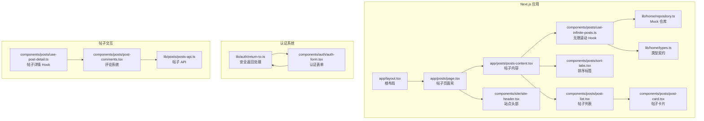
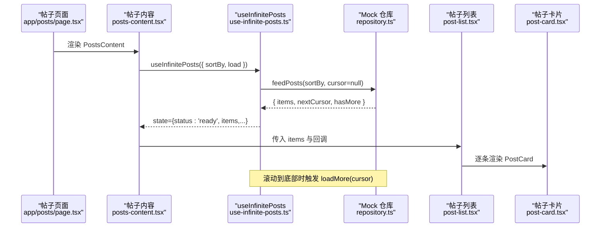
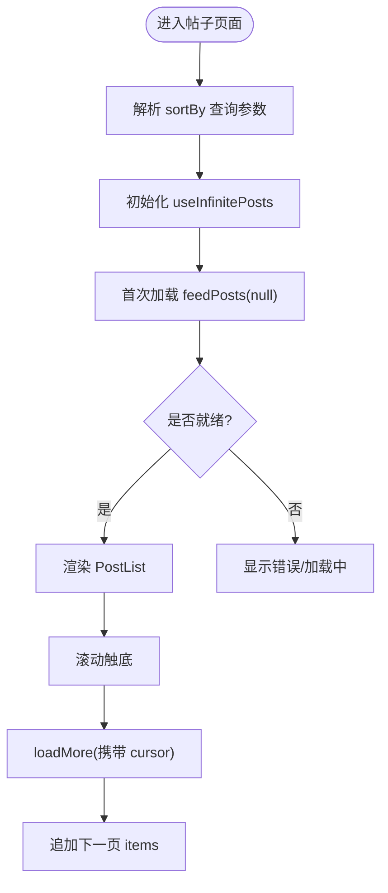
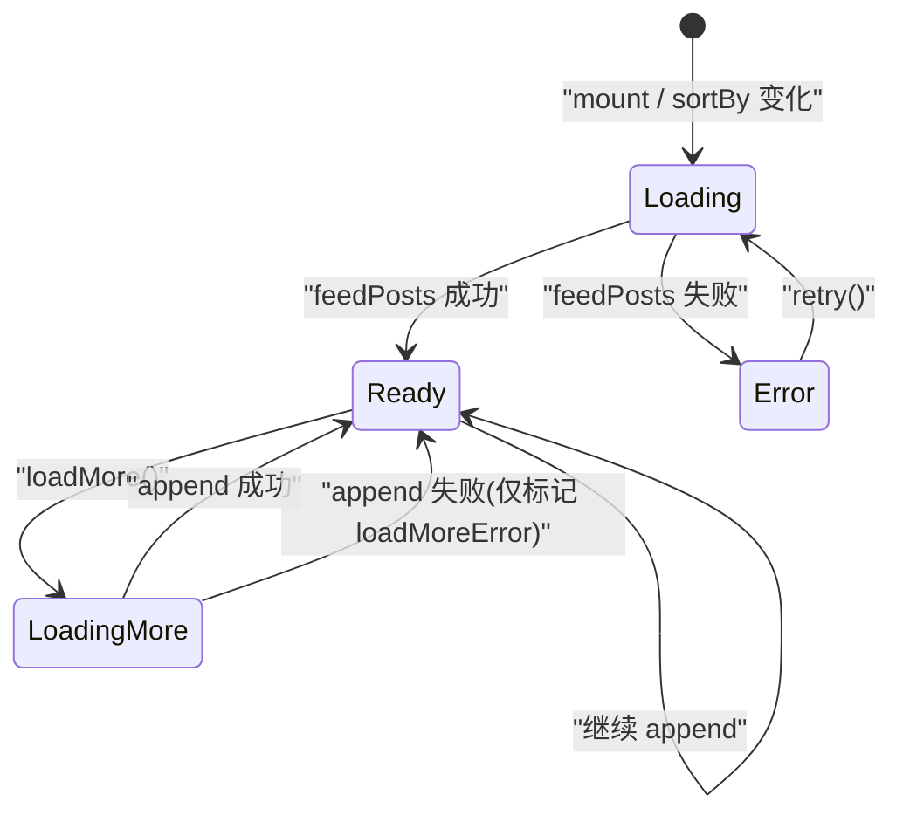
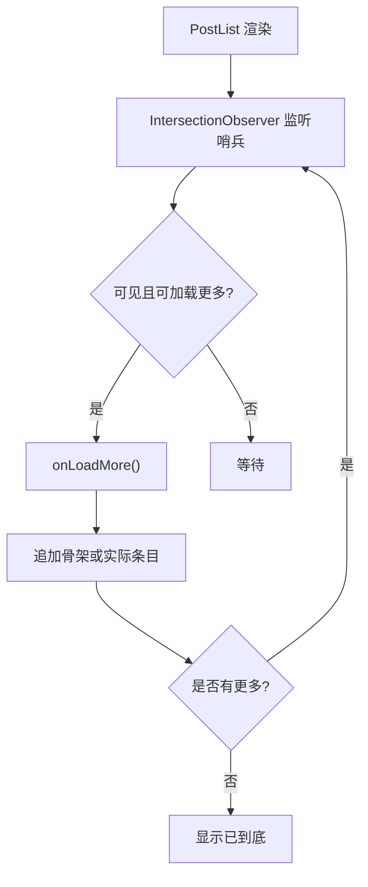
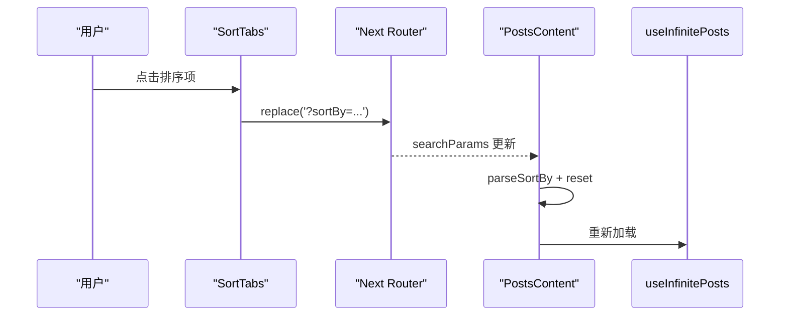
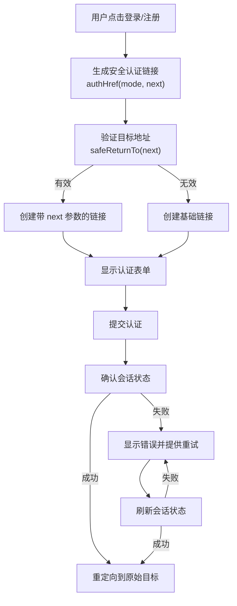
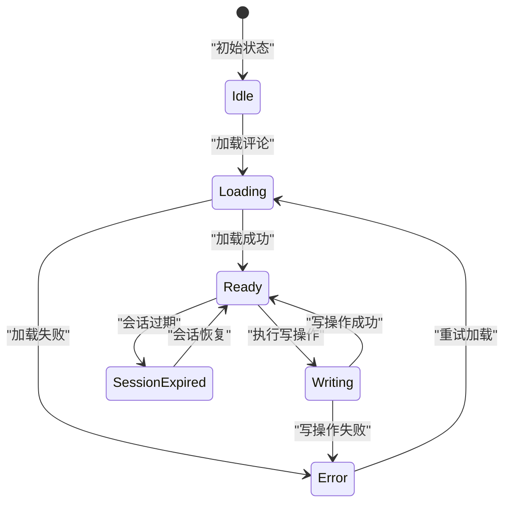
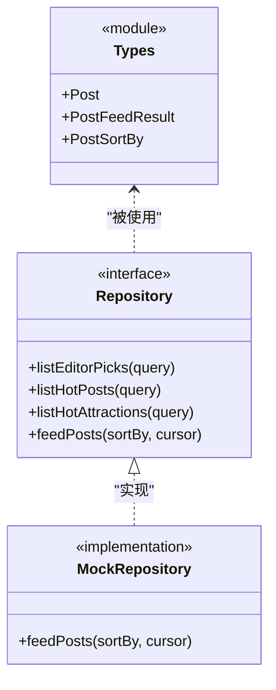
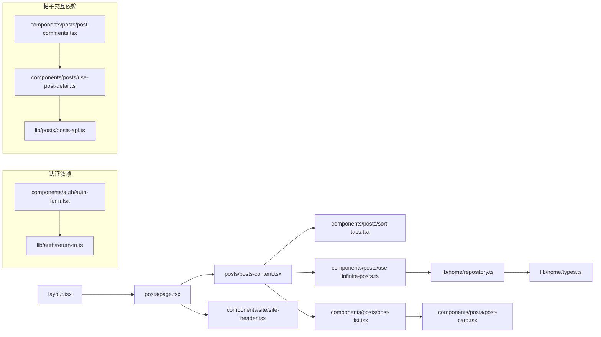

# WanderChain 帖子动态前端

<cite>
**本文引用的文件**   
- [frontend/package.json](file://frontend/package.json)
- [frontend/next.config.ts](file://frontend/next.config.ts)
- [frontend/app/layout.tsx](file://frontend/app/layout.tsx)
- [frontend/app/posts/page.tsx](file://frontend/app/posts/page.tsx)
- [frontend/app/posts/posts-content.tsx](file://frontend/app/posts/posts-content.tsx)
- [frontend/components/site/site-header.tsx](file://frontend/components/site/site-header.tsx)
- [frontend/components/posts/post-list.tsx](file://frontend/components/posts/post-list.tsx)
- [frontend/components/posts/use-infinite-posts.ts](file://frontend/components/posts/use-infinite-posts.ts)
- [frontend/components/posts/post-card.tsx](file://frontend/components/posts/post-card.tsx)
- [frontend/components/posts/sort-tabs.tsx](file://frontend/components/posts/sort-tabs.tsx)
- [frontend/lib/home/types.ts](file://frontend/lib/home/types.ts)
- [frontend/lib/home/repository.ts](file://frontend/lib/home/repository.ts)
- [frontend/lib/auth/return-to.ts](file://frontend/lib/auth/return-to.ts)
- [frontend/components/auth/auth-form.tsx](file://frontend/components/auth/auth-form.tsx)
- [frontend/components/posts/post-comments.tsx](file://frontend/components/posts/post-comments.tsx)
- [frontend/components/posts/use-post-detail.ts](file://frontend/components/posts/use-post-detail.ts)
- [frontend/lib/posts/posts-api.ts](file://frontend/lib/posts/posts-api.ts)
</cite>

## 更新摘要
**所做更改**
- 更新了认证导航部分，添加了安全 return-to 功能和会话确认机制
- 新增了 E2E 测试覆盖，包括登录/注册重定向和会话确认场景
- 增强了帖子交互规范，包括当前账户状态读取和评论系统改进
- 更新了组件架构以支持更健壮的认证流程和用户交互

## 目录
1. [简介](#简介)
2. [项目结构](#项目结构)
3. [核心组件](#核心组件)
4. [架构总览](#架构总览)
5. [详细组件分析](#详细组件分析)
6. [依赖关系分析](#依赖关系分析)
7. [性能考量](#性能考量)
8. [故障排查指南](#故障排查指南)
9. [结论](#结论)

## 简介
本文件面向 WanderChain 的"帖子动态"前端实现，聚焦 Next.js 应用中的帖子列表、无限滚动、排序切换与数据契约。该功能通过页面路由挂载内容区，使用自定义 Hook 管理分页状态，并通过仓库接口（当前为本地 Mock）拉取帖子数据，最终渲染为卡片列表。整体设计强调：
- 清晰的职责分层：页面负责布局与加载占位，内容组件负责业务拼装，Hook 负责数据流，仓库抽象数据源。
- 可替换的数据层：类型与仓库接口定义在 lib/home 下，便于后续接入真实后端 API。
- 良好的交互体验：无限滚动、骨架屏、错误重试与排序 URL 同步。
- **新增**：增强的认证导航与安全返回功能，确保用户登录后能正确重定向到原始目标页面。
- **新增**：完善的会话确认机制，提供友好的错误处理和重试功能。

## 项目结构
WanderChain 前端基于 Next.js 16 与 React 19，采用 App Router 组织页面，组件按功能域拆分到 components 目录，共享类型与仓储逻辑位于 lib/home。

图表来源
- [frontend/app/layout.tsx:1-41](file://frontend/app/layout.tsx#L1-L41)
- [frontend/app/posts/page.tsx:1-40](file://frontend/app/posts/page.tsx#L1-L40)
- [frontend/app/posts/posts-content.tsx:1-73](file://frontend/app/posts/posts-content.tsx#L1-L73)
- [frontend/components/posts/use-infinite-posts.ts:1-111](file://frontend/components/posts/use-infinite-posts.ts#L1-L111)
- [frontend/components/posts/sort-tabs.tsx:1-47](file://frontend/components/posts/sort-tabs.tsx#L1-L47)
- [frontend/components/posts/post-list.tsx:1-95](file://frontend/components/posts/post-list.tsx#L1-L95)
- [frontend/components/posts/post-card.tsx:1-31](file://frontend/components/posts/post-card.tsx#L1-L31)
- [frontend/components/site/site-header.tsx:1-36](file://frontend/components/site/site-header.tsx#L1-L36)
- [frontend/lib/auth/return-to.ts:1-12](file://frontend/lib/auth/return-to.ts#L1-L12)
- [frontend/components/auth/auth-form.tsx:1-372](file://frontend/components/auth/auth-form.tsx#L1-L372)
- [frontend/components/posts/use-post-detail.ts:1-207](file://frontend/components/posts/use-post-detail.ts#L1-L207)
- [frontend/components/posts/post-comments.tsx:1-128](file://frontend/components/posts/post-comments.tsx#L1-L128)
- [frontend/lib/posts/posts-api.ts:95-116](file://frontend/lib/posts/posts-api.ts#L95-L116)

章节来源
- [frontend/package.json:1-34](file://frontend/package.json#L1-L34)
- [frontend/next.config.ts:1-14](file://frontend/next.config.ts#L1-L14)

## 核心组件
- 帖子页面壳：提供站点头尾、Suspense 占位与主内容容器。
- 帖子内容：解析排序参数、绑定无限滚动 Hook、渲染排序标签与列表。
- 无限滚动 Hook：封装分页状态机、游标管理、重试与防抖加载。
- 帖子列表：IntersectionObserver 触发加载更多、空态与结束提示。
- 帖子卡片：展示封面、标题、摘要、作者、时间与统计信息。
- 排序标签：将排序选择写入 URL 查询参数并驱动重新加载。
- 类型与仓库：统一 Post 模型与 feedPosts 分页契约；当前以内存 Mock 实现。
- **新增**：安全返回处理：验证和生成安全的认证重定向链接。
- **新增**：认证表单：支持登录/注册流程，包含会话确认和错误处理。
- **新增**：评论系统：增强的评论显示、删除确认和用户交互状态管理。

章节来源
- [frontend/app/posts/page.tsx:1-40](file://frontend/app/posts/page.tsx#L1-L40)
- [frontend/app/posts/posts-content.tsx:1-73](file://frontend/app/posts/posts-content.tsx#L1-L73)
- [frontend/components/posts/use-infinite-posts.ts:1-111](file://frontend/components/posts/use-infinite-posts.ts#L1-L111)
- [frontend/components/posts/post-list.tsx:1-95](file://frontend/components/posts/post-list.tsx#L1-L95)
- [frontend/components/posts/post-card.tsx:1-31](file://frontend/components/posts/post-card.tsx#L1-L31)
- [frontend/components/posts/sort-tabs.tsx:1-47](file://frontend/components/posts/sort-tabs.tsx#L1-L47)
- [frontend/lib/home/types.ts:1-73](file://frontend/lib/home/types.ts#L1-L73)
- [frontend/lib/home/repository.ts:1-157](file://frontend/lib/home/repository.ts#L1-L157)
- [frontend/lib/auth/return-to.ts:1-12](file://frontend/lib/auth/return-to.ts#L1-L12)
- [frontend/components/auth/auth-form.tsx:1-372](file://frontend/components/auth/auth-form.tsx#L1-L372)
- [frontend/components/posts/post-comments.tsx:1-128](file://frontend/components/posts/post-comments.tsx#L1-L128)

## 架构总览
下图展示了从页面入口到数据获取与渲染的关键调用链，以及 Mock 仓库的分页游标处理流程。

图表来源
- [frontend/app/posts/page.tsx:1-40](file://frontend/app/posts/page.tsx#L1-L40)
- [frontend/app/posts/posts-content.tsx:1-73](file://frontend/app/posts/posts-content.tsx#L1-L73)
- [frontend/components/posts/use-infinite-posts.ts:1-111](file://frontend/components/posts/use-infinite-posts.ts#L1-L111)
- [frontend/lib/home/repository.ts:124-157](file://frontend/lib/home/repository.ts#L124-L157)
- [frontend/components/posts/post-list.tsx:1-95](file://frontend/components/posts/post-list.tsx#L1-L95)
- [frontend/components/posts/post-card.tsx:1-31](file://frontend/components/posts/post-card.tsx#L1-L31)

## 详细组件分析

### 帖子页面与内容
- 页面壳负责包裹站点头尾，并使用 Suspense 显示加载占位。
- 内容组件解析 URL 中的 sortBy，构造 load 函数委托给仓库，并将状态交给 PostList 渲染。
- 支持初始加载、错误提示与重试按钮。

图表来源
- [frontend/app/posts/page.tsx:1-40](file://frontend/app/posts/page.tsx#L1-L40)
- [frontend/app/posts/posts-content.tsx:1-73](file://frontend/app/posts/posts-content.tsx#L1-L73)
- [frontend/components/posts/use-infinite-posts.ts:1-111](file://frontend/components/posts/use-infinite-posts.ts#L1-L111)

章节来源
- [frontend/app/posts/page.tsx:1-40](file://frontend/app/posts/page.tsx#L1-L40)
- [frontend/app/posts/posts-content.tsx:1-73](file://frontend/app/posts/posts-content.tsx#L1-L73)

### 无限滚动 Hook
- 状态机：loading / error / ready，包含 items、isLoadingMore、hasMore、loadMoreError。
- 游标管理：用 ref 保存 nextCursor，避免重复请求与竞态。
- 生命周期：组件挂载即首次加载；sortBy 变化时重置并重新拉取。
- 错误恢复：区分首屏失败与加载更多失败，分别提供 retry 行为。

图表来源
- [frontend/components/posts/use-infinite-posts.ts:1-111](file://frontend/components/posts/use-infinite-posts.ts#L1-L111)

章节来源
- [frontend/components/posts/use-infinite-posts.ts:1-111](file://frontend/components/posts/use-infinite-posts.ts#L1-L111)

### 帖子列表与卡片
- 列表使用 IntersectionObserver 监听哨兵元素，满足条件时触发 onLoadMore。
- 空态、加载中骨架、加载更多失败重试与"已到底"提示齐全。
- 卡片展示封面图、标题、摘要、作者与时间，以及点赞、评论、收藏数。

图表来源
- [frontend/components/posts/post-list.tsx:1-95](file://frontend/components/posts/post-list.tsx#L1-L95)
- [frontend/components/posts/post-card.tsx:1-31](file://frontend/components/posts/post-card.tsx#L1-L31)

章节来源
- [frontend/components/posts/post-list.tsx:1-95](file://frontend/components/posts/post-list.tsx#L1-L95)
- [frontend/components/posts/post-card.tsx:1-31](file://frontend/components/posts/post-card.tsx#L1-L31)

### 排序标签
- 将排序值写入 URL 查询参数，使用 router.replace 无滚动跳转。
- 与 posts-content 的 parseSortBy 配合，确保 URL 与视图一致。

图表来源
- [frontend/components/posts/sort-tabs.tsx:1-47](file://frontend/components/posts/sort-tabs.tsx#L1-L47)
- [frontend/app/posts/posts-content.tsx:1-73](file://frontend/app/posts/posts-content.tsx#L1-L73)

章节来源
- [frontend/components/posts/sort-tabs.tsx:1-47](file://frontend/components/posts/sort-tabs.tsx#L1-L47)
- [frontend/app/posts/posts-content.tsx:1-73](file://frontend/app/posts/posts-content.tsx#L1-L73)

### 安全认证导航与会话管理
**新增** 增强的认证导航系统提供了安全的 return-to 功能和健壮的会话管理机制：

- **安全返回处理**：`safeReturnTo` 函数严格验证目标 URL，只允许特定的帖子详情路径，防止开放重定向攻击。
- **认证链接生成**：`authHref` 函数生成安全的登录/注册链接，自动附加有效的 next 参数。
- **会话确认机制**：登录/注册成功后进行会话确认，如果确认失败则提供友好的错误提示和重试按钮。
- **双向互转支持**：登录和注册页面之间可以互相跳转，同时保留原始的目标地址。

图表来源
- [frontend/lib/auth/return-to.ts:1-12](file://frontend/lib/auth/return-to.ts#L1-L12)
- [frontend/components/auth/auth-form.tsx:92-100](file://frontend/components/auth/auth-form.tsx#L92-L100)
- [frontend/components/auth/auth-form.tsx:126-140](file://frontend/components/auth/auth-form.tsx#L126-L140)

章节来源
- [frontend/lib/auth/return-to.ts:1-12](file://frontend/lib/auth/return-to.ts#L1-L12)
- [frontend/components/auth/auth-form.tsx:1-372](file://frontend/components/auth/auth-form.tsx#L1-L372)

### 增强的评论系统与帖子交互
**新增** 评论系统和帖子交互功能得到了显著增强：

- **当前账户状态读取**：通过 `readMyInteractions` API 获取用户的投票和收藏状态，实时更新交互界面。
- **评论删除确认**：提供安全的评论删除流程，包含确认对话框和焦点管理。
- **会话过期处理**：当会话过期时，评论系统会优雅地降级，阻止写操作并提示用户重新登录。
- **异步状态管理**：使用复杂的状态机管理评论的加载、更新和错误状态。

图表来源
- [frontend/components/posts/post-comments.tsx:28-128](file://frontend/components/posts/post-comments.tsx#L28-L128)
- [frontend/components/posts/use-post-detail.ts:178-205](file://frontend/components/posts/use-post-detail.ts#L178-L205)
- [frontend/lib/posts/posts-api.ts:108-110](file://frontend/lib/posts/posts-api.ts#L108-L110)

章节来源
- [frontend/components/posts/post-comments.tsx:1-128](file://frontend/components/posts/post-comments.tsx#L1-L128)
- [frontend/components/posts/use-post-detail.ts:1-207](file://frontend/components/posts/use-post-detail.ts#L1-L207)
- [frontend/lib/posts/posts-api.ts:95-116](file://frontend/lib/posts/posts-api.ts#L95-L116)

### 类型与仓库契约
- types.ts 定义了 Post、PostFeedResult、PostSortBy 等关键类型，作为前后端契约。
- repository.ts 提供 HomeRepository 接口与 mockRepository 实现，包含：
  - 城市过滤、排序比较器、分页截断。
  - 游标编码/解码与校验，防止跨排序的游标复用。
  - feedPosts 返回 items、nextCursor、hasMore，供 Hook 消费。

图表来源
- [frontend/lib/home/types.ts:1-73](file://frontend/lib/home/types.ts#L1-L73)
- [frontend/lib/home/repository.ts:1-157](file://frontend/lib/home/repository.ts#L1-L157)

章节来源
- [frontend/lib/home/types.ts:1-73](file://frontend/lib/home/types.ts#L1-L73)
- [frontend/lib/home/repository.ts:1-157](file://frontend/lib/home/repository.ts#L1-L157)

## 依赖关系分析
- 页面层依赖站点头尾与内容组件。
- 内容组件依赖排序标签与无限滚动 Hook。
- Hook 依赖仓库接口与类型定义。
- 仓库实现依赖类型定义与本地 Mock 数据。
- **新增**：认证系统依赖安全返回处理模块。
- **新增**：评论系统依赖帖子 API 和会话状态管理。

图表来源
- [frontend/app/layout.tsx:1-41](file://frontend/app/layout.tsx#L1-L41)
- [frontend/app/posts/page.tsx:1-40](file://frontend/app/posts/page.tsx#L1-L40)
- [frontend/app/posts/posts-content.tsx:1-73](file://frontend/app/posts/posts-content.tsx#L1-L73)
- [frontend/components/posts/sort-tabs.tsx:1-47](file://frontend/components/posts/sort-tabs.tsx#L1-L47)
- [frontend/components/posts/use-infinite-posts.ts:1-111](file://frontend/components/posts/use-infinite-posts.ts#L1-L111)
- [frontend/lib/home/repository.ts:1-157](file://frontend/lib/home/repository.ts#L1-L157)
- [frontend/lib/home/types.ts:1-73](file://frontend/lib/home/types.ts#L1-L73)
- [frontend/components/posts/post-list.tsx:1-95](file://frontend/components/posts/post-list.tsx#L1-L95)
- [frontend/components/posts/post-card.tsx:1-31](file://frontend/components/posts/post-card.tsx#L1-L31)
- [frontend/components/site/site-header.tsx:1-36](file://frontend/components/site/site-header.tsx#L1-L36)
- [frontend/components/auth/auth-form.tsx:1-372](file://frontend/components/auth/auth-form.tsx#L1-L372)
- [frontend/lib/auth/return-to.ts:1-12](file://frontend/lib/auth/return-to.ts#L1-L12)
- [frontend/components/posts/post-comments.tsx:1-128](file://frontend/components/posts/post-comments.tsx#L1-L128)
- [frontend/components/posts/use-post-detail.ts:1-207](file://frontend/components/posts/use-post-detail.ts#L1-L207)
- [frontend/lib/posts/posts-api.ts:95-116](file://frontend/lib/posts/posts-api.ts#L95-L116)

## 性能考量
- 图片优化：通过 next.config.ts 配置自定义图片 loader，将尺寸参数写入图片 URL，由 CDN 直接出图，减少 Next.js 内置 image 服务开销。
- 懒加载：帖子卡片图片使用懒加载属性，降低首屏带宽压力。
- 无限滚动：使用 IntersectionObserver 预加载，减少频繁滚动事件监听。
- 骨架屏：在加载更多时展示骨架条目，提升感知性能。
- 构建产物：output 设置为 standalone，便于容器化部署与最小依赖运行。
- **新增**：会话状态缓存：避免频繁的会话检查请求，提升认证流程性能。
- **新增**：评论数据增量更新：只加载必要的评论数据，减少网络传输量。

章节来源
- [frontend/next.config.ts:1-14](file://frontend/next.config.ts#L1-L14)
- [frontend/components/posts/post-card.tsx:1-31](file://frontend/components/posts/post-card.tsx#L1-L31)
- [frontend/components/posts/post-list.tsx:1-95](file://frontend/components/posts/post-list.tsx#L1-L95)
- [frontend/components/auth/auth-form.tsx:92-100](file://frontend/components/auth/auth-form.tsx#L92-L100)
- [frontend/components/posts/post-comments.tsx:37-38](file://frontend/components/posts/post-comments.tsx#L37-L38)

## 故障排查指南
- 首屏加载失败：检查 useInfinitePosts 的错误分支与 retry 按钮；确认仓库 feedPosts 抛出异常路径。
- 加载更多失败：检查 PostList 的 loadMoreError 分支与重试按钮；确认 IntersectionObserver 触发条件与 loadingMoreRef 状态。
- 排序不生效：确认 URL 中 sortBy 参数是否正确；检查 parseSortBy 与 SortTabs 的 URL 同步逻辑。
- 游标异常：若出现游标校验失败，检查 repository.ts 中游标编码/解码与 sortBy 一致性校验。
- 图片不显示：确认 next.config.ts 的自定义 loader 与图片 URL 格式是否符合预期。
- **新增**：认证重定向失败：检查 safeReturnTo 函数的目标地址验证逻辑，确认 next 参数格式正确。
- **新增**：会话确认失败：检查 confirmSession 函数的错误处理，确认 refresh 方法正常工作。
- **新增**：评论加载问题：检查 readComments 方法的错误处理，确认 API 连接正常。

章节来源
- [frontend/components/posts/use-infinite-posts.ts:1-111](file://frontend/components/posts/use-infinite-posts.ts#L1-L111)
- [frontend/components/posts/post-list.tsx:1-95](file://frontend/components/posts/post-list.tsx#L1-L95)
- [frontend/app/posts/posts-content.tsx:1-73](file://frontend/app/posts/posts-content.tsx#L1-L73)
- [frontend/components/posts/sort-tabs.tsx:1-47](file://frontend/components/posts/sort-tabs.tsx#L1-L47)
- [frontend/lib/home/repository.ts:92-122](file://frontend/lib/home/repository.ts#L92-L122)
- [frontend/next.config.ts:1-14](file://frontend/next.config.ts#L1-L14)
- [frontend/lib/auth/return-to.ts:2-5](file://frontend/lib/auth/return-to.ts#L2-L5)
- [frontend/components/auth/auth-form.tsx:92-100](file://frontend/components/auth/auth-form.tsx#L92-L100)
- [frontend/components/posts/post-comments.tsx:68-76](file://frontend/components/posts/post-comments.tsx#L68-L76)

## 结论
WanderChain 帖子动态前端以清晰的组件分层与可替换的数据契约为基础，实现了稳定的无限滚动、排序切换与错误恢复能力。当前使用 Mock 仓库进行开发验证，未来只需替换 repository.ts 的实现即可无缝对接真实后端 API，同时保持上层组件与测试稳定。

**重要更新**：
- **增强的认证系统**：提供了安全的 return-to 功能和健壮的会话管理机制，确保用户登录后能正确重定向到原始目标页面。
- **完善的 E2E 测试覆盖**：包含了登录/注册重定向和会话确认的完整测试场景，保证认证流程的可靠性。
- **增强的帖子交互**：改进了评论系统和当前账户状态读取，提供更流畅的用户体验。

建议在后续迭代中：
- 补充网络层错误码映射与用户友好提示。
- 对排序与分页进行端到端测试覆盖。
- 持续优化图片与首屏渲染性能。
- 扩展认证系统的多语言支持。
- 优化评论系统的性能和用户体验。