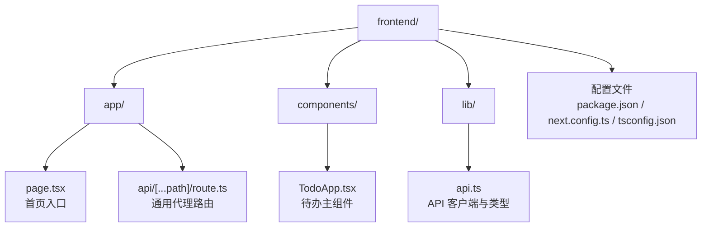
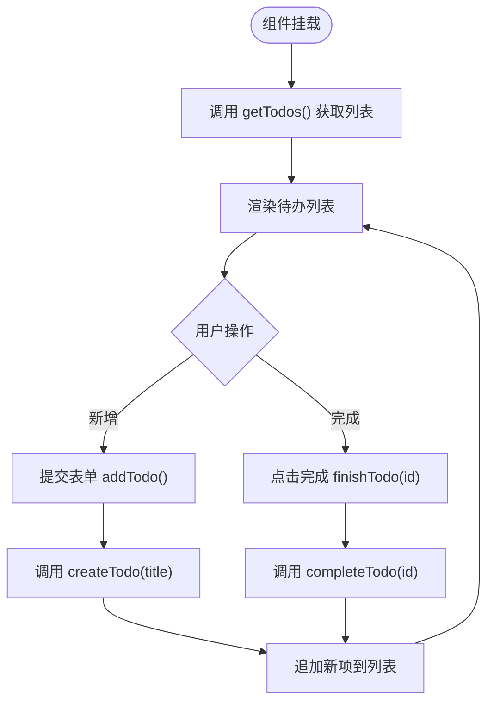
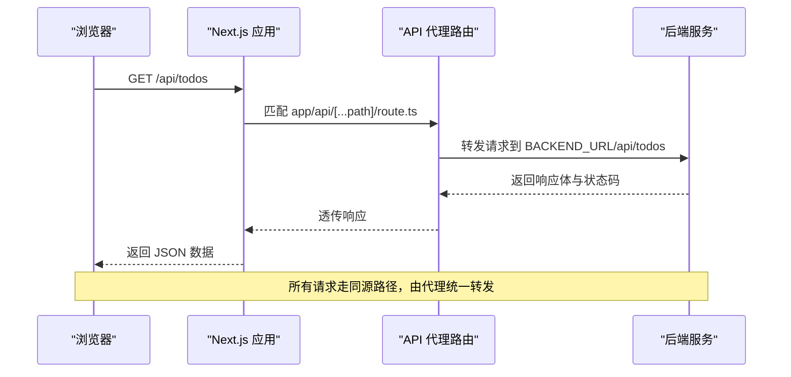
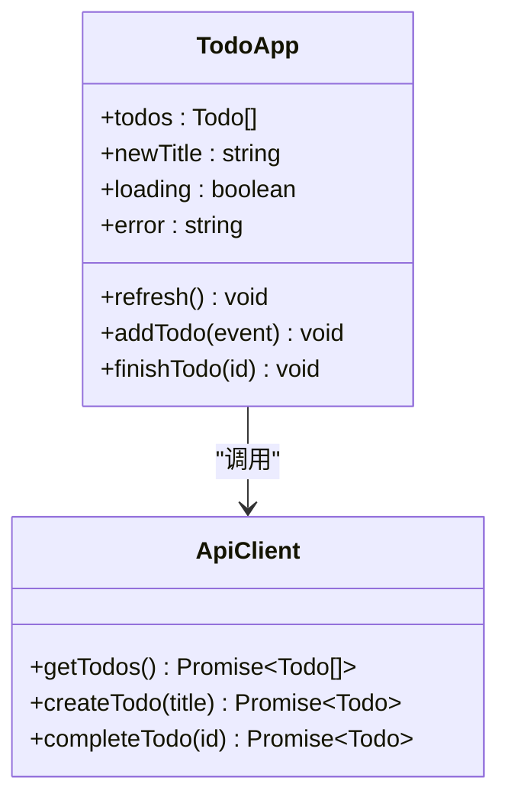
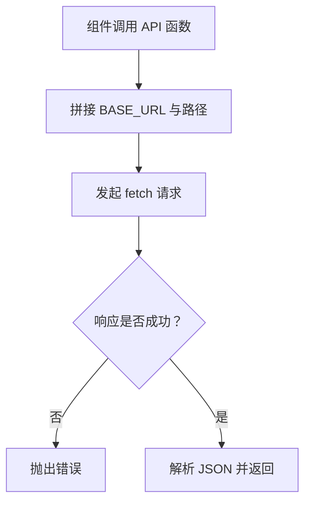
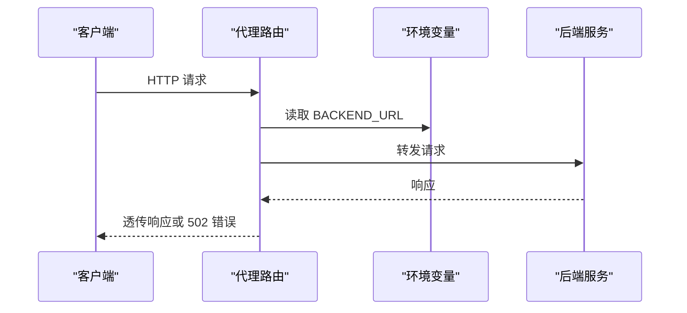
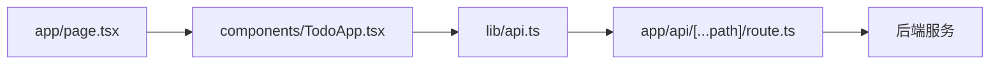
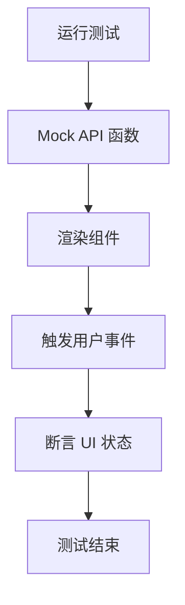

# 前端开发

<cite>
**本文引用的文件**   
- [frontend/package.json](file://frontend/package.json)
- [frontend/next.config.ts](file://frontend/next.config.ts)
- [frontend/app/page.tsx](file://frontend/app/page.tsx)
- [frontend/components/TodoApp.tsx](file://frontend/components/TodoApp.tsx)
- [frontend/lib/api.ts](file://frontend/lib/api.ts)
- [frontend/app/api/[...path]/route.ts](file://frontend/app/api/[...path]/route.ts)
- [frontend/components/TodoApp.test.tsx](file://frontend/components/TodoApp.test.tsx)
- [frontend/app/api/[...path]/route.test.ts](file://frontend/app/api/[...path]/route.test.ts)
- [frontend/vitest.config.ts](file://frontend/vitest.config.ts)
- [frontend/vitest.setup.ts](file://frontend/vitest.setup.ts)
- [frontend/tsconfig.json](file://frontend/tsconfig.json)
- [frontend/Dockerfile](file://frontend/Dockerfile)
</cite>

## 目录
1. [简介](#简介)
2. [项目结构](#项目结构)
3. [核心组件与状态管理](#核心组件与状态管理)
4. [架构总览](#架构总览)
5. [详细组件分析](#详细组件分析)
6. [依赖关系分析](#依赖关系分析)
7. [性能与构建配置](#性能与构建配置)
8. [测试策略](#测试策略)
9. [样式定制指南](#样式定制指南)
10. [故障排查](#故障排查)
11. [结论](#结论)

## 简介
本前端应用基于 React 19 与 Next.js 16，采用现代的前端工程化方案：TypeScript 类型安全、Vitest 单元测试、Next.js App Router 路由与 API 路由、Docker 容器化部署。应用的核心是 Todo 待办事项功能，包含列表展示、新增待办、完成待办等交互；通过同源代理将浏览器请求转发到后端服务，从而避免跨域问题并统一错误处理。

该文档面向开发者与维护者，既提供高层架构说明，也深入到组件实现、API 客户端封装、代理路由、类型定义、测试与构建配置等技术细节，帮助读者快速理解并扩展系统。

## 项目结构
前端代码位于 `frontend` 目录，采用 Next.js App Router 的约定式目录结构：
- `app/`：页面与 API 路由
- `components/`：可复用 UI 组件
- `lib/`：业务逻辑与 API 客户端
- 根级配置文件：`package.json`、`next.config.ts`、`tsconfig.json`、`vitest.config.ts`、`Dockerfile`

**图表来源**
- [frontend/app/page.tsx:1-6](file://frontend/app/page.tsx#L1-L6)
- [frontend/app/api/[...path]/route.ts:1-77](file://frontend/app/api/[...path]/route.ts#L1-L77)
- [frontend/components/TodoApp.tsx:1-109](file://frontend/components/TodoApp.tsx#L1-L109)
- [frontend/lib/api.ts:1-36](file://frontend/lib/api.ts#L1-L36)

**章节来源**
- [frontend/package.json:1-34](file://frontend/package.json#L1-L34)
- [frontend/next.config.ts:1-9](file://frontend/next.config.ts#L1-L9)
- [frontend/app/page.tsx:1-6](file://frontend/app/page.tsx#L1-L6)

## 核心组件与状态管理
TodoApp 是应用的唯一业务组件，负责：
- 维护待办列表、新增标题、加载状态与错误信息
- 在挂载时拉取待办列表
- 提交表单创建新待办
- 点击“完成”更新单条待办状态
- 统一错误提示与加载反馈

状态管理采用 React 内置的 `useState` 与 `useEffect`，保持轻量且易于理解。所有网络请求通过 `lib/api.ts` 暴露的函数进行封装，组件不直接调用 `fetch`，便于测试与替换实现。

**图表来源**
- [frontend/components/TodoApp.tsx:6-109](file://frontend/components/TodoApp.tsx#L6-L109)
- [frontend/lib/api.ts:21-35](file://frontend/lib/api.ts#L21-L35)

**章节来源**
- [frontend/components/TodoApp.tsx:1-109](file://frontend/components/TodoApp.tsx#L1-L109)
- [frontend/lib/api.ts:1-36](file://frontend/lib/api.ts#L1-L36)

## 架构总览
前端通过 Next.js 应用服务器提供静态资源与页面，同时使用 API 路由作为同源代理，把 `/api/todos` 的请求转发到后端服务。浏览器只与前端同域通信，避免跨域配置复杂性。

**图表来源**
- [frontend/app/api/[...path]/route.ts:1-77](file://frontend/app/api/[...path]/route.ts#L1-L77)
- [frontend/lib/api.ts:11-35](file://frontend/lib/api.ts#L11-L35)

**章节来源**
- [frontend/app/api/[...path]/route.ts:1-77](file://frontend/app/api/[...path]/route.ts#L1-L77)
- [frontend/lib/api.ts:1-36](file://frontend/lib/api.ts#L1-L36)

## 详细组件分析

### TodoApp 组件
TodoApp 是一个客户端组件（`'use client'`），使用 React Hooks 管理本地状态，并通过 `lib/api.ts` 提供的函数与后端交互。其职责包括：
- 初始化时调用 `getTodos()` 拉取数据
- 表单提交时调用 `createTodo(title)` 并乐观更新列表
- 完成按钮调用 `completeTodo(id)` 并就地更新对应条目
- 统一的错误处理与加载提示

**图表来源**
- [frontend/components/TodoApp.tsx:1-109](file://frontend/components/TodoApp.tsx#L1-L109)
- [frontend/lib/api.ts:1-36](file://frontend/lib/api.ts#L1-L36)

**章节来源**
- [frontend/components/TodoApp.tsx:1-109](file://frontend/components/TodoApp.tsx#L1-L109)

### API 客户端封装
`lib/api.ts` 定义了 `Todo` 类型与三个 API 方法：
- `getTodos()`：获取待办列表
- `createTodo(title)`：新增待办
- `completeTodo(id)`：完成指定待办

内部使用 `fetch` 发起同源请求，统一处理非 2xx 响应并抛出错误，组件侧捕获后显示友好提示。

**图表来源**
- [frontend/lib/api.ts:11-35](file://frontend/lib/api.ts#L11-L35)

**章节来源**
- [frontend/lib/api.ts:1-36](file://frontend/lib/api.ts#L1-L36)

### 同源代理路由
`app/api/[...path]/route.ts` 实现了通用代理路由：
- 从环境变量 `BACKEND_URL` 或默认值读取后端地址
- 将 Next.js 接收到的请求路径与方法、查询串、请求头与请求体转发到后端
- 透传上游响应的状态码与内容类型
- 当后端不可达时返回 502 错误

**图表来源**
- [frontend/app/api/[...path]/route.ts:1-77](file://frontend/app/api/[...path]/route.ts#L1-L77)

**章节来源**
- [frontend/app/api/[...path]/route.ts:1-77](file://frontend/app/api/[...path]/route.ts#L1-L77)

## 依赖关系分析
前端依赖关系如下：
- 页面入口 `app/page.tsx` 渲染 `TodoApp`
- `TodoApp` 依赖 `lib/api.ts` 提供的 API 函数与类型
- `lib/api.ts` 通过 `fetch` 访问同源 `/api/todos`
- `app/api/[...path]/route.ts` 将 `/api/*` 请求转发到后端服务

**图表来源**
- [frontend/app/page.tsx:1-6](file://frontend/app/page.tsx#L1-L6)
- [frontend/components/TodoApp.tsx:1-109](file://frontend/components/TodoApp.tsx#L1-L109)
- [frontend/lib/api.ts:1-36](file://frontend/lib/api.ts#L1-L36)
- [frontend/app/api/[...path]/route.ts:1-77](file://frontend/app/api/[...path]/route.ts#L1-L77)

**章节来源**
- [frontend/app/page.tsx:1-6](file://frontend/app/page.tsx#L1-L6)
- [frontend/components/TodoApp.tsx:1-109](file://frontend/components/TodoApp.tsx#L1-L109)
- [frontend/lib/api.ts:1-36](file://frontend/lib/api.ts#L1-L36)
- [frontend/app/api/[...path]/route.ts:1-77](file://frontend/app/api/[...path]/route.ts#L1-L77)

## 性能与构建配置
- **Next.js 输出模式**：配置为 `standalone`，产物自带最小依赖与 `server.js`，适合容器运行。
- **Node 版本要求**：`package.json` 中声明 Node 引擎版本不低于 20.9.0。
- **运行时环境**：Docker 镜像使用 `node:24-alpine`，设置 `NODE_ENV=production`、`PORT=3000`、`HOSTNAME=0.0.0.0`，并通过环境变量 `BACKEND_URL` 控制后端地址。
- **TypeScript 编译选项**：启用严格模式、ESNext 模块解析、React JSX 转换、增量编译，并支持 `@/*` 路径别名。

优化建议：
- 利用 Next.js 的缓存与静态生成特性，对不需要动态数据的页面考虑预渲染。
- 对频繁更新的列表数据，可在组件层做局部更新与去抖处理，减少不必要的重渲染。
- 在生产环境中开启 Next.js 的性能分析与监控，定位瓶颈。

**章节来源**
- [frontend/next.config.ts:1-9](file://frontend/next.config.ts#L1-L9)
- [frontend/package.json:1-34](file://frontend/package.json#L1-L34)
- [frontend/Dockerfile:1-27](file://frontend/Dockerfile#L1-L27)
- [frontend/tsconfig.json:1-42](file://frontend/tsconfig.json#L1-L42)

## 测试策略
前端测试基于 Vitest 与 Testing Library：
- 组件测试：模拟 `lib/api.ts` 的导出函数，验证渲染结果、用户交互与错误提示。
- 代理路由测试：在 node 环境下 mock `fetch`，验证路径拼接、查询串透传、请求体与方法透传、非 2xx 状态码透传以及后端不可达时的 502 响应。

**图表来源**
- [frontend/components/TodoApp.test.tsx:1-81](file://frontend/components/TodoApp.test.tsx#L1-L81)
- [frontend/app/api/[...path]/route.test.ts:1-102](file://frontend/app/api/[...path]/route.test.ts#L1-L102)
- [frontend/vitest.config.ts:1-15](file://frontend/vitest.config.ts#L1-L15)
- [frontend/vitest.setup.ts:1-9](file://frontend/vitest.setup.ts#L1-L9)

**章节来源**
- [frontend/components/TodoApp.test.tsx:1-81](file://frontend/components/TodoApp.test.tsx#L1-L81)
- [frontend/app/api/[...path]/route.test.ts:1-102](file://frontend/app/api/[...path]/route.test.ts#L1-L102)
- [frontend/vitest.config.ts:1-15](file://frontend/vitest.config.ts#L1-L15)
- [frontend/vitest.setup.ts:1-9](file://frontend/vitest.setup.ts#L1-L9)

## 样式定制指南
当前 TodoApp 使用类名组织样式（如 `.todo-app`、`.todo-form`、`.todo-list`、`.done`、`.badge`、`.complete`、`.hint`、`.error`）。建议在 `app/globals.css` 中集中定义这些样式，或通过 CSS Modules、Tailwind 等方案进行扩展。

建议：
- 为每个语义化类名编写清晰样式规则，确保无障碍属性（如 `aria-label`）与视觉一致。
- 对空状态、加载状态与错误状态分别设计友好的提示文案与布局。
- 若引入第三方样式库，注意与现有类名的命名空间隔离，避免冲突。

**章节来源**
- [frontend/components/TodoApp.tsx:58-106](file://frontend/components/TodoApp.tsx#L58-L106)

## 故障排查
常见问题与定位思路：
- **后端不可达**：代理路由在捕获异常时返回 502，检查 `BACKEND_URL` 环境变量是否正确配置，确认后端服务是否启动。
- **请求失败提示**：API 客户端对非 2xx 响应抛出错误，组件会显示错误消息；检查后端返回的状态码与响应体。
- **列表未更新**：确认 `createTodo` 与 `completeTodo` 返回值结构与 `Todo` 类型一致，确保组件能就地更新状态。
- **测试失败**：组件测试需 mock API 函数；代理路由测试需在 node 环境并 mock `fetch`，检查用例中的断言是否与实现一致。

**章节来源**
- [frontend/app/api/[...path]/route.ts:30-52](file://frontend/app/api/[...path]/route.ts#L30-L52)
- [frontend/lib/api.ts:13-19](file://frontend/lib/api.ts#L13-L19)
- [frontend/components/TodoApp.tsx:12-56](file://frontend/components/TodoApp.tsx#L12-L56)
- [frontend/app/api/[...path]/route.test.ts:93-100](file://frontend/app/api/[...path]/route.test.ts#L93-L100)

## 结论
本前端应用以 React 19 与 Next.js 16 为基础，采用清晰的组件化设计与轻量状态管理，通过 API 客户端与同源代理路由实现前后端解耦。配合 TypeScript、Vitest 测试与 Docker 构建，形成完整的前端工程体系。后续可扩展更多业务组件、引入更丰富的状态管理方案，并结合 Next.js 的高级特性提升性能与可维护性。