# 前端开发

<cite>
**本文引用的文件**   
- [frontend/package.json](file://frontend/package.json)
- [frontend/next.config.ts](file://frontend/next.config.ts)
- [frontend/app/layout.tsx](file://frontend/app/layout.tsx)
- [frontend/app/page.tsx](file://frontend/app/page.tsx)
- [frontend/app/home.module.css](file://frontend/app/home.module.css)
- [frontend/app/auth.module.css](file://frontend/app/auth.module.css)
- [frontend/app/community/page.tsx](file://frontend/app/community/page.tsx)
- [frontend/app/attractions/page.tsx](file://frontend/app/attractions/page.tsx)
- [frontend/app/login/page.tsx](file://frontend/app/login/page.tsx)
- [frontend/app/register/page.tsx](file://frontend/app/register/page.tsx)
- [frontend/components/home/city-switcher.tsx](file://frontend/components/home/city-switcher.tsx)
- [frontend/components/home/editor-picks.tsx](file://frontend/components/home/editor-picks.tsx)
- [frontend/components/home/hot-posts.tsx](file://frontend/components/home/hot-posts.tsx)
- [frontend/components/home/hot-attractions.tsx](file://frontend/components/home/hot-attractions.tsx)
- [frontend/components/home/hot-attractions.module.css](file://frontend/components/home/hot-attractions.module.css)
- [frontend/components/home/hot-attractions.test.tsx](file://frontend/components/home/hot-attractions.test.tsx)
- [frontend/components/home/feature-nav.tsx](file://frontend/components/home/feature-nav.tsx)
- [frontend/components/home/ai-assistant.tsx](file://frontend/components/home/ai-assistant.tsx)
- [frontend/components/home/use-section-data.ts](file://frontend/components/home/use-section-data.ts)
- [frontend/components/home/section-state.tsx](file://frontend/components/home/section-state.tsx)
- [frontend/components/site/placeholder.tsx](file://frontend/components/site/placeholder.tsx)
- [frontend/components/site/placeholder.module.css](file://frontend/components/site/placeholder.module.css)
- [frontend/components/site/site-header.tsx](file://frontend/components/site/site-header.tsx)
- [frontend/components/site/site-footer.tsx](file://frontend/components/site/site-footer.tsx)
- [frontend/components/auth/auth-provider.tsx](file://frontend/components/auth/auth-provider.tsx)
- [frontend/components/auth/auth-form.tsx](file://frontend/components/auth/auth-form.tsx)
- [frontend/lib/home/repository.ts](file://frontend/lib/home/repository.ts)
- [frontend/lib/auth/mock-auth.ts](file://frontend/lib/auth/mock-auth.ts)
- [frontend/app/api/[...path]/route.ts](file://frontend/app/api/[...path]/route.ts)
- [frontend/vitest.config.ts](file://frontend/vitest.config.ts)
- [frontend/vitest.setup.ts](file://frontend/vitest.setup.ts)
- [frontend/tsconfig.json](file://frontend/tsconfig.json)
- [frontend/Dockerfile](file://frontend/Dockerfile)
- [playwright.config.ts](file://playwright.config.ts)
- [package.json](file://package.json)
- [scripts/e2e-run.mjs](file://scripts/e2e-run.mjs)
- [docs/e2e/README.md](file://docs/e2e/README.md)
- [docs/e2e/support/global-setup.ts](file://docs/e2e/support/global-setup.ts)
- [docs/e2e/support/fixtures.ts](file://docs/e2e/support/fixtures.ts)
- [docs/e2e/support/helpers.ts](file://docs/e2e/support/helpers.ts)
- [docs/e2e/homepage-hero.spec.ts](file://docs/e2e/homepage-hero.spec.ts)
- [docs/e2e/homepage-u8-hot-attractions.spec.ts](file://docs/e2e/homepage-u8-hot-attractions.spec.ts)
- [docs/e2e/homepage-u5-city-switcher.spec.ts](file://docs/e2e/homepage-u5-city-switcher.spec.ts)
</cite>

## 更新摘要
**变更内容**   
- 新增 Playwright E2E 端到端测试套件，提供真实浏览器自动化测试能力
- 增强响应式设计验证，覆盖桌面端、移动端和超窄屏多视口测试
- 完善可访问性测试，包括语义化标记、键盘导航和无障碍属性验证
- 集成自动化截图和失败诊断工具，提升测试调试体验
- 新增端口自动探测和 Web 服务器管理脚本

## 目录
1. [简介](#简介)
2. [项目结构](#项目结构)
3. [核心架构与设计模式](#核心架构与设计模式)
4. [wanderchain 旅行平台首页](#wanderchain-旅行平台首页)
5. [认证系统与用户管理](#认证系统与用户管理)
6. [站点框架与通用组件](#站点框架与通用组件)
7. [Todo 待办应用](#todo-待办应用)
8. [数据层与类型系统](#数据层与类型系统)
9. [状态管理与用户体验](#状态管理与用户体验)
10. [API 客户端与代理路由](#api-客户端与代理路由)
11. [端到端测试与质量保证](#端到端测试与质量保证)
12. [依赖关系分析](#依赖关系分析)
13. [性能与构建配置](#性能与构建配置)
14. [测试策略](#测试策略)
15. [样式定制指南](#样式定制指南)
16. [故障排查](#故障排查)
17. [结论](#结论)

## 简介
本前端应用基于 React 19 与 Next.js 16，采用现代的前端工程化方案：TypeScript 类型安全、Vitest 单元测试、Playwright 端到端测试、Next.js App Router 路由与 API 路由、Docker 容器化部署。应用已从简单的 Todo 待办功能扩展为完整的 wanderchain 旅行平台，包含城市筛选、编辑推荐、热门帖子、热门景点、AI 助手入口、用户认证等丰富功能。

应用采用清晰的组件化设计，通过 HomeRepository 接口抽象数据源，支持 Mock 数据与真实 API 的无缝切换。认证系统基于本地存储的 Mock 实现，便于前端开发和演示。所有网络请求通过 `lib/api.ts` 暴露的函数进行封装，配合同源代理路由避免跨域问题并统一错误处理。

该文档面向开发者与维护者，既提供高层架构说明，也深入到组件实现、数据层设计、状态管理、API 客户端封装、代理路由、类型定义、测试与构建配置等技术细节，帮助读者快速理解并扩展系统。

## 项目结构
前端代码位于 `frontend` 目录，采用 Next.js App Router 的约定式目录结构：
- `app/`：页面与 API 路由，包含旅行平台首页、认证页面、占位页面和通用代理路由
- `components/`：可复用 UI 组件，分为 home（旅行平台）、auth（认证）、site（站点框架）等模块
- `lib/`：业务逻辑与 API 客户端，包含 home（旅行平台数据层）、auth（认证服务）和 api（通用 API 客户端）
- 根级配置文件：`package.json`、`next.config.ts`、`tsconfig.json`、`vitest.config.ts`、`Dockerfile`

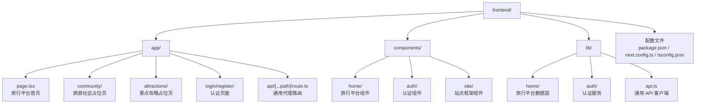

**图表来源**
- [frontend/app/page.tsx:1-126](file://frontend/app/page.tsx#L1-L126)
- [frontend/app/community/page.tsx:1-18](file://frontend/app/community/page.tsx#L1-L18)
- [frontend/app/attractions/page.tsx:1-18](file://frontend/app/attractions/page.tsx#L1-L18)
- [frontend/app/login/page.tsx:1-29](file://frontend/app/login/page.tsx#L1-L29)
- [frontend/app/api/[...path]/route.ts:1-77](file://frontend/app/api/[...path]/route.ts#L1-L77)

**章节来源**
- [frontend/package.json:1-34](file://frontend/package.json#L1-L34)
- [frontend/next.config.ts:1-9](file://frontend/next.config.ts#L1-L9)
- [frontend/app/page.tsx:1-126](file://frontend/app/page.tsx#L1-L126)

## 核心架构与设计模式
wanderchain 旅行平台采用以下核心设计模式：

### 数据层抽象
通过 `HomeRepository` 接口定义数据契约，使用 `mockRepository` 实现 Mock 数据，未来可轻松切换到真实 API 实现而不影响组件层。

### 认证上下文模式
使用 React Context 管理用户认证状态，`AuthProvider` 提供全局认证状态和操作方法，`useAuth` Hook 供组件访问认证信息。

### 组件化设计
每个功能模块独立成组件，如 CitySwitcher、EditorPicks、HotPosts 等，组件间通过 props 传递数据和回调。

### 状态管理
使用 React Hooks 进行轻量状态管理，`useSectionData` Hook 统一管理区块级数据加载状态。

### 类型安全
完整的 TypeScript 类型定义，包括 CitySlug、EditorPick、Post、Attraction、AuthUser 等业务类型，确保编译时类型检查。

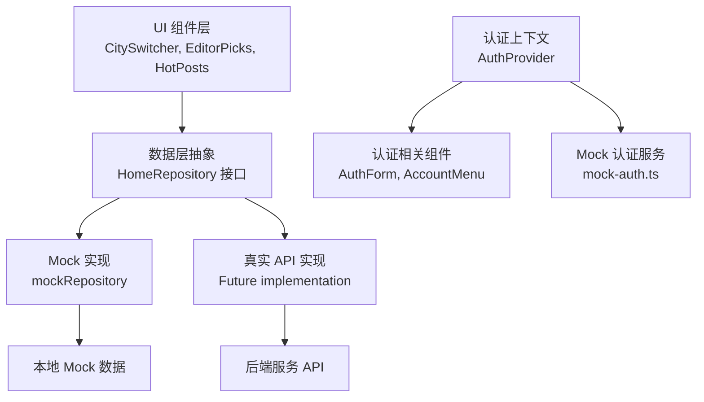

**图表来源**
- [frontend/lib/home/repository.ts:9-13](file://frontend/lib/home/repository.ts#L9-L13)
- [frontend/lib/home/repository.ts:49-68](file://frontend/lib/home/repository.ts#L49-L68)
- [frontend/components/auth/auth-provider.tsx:31-76](file://frontend/components/auth/auth-provider.tsx#L31-L76)
- [frontend/lib/auth/mock-auth.ts:133-191](file://frontend/lib/auth/mock-auth.ts#L133-L191)

**章节来源**
- [frontend/lib/home/repository.ts:1-69](file://frontend/lib/home/repository.ts#L1-L69)

## wanderchain 旅行平台首页
旅行平台首页是应用的主要入口，集成了城市筛选、功能导航、编辑推荐、热门帖子、热门景点等多个功能模块。

### 首页组件结构
HomePage 组件作为服务器组件，负责：
- 解析 URL 查询参数中的城市信息
- 组装各功能模块组件
- 提供统一的页面布局和数据流

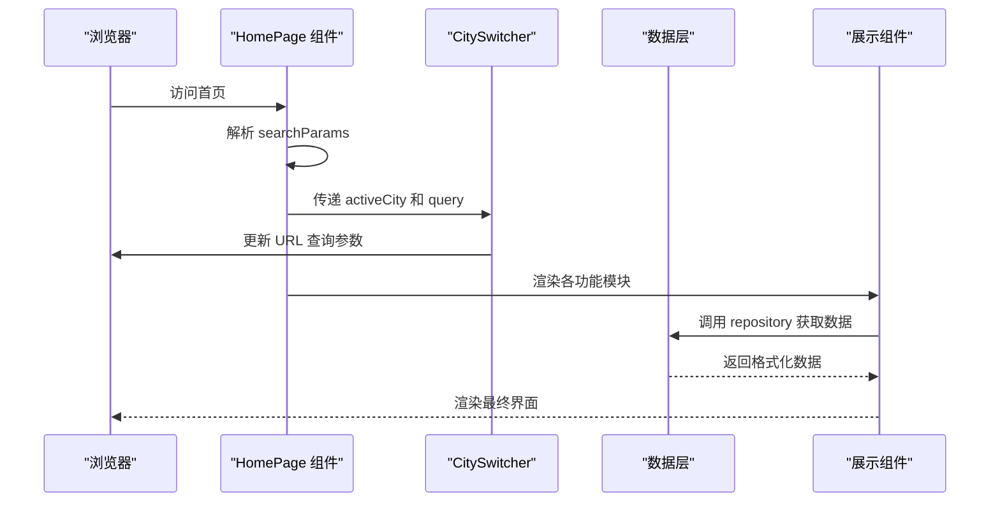

**图表来源**
- [frontend/app/page.tsx:37-125](file://frontend/app/page.tsx#L37-L125)
- [frontend/components/home/city-switcher.tsx:13-31](file://frontend/components/home/city-switcher.tsx#L13-L31)

### 核心功能模块

#### 城市筛选器 (CitySwitcher)
用户可通过点击不同城市按钮来筛选内容，URL 查询参数会相应更新，其他组件监听城市变化重新加载数据。

#### 功能导航 (FeatureNav)
提供三个主要入口：旅游社区、景点攻略、AI 助手，每个入口都有独特的图标和描述。

#### 数据展示组件
- **EditorPicks**：展示编辑精选的旅行路线，按排序权重显示
- **HotPosts**：展示热门帖子，按评论数、浏览量和发布时间排序
- **HotAttractions**：展示热门景点，按浏览量和评分排序，具备完善的响应式设计

**章节来源**
- [frontend/app/page.tsx:37-125](file://frontend/app/page.tsx#L37-L125)
- [frontend/components/home/city-switcher.tsx:13-73](file://frontend/components/home/city-switcher.tsx#L13-L73)

## 认证系统与用户管理
wanderchain 旅行平台提供了完整的用户认证系统，基于前端本地存储的 Mock 实现，便于开发和演示。

### 认证架构
认证系统采用 Provider-Consumer 模式：
- **AuthProvider**：提供全局认证状态和操作方法的 Context Provider
- **useAuth Hook**：供组件访问认证状态的自定义 Hook
- **Mock 认证服务**：基于 localStorage 的用户数据存储和会话管理

### 用户界面
- **登录页面** (`/login`)：用户登录表单，支持邮箱密码验证
- **注册页面** (`/register`)：新用户注册，包含用户名、邮箱、密码确认
- **账户菜单**：已登录用户的下拉菜单，显示用户信息和登出选项

### 数据持久化
认证数据存储在浏览器 localStorage 中：
- **用户账户**：`wanderchain.accounts` - 存储注册用户信息
- **会话信息**：`wanderchain.session` - 存储登录状态和令牌
- **会话过期**：8小时自动过期机制

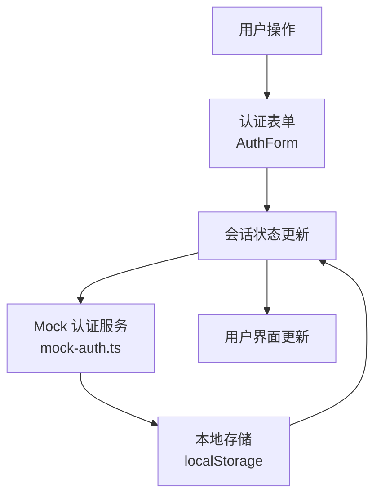

**图表来源**
- [frontend/components/auth/auth-provider.tsx:42-76](file://frontend/components/auth/auth-provider.tsx#L42-L76)
- [frontend/lib/auth/mock-auth.ts:117-191](file://frontend/lib/auth/mock-auth.ts#L117-L191)

**章节来源**
- [frontend/components/auth/auth-provider.tsx:1-77](file://frontend/components/auth/auth-provider.tsx#L1-L77)
- [frontend/lib/auth/mock-auth.ts:1-191](file://frontend/lib/auth/mock-auth.ts#L1-L191)
- [frontend/app/login/page.tsx:1-29](file://frontend/app/login/page.tsx#L1-L29)
- [frontend/components/auth/auth-form.tsx:1-139](file://frontend/components/auth/auth-form.tsx#L1-L139)

## 站点框架与通用组件
wanderchain 旅行平台提供了完整的站点框架组件，确保一致的视觉风格和用户体验。

### 站点头部 (SiteHeader)
- 品牌标识和导航链接
- AI 助手触发按钮
- 响应式设计，适配移动端

### 站点底部 (SiteFooter)
- 版权信息和法律声明
- 相关链接和功能入口
- 统一的视觉风格

### 占位页面 (PlaceholderPage)
增强了占位页面的导航功能，现在集成了 SiteHeader 和 SiteFooter 组件，提供完整的站点框架体验。

- 用于尚未开发的板块
- 提供友好的提示信息
- 引导用户回到首页
- 完整的站点导航和页脚信息

### 全局布局 (RootLayout)
- 认证提供者包裹整个应用
- AI 助手提供者包裹整个应用
- 无障碍访问支持（跳过链接）
- 全局元数据和样式导入

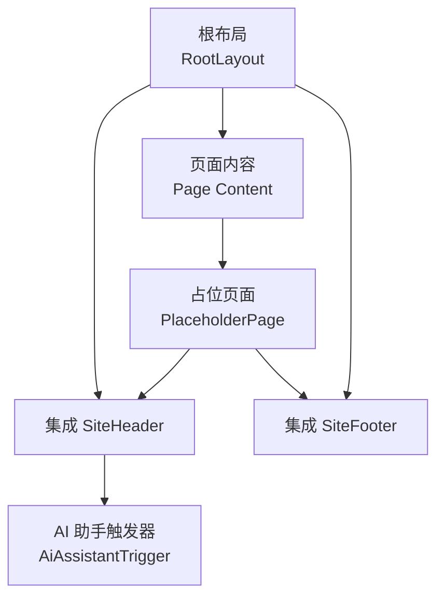

**图表来源**
- [frontend/app/layout.tsx:16-34](file://frontend/app/layout.tsx#L16-L34)
- [frontend/components/site/placeholder.tsx:11-33](file://frontend/components/site/placeholder.tsx#L11-L33)

**章节来源**
- [frontend/app/layout.tsx:1-35](file://frontend/app/layout.tsx#L1-L35)
- [frontend/components/site/placeholder.tsx:1-36](file://frontend/components/site/placeholder.tsx#L1-L36)
- [frontend/components/site/placeholder.module.css:1-58](file://frontend/components/site/placeholder.module.css#L1-L58)
- [frontend/app/community/page.tsx:1-18](file://frontend/app/community/page.tsx#L1-L18)
- [frontend/app/attractions/page.tsx:1-18](file://frontend/app/attractions/page.tsx#L1-L18)

## Todo 待办应用
Todo 应用作为基础示例组件仍然保留，展示了基础的 React 状态管理和 API 交互模式。

### TodoApp 组件
TodoApp 是一个客户端组件，使用 React Hooks 管理本地状态，并通过 `lib/api.ts` 提供的函数与后端交互。其职责包括：
- 初始化时调用 `getTodos()` 拉取数据
- 表单提交时调用 `createTodo(title)` 并乐观更新列表
- 完成按钮调用 `completeTodo(id)` 并就地更新对应条目
- 统一的错误处理与加载提示

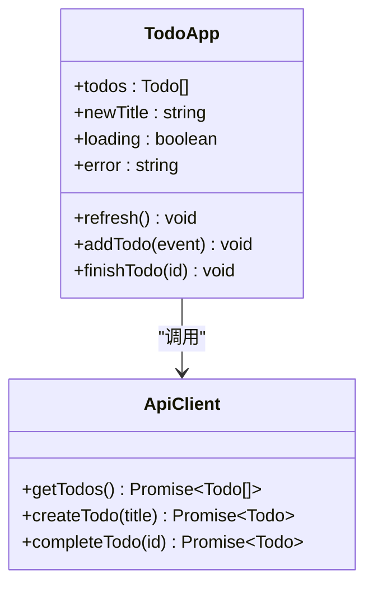

**图表来源**
- [frontend/components/TodoApp.tsx:1-109](file://frontend/components/TodoApp.tsx#L1-L109)
- [frontend/lib/api.ts:1-36](file://frontend/lib/api.ts#L1-L36)

**章节来源**
- [frontend/components/TodoApp.tsx:1-109](file://frontend/components/TodoApp.tsx#L1-L109)

## 数据层与类型系统
wanderchain 旅行平台的数据层采用接口抽象设计，便于未来切换到真实 API。

### 类型定义
定义了完整的业务类型：
- **CitySlug**：城市标识符，包含 all、beijing、shanghai 等 8 个城市
- **EditorPick**：编辑精选路线，包含标题、摘要、封面图、编辑者等信息
- **Post**：帖子信息，包含作者、评论数、浏览量、发布时间等
- **Attraction**：景点信息，包含名称、评分、浏览量、封面图等
- **ListQuery** 和 **ListResult**：通用的列表查询和结果类型
- **AuthUser**：用户信息，包含 id、email、name、role 等字段

### 仓库模式
`HomeRepository` 接口定义了三个核心方法：
- `listEditorPicks(query)`：获取编辑精选
- `listHotPosts(query)`：获取热门帖子
- `listHotAttractions(query)`：获取热门景点

`mockRepository` 实现了这些接口，使用本地 Mock 数据并提供分页、排序、城市过滤等功能。

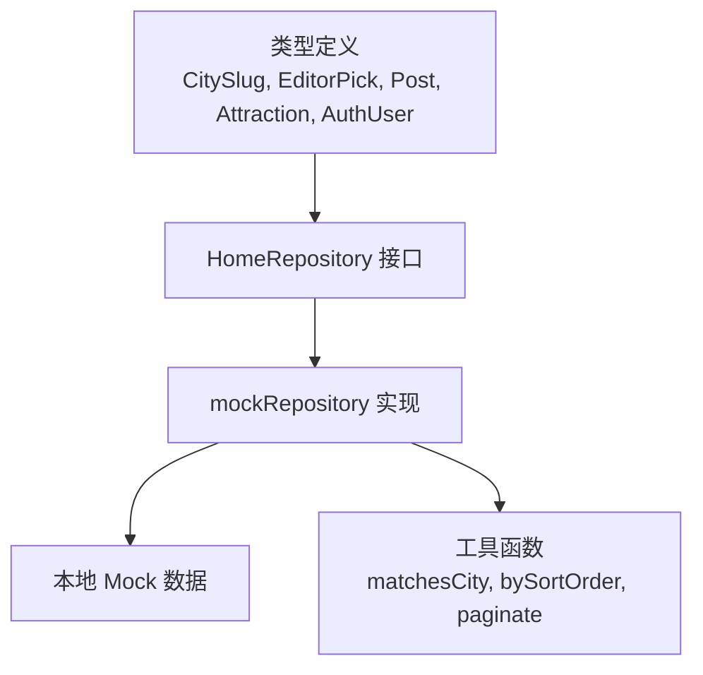

**图表来源**
- [frontend/lib/home/repository.ts:9-13](file://frontend/lib/home/repository.ts#L9-L13)
- [frontend/lib/home/repository.ts:49-68](file://frontend/lib/home/repository.ts#L49-L68)

**章节来源**
- [frontend/lib/home/repository.ts:1-69](file://frontend/lib/home/repository.ts#L1-L69)

## 状态管理与用户体验
### 区块级状态管理
`useSectionData` Hook 提供了统一的区块数据加载状态管理：
- **loading**：数据加载中，显示加载指示器
- **error**：数据加载失败，显示错误提示
- **ready**：数据加载成功，显示具体内容

### 空状态处理
每个数据展示组件都实现了完善的空状态处理：
- 无数据时显示友好的提示信息
- 根据城市筛选条件动态调整空状态文案
- 提供引导用户探索其他内容的链接

### AI 助手体验
AI 助手采用 Context Provider 模式管理全局状态：
- 提供打开/关闭助手的统一接口
- 支持键盘无障碍操作（Escape 键关闭）
- 焦点管理，自动恢复焦点到触发元素
- 模态框语义化标记，支持屏幕阅读器

### 认证状态管理
认证系统提供三种状态：
- **loading**：初始加载状态，读取本地会话
- **guest**：访客状态，未登录用户
- **user**：已登录状态，显示用户信息

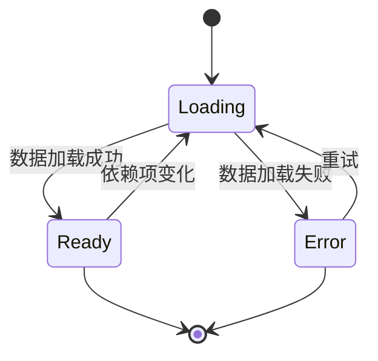

**图表来源**
- [frontend/components/home/use-section-data.ts:6-9](file://frontend/components/home/use-section-data.ts#L6-L9)
- [frontend/components/home/use-section-data.ts:15-43](file://frontend/components/home/use-section-data.ts#L15-L43)

**章节来源**
- [frontend/components/home/use-section-data.ts:1-44](file://frontend/components/home/use-section-data.ts#L1-L44)
- [frontend/components/home/section-state.tsx:1-24](file://frontend/components/home/section-state.tsx#L1-L24)
- [frontend/components/home/ai-assistant.tsx:42-121](file://frontend/components/home/ai-assistant.tsx#L42-L121)

## API 客户端与代理路由
前端通过 Next.js 应用服务器提供静态资源与页面，同时使用 API 路由作为同源代理，把 `/api/todos` 的请求转发到后端服务。浏览器只与前端同域通信，避免跨域配置复杂性。

### API 客户端封装
`lib/api.ts` 定义了 `Todo` 类型与三个 API 方法：
- `getTodos()`：获取待办列表
- `createTodo(title)`：新增待办
- `completeTodo(id)`：完成指定待办

内部使用 `fetch` 发起同源请求，统一处理非 2xx 响应并抛出错误，组件侧捕获后显示友好提示。

### 同源代理路由
`app/api/[...path]/route.ts` 实现了通用代理路由：
- 从环境变量 `BACKEND_URL` 或默认值读取后端地址
- 将 Next.js 接收到的请求路径与方法、查询串、请求头与请求体转发到后端
- 透传上游响应的状态码与内容类型
- 当后端不可达时返回 502 错误

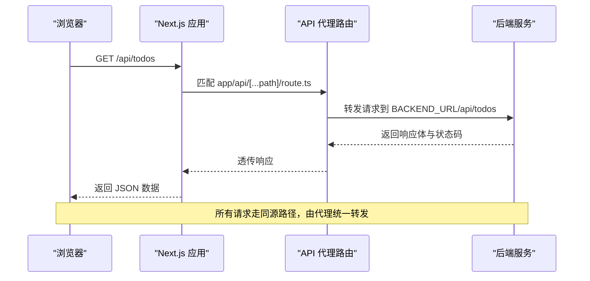

**图表来源**
- [frontend/app/api/[...path]/route.ts:1-77](file://frontend/app/api/[...path]/route.ts#L1-L77)
- [frontend/lib/api.ts:11-35](file://frontend/lib/api.ts#L11-L35)

**章节来源**
- [frontend/lib/api.ts:1-36](file://frontend/lib/api.ts#L1-L36)
- [frontend/app/api/[...path]/route.ts:1-77](file://frontend/app/api/[...path]/route.ts#L1-L77)

## 端到端测试与质量保证
项目新增了完整的 Playwright E2E 测试套件，提供真实浏览器自动化测试能力，确保前端应用的稳定性和质量。

### Playwright 测试架构
E2E 测试位于 `docs/e2e` 目录，采用模块化设计：
- **配置文件**：`playwright.config.ts` 定义测试环境、浏览器配置和报告设置
- **测试用例**：按功能模块组织，每个 SPEC 对应独立的测试文件
- **支持库**：`support/` 目录包含通用工具函数、fixtures 和辅助方法
- **报告系统**：自动生成 HTML 报告和失败截图

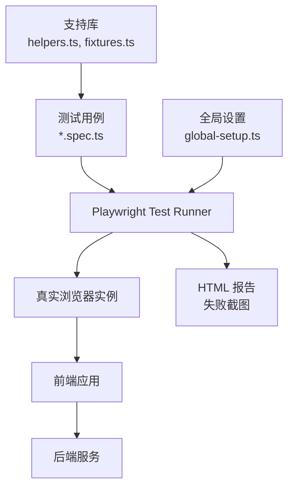

**图表来源**
- [playwright.config.ts:14-54](file://playwright.config.ts#L14-L54)
- [docs/e2e/support/global-setup.ts:9-29](file://docs/e2e/support/global-setup.ts#L9-L29)
- [docs/e2e/support/fixtures.ts:19-48](file://docs/e2e/support/fixtures.ts#L19-L48)

### 多视口响应式测试
测试套件覆盖了多种设备视口，确保响应式设计的正确性：
- **桌面端**：1440×900 像素，模拟主流桌面显示器
- **移动端**：375×667 像素，模拟 iPhone 尺寸
- **超窄屏**：320×667 像素，验证最小屏幕兼容性

### 可访问性测试
E2E 测试包含丰富的可访问性验证：
- **语义化标记**：验证 heading 层级、ARIA 属性和角色
- **键盘导航**：确保所有交互元素可通过键盘操作
- **屏幕阅读器**：验证无障碍标签和描述
- **颜色对比度**：确保文本可读性

### 自动化工作流
- **端口自动探测**：从 3000 开始自动寻找空闲端口
- **Web 服务器管理**：自动启动和管理 next dev 服务器
- **失败截图**：测试失败时自动截取全页截图
- **并行执行控制**：串行执行避免状态冲突

**章节来源**
- [playwright.config.ts:1-55](file://playwright.config.ts#L1-L55)
- [docs/e2e/README.md:1-94](file://docs/e2e/README.md#L1-L94)
- [docs/e2e/support/global-setup.ts:1-30](file://docs/e2e/support/global-setup.ts#L1-L30)
- [docs/e2e/support/fixtures.ts:1-51](file://docs/e2e/support/fixtures.ts#L1-L51)
- [docs/e2e/support/helpers.ts:1-302](file://docs/e2e/support/helpers.ts#L1-L302)
- [scripts/e2e-run.mjs:1-111](file://scripts/e2e-run.mjs#L1-L111)

## 依赖关系分析
前端依赖关系如下：
- 页面入口 `app/page.tsx` 渲染 wanderchain 旅行平台首页
- 首页组件依赖各个功能模块组件：CitySwitcher、EditorPicks、HotPosts、HotAttractions、FeatureNav
- 功能组件依赖 `lib/home/repository.ts` 提供的数据接口
- `lib/home/repository.ts` 使用本地 Mock 数据
- 原有的 TodoApp 组件仍保留，依赖 `lib/api.ts` 提供的 API 函数
- `lib/api.ts` 通过 `fetch` 访问同源 `/api/todos`
- `app/api/[...path]/route.ts` 将 `/api/*` 请求转发到后端服务
- 认证系统依赖 `lib/auth/mock-auth.ts` 提供 Mock 认证服务

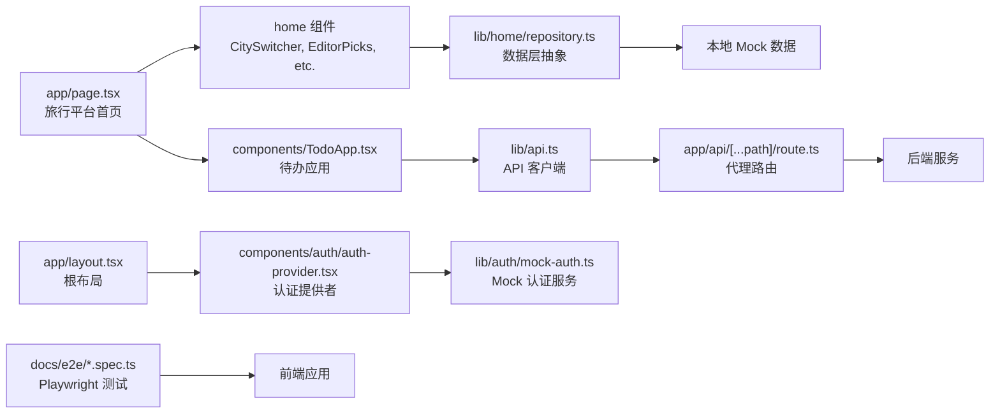

**图表来源**
- [frontend/app/page.tsx:1-126](file://frontend/app/page.tsx#L1-L126)
- [frontend/components/home/city-switcher.tsx:1-74](file://frontend/components/home/city-switcher.tsx#L1-L74)
- [frontend/lib/home/repository.ts:1-69](file://frontend/lib/home/repository.ts#L1-L69)
- [frontend/components/TodoApp.tsx:1-109](file://frontend/components/TodoApp.tsx#L1-L109)
- [frontend/lib/api.ts:1-36](file://frontend/lib/api.ts#L1-L36)
- [frontend/app/api/[...path]/route.ts:1-77](file://frontend/app/api/[...path]/route.ts#L1-L77)
- [frontend/app/layout.tsx:16-34](file://frontend/app/layout.tsx#L16-L34)
- [frontend/components/auth/auth-provider.tsx:42-76](file://frontend/components/auth/auth-provider.tsx#L42-L76)
- [frontend/lib/auth/mock-auth.ts:1-191](file://frontend/lib/auth/mock-auth.ts#L1-L191)

**章节来源**
- [frontend/app/page.tsx:1-126](file://frontend/app/page.tsx#L1-L126)
- [frontend/components/home/city-switcher.tsx:1-74](file://frontend/components/home/city-switcher.tsx#L1-L74)
- [frontend/lib/home/repository.ts:1-69](file://frontend/lib/home/repository.ts#L1-L69)
- [frontend/components/TodoApp.tsx:1-109](file://frontend/components/TodoApp.tsx#L1-L109)
- [frontend/lib/api.ts:1-36](file://frontend/lib/api.ts#L1-L36)
- [frontend/app/api/[...path]/route.ts:1-77](file://frontend/app/api/[...path]/route.ts#L1-L77)
- [frontend/app/layout.tsx:16-34](file://frontend/app/layout.tsx#L16-L34)
- [frontend/components/auth/auth-provider.tsx:42-76](file://frontend/components/auth/auth-provider.tsx#L42-L76)
- [frontend/lib/auth/mock-auth.ts:1-191](file://frontend/lib/auth/mock-auth.ts#L1-L191)

## 性能与构建配置
- **Next.js 输出模式**：配置为 `standalone`，产物自带最小依赖与 `server.js`，适合容器运行。
- **Node 版本要求**：`package.json` 中声明 Node 引擎版本不低于 20.9.0。
- **运行时环境**：Docker 镜像使用 `node:24-alpine`，设置 `NODE_ENV=production`、`PORT=3000`、`HOSTNAME=0.0.0.0`，并通过环境变量 `BACKEND_URL` 控制后端地址。
- **TypeScript 编译选项**：启用严格模式、ESNext 模块解析、React JSX 转换、增量编译，并支持 `@/*` 路径别名。

优化建议：
- 利用 Next.js 的缓存与静态生成特性，对不需要动态数据的页面考虑预渲染。
- 对频繁更新的列表数据，可在组件层做局部更新与去抖处理，减少不必要的重渲染。
- 对图片资源使用懒加载和适当的尺寸优化，提升首屏加载性能。
- 在生产环境中开启 Next.js 的性能分析与监控，定位瓶颈。
- 考虑使用 Next.js 的 Image 组件优化图片加载性能。

**章节来源**
- [frontend/next.config.ts:1-9](file://frontend/next.config.ts#L1-L9)
- [frontend/package.json:1-34](file://frontend/package.json#L1-L34)
- [frontend/Dockerfile:1-27](file://frontend/Dockerfile#L1-L27)
- [frontend/tsconfig.json:1-42](file://frontend/tsconfig.json#L1-L42)

## 测试策略
前端测试采用多层次策略，结合 Vitest 单元测试和 Playwright E2E 测试：

### 单元测试（Vitest）
- **组件测试**：模拟 `lib/home/repository.ts` 的导出函数，验证渲染结果、用户交互与错误提示
- **Todo 组件**：模拟 `lib/api.ts` 的导出函数，验证待办功能的渲染结果、用户交互与错误提示
- **AI 助手组件**：验证上下文状态、模态框打开关闭、键盘事件处理
- **认证组件**：模拟 `lib/auth/mock-auth.ts` 的导出函数，验证登录注册流程

### 端到端测试（Playwright）
- **功能完整性**：验证完整用户流程和业务流程
- **响应式设计**：在多个视口下验证布局和交互
- **可访问性**：确保符合 WCAG 标准和无障碍规范
- **跨浏览器兼容**：支持 Chrome、Firefox、Safari 等主流浏览器

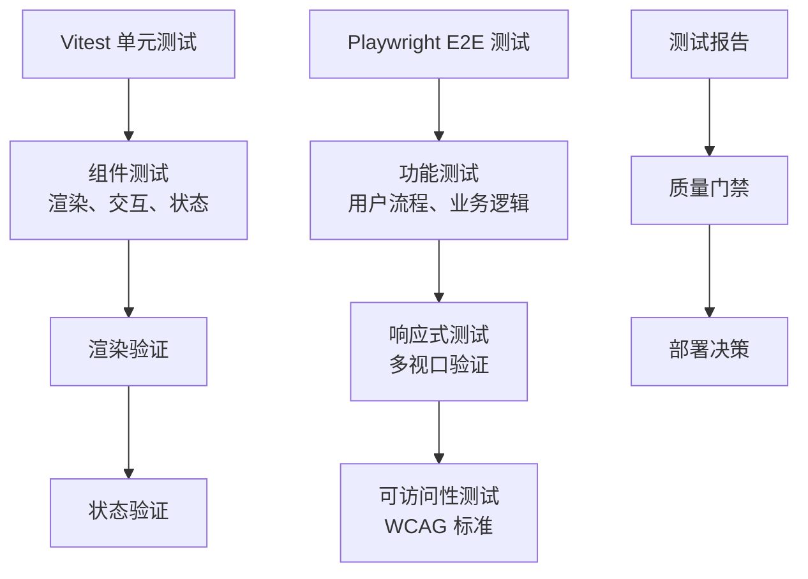

**图表来源**
- [frontend/vitest.config.ts:1-15](file://frontend/vitest.config.ts#L1-L15)
- [playwright.config.ts:14-54](file://playwright.config.ts#L14-L54)

**章节来源**
- [frontend/vitest.config.ts:1-15](file://frontend/vitest.config.ts#L1-L15)
- [frontend/vitest.setup.ts:1-9](file://frontend/vitest.setup.ts#L1-L9)
- [docs/e2e/README.md:1-94](file://docs/e2e/README.md#L1-L94)

## 样式定制指南
当前应用采用 CSS Modules 组织样式，每个组件都有对应的 `.module.css` 文件。

### 旅行平台样式
- **首页样式**：`app/home.module.css` 定义了 Hero 区域、统计面板、内容区块等样式
- **组件样式**：每个 home 组件都有独立的样式文件，如 `city-switcher.module.css`、`editor-picks.module.css` 等
- **全局样式**：使用 CSS 变量定义主题色、字体、间距等设计令牌

### 响应式设计优化
热门景点组件新增了完善的响应式设计：

- **桌面端**：5列网格布局（>1080px）
- **平板端**：3列网格布局（720px-1080px）
- **小屏设备**：2列网格布局（480px-720px）
- **移动端**：单列网格布局（<480px）

```css
/* 热门景点响应式断点 */
@media (max-width: 1080px) {
  .grid { grid-template-columns: repeat(3, minmax(0, 1fr)); }
}
@media (max-width: 720px) {
  .grid { grid-template-columns: repeat(2, minmax(0, 1fr)); }
}
@media (max-width: 480px) {
  .grid { grid-template-columns: minmax(0, 1fr); }
}
```

### 认证页面样式
- **认证页面样式**：`app/auth.module.css` 定义了登录注册页面的布局和样式
- **认证组件样式**：`components/auth/auth-form.module.css`、`account-menu.module.css` 等

### 站点框架样式
- **占位页面样式**：`components/site/placeholder.module.css` 定义了占位页面的样式，包含响应式卡片布局
- **站点组件样式**：`site-header.module.css`、`site-footer.module.css` 等

### Todo 应用样式
TodoApp 使用类名组织样式（如 `.todo-app`、`.todo-form`、`.todo-list`、`.done`、`.badge`、`.complete`、`.hint`、`.error`）。建议在 `app/globals.css` 中集中定义这些样式，或通过 CSS Modules、Tailwind 等方案进行扩展。

建议：
- 为每个语义化类名编写清晰样式规则，确保无障碍属性（如 `aria-label`）与视觉一致。
- 对空状态、加载状态与错误状态分别设计友好的提示文案与布局。
- 若引入第三方样式库，注意与现有类名的命名空间隔离，避免冲突。
- 使用 CSS 变量统一管理主题色和设计令牌，便于后续主题定制。
- 保持响应式设计，确保在不同设备上的良好显示效果。

**章节来源**
- [frontend/app/home.module.css:1-123](file://frontend/app/home.module.css#L1-L123)
- [frontend/app/auth.module.css:1-150](file://frontend/app/auth.module.css#L1-L150)
- [frontend/components/home/hot-attractions.module.css:54-70](file://frontend/components/home/hot-attractions.module.css#L54-L70)
- [frontend/components/site/placeholder.module.css:1-58](file://frontend/components/site/placeholder.module.css#L1-L58)
- [frontend/components/TodoApp.tsx:58-106](file://frontend/components/TodoApp.tsx#L58-L106)

## 故障排查
常见问题与定位思路：

### 旅行平台相关问题
- **城市筛选无效**：检查 `parseCity` 函数是否正确解析 URL 查询参数，确认 `CitySlug` 类型定义是否包含目标城市
- **数据加载失败**：检查 `useSectionData` Hook 的错误处理逻辑，确认 `mockRepository` 的实现是否正确
- **空状态显示异常**：检查各组件的空状态判断逻辑，确认数据格式是否符合预期

### 响应式设计问题
针对新的响应式设计的故障排查：

- **热门景点网格布局异常**：检查 CSS 媒体查询断点是否正确，确认 480px、720px、1080px 断点生效
- **图片加载问题**：检查 `sizes` 属性配置是否正确，确认响应式图片在不同屏幕尺寸下的加载行为
- **移动端显示异常**：检查移动端断点下的样式覆盖是否正确应用

### 认证系统相关问题
- **登录失败**：检查 `mock-auth.ts` 中的用户数据，确认邮箱和密码是否正确
- **会话丢失**：检查 localStorage 中的 `wanderchain.session` 是否过期或被清除
- **注册失败**：检查邮箱格式验证和密码长度要求

### Todo 应用相关问题
- **后端不可达**：代理路由在捕获异常时返回 502，检查 `BACKEND_URL` 环境变量是否正确配置，确认后端服务是否启动。
- **请求失败提示**：API 客户端对非 2xx 响应抛出错误，组件会显示错误消息；检查后端返回的状态码与响应体。
- **列表未更新**：确认 `createTodo` 与 `completeTodo` 返回值结构与 `Todo` 类型一致，确保组件能就地更新状态。

### Playwright E2E 测试相关问题
- **测试无法启动**：检查端口是否被占用，确认 `scripts/e2e-run.mjs` 的端口探测逻辑
- **浏览器连接失败**：检查 Playwright 浏览器安装情况，确认 `E2E_CHANNEL` 环境变量配置
- **测试超时**：检查网络请求和页面加载时间，调整 `timeout` 和 `actionTimeout` 配置
- **截图缺失**：确认失败截图目录权限，检查 `failureScreenshot` fixture 是否正确配置

### 测试相关问题
- **组件测试失败**：需要 mock 相应的数据层或 API 函数；检查用例中的断言是否与实现一致。
- **代理路由测试失败**：需在 node 环境并 mock `fetch`，检查用例中的断言是否与实现一致。

**章节来源**
- [frontend/app/api/[...path]/route.ts:30-52](file://frontend/app/api/[...path]/route.ts#L30-L52)
- [frontend/lib/api.ts:13-19](file://frontend/lib/api.ts#L13-L19)
- [frontend/components/TodoApp.tsx:12-56](file://frontend/components/TodoApp.tsx#L12-L56)
- [frontend/app/api/[...path]/route.test.ts:93-100](file://frontend/app/api/[...path]/route.test.ts#L93-L100)
- [frontend/lib/auth/mock-auth.ts:124-131](file://frontend/lib/auth/mock-auth.ts#L124-L131)
- [frontend/components/home/hot-attractions.module.css:54-70](file://frontend/components/home/hot-attractions.module.css#L54-L70)
- [playwright.config.ts:21-40](file://playwright.config.ts#L21-L40)
- [scripts/e2e-run.mjs:68-80](file://scripts/e2e-run.mjs#L68-L80)

## 结论
本前端应用已从简单的 Todo 待办应用扩展为完整的 wanderchain 旅行平台，展现了现代前端开发的最佳实践。应用以 React 19 与 Next.js 16 为基础，采用清晰的组件化设计与轻量状态管理，通过 HomeRepository 接口抽象数据层，实现 Mock 数据与真实 API 的无缝切换。

**最新更新** 应用新增了完善的响应式设计优化，特别是热门景点组件的 480px 断点支持，确保在移动设备上提供最佳的单列布局体验。同时，占位页面现在集成了完整的站点框架，包括 SiteHeader 和 SiteFooter，为用户提供一致的导航体验。

**重大增强** 项目新增了完整的 Playwright E2E 测试套件，提供了真实浏览器自动化测试能力，确保前端应用的稳定性和质量。测试套件覆盖了多视口响应式设计、可访问性验证和完整的用户流程测试，配合自动化截图和失败诊断工具，大幅提升了测试的可维护性和调试效率。

核心优势包括：
- **可扩展的架构**：数据层接口设计便于未来接入真实 API
- **完善的类型系统**：TypeScript 类型定义确保编译时类型安全
- **丰富的功能模块**：城市筛选、编辑推荐、热门帖子、热门景点等完整功能
- **优秀的用户体验**：完善的加载状态、错误处理和空状态管理
- **响应式设计**：多断点适配，确保在各种设备上的良好显示效果
- **完整的认证系统**：基于本地存储的 Mock 认证，便于开发和演示
- **强大的测试体系**：Vitest 单元测试 + Playwright E2E 测试的双重保障
- **良好的可维护性**：清晰的组件结构和模块化设计

配合 TypeScript、Vitest 测试、Playwright E2E 测试与 Docker 构建，形成完整的前端工程体系。后续可扩展更多业务组件、引入更丰富的状态管理方案，并结合 Next.js 的高级特性提升性能与可维护性。