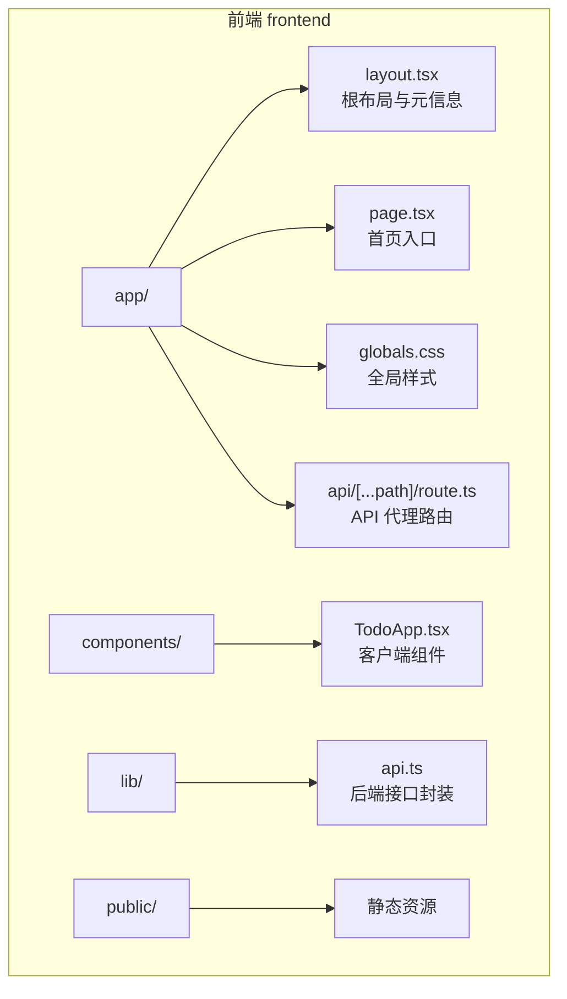
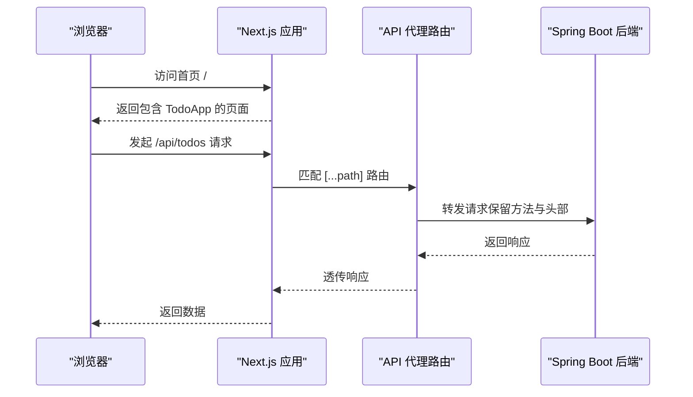
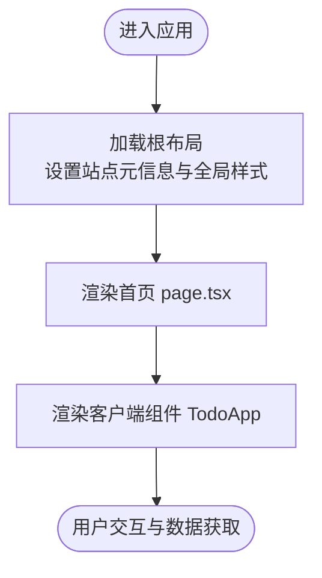
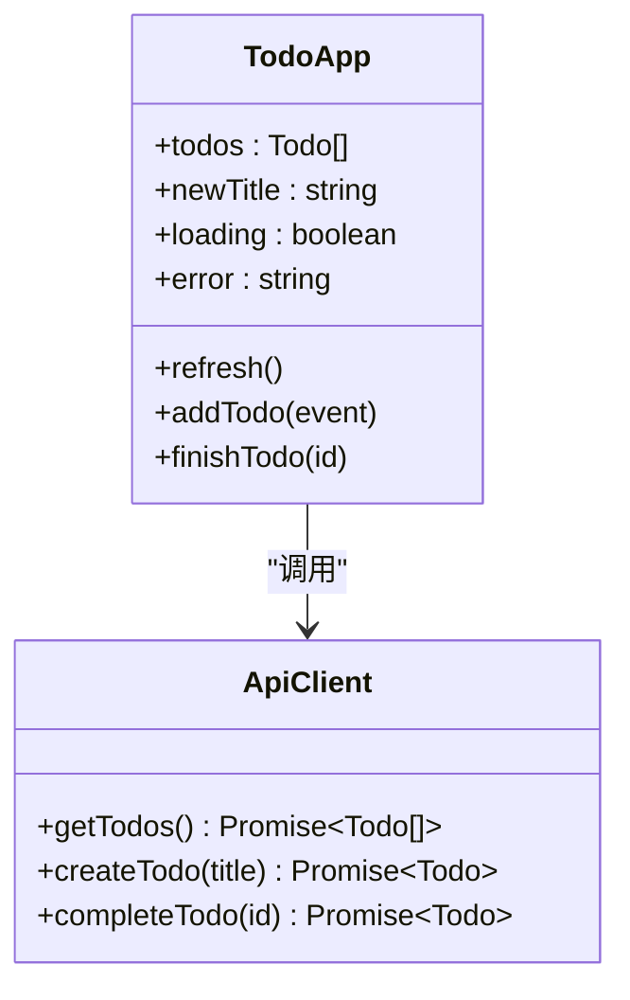
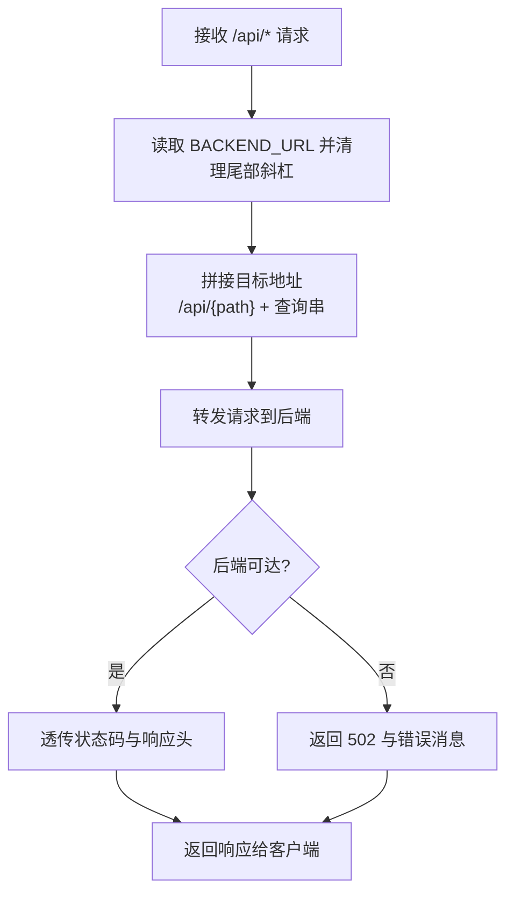
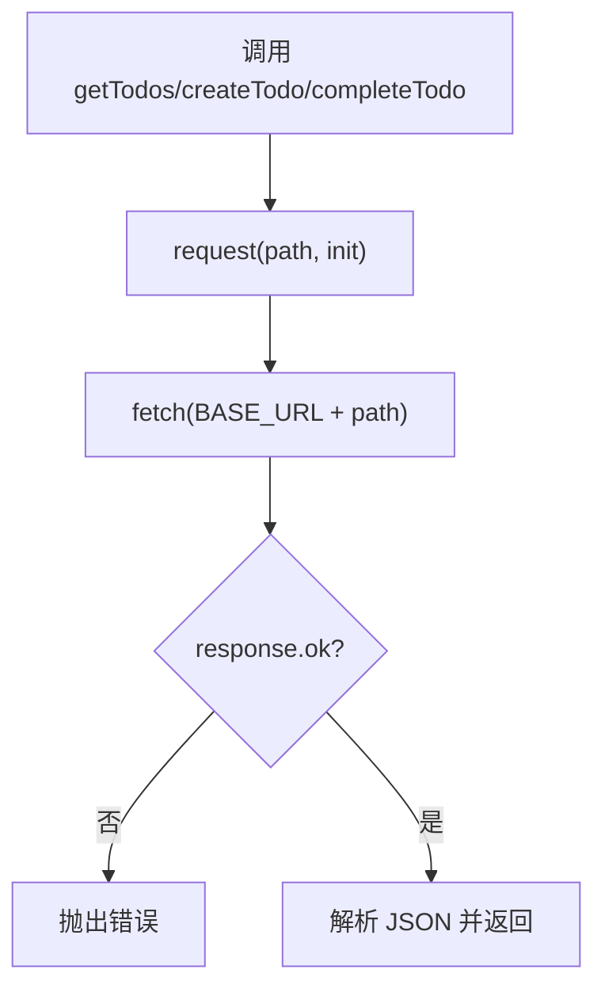
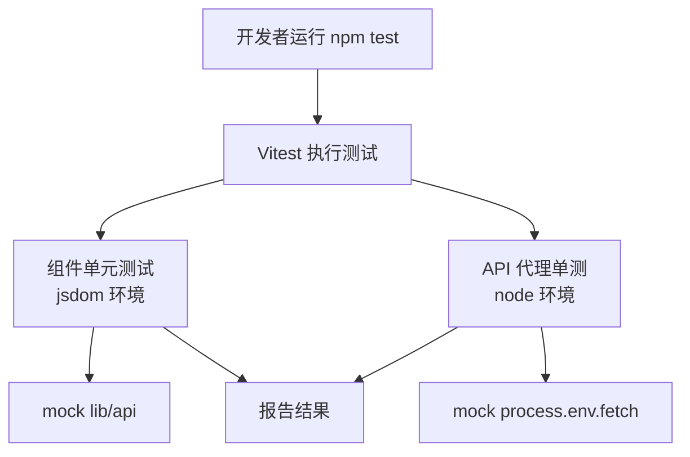
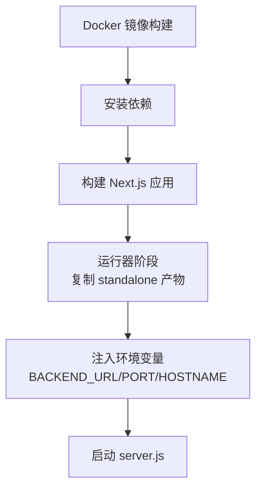

# 前端架构设计

<cite>
**本文引用的文件**   
- [frontend/package.json](file://frontend/package.json)
- [frontend/next.config.ts](file://frontend/next.config.ts)
- [frontend/tsconfig.json](file://frontend/tsconfig.json)
- [frontend/app/layout.tsx](file://frontend/app/layout.tsx)
- [frontend/app/page.tsx](file://frontend/app/page.tsx)
- [frontend/app/globals.css](file://frontend/app/globals.css)
- [frontend/components/TodoApp.tsx](file://frontend/components/TodoApp.tsx)
- [frontend/lib/api.ts](file://frontend/lib/api.ts)
- [frontend/app/api/[...path]/route.ts](file://frontend/app/api/[...path]/route.ts)
- [frontend/vitest.config.ts](file://frontend/vitest.config.ts)
- [frontend/vitest.setup.ts](file://frontend/vitest.setup.ts)
- [frontend/components/TodoApp.test.tsx](file://frontend/components/TodoApp.test.tsx)
- [frontend/app/api/[...path]/route.test.ts](file://frontend/app/api/[...path]/route.test.ts)
- [frontend/Dockerfile](file://frontend/Dockerfile)
</cite>

## 目录
1. [简介](#简介)
2. [项目结构](#项目结构)
3. [核心组件](#核心组件)
4. [架构总览](#架构总览)
5. [详细组件分析](#详细组件分析)
6. [依赖与配置分析](#依赖与配置分析)
7. [性能与构建优化](#性能与构建优化)
8. [开发工作流与测试](#开发工作流与测试)
9. [部署与环境](#部署与环境)
10. [故障排查](#故障排查)
11. [结论与建议](#结论与建议)

## 简介
本文件面向基于 React 19 与 Next.js 16 的前端应用，目标是说明 App Router 的页面组织、布局与路由策略、API 代理方案、TypeScript 与构建配置、测试体系以及容器化部署方式。该前端为最小待办事项应用，通过 Next.js 的 API Routes 将请求转发到 Spring Boot 后端，实现前后端解耦与统一入口。

## 项目结构
前端位于 `frontend` 目录，采用 Next.js App Router 标准结构：
- `app/`：页面、布局、全局样式与 API Routes
- `components/`：可复用 UI 组件与对应单元测试
- `lib/`：工具库与类型定义（如 API 封装）
- `public/`：静态资源（例如 favicon）
- 根级配置文件：Next.js、TypeScript、Vitest、Docker 等

**图表来源**
- [frontend/app/layout.tsx:1-19](file://frontend/app/layout.tsx#L1-L19)
- [frontend/app/page.tsx:1-6](file://frontend/app/page.tsx#L1-L6)
- [frontend/app/globals.css:1-88](file://frontend/app/globals.css#L1-L88)
- [frontend/app/api/[...path]/route.ts:1-77](file://frontend/app/api/[...path]/route.ts#L1-L77)
- [frontend/components/TodoApp.tsx:1-109](file://frontend/components/TodoApp.tsx#L1-L109)
- [frontend/lib/api.ts:1-36](file://frontend/lib/api.ts#L1-L36)

**章节来源**
- [frontend/app/layout.tsx:1-19](file://frontend/app/layout.tsx#L1-L19)
- [frontend/app/page.tsx:1-6](file://frontend/app/page.tsx#L1-L6)
- [frontend/app/globals.css:1-88](file://frontend/app/globals.css#L1-L88)
- [frontend/components/TodoApp.tsx:1-109](file://frontend/components/TodoApp.tsx#L1-L109)
- [frontend/lib/api.ts:1-36](file://frontend/lib/api.ts#L1-L36)
- [frontend/app/api/[...path]/route.ts:1-77](file://frontend/app/api/[...path]/route.ts#L1-L77)

## 核心组件
- 根布局与站点元信息：在 `app/layout.tsx` 中定义站点标题、描述与图标，并注入全局样式。
- 首页：`app/page.tsx` 渲染客户端组件 `TodoApp`。
- 客户端组件：`components/TodoApp.tsx` 使用 React Hooks 管理状态，调用 `lib/api.ts` 提供的函数与后端交互。
- API 代理：`app/api/[...path]/route.ts` 将 `/api/*` 请求转发至后端服务地址，透传方法、头部与响应体。
- 类型与接口：`lib/api.ts` 定义 `Todo` 类型与统一的 fetch 封装。

**章节来源**
- [frontend/app/layout.tsx:1-19](file://frontend/app/layout.tsx#L1-L19)
- [frontend/app/page.tsx:1-6](file://frontend/app/page.tsx#L1-L6)
- [frontend/components/TodoApp.tsx:1-109](file://frontend/components/TodoApp.tsx#L1-L109)
- [frontend/lib/api.ts:1-36](file://frontend/lib/api.ts#L1-L36)
- [frontend/app/api/[...path]/route.ts:1-77](file://frontend/app/api/[...path]/route.ts#L1-L77)

## 架构总览
前端以 Next.js 作为运行时与构建系统，采用 App Router 组织页面与布局；通过 API Routes 对后端进行透明代理，避免跨域问题并集中处理后端地址配置。

**图表来源**
- [frontend/app/page.tsx:1-6](file://frontend/app/page.tsx#L1-L6)
- [frontend/components/TodoApp.tsx:1-109](file://frontend/components/TodoApp.tsx#L1-L109)
- [frontend/lib/api.ts:1-36](file://frontend/lib/api.ts#L1-L36)
- [frontend/app/api/[...path]/route.ts:1-77](file://frontend/app/api/[...path]/route.ts#L1-L77)

## 详细组件分析

### 页面与布局（App Router）
- 根布局 `app/layout.tsx`：
  - 定义站点元信息（标题、描述、图标）。
  - 提供 `<html>` 与 `<body>` 包裹，注入全局样式。
- 首页 `app/page.tsx`：
  - 作为 App Router 的默认页面，渲染客户端组件 `TodoApp`。

**图表来源**
- [frontend/app/layout.tsx:1-19](file://frontend/app/layout.tsx#L1-L19)
- [frontend/app/page.tsx:1-6](file://frontend/app/page.tsx#L1-L6)
- [frontend/components/TodoApp.tsx:1-109](file://frontend/components/TodoApp.tsx#L1-L109)

**章节来源**
- [frontend/app/layout.tsx:1-19](file://frontend/app/layout.tsx#L1-L19)
- [frontend/app/page.tsx:1-6](file://frontend/app/page.tsx#L1-L6)

### 客户端组件 TodoApp
- 使用 `'use client'` 标记为客户端组件，负责：
  - 列表展示、新增、完成操作。
  - 本地状态：待办列表、输入框、加载与错误提示。
  - 生命周期：挂载时自动刷新列表。
- 与 `lib/api.ts` 协作，调用 `getTodos`、`createTodo`、`completeTodo`。

**图表来源**
- [frontend/components/TodoApp.tsx:1-109](file://frontend/components/TodoApp.tsx#L1-L109)
- [frontend/lib/api.ts:1-36](file://frontend/lib/api.ts#L1-L36)

**章节来源**
- [frontend/components/TodoApp.tsx:1-109](file://frontend/components/TodoApp.tsx#L1-L109)

### API 代理路由
- 路径：`app/api/[...path]/route.ts`
- 功能：
  - 从环境变量或默认值读取后端地址。
  - 拼接目标 URL，逐段编码 path 参数，防止重定向到其他主机。
  - 透传请求方法、Content-Type、Accept 与查询串。
  - 捕获后端不可达异常，返回 502。
  - 透传上游响应状态码与 Content-Type。
- 运行期配置：
  - `runtime = 'nodejs'`，`dynamic = 'force-dynamic'`，确保动态行为。

**图表来源**
- [frontend/app/api/[...path]/route.ts:1-77](file://frontend/app/api/[...path]/route.ts#L1-L77)

**章节来源**
- [frontend/app/api/[...path]/route.ts:1-77](file://frontend/app/api/[...path]/route.ts#L1-L77)

### 类型与接口封装
- `lib/api.ts`：
  - 定义 `Todo` 类型。
  - 统一 `request<T>` 封装，处理非 2xx 响应抛出错误。
  - 暴露 `getTodos`、`createTodo`、`completeTodo`。

**图表来源**
- [frontend/lib/api.ts:1-36](file://frontend/lib/api.ts#L1-L36)

**章节来源**
- [frontend/lib/api.ts:1-36](file://frontend/lib/api.ts#L1-L36)

## 依赖与配置分析

### 包管理与脚本
- 依赖：
  - 运行时：`next@16.4.3`、`react@19.3.1`、`react-dom@19.3.1`。
  - 开发：TypeScript、Vitest、Testing Library、Vite React 插件、JSDOM。
- 脚本：
  - `dev`：启动开发服务器。
  - `build`：构建生产产物。
  - `start`：启动生产服务器。
  - `test`：运行 Vitest。

**章节来源**
- [frontend/package.json:1-34](file://frontend/package.json#L1-L34)

### TypeScript 配置
- 目标与模块：
  - `target: ES2017`，`module: esnext`，`moduleResolution: bundler`。
- JSX：
  - `jsx: react-jsx`，适配 React 19。
- 严格模式：
  - `strict: true`，`noEmit: true`，由 Next.js 编译。
- 路径别名：
  - `@/*` 映射到项目根目录，便于导入。
- 包含与排除：
  - 包含 `.next/types` 与开发类型，排除 `node_modules`。

**章节来源**
- [frontend/tsconfig.json:1-42](file://frontend/tsconfig.json#L1-L42)

### Next.js 配置
- `output: 'standalone'`：
  - 生成独立产物，包含最小依赖与 `server.js`，适合容器运行。

**章节来源**
- [frontend/next.config.ts:1-9](file://frontend/next.config.ts#L1-L9)

## 性能与构建优化
- Standalone 输出：
  - 减少运行时体积，提升冷启动速度，适合容器环境。
- 增量编译：
  - TypeScript 启用 `incremental`，加速二次构建。
- 客户端组件边界：
  - 仅 `TodoApp` 使用 `'use client'`，其余保持服务端渲染能力，降低客户端包体积。
- 无缓存 API 代理：
  - 代理路由设置 `cache: 'no-store'`，避免缓存脏数据。

**章节来源**
- [frontend/next.config.ts:1-9](file://frontend/next.config.ts#L1-L9)
- [frontend/tsconfig.json:1-42](file://frontend/tsconfig.json#L1-L42)
- [frontend/app/api/[...path]/route.ts:1-77](file://frontend/app/api/[...path]/route.ts#L1-L77)

## 开发工作流与测试
- 测试框架：
  - Vitest + Testing Library + JSDOM。
  - 组件测试在 jsdom 环境运行，API 代理测试在 node 环境运行。
- 测试配置：
  - `vitest.config.ts` 启用 React 插件，设置 jsdom 环境与 include/exclude。
  - `vitest.setup.ts` 引入 jest-dom 断言库，并在用例后清理 DOM。
- 组件测试覆盖：
  - 渲染初始列表、新增待办、完成待办、错误提示。
  - 使用 `vi.mock` 模拟 `lib/api` 接口。
- API 代理测试覆盖：
  - 默认后端地址、环境变量切换、POST 透传、非 2xx 透传、后端不可达返回 502。

**图表来源**
- [frontend/vitest.config.ts:1-15](file://frontend/vitest.config.ts#L1-L15)
- [frontend/vitest.setup.ts:1-9](file://frontend/vitest.setup.ts#L1-L9)
- [frontend/components/TodoApp.test.tsx:1-81](file://frontend/components/TodoApp.test.tsx#L1-L81)
- [frontend/app/api/[...path]/route.test.ts:1-102](file://frontend/app/api/[...path]/route.test.ts#L1-L102)

**章节来源**
- [frontend/vitest.config.ts:1-15](file://frontend/vitest.config.ts#L1-L15)
- [frontend/vitest.setup.ts:1-9](file://frontend/vitest.setup.ts#L1-L9)
- [frontend/components/TodoApp.test.tsx:1-81](file://frontend/components/TodoApp.test.tsx#L1-L81)
- [frontend/app/api/[...path]/route.test.ts:1-102](file://frontend/app/api/[...path]/route.test.ts#L1-L102)

## 部署与环境
- Docker 多阶段构建：
  - `deps`：安装依赖。
  - `builder`：执行 `npm run build`。
  - `runner`：运行 standalone 产物，暴露 3000 端口。
- 环境变量：
  - `BACKEND_URL`：运行期决定后端地址，支持容器启动时覆盖。
  - `NODE_ENV=production`、`PORT=3000`、`HOSTNAME=0.0.0.0`。
- 安全与权限：
  - 创建非 root 用户 `nextjs` 运行服务。
  - 复制 `public` 与 `.next/standalone`、`.next/static`。

**图表来源**
- [frontend/Dockerfile:1-27](file://frontend/Dockerfile#L1-L27)
- [frontend/next.config.ts:1-9](file://frontend/next.config.ts#L1-L9)
- [frontend/app/api/[...path]/route.ts:1-77](file://frontend/app/api/[...path]/route.ts#L1-L77)

**章节来源**
- [frontend/Dockerfile:1-27](file://frontend/Dockerfile#L1-L27)
- [frontend/next.config.ts:1-9](file://frontend/next.config.ts#L1-L9)
- [frontend/app/api/[...path]/route.ts:1-77](file://frontend/app/api/[...path]/route.ts#L1-L77)

## 故障排查
- 后端不可达：
  - 现象：API 代理返回 502，错误消息“后端服务不可达”。
  - 检查：确认 `BACKEND_URL` 是否正确，后端服务是否运行。
- 请求失败：
  - 现象：客户端显示“请求失败：HTTP <status>”。
  - 检查：后端返回的非 2xx 状态码与响应体。
- 代理未生效：
  - 现象：浏览器直接访问后端地址报错或被拦截。
  - 检查：确认前端请求路径为 `/api/*`，并由 Next.js 代理转发。
- 样式不生效：
  - 现象：页面样式缺失。
  - 检查：确认 `app/globals.css` 被根布局正确引入。

**章节来源**
- [frontend/app/api/[...path]/route.ts:1-77](file://frontend/app/api/[...path]/route.ts#L1-L77)
- [frontend/lib/api.ts:1-36](file://frontend/lib/api.ts#L1-L36)
- [frontend/app/layout.tsx:1-19](file://frontend/app/layout.tsx#L1-L19)

## 结论与建议
- 架构决策：
  - 使用 Next.js App Router 组织页面与布局，分离服务端渲染与客户端交互。
  - 通过 API Routes 集中代理后端，简化跨域与地址配置。
  - 使用 TypeScript 严格模式与路径别名，提高代码质量与可维护性。
  - 采用 Vitest 与 Testing Library 进行组件与路由单测，保障稳定性。
  - 使用 standalone 输出与 Docker 多阶段构建，提升部署效率与运行性能。
- 最佳实践建议：
  - 将业务逻辑下沉至服务端，前端专注 UI 与状态管理。
  - 对关键接口编写单测，覆盖成功、失败与异常场景。
  - 使用环境变量管理后端地址，避免硬编码。
  - 保持客户端组件边界清晰，减少不必要的客户端包体积。
  - 在 CI 中集成构建与测试，确保变更质量。