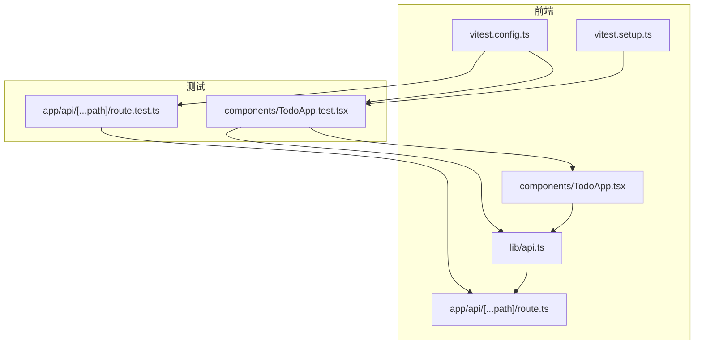
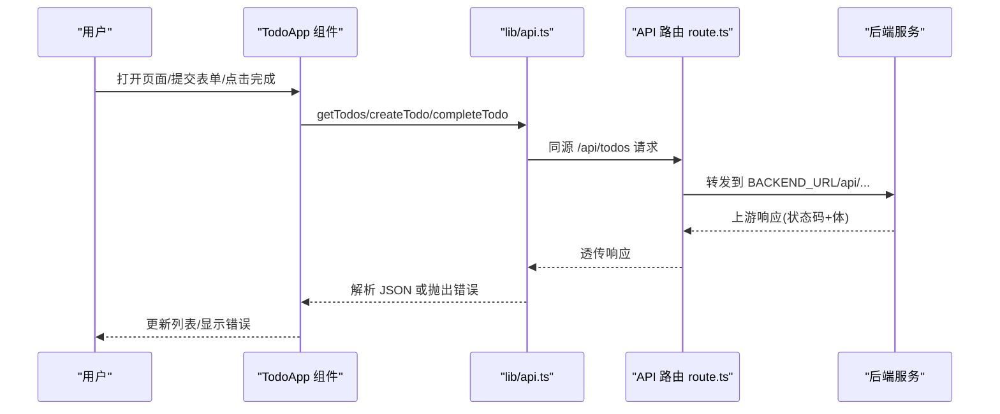
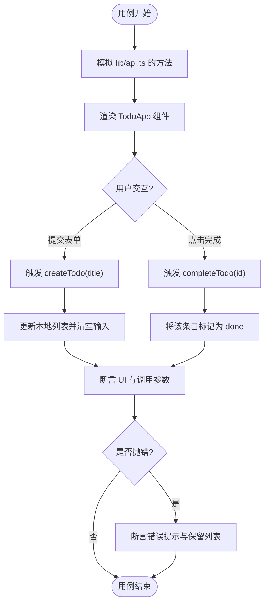
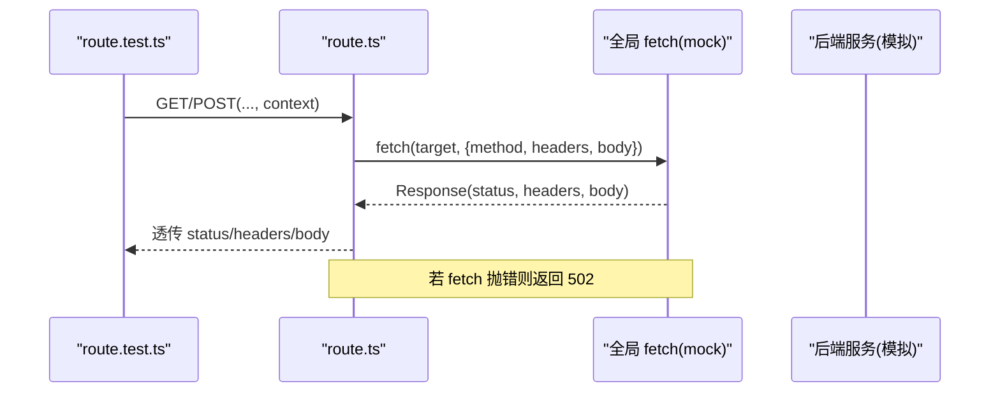
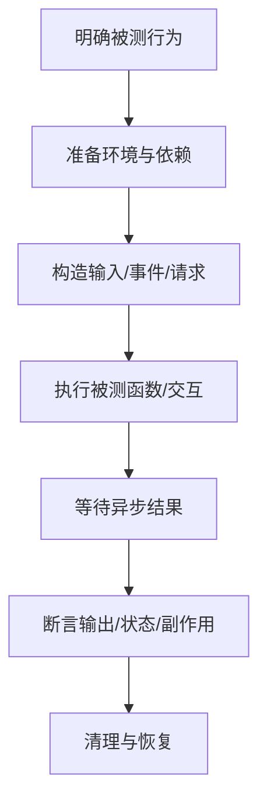
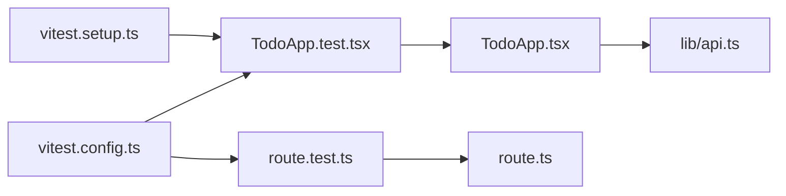

# 测试策略与实践

<cite>
**本文引用的文件**   
- [frontend/package.json](file://frontend/package.json)
- [frontend/vitest.config.ts](file://frontend/vitest.config.ts)
- [frontend/vitest.setup.ts](file://frontend/vitest.setup.ts)
- [frontend/lib/api.ts](file://frontend/lib/api.ts)
- [frontend/components/TodoApp.tsx](file://frontend/components/TodoApp.tsx)
- [frontend/components/TodoApp.test.tsx](file://frontend/components/TodoApp.test.tsx)
- [frontend/app/api/[...path]/route.ts](file://frontend/app/api/[...path]/route.ts)
- [frontend/app/api/[...path]/route.test.ts](file://frontend/app/api/[...path]/route.test.ts)
</cite>

## 目录
1. [引言](#引言)
2. [项目结构](#项目结构)
3. [核心组件](#核心组件)
4. [架构总览](#架构总览)
5. [详细组件分析](#详细组件分析)
6. [依赖关系分析](#依赖关系分析)
7. [性能与覆盖率](#性能与覆盖率)
8. [持续集成建议](#持续集成建议)
9. [故障排查指南](#故障排查指南)
10. [结论](#结论)

## 引言
本文件面向前端工程，系统化说明基于 Vitest 的测试策略与实践。内容覆盖测试环境配置、断言库使用、模拟对象策略；对 TodoApp 组件进行行为与交互测试；对 API 代理路由进行请求/响应与错误场景测试；并给出最佳实践、覆盖率要求、持续集成建议、调试技巧与性能优化建议。目标是让初学者也能快速上手，同时为高级用户提供可落地的工程化方案。

## 项目结构
前端采用 Next.js + React 技术栈，测试基于 Vitest，配合 Testing Library 完成组件与用户交互测试，API 路由测试在 Node 环境下运行并通过全局 fetch 模拟验证代理逻辑。

图表来源
- [frontend/components/TodoApp.tsx:1-109](file://frontend/components/TodoApp.tsx#L1-L109)
- [frontend/lib/api.ts:1-36](file://frontend/lib/api.ts#L1-L36)
- [frontend/app/api/[...path]/route.ts:1-77](file://frontend/app/api/[...path]/route.ts#L1-L77)
- [frontend/vitest.config.ts:1-15](file://frontend/vitest.config.ts#L1-L15)
- [frontend/vitest.setup.ts:1-9](file://frontend/vitest.setup.ts#L1-L9)
- [frontend/components/TodoApp.test.tsx:1-81](file://frontend/components/TodoApp.test.tsx#L1-L81)
- [frontend/app/api/[...path]/route.test.ts:1-102](file://frontend/app/api/[...path]/route.test.ts#L1-L102)

章节来源
- [frontend/package.json:1-34](file://frontend/package.json#L1-L34)

## 核心组件
本节聚焦测试基础设施与关键被测模块的职责与协作方式。

- 测试框架与配置
  - Vitest：统一测试运行器，支持组件与 Node 环境测试。
  - jsdom：为组件测试提供 DOM 环境。
  - setupFiles：统一引入 Testing Library 扩展与清理逻辑。
  - include/exclude：匹配测试文件，排除构建产物与依赖。

- 断言与交互
  - @testing-library/jest-dom：提供丰富的 DOM 断言。
  - @testing-library/react：渲染与查询 React 组件。
  - @testing-library/user-event：模拟真实用户交互（输入、点击等）。

- 被测模块
  - lib/api.ts：封装后端 Todo API 的 fetch 调用，定义 Todo 类型与基础请求方法。
  - components/TodoApp.tsx：客户端组件，负责待办列表展示、新增、完成操作及错误提示。
  - app/api/[...path]/route.ts：Next.js API 路由，将浏览器请求代理到后端服务，透传方法与状态码，并在后端不可达时返回 502。

章节来源
- [frontend/vitest.config.ts:1-15](file://frontend/vitest.config.ts#L1-L15)
- [frontend/vitest.setup.ts:1-9](file://frontend/vitest.setup.ts#L1-L9)
- [frontend/lib/api.ts:1-36](file://frontend/lib/api.ts#L1-L36)
- [frontend/components/TodoApp.tsx:1-109](file://frontend/components/TodoApp.tsx#L1-L109)
- [frontend/app/api/[...path]/route.ts:1-77](file://frontend/app/api/[...path]/route.ts#L1-L77)

## 架构总览
下图展示了从 UI 到 API 代理再到后端的完整数据流，以及测试如何介入其中。

图表来源
- [frontend/components/TodoApp.tsx:1-109](file://frontend/components/TodoApp.tsx#L1-L109)
- [frontend/lib/api.ts:1-36](file://frontend/lib/api.ts#L1-L36)
- [frontend/app/api/[...path]/route.ts:1-77](file://frontend/app/api/[...path]/route.ts#L1-L77)

## 详细组件分析

### TodoApp 组件测试
TodoApp 是客户端组件，内部通过 lib/api.ts 发起网络请求，维护本地状态（待办列表、加载态、错误信息），并提供新增与完成的交互。

- 测试目标
  - 挂载后渲染后端返回的待办列表。
  - 提交表单触发创建接口，并将新待办加入列表。
  - 点击“完成”按钮调用完成接口并更新该条状态。
  - 请求失败时展示错误且保留已加载的列表。

- 模拟策略
  - 使用 vi.mock 对 lib/api.ts 中的 getTodos、createTodo、completeTodo 进行全量替换。
  - 使用 userEvent 模拟真实用户输入与点击。
  - 使用 waitFor 与 findBy* 等待异步状态稳定后再断言。

- 关键断言点
  - 列表项数量与文本内容。
  - “已完成”标签的出现与“完成”按钮的消失。
  - 错误提示区域存在且包含错误消息。
  - 各 API 被调用的参数正确。

图表来源
- [frontend/components/TodoApp.test.tsx:1-81](file://frontend/components/TodoApp.test.tsx#L1-L81)
- [frontend/components/TodoApp.tsx:1-109](file://frontend/components/TodoApp.tsx#L1-L109)
- [frontend/lib/api.ts:1-36](file://frontend/lib/api.ts#L1-L36)

章节来源
- [frontend/components/TodoApp.test.tsx:1-81](file://frontend/components/TodoApp.test.tsx#L1-L81)
- [frontend/components/TodoApp.tsx:1-109](file://frontend/components/TodoApp.tsx#L1-L109)

### API 路由测试
API 路由负责将浏览器请求代理到后端服务，透传方法、头部、请求体与状态码，并在后端不可达时返回 502。

- 测试目标
  - 默认后端地址拼接路径与查询串。
  - 运行期修改 BACKEND_URL 后新请求走新地址。
  - POST 透传方法、请求体、content-type 与响应状态。
  - 透传上游非 2xx 状态码与响应体。
  - 后端不可达时返回 502 与错误体。

- 模拟策略
  - 在 Node 环境下运行（@vitest-environment node）。
  - 使用 vi.stubGlobal('fetch', ...) 拦截 fetch 调用。
  - 构造 Request/Response 对象模拟浏览器与上游响应。
  - 在 beforeEach/afterEach 中重置 mock 与清理全局 stub。

图表来源
- [frontend/app/api/[...path]/route.test.ts:1-102](file://frontend/app/api/[...path]/route.test.ts#L1-L102)
- [frontend/app/api/[...path]/route.ts:1-77](file://frontend/app/api/[...path]/route.ts#L1-L77)

章节来源
- [frontend/app/api/[...path]/route.test.ts:1-102](file://frontend/app/api/[...path]/route.test.ts#L1-L102)
- [frontend/app/api/[...path]/route.ts:1-77](file://frontend/app/api/[...path]/route.ts#L1-L77)

### 概念性概览
以下流程图概括了通用测试编写流程，适用于组件与 API 路由两类用例。

[本图为概念性流程，不直接映射具体源码]

## 依赖关系分析
- 组件层
  - TodoApp 依赖 lib/api.ts 提供的 getTodos、createTodo、completeTodo。
  - 测试通过 vi.mock 替换这些依赖，避免真实网络请求。

- API 层
  - route.ts 依赖 process.env.BACKEND_URL 决定上游地址。
  - 测试通过 vi.stubGlobal('fetch') 拦截网络，验证代理逻辑。

- 测试基础设施
  - vitest.config.ts 指定 jsdom 环境、setupFiles、测试文件匹配规则。
  - vitest.setup.ts 引入 jest-dom 扩展并注册 afterEach cleanup。

图表来源
- [frontend/components/TodoApp.test.tsx:1-81](file://frontend/components/TodoApp.test.tsx#L1-L81)
- [frontend/components/TodoApp.tsx:1-109](file://frontend/components/TodoApp.tsx#L1-L109)
- [frontend/lib/api.ts:1-36](file://frontend/lib/api.ts#L1-L36)
- [frontend/app/api/[...path]/route.test.ts:1-102](file://frontend/app/api/[...path]/route.test.ts#L1-L102)
- [frontend/app/api/[...path]/route.ts:1-77](file://frontend/app/api/[...path]/route.ts#L1-L77)
- [frontend/vitest.config.ts:1-15](file://frontend/vitest.config.ts#L1-L15)
- [frontend/vitest.setup.ts:1-9](file://frontend/vitest.setup.ts#L1-L9)

章节来源
- [frontend/vitest.config.ts:1-15](file://frontend/vitest.config.ts#L1-L15)
- [frontend/vitest.setup.ts:1-9](file://frontend/vitest.setup.ts#L1-L9)

## 性能与覆盖率
- 性能优化建议
  - 仅在需要 DOM 的测试中使用 jsdom；API 路由测试使用 node 环境以减少开销。
  - 合理拆分 describe/it，避免单测文件过大导致启动缓慢。
  - 复用 mock 数据与辅助函数，减少重复代码。
  - 使用 waitFor 与 findBy* 替代轮询，避免不必要的重渲染。
  - 控制渲染范围，必要时使用 render 的 container 隔离。

- 覆盖率要求
  - 建议以行覆盖率与分支覆盖率为基准，逐步提升至 80% 以上。
  - 重点覆盖：组件交互分支、错误处理分支、API 透传与异常分支。
  - 使用 Vitest 内置覆盖率报告，结合 CI 阻断低覆盖率合并。

[本节为通用指导，不直接分析具体文件]

## 持续集成建议
- 脚本入口
  - 使用 package.json 中的 test 脚本统一执行 Vitest。
- 推荐步骤
  - 安装依赖：npm ci。
  - 运行测试：npm test。
  - 生成覆盖率：在 Vitest 配置中启用 coverage 并输出 HTML/JSON。
  - 缓存依赖与节点模块，缩短构建时间。
- 并行与隔离
  - 开启测试并行执行，注意每个测试独立初始化 mock 与环境。
  - 对共享全局状态（如 process.env）在 beforeEach/afterEach 中严格清理。

章节来源
- [frontend/package.json:9-14](file://frontend/package.json#L9-L14)

## 故障排查指南
- 常见问题
  - 组件测试报 DOM 相关错误：确认 vitest.config.ts 使用 jsdom 环境，并确保 vitest.setup.ts 引入了 jest-dom 扩展。
  - 异步断言不稳定：使用 waitFor 或 findBy* 等待状态稳定，避免立即断言。
  - API 路由测试未命中 mock：确保在 Node 环境运行，并使用 vi.stubGlobal('fetch', ...) 替换全局 fetch。
  - 环境变量污染：在 beforeEach/afterEach 中重置 process.env.BACKEND_URL 与全局 stub。
  - 测试间相互影响：在每个用例前 vi.clearAllMocks()，避免 mock 残留。

- 定位技巧
  - 使用 Vitest 的 --reporter=verbose 查看详细日志。
  - 针对单个测试文件运行：vitest run path/to/test.ts。
  - 使用断点调试：在 VS Code 中配置 Vitest 调试器，或在测试中加入 console.log 临时定位。

章节来源
- [frontend/vitest.config.ts:1-15](file://frontend/vitest.config.ts#L1-L15)
- [frontend/vitest.setup.ts:1-9](file://frontend/vitest.setup.ts#L1-L9)
- [frontend/app/api/[...path]/route.test.ts:1-102](file://frontend/app/api/[...path]/route.test.ts#L1-L102)

## 结论
本项目通过 Vitest 统一驱动组件与 API 路由测试，借助 jsdom 与 Testing Library 实现高保真交互测试，通过 Node 环境与全局 fetch 模拟验证代理逻辑。建议在现有基础上完善覆盖率阈值与 CI 门禁，持续沉淀测试模板与最佳实践，提升交付质量与回归效率。