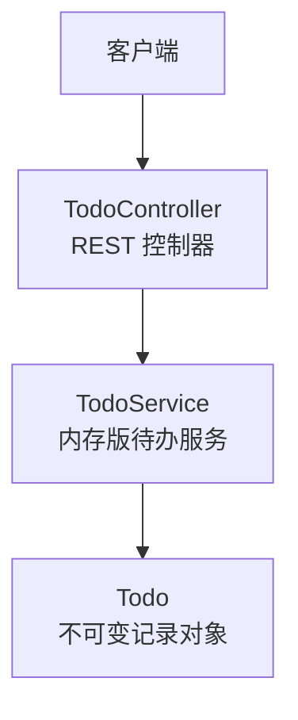
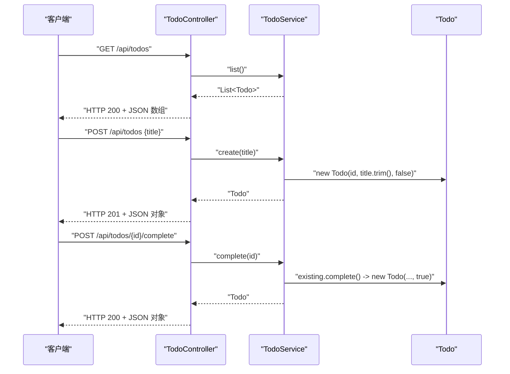
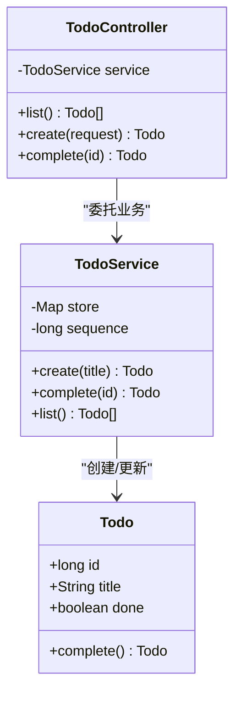
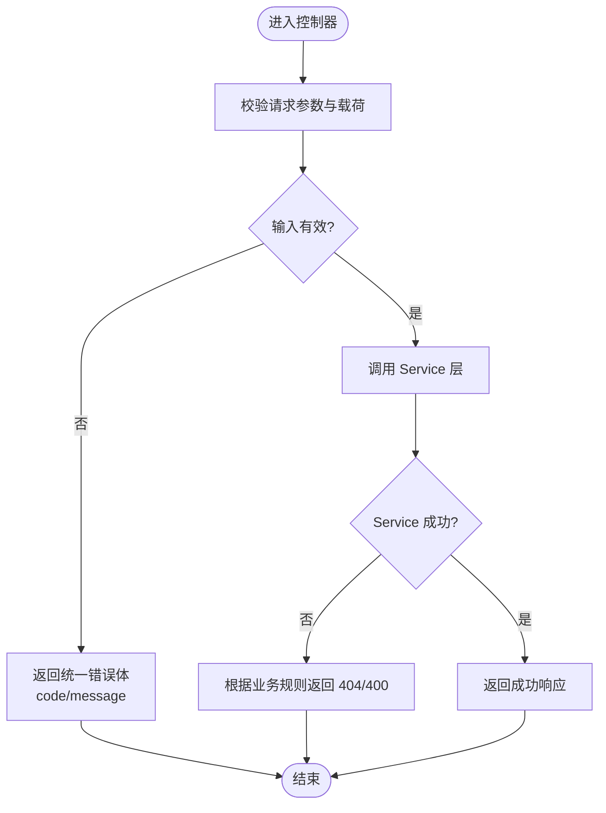

# API 控制器

<cite>
**本文引用的文件**   
- [TodoController.java](file://backend/src/main/java/com/luyi/myfirst/web/TodoController.java)
- [TodoService.java](file://backend/src/main/java/com/luyi/myfirst/domain/TodoService.java)
- [Todo.java](file://backend/src/main/java/com/luyi/myfirst/domain/Todo.java)
- [todo-module-spec.md](file://docs/specs/todo-module-spec.md)
</cite>

## 目录
1. [简介](#简介)
2. [项目结构](#项目结构)
3. [核心组件](#核心组件)
4. [架构总览](#架构总览)
5. [端点详解](#端点详解)
6. [依赖关系分析](#依赖关系分析)
7. [性能与并发特性](#性能与并发特性)
8. [错误处理策略](#错误处理策略)
9. [API 版本管理与向后兼容](#api-版本管理与向后兼容)
10. [故障排查指南](#故障排查指南)
11. [结论](#结论)

## 简介
本文档聚焦后端 RESTful API 控制器 `TodoController`，详细说明其实现的三个核心端点：
- GET /api/todos：获取所有待办事项
- POST /api/todos：创建新待办事项
- POST /api/todos/{id}/complete：标记指定待办为已完成

文档同时说明控制器如何与 Service 层交互、请求验证与异常处理方式，并给出 API 调用示例、请求/响应体结构与错误处理策略。最后补充 API 版本管理与向后兼容的最佳实践，帮助团队在演进过程中保持契约稳定。

## 项目结构
本项目的后端采用 Spring Boot 的 MVC 分层结构：
- web 层：REST 控制器，负责路由、参数绑定与 HTTP 状态码
- domain 层：领域模型与服务逻辑，当前使用内存存储
- resources：应用配置（如端口与监听地址）

**图表来源**
- [TodoController.java:16-40](file://backend/src/main/java/com/luyi/myfirst/web/TodoController.java#L16-L40)
- [TodoService.java:14-42](file://backend/src/main/java/com/luyi/myfirst/domain/TodoService.java#L14-L42)
- [Todo.java:7-11](file://backend/src/main/java/com/luyi/myfirst/domain/Todo.java#L7-L11)

**章节来源**
- [TodoController.java:16-40](file://backend/src/main/java/com/luyi/myfirst/web/TodoController.java#L16-L40)
- [TodoService.java:14-42](file://backend/src/main/java/com/luyi/myfirst/domain/TodoService.java#L14-L42)
- [Todo.java:7-11](file://backend/src/main/java/com/luyi/myfirst/domain/Todo.java#L7-L11)

## 核心组件
- TodoController：定义 REST 端点，接收请求并委托给 Service 层。
- TodoService：提供 create、complete、list 等核心业务方法；当前基于内存 Map 存储。
- Todo：不可变 record，包含 id、title、done 字段；complete 返回新实例表达状态变更。

关键职责划分：
- 控制器不直接操作数据，仅做路由与参数绑定
- Service 封装业务规则与数据存储
- 模型通过不可变对象避免多线程共享状态问题

**章节来源**
- [TodoController.java:16-40](file://backend/src/main/java/com/luyi/myfirst/web/TodoController.java#L16-L40)
- [TodoService.java:14-42](file://backend/src/main/java/com/luyi/myfirst/domain/TodoService.java#L14-L42)
- [Todo.java:7-11](file://backend/src/main/java/com/luyi/myfirst/domain/Todo.java#L7-L11)

## 架构总览
控制器到服务的调用流程如下：

**图表来源**
- [TodoController.java:26-40](file://backend/src/main/java/com/luyi/myfirst/web/TodoController.java#L26-L40)
- [TodoService.java:20-42](file://backend/src/main/java/com/luyi/myfirst/domain/TodoService.java#L20-L42)
- [Todo.java:7-11](file://backend/src/main/java/com/luyi/myfirst/domain/Todo.java#L7-L11)

## 端点详解

### GET /api/todos
- HTTP 方法：GET
- URL 模式：/api/todos
- 路径参数：无
- 查询参数：无
- 请求体：无
- 成功响应：HTTP 200，JSON 数组，元素为 Todo 对象
- 失败响应：未定义全局异常处理器时，框架默认错误体可能不符合统一规范

行为说明：
- 返回内存中所有待办项，顺序按插入顺序（LinkedHashMap）
- 若为空，返回空数组 []

调用示例：
- 请求：GET http://localhost:8989/api/todos
- 响应：HTTP 200，[{"id":1,"title":"...","done":false}]

**章节来源**
- [TodoController.java:26-29](file://backend/src/main/java/com/luyi/myfirst/web/TodoController.java#L26-L29)
- [TodoService.java:40-42](file://backend/src/main/java/com/luyi/myfirst/domain/TodoService.java#L40-L42)

### POST /api/todos
- HTTP 方法：POST
- URL 模式：/api/todos
- 路径参数：无
- 查询参数：无
- 请求体：CreateTodoRequest，包含 title 字段
- 成功响应：HTTP 201，JSON 对象 Todo
- 失败响应：当前实现抛出 IllegalArgumentException，可能被框架转为 500

行为说明：
- 校验 title 非空白，trim 后保存
- 分配自增 id，初始 done=false
- 返回完整 Todo 对象

调用示例：
- 请求：POST http://localhost:8989/api/todos
- 请求体：{"title":"下班后去超市买牛奶和鸡蛋"}
- 响应：HTTP 201，{"id":1,"title":"下班后去超市买牛奶和鸡蛋","done":false}

**章节来源**
- [TodoController.java:31-35](file://backend/src/main/java/com/luyi/myfirst/web/TodoController.java#L31-L35)
- [TodoService.java:20-28](file://backend/src/main/java/com/luyi/myfirst/domain/TodoService.java#L20-L28)

### POST /api/todos/{id}/complete
- HTTP 方法：POST
- URL 模式：/api/todos/{id}/complete
- 路径参数：id（long）
- 查询参数：无
- 请求体：无
- 成功响应：HTTP 200，JSON 对象 Todo（done=true）
- 失败响应：未找到或非法 id 时，当前实现抛出 IllegalArgumentException，可能被框架转为 500

行为说明：
- 根据 id 查找待办，不存在则抛错
- 调用 existing.complete() 生成新 Todo，done=true
- 更新内存存储并返回

调用示例：
- 请求：POST http://localhost:8989/api/todos/1/complete
- 响应：HTTP 200，{"id":1,"title":"...","done":true}

**章节来源**
- [TodoController.java:37-40](file://backend/src/main/java/com/luyi/myfirst/web/TodoController.java#L37-L40)
- [TodoService.java:30-38](file://backend/src/main/java/com/luyi/myfirst/domain/TodoService.java#L30-L38)
- [Todo.java:9-11](file://backend/src/main/java/com/luyi/myfirst/domain/Todo.java#L9-L11)

## 依赖关系分析
控制器依赖 Service 层完成业务逻辑，Service 依赖不可变模型对象。

**图表来源**
- [TodoController.java:16-40](file://backend/src/main/java/com/luyi/myfirst/web/TodoController.java#L16-L40)
- [TodoService.java:14-42](file://backend/src/main/java/com/luyi/myfirst/domain/TodoService.java#L14-L42)
- [Todo.java:7-11](file://backend/src/main/java/com/luyi/myfirst/domain/Todo.java#L7-L11)

**章节来源**
- [TodoController.java:16-40](file://backend/src/main/java/com/luyi/myfirst/web/TodoController.java#L16-L40)
- [TodoService.java:14-42](file://backend/src/main/java/com/luyi/myfirst/domain/TodoService.java#L14-L42)
- [Todo.java:7-11](file://backend/src/main/java/com/luyi/myfirst/domain/Todo.java#L7-L11)

## 性能与并发特性
- 时间复杂度
  - list：O(N)，N 为内存中待办数量
  - create：O(1)，Map 插入与自增序列
  - complete：O(1)，Map 查找与替换
- 空间复杂度
  - O(N)，内存 Map 存储所有待办
- 并发特性
  - 当前实现使用 LinkedHashMap 与非原子自增，存在并发安全缺陷
  - 规格要求 id 唯一、单请求原子、不同字段并发不互相覆盖
  - 建议引入并发安全的集合与原子变量，或使用线程安全的数据结构

**章节来源**
- [TodoService.java:17-42](file://backend/src/main/java/com/luyi/myfirst/domain/TodoService.java#L17-L42)
- [todo-module-spec.md:61-68](file://docs/specs/todo-module-spec.md#L61-L68)

## 错误处理策略
当前实现的问题与建议：
- 当前实现
  - 对非法输入或未找到资源抛出 IllegalArgumentException
  - 缺少全局异常处理器，可能导致 500 与框架默认错误体
- 规格要求
  - 统一 ErrorResponse 结构，包含 code 与 message
  - 明确各场景的状态码与错误码映射
  - 校验顺序：体积 → 可解析 → 字段约束 → 资源存在性 → 业务规则 → 执行

建议改进：
- 增加 @RestControllerAdvice 统一捕获异常
- 将 IllegalArgumentException 映射为 400 或 404，并返回统一错误体
- 对路径 id 进行类型校验，非法时返回 INVALID_ID
- 对请求体大小进行限制，超限返回 PAYLOAD_TOO_LARGE

**图表来源**
- [TodoController.java:26-40](file://backend/src/main/java/com/luyi/myfirst/web/TodoController.java#L26-L40)
- [TodoService.java:20-38](file://backend/src/main/java/com/luyi/myfirst/domain/TodoService.java#L20-L38)
- [todo-module-spec.md:499-520](file://docs/specs/todo-module-spec.md#L499-L520)

**章节来源**
- [todo-module-spec.md:463-520](file://docs/specs/todo-module-spec.md#L463-L520)

## API 版本管理与向后兼容
最佳实践建议：
- URL 版本化
  - 在路径中加入版本号，例如 /api/v1/todos
  - 便于后续在不破坏现有客户端的情况下演进接口
- 字段兼容性
  - 新增可选字段，默认值明确，旧客户端忽略未知字段
  - 删除字段需废弃期与迁移计划
- 错误体稳定
  - 保持 ErrorResponse 结构稳定，新增错误码需文档化
- 行为稳定性
  - 幂等性与状态码保持一致
  - 对已发布行为进行回归测试

当前实现与规格的差距：
- 当前未实现 PATCH 更新端点
- 当前未实现扩展字段 tags/dueDate/priority
- 当前未实现统一错误体与全局异常处理
- 当前未实现容量与体积上限

**章节来源**
- [todo-module-spec.md:615-635](file://docs/specs/todo-module-spec.md#L615-L635)

## 故障排查指南
常见问题与定位步骤：
- 创建返回 500
  - 检查 title 是否为 null 或空白
  - 确认是否缺少全局异常处理器
- 完成操作返回 500
  - 检查 id 是否存在
  - 确认路径参数是否为 long 类型
- 列表为空
  - 确认服务是否重启导致内存清空
  - 确认前端是否正确拉取 /api/todos

建议增强：
- 增加日志记录关键路径与异常信息
- 增加健康检查端点用于监控
- 增加单元测试与集成测试覆盖异常路径

**章节来源**
- [TodoService.java:20-38](file://backend/src/main/java/com/luyi/myfirst/domain/TodoService.java#L20-L38)
- [todo-module-spec.md:615-635](file://docs/specs/todo-module-spec.md#L615-L635)

## 结论
TodoController 实现了三个核心 REST 端点，职责清晰并与 Service 层解耦。当前实现满足基本功能，但在错误处理、并发安全、扩展字段与更新能力方面仍有差距。建议优先补齐全局异常处理与统一错误体，逐步引入并发安全与容量/体积限制，并按规格完善扩展字段与 PATCH 更新端点。通过 URL 版本化与严格的契约管理，确保 API 演进过程中的向后兼容性与稳定性。