# WanderChain 文章后端

<cite>
**本文引用的文件**   
- [Application.java](file://backend/src/main/java/com/luyi/myfirst/Application.java)
- [pom.xml](file://backend/pom.xml)
- [application.yml](file://backend/src/main/resources/application.yml)
- [schema.sql](file://backend/src/main/resources/schema.sql)
- [LoginController.java](file://backend/src/main/java/com/luyi/myfirst/web/auth/LoginController.java)
- [RegisterController.java](file://backend/src/main/java/com/luyi/myfirst/web/auth/RegisterController.java)
- [CaptchaController.java](file://backend/src/main/java/com/luyi/myfirst/web/auth/CaptchaController.java)
- [PasswordResetController.java](file://backend/src/main/java/com/luyi/myfirst/web/auth/PasswordResetController.java)
- [LogoutController.java](file://backend/src/main/java/com/luyi/myfirst/web/auth/LogoutController.java)
- [MeController.java](file://backend/src/main/java/com/luyi/myfirst/web/auth/MeController.java)
- [RegisterCodeController.java](file://backend/src/main/java/com/luyi/myfirst/web/auth/RegisterCodeController.java)
- [PasswordResetCodeController.java](file://backend/src/main/java/com/luyi/myfirst/web/auth/PasswordResetCodeController.java)
- [AccountController.java](file://backend/src/main/java/com/luyi/myfirst/web/auth/AccountController.java)
- [GlobalExceptionHandler.java](file://backend/src/main/java/com/luyi/myfirst/common/web/GlobalExceptionHandler.java)
- [AuthResponseBody.java](file://backend/src/main/java/com/luyi/myfirst/common/web/AuthResponseBody.java)
- [AuthResponseGuard.java](file://backend/src/main/java/com/luyi/myfirst/common/web/AuthResponseGuard.java)
- [PostController.java](file://backend/src/main/java/com/luyi/myfirst/web/post/PostController.java)
- [PostService.java](file://backend/src/main/java/com/luyi/myfirst/service/post/PostService.java)
- [PostServiceImpl.java](file://backend/src/main/java/com/luyi/myfirst/service/post/impl/PostServiceImpl.java)
- [PostInteractionService.java](file://backend/src/main/java/com/luyi/myfirst/service/post/interaction/PostInteractionService.java)
- [PostInteractionController.java](file://backend/src/main/java/com/luyi/myfirst/web/post/interaction\PostInteractionController.java)
- [Post.java](file://backend/src/main/java/com/luyi/myfirst/dao/post/entity/Post.java)
- [Comment.java](file://backend/src/main/java/com/luyi/myfirst/dao/post/entity/Comment.java)
- [Vote.java](file://backend/src/main/java/com/luyi/myfirst/dao/post/entity/Vote.java)
- [Bookmark.java](file://backend/src/main/java/com/luyi/myfirst/dao/post/entity/Bookmark.java)
- [PostRepository.java](file://backend/src/main/java/com/luyi/myfirst/dao/post/repository/PostRepository.java)
- [CommentRepository.java](file://backend/src/main/java/com/luyi/myfirst/dao/post/repository/CommentRepository.java)
- [VoteRepository.java](file://backend/src/main/java/com/luyi/myfirst/dao/post/repository/VoteRepository.java)
- [BookmarkRepository.java](file://backend/src/main/java/com/luyi/myfirst/dao/post/repository/BookmarkRepository.java)
- [PostCreateRequest.java](file://backend/src/main/java/com/luyi/myfirst/web/post/dto/PostCreateRequest.java)
- [PostResponse.java](file://backend/src/main/java/com/luyi/myfirst/web/post/dto/PostResponse.java)
- [PostSummaryResponse.java](file://backend/src/main/java/com/luyi/myfirst/web/post/dto/PostSummaryResponse.java)
- [PostStatus.java](file://backend/src/main/java/com/luyi/myfirst/common/enums/PostStatus.java)
</cite>

## 更新摘要
**所做更改**   
- 新增帖子交互功能章节，涵盖评论、投票、收藏三个核心能力及其 6 个 REST 端点
- 扩展数据库模型文档，新增 post_comments、post_votes、post_bookmarks 三张表结构说明
- 增强 PostSummaryResponse 统计字段说明，包含 commentCount、upVoteCount、bookmarkCount
- 更新帖子列表排序能力，支持按发布时间、点赞数、评论数多维度排序与游标分页
- 补充交互服务层实现分析，包括权限控制、软删除过滤、幂等操作等业务规则
- 完善 API 契约定义，涵盖评论、投票、收藏的请求响应 DTO 结构

## 目录
1. [引言](#引言)
2. [项目结构](#项目结构)
3. [核心组件](#核心组件)
4. [架构总览](#架构总览)
5. [详细组件分析](#详细组件分析)
6. [依赖关系分析](#依赖关系分析)
7. [性能与可靠性](#性能与可靠性)
8. [故障排查指南](#故障排查指南)
9. [结论](#结论)

## 引言
WanderChain 文章后端是一个基于 Spring Boot 的认证与会话服务，提供注册、登录、验证码、密码重置、登出、当前用户查询与账户注销等能力。它通过 JPA 持久化到 MySQL，使用 Redis 缓存验证码、冷却计数与限流数据，并通过 JWT Cookie 完成无状态令牌校验。整体采用"控制器薄、服务层厚"的分层设计：控制器只做请求路由、来源键解析与 Cookie 写入，业务规则集中在 service 层；同时通过全局异常处理器与响应守卫统一错误格式与出站安全。

**更新** 新增了完整的帖子管理功能和帖子交互功能，包括 5 个帖子管理 REST 端点和 6 个互动 REST 端点（评论、投票、收藏），以及相应的服务层实现和数据持久化支持。系统现在支持帖子的完整生命周期管理和丰富的用户互动功能。

## 项目结构
后端采用典型的 Spring Boot 分层组织：
- 应用入口与配置：Application、application.yml、pom.xml
- Web 层：web.auth 下的各 Controller 和 web.post 下的帖子控制器及互动控制器
- 通用能力：common.web 下的全局异常处理与响应守卫
- 数据层：dao.auth.entity/repository 和 dao.post.entity/repository
- 服务层：service.auth 和 service.post 下的业务逻辑实现及互动服务
- 数据库脚本：resources/schema.sql

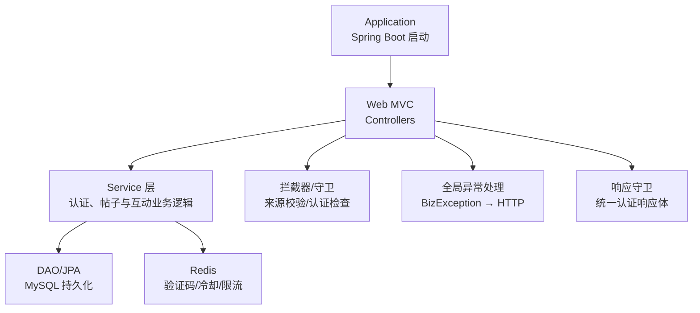

图表来源
- [Application.java:7-13](file://backend/src/main/java/com/luyi/myfirst/Application.java#L7-L13)
- [application.yml:3-40](file://backend/src/main/resources/application.yml#L3-L40)
- [pom.xml:28-75](file://backend/pom.xml#L28-L75)

章节来源
- [Application.java:7-13](file://backend/src/main/java/com/luyi/myfirst/Application.java#L7-L13)
- [pom.xml:1-92](file://backend/pom.xml#L1-L92)
- [application.yml:1-76](file://backend/src/main/resources/application.yml#L1-L76)

## 核心组件
- 应用入口与配置
  - Application：启用 Spring Boot 与配置属性扫描。
  - application.yml：定义端口、MySQL/Redis 连接、JPA 行为、SQL 初始化模式以及认证相关参数（会话 TTL、JWT 密钥、Cookie 安全、允许来源、可信代理、验证码与限流策略）。
  - pom.xml：声明 Spring Boot Web、JPA、MySQL、Redis、Security Crypto、Validation、JWT 等依赖。
- Web 控制器
  - 认证控制器：登录、注册、验证码、密码重置、登出、当前用户、注册码换发、密码重置码换发、账户注销。
  - 帖子控制器：创建、更新、删除、详情查询、列表获取。
  - 互动控制器：评论创建/删除/列表、投票创建/取消、收藏创建/取消。
- 服务层
  - 认证服务：处理用户认证、会话管理、验证码等业务逻辑。
  - 帖子服务：处理帖子 CRUD 操作、权限验证、分页查询等业务逻辑。
  - 互动服务：处理评论、投票、收藏的业务逻辑，包括权限控制和统计计算。
- 通用 Web 能力
  - GlobalExceptionHandler：将 BizException 映射为带错误码与可选 Retry-After 头的 HTTP 响应。
  - AuthResponseBody：认证端点响应体的标记接口。
  - AuthResponseGuard：仅放行实现 AuthResponseBody 的响应体，限制 /api/auth/** 路径的出站形状。

章节来源
- [Application.java:7-13](file://backend/src/main/java/com/luyi/myfirst/Application.java#L7-L13)
- [application.yml:3-76](file://backend/src/main/resources/application.yml#L3-L76)
- [pom.xml:28-75](file://backend/pom.xml#L28-L75)
- [GlobalExceptionHandler.java:8-24](file://backend/src/main/java/com/luyi/myfirst/common/web/GlobalExceptionHandler.java#L8-L24)
- [AuthResponseBody.java:3-15](file://backend/src/main/java/com/luyi/myfirst/common/web/AuthResponseBody.java#L3-L15)
- [AuthResponseGuard.java:11-76](file://backend/src/main/java/com/luyi/myfirst/common/web/AuthResponseGuard.java#L11-L76)

## 架构总览
认证链路的关键交互如下：客户端发起请求，经过拦截器进行来源与认证检查，控制器调用服务层完成业务，必要时写 Cookie，最后由响应守卫统一约束响应体类型。

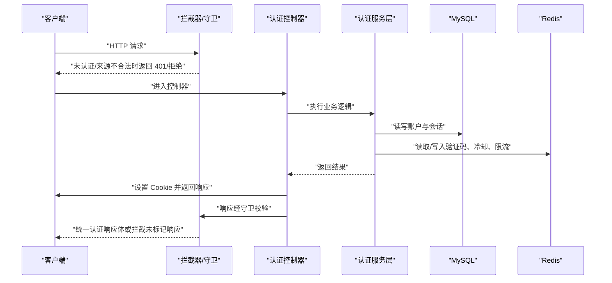

图表来源
- [LoginController.java:45-59](file://backend/src/main/java/com/luyi/myfirst/web/auth/LoginController.java#L45-L59)
- [RegisterController.java:37-46](file://backend/src/main/java/com/luyi/myfirst/web/auth/RegisterController.java#L37-L46)
- [LogoutController.java:34-39](file://backend/src/main/java/com/luyi/myfirst/web/auth/LogoutController.java#L34-L39)
- [AuthResponseGuard.java:41-76](file://backend/src/main/java/com/luyi/myfirst/common/web/AuthResponseGuard.java#L41-L76)

## 详细组件分析

### 数据库模型与持久化
- accounts：存储用户公开标识、邮箱、密码哈希、显示名、状态、令牌版本、审计字段与软删除时间；active_email 生成列用于唯一性约束。
- auth_sessions：记录 JWT jti、所属账户、签发与过期时间、吊销时间，用于令牌吊销判定。
- posts：存储帖子标题、内容、封面图片、标签、状态、作者 ID、发布时间、审计字段与软删除时间。
- **新增** post_comments：存储评论的帖子关联、作者、父评论、内容和审计信息，支持二级回复。
- **新增** post_votes：存储投票的帖子关联、作者、方向和审计信息，每个账户对每条帖子最多一条有效记录。
- **新增** post_bookmarks：存储收藏的帖子关联、作者和审计信息，每个账户对每条帖子最多一条有效记录。

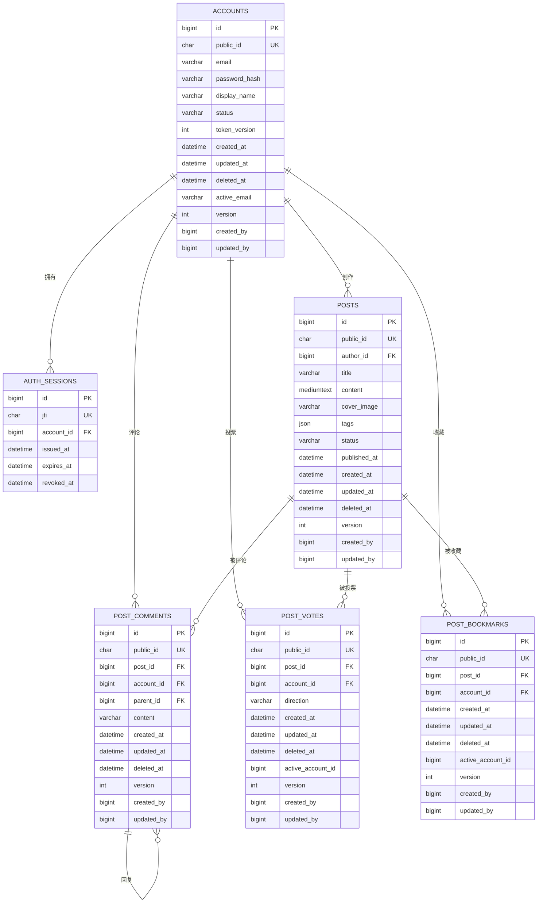

图表来源
- [schema.sql:6-29](file://backend/src/main/resources/schema.sql#L6-L29)
- [schema.sql:31-46](file://backend/src/main/resources/schema.sql#L31-L46)
- [Post.java:24-56](file://backend/src/main/java/com/luyi/myfirst/dao/post/entity/Post.java#L24-L56)
- [schema.sql:78-151](file://backend/src/main/resources/schema.sql#L78-L151)

章节来源
- [schema.sql:1-151](file://backend/src/main/resources/schema.sql#L1-L151)

### 认证控制器族
- 登录控制器
  - 接收邮箱、密码、验证码信息，解析来源键，调用登录服务，写 Cookie，返回用户基本信息与令牌过期时间。
- 注册控制器
  - 接收邮箱、验证码、密码、显示名，调用注册服务，写 Cookie，返回用户基本信息。
- 验证码控制器
  - 无状态发放图形码，供前端刷新。
- 密码重置控制器
  - 接收邮箱、验证码与新密码，调用重置服务，返回空体成功。
- 登出控制器
  - 先吊销会话再清除 Cookie，返回 204。
- 当前用户控制器
  - 从已验证令牌中取账户对象，白名单映射返回五项字段。
- 注册码换发控制器
  - 接收邮箱与验证码，调用注册码服务，返回 202。
- 密码重置码换发控制器
  - 接收邮箱与验证码，调用重置码服务，返回 202。
- 账户注销控制器
  - 调用账户服务执行软删除，随后清除 Cookie，返回 204。

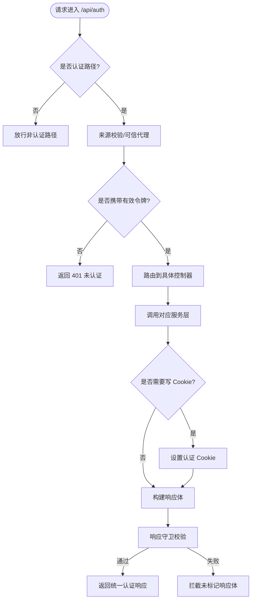

图表来源
- [LoginController.java:45-59](file://backend/src/main/java/com/luyi/myfirst/web/auth/LoginController.java#L45-L59)
- [RegisterController.java:37-46](file://backend/src/main/java/com/luyi/myfirst/web/auth/RegisterController.java#L37-L46)
- [LogoutController.java:34-39](file://backend/src/main/java/com/luyi/myfirst/web/auth/LogoutController.java#L34-L39)
- [MeController.java:26-34](file://backend/src/main/java/com/luyi/myfirst/web/auth/MeController.java#L26-L34)
- [AuthResponseGuard.java:41-76](file://backend/src/main/java/com/luyi/myfirst/common/web/AuthResponseGuard.java#L41-L76)

章节来源
- [LoginController.java:19-59](file://backend/src/main/java/com/luyi/myfirst/web/auth/LoginController.java#L19-L59)
- [RegisterController.java:16-46](file://backend/src/main/java/com/luyi/myfirst/web/auth/RegisterController.java#L16-L46)
- [CaptchaController.java:10-29](file://backend/src/main/java/com/luyi/myfirst/web/auth/CaptchaController.java#L10-L29)
- [PasswordResetController.java:11-33](file://backend/src/main/java/com/luyi/myfirst/web/auth/PasswordResetController.java#L11-L33)
- [LogoutController.java:13-39](file://backend/src/main/java/com/luyi/myfirst/web/auth/LogoutController.java#L13-L39)
- [MeController.java:12-34](file://backend/src/main/java/com/luyi/myfirst/web/auth/MeController.java#L12-L34)
- [RegisterCodeController.java:11-30](file://backend/src/main/java/com/luyi/myfirst/web/auth/RegisterCodeController.java#L11-L30)
- [PasswordResetCodeController.java:11-31](file://backend/src/main/java/com/luyi/myfirst/web/auth/PasswordResetCodeController.java#L11-L31)
- [AccountController.java:15-39](file://backend/src/main/java/com/luyi/myfirst/web/auth/AccountController.java#L15-L39)

### 帖子管理功能

#### 帖子控制器
帖子控制器提供 5 个 REST 端点，遵循统一的身份验证和响应格式规范：

- **创建帖子** (`POST /api/posts`)：需要认证，返回 201 状态码和帖子详情
- **更新帖子** (`PUT /api/posts/{publicId}`)：需要认证且必须是作者，返回 200 状态码
- **删除帖子** (`DELETE /api/posts/{publicId}`)：需要认证且必须是作者，返回 204 状态码
- **获取帖子详情** (`GET /api/posts/{publicId}`)：公开访问，草稿仅作者可见
- **获取帖子列表** (`GET /api/posts`)：公开访问，只返回已发布帖子，支持游标分页和多维度排序

```mermaid
flowchart TD
A["帖子请求"] --> B{"请求类型"}
B --> |POST| C["创建帖子<br/>需要认证"]
B --> |PUT| D["更新帖子<br/>需要认证+作者"]
B --> |DELETE| E["删除帖子<br/>需要认证+作者"]
B --> |GET/{id}| F["获取详情<br/>公开访问"]
B --> |GET| G["获取列表<br/>公开访问+分页"]
C --> H["调用 PostService.publish()"]
D --> I["调用 PostService.edit()"]
E --> J["调用 PostService.delete()"]
F --> K["调用 PostService.read()"]
G --> L["调用 PostService.feed()"]
H --> M["返回 201 + 帖子详情"]
I --> N["返回 200 + 更新后详情"]
J --> O["返回 204 无内容"]
K --> P["返回 200 + 帖子详情"]
L --> Q["返回 200 + 分页列表"]
```

图表来源
- [PostController.java:55-94](file://backend/src/main/java/com/luyi/myfirst/web/post/PostController.java#L55-L94)

#### 帖子服务层
帖子服务层实现了完整的业务逻辑，包括：

- **输入验证**：使用 `PostInputRules` 对标题、内容、封面图片、标签等进行规范化
- **权限控制**：确保只有作者可以编辑或删除帖子
- **可见性控制**：草稿对非作者返回 404 而非 403，防止信息泄露
- **分页查询**：使用游标分页，按 `published_at` 和 `id` 排序
- **作者信息解析**：将内部作者 ID 转换为对外公开的 `authorPublicId`
- **统计计算**：批量计算每篇帖子的评论数、点赞数和收藏数

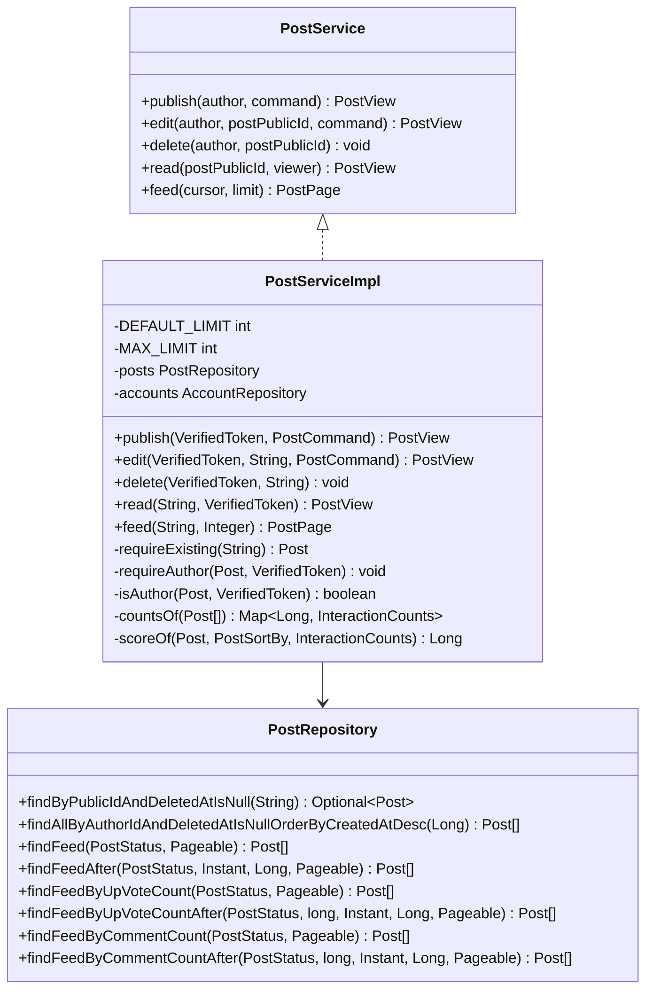

图表来源
- [PostService.java:18-34](file://backend/src/main/java/com/luyi/myfirst/service/post/PostService.java#L18-L34)
- [PostServiceImpl.java:45-283](file://backend/src/main/java/com/luyi/myfirst/service/post/impl/PostServiceImpl.java#L45-L283)
- [PostRepository.java:26-128](file://backend/src/main/java/com/luyi/myfirst/dao/post/repository/PostRepository.java#L26-L128)

#### 帖子数据模型
帖子实体继承自基础实体，包含以下核心字段：

- **公共标识** (`publicId`)：对外使用的唯一标识符
- **作者 ID** (`authorId`)：关联到账户表的内部主键
- **标题** (`title`)：帖子标题，最大长度 120
- **内容** (`content`)：帖子正文，使用 MEDIUMTEXT 类型
- **封面图片** (`coverImage`)：可选的封面图片 URL
- **标签** (`tags`)：JSON 格式的标签数组
- **状态** (`status`)：`draft`（草稿）或 `published`（已发布）
- **发布时间** (`publishedAt`)：首次发布时的时间戳
- **审计字段**：继承自 `BaseEntity` 的创建时间、更新时间、删除时间等

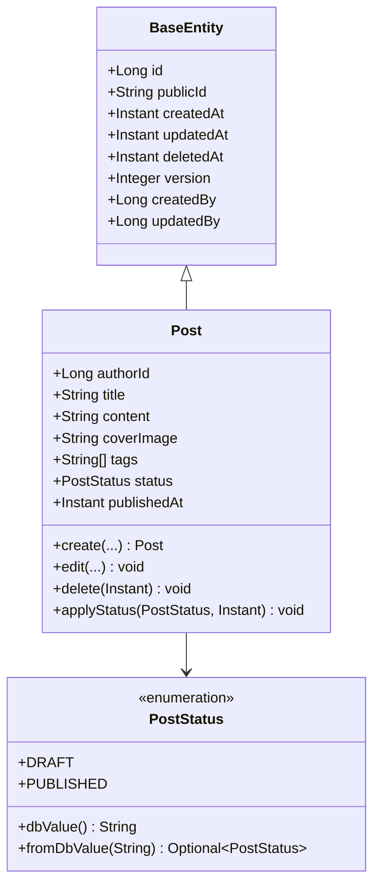

图表来源
- [Post.java:24-148](file://backend/src/main/java/com/luyi/myfirst/dao/post/entity/Post.java#L24-L148)
- [PostStatus.java:12-46](file://backend/src/main/java/com/luyi/myfirst/common/enums/PostStatus.java#L12-L46)

#### API 契约定义
帖子 API 使用标准的请求响应 DTO：

- **创建请求** (`PostCreateRequest`)：包含标题、内容、封面图片、标签和状态
- **更新请求** (`PostUpdateRequest`)：结构与创建请求相同
- **帖子详情响应** (`PostResponse`)：包含 9 个字段的白名单响应体
- **帖子摘要响应** (`PostSummaryResponse`)：用于列表展示的简化响应，**新增** 包含 commentCount、upVoteCount、bookmarkCount 三个统计字段
- **帖子列表响应** (`PostFeedResponse`)：包含帖子摘要数组和下一页游标

**章节来源**
- [PostController.java:43-148](file://backend/src/main/java/com/luyi/myfirst/web/post/PostController.java#L43-L148)
- [PostService.java:18-34](file://backend/src/main/java/com/luyi/myfirst/service/post/PostService.java#L18-L34)
- [PostServiceImpl.java:45-283](file://backend/src/main/java/com/luyi/myfirst/service/post/impl/PostServiceImpl.java#L45-L283)
- [Post.java:24-148](file://backend/src/main/java/com/luyi/myfirst/dao/post/entity/Post.java#L24-L148)
- [PostRepository.java:26-128](file://backend/src/main/java/com/luyi/myfirst/dao/post/repository/PostRepository.java#L26-L128)
- [PostCreateRequest.java:15-21](file://backend/src/main/java/com/luyi/myfirst/web/post/dto/PostCreateRequest.java#L15-L21)
- [PostResponse.java:17-27](file://backend/src/main/java/com/luyi/myfirst/web/post/dto/PostResponse.java#L17-L27)
- [PostSummaryResponse.java:15-27](file://backend/src/main/java/com/luyi/myfirst/web/post/dto/PostSummaryResponse.java#L15-L27)
- [PostStatus.java:12-46](file://backend/src/main/java/com/luyi/myfirst/common/enums/PostStatus.java#L12-L46)

### 帖子交互功能

#### 互动控制器
互动控制器提供 6 个 REST 端点，专注于评论、投票和收藏功能：

- **发表评论** (`POST /api/posts/{postPublicId}/comments`)：需要认证，返回 201 状态码和评论详情
- **删除评论** (`DELETE /api/posts/{postPublicId}/comments/{commentPublicId}`)：需要认证且必须是评论作者，返回 204 状态码
- **获取评论列表** (`GET /api/posts/{postPublicId}/comments`)：公开访问，支持游标分页，按创建时间倒序
- **投票** (`POST /api/posts/{postPublicId}/votes`)：需要认证，返回 201 或 200 状态码，支持方向切换
- **取消投票** (`DELETE /api/posts/{postPublicId}/votes`)：需要认证且必须是投票人，返回 204 状态码
- **收藏** (`POST /api/posts/{postPublicId}/bookmarks`)：需要认证，返回 201 或 200 状态码，幂等操作
- **取消收藏** (`DELETE /api/posts/{postPublicId}/bookmarks`)：需要认证且必须是收藏人，返回 204 状态码

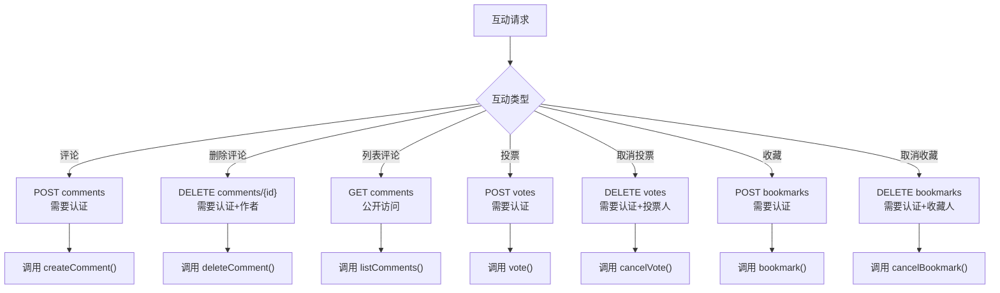

图表来源
- [PostInteractionController.java:55-120](file://backend/src/main/java/com/luyi/myfirst/web/post/interaction/PostInteractionController.java#L55-L120)

#### 互动服务层
互动服务层实现了完整的业务逻辑，包括：

- **评论管理**：支持二级回复（parentPublicId），软删除保护，作者权限验证
- **投票机制**：同一账户同一帖子只保留一条有效记录，再次投票替换方向
- **收藏功能**：幂等操作，自动判断是否存在并返回相应状态码
- **统计计算**：实时计算评论数、点赞数和收藏数
- **游标分页**：评论列表使用基于时间的游标分页

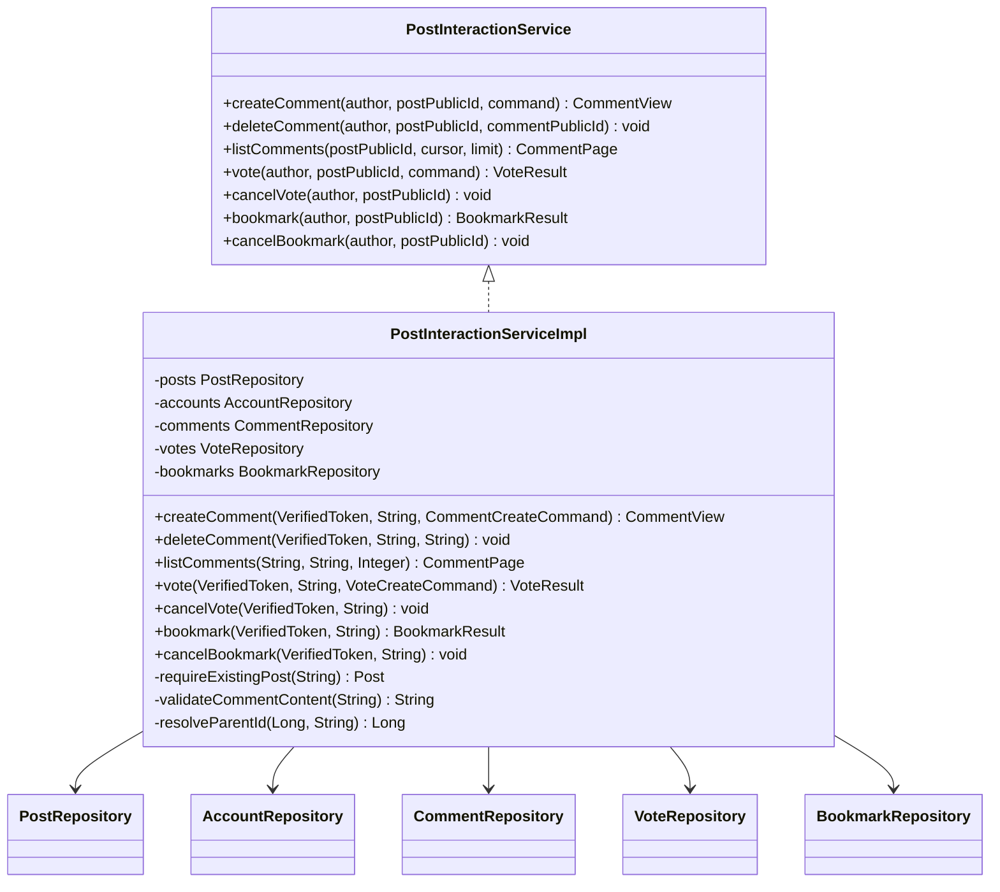

图表来源
- [PostInteractionService.java:16-42](file://backend/src/main/java/com/luyi/myfirst/service/post/interaction/PostInteractionService.java#L16-L42)
- [PostInteractionServiceImpl.java:56-85](file://backend/src/main/java/com/luyi/myfirst/service/post/interaction/impl/PostInteractionServiceImpl.java#L56-L85)

#### 互动数据模型
新增三个实体类，均继承自 BaseEntity：

- **Comment**：评论实体，支持二级回复，包含 postId、authorId、parentId、content 字段
- **Vote**：投票实体，包含 postId、authorId、direction（up/down）字段，每个账户对每条帖子最多一条有效记录
- **Bookmark**：收藏实体，包含 postId、authorId 字段，每个账户对每条帖子最多一条有效记录

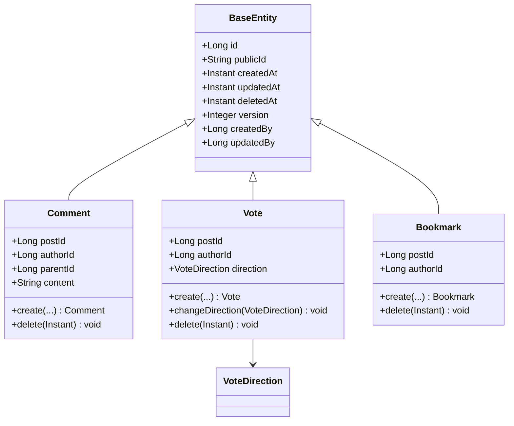

图表来源
- [Comment.java:12-66](file://backend/src/main/java/com/luyi/myfirst/dao/post/entity/Comment.java#L12-L66)
- [Vote.java:12-63](file://backend/src/main/java/com/luyi/myfirst/dao/post/entity/Vote.java#L12-L63)
- [Bookmark.java:12-48](file://backend/src/main/java/com/luyi/myfirst/dao/post/entity/Bookmark.java#L12-L48)

#### 互动 API 契约定义
互动 API 使用专门的请求响应 DTO：

- **评论创建请求** (`CommentCreateRequest`)：包含评论内容和父评论 ID
- **评论列表响应** (`CommentListResponse`)：包含评论数组和下一页游标
- **投票创建请求** (`VoteCreateRequest`)：包含投票方向（up/down）
- **投票响应** (`VoteResponse`)：包含投票详情和方向
- **收藏响应** (`BookmarkResponse`)：包含收藏详情

**章节来源**
- [PostInteractionController.java:43-153](file://backend/src/main/java/com/luyi/myfirst/web/post/interaction/PostInteractionController.java#L43-L153)
- [PostInteractionService.java:16-42](file://backend/src/main/java/com/luyi/myfirst/service/post/interaction/PostInteractionService.java#L16-L42)
- [PostInteractionServiceImpl.java:56-85](file://backend/src/main/java/com/luyi/myfirst/service/post/interaction/impl/PostInteractionServiceImpl.java#L56-L85)
- [Comment.java:12-66](file://backend/src/main/java/com/luyi/myfirst/dao/post/entity/Comment.java#L12-L66)
- [Vote.java:12-63](file://backend/src/main/java/com/luyi/myfirst/dao/post/entity/Vote.java#L12-L63)
- [Bookmark.java:12-48](file://backend/src/main/java/com/luyi/myfirst/dao/post/entity/Bookmark.java#L12-L48)

### 全局异常处理与响应守卫
- 全局异常处理
  - 捕获 BizException，按 httpStatus 返回错误体，并在需要时附加 Retry-After 头。
- 响应守卫
  - 对 /api/auth/** 路径的所有响应体进行类型检查：只有实现 AuthResponseBody 的类型才放行；框架内部错误页不受约束；未标记类型会被拦截并抛出运行时异常，便于在测试中发现遗漏。

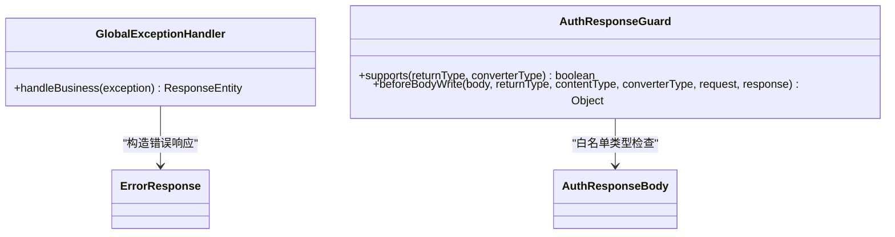

图表来源
- [GlobalExceptionHandler.java:8-24](file://backend/src/main/java/com/luyi/myfirst/common/web/GlobalExceptionHandler.java#L8-L24)
- [AuthResponseBody.java:3-15](file://backend/src/main/java/com/luyi/myfirst/common/web/AuthResponseBody.java#L3-L15)
- [AuthResponseGuard.java:28-76](file://backend/src/main/java/com/luyi/myfirst/common/web/AuthResponseGuard.java#L28-L76)

章节来源
- [GlobalExceptionHandler.java:8-24](file://backend/src/main/java/com/luyi/myfirst/common/web/GlobalExceptionHandler.java#L8-L24)
- [AuthResponseBody.java:3-15](file://backend/src/main/java/com/luyi/myfirst/common/web/AuthResponseBody.java#L3-L15)
- [AuthResponseGuard.java:11-76](file://backend/src/main/java/com/luyi/myfirst/common/web/AuthResponseGuard.java#L11-L76)

## 依赖关系分析
- 运行依赖
  - Spring Boot Web：提供 MVC、拦截器、响应体处理。
  - Spring Data JPA + MySQL Connector：持久化账户与会话及帖子数据。
  - Spring Data Redis：验证码、冷却、配额与限流计数。
  - Spring Security Crypto：BCrypt 密码哈希。
  - Validation：请求体验证。
  - JJWT：HS256 令牌签发与验签。
- 配置依赖
  - application.yml 显式声明所有认证相关参数，缺失即启动失败，避免代码默认值掩盖配置问题。

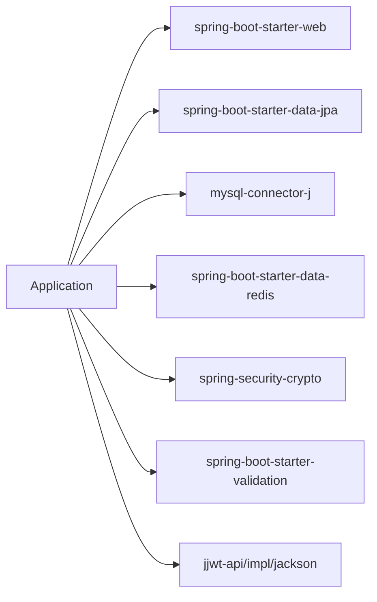

图表来源
- [pom.xml:28-75](file://backend/pom.xml#L28-L75)

章节来源
- [pom.xml:1-92](file://backend/pom.xml#L1-L92)
- [application.yml:10-40](file://backend/src/main/resources/application.yml#L10-L40)

## 性能与可靠性
- 数据库
  - JPA 关闭 ddl-auto，DDL 由 schema.sql 管理，避免 ORM 自动变更结构带来的风险。
  - SQL 初始化模式设为 always，确保幂等建表。
- 缓存
  - Redis 用于验证码、冷却与限流，降低数据库压力并提升抗攻击能力。
- 令牌与会话
  - JWT 明文不落库，仅存 jti 用于吊销；会话表索引覆盖 account_id 与 expires_at，支持按账户与过期时间查询。
- 安全
  - Cookie 安全标志、允许来源列表、可信代理白名单与来源限流共同构成 CSRF/枚举/暴力破解防护面。
- 可观测性
  - 全局异常处理只兜底业务拒绝，其他异常保持 500，便于联调发现真实错误。
- 帖子性能优化
  - 使用游标分页替代传统 offset 分页，避免大数据量时的性能问题。
  - 批量获取作者公开 ID，减少 N+1 查询问题。
  - 使用 saveAndFlush 确保更新的更新时间能正确返回。
- **新增** 互动性能优化
  - 评论、投票、收藏表均使用软删除和适当的索引优化查询性能。
  - 统计查询使用子查询实时计算，避免缓存一致性问题。
  - 投票和收藏表使用唯一约束确保每个账户对每条帖子只有一条有效记录。

[本节为通用指导，不直接分析具体文件]

## 故障排查指南
- 启动失败
  - 检查环境变量 WANDERCHAIN_DB_USER、WANDERCHAIN_DB_PASSWORD、WANDERCHAIN_REDIS_PASSWORD、WANDERCHAIN_JWT_SECRET 是否齐全。
  - 确认 MySQL 与 Redis 地址、端口、数据库号与密码正确。
- 认证失败
  - 登录返回 401 通常表示未携带有效令牌或令牌已失效；检查 Cookie 是否被浏览器策略阻止。
  - 403 可能来自来源校验或限流；核对 allowed-origins 与 trusted-proxies 配置。
- 验证码与限流
  - 若频繁触发重试或冷却，检查 Redis 连通性与验证码 TTL、冷却间隔配置。
- 响应体泄漏
  - 新增认证响应 DTO 需实现 AuthResponseBody，否则会被响应守卫拦截；查看服务端日志中的非法类型信息以定位。
- 业务错误
  - 关注 BizException 抛出的错误码与消息；如需重试，检查是否附带 Retry-After 头。
- 帖子相关错误
  - 404 表示帖子不存在或草稿对非作者不可见；403 表示尝试操作他人帖子；400 表示请求体验证失败。
  - 分页游标无效时检查 cursor 参数格式是否正确。
- **新增** 互动相关错误
  - 评论 404 表示帖子不存在或评论不存在；403 表示尝试删除他人评论。
  - 投票 400 表示投票方向无效；403 表示尝试取消他人投票。
  - 收藏 403 表示尝试取消他人收藏。
  - 统计字段为 0 可能是正常情况（无互动）或数据同步延迟。

章节来源
- [application.yml:10-76](file://backend/src/main/resources/application.yml#L10-L76)
- [GlobalExceptionHandler.java:8-24](file://backend/src/main/java/com/luyi/myfirst/common/web/GlobalExceptionHandler.java#L8-L24)
- [AuthResponseGuard.java:41-76](file://backend/src/main/java/com/luyi/myfirst/common/web/AuthResponseGuard.java#L41-L76)

## 结论
WanderChain 文章后端以清晰的边界划分职责：控制器负责路由与 Cookie，服务层承载业务规则，DAO 与缓存承担数据访问，全局异常与响应守卫保障一致的错误输出与安全出站。配合显式配置、幂等建表与严格的来源/限流策略，系统在安全性、可维护性与可扩展性上具备良好基础。

**更新** 新增的帖子管理功能和帖子交互功能进一步完善了后端能力，提供了完整的 CRUD 操作、权限控制、分页查询、API 契约定义和丰富的用户互动功能。通过 5 个帖子管理 REST 端点和 6 个互动 REST 端点，系统现在能够支持帖子的完整生命周期管理和评论、投票、收藏等社交功能。新增的三个数据库表（post_comments、post_votes、post_bookmarks）和相应的实体类、仓库接口为互动功能提供了坚实的数据基础。PostSummaryResponse 新增的统计字段（commentCount、upVoteCount、bookmarkCount）和增强的排序能力使得帖子列表更加丰富和有用。配合完善的测试覆盖，确保了功能的稳定性和可靠性。后续可在现有基础上继续扩展更多社交功能，复用统一的认证、异常与响应机制。