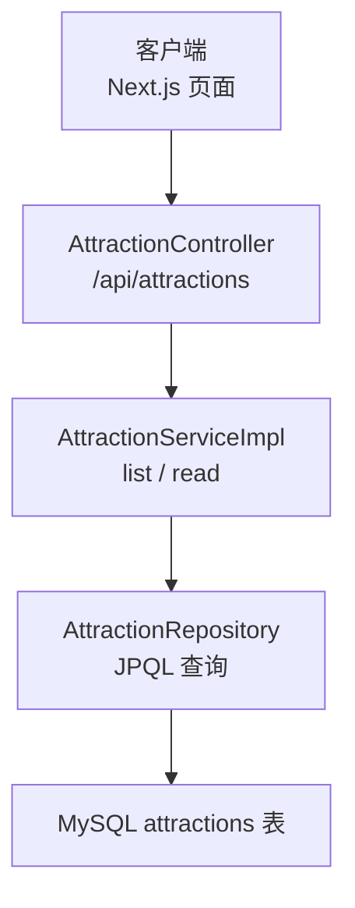
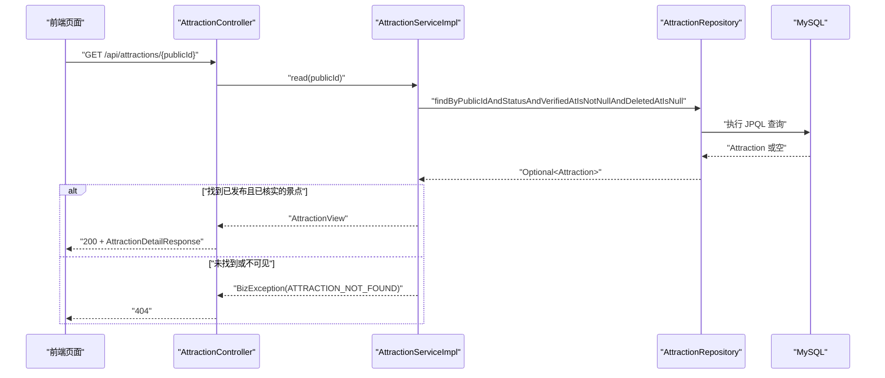
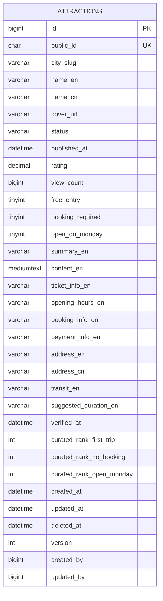
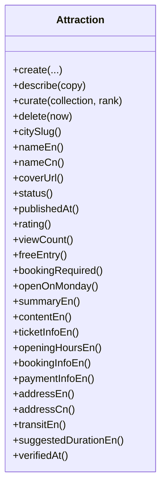
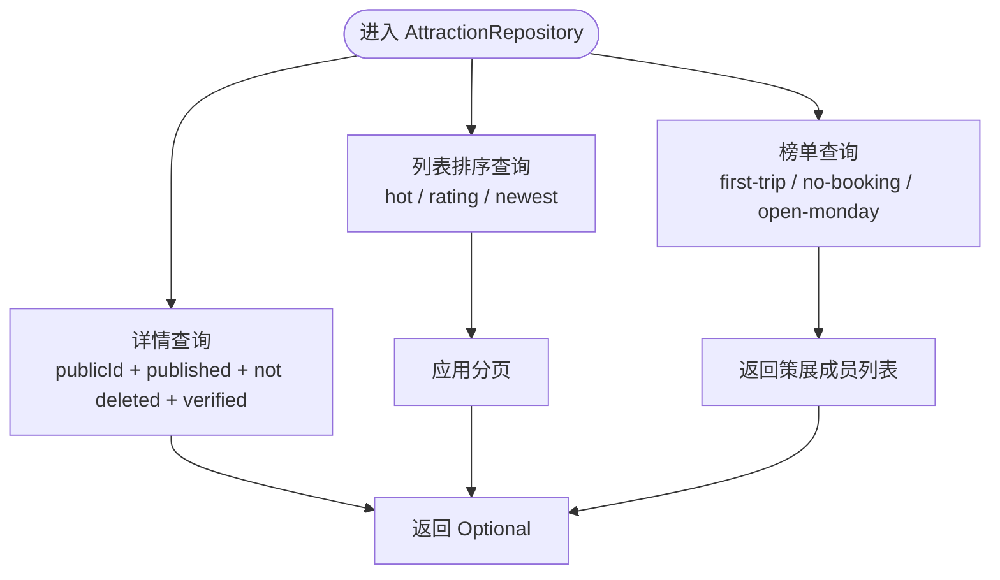
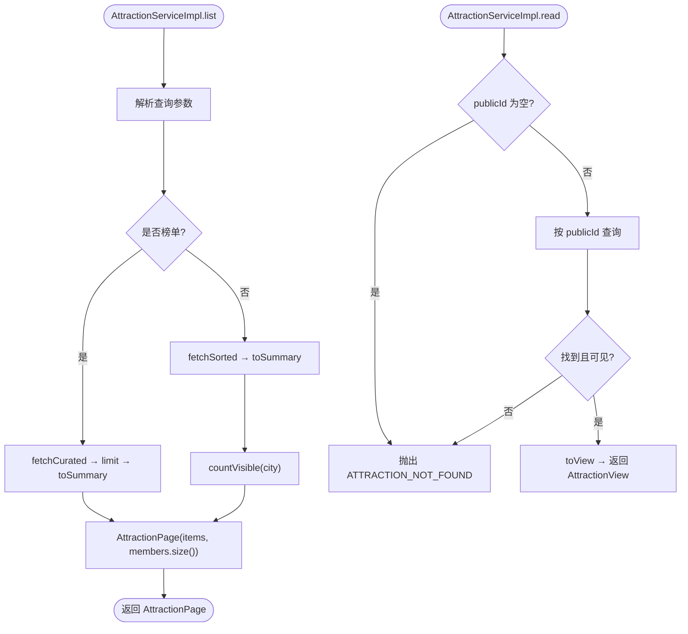
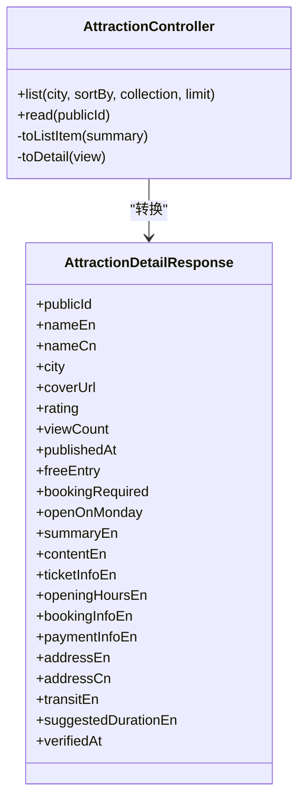
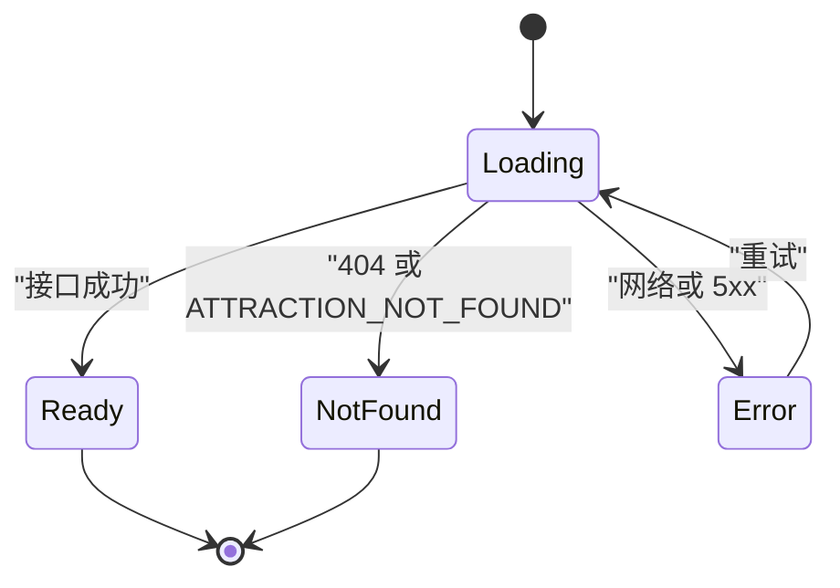
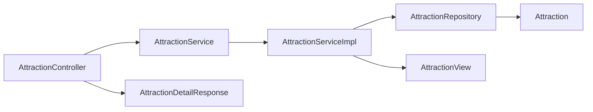

# WanderChain 景点模块

<cite>
**本文引用的文件**   
- [Attraction.java](file://backend/src/main/java/com/luyi/myfirst/dao/attraction/entity/Attraction.java)
- [AttractionRepository.java](file://backend/src/main/java/com/luyi/myfirst/dao/attraction/repository/AttractionRepository.java)
- [AttractionService.java](file://backend/src/main/java/com/luyi/myfirst/service/attraction/AttractionService.java)
- [AttractionServiceImpl.java](file://backend/src/main/java/com/luyi/myfirst/service/attraction/impl/AttractionServiceImpl.java)
- [AttractionView.java](file://backend/src/main/java/com/luyi/myfirst/service/attraction/model/AttractionView.java)
- [AttractionController.java](file://backend/src/main/java/com/luyi/myfirst/web/attraction/AttractionController.java)
- [AttractionDetailResponse.java](file://backend/src/main/java/com/luyi/myfirst/web/attraction/dto/AttractionDetailResponse.java)
- [schema.sql](file://backend/src/main/resources/schema.sql)
- [attractions-detail.md](file://docs/specs/wanderchain/attractions-detail.md)
</cite>

## 目录
1. [简介](#简介)
2. [项目结构](#项目结构)
3. [核心组件](#核心组件)
4. [架构总览](#架构总览)
5. [详细组件分析](#详细组件分析)
6. [依赖关系分析](#依赖关系分析)
7. [性能与可扩展性](#性能与可扩展性)
8. [故障排查指南](#故障排查指南)
9. [结论](#结论)

## 简介
WanderChain 的景点模块提供面向境外游客的景点列表与详情能力。后端采用 Spring Boot + JPA，对外暴露两个公开只读接口：
- 列表或榜单：`GET /api/attractions`
- 详情：`GET /api/attractions/{publicId}`

该模块遵循“已发布、未删除、已核实”的可见性约束；所有读查询在仓储层强制过滤草稿、已删除和未核实的景点，避免调用方遗漏条件导致数据泄露。前端通过 Next.js App Router 访问 `/attractions/[publicId]`，以 `publicId` 为唯一输入，渲染加载中、就绪、不存在、错误四种互斥状态。

## 项目结构
景点模块在后端按领域分层组织：
- `dao.attraction.entity`：JPA 实体，映射 `attractions` 表。
- `dao.attraction.repository`：JPA Repository，封装 JPQL 查询与可见性条件。
- `service.attraction`：只读服务接口与实现，负责参数归一化、分页、榜单截断与模型转换。
- `web.attraction`：REST 控制器与响应 DTO，仅做路由、DTO 转换与返回 200。
- `resources.schema.sql`：建表、索引、约束与种子数据。

**图表来源**
- [AttractionController.java:27-61](file://backend/src/main/java/com/luyi/myfirst/web/attraction/AttractionController.java#L27-L61)
- [AttractionServiceImpl.java:35-64](file://backend/src/main/java/com/luyi/myfirst/service/attraction/impl/AttractionServiceImpl.java#L35-L64)
- [AttractionRepository.java:30-40](file://backend/src/main/java/com/luyi/myfirst/dao/attraction/repository/AttractionRepository.java#L30-L40)
- [schema.sql:156-213](file://backend/src/main/resources/schema.sql#L156-L213)

**章节来源**
- [AttractionController.java:17-26](file://backend/src/main/java/com/luyi/myfirst/web/attraction/AttractionController.java#L17-L26)
- [AttractionService.java:6-14](file://backend/src/main/java/com/luyi/myfirst/service/attraction/AttractionService.java#L6-L14)
- [AttractionRepository.java:13-29](file://backend/src/main/java/com/luyi/myfirst/dao/attraction/repository/AttractionRepository.java#L13-L29)
- [schema.sql:154-213](file://backend/src/main/resources/schema.sql#L154-L213)

## 核心组件
- **Attraction 实体**：承载景点元数据、详情文案、核实时间、策展排序列等字段，并提供创建、详情写入、策展收录、软删除等写方法。
- **AttractionRepository**：定义详情查找、热门/评分/最新三种排序、三个策展榜单以及可见性计数查询。
- **AttractionService**：声明列表与详情两个只读能力；列表支持城市、排序、榜单、条数参数，详情对不可见 `publicId` 抛出业务异常。
- **AttractionServiceImpl**：解析查询、选择仓储方法、处理榜单全量取数后截断、计算 total、转换 Summary/View。
- **AttractionView / AttractionDetailResponse**：扁平记录，包含列表项 11 个字段与详情专属 11 个字段，其中 `addressCn` 是唯一允许中文的详情字段。
- **AttractionController**：接收原始请求参数，调用服务并返回 200；不重复校验白名单。

**章节来源**
- [Attraction.java:13-29](file://backend/src/main/java/com/luyi/myfirst/dao/attraction/entity/Attraction.java#L13-L29)
- [AttractionRepository.java:13-29](file://backend/src/main/java/com/luyi/myfirst/dao/attraction/repository/AttractionRepository.java#L13-L29)
- [AttractionService.java:6-30](file://backend/src/main/java/com/luyi/myfirst/service/attraction/AttractionService.java#L6-L30)
- [AttractionServiceImpl.java:20-34](file://backend/src/main/java/com/luyi/myfirst/service/attraction/impl/AttractionServiceImpl.java#L20-L34)
- [AttractionView.java:6-15](file://backend/src/main/java/com/luyi/myfirst/service/attraction/model/AttractionView.java#L6-L15)
- [AttractionDetailResponse.java:8-22](file://backend/src/main/java/com/luyi/myfirst/web/attraction/dto/AttractionDetailResponse.java#L8-L22)
- [AttractionController.java:17-26](file://backend/src/main/java/com/luyi/myfirst/web/attraction/AttractionController.java#L17-L26)

## 架构总览
景点模块的请求链路如下：

**图表来源**
- [AttractionController.java:57-61](file://backend/src/main/java/com/luyi/myfirst/web/attraction/AttractionController.java#L57-L61)
- [AttractionServiceImpl.java:54-64](file://backend/src/main/java/com/luyi/myfirst/service/attraction/impl/AttractionServiceImpl.java#L54-L64)
- [AttractionRepository.java:32-39](file://backend/src/main/java/com/luyi/myfirst/dao/attraction/repository/AttractionRepository.java#L32-L39)
- [schema.sql:156-213](file://backend/src/main/resources/schema.sql#L156-L213)

## 详细组件分析

### 数据模型与数据库设计
`attractions` 表是景点模块的核心数据源，包含：
- 公共标识与城市 slug。
- 名称、封面、状态、发布时间、评分、浏览量。
- 三个事实布尔列：免费入场、需要预约、周一开放。
- 详情文案：摘要、正文、门票、开放时间、预约、支付、英文地址、中文地址、交通、建议时长。
- 核实时间：作为可见性条件，缺失则不出现在任何读接口。
- 三个策展排序列：首次出行、无需预约、周一开放。
- 标准审计列：创建、更新、删除、版本、操作人。

**图表来源**
- [schema.sql:156-213](file://backend/src/main/resources/schema.sql#L156-L213)

**章节来源**
- [schema.sql:154-213](file://backend/src/main/resources/schema.sql#L154-L213)
- [Attraction.java:30-102](file://backend/src/main/java/com/luyi/myfirst/dao/attraction/entity/Attraction.java#L30-L102)

### 实体与写路径
Attraction 实体采用无 setter 的设计，写入口集中在：
- `create`：构造景点基础信息，由外部生成 `publicId`，便于测试与稳定排序。
- `describe`：批量写入详情页文案块，避免列表路径装配多余字段。
- `curate`：根据策展枚举写入对应榜单排序列，新增榜单时编译期暴露分支。
- `delete`：软删除，保持行存在但按 spec 视为不存在。

**图表来源**
- [Attraction.java:118-194](file://backend/src/main/java/com/luyi/myfirst/dao/attraction/entity/Attraction.java#L118-L194)
- [Attraction.java:196-283](file://backend/src/main/java/com/luyi/myfirst/dao/attraction/entity/Attraction.java#L196-L283)

**章节来源**
- [Attraction.java:13-29](file://backend/src/main/java/com/luyi/myfirst/dao/attraction/entity/Attraction.java#L13-L29)
- [Attraction.java:118-194](file://backend/src/main/java/com/luyi/myfirst/dao/attraction/entity/Attraction.java#L118-L194)

### 仓储与查询策略
AttractionRepository 将可见性条件内聚到每条查询中，确保：
- 只有 `status = published`、`deleted_at IS NULL`、`verified_at IS NOT NULL` 的行可被读取。
- 列表查询按浏览数、评分、发布时间排序，并列时按 `publicId` 升序保证稳定顺序。
- 榜单查询不按热度重排，而是按策展列升序，末尾再按主键兜底。
- 榜单查询不分页，服务层再按 `limit` 截断，使 `total` 等于真实成员数。

**图表来源**
- [AttractionRepository.java:32-40](file://backend/src/main/java/com/luyi/myfirst/dao/attraction/repository/AttractionRepository.java#L32-L40)
- [AttractionRepository.java:42-101](file://backend/src/main/java/com/luyi/myfirst/dao/attraction/repository/AttractionRepository.java#L42-L101)
- [AttractionRepository.java:103-166](file://backend/src/main/java/com/luyi/myfirst/dao/attraction/repository/AttractionRepository.java#L103-L166)

**章节来源**
- [AttractionRepository.java:13-29](file://backend/src/main/java/com/luyi/myfirst/dao/attraction/repository/AttractionRepository.java#L13-L29)
- [AttractionRepository.java:32-183](file://backend/src/main/java/com/luyi/myfirst/dao/attraction/repository/AttractionRepository.java#L32-L183)

### 服务层逻辑
AttractionServiceImpl 承担以下职责：
- 列表：根据城市、排序、榜单、条数选择仓储方法；榜单先取全量再截断。
- 详情：空 `publicId` 直接抛 404；否则查库，找不到或不可见也抛 404。
- 总数：列表使用同条件的 count 查询，榜单使用截断前成员数。
- 模型转换：分别转换为 `AttractionSummary`（列表）与 `AttractionView`（详情）。

**图表来源**
- [AttractionServiceImpl.java:44-52](file://backend/src/main/java/com/luyi/myfirst/service/attraction/impl/AttractionServiceImpl.java#L44-L52)
- [AttractionServiceImpl.java:54-64](file://backend/src/main/java/com/luyi/myfirst/service/attraction/impl/AttractionServiceImpl.java#L54-L64)
- [AttractionServiceImpl.java:66-127](file://backend/src/main/java/com/luyi/myfirst/service/attraction/impl/AttractionServiceImpl.java#L66-L127)

**章节来源**
- [AttractionServiceImpl.java:20-34](file://backend/src/main/java/com/luyi/myfirst/service/attraction/impl/AttractionServiceImpl.java#L20-L34)
- [AttractionServiceImpl.java:44-173](file://backend/src/main/java/com/luyi/myfirst/service/attraction/impl/AttractionServiceImpl.java#L44-L173)

### 控制器与响应契约
AttractionController 暴露两个 GET 端点：
- `/api/attractions`：接收可选的 `city`、`sortBy`、`collection`、`limit`，调用服务并返回 `AttractionListResponse`。
- `/api/attractions/{publicId}`：调用服务返回详情，未知、草稿、已删除、未核实统一走 404。

响应体 `AttractionDetailResponse` 是扁平 record，包含列表项 11 字段与详情专属 11 字段，其中 `addressCn` 是唯一允许中文的字段，`verifiedAt` 非空表示该景点已通过人工核实。

**图表来源**
- [AttractionController.java:27-61](file://backend/src/main/java/com/luyi/myfirst/web/attraction/AttractionController.java#L27-L61)
- [AttractionController.java:63-102](file://backend/src/main/java/com/luyi/myfirst/web/attraction/AttractionController.java#L63-L102)
- [AttractionDetailResponse.java:23-45](file://backend/src/main/java/com/luyi/myfirst/web/attraction/dto/AttractionDetailResponse.java#L23-L45)

**章节来源**
- [AttractionController.java:17-26](file://backend/src/main/java/com/luyi/myfirst/web/attraction/AttractionController.java#L17-L26)
- [AttractionController.java:37-61](file://backend/src/main/java/com/luyi/myfirst/web/attraction/AttractionController.java#L37-L61)
- [AttractionDetailResponse.java:8-22](file://backend/src/main/java/com/luyi/myfirst/web/attraction/dto/AttractionDetailResponse.java#L8-L22)

### 前端详情页契约
前端详情页 `app/attractions/[publicId]/page.tsx` 通过 `GET /api/attractions/{publicId}` 获取详情，并以四个互斥状态渲染：
- loading：显示加载提示。
- ready：展示标题、城市、评分、浏览量、核实时间、主图、摘要、事实卡、正文。
- not-found：404 或 `ATTRACTION_NOT_FOUND` 时显示“景点不存在”。
- error：网络或服务错误时显示错误提示并可重试。

事实卡固定八项：门票、开放时间、预约、支付、英文地址、中文地址、交通、建议游览时长；任一字段为 null 时显示占位文案，不中断整页。中文地址下方固定用途标注，其余界面语言为英文。

**图表来源**
- [attractions-detail.md:9-30](file://docs/specs/wanderchain/attractions-detail.md#L9-L30)
- [attractions-detail.md:92-122](file://docs/specs/wanderchain/attractions-detail.md#L92-L122)
- [attractions-detail.md:125-181](file://docs/specs/wanderchain/attractions-detail.md#L125-L181)

**章节来源**
- [attractions-detail.md:13-55](file://docs/specs/wanderchain/attractions-detail.md#L13-L55)
- [attractions-detail.md:59-122](file://docs/specs/wanderchain/attractions-detail.md#L59-L122)
- [attractions-detail.md:125-200](file://docs/specs/wanderchain/attractions-detail.md#L125-L200)

## 依赖关系分析
景点模块内部依赖清晰：
- 控制器依赖服务接口，不感知白名单与默认值。
- 服务实现依赖仓储与领域枚举，负责业务规则与模型转换。
- 仓储依赖 JPA 与 MySQL，集中可见性条件与排序逻辑。
- 实体依赖通用基类与枚举，封装写语义。

**图表来源**
- [AttractionController.java:3-9](file://backend/src/main/java/com/luyi/myfirst/web/attraction/AttractionController.java#L3-L9)
- [AttractionService.java:3-4](file://backend/src/main/java/com/luyi/myfirst/service/attraction/AttractionService.java#L3-L4)
- [AttractionServiceImpl.java:3-12](file://backend/src/main/java/com/luyi/myfirst/service/attraction/impl/AttractionServiceImpl.java#L3-L12)
- [AttractionRepository.java:3-8](file://backend/src/main/java/com/luyi/myfirst/dao/attraction/repository/AttractionRepository.java#L3-L8)
- [AttractionView.java:1-5](file://backend/src/main/java/com/luyi/myfirst/service/attraction/model/AttractionView.java#L1-L5)

**章节来源**
- [AttractionController.java:1-15](file://backend/src/main/java/com/luyi/myfirst/web/attraction/AttractionController.java#L1-L15)
- [AttractionService.java:1-14](file://backend/src/main/java/com/luyi/myfirst/service/attraction/AttractionService.java#L1-L14)
- [AttractionServiceImpl.java:1-17](file://backend/src/main/java/com/luyi/myfirst/service/attraction/impl/AttractionServiceImpl.java#L1-L17)
- [AttractionRepository.java:1-12](file://backend/src/main/java/com/luyi/myfirst/dao/attraction/repository/AttractionRepository.java#L1-L12)

## 性能与可扩展性
- **可见性条件下沉**：所有读查询在 JPQL 中强制过滤草稿、删除、未核实，避免 N+1 或调用方遗漏导致的性能与正确性问题。
- **榜单全量取数**：策展集合规模小，先取全量再截断，保证 `total` 准确，避免分页掩盖真实成员数。
- **稳定排序**：列表并列时按 `publicId` 或主键升序，保证多次执行结果一致。
- **索引设计**：按热门、评分、最新、三个策展列建立复合索引，匹配查询条件与排序列。
- **扩展点**：新增榜单需在 `Attraction` 的 `curate` 与 Repository 的查询中同步添加，编译期暴露未覆盖分支。

[本节为通用性能讨论，不直接分析具体代码片段]

## 故障排查指南
常见异常与定位方式：
- **404 详情**：检查 `publicId` 是否存在、是否已发布、是否已删除、是否已核实。服务层对空 `publicId` 与查不到均抛 `ATTRACTION_NOT_FOUND`。
- **列表为空**：确认城市 slug 是否在白名单，排序与榜单参数是否合法；注意 `all` 是查询语义而非数据取值。
- **榜单 total 异常**：确认是否误用分页截断后的 size 作为 total；服务层应使用截断前成员数。
- **中文地址出现位置错误**：`addressCn` 只应出现在详情响应，不应进入列表项。
- **前端四态异常**：确认 404 与 5xx 是否区分；取消旧请求不应写入错误状态。

**章节来源**
- [AttractionServiceImpl.java:54-64](file://backend/src/main/java/com/luyi/myfirst/service/attraction/impl/AttractionServiceImpl.java#L54-L64)
- [AttractionRepository.java:32-40](file://backend/src/main/java/com/luyi/myfirst/dao/attraction/repository/AttractionRepository.java#L32-L40)
- [AttractionDetailResponse.java:14-22](file://backend/src/main/java/com/luyi/myfirst/web/attraction/dto/AttractionDetailResponse.java#L14-L22)
- [attractions-detail.md:92-122](file://docs/specs/wanderchain/attractions-detail.md#L92-L122)

## 结论
WanderChain 景点模块以清晰的领域分层、严格的可见性约束与稳定的排序策略，提供了可靠的景点列表与详情能力。后端通过仓储层内聚查询条件，服务层专注业务规则与模型转换，控制器仅负责路由与 DTO 转换；前端以四态机制处理加载、就绪、不存在与错误场景。整体设计兼顾可读性、可维护性与可扩展性，适合后续扩展榜单、搜索与首页热点展示。