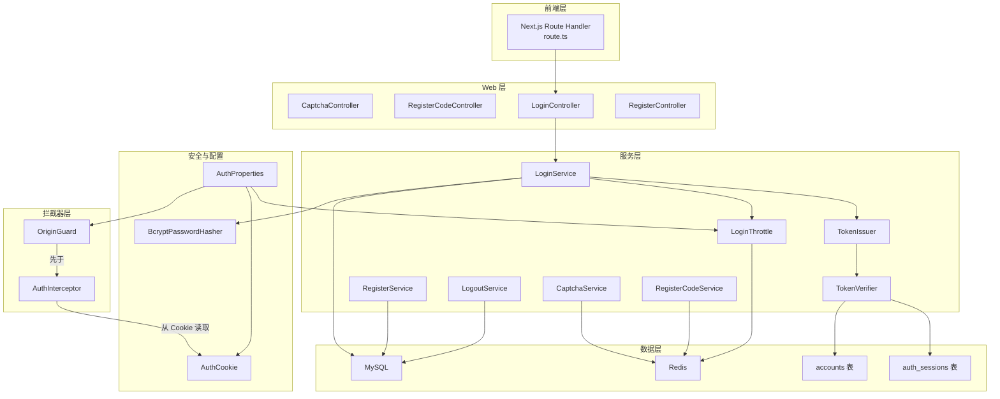
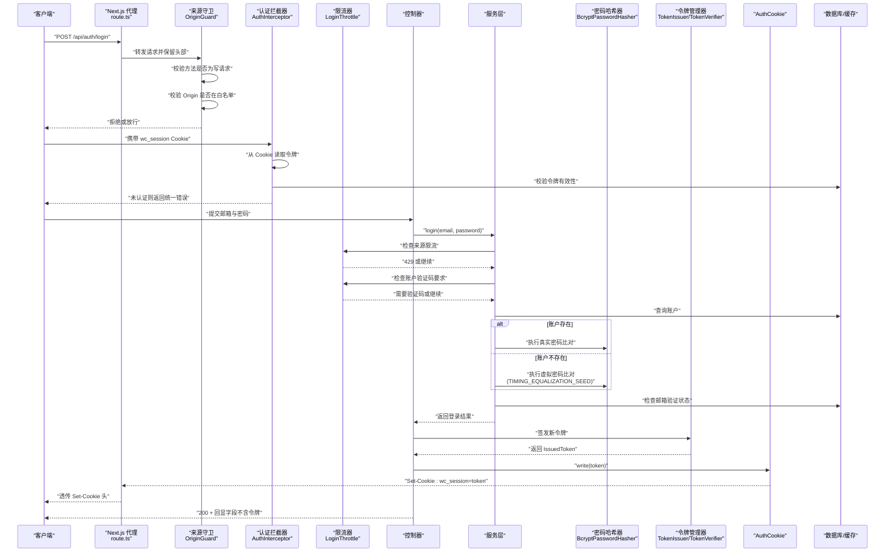
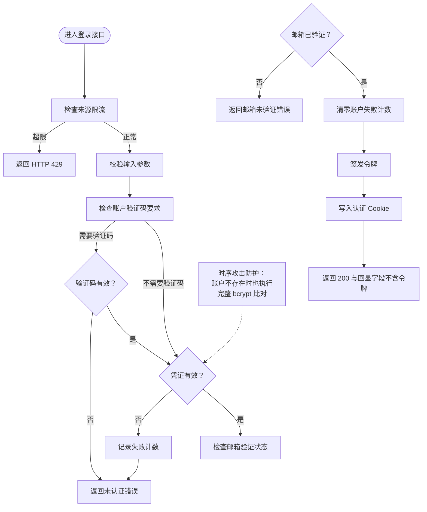
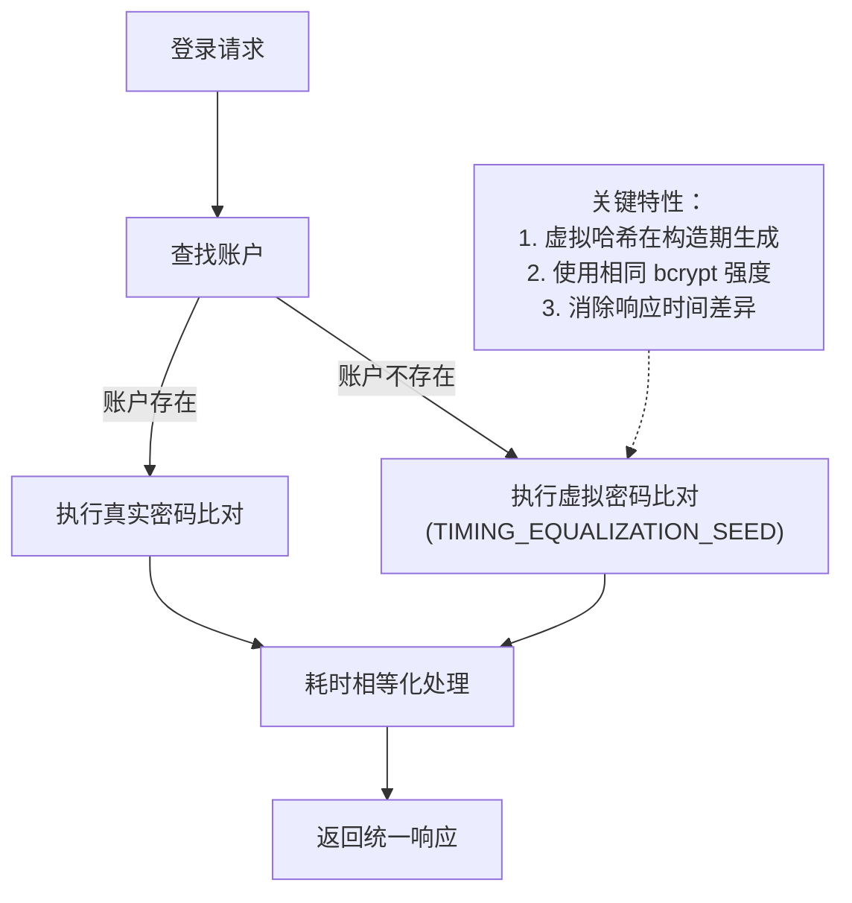
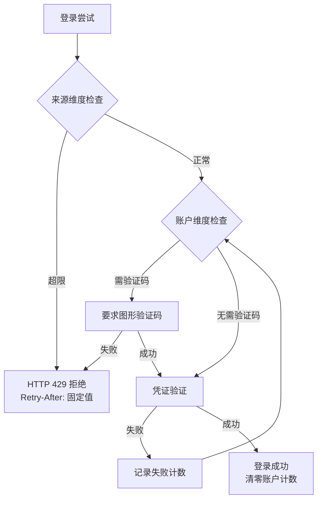
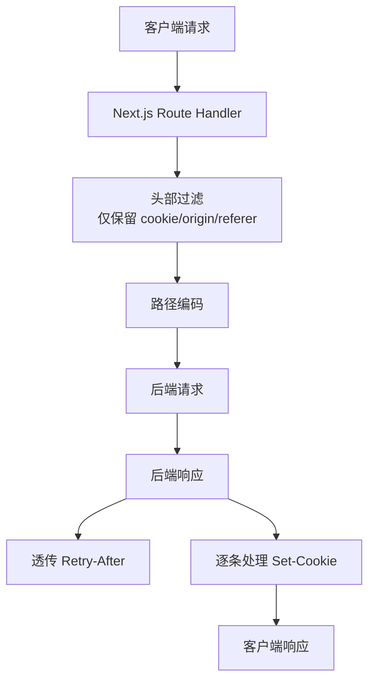
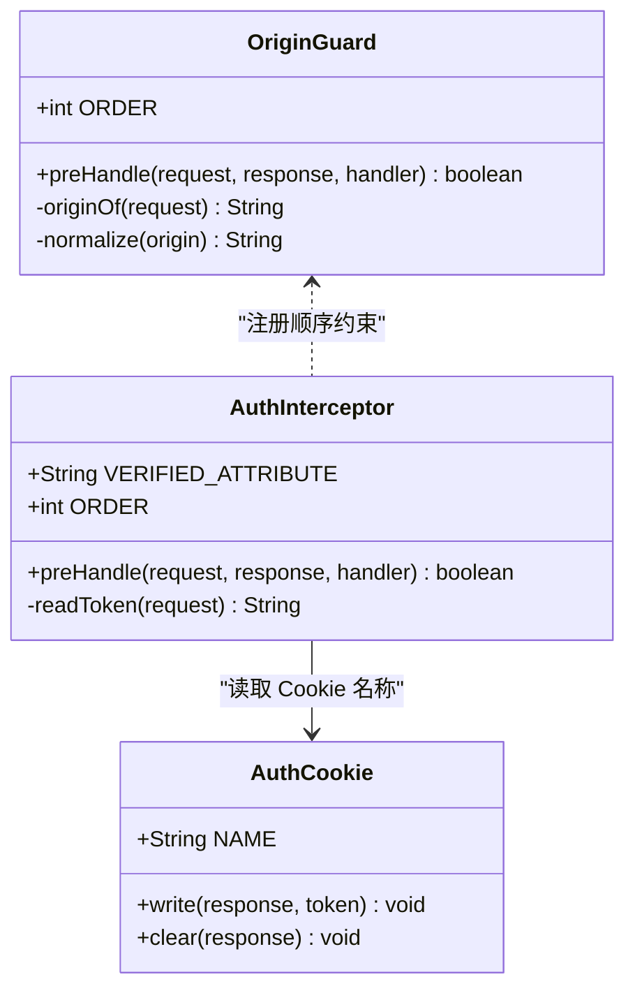
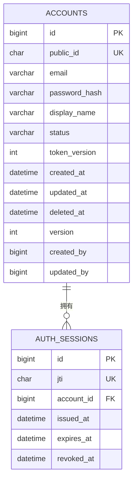
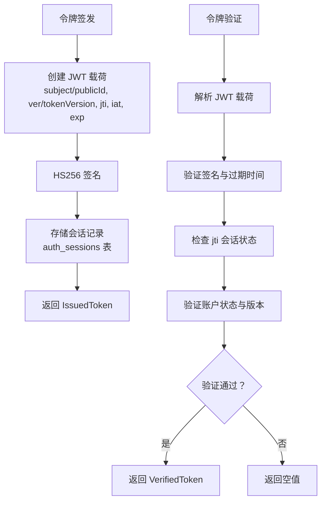
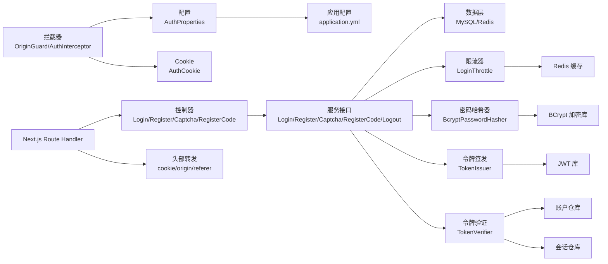

# WanderChain 认证系统

<cite>
**本文引用的文件**   
- [LoginController.java](file://backend/src/main/java/com/luyi/myfirst/web/auth/LoginController.java)
- [AuthCookie.java](file://backend/src/main/java/com/luyi/myfirst/web/auth/AuthCookie.java)
- [LoginServiceImpl.java](file://backend/src/main/java/com/luyi/myfirst/service/auth/impl/LoginServiceImpl.java)
- [AuthProperties.java](file://backend/src/main/java/com/luyi/myfirst/config/AuthProperties.java)
- [LoginThrottle.java](file://backend/src/main/java/com/luyi/myfirst/service/auth/support/LoginThrottle.java)
- [AuthInterceptor.java](file://backend/src/main/java/com/luyi/myfirst/web/auth/interceptor/AuthInterceptor.java)
- [OriginGuard.java](file://backend/src/main/java/com/luyi/myfirst/web/auth/interceptor/OriginGuard.java)
- [TokenIssuer.java](file://backend/src/main/java/com/luyi/myfirst/service/auth/support/TokenIssuer.java)
- [TokenVerifier.java](file://backend/src/main/java/com/luyi/myfirst/service/auth/support/TokenVerifier.java)
- [BcryptPasswordHasher.java](file://backend/src/main/java/com/luyi/myfirst/common/security/BcryptPasswordHasher.java)
- [schema.sql](file://backend/src/main/resources/schema.sql)
- [application.yml](file://backend/src/main/resources/application.yml)
- [route.ts](file://frontend/app/api/[...path]/route.ts)
</cite>

## 更新摘要
**已进行的变更**
- 认证系统已从模拟实现迁移到真实后端集成，新增了完整的 HttpOnly Cookie 认证机制
- 实现了前后端契约同步机制，通过 Next.js Route Handler 代理转发认证相关请求
- 完善了 API 端点实现，包括登录、注册、验证码等完整功能
- 增强了安全特性，包括时序攻击防护、双重限流机制、来源白名单校验
- 更新了架构设计，采用分层架构与严格的配置管理

## 目录
1. [简介](#简介)
2. [项目结构](#项目结构)
3. [核心组件](#核心组件)
4. [架构总览](#架构总览)
5. [详细组件分析](#详细组件分析)
6. [依赖关系分析](#依赖关系分析)
7. [性能与安全性考量](#性能与安全性考量)
8. [故障排查指南](#故障排查指南)
9. [结论](#结论)

## 简介
WanderChain 认证系统为后端提供账户注册、邮箱验证码校验、登录、登出、图形验证码以及受保护路径的访问控制能力。令牌通过安全的 HttpOnly Cookie 下发，不暴露给前端脚本；写请求来源通过 Origin 白名单进行二次校验；所有可配置参数集中在应用配置中，缺失时启动失败，避免"静默降级"。**重要安全改进**：登录成功响应的正文现在只包含过期时间和当前用户信息，访问令牌仅通过 Set-Cookie 头下发，不再包含在响应体中，这确保了安全性最佳实践，允许使用 HttpOnly Cookie 属性来防止 JavaScript 访问认证令牌，从而缓解跨站脚本攻击风险。

**最新安全增强**：系统实现了三重防护机制 - 账户级别通过验证码挑战进行保护，来源级别通过 HTTP 429 响应进行限制，同时引入了时序攻击防护以防止邮箱枚举攻击。时序攻击防护通过在账户不存在时也执行完整的 bcrypt 哈希比对，确保无论账户是否存在都具有相同的响应时间特征。

**前后端契约同步**：通过 Next.js Route Handler 实现前后端契约同步，自动转发认证相关的请求和响应头，确保 Cookie、Origin、Referer 等关键头部正确传递。

## 项目结构
认证相关代码采用分层组织：
- Web 层：控制器负责接收请求、设置响应头，不包含业务分支。
- 拦截器层：来源校验与令牌校验作为横切逻辑。
- 服务层：接口定义契约，实现类封装具体流程（如验证码、令牌签发、登录状态判定）。
- 数据层：JPA 实体与仓库用于持久化账户与会话。
- 配置层：集中声明认证链路的所有可调参数。
- 前端代理层：Next.js Route Handler 负责前后端通信与头部转发。



**图表来源**
- [LoginController.java:31-62](file://backend/src/main/java/com/luyi/myfirst/web/auth/LoginController.java#L31-L62)
- [AuthCookie.java:19-67](file://backend/src/main/java/com/luyi/myfirst/web/auth/AuthCookie.java#L19-L67)
- [LoginServiceImpl.java:42-163](file://backend/src/main/java/com/luyi/myfirst/service/auth/impl/LoginServiceImpl.java#L42-L163)
- [AuthProperties.java:32-84](file://backend/src/main/java/com/luyi/myfirst/config/AuthProperties.java#L32-L84)
- [LoginThrottle.java:20-109](file://backend/src/main/java/com/luyi/myfirst/service/auth/support/LoginThrottle.java#L20-L109)
- [AuthInterceptor.java:23-67](file://backend/src/main/java/com/luyi/myfirst/web/auth/interceptor/AuthInterceptor.java#L23-L67)
- [OriginGuard.java:30-106](file://backend/src/main/java/com/luyi/myfirst/web/auth/interceptor/OriginGuard.java#L30-L106)
- [TokenIssuer.java:25-58](file://backend/src/main/java/com/luyi/myfirst/service/auth/support/TokenIssuer.java#L25-L58)
- [TokenVerifier.java:29-73](file://backend/src/main/java/com/luyi/myfirst/service/auth/support/TokenVerifier.java#L29-L73)
- [BcryptPasswordHasher.java:14-37](file://backend/src/main/java/com/luyi/myfirst/common/security/BcryptPasswordHasher.java#L14-L37)
- [route.ts:1-103](file://frontend/app/api/[...path]/route.ts#L1-L103)

## 核心组件
- **应用入口与配置扫描**：Spring Boot 主类启用自动装配与配置属性扫描。
- **认证配置**：集中管理会话有效期、JWT 密钥、Cookie Secure 标志、允许的来源列表、验证码与登录防爆破参数。
- **HttpOnly Cookie 写入点**：统一设置 HttpOnly、SameSite=Lax、Path=/、Max-Age 与 Secure，确保令牌不在响应体中出现。
- **来源守卫**：对 POST/PUT/PATCH/DELETE 等写请求校验 Origin，拒绝未登记来源。
- **认证拦截器**：仅从 Cookie 读取令牌，校验失败抛出统一业务异常。
- **控制器**：登录、注册、验证码、注册码换发，均委托服务层处理。
- **服务接口**：定义登录、注册、验证码、注册码、登出的契约，明确错误语义与调用顺序。
- **双重限流组件**：LoginThrottle 实现账户级别和来源级别的防护机制。
- **时序攻击防护**：LoginServiceImpl 中的 TIMING_EQUALIZATION_SEED 常量确保账户存在与不存在时的响应时间一致性。
- **JWT 令牌管理**：TokenIssuer 负责 JWT 令牌签发，TokenVerifier 负责令牌验证与吊销检查。
- **前后端契约同步**：Next.js Route Handler 自动转发认证相关请求，确保 Cookie、Origin、Referer 等头部正确传递。

**章节来源**
- [AuthProperties.java:14-84](file://backend/src/main/java/com/luyi/myfirst/config/AuthProperties.java#L14-L84)
- [AuthCookie.java:9-67](file://backend/src/main/java/com/luyi/myfirst/web/auth/AuthCookie.java#L9-L67)
- [OriginGuard.java:17-106](file://backend/src/main/java/com/luyi/myfirst/web/auth/interceptor/OriginGuard.java#L17-L106)
- [AuthInterceptor.java:14-67](file://backend/src/main/java/com/luyi/myfirst/web/auth/interceptor/AuthInterceptor.java#L14-L67)
- [LoginController.java:16-62](file://backend/src/main/java/com/luyi/myfirst/web/auth/LoginController.java#L16-L62)
- [LoginThrottle.java:11-109](file://backend/src/main/java/com/luyi/myfirst/service/auth/support/LoginThrottle.java#L11-L109)
- [LoginServiceImpl.java:39-163](file://backend/src/main/java/com/luyi/myfirst/service/auth/impl/LoginServiceImpl.java#L39-L163)
- [TokenIssuer.java:16-58](file://backend/src/main/java/com/luyi/myfirst/service/auth/support/TokenIssuer.java#L16-L58)
- [TokenVerifier.java:20-73](file://backend/src/main/java/com/luyi/myfirst/service/auth/support/TokenVerifier.java#L20-L73)
- [route.ts:1-103](file://frontend/app/api/[...path]/route.ts#L1-L103)

## 架构总览
认证系统遵循"先凭证后状态"的契约：登录接口在密码正确后才判断邮箱是否验证；令牌只通过 Set-Cookie 下发；写请求必须通过来源白名单；受保护路径由拦截器解析 Cookie 中的令牌并注入已验证信息。

**更新** 系统现在采用三重防护机制：
- **账户级别防护**：连续失败达到阈值后要求验证码挑战，成功后清零计数
- **来源级别防护**：窗口内失败达到上限直接返回 HTTP 429，使用固定 Retry-After 值
- **时序攻击防护**：无论账户是否存在都执行相同强度的 bcrypt 哈希比对，消除响应时间差异



**图表来源**
- [OriginGuard.java:51-61](file://backend/src/main/java/com/luyi/myfirst/web/auth/interceptor/OriginGuard.java#L51-L61)
- [AuthInterceptor.java:43-52](file://backend/src/main/java/com/luyi/myfirst/web/auth/interceptor/AuthInterceptor.java#L43-L52)
- [LoginController.java:45-60](file://backend/src/main/java/com/luyi/myfirst/web/auth/LoginController.java#L45-L60)
- [LoginServiceImpl.java:82-161](file://backend/src/main/java/com/luyi/myfirst/service/auth/impl/LoginServiceImpl.java#L82-L161)
- [LoginThrottle.java:50-98](file://backend/src/main/java/com/luyi/myfirst/service/auth/support/LoginThrottle.java#L50-L98)
- [AuthCookie.java:32-65](file://backend/src/main/java/com/luyi/myfirst/web/auth/AuthCookie.java#L32-L65)
- [TokenIssuer.java:44-56](file://backend/src/main/java/com/luyi/myfirst/service/auth/support/TokenIssuer.java#L44-L56)
- [TokenVerifier.java:44-71](file://backend/src/main/java/com/luyi/myfirst/service/auth/support/TokenVerifier.java#L44-L71)
- [BcryptPasswordHasher.java:21-35](file://backend/src/main/java/com/luyi/myfirst/common/security/BcryptPasswordHasher.java#L21-L35)
- [route.ts:19-79](file://frontend/app/api/[...path]/route.ts#L19-L79)

## 详细组件分析

### 登录流程与时序攻击防护
登录端点将邮箱与明文密码交给服务层，服务层按"先限流，再凭证，后状态"的顺序处理：
- **来源级别限流**：首先检查来源维度，超过阈值直接返回 HTTP 429
- **账户级别防护**：连续失败达到阈值后要求验证码挑战
- **时序攻击防护**：无论账户是否存在都执行相同强度的 bcrypt 哈希比对
- **凭证验证**：密码不正确时记录失败计数
- **状态检查**：密码正确后检查邮箱验证状态

**更新** 登录成功响应现在只包含过期时间和用户信息，不再包含访问令牌。时序攻击防护通过 TIMING_EQUALIZATION_SEED 常量确保账户不存在时也执行完整的 bcrypt 哈希比对，消除响应时间差异。



**图表来源**
- [LoginController.java:45-60](file://backend/src/main/java/com/luyi/myfirst/web/auth/LoginController.java#L45-L60)
- [LoginServiceImpl.java:82-161](file://backend/src/main/java/com/luyi/myfirst/service/auth/impl/LoginServiceImpl.java#L82-L161)
- [LoginThrottle.java:50-98](file://backend/src/main/java/com/luyi/myfirst/service/auth/support/LoginThrottle.java#L50-L98)
- [AuthCookie.java:32-65](file://backend/src/main/java/com/luyi/myfirst/web/auth/AuthCookie.java#L32-L65)

**章节来源**
- [LoginController.java:16-62](file://backend/src/main/java/com/luyi/myfirst/web/auth/LoginController.java#L16-L62)
- [LoginServiceImpl.java:23-163](file://backend/src/main/java/com/luyi/myfirst/service/auth/impl/LoginServiceImpl.java#L23-L163)

### 时序攻击防护机制详解
系统实现了专门的时序攻击防护机制，防止攻击者通过响应时间分析来枚举已注册的邮箱地址：

#### 核心实现原理
- **TIMING_EQUALIZATION_SEED 常量**：使用固定的种子字符串 "wc-timing-equalization" 生成虚拟哈希目标
- **构造期预生成**：在 LoginServiceImpl 构造时预先计算一次虚拟 bcrypt 哈希，避免硬编码成本参数
- **统一比对路径**：无论账户是否存在，都执行相同强度的 bcrypt 哈希比对操作
- **耗时一致性保证**：确保账户不存在和账户存在但密码错误的响应时间基本一致

#### 安全防护效果
- **消除时间信道**：攻击者无法通过响应时间差异判断邮箱是否已注册
- **保持安全强度**：虚拟哈希使用与真实账户相同的 bcrypt 强度参数
- **测试验证**：通过单元测试确保时序等价性得到保证



**图表来源**
- [LoginServiceImpl.java:45-76](file://backend/src/main/java/com/luyi/myfirst/service/auth/impl/LoginServiceImpl.java#L45-L76)
- [LoginServiceImpl.java:112-119](file://backend/src/main/java/com/luyi/myfirst/service/auth/impl/LoginServiceImpl.java#L112-L119)

**章节来源**
- [LoginServiceImpl.java:45-76](file://backend/src/main/java/com/luyi/myfirst/service/auth/impl/LoginServiceImpl.java#L45-L76)
- [LoginServiceImpl.java:112-119](file://backend/src/main/java/com/luyi/myfirst/service/auth/impl/LoginServiceImpl.java#L112-L119)

### 登录响应格式
**更新** 登录成功响应现在遵循更安全的设计模式：

- **响应体字段**：`publicId`、`email`、`displayName`、`expiresAt`
- **令牌传输**：仅通过 `Set-Cookie` 头下发，使用 `wc_session` 名称
- **安全特性**：Cookie 设置 `HttpOnly`、`SameSite=Lax`、`Path=/`、`Max-Age` 与 `Secure`
- **过期时间同步**：响应体的 `expiresAt`、Cookie 的 `Max-Age` 与令牌自身的 `exp` 同源

```mermaid
sequenceDiagram
participant Client as "客户端"
participant NextProxy as "Next.js 代理"
participant LoginCtrl as "登录控制器"
participant LoginSvc as "登录服务"
participant TokenMgr as "令牌管理器"
participant Cookie as "AuthCookie"
Client->>NextProxy : "POST /api/auth/login"
NextProxy->>LoginCtrl : "转发请求"
LoginCtrl->>LoginSvc : "login(email, password)"
LoginSvc-->>LoginCtrl : "返回 LoginResult"
LoginCtrl->>TokenMgr : "issue(account, issuedAt)"
TokenMgr-->>LoginCtrl : "返回 IssuedToken"
LoginCtrl->>Cookie : "write(token)"
Cookie-->>NextProxy : "Set-Cookie : wc_session=token; HttpOnly; SameSite=Lax"
NextProxy-->>Client : "透传 Set-Cookie 头"
LoginCtrl-->>Client : "200 OK : {publicId, email, displayName, expiresAt}"
Note over Client : 响应体中不包含访问令牌
```

**图表来源**
- [LoginController.java:45-60](file://backend/src/main/java/com/luyi/myfirst/web/auth/LoginController.java#L45-L60)
- [AuthCookie.java:32-65](file://backend/src/main/java/com/luyi/myfirst/web/auth/AuthCookie.java#L32-L65)
- [TokenIssuer.java:44-56](file://backend/src/main/java/com/luyi/myfirst/service/auth/support/TokenIssuer.java#L44-L56)
- [route.ts:69-73](file://frontend/app/api/[...path]/route.ts#L69-L73)

**章节来源**
- [LoginController.java:16-62](file://backend/src/main/java/com/luyi/myfirst/web/auth/LoginController.java#L16-L62)

### 双重限流机制
系统实现了两种不同级别的防护机制：

#### 账户级别防护（验证码挑战）
- **触发条件**：账户连续失败次数达到阈值（failThreshold）
- **防护措施**：要求用户通过图形验证码挑战
- **重置机制**：成功登录后清零账户失败计数
- **时间处理**：无递增等待，仅依赖验证码挑战

#### 来源级别防护（HTTP 429 响应）
- **触发条件**：来源在时间窗口内的失败次数达到上限（sourceMax）
- **防护措施**：直接返回 HTTP 429 Too Many Requests
- **重试指导**：使用固定的 Retry-After 值，非递增惩罚
- **共享额度**：同一来源下的多个账户共用同一额度



**图表来源**
- [LoginThrottle.java:50-98](file://backend/src/main/java/com/luyi/myfirst/service/auth/support/LoginThrottle.java#L50-L98)
- [LoginServiceImpl.java:82-161](file://backend/src/main/java/com/luyi/myfirst/service/auth/impl/LoginServiceImpl.java#L82-L161)

**章节来源**
- [LoginThrottle.java:11-109](file://backend/src/main/java/com/luyi/myfirst/service/auth/support/LoginThrottle.java#L11-L109)
- [LoginServiceImpl.java:82-161](file://backend/src/main/java/com/luyi/myfirst/service/auth/impl/LoginServiceImpl.java#L82-L161)

### 前后端契约同步机制
**新增** 系统通过 Next.js Route Handler 实现了完整的前后端契约同步机制：

#### 请求转发策略
- **头部白名单**：仅转发 cookie、origin、referer 三个关键头部
- **路径编码**：逐段编码后拼接到配置的 origin 之后，防止客户端重定向到其他主机
- **运行期配置**：支持通过环境变量 BACKEND_URL 动态配置后端地址

#### 响应处理机制
- **Retry-After 透传**：429 限流响应的 Retry-After 头必须一并透传
- **Set-Cookie 处理**：使用 getSetCookie() 逐条回传，避免多条 cookie 合并导致属性错位
- **内容类型保持**：透传上游响应的 content-type 头



**图表来源**
- [route.ts:1-103](file://frontend/app/api/[...path]/route.ts#L1-L103)

**章节来源**
- [route.ts:1-103](file://frontend/app/api/[...path]/route.ts#L1-L103)

### 来源守卫与认证拦截器
- 来源守卫优先执行，仅对写请求校验 Origin，拒绝未登记来源。
- 认证拦截器随后执行，仅从 Cookie 读取令牌，校验失败抛出统一业务异常。



**图表来源**
- [OriginGuard.java:31-61](file://backend/src/main/java/com/luyi/myfirst/web/auth/interceptor/OriginGuard.java#L31-L61)
- [AuthInterceptor.java:24-52](file://backend/src/main/java/com/luyi/myfirst/web/auth/interceptor/AuthInterceptor.java#L24-L52)
- [AuthCookie.java:22-45](file://backend/src/main/java/com/luyi/myfirst/web/auth/AuthCookie.java#L22-L45)

**章节来源**
- [OriginGuard.java:17-106](file://backend/src/main/java/com/luyi/myfirst/web/auth/interceptor/OriginGuard.java#L17-L106)
- [AuthInterceptor.java:14-67](file://backend/src/main/java/com/luyi/myfirst/web/auth/interceptor/AuthInterceptor.java#L14-L67)
- [AuthCookie.java:9-67](file://backend/src/main/java/com/luyi/myfirst/web/auth/AuthCookie.java#L9-L67)

### 数据模型与会话
数据库包含账户与会话两张表：
- accounts：存储用户公开标识、邮箱、密码哈希、显示名、状态、令牌版本、时间戳与软删除标记。
- auth_sessions：记录 JWT 的 jti、关联账户、签发与过期时间、吊销时间。



**图表来源**
- [schema.sql:6-29](file://backend/src/main/resources/schema.sql#L6-L29)
- [schema.sql:31-46](file://backend/src/main/resources/schema.sql#L31-L46)

**章节来源**
- [schema.sql:1-47](file://backend/src/main/resources/schema.sql#L1-L47)

### JWT 令牌管理机制
系统实现了完整的 JWT 令牌管理功能：

#### 令牌签发（TokenIssuer）
- **算法选择**：使用 HS256 对称加密算法
- **载荷结构**：包含 subject(publicId)、ver(令牌版本)、jti、iat、exp 声明
- **有效期管理**：基于配置的 session-ttl 设置绝对过期时间，不支持滑动续期
- **安全密钥**：从配置中读取 jwt-secret，短密钥会启动失败

#### 令牌验证（TokenVerifier）
- **三步验证**：签名验证 → 会话检查 → 账户状态验证
- **吊销机制**：通过 jti 检查会话是否被吊销
- **版本控制**：通过 tokenVersion 实现令牌的批量失效
- **状态检查**：确保账户处于 active 状态且版本号匹配



**图表来源**
- [TokenIssuer.java:44-56](file://backend/src/main/java/com/luyi/myfirst/service/auth/support/TokenIssuer.java#L44-L56)
- [TokenVerifier.java:44-71](file://backend/src/main/java/com/luyi/myfirst/service/auth/support/TokenVerifier.java#L44-L71)

**章节来源**
- [TokenIssuer.java:16-58](file://backend/src/main/java/com/luyi/myfirst/service/auth/support/TokenIssuer.java#L16-L58)
- [TokenVerifier.java:20-73](file://backend/src/main/java/com/luyi/myfirst/service/auth/support/TokenVerifier.java#L20-L73)

## 依赖关系分析
- Web 层依赖服务层接口，不直接操作数据源。
- 拦截器依赖 TokenVerifier（由服务层支撑）与配置项。
- Cookie 写入点依赖配置项决定 Secure 与 Max-Age。
- 配置项集中声明认证链路的各项阈值与开关，缺失时启动失败。
- **新增依赖**：LoginThrottle 依赖 Redis 进行计数存储，LoginServiceImpl 依赖 LoginThrottle 进行限流控制，同时依赖 PasswordHasher 进行时序攻击防护。
- **新增令牌依赖**：TokenIssuer 依赖 AuthProperties 获取密钥配置，TokenVerifier 依赖 AccountRepository 和 AuthSessionRepository 进行验证。
- **新增前端依赖**：Next.js Route Handler 依赖环境变量配置后端地址，自动处理认证相关头部转发。



**图表来源**
- [LoginController.java:1-62](file://backend/src/main/java/com/luyi/myfirst/web/auth/LoginController.java#L1-L62)
- [OriginGuard.java:1-106](file://backend/src/main/java/com/luyi/myfirst/web/auth/interceptor/OriginGuard.java#L1-L106)
- [AuthInterceptor.java:1-67](file://backend/src/main/java/com/luyi/myfirst/web/auth/interceptor/AuthInterceptor.java#L1-L67)
- [AuthProperties.java:1-84](file://backend/src/main/java/com/luyi/myfirst/config/AuthProperties.java#L1-L84)
- [application.yml:41-72](file://backend/src/main/resources/application.yml#L41-L72)
- [LoginThrottle.java:1-109](file://backend/src/main/java/com/luyi/myfirst/service/auth/support/LoginThrottle.java#L1-L109)
- [BcryptPasswordHasher.java:1-37](file://backend/src/main/java/com/luyi/myfirst/common/security/BcryptPasswordHasher.java#L1-L37)
- [TokenIssuer.java:1-58](file://backend/src/main/java/com/luyi/myfirst/service/auth/support/TokenIssuer.java#L1-L58)
- [TokenVerifier.java:1-73](file://backend/src/main/java/com/luyi/myfirst/service/auth/support/TokenVerifier.java#L1-L73)
- [route.ts:1-103](file://frontend/app/api/[...path]/route.ts#L1-L103)

**章节来源**
- [application.yml:10-40](file://backend/src/main/resources/application.yml#L10-L40)
- [application.yml:41-72](file://backend/src/main/resources/application.yml#L41-L72)

## 性能与安全性考量
- **令牌安全**：Cookie 使用 HttpOnly 与 SameSite=Lax，防止脚本读取与跨站写请求附带；Secure 由配置决定，生产环境必须开启。**重要**：令牌不再出现在响应体中，从根本上避免了 XSS 攻击窃取令牌的风险。
- **来源防护**：写请求必须命中白名单，避免 CSRF 与误配导致的跨站风险。
- **三重防护机制**：
  - **账户级别**：连续失败后要求验证码挑战，无递增等待惩罚
  - **来源级别**：窗口内失败达上限直接返回 HTTP 429，使用固定 Retry-After 值
  - **时序攻击防护**：无论账户是否存在都执行相同强度的 bcrypt 哈希比对，消除响应时间差异
- **时序攻击防护详情**：
  - 使用 TIMING_EQUALIZATION_SEED 常量生成虚拟哈希目标
  - 在构造期预生成虚拟哈希，避免硬编码成本参数
  - 确保账户不存在和账户存在但密码错误的响应时间基本一致
  - 通过单元测试验证时序等价性的正确性
- **前后端契约同步**：Next.js Route Handler 确保 Cookie、Origin、Referer 等关键头部正确转发，防止认证链路静默失效。
- **验证码策略**：图形码一次性、注册码有冷却时间与每日配额，降低枚举与暴力攻击面。
- **会话管理**：会话表记录 jti 与过期时间，支持吊销与清理。
- **响应安全**：登录成功响应只包含必要的用户信息和过期时间，不包含敏感令牌数据。
- **JWT 安全**：使用 HS256 算法，强密钥验证，支持令牌版本控制和批量吊销。

## 故障排查指南
- 启动失败且提示配置未解析：检查环境变量是否设置，尤其是 JWT 密钥与数据库凭据。
- 本地无法登录：确认 cookie-secure 配置为 false，否则 HTTP 开发环境会拒绝不安全连接。
- 写请求被拒：检查 allowed-origins 是否包含当前前端来源，注意 localhost 与 127.0.0.1 是不同的源。
- 登录后仍携带旧令牌：确认登出时清除 Cookie 的属性与 Path、Secure 一致。
- 验证码无效：确认图形码未被重复使用，注册码尝试次数未超限。
- **新注意事项**：如果前端无法获取令牌，确认没有尝试从响应体中读取令牌，应该从 Cookie 中获取。
- **限流问题排查**：
  - 如果频繁收到 HTTP 429 响应，检查来源维度是否达到 sourceMax 限制
  - 如果需要验证码但不知道原因，检查账户维度是否达到 failThreshold 限制
  - 确认 Retry-After 值为固定值而非递增，这是预期的设计行为
- **时序攻击防护相关问题**：
  - 如果发现登录响应时间有明显差异，检查 LoginServiceImpl 中的时序攻击防护实现
  - 确认 TIMING_EQUALIZATION_SEED 常量没有被修改
  - 验证虚拟哈希的生成和使用是否正确
- **JWT 令牌问题**：
  - 检查 jwt-secret 配置是否正确，短密钥会导致启动失败
  - 确认令牌版本与账户 tokenVersion 匹配
  - 验证会话记录是否存在且未被吊销
- **前后端契约同步问题**：
  - 检查 Next.js Route Handler 是否正确转发 Cookie、Origin、Referer 头部
  - 确认 BACKEND_URL 环境变量配置正确
  - 验证 Set-Cookie 头是否被正确透传，避免多条 cookie 合并
- **配置问题**：
  - 确认所有认证相关配置项都已正确设置
  - 检查 trusted-proxies 配置是否符合当前部署拓扑
  - 验证 allowed-origins 是否包含实际的前端来源

**章节来源**
- [AuthProperties.java:39-84](file://backend/src/main/java/com/luyi/myfirst/config/AuthProperties.java#L39-L84)
- [application.yml:41-72](file://backend/src/main/resources/application.yml#L41-L72)
- [AuthCookie.java:32-65](file://backend/src/main/java/com/luyi/myfirst/web/auth/AuthCookie.java#L32-L65)
- [OriginGuard.java:51-61](file://backend/src/main/java/com/luyi/myfirst/web/auth/interceptor/OriginGuard.java#L51-L61)
- [LoginThrottle.java:50-98](file://backend/src/main/java/com/luyi/myfirst/service/auth/support/LoginThrottle.java#L50-L98)
- [LoginServiceImpl.java:39-163](file://backend/src/main/java/com/luyi/myfirst/service/auth/impl/LoginServiceImpl.java#L39-L163)
- [TokenIssuer.java:31-36](file://backend/src/main/java/com/luyi/myfirst/service/auth/support/TokenIssuer.java#L31-L36)
- [TokenVerifier.java:36-42](file://backend/src/main/java/com/luyi/myfirst/service/auth/support/TokenVerifier.java#L36-L42)
- [route.ts:1-103](file://frontend/app/api/[...path]/route.ts#L1-L103)

## 结论
WanderChain 认证系统以清晰的契约与分层设计保障安全性与可维护性：**最新的安全改进**包括令牌仅通过 HttpOnly Cookie 下发，不再出现在响应体中，从根本上缓解了跨站脚本攻击风险；写请求来源严格校验，登录流程坚持"先凭证后状态"，所有关键参数集中配置并在缺失时启动失败。**最重要的架构增强**是实现了三重防护机制：账户级别通过验证码挑战进行保护，来源级别通过 HTTP 429 响应进行限制，同时引入了时序攻击防护以防止邮箱枚举攻击。这种设计消除了递增等待惩罚，使账户级别保护仅依赖验证码挑战，而来源级别保护使用固定的 Retry-After 值，避免了 NAT 后的合法用户受到指数惩罚。

**前后端契约同步**：通过 Next.js Route Handler 实现了完整的前后端契约同步机制，确保 Cookie、Origin、Referer 等关键头部正确转发，防止认证链路静默失效。这一机制保证了现代 Web 应用的跨域认证需求，同时保持了安全性和可维护性。

**时序攻击防护**：通过确保无论账户是否存在都执行相同强度的 bcrypt 哈希比对，彻底消除了通过响应时间分析进行邮箱枚举的可能性，进一步提升了系统的整体安全性。

该体系便于扩展更多受保护端点，同时保持统一的错误输出与安全策略，符合现代 Web 应用的安全最佳实践。