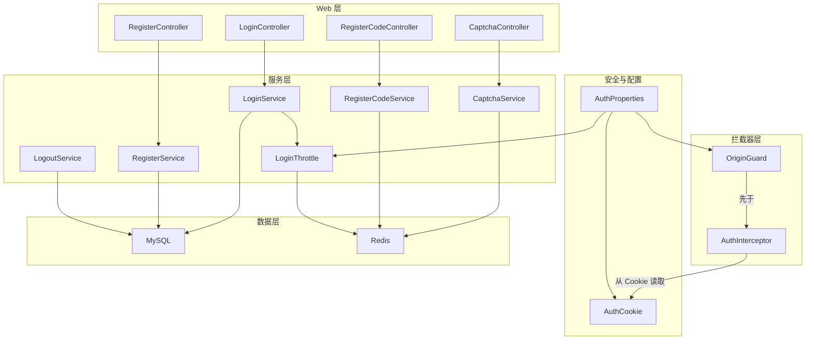
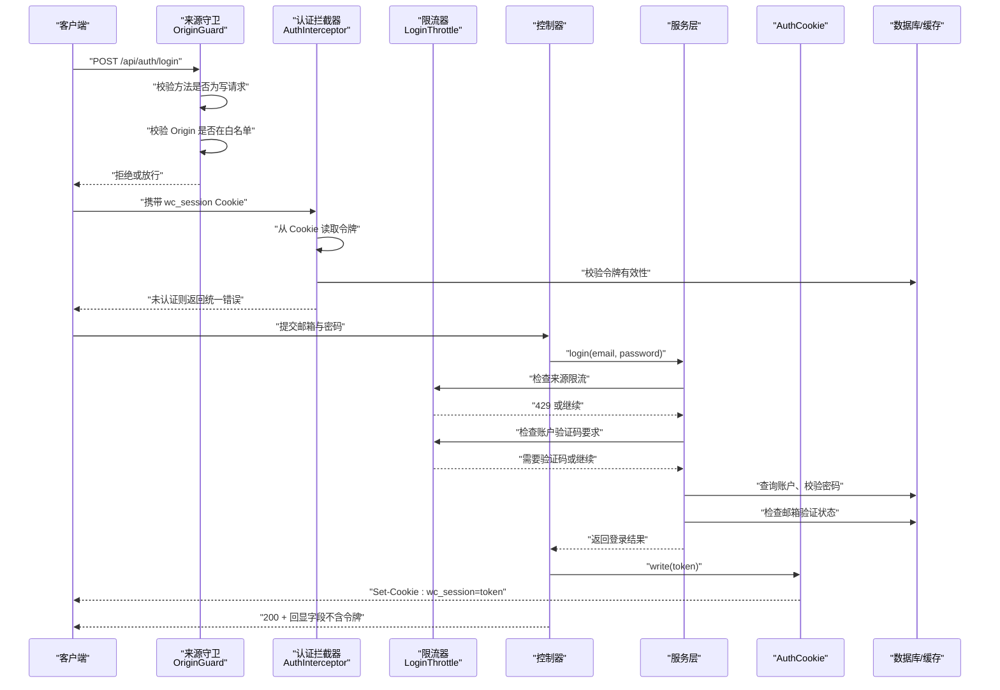
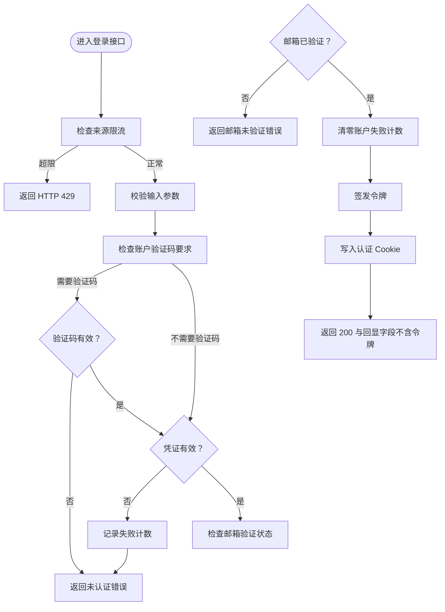
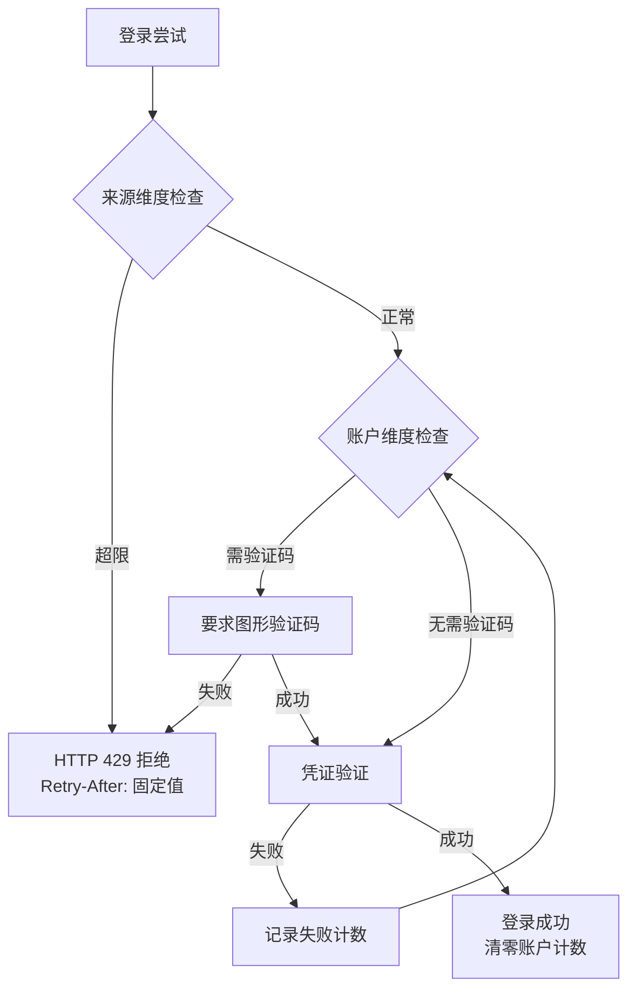
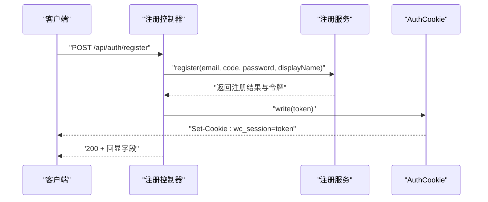
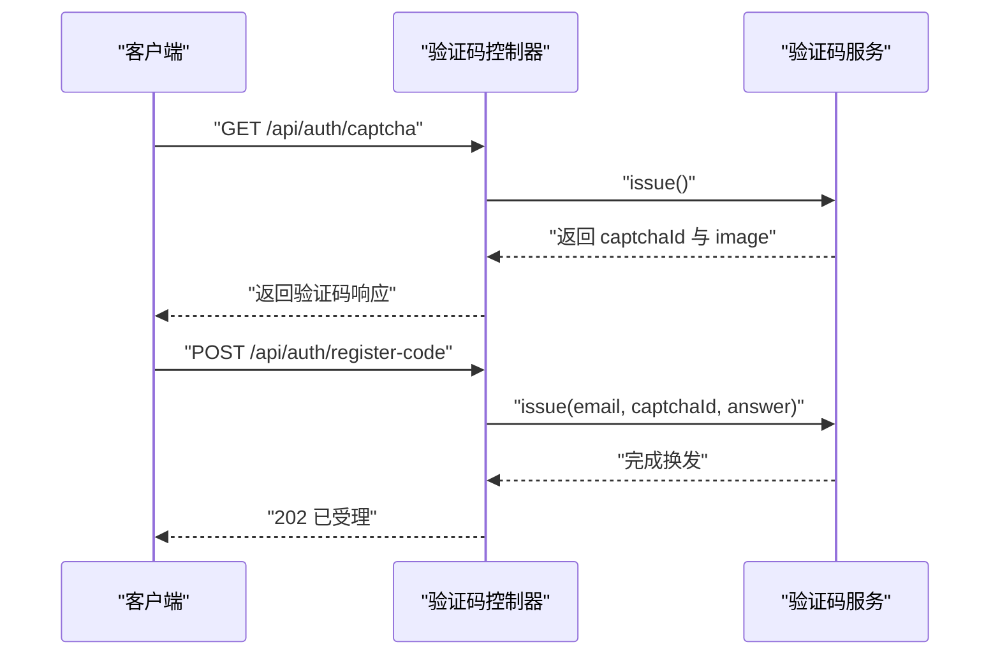
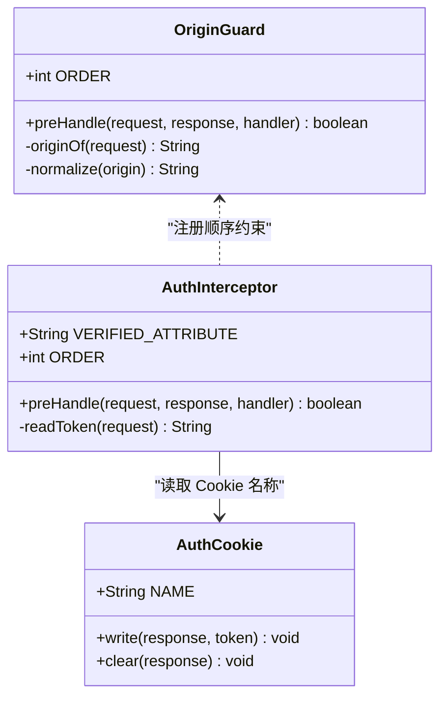
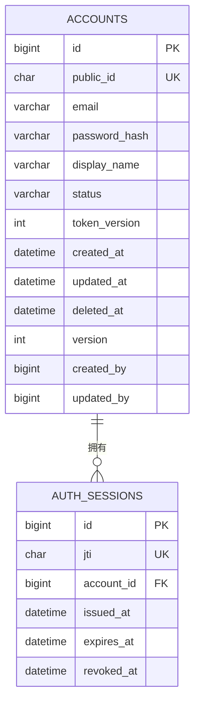
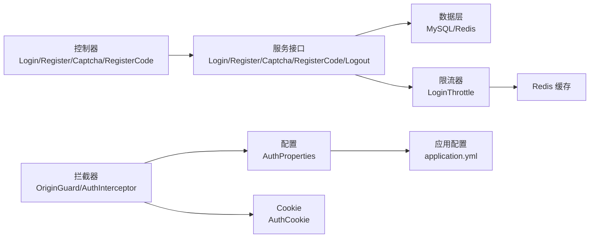

# WanderChain 认证系统

<cite>
**本文引用的文件**   
- [Application.java](file://backend/src/main/java/com/luyi/myfirst/Application.java)
- [application.yml](file://backend/src/main/resources/application.yml)
- [schema.sql](file://backend/src/main/resources/schema.sql)
- [AuthProperties.java](file://backend/src/main/java/com/luyi/myfirst/config/AuthProperties.java)
- [AuthCookie.java](file://backend/src/main/java/com/luyi/myfirst/web/auth/AuthCookie.java)
- [CaptchaController.java](file://backend/src/main/java/com/luyi/myfirst/web/auth/CaptchaController.java)
- [RegisterCodeController.java](file://backend/src/main/java/com/luyi/myfirst/web/auth/RegisterCodeController.java)
- [LoginController.java](file://backend/src/main/java/com/luyi/myfirst/web/auth/LoginController.java)
- [RegisterController.java](file://backend/src/main/java/com/luyi/myfirst/web/auth/RegisterController.java)
- [OriginGuard.java](file://backend/src/main/java/com/luyi/myfirst/web/auth/interceptor/OriginGuard.java)
- [AuthInterceptor.java](file://backend/src/main/java/com/luyi/myfirst/web/auth/interceptor/AuthInterceptor.java)
- [CaptchaService.java](file://backend/src/main/java/com/luyi/myfirst/service/auth/CaptchaService.java)
- [RegisterCodeService.java](file://backend/src/main/java/com/luyi/myfirst/service/auth/RegisterCodeService.java)
- [LoginService.java](file://backend/src/main/java/com/luyi/myfirst/service/auth/LoginService.java)
- [RegisterService.java](file://backend/src/main/java/com/luyi/myfirst/service/auth/RegisterService.java)
- [LogoutService.java](file://backend/src/main/java/com/luyi/myfirst/service/auth/LogoutService.java)
- [LoginResponse.java](file://backend/src/main/java/com/luyi/myfirst/web/auth/dto/LoginResponse.java)
- [LoginResult.java](file://backend/src/main/java/com/luyi/myfirst/service/auth/model/LoginResult.java)
- [LoginThrottle.java](file://backend/src/main/java/com/luyi/myfirst/service/auth/support/LoginThrottle.java)
- [LoginServiceImpl.java](file://backend/src/main/java/com/luyi/myfirst/service/auth/impl/LoginServiceImpl.java)
- [AccountStatus.java](file://backend/src/main/java/com/luyi/myfirst/common/enums/AccountStatus.java)
</cite>

## 更新摘要
**已进行的变更**
- 更新了账户级别限流行为说明，移除了递增等待要求，现在账户级别保护仅依赖验证码挑战而非时间惩罚
- 明确了两种不同的防护机制：账户级别（验证码要求）和来源级别（HTTP 429响应）
- 更新了安全策略说明，强调来源维度使用固定 Retry-After 值而非递增惩罚
- 修正了登录流程中的限流逻辑描述，区分账户维度和来源维度的不同处理方式

## 目录
1. [简介](#简介)
2. [项目结构](#项目结构)
3. [核心组件](#核心组件)
4. [架构总览](#架构总览)
5. [详细组件分析](#详细组件分析)
6. [依赖关系分析](#依赖关系分析)
7. [性能与安全性考量](#性能与安全性考量)
8. [故障排查指南](#故障排查指南)
9. [结论](#结论)

## 简介
WanderChain 认证系统为后端提供账户注册、邮箱验证码校验、登录、登出、图形验证码以及受保护路径的访问控制能力。令牌通过安全的 Cookie 下发，不暴露给前端脚本；写请求来源通过 Origin 白名单进行二次校验；所有可配置参数集中在应用配置中，缺失时启动失败，避免"静默降级"。**重要安全改进**：登录成功响应的正文现在只包含过期时间和当前用户信息，访问令牌仅通过 Set-Cookie 头下发，不再包含在响应体中，这确保了安全性最佳实践，允许使用 HttpOnly Cookie 属性来防止 JavaScript 访问认证令牌，从而缓解跨站脚本攻击风险。

**最新安全增强**：系统实现了双重防护机制 - 账户级别通过验证码挑战进行保护，来源级别通过 HTTP 429 响应进行限制，两者采用不同的防护策略和时间处理机制。

## 项目结构
认证相关代码采用分层组织：
- Web 层：控制器负责接收请求、设置响应头，不包含业务分支。
- 拦截器层：来源校验与令牌校验作为横切逻辑。
- 服务层：接口定义契约，实现类封装具体流程（如验证码、令牌签发、登录状态判定）。
- 数据层：JPA 实体与仓库用于持久化账户与会话。
- 配置层：集中声明认证链路的所有可调参数。



**图表来源**
- [CaptchaController.java:1-32](file://backend/src/main/java/com/luyi/myfirst/web/auth/CaptchaController.java#L1-L32)
- [RegisterCodeController.java:1-33](file://backend/src/main/java/com/luyi/myfirst/web/auth/RegisterCodeController.java#L1-L33)
- [LoginController.java:1-48](file://backend/src/main/java/com/luyi/myfirst/web/auth/LoginController.java#L1-L48)
- [RegisterController.java:1-49](file://backend/src/main/java/com/luyi/myfirst/web/auth/RegisterController.java#L1-L49)
- [OriginGuard.java:1-106](file://backend/src/main/java/com/luyi/myfirst/web/auth/interceptor/OriginGuard.java#L1-L106)
- [AuthInterceptor.java:1-67](file://backend/src/main/java/com/luyi/myfirst/web/auth/interceptor/AuthInterceptor.java#L1-L67)
- [AuthCookie.java:1-67](file://backend/src/main/java/com/luyi/myfirst/web/auth/AuthCookie.java#L1-L67)
- [AuthProperties.java:1-78](file://backend/src/main/java/com/luyi/myfirst/config/AuthProperties.java#L1-L78)
- [CaptchaService.java:1-19](file://backend/src/main/java/com/luyi/myfirst/service/auth/CaptchaService.java#L1-L19)
- [RegisterCodeService.java:1-17](file://backend/src/main/java/com/luyi/myfirst/service/auth/RegisterCodeService.java#L1-L17)
- [LoginService.java:1-26](file://backend/src/main/java/com/luyi/myfirst/service/auth/LoginService.java#L1-L26)
- [RegisterService.java:1-19](file://backend/src/main/java/com/luyi/myfirst/service/auth/RegisterService.java#L1-L19)
- [LogoutService.java:1-14](file://backend/src/main/java/com/luyi/myfirst/service/auth/LogoutService.java#L1-L14)
- [LoginThrottle.java:1-99](file://backend/src/main/java/com/luyi/myfirst/service/auth/support/LoginThrottle.java#L1-L99)

**章节来源**
- [Application.java:1-15](file://backend/src/main/java/com/luyi/myfirst/Application.java#L1-L15)
- [application.yml:1-70](file://backend/src/main/resources/application.yml#L1-L70)

## 核心组件
- 应用入口与配置扫描：Spring Boot 主类启用自动装配与配置属性扫描。
- 认证配置：集中管理会话有效期、JWT 密钥、Cookie Secure 标志、允许的来源列表、验证码与登录防爆破参数。
- Cookie 写入点：统一设置 HttpOnly、SameSite=Lax、Path=/、Max-Age 与 Secure，确保令牌不在响应体中出现。
- 来源守卫：对 POST/PUT/PATCH/DELETE 等写请求校验 Origin，拒绝未登记来源。
- 认证拦截器：仅从 Cookie 读取令牌，校验失败抛出统一业务异常。
- 控制器：登录、注册、验证码、注册码换发，均委托服务层处理。
- 服务接口：定义登录、注册、验证码、注册码、登出的契约，明确错误语义与调用顺序。
- **新增限流组件**：LoginThrottle 实现双重防护机制，区分账户级别和来源级别的限流策略。

**章节来源**
- [AuthProperties.java:14-78](file://backend/src/main/java/com/luyi/myfirst/config/AuthProperties.java#L14-L78)
- [AuthCookie.java:9-67](file://backend/src/main/java/com/luyi/myfirst/web/auth/AuthCookie.java#L9-L67)
- [OriginGuard.java:17-106](file://backend/src/main/java/com/luyi/myfirst/web/auth/interceptor/OriginGuard.java#L17-L106)
- [AuthInterceptor.java:14-67](file://backend/src/main/java/com/luyi/myfirst/web/auth/interceptor/AuthInterceptor.java#L14-L67)
- [LoginController.java:16-48](file://backend/src/main/java/com/luyi/myfirst/web/auth/LoginController.java#L16-L48)
- [RegisterController.java:16-49](file://backend/src/main/java/com/luyi/myfirst/web/auth/RegisterController.java#L16-L49)
- [CaptchaController.java:10-32](file://backend/src/main/java/com/luyi/myfirst/web/auth/CaptchaController.java#L10-L32)
- [RegisterCodeController.java:11-33](file://backend/src/main/java/com/luyi/myfirst/web/auth/RegisterCodeController.java#L11-L33)
- [LoginService.java:7-26](file://backend/src/main/java/com/luyi/myfirst/service/auth/LoginService.java#L7-L26)
- [RegisterService.java:7-19](file://backend/src/main/java/com/luyi/myfirst/service/auth/RegisterService.java#L7-L19)
- [CaptchaService.java:5-19](file://backend/src/main/java/com/luyi/myfirst/service/auth/CaptchaService.java#L5-L19)
- [RegisterCodeService.java:3-17](file://backend/src/main/java/com/luyi/myfirst/service/auth/RegisterCodeService.java#L3-L17)
- [LogoutService.java:5-14](file://backend/src/main/java/com/luyi/myfirst/service/auth/LogoutService.java#L5-L14)
- [LoginThrottle.java:11-99](file://backend/src/main/java/com/luyi/myfirst/service/auth/support/LoginThrottle.java#L11-L99)

## 架构总览
认证系统遵循"先凭证后状态"的契约：登录接口在密码正确后才判断邮箱是否验证；令牌只通过 Set-Cookie 下发；写请求必须通过来源白名单；受保护路径由拦截器解析 Cookie 中的令牌并注入已验证信息。

**更新** 系统现在采用双重防护机制：
- **账户级别防护**：连续失败达到阈值后要求验证码挑战，成功后清零计数
- **来源级别防护**：窗口内失败达到上限直接返回 HTTP 429，使用固定 Retry-After 值



**图表来源**
- [OriginGuard.java:51-61](file://backend/src/main/java/com/luyi/myfirst/web/auth/interceptor/OriginGuard.java#L51-L61)
- [AuthInterceptor.java:43-52](file://backend/src/main/java/com/luyi/myfirst/web/auth/interceptor/AuthInterceptor.java#L43-L52)
- [LoginController.java:37-46](file://backend/src/main/java/com/luyi/myfirst/web/auth/LoginController.java#L37-L46)
- [LoginServiceImpl.java:82-130](file://backend/src/main/java/com/luyi/myfirst/service/auth/impl/LoginServiceImpl.java#L82-L130)
- [LoginThrottle.java:50-88](file://backend/src/main/java/com/luyi/myfirst/service/auth/support/LoginThrottle.java#L50-L88)
- [AuthCookie.java:32-45](file://backend/src/main/java/com/luyi/myfirst/web/auth/AuthCookie.java#L32-L45)

## 详细组件分析

### 登录流程
登录端点将邮箱与明文密码交给服务层，服务层按"先限流，再凭证，后状态"的顺序处理：
- **来源级别限流**：首先检查来源维度，超过阈值直接返回 HTTP 429
- **账户级别防护**：连续失败达到阈值后要求验证码挑战
- **凭证验证**：密码不正确时记录失败计数
- **状态检查**：密码正确后检查邮箱验证状态

**更新** 登录成功响应现在只包含过期时间和用户信息，不再包含访问令牌。



**图表来源**
- [LoginController.java:37-46](file://backend/src/main/java/com/luyi/myfirst/web/auth/LoginController.java#L37-L46)
- [LoginServiceImpl.java:82-130](file://backend/src/main/java/com/luyi/myfirst/service/auth/impl/LoginServiceImpl.java#L82-L130)
- [LoginThrottle.java:50-88](file://backend/src/main/java/com/luyi/myfirst/service/auth/support/LoginThrottle.java#L50-L88)
- [AuthCookie.java:32-45](file://backend/src/main/java/com/luyi/myfirst/web/auth/AuthCookie.java#L32-L45)

**章节来源**
- [LoginController.java:16-48](file://backend/src/main/java/com/luyi/myfirst/web/auth/LoginController.java#L16-L48)
- [LoginServiceImpl.java:23-155](file://backend/src/main/java/com/luyi/myfirst/service/auth/impl/LoginServiceImpl.java#L23-L155)

### 登录响应格式
**更新** 登录成功响应现在遵循更安全的设计模式：

- **响应体字段**：`publicId`、`email`、`displayName`、`expiresAt`
- **令牌传输**：仅通过 `Set-Cookie` 头下发，使用 `wc_session` 名称
- **安全特性**：Cookie 设置 `HttpOnly`、`SameSite=Lax`、`Path=/`、`Max-Age` 与 `Secure`
- **过期时间同步**：响应体的 `expiresAt`、Cookie 的 `Max-Age` 与令牌自身的 `exp` 同源

```mermaid
sequenceDiagram
participant Client as "客户端"
participant LoginCtrl as "登录控制器"
participant LoginSvc as "登录服务"
participant Cookie as "AuthCookie"
Client->>LoginCtrl : "POST /api/auth/login"
LoginCtrl->>LoginSvc : "login(email, password)"
LoginSvc-->>LoginCtrl : "返回 LoginResult"
LoginCtrl->>Cookie : "write(token)"
Cookie-->>Client : "Set-Cookie : wc_session=token; HttpOnly; SameSite=Lax"
LoginCtrl-->>Client : "200 OK : {publicId, email, displayName, expiresAt}"
Note over Client : 响应体中不包含访问令牌
```

**图表来源**
- [LoginController.java:37-46](file://backend/src/main/java/com/luyi/myfirst/web/auth/LoginController.java#L37-L46)
- [LoginResponse.java:5-12](file://backend/src/main/java/com/luyi/myfirst/web/auth/dto/LoginResponse.java#L5-L12)
- [LoginResult.java:3-11](file://backend/src/main/java/com/luyi/myfirst/service/auth/model/LoginResult.java#L3-L11)

**章节来源**
- [LoginController.java:16-48](file://backend/src/main/java/com/luyi/myfirst/web/auth/LoginController.java#L16-L48)
- [LoginResponse.java:1-13](file://backend/src/main/java/com/luyi/myfirst/web/auth/dto/LoginResponse.java#L1-L13)
- [LoginResult.java:1-12](file://backend/src/main/java/com/luyi/myfirst/service/auth/model/LoginResult.java#L1-L12)

### 双重限流机制
系统实现了两种不同级别的防护机制：

#### 账户级别防护（验证码挑战）
- **触发条件**：账户连续失败次数达到阈值（failThreshold）
- **防护措施**：要求用户通过图形验证码挑战
- **重置机制**：成功登录后清零账户失败计数
- **时间处理**：无递增等待，仅依赖验证码挑战

#### 来源级别防护（HTTP 429 响应）
- **触发条件**：来源在时间窗口内的失败次数达到上限（sourceMax）
- **防护措施**：直接返回 HTTP 429 Too Many Requests
- **重试指导**：使用固定的 Retry-After 值，非递增惩罚
- **共享额度**：同一来源下的多个账户共用同一额度



**图表来源**
- [LoginThrottle.java:11-99](file://backend/src/main/java/com/luyi/myfirst/service/auth/support/LoginThrottle.java#L11-L99)
- [LoginServiceImpl.java:82-130](file://backend/src/main/java/com/luyi/myfirst/service/auth/impl/LoginServiceImpl.java#L82-L130)

**章节来源**
- [LoginThrottle.java:11-99](file://backend/src/main/java/com/luyi/myfirst/service/auth/support/LoginThrottle.java#L11-L99)
- [LoginServiceImpl.java:82-130](file://backend/src/main/java/com/luyi/myfirst/service/auth/impl/LoginServiceImpl.java#L82-L130)

### 注册流程
注册端点在验证码通过后创建账户并直接签发令牌，实现首次注册即自动登录。令牌同样只通过 Cookie 下发。



**图表来源**
- [RegisterController.java:37-47](file://backend/src/main/java/com/luyi/myfirst/web/auth/RegisterController.java#L37-L47)
- [RegisterService.java:10-18](file://backend/src/main/java/com/luyi/myfirst/service/auth/RegisterService.java#L10-L18)
- [AuthCookie.java:32-45](file://backend/src/main/java/com/luyi/myfirst/web/auth/AuthCookie.java#L32-L45)

**章节来源**
- [RegisterController.java:16-49](file://backend/src/main/java/com/luyi/myfirst/web/auth/RegisterController.java#L16-L49)
- [RegisterService.java:7-19](file://backend/src/main/java/com/luyi/myfirst/service/auth/RegisterService.java#L7-L19)

### 验证码与注册码换发
- 图形验证码接口无状态、无副作用，每次返回新的 id 与图片。
- 注册码换发接口消费图形码后生成验证码摘要并投递，返回 202 表示受理。



**图表来源**
- [CaptchaController.java:26-30](file://backend/src/main/java/com/luyi/myfirst/web/auth/CaptchaController.java#L26-L30)
- [CaptchaService.java:13-17](file://backend/src/main/java/com/luyi/myfirst/service/auth/CaptchaService.java#L13-L17)
- [RegisterCodeController.java:27-31](file://backend/src/main/java/com/luyi/myfirst/web/auth/RegisterCodeController.java#L27-L31)
- [RegisterCodeService.java:11-15](file://backend/src/main/java/com/luyi/myfirst/service/auth/RegisterCodeService.java#L11-L15)

**章节来源**
- [CaptchaController.java:10-32](file://backend/src/main/java/com/luyi/myfirst/web/auth/CaptchaController.java#L10-L32)
- [RegisterCodeController.java:11-33](file://backend/src/main/java/com/luyi/myfirst/web/auth/RegisterCodeController.java#L11-L33)
- [CaptchaService.java:5-19](file://backend/src/main/java/com/luyi/myfirst/service/auth/CaptchaService.java#L5-L19)
- [RegisterCodeService.java:3-17](file://backend/src/main/java/com/luyi/myfirst/service/auth/RegisterCodeService.java#L3-L17)

### 来源守卫与认证拦截器
- 来源守卫优先执行，仅对写请求校验 Origin，拒绝未登记来源。
- 认证拦截器随后执行，仅从 Cookie 读取令牌，校验失败抛出统一业务异常。



**图表来源**
- [OriginGuard.java:31-61](file://backend/src/main/java/com/luyi/myfirst/web/auth/interceptor/OriginGuard.java#L31-L61)
- [AuthInterceptor.java:24-52](file://backend/src/main/java/com/luyi/myfirst/web/auth/interceptor/AuthInterceptor.java#L24-L52)
- [AuthCookie.java:22-45](file://backend/src/main/java/com/luyi/myfirst/web/auth/AuthCookie.java#L22-L45)

**章节来源**
- [OriginGuard.java:17-106](file://backend/src/main/java/com/luyi/myfirst/web/auth/interceptor/OriginGuard.java#L17-L106)
- [AuthInterceptor.java:14-67](file://backend/src/main/java/com/luyi/myfirst/web/auth/interceptor/AuthInterceptor.java#L14-L67)
- [AuthCookie.java:9-67](file://backend/src/main/java/com/luyi/myfirst/web/auth/AuthCookie.java#L9-L67)

### 数据模型与会话
数据库包含账户与会话两张表：
- accounts：存储用户公开标识、邮箱、密码哈希、显示名、状态、令牌版本、时间戳与软删除标记。
- auth_sessions：记录 JWT 的 jti、关联账户、签发与过期时间、吊销时间。



**图表来源**
- [schema.sql:6-29](file://backend/src/main/resources/schema.sql#L6-L29)
- [schema.sql:31-46](file://backend/src/main/resources/schema.sql#L31-L46)

**章节来源**
- [schema.sql:1-47](file://backend/src/main/resources/schema.sql#L1-L47)

## 依赖关系分析
- Web 层依赖服务层接口，不直接操作数据源。
- 拦截器依赖 TokenVerifier（由服务层支撑）与配置项。
- Cookie 写入点依赖配置项决定 Secure 与 Max-Age。
- 配置项集中声明认证链路的各项阈值与开关，缺失时启动失败。
- **新增依赖**：LoginThrottle 依赖 Redis 进行计数存储，LoginServiceImpl 依赖 LoginThrottle 进行限流控制。



**图表来源**
- [LoginController.java:1-48](file://backend/src/main/java/com/luyi/myfirst/web/auth/LoginController.java#L1-L48)
- [RegisterController.java:1-49](file://backend/src/main/java/com/luyi/myfirst/web/auth/RegisterController.java#L1-L49)
- [CaptchaController.java:1-32](file://backend/src/main/java/com/luyi/myfirst/web/auth/CaptchaController.java#L1-L32)
- [RegisterCodeController.java:1-33](file://backend/src/main/java/com/luyi/myfirst/web/auth/RegisterCodeController.java#L1-L33)
- [OriginGuard.java:1-106](file://backend/src/main/java/com/luyi/myfirst/web/auth/interceptor/OriginGuard.java#L1-L106)
- [AuthInterceptor.java:1-67](file://backend/src/main/java/com/luyi/myfirst/web/auth/interceptor/AuthInterceptor.java#L1-L67)
- [AuthProperties.java:1-78](file://backend/src/main/java/com/luyi/myfirst/config/AuthProperties.java#L1-L78)
- [application.yml:41-66](file://backend/src/main/resources/application.yml#L41-L66)
- [LoginThrottle.java:1-99](file://backend/src/main/java/com/luyi/myfirst/service/auth/support/LoginThrottle.java#L1-L99)

**章节来源**
- [application.yml:10-40](file://backend/src/main/resources/application.yml#L10-L40)
- [application.yml:41-66](file://backend/src/main/resources/application.yml#L41-L66)

## 性能与安全性考量
- **令牌安全**：Cookie 使用 HttpOnly 与 SameSite=Lax，防止脚本读取与跨站写请求附带；Secure 由配置决定，生产环境必须开启。**重要**：令牌不再出现在响应体中，从根本上避免了 XSS 攻击窃取令牌的风险。
- **来源防护**：写请求必须命中白名单，避免 CSRF 与误配导致的跨站风险。
- **双重限流机制**：
  - **账户级别**：连续失败后要求验证码挑战，无递增等待惩罚
  - **来源级别**：窗口内失败达上限直接返回 HTTP 429，使用固定 Retry-After 值
- **验证码策略**：图形码一次性、注册码有冷却时间与每日配额，降低枚举与暴力攻击面。
- **会话管理**：会话表记录 jti 与过期时间，支持吊销与清理。
- **响应安全**：登录成功响应只包含必要的用户信息和过期时间，不包含敏感令牌数据。
- **防计时攻击**：账户不存在时也执行 bcrypt 比对，避免通过响应时间差异推断账户存在性。

## 故障排查指南
- 启动失败且提示配置未解析：检查环境变量是否设置，尤其是 JWT 密钥与数据库凭据。
- 本地无法登录：确认 cookie-secure 配置为 false，否则 HTTP 开发环境会拒绝不安全连接。
- 写请求被拒：检查 allowed-origins 是否包含当前前端来源，注意 localhost 与 127.0.0.1 是不同的源。
- 登录后仍携带旧令牌：确认登出时清除 Cookie 的属性与 Path、Secure 一致。
- 验证码无效：确认图形码未被重复使用，注册码尝试次数未超限。
- **新注意事项**：如果前端无法获取令牌，确认没有尝试从响应体中读取令牌，应该从 Cookie 中获取。
- **限流问题排查**：
  - 如果频繁收到 HTTP 429 响应，检查来源维度是否达到 sourceMax 限制
  - 如果需要验证码但不知道原因，检查账户维度是否达到 failThreshold 限制
  - 确认 Retry-After 值为固定值而非递增，这是预期的设计行为

**章节来源**
- [AuthProperties.java:39-54](file://backend/src/main/java/com/luyi/myfirst/config/AuthProperties.java#L39-L54)
- [application.yml:41-66](file://backend/src/main/resources/application.yml#L41-L66)
- [AuthCookie.java:32-65](file://backend/src/main/java/com/luyi/myfirst/web/auth/AuthCookie.java#L32-L65)
- [OriginGuard.java:51-61](file://backend/src/main/java/com/luyi/myfirst/web/auth/interceptor/OriginGuard.java#L51-L61)
- [LoginResponse.java:5-12](file://backend/src/main/java/com/luyi/myfirst/web/auth/dto/LoginResponse.java#L5-L12)
- [LoginThrottle.java:50-88](file://backend/src/main/java/com/luyi/myfirst/service/auth/support/LoginThrottle.java#L50-L88)

## 结论
WanderChain 认证系统以清晰的契约与分层设计保障安全性与可维护性：**最新的安全改进**包括令牌仅通过 Cookie 下发，不再出现在响应体中，从根本上缓解了跨站脚本攻击风险；写请求来源严格校验，登录流程坚持"先凭证后状态"，所有关键参数集中配置并在缺失时启动失败。该体系便于扩展更多受保护端点，同时保持统一的错误输出与安全策略。

**最重要的架构增强**是实现了双重防护机制：账户级别通过验证码挑战进行保护，来源级别通过 HTTP 429 响应进行限制。这种设计消除了递增等待惩罚，使账户级别保护仅依赖验证码挑战，而来源级别保护使用固定的 Retry-After 值，避免了 NAT 后的合法用户受到指数惩罚。通过移除响应体中的令牌和实现智能限流策略，系统实现了更高级别的安全性，符合现代 Web 应用的安全最佳实践。