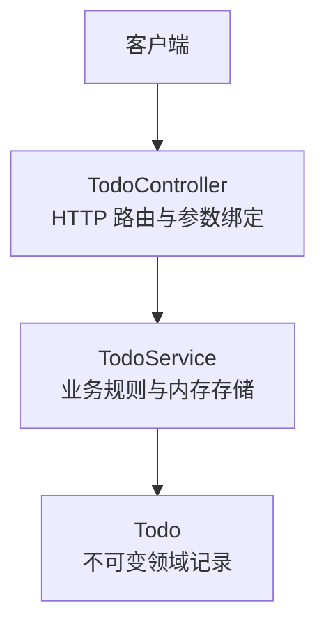
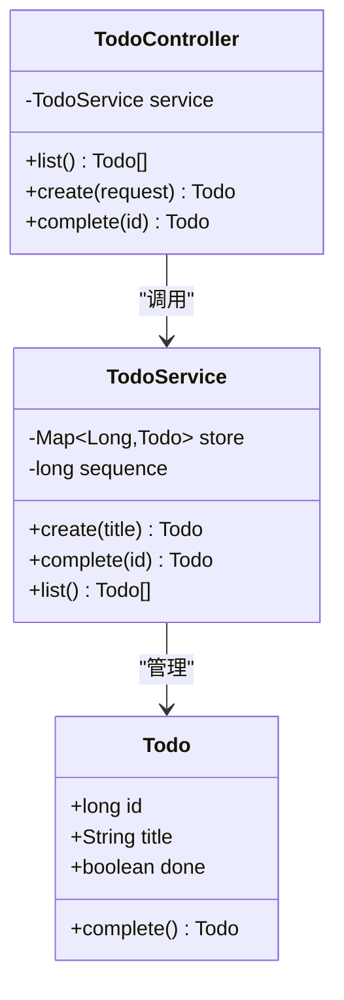
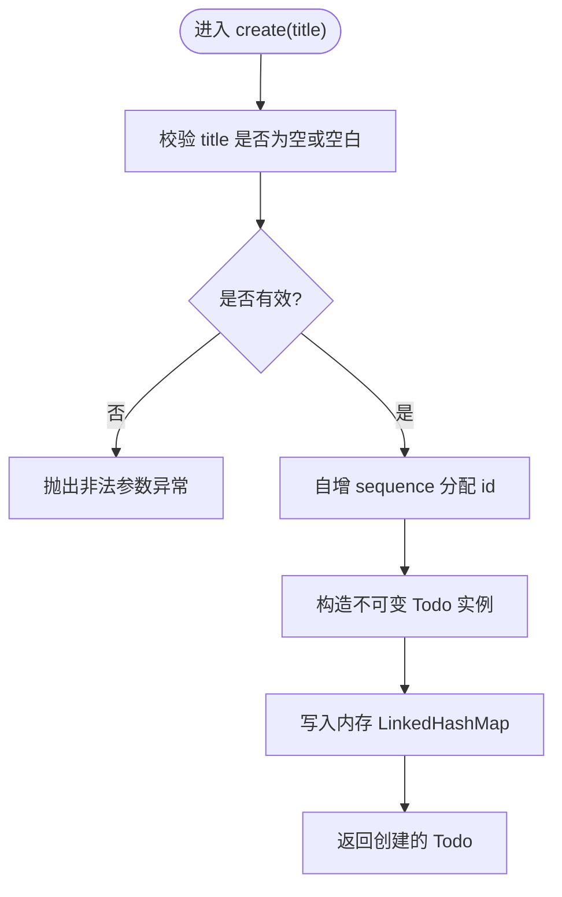
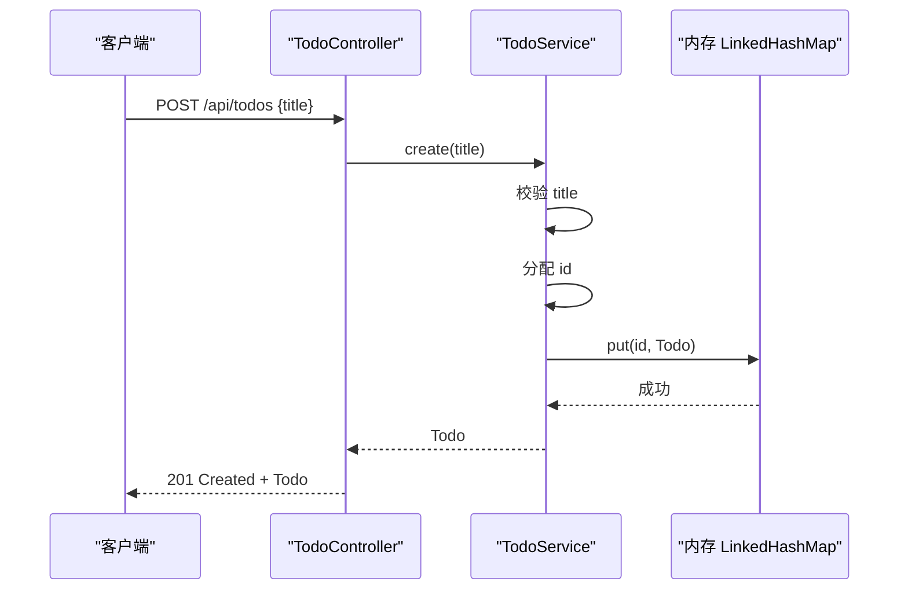
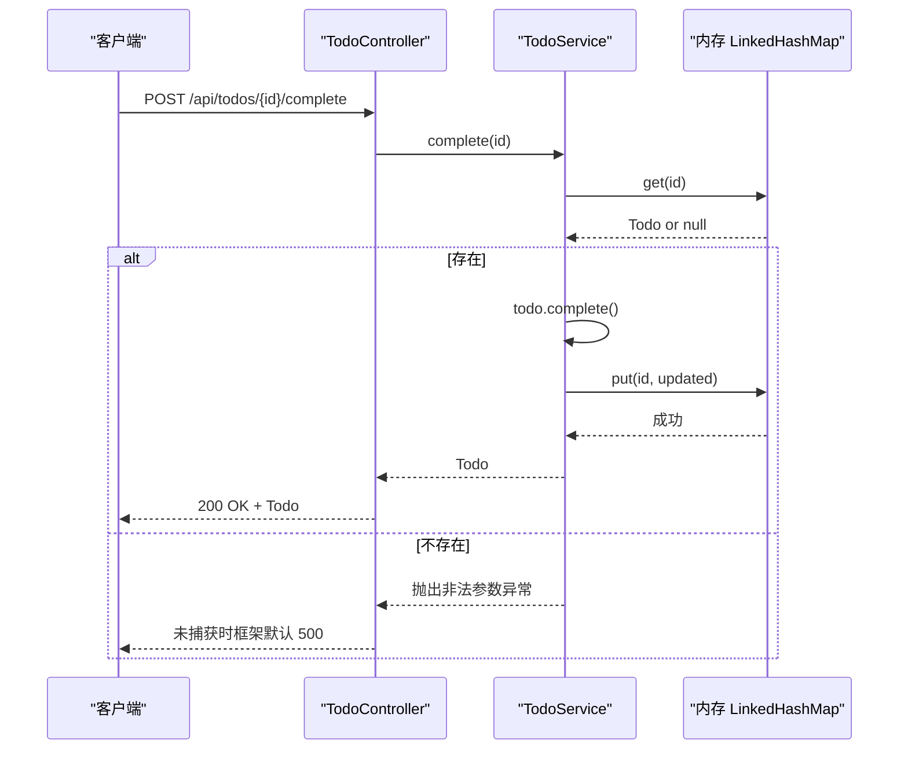
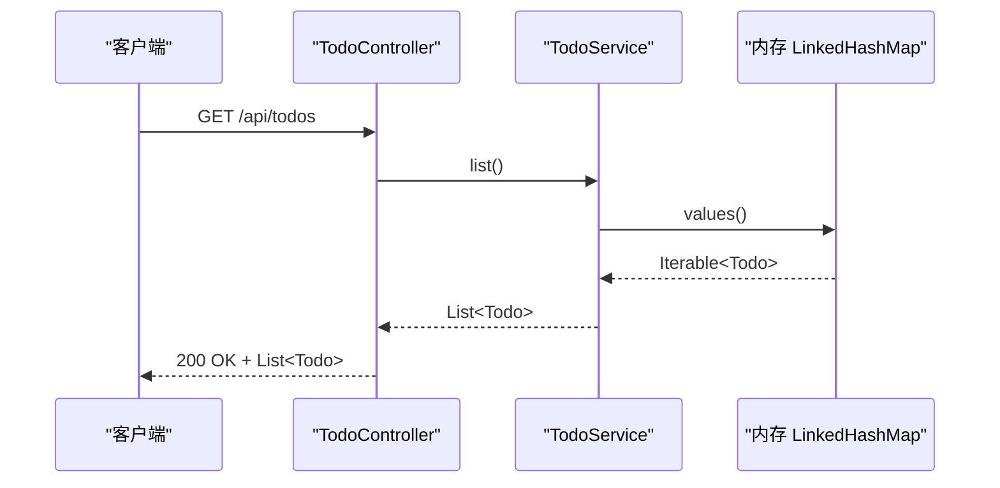
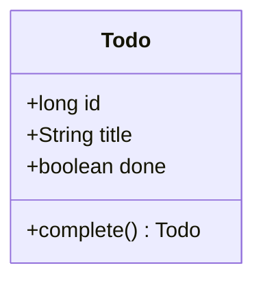
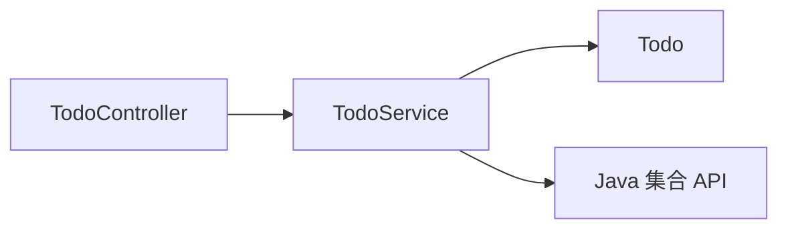

# 业务逻辑层

<cite>
**本文引用的文件**   
- [TodoService.java](file://backend/src/main/java/com/luyi/myfirst/domain/TodoService.java)
- [Todo.java](file://backend/src/main/java/com/luyi/myfirst/domain/Todo.java)
- [TodoController.java](file://backend/src/main/java/com/luyi/myfirst/web/TodoController.java)
- [TodoServiceTest.java](file://backend/src/test/java/com/luyi/myfirst/domain/TodoServiceTest.java)
- [todo-module-spec.md](file://docs/specs/todo-module-spec.md)
</cite>

## 目录
1. [引言](#引言)
2. [项目结构](#项目结构)
3. [核心组件](#核心组件)
4. [架构总览](#架构总览)
5. [详细组件分析](#详细组件分析)
6. [依赖关系分析](#依赖关系分析)
7. [性能与并发特性](#性能与并发特性)
8. [错误处理策略](#错误处理策略)
9. [从内存存储扩展到数据库持久化](#从内存存储扩展到数据库持久化)
10. [服务层扩展最佳实践与设计模式建议](#服务层扩展最佳实践与设计模式建议)
11. [故障排查指南](#故障排查指南)
12. [结论](#结论)

## 引言
本文聚焦后端业务逻辑层，围绕 `TodoService` 的职责、实现方式、内存存储机制、待办事项 CRUD 操作、与 Controller 层的解耦方式展开。同时结合规格文档，说明当前实现的边界、局限性，以及如何演进到数据库持久化，并给出扩展建议、错误处理策略和性能考量。

## 项目结构
本项目的后端采用分层组织：领域模型位于 `domain`，Web 接口位于 `web`，测试位于 `test`。`TodoService` 是业务逻辑的核心，`Todo` 是领域实体，`TodoController` 负责 HTTP 路由与参数绑定，将请求委托给 `TodoService`。

**图表来源**
- [TodoController.java:16-44](file://backend/src/main/java/com/luyi/myfirst/web/TodoController.java#L16-L44)
- [TodoService.java:14-43](file://backend/src/main/java/com/luyi/myfirst/domain/TodoService.java#L14-L43)
- [Todo.java:7-11](file://backend/src/main/java/com/luyi/myfirst/domain/Todo.java#L7-L11)

**章节来源**
- [TodoController.java:1-44](file://backend/src/main/java/com/luyi/myfirst/web/TodoController.java#L1-L44)
- [TodoService.java:1-43](file://backend/src/main/java/com/luyi/myfirst/domain/TodoService.java#L1-L43)
- [Todo.java:1-12](file://backend/src/main/java/com/luyi/myfirst/domain/Todo.java#L1-L12)

## 核心组件
- `Todo`：不可变的领域记录，包含 `id`、`title`、`done`。通过生成新实例表达状态变更，避免多线程下可变对象共享带来的隐式修改风险。
- `TodoService`：业务服务类，封装待办事项的创建、完成、查询等规则，并使用内存中的 `LinkedHashMap` 作为临时存储，使用单调递增的 `sequence` 分配 id。
- `TodoController`：REST 控制器，暴露 `/api/todos` 相关端点，仅做参数校验与响应包装，业务逻辑委托给 `TodoService`。

**章节来源**
- [Todo.java:7-11](file://backend/src/main/java/com/luyi/myfirst/domain/Todo.java#L7-L11)
- [TodoService.java:14-43](file://backend/src/main/java/com/luyi/myfirst/domain/TodoService.java#L14-L43)
- [TodoController.java:16-44](file://backend/src/main/java/com/luyi/myfirst/web/TodoController.java#L16-L44)

## 架构总览
Todo 模块遵循“控制器薄、服务厚”的分层设计：Controller 只负责 HTTP 契约，Service 负责业务规则和数据访问。当前数据访问直接基于内存集合，便于 Harness 可重复执行；未来可通过抽象数据访问层替换为数据库实现。

**图表来源**
- [Todo.java:7-11](file://backend/src/main/java/com/luyi/myfirst/domain/Todo.java#L7-L11)
- [TodoService.java:14-43](file://backend/src/main/java/com/luyi/myfirst/domain/TodoService.java#L14-L43)
- [TodoController.java:16-44](file://backend/src/main/java/com/luyi/myfirst/web/TodoController.java#L16-L44)

## 详细组件分析

### TodoService 职责与实现
`TodoService` 承担以下职责：
- 输入校验：拒绝空白标题。
- 资源创建：分配唯一 id，构造不可变 `Todo`，存入内存 Map。
- 状态更新：根据 id 查找记录，若不存在则报错；否则调用领域对象的 `complete()` 生成新实例并覆盖旧记录。
- 列表查询：返回按插入顺序排列的全部记录。

**图表来源**
- [TodoService.java:20-28](file://backend/src/main/java/com/luyi/myfirst/domain/TodoService.java#L20-L28)

**章节来源**
- [TodoService.java:14-43](file://backend/src/main/java/com/luyi/myfirst/domain/TodoService.java#L14-L43)

### TodoService 方法调用序列（创建）

**图表来源**
- [TodoController.java:31-35](file://backend/src/main/java/com/luyi/myfirst/web/TodoController.java#L31-L35)
- [TodoService.java:20-28](file://backend/src/main/java/com/luyi/myfirst/domain/TodoService.java#L20-L28)

### TodoService 方法调用序列（完成）

**图表来源**
- [TodoController.java:37-40](file://backend/src/main/java/com/luyi/myfirst/web/TodoController.java#L37-L40)
- [TodoService.java:30-38](file://backend/src/main/java/com/luyi/myfirst/domain/TodoService.java#L30-L38)

### TodoService 方法调用序列（列表）

**图表来源**
- [TodoController.java:26-29](file://backend/src/main/java/com/luyi/myfirst/web/TodoController.java#L26-L29)
- [TodoService.java:40-42](file://backend/src/main/java/com/luyi/myfirst/domain/TodoService.java#L40-L42)

### 领域模型 Todo
`Todo` 使用 record 保证不可变性，并通过 `complete()` 返回新实例来表达状态变更，避免多线程下的隐式共享问题。

**图表来源**
- [Todo.java:7-11](file://backend/src/main/java/com/luyi/myfirst/domain/Todo.java#L7-L11)

**章节来源**
- [Todo.java:1-12](file://backend/src/main/java/com/luyi/myfirst/domain/Todo.java#L1-L12)

## 依赖关系分析
- `TodoController` 依赖 `TodoService`，通过构造函数注入，保持控制器薄、服务厚。
- `TodoService` 依赖 `Todo` 领域对象，以及 Java 标准库的集合类型。
- 当前无外部依赖（如数据库），符合 Harness 可重复执行的约束。

**图表来源**
- [TodoController.java:3-12](file://backend/src/main/java/com/luyi/myfirst/web/TodoController.java#L3-L12)
- [TodoService.java:3-8](file://backend/src/main/java/com/luyi/myfirst/domain/TodoService.java#L3-L8)

**章节来源**
- [TodoController.java:1-44](file://backend/src/main/java/com/luyi/myfirst/web/TodoController.java#L1-L44)
- [TodoService.java:1-43](file://backend/src/main/java/com/luyi/myfirst/domain/TodoService.java#L1-L43)

## 性能与并发特性
- 时间复杂度
  - 创建：O(1) 分配 id、O(1) 写入 Map。
  - 完成：O(1) 查找、O(1) 覆盖。
  - 列表：O(N) 复制全部值到新列表。
- 空间复杂度
  - O(N) 存储 N 条待办记录。
- 并发特性
  - 当前 `sequence++` 非原子，`LinkedHashMap` 非线程安全；在并发场景可能出现 id 冲突或数据结构损坏。
  - 规格要求 id 唯一、写操作原子、不同字段并发不互相覆盖；当前实现未满足该要求。

**章节来源**
- [TodoService.java:17-42](file://backend/src/main/java/com/luyi/myfirst/domain/TodoService.java#L17-L42)
- [todo-module-spec.md:61-68](file://docs/specs/todo-module-spec.md#L61-L68)

## 错误处理策略
- 当前行为
  - 创建时标题为空或空白：抛出 `IllegalArgumentException`。
  - 完成不存在的 id：抛出 `IllegalArgumentException`。
  - 控制器未捕获异常，Spring 默认返回 500 及框架默认错误体。
- 规格期望
  - 统一错误响应体 `{code, message}`。
  - 明确 4xx/5xx 状态码与错误码映射。
  - 对非法路径 id、未知字段、不可更新字段等进行结构化错误返回。
- 差距
  - 缺少全局异常处理。
  - 缺少统一错误体。
  - 缺少容量与体积上限校验。
  - 缺少并发安全。

**章节来源**
- [TodoService.java:20-38](file://backend/src/main/java/com/luyi/myfirst/domain/TodoService.java#L20-L38)
- [todo-module-spec.md:248-262](file://docs/specs/todo-module-spec.md#L248-L262)
- [todo-module-spec.md:472-509](file://docs/specs/todo-module-spec.md#L472-L509)
- [todo-module-spec.md:615-634](file://docs/specs/todo-module-spec.md#L615-L634)

## 从内存存储扩展到数据库持久化
- 抽象数据访问层
  - 定义 `TodoRepository` 接口，声明 `save`、`findById`、`findAll` 等方法。
  - 当前实现 `InMemoryTodoRepository`，内部使用 `LinkedHashMap`。
  - 新增 `JdbcTodoRepository` 或 `JpaTodoRepository`，对接数据库。
- 重构 `TodoService`
  - 注入 `TodoRepository`，不再直接持有内存集合。
  - 保留业务规则（校验、id 分配、状态更新语义）。
- 迁移步骤
  - 引入数据库配置与连接池。
  - 设计表结构（主键 id、title、done、tags、dueDate、priority）。
  - 编写 Flyway/Liquibase 迁移脚本。
  - 实现 Repository 并替换 Service 依赖。
  - 补充单元测试与集成测试，覆盖并发、幂等、容量限制。
- 注意事项
  - id 分配策略：数据库自增或应用层序列器（需保证原子性）。
  - 事务边界：写操作包裹在事务中。
  - 并发控制：乐观锁版本号或数据库行级锁。
  - 容量与体积上限：在服务层或网关层拦截。

[本节为概念性扩展建议，不直接分析具体文件]

## 服务层扩展最佳实践与设计模式建议
- 单一职责原则
  - Service 只负责业务规则与协调，不直接处理 HTTP 细节。
- 依赖倒置
  - 通过接口抽象数据访问层，便于替换实现（内存/数据库）。
- 不可变领域对象
  - 使用 record 或不可变类表达领域状态，变更通过生成新实例。
- 工厂模式
  - 使用工厂创建复杂对象（例如带标签、截止日期、优先级的 Todo）。
- 策略模式
  - 针对不同存储后端（内存、JDBC、JPA）提供不同策略实现。
- 验证器模式
  - 将输入校验逻辑抽取为独立验证器，提高复用性与可测试性。
- 异常规范化
  - 定义领域异常与应用异常，统一转换为结构化错误响应。

[本节为通用设计建议，不直接分析具体文件]

## 故障排查指南
- 常见问题
  - 创建失败：检查标题是否为空或空白。
  - 完成失败：检查 id 是否存在。
  - 列表为空：进程重启后内存清空，属预期行为。
- 调试建议
  - 增加日志输出，记录关键步骤（创建、完成、查询）。
  - 使用断言测试覆盖正常路径与异常路径。
  - 针对并发场景进行压力测试，观察 id 唯一性与数据一致性。

**章节来源**
- [TodoServiceTest.java:15-62](file://backend/src/test/java/com/luyi/myfirst/domain/TodoServiceTest.java#L15-L62)
- [todo-module-spec.md:385-391](file://docs/specs/todo-module-spec.md#L385-L391)

## 结论
`TodoService` 当前以内存存储为核心，实现了待办事项的创建、完成与查询，并与 `TodoController` 解耦。其简单实现适合 Harness 可重复执行，但缺乏并发安全、统一错误处理、容量与体积上限等能力。未来应通过抽象数据访问层逐步迁移至数据库持久化，并完善错误处理、并发控制与扩展字段支持，以满足规格定义的完整契约。