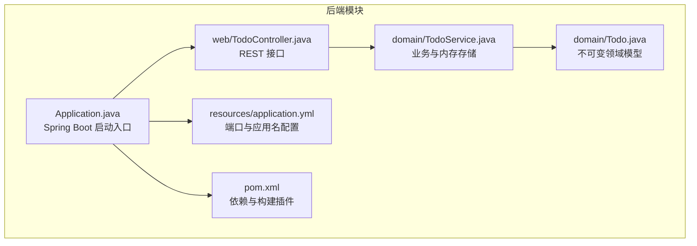
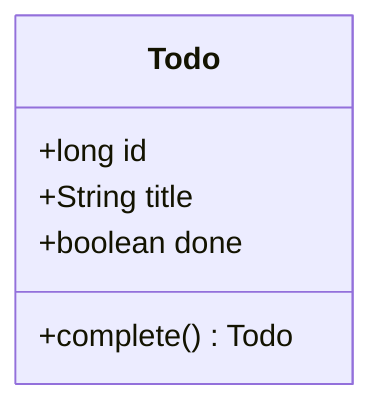
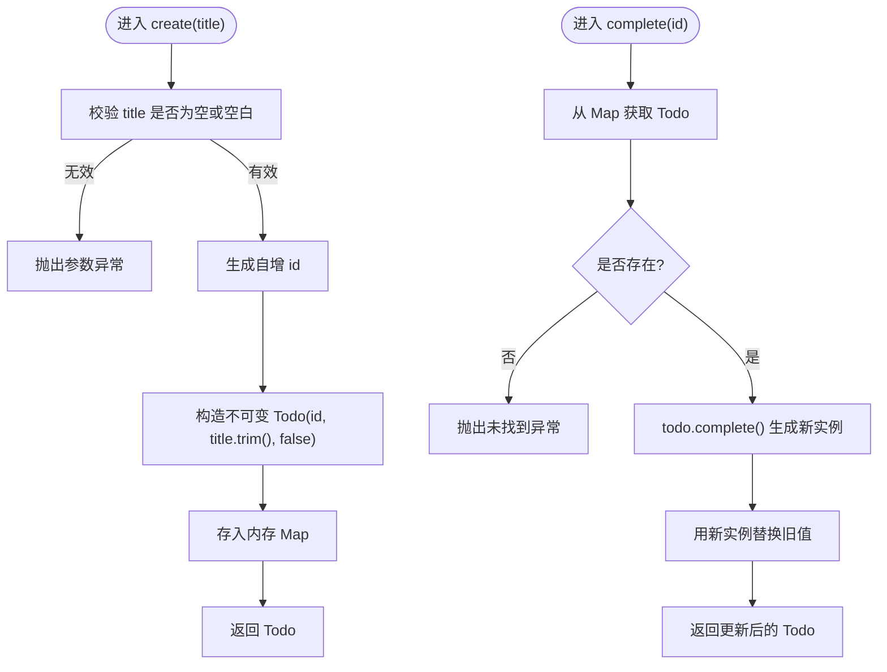
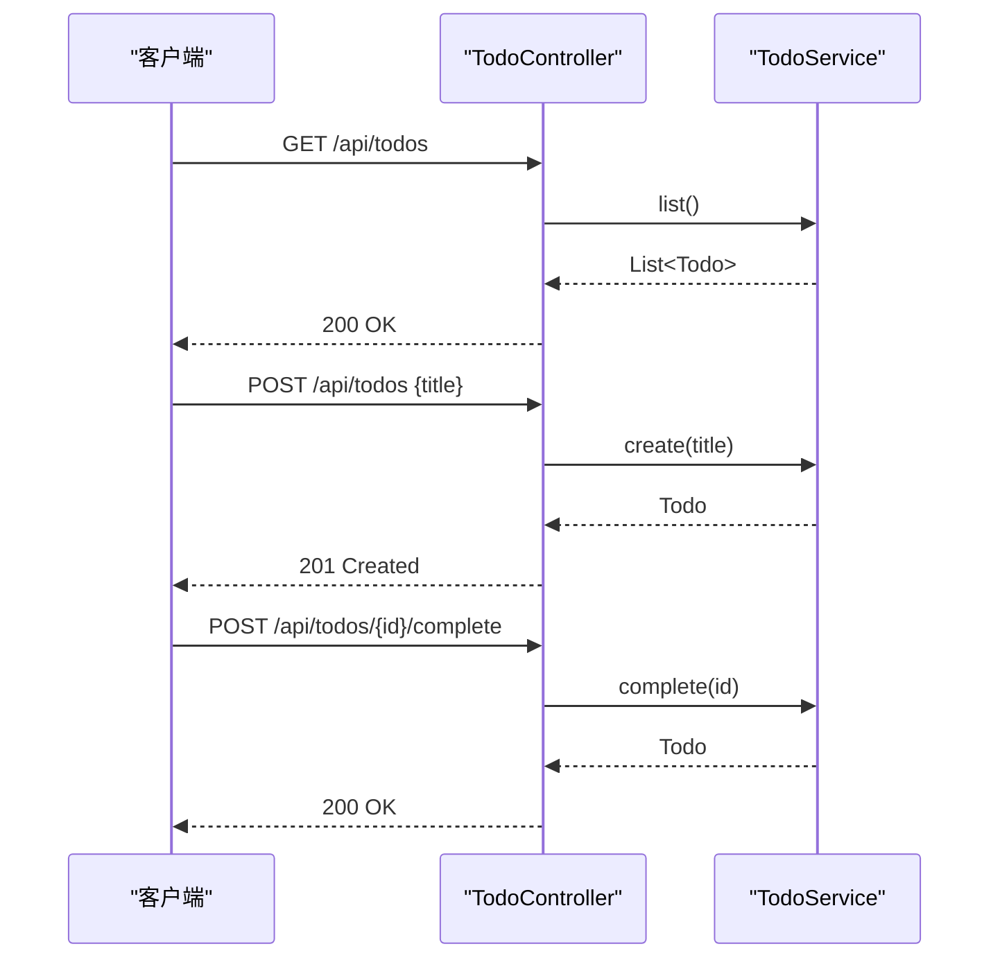
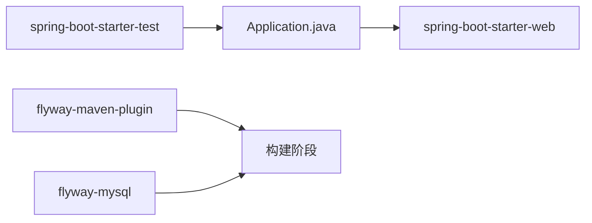

# 后端开发

<cite>
**本文引用的文件**   
- [Application.java](file://backend/src/main/java/com/luyi/myfirst/Application.java)
- [TodoController.java](file://backend/src/main/java/com/luyi/myfirst/web/TodoController.java)
- [TodoService.java](file://backend/src/main/java/com/luyi/myfirst/domain/TodoService.java)
- [Todo.java](file://backend/src/main/java/com/luyi/myfirst/domain/Todo.java)
- [application.yml](file://backend/src/main/resources/application.yml)
- [pom.xml](file://backend/pom.xml)
</cite>

## 目录
1. [简介](#简介)
2. [项目结构](#项目结构)
3. [核心组件](#核心组件)
4. [架构总览](#架构总览)
5. [详细组件分析](#详细组件分析)
6. [依赖关系分析](#依赖关系分析)
7. [性能与扩展性](#性能与扩展性)
8. [故障排查指南](#故障排查指南)
9. [结论](#结论)
10. [附录：API 参考](#附录api-参考)

## 简介
本后端是一个基于 Spring Boot 的轻量级 REST 服务，采用 MVC 分层架构：
- Controller 层负责 HTTP 请求解析与响应封装。
- Service 层封装业务逻辑与内存存储。
- Domain 层定义不可变的领域模型 Todo。

当前实现使用内存 Map 作为数据持久化，便于测试与快速迭代；同时通过 Maven 插件预留数据库迁移能力，为后续接入数据库提供平滑扩展路径。

## 项目结构
后端模块位于 backend 目录下，遵循标准 Spring Boot 工程布局：
- src/main/java 下按包组织代码：domain（领域）、web（控制器）。
- src/main/resources 存放应用配置 application.yml。
- pom.xml 声明 Spring Boot Web Starter、测试依赖以及 Flyway Maven 插件（仅构建期使用）。

**图表来源**
- [Application.java:6-11](file://backend/src/main/java/com/luyi/myfirst/Application.java#L6-L11)
- [TodoController.java:16-43](file://backend/src/main/java/com/luyi/myfirst/web/TodoController.java#L16-L43)
- [TodoService.java:14-42](file://backend/src/main/java/com/luyi/myfirst/domain/TodoService.java#L14-L42)
- [Todo.java:7-11](file://backend/src/main/java/com/luyi/myfirst/domain/Todo.java#L7-L11)
- [application.yml:1-13](file://backend/src/main/resources/application.yml#L1-L13)
- [pom.xml:27-65](file://backend/pom.xml#L27-L65)

**章节来源**
- [Application.java:6-11](file://backend/src/main/java/com/luyi/myfirst/Application.java#L6-L11)
- [application.yml:1-13](file://backend/src/main/resources/application.yml#L1-L13)
- [pom.xml:27-65](file://backend/pom.xml#L27-L65)

## 核心组件
- Application：Spring Boot 启动类，启用自动配置并启动内嵌 Tomcat。
- TodoController：暴露 /api/todos 相关 REST 端点，完成参数绑定与状态码设置。
- TodoService：维护内存中的待办事项集合，提供创建、标记完成、列表查询等能力。
- Todo：不可变记录类型，complete() 返回新实例表达状态变更。

**章节来源**
- [Application.java:6-11](file://backend/src/main/java/com/luyi/myfirst/Application.java#L6-L11)
- [TodoController.java:16-43](file://backend/src/main/java/com/luyi/myfirst/web/TodoController.java#L16-L43)
- [TodoService.java:14-42](file://backend/src/main/java/com/luyi/myfirst/domain/TodoService.java#L14-L42)
- [Todo.java:7-11](file://backend/src/main/java/com/luyi/myfirst/domain/Todo.java#L7-L11)

## 架构总览
系统采用典型的 MVC 分层：
- 客户端发起 HTTP 请求到 TodoController。
- Controller 调用 TodoService 执行业务逻辑。
- Service 操作内存存储，并通过 Todo 不可变对象表达领域状态。

```mermaid
sequenceDiagram
participant Client as "客户端"
participant Controller as "TodoController"
participant Service as "TodoService"
participant Store as "内存Map"
participant Model as "Todo(不可变)"
Client->>Controller : POST /api/todos {title}
Controller->>Service : create(title)
Service->>Store : put(id, new Todo)
Store-->>Service : 已保存
Service-->>Controller : Todo
Controller-->>Client : 201 Created + Todo
Client->>Controller : GET /api/todos
Controller->>Service : list()
Service->>Store : values()
Store-->>Service : List<Todo>
Service-->>Controller : List<Todo>
Controller-->>Client : 200 OK + List<Todo>
Client->>Controller : POST /api/todos/{id}/complete
Controller->>Service : complete(id)
Service->>Store : get(id)
Store-->>Service : Todo
Service->>Model : todo.complete()
Model-->>Service : new Todo(done=true)
Service->>Store : put(id, updated)
Service-->>Controller : Todo
Controller-->>Client : 200 OK + Todo
```

**图表来源**
- [TodoController.java:26-40](file://backend/src/main/java/com/luyi/myfirst/web/TodoController.java#L26-L40)
- [TodoService.java:20-42](file://backend/src/main/java/com/luyi/myfirst/domain/TodoService.java#L20-L42)
- [Todo.java:7-11](file://backend/src/main/java/com/luyi/myfirst/domain/Todo.java#L7-L11)

## 详细组件分析

### 领域模型 Todo（不可变设计）
- 使用 record 保证字段不可变，避免多线程共享可变状态带来的竞态条件。
- complete() 方法返回新的 Todo 实例，以“生成新对象”的方式表达状态变更，符合不可变对象模式。
- 该设计简化了并发安全与测试，因为对象一旦创建即稳定。

**图表来源**
- [Todo.java:7-11](file://backend/src/main/java/com/luyi/myfirst/domain/Todo.java#L7-L11)

**章节来源**
- [Todo.java:7-11](file://backend/src/main/java/com/luyi/myfirst/domain/Todo.java#L7-L11)

### 业务服务 TodoService（内存存储）
- 使用 LinkedHashMap 维护 id -> Todo 的映射，保证插入顺序。
- 使用自增序列号分配 id，确保唯一性。
- create() 对 title 进行非空校验，非法输入抛出异常。
- complete() 查找现有 Todo，若不存在则抛异常；否则调用 Todo.complete() 生成新实例并覆盖旧值。
- list() 返回内存中所有 Todo 的副本列表，避免外部直接修改内部存储。

**图表来源**
- [TodoService.java:20-42](file://backend/src/main/java/com/luyi/myfirst/domain/TodoService.java#L20-L42)

**章节来源**
- [TodoService.java:20-42](file://backend/src/main/java/com/luyi/myfirst/domain/TodoService.java#L20-L42)

### 控制器 TodoController（RESTful API）
- 使用 @RestController 与 @RequestMapping("/api/todos") 统一前缀。
- GET /api/todos：返回所有待办项。
- POST /api/todos：接收 CreateTodoRequest（包含 title），返回 201 Created 与新建的 Todo。
- POST /api/todos/{id}/complete：根据 id 标记完成，返回更新后的 Todo。
- 通过构造器注入 TodoService，符合 Spring 推荐的依赖注入方式。

**图表来源**
- [TodoController.java:16-43](file://backend/src/main/java/com/luyi/myfirst/web/TodoController.java#L16-L43)

**章节来源**
- [TodoController.java:16-43](file://backend/src/main/java/com/luyi/myfirst/web/TodoController.java#L16-L43)

### 启动类 Application
- 使用 @SpringBootApplication 启用自动配置与组件扫描。
- main 方法通过 SpringApplication.run 启动应用。

**章节来源**
- [Application.java:6-11](file://backend/src/main/java/com/luyi/myfirst/Application.java#L6-L11)

## 依赖关系分析
- 运行期依赖：spring-boot-starter-web 提供 Web MVC、Tomcat 与 JSON 序列化。
- 测试依赖：spring-boot-starter-test 用于单元测试与集成测试。
- 构建期依赖：flyway-maven-plugin 与 flyway-mysql 仅用于数据库迁移脚本管理，不引入运行时数据库驱动。

**图表来源**
- [pom.xml:27-65](file://backend/pom.xml#L27-L65)

**章节来源**
- [pom.xml:27-65](file://backend/pom.xml#L27-L65)

## 性能与扩展性

### 内存存储特性
- 时间复杂度：
  - 创建/查询/完成：O(1)（HashMap/LinkedHashMap 基本操作）。
  - 列表：O(n)（复制 values 到新 ArrayList）。
- 空间复杂度：O(n)，n 为待办项数量。
- 线程安全：当前实现未加锁，不适合高并发场景；如需并发访问，可考虑 ConcurrentHashMap 或在 Service 层加同步策略。

### 扩展为数据库的方案
- 保留 TodoService 接口不变，将内存 Map 替换为 Repository 或 DAO 层。
- 使用 JPA/Hibernate 或 MyBatis 对接数据库，Todo 可作为实体或 DTO。
- 利用 Flyway 管理数据库版本迁移，pom.xml 已预留插件与 MySQL 方言依赖。
- 通过 Spring Profile 切换内存与数据库实现，保持测试与生产环境一致。

[本节为通用指导，不直接分析具体文件]

## 故障排查指南
- 标题为空或空白：create() 会抛出 IllegalArgumentException，检查请求体是否包含有效的 title。
- 未完成的任务 ID 不存在：complete() 会抛出 IllegalArgumentException，确认传入的 id 是否存在。
- 端口冲突：application.yml 默认端口为 8989，如被占用请调整 server.port。
- 日志级别：root 日志级别为 INFO，可通过 logging.level 调整更详细的输出。

**章节来源**
- [TodoService.java:20-37](file://backend/src/main/java/com/luyi/myfirst/domain/TodoService.java#L20-L37)
- [application.yml:1-13](file://backend/src/main/resources/application.yml#L1-L13)

## 结论
本项目以最小可用为目标，采用清晰的 MVC 分层与不可变领域模型，提供了稳定的 REST API 与内存存储实现。通过 Spring Boot 自动配置与依赖注入简化了样板代码，同时通过 Flyway 插件为未来数据库迁移预留了扩展点。建议在需要时引入 Repository 抽象与数据库驱动，逐步将内存存储替换为持久化方案，并保持对外 API 的一致性。

[本节为总结性内容，不直接分析具体文件]

## 附录：API 参考

- GET /api/todos
  - 功能：获取所有待办事项列表。
  - 响应：200 OK，JSON 数组，元素为 Todo 对象。

- POST /api/todos
  - 功能：创建新的待办事项。
  - 请求体：CreateTodoRequest，包含 title 字段。
  - 响应：201 Created，JSON 对象 Todo。

- POST /api/todos/{id}/complete
  - 功能：将指定 id 的待办事项标记为已完成。
  - 路径参数：id，长整型。
  - 响应：200 OK，JSON 对象 Todo。

**章节来源**
- [TodoController.java:26-40](file://backend/src/main/java/com/luyi/myfirst/web/TodoController.java#L26-L40)