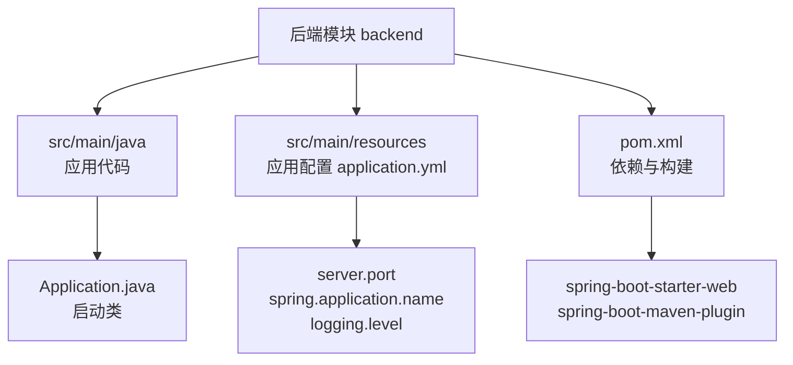
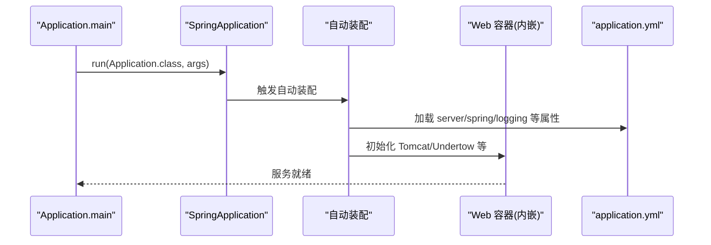
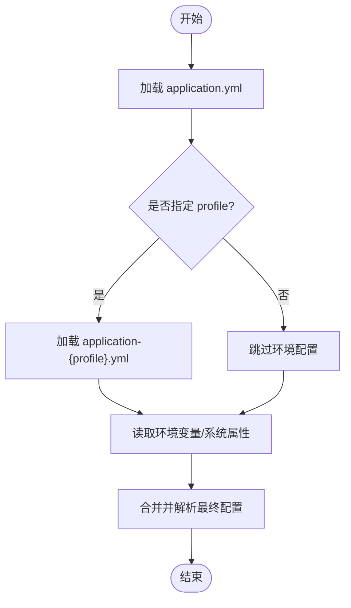
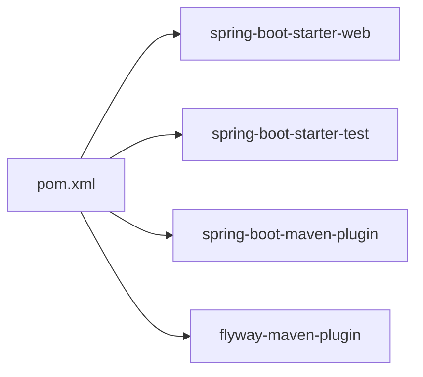

# 应用配置

<cite>
**本文引用的文件**   
- [application.yml](file://backend/src/main/resources/application.yml)
- [pom.xml](file://backend/pom.xml)
- [Application.java](file://backend/src/main/java/com/luyi/myfirst/Application.java)
</cite>

## 目录
1. [简介](#简介)
2. [项目结构](#项目结构)
3. [核心组件](#核心组件)
4. [架构总览](#架构总览)
5. [详细组件分析](#详细组件分析)
6. [依赖关系分析](#依赖关系分析)
7. [性能与可观测性](#性能与可观测性)
8. [故障排查指南](#故障排查指南)
9. [结论](#结论)
10. [附录：最佳实践清单](#附录最佳实践清单)

## 简介
本文面向 Spring Boot 后端模块，系统性说明应用配置的组织方式、关键配置项含义、Maven 构建与插件设置、自动装配工作原理与扩展点，以及环境隔离、敏感信息管理、常见问题与优化建议。目标是帮助读者快速理解并安全地维护该项目的运行配置。

## 项目结构
本仓库采用前后端分离布局，后端位于 backend 子模块，使用 Spring Boot 3.x 与 Maven 管理依赖和构建流程。核心配置文件位于 resources 目录下；应用入口为 Application.java。

**图示来源**
- [Application.java:6-11](file://backend/src/main/java/com/luyi/myfirst/Application.java#L6-L11)
- [application.yml:1-13](file://backend/src/main/resources/application.yml#L1-L13)
- [pom.xml:27-44](file://backend/pom.xml#L27-L44)

**章节来源**
- [Application.java:1-13](file://backend/src/main/java/com/luyi/myfirst/Application.java#L1-L13)
- [application.yml:1-13](file://backend/src/main/resources/application.yml#L1-L13)
- [pom.xml:1-74](file://backend/pom.xml#L1-L74)

## 核心组件
- 应用启动器：Application.java 通过 @SpringBootApplication 启用自动装配与组件扫描，并使用 SpringApplication.run 启动容器。
- 应用配置：application.yml 提供最小化运行时配置，包括服务器端口、应用名称与日志级别。
- 构建与依赖：pom.xml 继承 spring-boot-starter-parent，引入 web starter 与测试 starter，并配置 spring-boot-maven-plugin 与 flyway-maven-plugin（仅作为迁移工具）。

**章节来源**
- [Application.java:6-11](file://backend/src/main/java/com/luyi/myfirst/Application.java#L6-L11)
- [application.yml:1-13](file://backend/src/main/resources/application.yml#L1-L13)
- [pom.xml:27-44](file://backend/pom.xml#L27-L44)

## 架构总览
下图展示从启动到 HTTP 服务暴露的关键路径，以及与配置文件的关联。

**图示来源**
- [Application.java:9-11](file://backend/src/main/java/com/luyi/myfirst/Application.java#L9-L11)
- [application.yml:1-13](file://backend/src/main/resources/application.yml#L1-L13)

## 详细组件分析

### application.yml 配置详解
- 服务器端口
  - server.port：定义内嵌 Web 容器的监听端口。当前值为 8989。
- 应用元信息
  - spring.application.name：应用名称，用于标识实例、日志与监控上下文。
- 日志配置
  - logging.level.root：根日志级别，当前为 INFO。可按包名细化日志级别。

补充说明
- 未显式配置 server.servlet.context-path 时，默认上下文路径为空根路径 “/”。
- 未显式配置 logging.file 或 logging.pattern 时，遵循 Spring Boot 默认行为（控制台输出为主）。

**章节来源**
- [application.yml:2-12](file://backend/src/main/resources/application.yml#L2-L12)

### pom.xml 构建与依赖
- 父工程与版本
  - 继承 spring-boot-starter-parent 3.5.5，统一管理 Spring Boot 相关依赖版本。
- Java 版本
  - java.version=17，确保编译与运行环境一致。
- 依赖
  - spring-boot-starter-web：提供 Web MVC、Tomcat 等能力。
  - spring-boot-starter-test：提供单元测试与集成测试支持（test scope）。
- 构建插件
  - spring-boot-maven-plugin：打包可执行 Jar、生成启动脚本等。
  - flyway-maven-plugin：仅作为迁移工具使用，不引入运行期数据库依赖；包含 MySQL 驱动与 Flyway 的 MySQL 方言依赖。

注意
- 若需在生产环境启用数据库功能，应另行引入运行期依赖（如 spring-boot-starter-data-jpa、DataSource 等），并在配置中提供连接信息。

**章节来源**
- [pom.xml:7-25](file://backend/pom.xml#L7-L25)
- [pom.xml:27-37](file://backend/pom.xml#L27-L37)
- [pom.xml:39-70](file://backend/pom.xml#L39-L70)

### Spring Boot 自动装配与自定义配置
- 自动装配
  - @SpringBootApplication 组合了 @EnableAutoConfiguration，根据 classpath 与已配置属性自动装配组件（例如引入 web starter 后自动装配 Web 容器与 MVC）。
- 自定义配置
  - 可通过 @Configuration + @Bean 声明自定义组件。
  - 通过 @Value 或 @ConfigurationProperties 注入 application.yml 中的键值。
  - 使用 @ConditionalOnProperty/@ConditionalOnMissingBean 等条件注解实现按需装配。
  - 通过 Environment 或 ConfigurableEnvironment 读取系统属性与环境变量。

提示
- 将业务相关的配置集中放在独立的 .yml 文件中，并通过 @ConfigurationProperties 绑定到 POJO，提升可读性与类型安全。

**章节来源**
- [Application.java:6-11](file://backend/src/main/java/com/luyi/myfirst/Application.java#L6-L11)

### 环境特定配置与敏感信息管理
- 多环境配置
  - 使用 application-{profile}.yml（如 application-dev.yml、application-prod.yml）配合 spring.profiles.active 进行切换。
  - 也可在命令行或环境变量中指定 --spring.profiles.active=dev。
- 敏感信息
  - 避免将密钥、密码等硬编码进仓库。推荐通过环境变量或外部配置中心注入。
  - 在本地开发可使用 .env 或 IDE 的运行配置注入，CI/CD 中使用密钥管理服务。
- 配置优先级（从高到低）
  - 命令行参数 > 环境变量 > OS 环境变量 > jar 外部的 application.yml > jar 内部的 application.yml > 默认值。

**章节来源**
- [application.yml:1-13](file://backend/src/main/resources/application.yml#L1-L13)

### 配置文件组织结构建议
- 基础配置：application.yml（公共配置）
- 环境配置：application-{profile}.yml（按环境拆分）
- 业务配置：按模块拆分为多个 .yml，并通过 @ConfigurationProperties 绑定
- 敏感配置：统一由外部系统注入，不在仓库中保存明文

[本图为概念流程图，无需图示来源]

## 依赖关系分析
- 直接依赖
  - spring-boot-starter-web：提供 Web 层能力。
  - spring-boot-starter-test：测试依赖。
- 构建插件依赖
  - spring-boot-maven-plugin：打包与运行。
  - flyway-maven-plugin：迁移工具（非运行期依赖）。

**图示来源**
- [pom.xml:27-44](file://backend/pom.xml#L27-L44)
- [pom.xml:45-70](file://backend/pom.xml#L45-L70)

**章节来源**
- [pom.xml:27-70](file://backend/pom.xml#L27-L70)

## 性能与可观测性
- 日志
  - 调整 logging.level.root 控制全局日志级别；针对具体包名细化日志级别以平衡性能与信息量。
  - 生产环境建议开启结构化日志与采样策略，减少 I/O 压力。
- Web 容器
  - 可根据负载调整 server.port 与线程池参数（如 tomcat 线程数、最大连接数等）。
- 健康检查与指标
  - 引入 spring-boot-starter-actuator 暴露 /health、/metrics 等端点，便于监控与告警。

[本节为通用指导，无需章节来源]

## 故障排查指南
- 端口冲突
  - 现象：启动时报端口占用。
  - 处理：修改 server.port 或释放占用端口。
- 上下文路径异常
  - 现象：访问路径不符合预期。
  - 处理：确认 server.servlet.context-path 是否为空或符合预期。
- 日志过多或过少
  - 现象：日志噪音大或关键信息缺失。
  - 处理：调整 logging.level 至合适级别，必要时对特定包精细化配置。
- 环境变量未生效
  - 现象：外部配置未覆盖 application.yml。
  - 处理：检查环境变量命名规范与优先级，确认是否被后续配置覆盖。
- 构建失败
  - 现象：Maven 构建报错。
  - 处理：核对 Java 版本、依赖版本与网络代理；清理本地仓库缓存后重试。

**章节来源**
- [application.yml:2-12](file://backend/src/main/resources/application.yml#L2-L12)
- [pom.xml:21-25](file://backend/pom.xml#L21-L25)

## 结论
本项目基于 Spring Boot 3.x 与 Maven，采用最小化配置即可开箱即用。通过合理组织 application.yml、引入环境配置与外部化敏感信息，并结合自动装配机制扩展能力，可在保证可维护性的同时快速迭代。建议在后续演进中逐步引入 Actuator、配置中心与更细粒度的日志策略，以提升可观测性与运维效率。

[本节为总结性内容，无需章节来源]

## 附录：最佳实践清单
- 将公共配置与敏感配置分离，敏感信息一律外部化。
- 使用 application-{profile}.yml 管理环境差异，并通过 profiles.active 切换。
- 使用 @ConfigurationProperties 绑定配置，提高类型安全与可读性。
- 仅在需要时引入额外 Starter，保持依赖精简。
- 生产环境关闭调试端点，限制 Actuator 暴露范围。
- 使用 CI/CD 注入密钥，避免提交到版本库。
- 定期审查日志级别与采样策略，避免性能退化。

[本节为通用指导，无需章节来源]