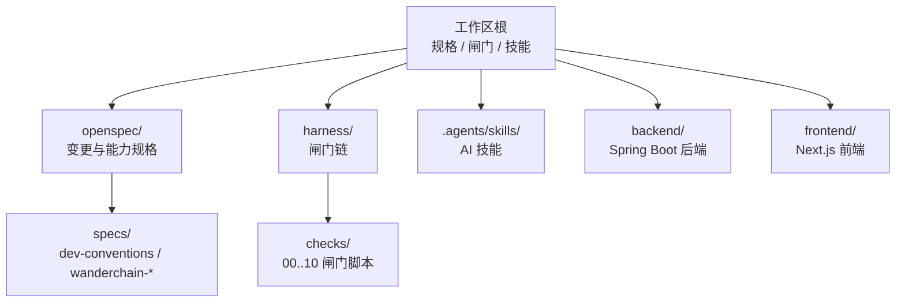
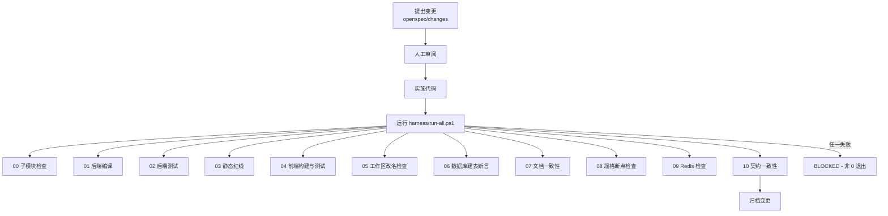
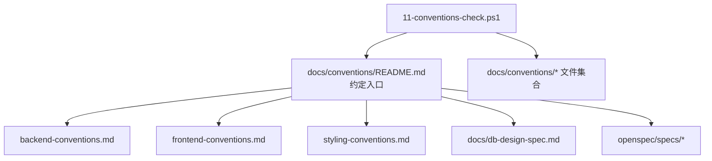
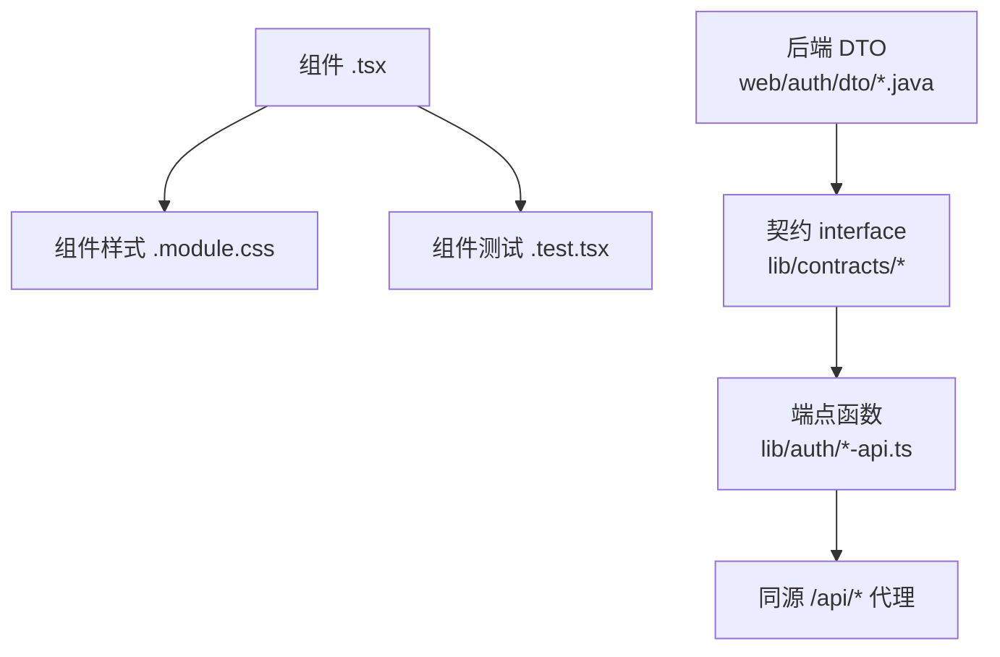
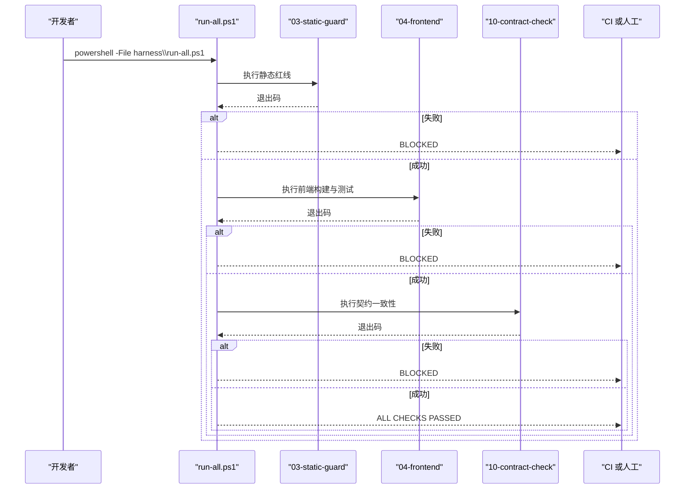
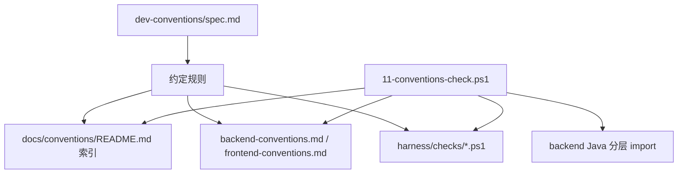
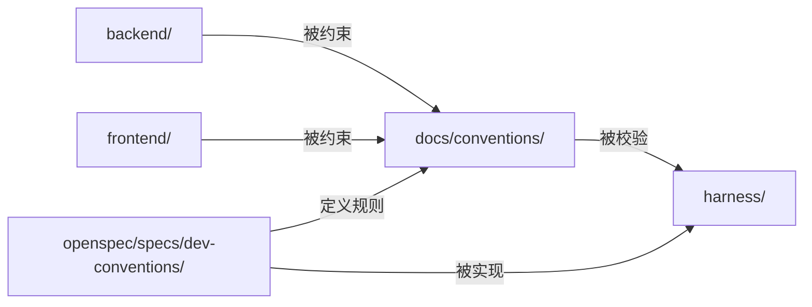

# 开发规范系统

<cite>
**本文引用的文件**   
- [README.md](file://README.md)
- [backend/README.md](file://backend/README.md)
- [frontend/README.md](file://frontend/README.md)
- [docs/conventions/README.md](file://docs/conventions/README.md)
- [docs/conventions/backend-conventions.md](file://docs/conventions/backend-conventions.md)
- [docs/conventions/frontend-conventions.md](file://docs/conventions/frontend-conventions.md)
- [harness/run-all.ps1](file://harness/run-all.ps1)
- [harness/checks/11-conventions-check.ps1](file://harness/checks/11-conventions-check.ps1)
- [openspec/config.yaml](file://openspec/config.yaml)
- [openspec/specs/dev-conventions/spec.md](file://openspec/specs/dev-conventions/spec.md)
</cite>

## 目录
1. [引言](#引言)
2. [项目结构](#项目结构)
3. [核心组件](#核心组件)
4. [架构总览](#架构总览)
5. [详细组件分析](#详细组件分析)
6. [依赖关系分析](#依赖关系分析)
7. [性能与可维护性考量](#性能与可维护性考量)
8. [故障排查指南](#故障排查指南)
9. [结论](#结论)

## 引言
本仓库不是普通业务项目，而是把“规格驱动、闸门否决、技能固化”三层落到真实目录的最小工程示范。它通过 `openspec/` 固定意图、`harness/` 行使否决权、`.agents/skills/` 固化方法；`backend/` 与 `frontend/` 作为两个独立 Git 子模块被编排，各自保留构建身份、提交历史与发布节奏。

开发规范系统的目标是：
- 让新增模块有唯一入口与明确落点。
- 把能机械校验的规则变成闸门，而不是只停留在文档里。
- 用错误码、契约镜像与分层依赖方向约束前后端协作。
- 让“AI 可以写代码，但只有闸门返回 0 才算完成”。

**章节来源**
- [README.md:1-128](file://README.md#L1-L128)

## 项目结构
仓库采用“顶层工作区 + 两个子模块”的结构：
- 顶层负责规格、闸门与工作区技能。
- `backend/` 是 Spring Boot 后端，实现 wanderchain 账户认证。
- `frontend/` 是 Next.js 前端，提供首页与认证接入，并通过同源代理访问后端。



**图表来源**
- [README.md:74-87](file://README.md#L74-L87)
- [harness/run-all.ps1:5-16](file://harness/run-all.ps1#L5-L16)

**章节来源**
- [README.md:1-20](file://README.md#L1-L20)
- [README.md:74-87](file://README.md#L74-L87)

## 核心组件
开发规范系统由四类核心组件构成：

| 组件 | 职责 | 关键位置 |
|---|---|---|
| 规格层 | 用 OpenSpec 固定需求、约定与验收行为 | `openspec/specs/`、`openspec/config.yaml` |
| 闸门层 | 按顺序执行检查，遇错即停，拥有否决权 | `harness/run-all.ps1`、`harness/checks/*.ps1` |
| 约定文档 | 给出后端与前端的开发约定、真源声明与机械守卫 | `docs/conventions/` |
| 应用层 | 被规范约束的两个独立仓库 | `backend/`、`frontend/` |

其中，`dev-conventions` 规格把“约定入口唯一、真源不重述、依赖现状与拟引入零交集、机械守卫登记、后端分层依赖单向”等规则写成可验证要求，并由 `11-conventions-check.ps1` 落地。

**章节来源**
- [openspec/specs/dev-conventions/spec.md:1-111](file://openspec/specs/dev-conventions/spec.md#L1-L111)
- [docs/conventions/README.md:1-61](file://docs/conventions/README.md#L1-L61)
- [harness/run-all.ps1:1-25](file://harness/run-all.ps1#L1-L25)

## 架构总览
开发规范系统的工作流围绕“规格 → 实施 → 闸门 → 归档”展开。闸门链是系统的关键控制面：它不关心具体业务逻辑，只关心“当前代码是否满足已登记的规则”。



**图表来源**
- [README.md:65-87](file://README.md#L65-L87)
- [harness/run-all.ps1:5-16](file://harness/run-all.ps1#L5-L16)
- [harness/run-all.ps1:41-67](file://harness/run-all.ps1#L41-L67)

**章节来源**
- [README.md:65-87](file://README.md#L65-L87)
- [harness/run-all.ps1:1-25](file://harness/run-all.ps1#L1-L25)

## 详细组件分析

### 开发约定入口与索引机制
`docs/conventions/README.md` 是仓库内开发约定的唯一入口。它承担三件事：
- 给出主题索引，指向后端约定、前端约定、样式约定、数据库设计说明与能力规格。
- 规定新增业务模块的必读清单：先立项、定数据、定落点、登记新表、登记契约、跑完整闸门。
- 声明维护规则：闸门先于文档、不重述既有真源、区分现状与计划、不引用会改名的 `changes/` 路径。

该入口本身也被 `AGENTS.md` 引用，并由 `11-conventions-check.ps1` 做双向一致性检查：索引列出的文件必须存在，目录下除自身外的每个 Markdown 文件也必须出现在索引中。



**图表来源**
- [docs/conventions/README.md:11-28](file://docs/conventions/README.md#L11-L28)
- [openspec/specs/dev-conventions/spec.md:8-31](file://openspec/specs/dev-conventions/spec.md#L8-L31)
- [harness/checks/11-conventions-check.ps1:183-216](file://harness/checks/11-conventions-check.ps1#L183-L216)

**章节来源**
- [docs/conventions/README.md:1-61](file://docs/conventions/README.md#L1-L61)
- [openspec/specs/dev-conventions/spec.md:8-31](file://openspec/specs/dev-conventions/spec.md#L8-L31)

### 后端开发约定
后端约定聚焦 Spring Boot 包结构、依赖方向、Controller 粒度、DTO 与响应、异常收口、错误码命名空间与分页方向。

关键点如下：
- 包结构为 `common ← config/dao ← service ← web`，且由 `11-conventions-check.ps1` 禁止 `dao/service` import `web`、禁止 `common` import 业务层。
- Controller 粒度是一个端点一个类，只做请求绑定、上下文读取与响应包装，不写业务分支、不直接访问 Repository、不拼装响应体。
- DTO 使用 Java `record`，禁止把实体作为响应体；所有响应体通过标记接口 `AuthResponseBody` 出站守卫拦截。
- 异常统一走 `BizException` 与 `GlobalExceptionHandler`，服务层不写 HTTP 状态码。
- 认证域错误码固定七个，新增属于契约变更，必须先改 spec、再改枚举、最后改前端映射。
- 分页尚未落地，但已明确游标不透明、默认 limit、上限截断与非法游标处理方向。

```mermaid
classDiagram
class Common {
"无业务归属共享件"
"enums / exception / id / security / web"
}
class ConfigDao {
"配置与数据访问"
"config / dao"
}
class Service {
"领域服务接口与实现"
"service/auth/*"
}
class Web {
"控制器与DTO"
"web/auth/*"
}
Common <|-- ConfigDao : "被依赖"
ConfigDao <|-- Service : "被依赖"
Service <|-- Web : "被依赖"
```

**图表来源**
- [docs/conventions/backend-conventions.md:6-27](file://docs/conventions/backend-conventions.md#L6-L27)
- [harness/checks/11-conventions-check.ps1:183-205](file://harness/checks/11-conventions-check.ps1#L183-L205)

**章节来源**
- [docs/conventions/backend-conventions.md:1-142](file://docs/conventions/backend-conventions.md#L1-L142)
- [harness/checks/11-conventions-check.ps1:183-216](file://harness/checks/11-conventions-check.ps1#L183-L216)

### 前端开发约定
前端约定聚焦 Next.js App Router 下的目录组织、组件三件套、状态归属、API 封装两层与契约镜像顺序。

关键点如下：
- `app/` 只放路由与页面；`components/` 按业务域分组；`lib/` 放可单测纯逻辑。
- 组件三件套包括 `.tsx`、`.module.css`、`.test.tsx`，新增组件应齐备。
- 状态归属按可见范围决定：全局 Provider、页面容器或组件内状态。
- API 封装分为契约层与端点层：契约层镜像后端 DTO，端点层负责发请求与错误翻译。
- 契约镜像顺序严格为“先改后端 DTO，再到前端契约镜像，最后更新契约闸门清单”。



**图表来源**
- [docs/conventions/frontend-conventions.md:6-33](file://docs/conventions/frontend-conventions.md#L6-L33)
- [docs/conventions/frontend-conventions.md:67-85](file://docs/conventions/frontend-conventions.md#L67-L85)

**章节来源**
- [docs/conventions/frontend-conventions.md:1-126](file://docs/conventions/frontend-conventions.md#L1-L126)

### 闸门链与控制流
`harness/run-all.ps1` 是闸门总入口，按文件名顺序执行 `checks/*.ps1`，任一失败立即返回非 0。它记录每个闸门的耗时、汇总结果，并在失败时输出 `BLOCKED`，成功时输出 `ALL CHECKS PASSED`。

闸门链包含：
- 00：子模块检查
- 01：后端编译
- 02：后端测试
- 03：静态红线
- 04：前端构建与测试
- 05：工作区改名检查
- 06：数据库建表断言
- 07：文档一致性
- 08：规格断点检查
- 09：Redis 检查
- 10：契约一致性



**图表来源**
- [harness/run-all.ps1:1-25](file://harness/run-all.ps1#L1-L25)
- [harness/run-all.ps1:41-67](file://harness/run-all.ps1#L41-L67)
- [harness/run-all.ps1:80-94](file://harness/run-all.ps1#L80-L94)

**章节来源**
- [harness/run-all.ps1:1-95](file://harness/run-all.ps1#L1-L95)

### 约定规格的机械守卫
`openspec/specs/dev-conventions/spec.md` 把开发约定本身也当成可验收行为，要求：
- 约定入口唯一且索引双向一致。
- 约定文档声明真源且不重述。
- “依赖现状”和“拟引入”双向零交集。
- 约定文档登记机械守卫，且引用的闸门标识对应真实脚本。
- 新增闸门需同步更新 `AGENTS.md` 标记与目录树。
- 后端分层依赖方向单向。

这些要求由 `11-conventions-check.ps1` 实现，包括检查约定文档结构、真源路径有效性、依赖描述一致性以及 Java 包导入方向。



**图表来源**
- [openspec/specs/dev-conventions/spec.md:8-111](file://openspec/specs/dev-conventions/spec.md#L8-L111)
- [harness/checks/11-conventions-check.ps1:183-216](file://harness/checks/11-conventions-check.ps1#L183-L216)

**章节来源**
- [openspec/specs/dev-conventions/spec.md:1-111](file://openspec/specs/dev-conventions/spec.md#L1-L111)
- [harness/checks/11-conventions-check.ps1:178-216](file://harness/checks/11-conventions-check.ps1#L178-L216)

### OpenSpec 配置与语言策略
`openspec/config.yaml` 指定 schema 为 `spec-driven`，并强制所有工件使用中文，同时保持 OpenSpec 的结构标题与 SHALL/MUST 关键词为英文。这使规格既能被人类阅读，也能被工具解析。

**章节来源**
- [openspec/config.yaml:1-29](file://openspec/config.yaml#L1-L29)

## 依赖关系分析
开发规范系统的依赖关系可以分为三层：

1. **应用依赖**：`backend/` 与 `frontend/` 是被约束的应用，不是规范本身。
2. **规范依赖**：`docs/conventions/` 与 `openspec/specs/dev-conventions/` 定义规则。
3. **执行依赖**：`harness/` 执行规则，并把结果反馈给开发者与 CI。



**图表来源**
- [docs/conventions/backend-conventions.md:1-10](file://docs/conventions/backend-conventions.md#L1-L10)
- [docs/conventions/frontend-conventions.md:1-10](file://docs/conventions/frontend-conventions.md#L1-L10)
- [openspec/specs/dev-conventions/spec.md:1-10](file://openspec/specs/dev-conventions/spec.md#L1-L10)
- [harness/run-all.ps1:1-25](file://harness/run-all.ps1#L1-L25)

**章节来源**
- [docs/conventions/backend-conventions.md:1-142](file://docs/conventions/backend-conventions.md#L1-L142)
- [docs/conventions/frontend-conventions.md:1-126](file://docs/conventions/frontend-conventions.md#L1-L126)
- [openspec/specs/dev-conventions/spec.md:1-111](file://openspec/specs/dev-conventions/spec.md#L1-L111)
- [harness/run-all.ps1:1-95](file://harness/run-all.ps1#L1-L95)

## 性能与可维护性考量
从规范系统角度，可维护性优先于一次性优化：

- **闸门顺序合理**：先子模块、再编译、测试、静态检查、前端、数据库与契约，避免在早期阶段浪费后续资源。
- **失败快速定位**：每个闸门独立进程执行，退出码互不污染，便于定位是哪一层出问题。
- **规则可执行**：约定不只是文档，而是通过 `11-conventions-check.ps1` 等脚本强制生效。
- **契约单一真源**：后端 DTO 是字段名与类型真源，前端契约镜像，闸门做双向比对，减少联调期漂移。
- **分层依赖单向**：Java 包结构限制反向依赖，降低耦合扩散风险。

[本节为通用指导，不直接分析具体文件]

## 故障排查指南
当开发规范系统出现红灯时，可按以下思路排查：

| 现象 | 可能原因 | 排查步骤 |
|---|---|---|
| `run-all.ps1` 中途停止 | 某个闸门返回非 0 | 查看最近一次 `[FAIL]` 行，单独执行对应 `harness/checks/NN-*.ps1` |
| `11-conventions-check` 失败 | 约定文档缺少真源声明、依赖小节不一致、或后端分层依赖违规 | 检查 `docs/conventions/README.md` 索引、各约定文档的“真源声明”“依赖现状”“拟引入”“机械守卫”，并确认 Java import 方向 |
| 契约检查失败 | 后端 DTO 与前端契约字段名或类型不一致 | 先改后端 DTO，再镜像到 `frontend/lib/contracts/`，最后更新 `10-contract-check.ps1` 受管清单 |
| 前端构建失败 | 依赖未安装、Next.js 构建错误或 Vitest 测试失败 | 在 `frontend/` 下执行 `npm ci`、`npm run build`、`npm run test` |
| 数据库或 Redis 检查失败 | 本地 MySQL 8 或 Redis 实例不可达、凭据不正确 | 按 README 前置环境说明检查端口、用户名、密码与 db 编号 |

**章节来源**
- [harness/run-all.ps1:41-94](file://harness/run-all.ps1#L41-L94)
- [harness/checks/11-conventions-check.ps1:183-216](file://harness/checks/11-conventions-check.ps1#L183-L216)
- [README.md:89-128](file://README.md#L89-L128)

## 结论
开发规范系统把“意图、方法与护栏”三者结合：  
- `openspec/` 固定要做什么；  
- `docs/conventions/` 规定怎么做；  
- `harness/` 保证没做错。  

它不追求功能广度，而是通过最小闭环证明：AI 编码可以被验证、可追溯、边界清晰。对团队而言，最重要的不是记住所有约定，而是养成“先改规格、再改实现、最后跑闸门”的习惯。

[本节为总结性内容，不直接分析具体文件]