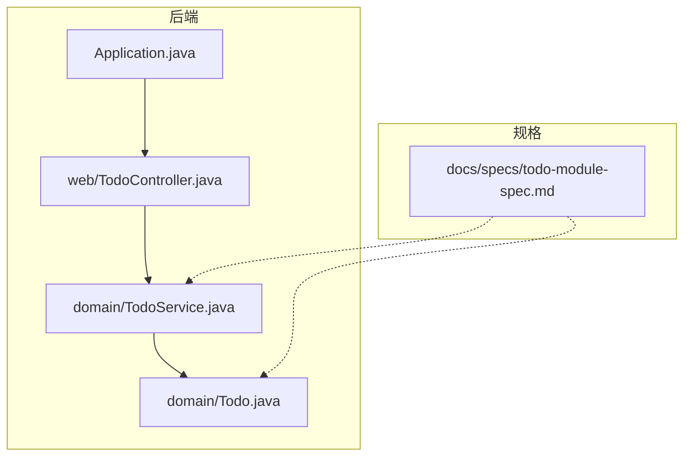
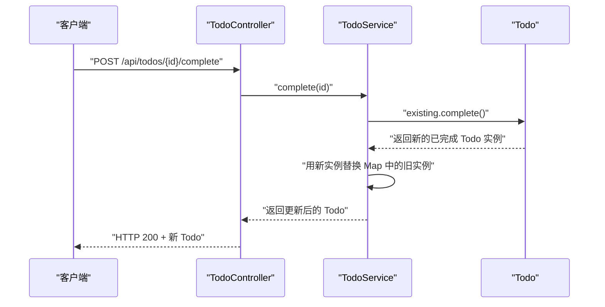
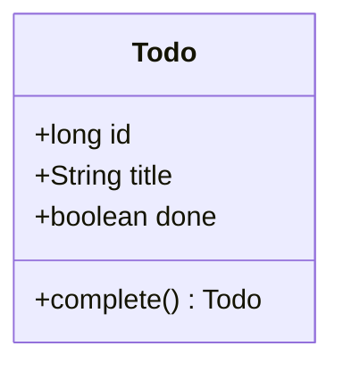
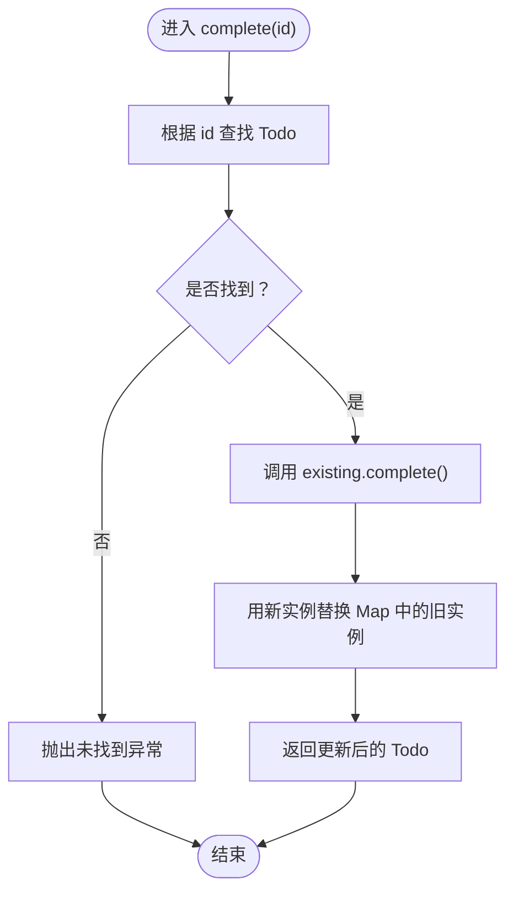
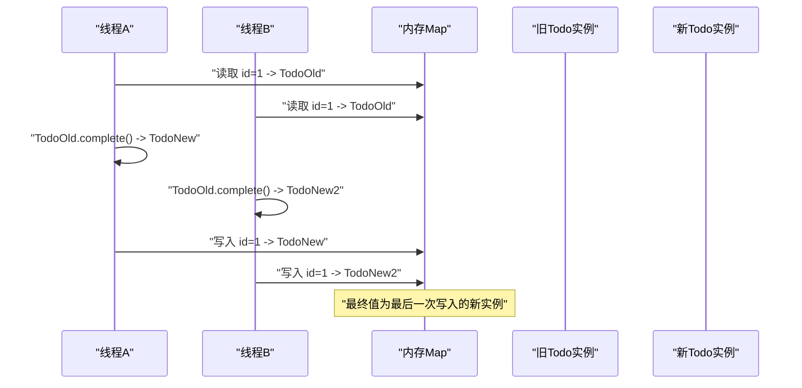
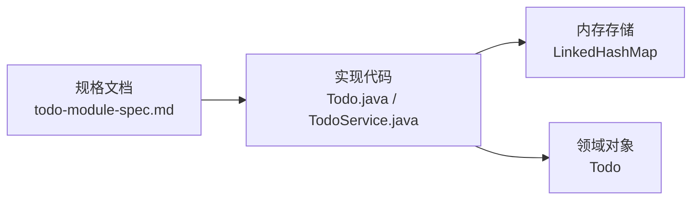

# 领域模型设计

<cite>
**本文引用的文件**   
- [Todo.java](file://backend/src/main/java/com/luyi/myfirst/domain/Todo.java)
- [TodoService.java](file://backend/src/main/java/com/luyi/myfirst/domain/TodoService.java)
- [todo-module-spec.md](file://docs/specs/todo-module-spec.md)
</cite>

## 目录
1. [引言](#引言)
2. [项目结构](#项目结构)
3. [核心组件](#核心组件)
4. [架构总览](#架构总览)
5. [详细组件分析](#详细组件分析)
6. [依赖关系分析](#依赖关系分析)
7. [性能与并发特性](#性能与并发特性)
8. [故障排查指南](#故障排查指南)
9. [结论](#结论)
10. [附录：扩展建议与最佳实践](#附录扩展建议与最佳实践)

## 引言
本文聚焦 Todo 领域模型的设计与实现，重点解释使用 Java record 构建不可变对象的理念、优势以及在多线程环境下的安全性。文档围绕以下目标展开：
- 说明 Todo 实体的字段语义：id（唯一标识符）、title（待办标题）、done（完成状态）。
- 解释 complete() 方法如何通过生成新实例表达状态变更，而不是修改现有对象。
- 结合 TodoService 的内存存储，展示完整的数据流和调用链。
- 给出面向未来的扩展建议和最佳实践，帮助在保持不可变性的同时演进领域模型。

## 项目结构
当前后端代码位于 backend 模块中，Todo 领域模型及其服务分别位于 domain 包下；规格说明位于 docs/specs/todo-module-spec.md。

**图表来源**
- [Todo.java:1-13](file://backend/src/main/java/com/luyi/myfirst/domain/Todo.java#L1-L13)
- [TodoService.java:1-44](file://backend/src/main/java/com/luyi/myfirst/domain/TodoService.java#L1-L44)
- [todo-module-spec.md:1-12](file://docs/specs/todo-module-spec.md#L1-L12)

**章节来源**
- [Todo.java:1-13](file://backend/src/main/java/com/luyi/myfirst/domain/Todo.java#L1-L13)
- [TodoService.java:1-44](file://backend/src/main/java/com/luyi/myfirst/domain/TodoService.java#L1-L44)
- [todo-module-spec.md:1-12](file://docs/specs/todo-module-spec.md#L1-L12)

## 核心组件
- Todo：使用 Java record 定义的不可变领域实体，包含 id、title、done 三个字段，并提供 complete() 方法以返回新的已完成实例。
- TodoService：内存版待办服务，负责创建、完成、查询 Todo，内部使用 LinkedHashMap 维护有序映射，并维护自增序列号。

关键职责划分：
- Todo 专注领域语义与不变性保证。
- TodoService 负责业务编排与数据生命周期管理。
- 规格文档定义契约边界与验收标准，指导实现演进。

**章节来源**
- [Todo.java:1-13](file://backend/src/main/java/com/luyi/myfirst/domain/Todo.java#L1-L13)
- [TodoService.java:10-44](file://backend/src/main/java/com/luyi/myfirst/domain/TodoService.java#L10-L44)
- [todo-module-spec.md:16-54](file://docs/specs/todo-module-spec.md#L16-L54)

## 架构总览
Todo 领域模型采用“不可变实体 + 服务编排”的轻量架构。请求进入控制器后，由服务层调用领域对象的方法完成状态转换，并以新实例替换旧实例，从而避免共享可变状态带来的并发问题。

**图表来源**
- [TodoService.java:30-38](file://backend/src/main/java/com/luyi/myfirst/domain/TodoService.java#L30-L38)
- [Todo.java:9-11](file://backend/src/main/java/com/luyi/myfirst/domain/Todo.java#L9-L11)

## 详细组件分析

### Todo 领域实体
Todo 是一个 Java record，具备以下特点：
- 不可变性：record 的字段默认 final，构造后即不可变，天然线程安全。
- 简洁声明：通过紧凑语法声明 id、title、done 三个字段。
- 行为内聚：complete() 方法封装了“完成”这一领域行为，返回新实例而非修改原对象。

字段语义：
- id：正整数唯一标识符，进程内单调递增，重启后从 1 重新开始。
- title：待办标题，创建时进行 trim 处理，后续保持不变。
- done：完成状态，初始为 false，仅通过 complete() 置为 true。

**图表来源**
- [Todo.java:7-11](file://backend/src/main/java/com/luyi/myfirst/domain/Todo.java#L7-L11)

**章节来源**
- [Todo.java:1-13](file://backend/src/main/java/com/luyi/myfirst/domain/Todo.java#L1-L13)
- [todo-module-spec.md:418-433](file://docs/specs/todo-module-spec.md#L418-L433)

### TodoService 服务层
TodoService 提供 create、complete、list 三个核心能力：
- create(title)：校验标题非空白，分配自增 id，创建 Todo 并存入内存 Map。
- complete(id)：查找已有 Todo，调用其 complete() 获取新实例，再替换 Map 中的旧实例。
- list()：返回内存中所有 Todo 的快照列表。

**图表来源**
- [TodoService.java:30-38](file://backend/src/main/java/com/luyi/myfirst/domain/TodoService.java#L30-L38)
- [Todo.java:9-11](file://backend/src/main/java/com/luyi/myfirst/domain/Todo.java#L9-L11)

**章节来源**
- [TodoService.java:10-44](file://backend/src/main/java/com/luyi/myfirst/domain/TodoService.java#L10-L44)
- [todo-module-spec.md:113-126](file://docs/specs/todo-module-spec.md#L113-L126)

### 不可变性与状态变更模式
complete() 的设计遵循“通过生成新实例表达状态变更”的模式：
- 不修改现有 Todo 实例，而是返回一个新的 Todo，其中 done 为 true。
- 服务层将新实例写回存储，替换旧实例。
- 这种模式避免了多线程环境下对同一对象的隐式共享与竞争条件。

**图表来源**
- [TodoService.java:30-38](file://backend/src/main/java/com/luyi/myfirst/domain/TodoService.java#L30-L38)
- [Todo.java:9-11](file://backend/src/main/java/com/luyi/myfirst/domain/Todo.java#L9-L11)

**章节来源**
- [Todo.java:1-13](file://backend/src/main/java/com/luyi/myfirst/domain/Todo.java#L1-L13)
- [TodoService.java:30-38](file://backend/src/main/java/com/luyi/myfirst/domain/TodoService.java#L30-L38)

## 依赖关系分析
- TodoService 依赖 Todo 领域对象，通过调用 complete() 完成状态转换。
- TodoService 内部使用 LinkedHashMap 维护有序映射，确保按创建顺序返回结果。
- 规格文档定义了字段契约、错误码与验收场景，指导实现与测试。

**图表来源**
- [todo-module-spec.md:418-433](file://docs/specs/todo-module-spec.md#L418-L433)
- [TodoService.java:17-42](file://backend/src/main/java/com/luyi/myfirst/domain/TodoService.java#L17-L42)
- [Todo.java:7-11](file://backend/src/main/java/com/luyi/myfirst/domain/Todo.java#L7-L11)

**章节来源**
- [TodoService.java:17-42](file://backend/src/main/java/com/luyi/myfirst/domain/TodoService.java#L17-L42)
- [todo-module-spec.md:418-433](file://docs/specs/todo-module-spec.md#L418-L433)

## 性能与并发特性
- 时间复杂度：
  - create：O(1)，插入 LinkedHashMap。
  - complete：O(1)，查找并替换。
  - list：O(n)，返回快照列表。
- 空间复杂度：
  - 内存存储随 Todo 数量线性增长。
- 并发特性：
  - Todo 不可变，天然线程安全。
  - TodoService 的 sequence++ 与 LinkedHashMap 在当前实现中并非原子或线程安全，规格要求后续补充并发保护。

**章节来源**
- [TodoService.java:17-42](file://backend/src/main/java/com/luyi/myfirst/domain/TodoService.java#L17-L42)
- [todo-module-spec.md:615-635](file://docs/specs/todo-module-spec.md#L615-L635)

## 故障排查指南
常见问题与定位要点：
- 标题为空或空白：create 会抛出非法参数异常，需在前端或服务端统一校验。
- 完成不存在的 id：complete 会抛出非法参数异常，应转换为 404 错误响应。
- 并发写入覆盖：当前实现未保证原子性，需引入并发控制机制。

建议的排查步骤：
- 检查输入校验逻辑，确保标题非空且符合长度约束。
- 确认 complete 路径的资源存在性判断与错误码映射。
- 评估并发场景下的数据一致性，必要时引入锁或并发容器。

**章节来源**
- [TodoService.java:20-38](file://backend/src/main/java/com/luyi/myfirst/domain/TodoService.java#L20-L38)
- [todo-module-spec.md:223-238](file://docs/specs/todo-module-spec.md#L223-L238)

## 结论
Todo 领域模型通过 Java record 实现了不可变对象，配合 complete() 方法以新实例表达状态变更，有效避免了多线程环境下的隐式共享问题。TodoService 作为服务层，负责业务编排与数据存储。尽管当前实现尚未完全满足规格中的并发与校验要求，但整体设计具备良好的可扩展性与可测试性。

[本节为总结性内容，不直接分析具体文件]

## 附录：扩展建议与最佳实践
- 扩展字段：
  - 增加 tags、dueDate、priority 等字段，保持 record 不可变性，新增字段时同步更新 complete() 等方法。
- 校验与错误处理：
  - 在服务层集中处理输入校验与异常映射，返回统一的错误响应体。
- 并发安全：
  - 使用并发安全的集合或加锁机制，保证 id 唯一性与读改写原子性。
- 测试策略：
  - 针对正常路径与异常路径编写单元测试，覆盖幂等、并发、边界值等场景。
- 契约一致性：
  - 前后端字段命名与类型保持一致，新增字段需同步更新接口契约与前端类型定义。

**章节来源**
- [todo-module-spec.md:418-460](file://docs/specs/todo-module-spec.md#L418-L460)
- [todo-module-spec.md:615-635](file://docs/specs/todo-module-spec.md#L615-L635)