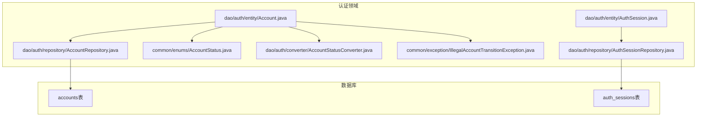
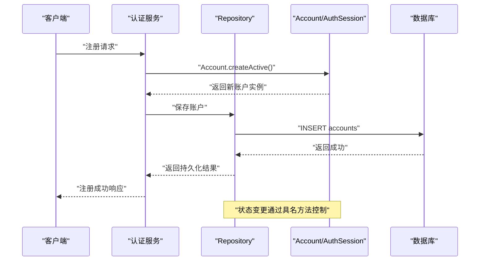
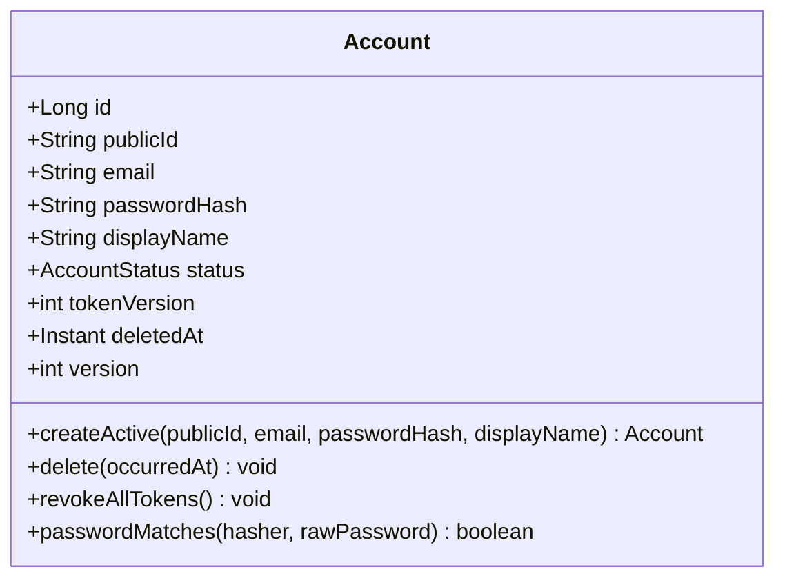
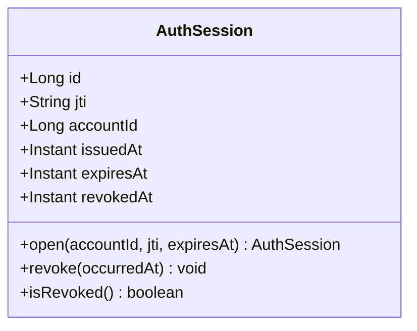
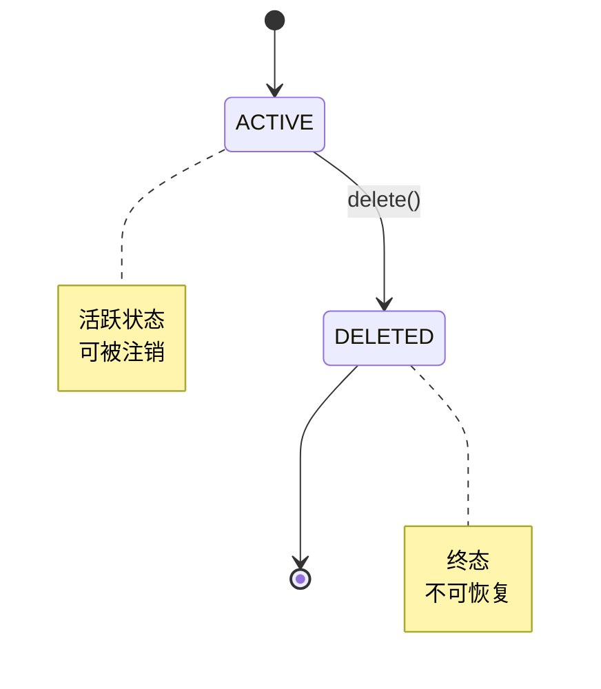
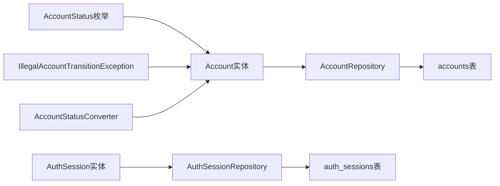

基于我对代码库的分析，我现在可以更新领域模型设计文档。原来的Todo领域模型已经被Account和AuthSession实体替换，用于wanderchain认证系统。让我创建新的文档：

# 领域模型设计

<cite>
**本文引用的文件**   
- [Account.java](file://backend/src/main/java/com/luyi/myfirst/dao/auth/entity/Account.java)
- [AuthSession.java](file://backend/src/main/java/com/luyi/myfirst/dao/auth/entity/AuthSession.java)
- [AccountStatus.java](file://backend/src/main/java/com/luyi/myfirst/common/enums/AccountStatus.java)
- [AccountRepository.java](file://backend/src/main/java/com/luyi/myfirst/dao/auth/repository/AccountRepository.java)
- [AuthSessionRepository.java](file://backend/src/main/java/com/luyi/myfirst/dao/auth/repository/AuthSessionRepository.java)
- [AccountStatusConverter.java](file://backend/src/main/java/com/luyi/myfirst/dao/auth/converter/AccountStatusConverter.java)
- [IllegalAccountTransitionException.java](file://backend/src/main/java/com/luyi/myfirst/common/exception/IllegalAccountTransitionException.java)
</cite>

## 更新摘要
**所做更改**   
- 将原有的Todo领域模型替换为Account和AuthSession实体
- 新增账户状态机设计和会话管理机制
- 添加JPA持久化支持和数据库约束
- 实现令牌版本控制和吊销机制

## 目录
1. [引言](#引言)
2. [项目结构](#项目结构)
3. [核心组件](#核心组件)
4. [架构总览](#架构总览)
5. [详细组件分析](#详细组件分析)
6. [依赖关系分析](#依赖关系分析)
7. [性能与并发特性](#性能与并发特性)
8. [故障排查指南](#故障排查指南)
9. [结论](#结论)
10. [附录：扩展建议与最佳实践](#附录扩展建议与最佳实践)

## 引言
本文聚焦 wanderchain 认证系统的领域模型设计与实现，重点解释 Account 和 AuthSession 实体的设计理念、状态机约束以及会话管理机制。文档围绕以下目标展开：
- 说明 Account 实体的字段语义：publicId（对外标识符）、email（邮箱）、displayName（显示名称）、status（账户状态）等。
- 解释 AuthSession 实体的作用：管理JWT会话的签发、过期和吊销。
- 阐述账户状态机的设计模式，通过具名方法表达状态变更而非直接修改字段。
- 结合Repository层的数据访问，展示完整的认证数据流和调用链。
- 给出面向未来的扩展建议和最佳实践，帮助在保持业务不变性的同时演进领域模型。

## 项目结构
当前后端代码位于 backend 模块中，认证相关的领域模型位于 dao.auth.entity 包下；枚举定义在 common.enums 包下；Repository接口位于 dao.auth.repository 包下。

**图表来源**
- [Account.java:27-61](file://backend/src/main/java/com/luyi/myfirst/dao/auth/entity/Account.java#L27-L61)
- [AuthSession.java:19-42](file://backend/src/main/java/com/luyi/myfirst/dao/auth/entity/AuthSession.java#L19-L42)
- [AccountStatus.java:10-35](file://backend/src/main/java/com/luyi/myfirst/common/enums/AccountStatus.java#L10-L35)

**章节来源**
- [Account.java:1-161](file://backend/src/main/java/com/luyi/myfirst/dao/auth/entity/Account.java#L1-L161)
- [AuthSession.java:1-95](file://backend/src/main/java/com/luyi/myfirst/dao/auth/entity/AuthSession.java#L1-L95)
- [AccountStatus.java:1-36](file://backend/src/main/java/com/luyi/myfirst/common/enums/AccountStatus.java#L1-L36)

## 核心组件
- **Account**：JPA实体类，表示用户账户，包含身份标识、邮箱、密码哈希、显示名称、状态等信息，提供受控的状态变更方法。
- **AuthSession**：JPA实体类，表示认证会话，记录JWT令牌的jti、账户关联、签发时间、过期时间和吊销状态。
- **AccountStatus**：枚举类型，定义账户的三种状态：ACTIVE（活跃）、EMAIL_UNVERIFIED（邮箱未验证）、DELETED（已删除）。
- **Repository层**：提供账户和会话的数据库访问接口，支持按publicId和邮箱查询账户，按jti查询会话。

关键职责划分：
- Account专注账户领域语义与状态机约束。
- AuthSession专注会话生命周期管理。
- Repository负责数据持久化操作。
- Converter处理枚举与数据库值的映射。

**章节来源**
- [Account.java:27-86](file://backend/src/main/java/com/luyi/myfirst/dao/auth/entity/Account.java#L27-L86)
- [AuthSession.java:19-60](file://backend/src/main/java/com/luyi/myfirst/dao/auth/entity/AuthSession.java#L19-L60)
- [AccountStatus.java:10-35](file://backend/src/main/java/com/luyi/myfirst/common/enums/AccountStatus.java#L10-L35)

## 架构总览
认证领域模型采用"JPA实体 + 状态机 + Repository"的分层架构。账户状态变更通过具名方法进行，确保状态转换的可测试性和一致性。会话管理采用轻量级设计，仅存储必要的元数据，实际令牌内容不落库。

**图表来源**
- [Account.java:74-86](file://backend/src/main/java/com/luyi/myfirst/dao/auth/entity/Account.java#L74-L86)
- [AccountRepository.java:9-21](file://backend/src/main/java/com/luyi/myfirst/dao/auth/repository/AccountRepository.java#L9-L21)

## 详细组件分析

### Account 账户实体
Account是一个JPA实体类，具备以下特点：
- **持久化支持**：使用@Entity注解，支持JPA框架进行数据库操作。
- **受控状态变更**：通过delete()等具名方法控制状态转换，禁止直接设置状态字段。
- **安全设计**：密码哈希不对外暴露，只提供校验方法passwordMatches()。
- **令牌版本控制**：tokenVersion字段用于批量吊销令牌，无需逐条处理。

字段语义：
- id：数据库主键，自增长ID。
- publicId：对外标识符，使用ULID格式，同一邮箱重新注册会获得新值。
- email：用户邮箱，唯一且不可变。
- passwordHash：加密后的密码哈希，不对外暴露。
- displayName：用户显示名称。
- status：账户状态，受状态机约束。
- tokenVersion：令牌版本号，用于批量吊销。
- deletedAt：注销时间戳，软删除标记。
- version：乐观锁版本号，防止并发更新冲突。

**图表来源**
- [Account.java:27-161](file://backend/src/main/java/com/luyi/myfirst/dao/auth/entity/Account.java#L27-L161)

**章节来源**
- [Account.java:1-161](file://backend/src/main/java/com/luyi/myfirst/dao/auth/entity/Account.java#L1-L161)

### AuthSession 会话实体
AuthSession是轻量级的会话管理实体，具有以下特征：
- **最小化存储**：仅存储JWT的jti（唯一标识符），不存储令牌内容。
- **时间戳管理**：记录签发时间、过期时间和吊销时间。
- **软吊销机制**：通过revokedAt字段标记吊销，不删除记录以便审计。

字段语义：
- id：数据库主键，自增长ID。
- jti：JWT的唯一标识符，36字符UUID文本。
- accountId：关联的账户ID。
- issuedAt：令牌签发时间，由数据库默认值填充。
- expiresAt：令牌过期时间，从JWT载荷中提取。
- revokedAt：吊销时间戳，NULL表示有效。

**图表来源**
- [AuthSession.java:19-95](file://backend/src/main/java/com/luyi/myfirst/dao/auth/entity/AuthSession.java#L19-L95)

**章节来源**
- [AuthSession.java:1-95](file://backend/src/main/java/com/luyi/myfirst/dao/auth/entity/AuthSession.java#L1-L95)

### 账户状态机设计
AccountStatus定义了严格的三态状态机：
- **ACTIVE**：活跃状态，正常使用的账户。
- **EMAIL_UNVERIFIED**：邮箱未验证状态，保留给未来功能使用。
- **DELETED**：已删除状态，账户的终态。

状态迁移规则：
- 只允许从ACTIVE迁移到DELETED。
- DELETED是终态，不允许再次迁移。
- EMAIL_UNVERIFIED在当前实现中没有出口。

**图表来源**
- [AccountStatus.java:10-35](file://backend/src/main/java/com/luyi/myfirst/common/enums/AccountStatus.java#L10-L35)
- [Account.java:94-101](file://backend/src/main/java/com/luyi/myfirst/dao/auth/entity/Account.java#L94-L101)

**章节来源**
- [AccountStatus.java:1-36](file://backend/src/main/java/com/luyi/myfirst/common/enums/AccountStatus.java#L1-L36)
- [Account.java:88-101](file://backend/src/main/java/com/luyi/myfirst/dao/auth/entity/Account.java#L88-L101)

### 令牌版本控制机制
Account实体实现了令牌版本控制机制，用于批量吊销所有已签发的令牌：
- **tokenVersion字段**：每次吊销时自增，旧令牌的版本号不匹配则失效。
- **revokeAllTokens()方法**：统一入口，确保版本号的原子性递增。
- **与注销操作的集成**：注销账户时自动调用revokeAllTokens()。

这种设计的优势：
- 避免逐条吊销大量会话记录的开销。
- 保证令牌吊销的一致性和原子性。
- 支持密码重置等需要批量吊销的场景。

**章节来源**
- [Account.java:103-111](file://backend/src/main/java/com/luyi/myfirst/dao/auth/entity/Account.java#L103-L111)

## 依赖关系分析
- Account依赖AccountStatus枚举，通过状态机约束状态变更。
- Account依赖IllegalAccountTransitionException，用于抛出非法状态迁移异常。
- Account依赖AccountStatusConverter，处理枚举与数据库字符串的映射。
- Repository层依赖Spring Data JPA，提供标准化的CRUD操作。
- 数据库层通过CHECK约束和生成列保证数据完整性。

**图表来源**
- [Account.java:3-6](file://backend/src/main/java/com/luyi/myfirst/dao/auth/entity/Account.java#L3-L6)
- [AccountRepository.java:3-4](file://backend/src/main/java/com/luyi/myfirst/dao/auth/repository/AccountRepository.java#L3-L4)
- [AuthSessionRepository.java:3-4](file://backend/src/main/java/com/luyi/myfirst/dao/auth/repository/AuthSessionRepository.java#L3-L4)

**章节来源**
- [Account.java:1-161](file://backend/src/main/java/com/luyi/myfirst/dao/auth/entity/Account.java#L1-L161)
- [AccountRepository.java:1-22](file://backend/src/main/java/com/luyi/myfirst/dao/auth/repository/AccountRepository.java#L1-L22)

## 性能与并发特性
- **时间复杂度**：
  - 账户创建：O(1)，插入accounts表。
  - 账户查询：O(log n)，基于索引的查找。
  - 会话创建：O(1)，插入auth_sessions表。
  - 会话吊销：O(1)，更新revoked_at字段。
- **空间复杂度**：
  - 账户数据随用户数量线性增长。
  - 会话数据随活跃会话数增长，但可通过过期清理优化。
- **并发特性**：
  - 使用@Version乐观锁防止并发更新冲突。
  - 数据库层面的CHECK约束保证状态合法性。
  - 令牌版本控制避免竞态条件导致的令牌泄露。

**章节来源**
- [Account.java:58-61](file://backend/src/main/java/com/luyi/myfirst/dao/auth/entity/Account.java#L58-L61)
- [AccountRepository.java:13-20](file://backend/src/main/java/com/luyi/myfirst/dao/auth/repository/AccountRepository.java#L13-L20)

## 故障排查指南
常见问题与定位要点：
- **状态迁移异常**：尝试非法状态转换时会抛出IllegalAccountTransitionException，检查是否调用了正确的具名方法。
- **邮箱冲突**：同一邮箱只能有一个活跃账户，注销后需等待deleted_at字段设置才能重新注册。
- **令牌失效**：检查tokenVersion是否与账户当前版本匹配，或会话是否已被吊销。
- **并发更新冲突**：@Version字段冲突时，需要重试或合并更新逻辑。

建议的排查步骤：
- 检查账户状态是否符合预期的迁移路径。
- 确认邮箱唯一性约束的使用场景是否正确。
- 验证令牌版本控制的实现逻辑。
- 评估并发场景下的数据一致性保障。

**章节来源**
- [IllegalAccountTransitionException.java:1-22](file://backend/src/main/java/com/luyi/myfirst/common/exception/IllegalAccountTransitionException.java#L1-L22)
- [AccountRepository.java:13-20](file://backend/src/main/java/com/luyi/myfirst/dao/auth/repository/AccountRepository.java#L13-L20)

## 结论
wanderchain认证系统的领域模型通过JPA实体实现了健壮的账户管理和会话控制。Account实体采用状态机设计确保业务不变性，AuthSession实体提供轻量级的会话跟踪。Repository层简化了数据访问逻辑，配合数据库约束保证了数据的完整性和一致性。整体设计具有良好的可扩展性和可维护性，为认证功能的演进奠定了坚实基础。

## 附录：扩展建议与最佳实践
- **扩展账户属性**：
  - 增加头像URL、个人简介、注册时间等业务字段。
  - 保持状态机约束，新增状态时需同步更新迁移逻辑。
- **增强会话管理**：
  - 添加设备信息、IP地址等会话元数据。
  - 实现会话超时自动清理机制。
- **改进错误处理**：
  - 统一异常处理策略，提供友好的错误消息。
  - 添加详细的日志记录便于问题追踪。
- **优化性能**：
  - 考虑缓存热点账户数据减少数据库压力。
  - 实现会话的异步清理和归档机制。
- **安全性增强**：
  - 实施更严格的密码策略和强度检查。
  - 添加登录失败次数限制和账户锁定机制。
- **可观测性提升**：
  - 添加关键业务指标监控。
  - 实现审计日志记录敏感操作。

**章节来源**
- [Account.java:1-161](file://backend/src/main/java/com/luyi/myfirst/dao/auth/entity/Account.java#L1-L161)
- [AuthSession.java:1-95](file://backend/src/main/java/com/luyi/myfirst/dao/auth/entity/AuthSession.java#L1-L95)