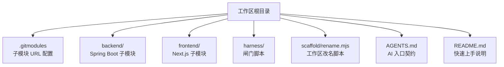
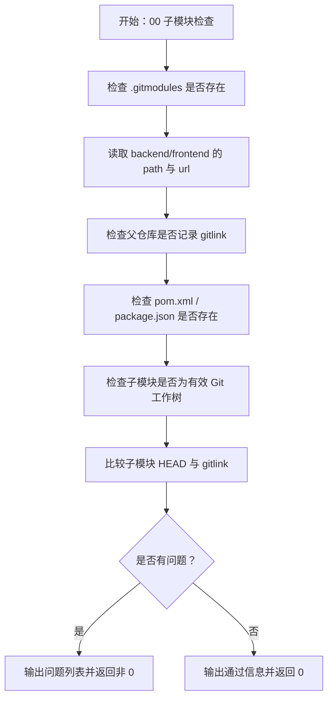
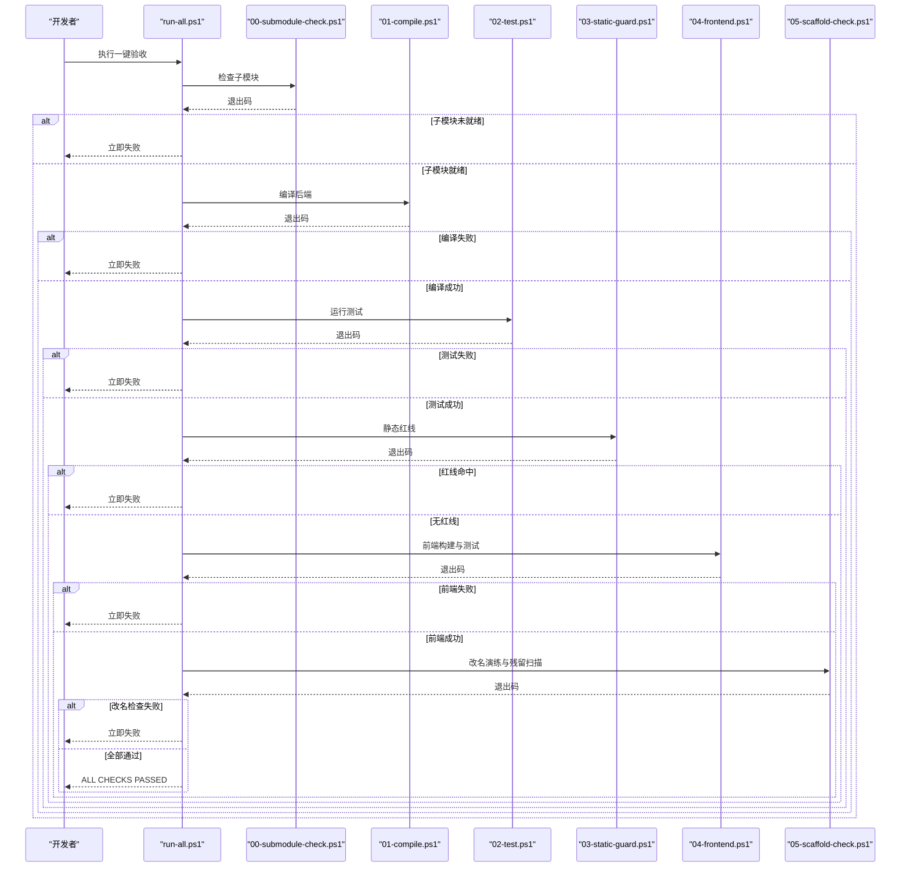
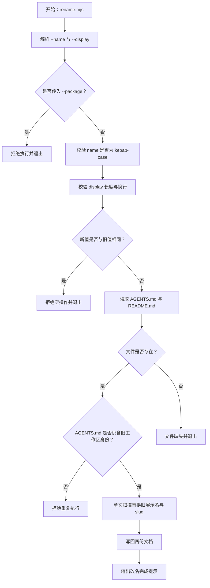
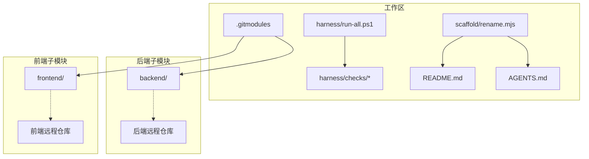
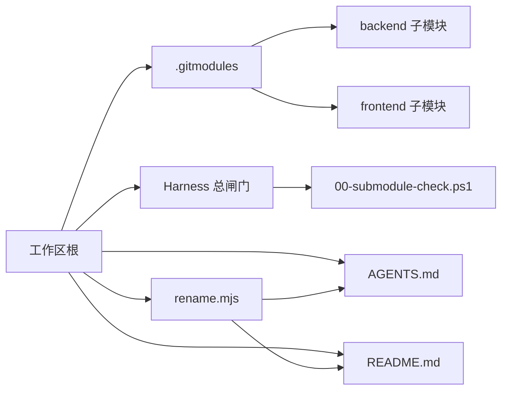

# 子模块管理

<cite>
**本文引用的文件**   
- [.gitmodules](file://.gitmodules)
- [README.md](file://README.md)
- [AGENTS.md](file://AGENTS.md)
- [scaffold/rename.mjs](file://scaffold/rename.mjs)
- [harness/run-all.ps1](file://harness/run-all.ps1)
- [harness/checks/00-submodule-check.ps1](file://harness/checks/00-submodule-check.ps1)
</cite>

## 目录
1. [引言](#引言)
2. [项目结构](#项目结构)
3. [核心组件](#核心组件)
4. [架构总览](#架构总览)
5. [详细组件分析](#详细组件分析)
6. [依赖关系分析](#依赖关系分析)
7. [性能与可重复性](#性能与可重复性)
8. [故障排除指南](#故障排除指南)
9. [结论](#结论)
10. [附录：常用命令速查](#附录常用命令速查)

## 引言
本仓库是一个“顶层工作区”，自身沉淀规格、护栏与技能；前后端应用则作为两个独立 Git 仓库，以 **Git 子模块** 挂载在 `backend/` 与 `frontend/`。这样做的核心目标是让前后端具备独立的提交历史、构建身份和发布节奏，同时由工作区通过 gitlink 锁定具体版本，保证克隆即可复现。

选择子模块而非普通目录的原因包括：
- 独立提交：后端与前端各自维护分支、标签与变更历史。
- 独立发布：后端 Maven 工件与前端制品可以分别构建、打包和部署。
- 版本锁定：工作区只记录子模块的提交哈希，避免“代码存在但版本漂移”的问题。
- 边界清晰：工作区不直接跟踪子模块内部文件，只负责编排与验收。

代价是克隆后必须先初始化子模块，因此 Harness 的第一个闸门就是子模块检查。

**章节来源**
- [README.md:1-10](file://README.md#L1-L10)
- [README.md:94-100](file://README.md#L94-L100)
- [AGENTS.md:7-14](file://AGENTS.md#L7-L14)
- [AGENTS.md:26-35](file://AGENTS.md#L26-L35)

## 项目结构
从子模块视角看，工作区的关键结构如下：
- `.gitmodules`：声明 `backend` 与 `frontend` 两个子模块的路径与远程地址。
- `backend/`：Spring Boot 后端，Maven 项目根。
- `frontend/`：Next.js 前端，npm 项目根。
- `harness/`：六道闸门脚本，按文件名顺序执行，任一失败即阻断。
- `scaffold/rename.mjs`：工作区改名工具，只改工作区文档，不进入子模块。
- `AGENTS.md` 与 `README.md`：AI 入口契约与快速上手说明，也是改名工具的替换目标。

**图表来源**
- [.gitmodules:1-7](file://.gitmodules#L1-L7)
- [README.md:70-81](file://README.md#L70-L81)
- [AGENTS.md:72-119](file://AGENTS.md#L72-L119)

**章节来源**
- [.gitmodules:1-7](file://.gitmodules#L1-L7)
- [README.md:70-81](file://README.md#L70-L81)
- [AGENTS.md:72-119](file://AGENTS.md#L72-L119)

## 核心组件
本节聚焦与子模块管理直接相关的核心组件。

### 子模块声明：`.gitmodules`
`.gitmodules` 是工作区对子模块的“注册表”。当前仓库声明了两个子模块：
- `backend`：路径为 `backend`，远程地址指向后端仓库。
- `frontend`：路径为 `frontend`，远程地址指向前端仓库。

它的作用不是保存代码，而是告诉 Git：“当克隆或初始化这个工作区时，还需要把这两个远程仓库拉下来，并放到指定目录。”

**章节来源**
- [.gitmodules:1-7](file://.gitmodules#L1-L7)

### 子模块就绪检查：`harness/checks/00-submodule-check.ps1`
这是整个 Harness 链路的第一个闸门，职责非常明确：**只读检查**，不联网、不自动修复、不提问。它主要验证：
- `.gitmodules` 是否存在。
- `backend` 与 `frontend` 是否配置了 `path` 与 `url`。
- 父仓库是否记录了这两个目录的 gitlink（mode 为 `160000`）。
- 子模块目录中是否存在关键标记文件（后端 `pom.xml`、前端 `package.json`）。
- 子模块是否为有效的 Git 工作树。
- 子模块当前 HEAD 是否与父仓库记录的 gitlink 一致。

如果任一检查失败，脚本会输出问题列表，并提示修复命令：`git submodule update --init --recursive`。

**图表来源**
- [harness/checks/00-submodule-check.ps1:1-94](file://harness/checks/00-submodule-check.ps1#L1-L94)

**章节来源**
- [harness/checks/00-submodule-check.ps1:1-94](file://harness/checks/00-submodule-check.ps1#L1-L94)

### 总闸门：`harness/run-all.ps1`
总闸门按 `harness/checks/` 下脚本的文件名排序依次执行，默认遇错即停。执行顺序体现设计意图：
1. 先确认子模块就绪。
2. 再编译后端。
3. 再运行后端测试与容器装配。
4. 再扫描静态红线。
5. 再处理前端安装、构建与测试。
6. 最后做工作区改名演练与残留扫描。

这种顺序保证了“环境未就绪就不编译、代码未编译就不测试、测试未通过就不继续”。

**图表来源**
- [harness/run-all.ps1:1-90](file://harness/run-all.ps1#L1-L90)
- [harness/checks/00-submodule-check.ps1:1-94](file://harness/checks/00-submodule-check.ps1#L1-L94)

**章节来源**
- [harness/run-all.ps1:1-90](file://harness/run-all.ps1#L1-L90)

### 工作区改名工具：`scaffold/rename.mjs`
`scaffold/rename.mjs` 的工作原则是：**只改工作区自身的展示名与 slug，不进入子模块，不改 `.gitmodules`，也不改应用身份**。

它的核心规则包括：
- 必须提供 `--name` 与 `--display`。
- `--name` 必须是 kebab-case。
- `--display` 去空白后长度在 1 到 60 之间，且不能包含换行。
- 显式拒绝 `--package`，因为 Java 包名、Maven artifactId、前端包名属于子模块的应用身份，应在各自仓库内改名。
- 如果新值与旧值相同，直接拒绝，防止“看似成功却什么都没改”。
- 二次执行防护：如果 `AGENTS.md` 中已经找不到旧工作区身份，说明可能已经改名过，脚本拒绝再次执行。
- 替换范围仅限 `AGENTS.md` 与 `README.md`。
- 使用单次扫描替换，避免新值中包含旧 token 导致级联替换。

**图表来源**
- [scaffold/rename.mjs:1-122](file://scaffold/rename.mjs#L1-L122)

**章节来源**
- [scaffold/rename.mjs:1-122](file://scaffold/rename.mjs#L1-L122)

## 架构总览
从系统层面看，工作区、子模块与 Harness 的关系如下：

- 工作区通过 `.gitmodules` 声明子模块。
- Harness 通过脚本顺序保障环境与质量。
- 改名脚本只影响工作区文档，不影响子模块。
- 子模块本身仍是完整 Git 仓库，拥有自己的远程地址、提交历史和构建产物。

**图表来源**
- [.gitmodules:1-7](file://.gitmodules#L1-L7)
- [harness/run-all.ps1:1-90](file://harness/run-all.ps1#L1-L90)
- [scaffold/rename.mjs:1-122](file://scaffold/rename.mjs#L1-L122)

## 详细组件分析

### 为什么用子模块而不是普通目录
- 独立提交：后端与前端各自有独立的分支、标签和变更记录。
- 独立发布：后端可以单独打 Maven 包，前端可以单独构建 Next.js 产物。
- 版本锁定：工作区只记录子模块的提交哈希，避免“本地改了但没提交”或“别人换了版本你没更新”的隐性问题。
- 解耦设计：工作区关注编排、规格与验收；子模块关注实现、构建与发布。

这些设计在仓库文档中有明确说明：前后端不属于工作区的三层（工件层、能力层、行为层），而是被编排的两个独立仓库。

**章节来源**
- [README.md:94-100](file://README.md#L94-L100)
- [AGENTS.md:7-14](file://AGENTS.md#L7-L14)
- [AGENTS.md:26-35](file://AGENTS.md#L26-L35)

### 子模块初始化、更新与切换版本
#### 初始化
新克隆工作区时，应连同子模块一起拉取：
- `git clone --recurse-submodules <工作区仓库地址>`

如果已经克隆但子模块为空，应执行：
- `git submodule update --init --recursive`

#### 查看状态
- `git submodule status`：行首为 `-` 表示子模块未初始化。

#### 切换版本
子模块的版本由工作区的 gitlink 决定。若需要切换到某个子模块的特定提交：
1. 进入子模块目录。
2. 切换到目标提交或分支。
3. 回到工作区根目录。
4. 提交新的 gitlink。

注意：子模块的改动必须在对应子模块仓库内先提交并推送，再回到工作区提交新的 gitlink。工作区提交只包含自有文件、`.gitmodules` 与两个 gitlink。

#### 替换子模块地址
如果需要更换子模块远程地址：
- `git submodule set-url backend <新地址>`
- `git submodule set-url frontend <新地址>`
- `git submodule sync`

**章节来源**
- [README.md:21-28](file://README.md#L21-L28)
- [AGENTS.md:35-42](file://AGENTS.md#L35-L42)
- [AGENTS.md:125-128](file://AGENTS.md#L125-L128)

### 工作区改名与工作区身份解耦
工作区改名工具的设计重点是“身份解耦”：
- 工作区身份：展示名与 slug，保存在 `AGENTS.md` 与 `README.md`。
- 应用身份：Java 包名、Maven artifactId、前端包名，保存在后端与前端仓库中。

改名脚本不会进入 `backend/` 或 `frontend/`，也不会修改 `.gitmodules`。这样做的好处是：
- 分发模板后，使用者只需运行改名脚本即可获得属于自己的工作区标识。
- 应用本身的构建身份不受工作区改名影响。
- 团队可以在不同业务线复用同一套工作区骨架，同时保持各自应用的包名与制品名独立。

**章节来源**
- [scaffold/rename.mjs:1-17](file://scaffold/rename.mjs#L1-L17)
- [scaffold/rename.mjs:45-51](file://scaffold/rename.mjs#L45-L51)
- [scaffold/rename.mjs:95-122](file://scaffold/rename.mjs#L95-L122)
- [README.md:44-59](file://README.md#L44-L59)
- [AGENTS.md:154-161](file://AGENTS.md#L154-L161)

### 子模块冲突解决策略
虽然本仓库没有内置复杂的冲突合并逻辑，但可以从现有机制推导最佳实践：

1. **优先以工作区 gitlink 为准**  
   如果 `git submodule status` 显示子模块 HEAD 与父仓库不一致，通常应以工作区记录的提交为准。

2. **先恢复再同步**  
   如果本地子模块有未提交的改动，建议先暂存或丢弃本地改动，再执行 `git submodule update --init --recursive`。

3. **明确谁负责哪个版本**  
   - 子模块内部代码变更：在子模块仓库内提交。
   - 工作区引用哪个子模块版本：在工作区提交新的 gitlink。
   - 子模块远程地址变更：修改 `.gitmodules` 并同步。

4. **用 Harness 辅助判断**  
   如果 00 闸门失败，说明子模块未初始化或版本不一致，应先修复子模块，再继续后续检查。

**章节来源**
- [harness/checks/00-submodule-check.ps1:43-79](file://harness/checks/00-submodule-check.ps1#L43-L79)
- [AGENTS.md:35-35](file://AGENTS.md#L35-L35)

### 版本同步策略
推荐采用“稳定基线 + 按需升级”的策略：
- 工作区锁定一个稳定的后端与前端提交版本。
- 当需要引入新功能或修复问题时，先在子模块仓库内开发并提交。
- 在工作区中将 gitlink 升级到新的子模块提交。
- 通过 `powershell -File harness\run-all.ps1` 验证整体链路。
- 如果团队协作，建议在 PR 或合并前确保所有成员能执行完整的 Harness。

**章节来源**
- [README.md:94-100](file://README.md#L94-L100)
- [AGENTS.md:35-35](file://AGENTS.md#L35-L35)
- [harness/run-all.ps1:1-16](file://harness/run-all.ps1#L1-L16)

### 团队协作最佳实践
- 新成员克隆后先执行子模块初始化。
- 任何涉及前后端的改动，先在对应子模块仓库内提交。
- 回到工作区后，提交新的 gitlink。
- 提交前运行一键验收。
- 不要手动编辑 `.gitmodules` 后忘记同步。
- 不要在工作区里直接修改子模块内部代码而不走子模块仓库流程。
- 改名只通过 `scaffold/rename.mjs` 进行，不要手工批量替换工作区标识。

**章节来源**
- [AGENTS.md:35-42](file://AGENTS.md#L35-L42)
- [AGENTS.md:125-135](file://AGENTS.md#L125-L135)
- [README.md:44-59](file://README.md#L44-L59)

## 依赖关系分析
从依赖角度看，工作区对子模块是“引用关系”，而不是“包含关系”：

- `.gitmodules` 依赖后端与前端的远程仓库。
- Harness 依赖子模块已就绪。
- 改名脚本依赖 `AGENTS.md` 与 `README.md`。
- 子模块本身不反向依赖工作区，它们仍然是独立仓库。

**图表来源**
- [.gitmodules:1-7](file://.gitmodules#L1-L7)
- [harness/run-all.ps1:1-90](file://harness/run-all.ps1#L1-L90)
- [harness/checks/00-submodule-check.ps1:1-94](file://harness/checks/00-submodule-check.ps1#L1-L94)
- [scaffold/rename.mjs:1-122](file://scaffold/rename.mjs#L1-L122)

**章节来源**
- [.gitmodules:1-7](file://.gitmodules#L1-L7)
- [harness/run-all.ps1:1-90](file://harness/run-all.ps1#L1-L90)
- [scaffold/rename.mjs:1-122](file://scaffold/rename.mjs#L1-L122)

## 性能与可重复性
- 子模块带来的主要成本是新克隆时需要初始化子模块，因此 00 闸门放在最前面。
- 00 闸门本身不联网、不自动初始化，只是检查当前状态，这有利于 CI 环境稳定。
- 前端与后端各自有依赖锁定文件（例如 npm 的 `package-lock.json`），配合子模块版本锁定，有助于提升构建可重复性。
- 如果网络较慢，可考虑使用镜像源，但应保持依赖版本锁定不变。

**章节来源**
- [README.md:83-92](file://README.md#L83-L92)
- [README.md:96-96](file://README.md#L96-L96)
- [harness/checks/00-submodule-check.ps1:1-8](file://harness/checks/00-submodule-check.ps1#L1-L8)

## 故障排除指南

### 子模块未初始化
**现象**  
00 闸门失败，提示子模块未初始化或工作树为空。

**原因**  
克隆时没有使用 `--recurse-submodules`，或者已有克隆但未执行子模块初始化。

**处理**  
- 执行 `git submodule update --init --recursive`。
- 重新运行 `powershell -File harness\run-all.ps1`。

**章节来源**
- [harness/checks/00-submodule-check.ps1:82-90](file://harness/checks/00-submodule-check.ps1#L82-L90)
- [README.md:21-28](file://README.md#L21-L28)

### 子模块 HEAD 与 gitlink 不一致
**现象**  
00 闸门报告子模块检出提交与父仓库 gitlink 不一致。

**原因**  
子模块被切换到其他提交，但工作区没有提交新的 gitlink。

**处理**  
- 如果希望使用工作区锁定的版本：执行 `git submodule update --init --recursive`。
- 如果希望升级版本：在子模块中切换到目标提交，回到工作区提交新的 gitlink。

**章节来源**
- [harness/checks/00-submodule-check.ps1:69-79](file://harness/checks/00-submodule-check.ps1#L69-L79)
- [AGENTS.md:35-35](file://AGENTS.md#L35-L35)

### 无法访问子模块远程仓库
**现象**  
初始化子模块时网络失败或凭据错误。

**原因**  
首次初始化子模块需要访问远程仓库，网络不可达或认证失败。

**处理**  
- 检查网络连通性。
- 检查 Git 凭据配置。
- 如果是私有仓库，确认当前用户有访问权限。
- 如需更换地址，使用 `git submodule set-url` 并 `git submodule sync`。

**章节来源**
- [AGENTS.md:154-161](file://AGENTS.md#L154-L161)
- [AGENTS.md:127-128](file://AGENTS.md#L127-L128)

### 改名脚本拒绝执行
**现象**  
运行 `node scaffold/rename.mjs` 时报错，提示参数非法、空操作或重复执行。

**原因**  
- 缺少 `--name` 或 `--display`。
- `--name` 不符合 kebab-case。
- `--display` 长度或格式不合法。
- 新值与旧值相同。
- `AGENTS.md` 中找不到旧工作区身份。
- 传入了不允许的 `--package`。

**处理**  
- 按照提示修正参数。
- 如果确实已经改名过，不要重复执行。
- 应用身份改名请在 `backend` 或 `frontend` 仓库内进行。

**章节来源**
- [scaffold/rename.mjs:45-82](file://scaffold/rename.mjs#L45-L82)
- [scaffold/rename.mjs:95-100](file://scaffold/rename.mjs#L95-L100)
- [README.md:44-59](file://README.md#L44-L59)

### 改名后 Harness 仍然失败
**现象**  
改名完成后运行一键验收仍有失败项。

**原因**  
- 改名不完整。
- 工作区中存在旧身份残留。
- 子模块或应用身份也被误改。
- 改名后没有重新运行验收。

**处理**  
- 确认只修改了 `AGENTS.md` 与 `README.md`。
- 确认没有修改 `.gitmodules`。
- 确认没有修改子模块内部应用身份。
- 重新运行 `powershell -File harness\run-all.ps1`。

**章节来源**
- [scaffold/rename.mjs:102-122](file://scaffold/rename.mjs#L102-L122)
- [README.md:56-59](file://README.md#L56-L59)

## 结论
本仓库通过 Git 子模块将前后端应用与工作区解耦：工作区负责规格、护栏与技能，前后端各自保留独立仓库、独立构建身份与独立发布节奏。`.gitmodules` 声明子模块地址，Harness 的第一个闸门确保子模块就绪，改名脚本确保工作区身份与应用身份分离。

对于团队而言，最重要的实践是：
- 始终通过子模块仓库管理前后端代码。
- 通过工作区 gitlink 锁定子模块版本。
- 通过 Harness 统一验收。
- 通过改名脚本安全地分发和重命名工作区。
- 遇到子模块问题时，优先检查初始化状态、HEAD 一致性以及远程仓库可达性。

**章节来源**
- [README.md:1-10](file://README.md#L1-L10)
- [README.md:94-100](file://README.md#L94-L100)
- [AGENTS.md:7-14](file://AGENTS.md#L7-L14)
- [AGENTS.md:35-42](file://AGENTS.md#L35-L42)
- [harness/run-all.ps1:1-16](file://harness/run-all.ps1#L1-L16)

## 附录：常用命令速查

| 目的 | 命令 |
|---|---|
| 初始化子模块 | `git submodule update --init --recursive` |
| 新克隆并带子模块 | `git clone --recurse-submodules <工作区仓库地址>` |
| 查看子模块状态 | `git submodule status` |
| 替换子模块地址 | `git submodule set-url backend <新地址>` 与 `git submodule set-url frontend <新地址>`，然后 `git submodule sync` |
| 一键验收 | `powershell -File harness\run-all.ps1` |
| 只检查子模块 | `powershell -File harness\checks\00-submodule-check.ps1` |
| 工作区改名 | `node scaffold/rename.mjs --name <新 slug> --display "<新展示名>"` |
| 启动后端服务 | `mvn -f backend/pom.xml spring-boot:run` |
| 前端开发 | `cd frontend; npm run dev` |
| 前端构建 | `cd frontend; npm run build` |
| 前端测试 | `cd frontend; npm run test` |

**章节来源**
- [AGENTS.md:121-143](file://AGENTS.md#L121-L143)
- [README.md:21-38](file://README.md#L21-L38)
- [README.md:44-59](file://README.md#L44-L59)