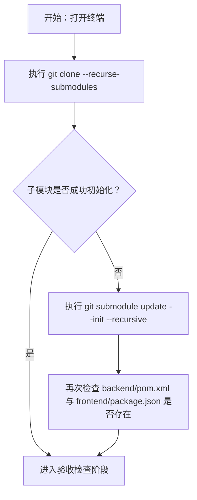
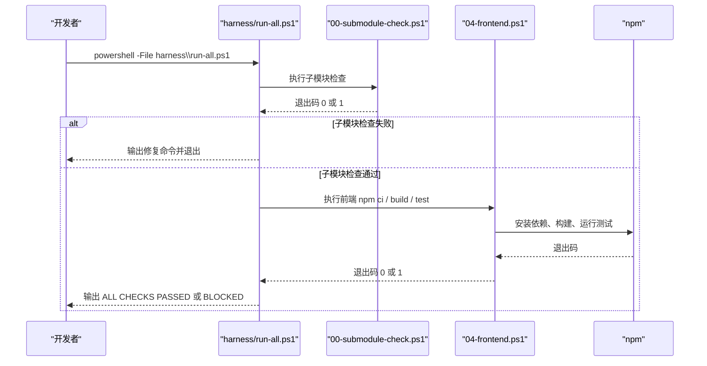
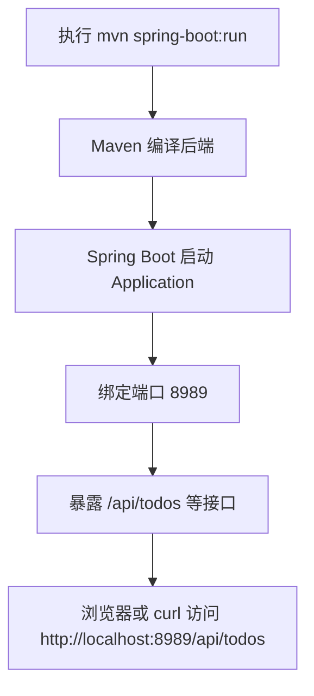
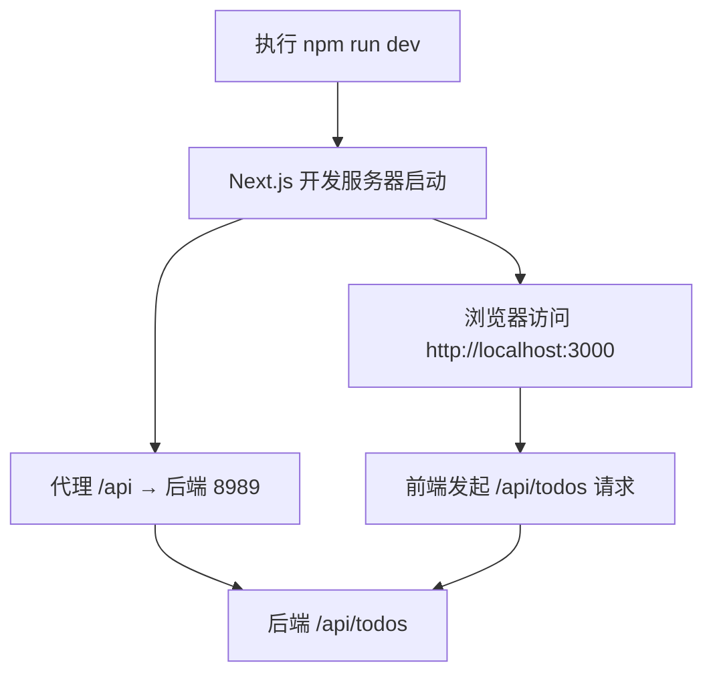
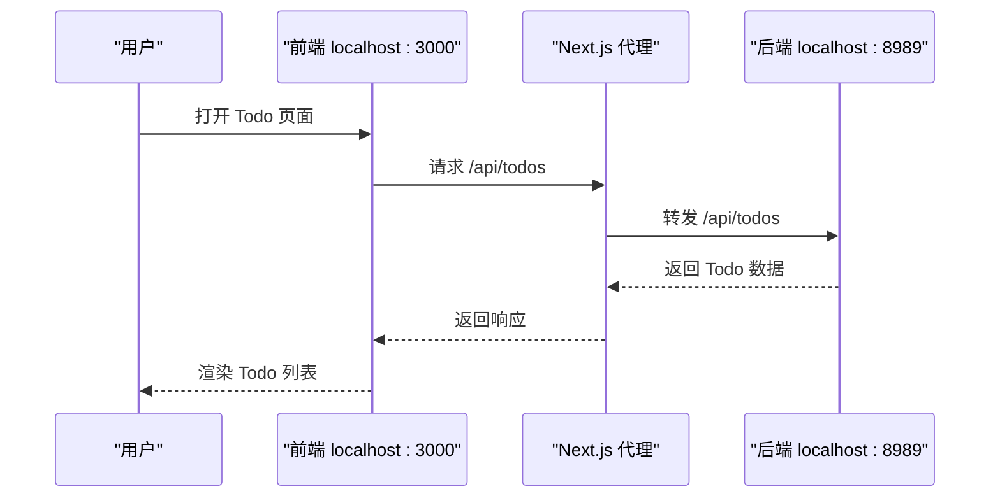
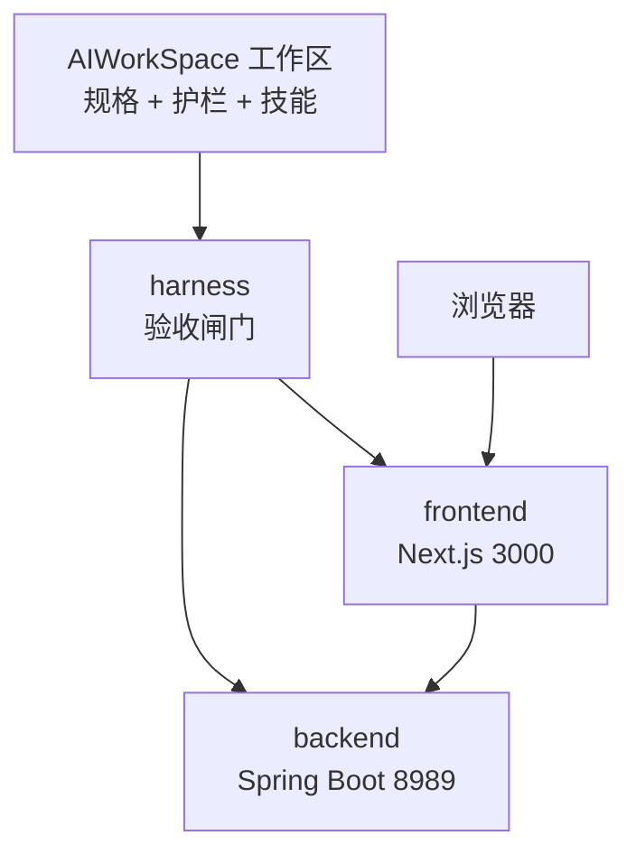

# 快速开始

<cite>
**本文引用的文件**   
- [README.md](file://README.md)
- [.gitmodules](file://.gitmodules)
- [harness/run-all.ps1](file://harness/run-all.ps1)
- [harness/checks/00-submodule-check.ps1](file://harness/checks/00-submodule-check.ps1)
- [harness/checks/04-frontend.ps1](file://harness/checks/04-frontend.ps1)
- [backend/pom.xml](file://backend/pom.xml)
- [backend/src/main/resources/application.yml](file://backend/src/main/resources/application.yml)
- [backend/src/main/java/com/luyi/myfirst/Application.java](file://backend/src/main/java/com/luyi/myfirst/Application.java)
- [frontend/package.json](file://frontend/package.json)
- [frontend/next.config.ts](file://frontend/next.config.ts)
</cite>

## 目录
1. [简介](#简介)
2. [环境准备](#环境准备)
3. [克隆与子模块初始化](#克隆与子模块初始化)
4. [验收检查](#验收检查)
5. [启动后端服务](#启动后端服务)
6. [启动前端开发服务器](#启动前端开发服务器)
7. [验证 Todo 功能](#验证-todo-功能)
8. [常见问题与解决方案](#常见问题与解决方案)
9. [架构总览](#架构总览)
10. [结论](#结论)

## 简介
AIWorkSpace 是一个以规格、护栏和技能为核心的顶层工作区。`backend/` 和 `frontend/` 是两个独立的 Git 子模块：后端提供 Spring Boot API，前端使用 Next.js 提供界面并代理 `/api` 请求到后端。Todo 是最小的业务载体，用于承载完整的构建、测试与运行流程。

本指南面向从零开始的开发者，目标是让你按步骤完成环境准备、子模块初始化、验收检查、后端与前端启动，并最终访问 Todo 功能。

**章节来源**
- [README.md:1-20](file://README.md#L1-L20)

## 环境准备
在开始之前，请确保本机已安装以下工具：

| 工具 | 最低版本 | 用途 |
|---|---:|---|
| JDK | 17+ | 编译和运行 Spring Boot 后端 |
| Maven | 3.9+ | 构建后端项目 |
| Node.js | 20.19+ | 安装前端依赖、启动开发服务器；Next.js 16 要求 Node ≥ 20.9.0 |
| Git | 2.x | 管理仓库与子模块 |

如果你已经安装了这些工具，可以在终端中分别执行 `java -version`、`mvn -v`、`node -v`、`git --version` 进行确认。

**章节来源**
- [README.md:83-92](file://README.md#L83-L92)
- [frontend/package.json:6-8](file://frontend/package.json#L6-L8)
- [backend/pom.xml:21-25](file://backend/pom.xml#L21-L25)

## 克隆与子模块初始化
AIWorkSpace 通过 `.gitmodules` 声明两个子模块：`backend` 和 `frontend`。首次克隆时建议直接递归拉取子模块；如果已经克隆过但子模块目录为空，则需要单独初始化。

### 推荐命令
```powershell
# 首次克隆（包含子模块）
git clone --recurse-submodules <工作区仓库地址>

# 如果已有仓库但子模块未初始化
git submodule update --init --recursive
```

### 预期行为
- 根目录出现 `backend/` 和 `frontend/` 两个子模块目录。
- `backend/pom.xml` 和 `frontend/package.json` 存在，说明子模块工作树有效。
- 后续运行验收脚本时，子模块检查会校验当前检出提交是否与父仓库记录的 gitlink 一致。



**图表来源**
- [.gitmodules:1-7](file://.gitmodules#L1-L7)
- [harness/checks/00-submodule-check.ps1:21-61](file://harness/checks/00-submodule-check.ps1#L21-L61)

**章节来源**
- [README.md:23-27](file://README.md#L23-L27)
- [.gitmodules:1-7](file://.gitmodules#L1-L7)
- [harness/checks/00-submodule-check.ps1:1-9](file://harness/checks/00-submodule-check.ps1#L1-L9)
- [harness/checks/00-submodule-check.ps1:21-79](file://harness/checks/00-submodule-check.ps1#L21-L79)

## 验收检查
在工作区根目录执行 Harness 总闸门脚本。该脚本会按顺序执行六项检查：子模块就绪、后端编译、后端测试、静态红线、前端安装构建测试、工作区改名演练。任一检查失败都会返回非零退出码。

### 执行命令
```powershell
powershell -File harness\run-all.ps1
```

### 预期输出
当所有检查通过时，控制台末尾应显示类似如下结果：

```text
===== Harness Summary =====
  [PASS] 00-submodule-check (x.x s)
  [PASS] 01-compile (x.x s)
  [PASS] 02-test (x.x s)
  [PASS] 03-static-guard (x.x s)
  [PASS] 04-frontend (x.x s)
  [PASS] 05-scaffold-check (x.x s)

RESULT: ALL CHECKS PASSED
```

如果出现失败，脚本会在对应检查后输出红色提示，并在汇总区域列出失败的检查名称、退出码和耗时。默认情况下，遇到第一个失败会立即停止后续检查；如需跑完全部检查以便一次性收集问题，可追加 `-ContinueOnError` 参数。



**图表来源**
- [harness/run-all.ps1:1-20](file://harness/run-all.ps1#L1-L20)
- [harness/run-all.ps1:36-62](file://harness/run-all.ps1#L36-L62)
- [harness/run-all.ps1:64-89](file://harness/run-all.ps1#L64-L89)
- [harness/checks/04-frontend.ps1:1-36](file://harness/checks/04-frontend.ps1#L1-L36)

**章节来源**
- [README.md:29-30](file://README.md#L29-L30)
- [harness/run-all.ps1:1-20](file://harness/run-all.ps1#L1-L20)
- [harness/run-all.ps1:36-89](file://harness/run-all.ps1#L36-L89)

## 启动后端服务
后端是一个 Spring Boot 应用，端口配置为 `8989`。启动后会暴露 `/api/todos` 等接口，供前端调用。

### 启动命令
在项目根目录执行：

```powershell
mvn -f backend/pom.xml spring-boot:run
```

### 预期输出
启动成功后，控制台会输出 Spring Boot 启动日志，并显示服务监听端口。你可以用浏览器或 curl 访问：

```text
http://localhost:8989/api/todos
```

如果端口被占用或启动失败，请检查：
- JDK 版本是否符合后端要求。
- Maven 是否能正常解析依赖。
- 本地是否有其他进程占用 `8989` 端口。
- 网络是否能访问 Maven 中央仓库。



**图表来源**
- [backend/pom.xml:27-37](file://backend/pom.xml#L27-L37)
- [backend/src/main/java/com/luyi/myfirst/Application.java:6-11](file://backend/src/main/java/com/luyi/myfirst/Application.java#L6-L11)
- [backend/src/main/resources/application.yml:1-8](file://backend/src/main/resources/application.yml#L1-L8)

**章节来源**
- [README.md:32-34](file://README.md#L32-L34)
- [backend/pom.xml:27-44](file://backend/pom.xml#L27-L44)
- [backend/src/main/java/com/luyi/myfirst/Application.java:1-13](file://backend/src/main/java/com/luyi/myfirst/Application.java#L1-L13)
- [backend/src/main/resources/application.yml:1-8](file://backend/src/main/resources/application.yml#L1-L8)

## 启动前端开发服务器
前端基于 Next.js，开发服务器默认监听 `3000` 端口，并通过同源代理将 `/api` 请求转发到后端 `8989` 端口。

### 启动命令
```powershell
cd frontend
npm ci
npm run dev
```

### 预期输出
- `npm ci` 会从 `package-lock.json` 安装精确版本的依赖。
- `npm run dev` 启动 Next.js 开发服务器，控制台会提示开发服务器地址，例如 `http://localhost:3000`。
- 打开浏览器访问 `http://localhost:3000`，即可看到 Todo 界面。



**图表来源**
- [frontend/package.json:9-13](file://frontend/package.json#L9-L13)
- [frontend/package.json:15-18](file://frontend/package.json#L15-L18)
- [backend/src/main/resources/application.yml:2-3](file://backend/src/main/resources/application.yml#L2-L3)

**章节来源**
- [README.md:36-38](file://README.md#L36-L38)
- [frontend/package.json:9-13](file://frontend/package.json#L9-L13)
- [frontend/package.json:15-18](file://frontend/package.json#L15-L18)

## 验证 Todo 功能
完成上述步骤后，Todo 功能的验收路径如下：

1. 后端已启动，`http://localhost:8989/api/todos` 可访问。
2. 前端已启动，`http://localhost:3000` 可访问。
3. 在前端页面中查看 Todo 列表、新增或切换状态等操作，观察前端是否正确调用 `/api/todos`。
4. 如果前端无法加载数据，优先检查后端是否仍在运行、端口是否为 `8989`，以及前端代理是否指向正确路径。



**图表来源**
- [backend/src/main/resources/application.yml:2-3](file://backend/src/main/resources/application.yml#L2-L3)
- [frontend/package.json:9-13](file://frontend/package.json#L9-L13)

**章节来源**
- [README.md:32-38](file://README.md#L32-L38)

## 常见问题与解决方案

### npm registry 镜像配置
如果 `npm ci` 或 `npm install` 下载依赖很慢，可以临时切换到国内镜像源。仓库文档提供了腾讯镜像示例，团队若使用私有源则以私有源为准。

常见处理方式：
- 设置全局镜像源后重新执行 `npm ci`。
- 使用 `.npmrc` 文件指定 registry。
- 注意：`package-lock.json` 会钉住依赖版本，切换镜像不会改变已锁定的包版本。

**章节来源**
- [README.md:91-92](file://README.md#L91-L92)
- [frontend/package.json:15-32](file://frontend/package.json#L15-L32)

### 子模块访问权限问题
如果克隆或初始化子模块时报权限错误，通常是因为无法访问 `.gitmodules` 中配置的远程仓库地址。

排查建议：
- 确认网络可达，且能访问 GitHub 上的后端与前端子模块仓库。
- 如果使用 SSH，检查本地 SSH Key 是否已添加到远端账户。
- 如果使用 HTTPS，检查凭据缓存或用户名密码是否正确。
- 初始化失败时，可重新执行 `git submodule update --init --recursive`。

**章节来源**
- [README.md:89-90](file://README.md#L89-L90)
- [.gitmodules:1-7](file://.gitmodules#L1-L7)
- [harness/checks/00-submodule-check.ps1:82-89](file://harness/checks/00-submodule-check.ps1#L82-L89)

### 前端构建或测试失败
如果 `harness\run-all.ps1` 的前端检查失败，通常是依赖安装、TypeScript 类型检查或组件测试出现问题。

排查建议：
- 先单独执行 `cd frontend && npm ci`，确认依赖安装成功。
- 再执行 `npm run build`，查看 TypeScript 或 Next.js 构建错误。
- 最后执行 `npm run test`，查看 Vitest 测试失败详情。
- 如果本地环境与 CI 不一致，优先统一 Node.js 版本。

**章节来源**
- [harness/checks/04-frontend.ps1:1-36](file://harness/checks/04-frontend.ps1#L1-L36)
- [frontend/package.json:9-13](file://frontend/package.json#L9-L13)

### 后端启动失败
如果后端无法启动，常见原因包括 JDK 版本不匹配、端口冲突、Maven 依赖下载失败。

排查建议：
- 确认 JDK ≥ 17。
- 确认 `8989` 端口未被占用。
- 清理 Maven 缓存后重试：`mvn clean` 后再启动。
- 检查网络是否能访问 Maven 中央仓库。

**章节来源**
- [backend/pom.xml:21-25](file://backend/pom.xml#L21-L25)
- [backend/src/main/resources/application.yml:2-3](file://backend/src/main/resources/application.yml#L2-L3)

## 架构总览
从快速开始的角度，AIWorkSpace 的运行关系可以简化为三层：

- **工作区层**：负责规格、护栏与技能，提供统一的验收入口。
- **后端层**：Spring Boot 应用，提供 `/api/todos` 等接口。
- **前端层**：Next.js 应用，提供 Todo 界面并代理 `/api` 到后端。



**图表来源**
- [README.md:1-20](file://README.md#L1-L20)
- [README.md:70-81](file://README.md#L70-L81)
- [backend/src/main/resources/application.yml:2-3](file://backend/src/main/resources/application.yml#L2-L3)
- [frontend/package.json:9-13](file://frontend/package.json#L9-L13)

## 结论
按照本指南完成环境准备、子模块初始化、验收检查、后端与前端启动后，你应该能够：
- 在 `http://localhost:8989/api/todos` 访问后端接口。
- 在 `http://localhost:3000` 访问前端 Todo 界面。
- 通过 `harness\run-all.ps1` 验证项目整体健康度。
- 根据常见问题定位并解决依赖、子模块、端口和网络相关问题。

当你熟悉基本流程后，可以继续探索 OpenSpec 规格、变更提案、归档流程，以及 AI 技能如何与工作区协作。