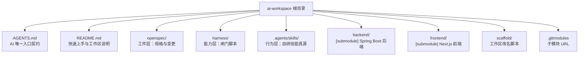
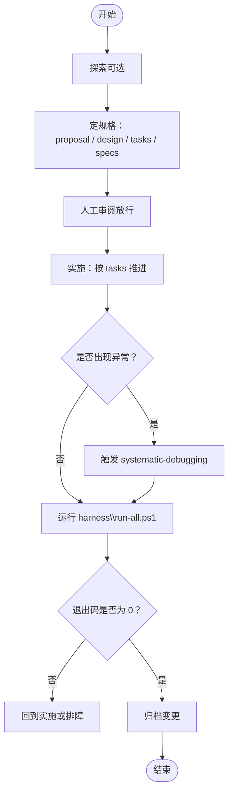
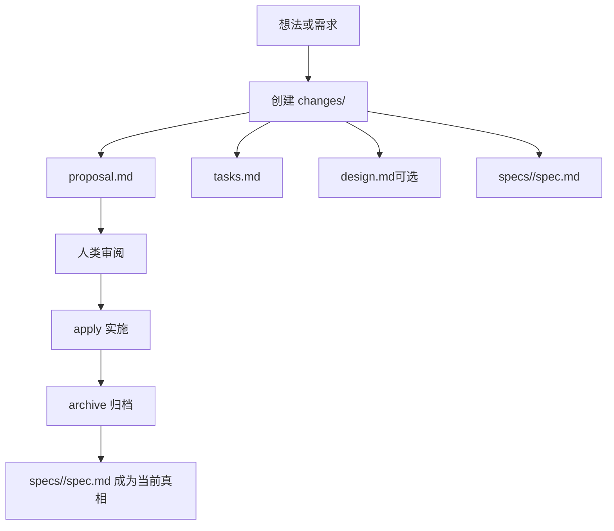
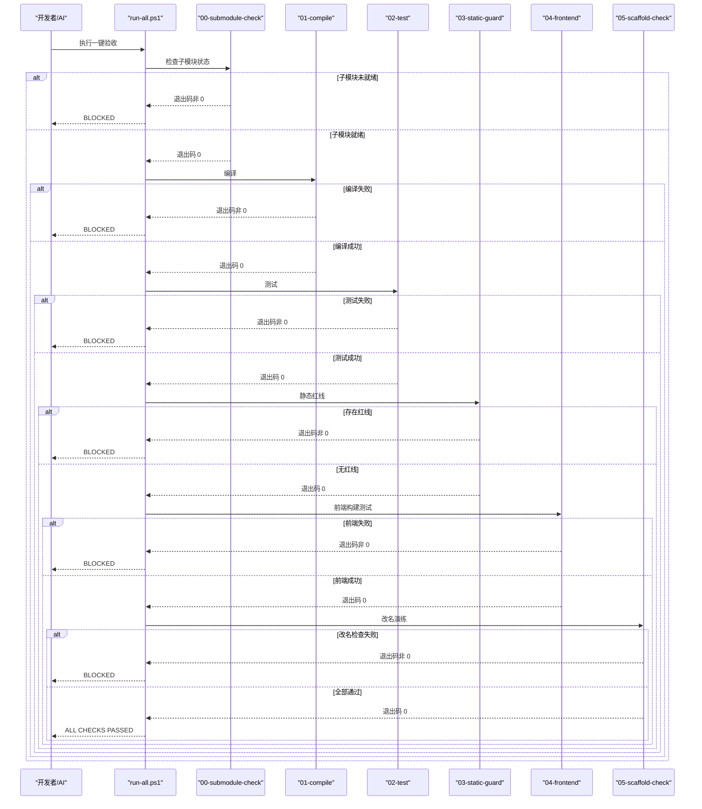
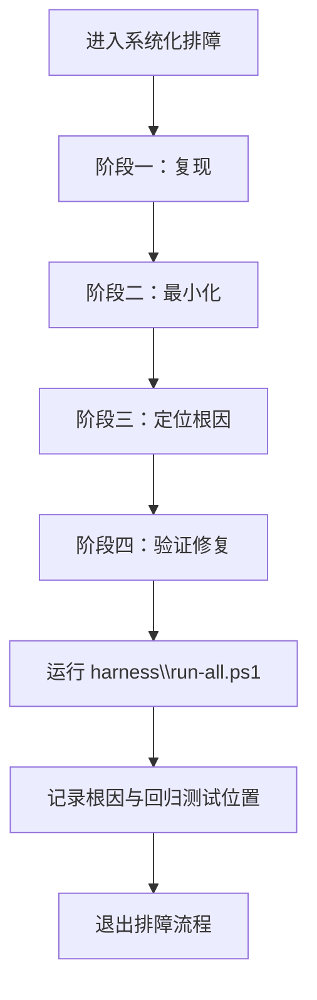
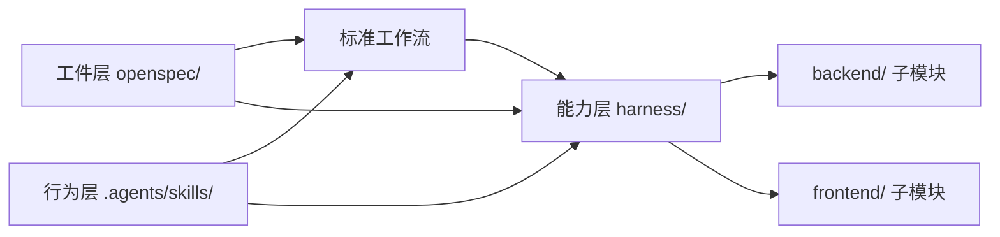

# 三层架构详解

<cite>
**本文引用的文件**   
- [README.md](file://README.md)
- [AGENTS.md](file://AGENTS.md)
- [openspec/config.yaml](file://openspec/config.yaml)
- [openspec/specs/workspace-layout/spec.md](file://openspec/specs/workspace-layout/spec.md)
- [harness/run-all.ps1](file://harness/run-all.ps1)
- [.agents/skills/systematic-debugging/SKILL.md](file://.agents/skills/systematic-debugging/SKILL.md)
- [.agents/skills/verification-before-completion/SKILL.md](file://.agents/skills/verification-before-completion/SKILL.md)
</cite>

## 目录
1. [引言](#引言)
2. [项目结构](#项目结构)
3. [核心组件](#核心组件)
4. [架构总览](#架构总览)
5. [详细组件分析](#详细组件分析)
6. [依赖关系分析](#依赖关系分析)
7. [性能与可重复性](#性能与可重复性)
8. [故障排查指南](#故障排查指南)
9. [结论](#结论)
10. [附录：实际使用场景](#附录实际使用场景)

## 引言
AIWorkSpace 不是普通业务仓库，而是把“让 AI 编码变得可验证、可追溯、边界清晰”的工程骨架落到真实目录中的顶层工作区。它自身不追求复杂业务，而是通过三个层次约束 AI 的行为：

- **工件层（Spec）**：用规格固定“要做什么”，解决 AI 不知道意图的问题。
- **能力层（Harness）**：用退出码行使否决权，解决“错了没人拦”的问题。
- **行为层（Skills）**：固化“怎么干才专业”，解决 AI 靠猜、靠试、靠嘴硬的问题。

三者是乘法关系：**结果 ≈ 规格质量 × 方法正确度 × 护栏有效度**。任一项为 0，整体结果归零。`backend/` 与 `frontend/` 不属于这三层，它们是被编排的两个独立 git 子模块仓库。

**章节来源**
- [README.md:1-19](file://README.md#L1-L19)
- [AGENTS.md:7-26](file://AGENTS.md#L7-L26)

## 项目结构
AIWorkSpace 的目录组织围绕三层展开，同时保留两个独立应用作为子模块：

**图表来源**
- [AGENTS.md:72-119](file://AGENTS.md#L72-L119)
- [README.md:70-81](file://README.md#L70-L81)

### 工件层目录：`openspec/`
- `config.yaml`：OpenSpec 配置，声明 schema 为 spec-driven，并约定中文上下文与英文结构关键字。
- `specs/`：已归档能力的当前真相，例如 workspace-layout、workspace-scaffold、frontend-nextjs、skill-distribution。
- `changes/`：在飞变更；`archive/`：历史变更，用于审计与回滚依据。

**章节来源**
- [openspec/config.yaml:1-29](file://openspec/config.yaml#L1-L29)
- [AGENTS.md:97-101](file://AGENTS.md#L97-L101)

### 能力层目录：`harness/`
- `run-all.ps1`：总闸门，按文件名顺序执行 `checks/` 下的检查，任一失败返回非 0。
- `checks/`：六条闸门，包括子模块检查、编译、测试、静态红线、前端构建测试、工作区改名演练。

**章节来源**
- [AGENTS.md:102-110](file://AGENTS.md#L102-L110)
- [harness/run-all.ps1:1-20](file://harness/run-all.ps1#L1-L20)

### 行为层目录：`.agents/skills/`
- `systematic-debugging`：系统化排障四阶段根因法。
- `verification-before-completion`：先证后宣布，强制以命令输出和退出码作为完成证据。
- 其他 `openspec-*` 技能由 OpenSpec 工具生成或分发，但本仓库强调自研技能的编写真源位于 `.agents/skills/`。

**章节来源**
- [AGENTS.md:113-118](file://AGENTS.md#L113-L118)
- [.agents/skills/systematic-debugging/SKILL.md:1-6](file://.agents/skills/systematic-debugging/SKILL.md#L1-L6)
- [.agents/skills/verification-before-completion/SKILL.md:1-6](file://.agents/skills/verification-before-completion/SKILL.md#L1-L6)

### 子模块与应用边界
- `backend/`：Spring Boot 后端，Maven 项目根，包含领域模型、服务与控制器。
- `frontend/`：Next.js 前端，npm 项目根，包含页面、组件、API 代理与测试。
- 两者各自保留构建身份、提交历史与发布节奏，工作区只以 gitlink 锁定版本。

**章节来源**
- [AGENTS.md:79-96](file://AGENTS.md#L79-L96)
- [README.md:77-79](file://README.md#L77-L79)

## 核心组件
AIWorkSpace 的核心不是某个类或接口，而是三个层次的职责分工与协作机制：

| 层次 | 目录 | 核心问题 | 关键产物 | 失效后果 |
|---|---|---|---|---|
| 工件层 | `openspec/` | AI 不知道“要做什么” | proposal、design、tasks、specs | 需求漂移、无法审计 |
| 能力层 | `harness/` | 错了没人拦 | `run-all.ps1` 与各 check 脚本 | 错误流入主干 |
| 行为层 | `.agents/skills/` | AI 不知道“怎么做才对” | 系统化排障、先证后宣布 | 靠猜测交付 |

**章节来源**
- [README.md:9-19](file://README.md#L9-L19)
- [AGENTS.md:16-26](file://AGENTS.md#L16-L26)

## 架构总览
从端到端视角看，AIWorkSpace 的工作流由“定规格 → 人工审阅 → 实施 → 验收 → 归档”构成，其中人工审阅是唯一不可省略的卡点。

**图表来源**
- [AGENTS.md:37-58](file://AGENTS.md#L37-L58)
- [.agents/skills/systematic-debugging/SKILL.md:8-18](file://.agents/skills/systematic-debugging/SKILL.md#L8-L18)

### 三层乘法模型
数学表达为：

> 结果 ≈ 规格质量 × 方法正确度 × 护栏有效度

- 如果规格模糊，再好的实现也会偏离意图。
- 如果方法不正确，再清晰的规格也会被错误实现污染。
- 如果护栏无效，即使规格和方法都正确，也可能被跳过或伪造绿灯。

因此，任何一层失效都会使整体结果归零。

**章节来源**
- [README.md:17-19](file://README.md#L17-L19)
- [AGENTS.md:24-26](file://AGENTS.md#L24-L26)

## 详细组件分析

### 工件层：SDD（规格驱动开发）
工件层的核心是把“意图”变成可审查、可追踪、可回归的规格。OpenSpec 以 `spec-driven` schema 组织变更与真相，避免实现者单方面改写需求。

#### 设计要点
- 所有超过“改个拼写”的改动必须先在 `openspec/changes/<change-id>/` 中产生 proposal 与 tasks。
- Spec 不能由实现者单方面修改；发现规格有误应修改 proposal 并说明理由。
- 已完成能力的需求描述沉淀到 `openspec/specs/`，在飞变更的 delta 位于 `changes/<change-id>/specs/`。
- 工作区对前后端的约束也写成规格，例如 workspace-layout 明确 submodule、构建身份、未初始化时验收失败等要求。

**图表来源**
- [AGENTS.md:37-54](file://AGENTS.md#L37-L54)
- [AGENTS.md:97-101](file://AGENTS.md#L97-L101)

#### 关键规格示例：workspace-layout
workspace-layout 规格定义了工作区如何管理前后端子模块，包括：
- 父仓库只记录 gitlink，不跟踪子模块内容。
- 子模块保留独立构建身份。
- 子模块未初始化时，Harness 必须以退出码 1 失败。
- 工作区提交只包含自有文件和 gitlink SHA。
- 子模块远程地址可由模板使用者替换。

这些 Scenario 把抽象原则变成可执行的验收标准，而不是口头约定。

**章节来源**
- [openspec/config.yaml:1-6](file://openspec/config.yaml#L1-L6)
- [openspec/specs/workspace-layout/spec.md:1-75](file://openspec/specs/workspace-layout/spec.md#L1-L75)
- [AGENTS.md:28-35](file://AGENTS.md#L28-L35)

### 能力层：Harness（验证护栏）
能力层的核心是“拥有否决权”。AI 可以声称自己做完了，但只有 `harness\run-all.ps1` 返回 0 才算真的做完。

#### 闸门顺序
总闸门按文件名排序执行以下检查：
1. `00-submodule-check.ps1`：子模块已初始化且 HEAD 与 gitlink 一致。
2. `01-compile.ps1`：后端能否编译。
3. `02-test.ps1`：后端测试 + 容器装配。
4. `03-static-guard.ps1`：是否存在 TODO、System.out、@Disabled、前端跳过等红线。
5. `04-frontend.ps1`：前端安装、构建、测试。
6. `05-scaffold-check.ps1`：工作区改名演练 + 残留扫描 + .gitmodules 完整性。

**图表来源**
- [harness/run-all.ps1:1-20](file://harness/run-all.ps1#L1-L20)
- [harness/run-all.ps1:36-62](file://harness/run-all.ps1#L36-L62)
- [harness/run-all.ps1:75-89](file://harness/run-all.ps1#L75-L89)

#### 退出码语义
- 退出码 0：ALL CHECKS PASSED。
- 退出码非 0：BLOCKED，并列出失败的检查数量。
- 默认遇错即停；排查时可启用继续模式，但完成判定仍以 0 为准。

**章节来源**
- [harness/run-all.ps1:1-20](file://harness/run-all.ps1#L1-L20)
- [harness/run-all.ps1:21-25](file://harness/run-all.ps1#L21-L25)
- [harness/run-all.ps1:75-89](file://harness/run-all.ps1#L75-L89)
- [AGENTS.md:145-152](file://AGENTS.md#L145-L152)

### 行为层：Skills（技能系统）
行为层不是“建议型文档”，而是流程的一部分。它规定 AI 在特定场景下必须遵循的方法，尤其是系统化排障和完成前验证。

#### 系统化排障技能
当测试失败、启动报错或行为异常时，必须进入四阶段：
1. 复现：找到最短稳定复现路径。
2. 最小化：剥离无关代码，聚焦边界条件。
3. 定位根因：提出可证伪假设，追问三次为什么。
4. 验证修复：原复现由红转绿，补回归测试，跑全量护栏。

反模式包括吞异常、调大超时、注释断言、一次改多处、“重启就好”等。

**图表来源**
- [.agents/skills/systematic-debugging/SKILL.md:6-49](file://.agents/skills/systematic-debugging/SKILL.md#L6-L49)
- [.agents/skills/systematic-debugging/SKILL.md:61-64](file://.agents/skills/systematic-debugging/SKILL.md#L61-L64)

#### 完成前验证技能
在宣布“做完了”之前，必须回答四个问题：
1. 实际执行了什么命令？
2. 退出码是多少？
3. 输出证明了什么？
4. 有没有未覆盖的路径？

完成声明的标准格式必须包含改动、验证命令、关键输出和未覆盖项。没有新鲜证据的完成声明视为未完成。

**章节来源**
- [.agents/skills/verification-before-completion/SKILL.md:1-6](file://.agents/skills/verification-before-completion/SKILL.md#L1-L6)
- [.agents/skills/verification-before-completion/SKILL.md:20-35](file://.agents/skills/verification-before-completion/SKILL.md#L20-L35)
- [.agents/skills/verification-before-completion/SKILL.md:55-67](file://.agents/skills/verification-before-completion/SKILL.md#L55-L67)

### 三层协同关系
- 工件层决定“方向是否正确”。
- 行为层决定“过程是否专业”。
- 能力层决定“结果是否可接受”。

三者缺一不可：
- 有规格但没有护栏，AI 可能跳过验证。
- 有技能但没有规格，AI 可能做出正确但不符合需求的事。
- 有护栏但没有技能，AI 可能绕过或敷衍验证。

**章节来源**
- [AGENTS.md:16-26](file://AGENTS.md#L16-L26)
- [.agents/skills/verification-before-completion/SKILL.md:64-69](file://.agents/skills/verification-before-completion/SKILL.md#L64-L69)

## 依赖关系分析
AIWorkSpace 的依赖不是传统代码库之间的 import 关系，而是“流程依赖 + 目录契约 + 退出码契约”。

**图表来源**
- [AGENTS.md:37-58](file://AGENTS.md#L37-L58)
- [AGENTS.md:102-118](file://AGENTS.md#L102-L118)

### 耦合与内聚
- 工件层与行为层相对松耦合：规格定义目标，技能定义方法，二者通过工作流连接。
- 能力层与实现层解耦：Harness 不关心 backend/frontend 内部实现，只关心退出码。
- 行为层内部高内聚：每个技能聚焦一个强纪律场景，避免泛泛而谈。

### 外部依赖
- Git 与子模块：首次克隆需要 `--recurse-submodules`。
- JDK、Maven、Node.js：分别支撑后端、构建与前端。
- OpenSpec CLI：用于 propose/apply/archive 等操作。

**章节来源**
- [README.md:83-92](file://README.md#L83-L92)
- [AGENTS.md:154-160](file://AGENTS.md#L154-L160)

## 性能与可重复性
AIWorkSpace 刻意减少外部中间件，以保证 `mvn test` 在任何机器上可重复执行。这是能力层的重要设计取舍：

- 不连接数据库/缓存，降低环境抖动。
- 接入外部依赖后，应把“起容器”纳入 Harness，否则会出现护栏空洞。
- 闸门按顺序执行，遇错即停，避免无效后续检查浪费资源。
- 前端构建与测试放在后端编译测试之后，便于尽早发现基础环境问题。

**章节来源**
- [README.md:94-99](file://README.md#L94-L99)
- [AGENTS.md:156-157](file://AGENTS.md#L156-L157)
- [harness/run-all.ps1:3-12](file://harness/run-all.ps1#L3-L12)

## 故障排查指南
常见故障通常来自三层之一：

| 现象 | 可能原因 | 处理建议 |
|---|---|---|
| 子模块检查失败 | 新克隆未初始化子模块 | 执行 `git submodule update --init --recursive` |
| 编译失败 | 后端代码或依赖问题 | 先确认子模块就绪，再单独运行编译检查 |
| 测试失败 | 行为不符合规格或环境不稳定 | 触发 systematic-debugging，不要直接改代码 |
| 静态红线拦截 | 存在 TODO、System.out、@Disabled、前端跳过 | 清理占位符，补充真实实现或测试 |
| 前端构建失败 | Node 环境、依赖或构建配置问题 | 单独运行前端检查，确认 npm ci/build/test |
| 改名检查失败 | 工作区展示名或 slug 不一致 | 使用 scaffold/rename.mjs 重新改名并验收 |

**章节来源**
- [AGENTS.md:125-134](file://AGENTS.md#L125-L134)
- [AGENTS.md:154-160](file://AGENTS.md#L154-L160)
- [.agents/skills/systematic-debugging/SKILL.md:8-18](file://.agents/skills/systematic-debugging/SKILL.md#L8-L18)

## 结论
AIWorkSpace 的价值不在 backend 与 frontend 的代码，而在“让边界可验证”的工程骨架。它用 SDD 固定意图，用 Skills 固化方法，用 Harness 行使否决权。三者相乘而非相加：任何一个环节失效，整体结果都会归零。

对于团队而言，这套架构的意义在于：
- 把 AI 的能力限制在“可验证、可追溯、可审计”的范围内。
- 把“人拍板需求”和“机器执行验证”分开。
- 把“临时经验”沉淀为“可重复的流程”。

**章节来源**
- [README.md:3-8](file://README.md#L3-L8)
- [AGENTS.md:7-14](file://AGENTS.md#L7-L14)
- [AGENTS.md:24-26](file://AGENTS.md#L24-L26)

## 附录：实际使用场景

### 场景一：新增按完成状态过滤的查询
1. 使用 `/opsx:propose` 增加按完成状态过滤的查询，产出 proposal、tasks 与 specs。
2. 人工审阅放行，确认需求合理。
3. 使用 `/opsx:apply` 按 tasks 实施。
4. 若遇到测试失败或行为异常，触发 `systematic-debugging`。
5. 完成后运行 `powershell -File harness\run-all.ps1`，确认退出码为 0。
6. 使用 `/opsx:archive` 归档变更，specs 更新为新的真相。

**章节来源**
- [README.md:40-42](file://README.md#L40-L42)
- [AGENTS.md:37-54](file://AGENTS.md#L37-L54)
- [.agents/skills/systematic-debugging/SKILL.md:8-18](file://.agents/skills/systematic-debugging/SKILL.md#L8-L18)

### 场景二：克隆后首次验收
1. 使用 `git clone --recurse-submodules` 克隆仓库。
2. 如果已有克隆但子模块为空，执行 `git submodule update --init --recursive`。
3. 运行 `powershell -File harness\run-all.ps1`。
4. 如果 00 闸门失败，根据提示初始化子模块。
5. 全部通过后，再启动后端与前端。

**章节来源**
- [README.md:21-38](file://README.md#L21-L38)
- [openspec/specs/workspace-layout/spec.md:34-49](file://openspec/specs/workspace-layout/spec.md#L34-L49)

### 场景三：分发新工作区后的改名
1. 克隆模板后第一步执行 `node scaffold/rename.mjs --name <slug> --display "<展示名>"`。
2. 只改 `AGENTS.md` 与 `README.md`，不改子模块应用身份。
3. 运行 `powershell -File harness\run-all.ps1`，确保改名演练与残留扫描通过。
4. 如需替换子模块地址，使用 `git submodule set-url` 并同步配置。

**章节来源**
- [README.md:44-59](file://README.md#L44-L59)
- [AGENTS.md:111-112](file://AGENTS.md#L111-L112)
- [AGENTS.md:135-137](file://AGENTS.md#L135-L137)