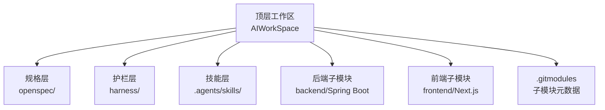
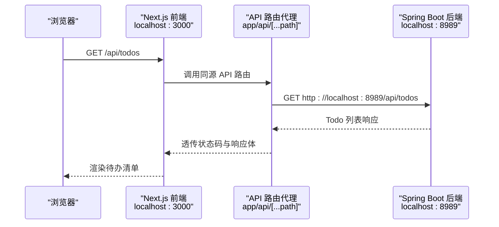
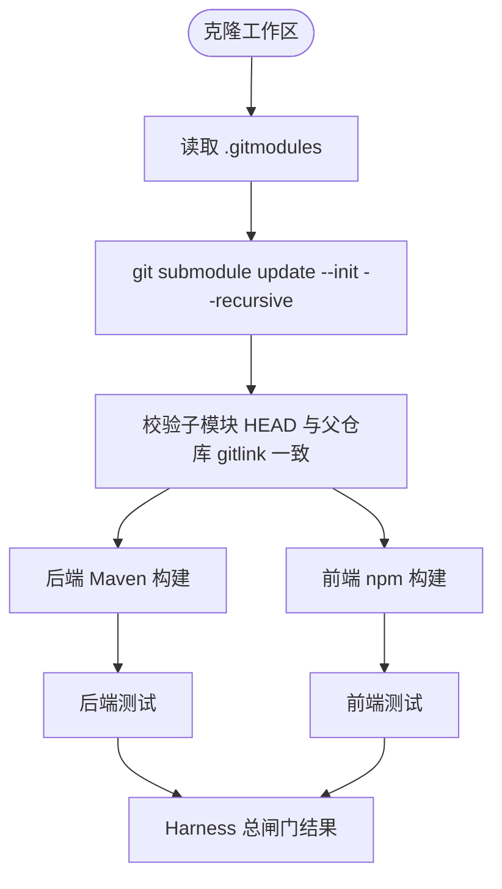
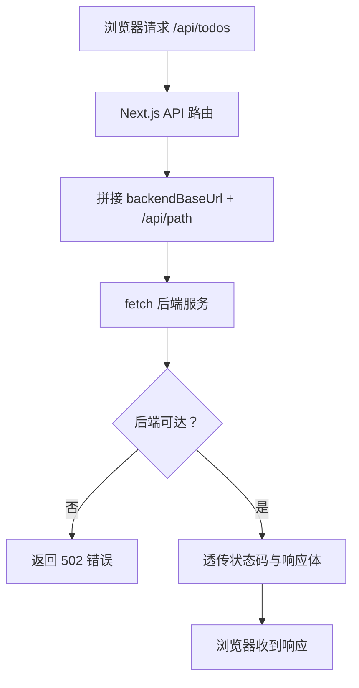
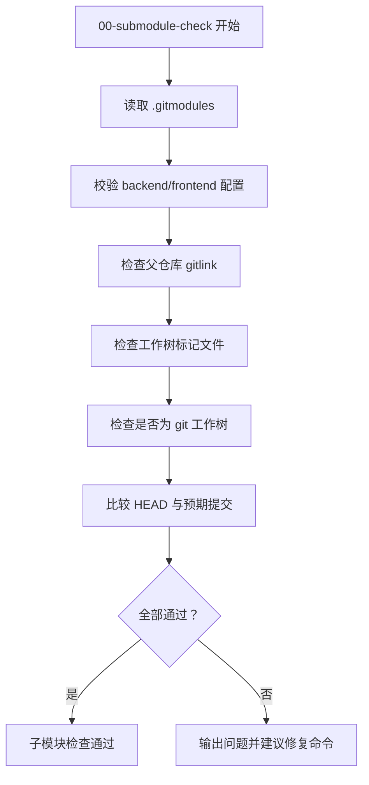
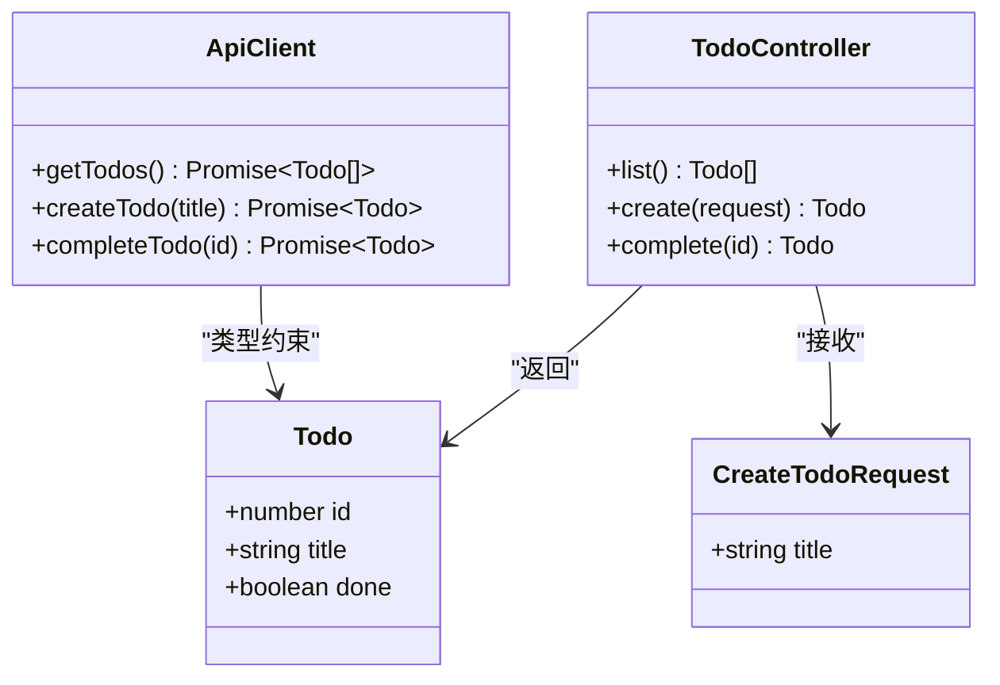
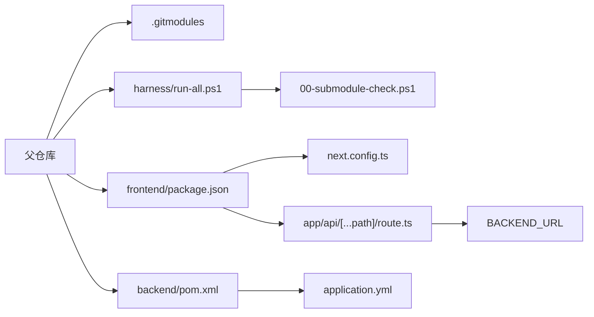
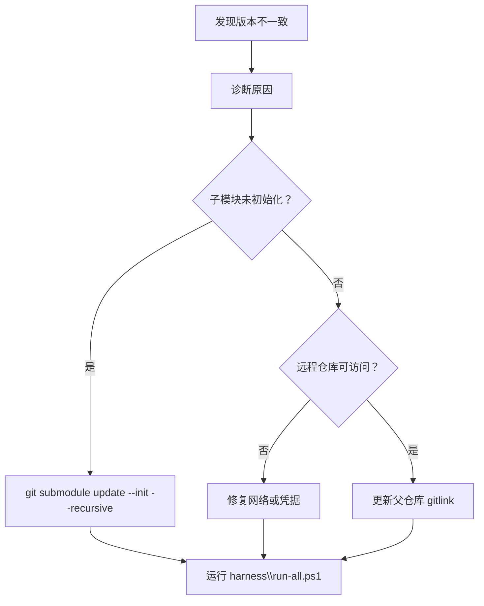
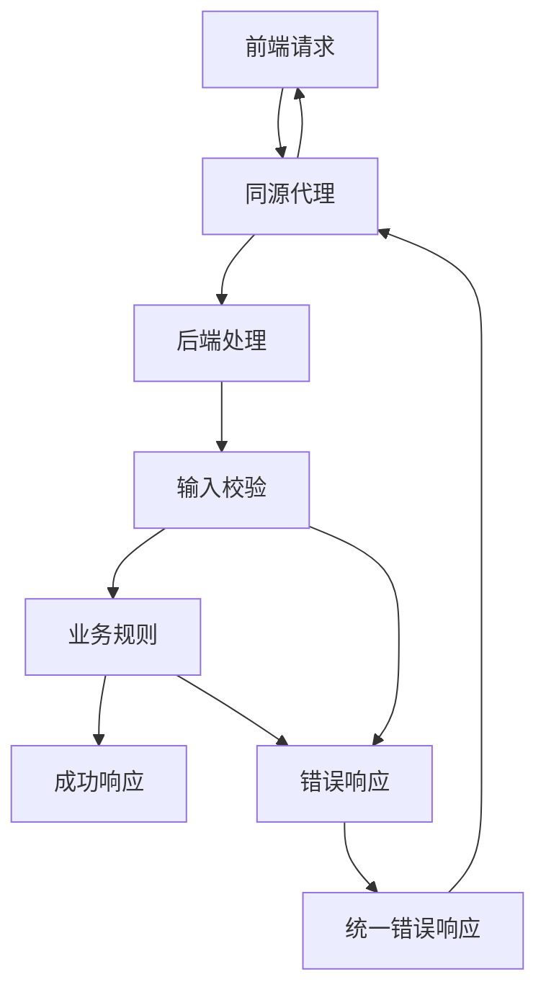

# 前后端分离架构

<cite>
**本文引用的文件**   
- [README.md](file://README.md)
- [.gitmodules](file://.gitmodules)
- [frontend\next.config.ts](file://frontend\next.config.ts)
- [backend\pom.xml](file://backend\pom.xml)
- [frontend\package.json](file://frontend\package.json)
- [docs\specs\todo-module-spec.md](file://docs\specs\todo-module-spec.md)
- [frontend\app\api\[...path]\route.ts](file://frontend\app\api\[...path]\route.ts)
- [backend\src\main\java\com\luyi\myfirst\web\TodoController.java](file://backend\src\main\java\com\luyi\myfirst\web\TodoController.java)
- [backend\src\main\resources\application.yml](file://backend\src\main\resources\application.yml)
- [harness\run-all.ps1](file://harness\run-all.ps1)
- [harness\checks\00-submodule-check.ps1](file://harness\checks\00-submodule-check.ps1)
- [frontend\lib\api.ts](file://frontend\lib\api.ts)
</cite>

## 目录
1. [引言](#引言)
2. [项目结构](#项目结构)
3. [核心组件](#核心组件)
4. [架构总览](#架构总览)
5. [详细组件分析](#详细组件分析)
6. [依赖关系分析](#依赖关系分析)
7. [性能与部署特性](#性能与部署特性)
8. [本地开发环境搭建指南](#本地开发环境搭建指南)
9. [版本同步、冲突处理与发布策略](#版本同步冲突处理与发布策略)
10. [前后端通信协议与错误处理](#前后端通信协议与错误处理)
11. [常见问题排查](#常见问题排查)
12. [结论](#结论)

## 引言
本仓库是一个“规格 + 护栏 + 技能”的顶层工作区，`backend/` 与 `frontend/` 是两个独立 Git 仓库，通过子模块挂载到当前工作区。后端使用 Spring Boot，前端使用 Next.js；前端通过同源 API 路由把 `/api/*` 请求代理到后端服务，从而在开发和本地部署时统一端口，避免跨域问题。

该设计强调：
- 独立提交、独立构建、独立发布节奏。
- 父仓库用 gitlink 锁定子模块版本，保证克隆可复现。
- 以规格文档定义前后端契约，以 Harness 脚本作为验收闸门。

**章节来源**
- [README.md:1-19](file://README.md#L1-L19)
- [README.md:70-81](file://README.md#L70-L81)

## 项目结构
工作区采用“顶层编排 + 子模块应用”的结构：
- `openspec/`：规格与变更提案。
- `harness/`：自动化验收脚本。
- `.agents/skills/`：AI 行为技能。
- `backend/`：Spring Boot 后端，独立 Maven 项目。
- `frontend/`：Next.js 前端，独立 npm 项目。
- `.gitmodules`：声明两个子模块的路径和远程地址。



**图表来源**
- [README.md:70-81](file://README.md#L70-L81)
- [.gitmodules:1-7](file://.gitmodules#L1-L7)

**章节来源**
- [README.md:70-81](file://README.md#L70-L81)
- [.gitmodules:1-7](file://.gitmodules#L1-L7)

## 核心组件
- **后端控制器**：`TodoController` 暴露 `/api/todos` 相关接口，负责查询、创建、完成待办。
- **前端 API 客户端**：`lib/api.ts` 封装对 `/api/todos` 的调用，并定义当前 `Todo` 类型。
- **同源代理路由**：`app/api/[...path]/route.ts` 将浏览器请求转发到后端服务。
- **后端运行配置**：`application.yml` 指定端口为 `8989`。
- **前端构建配置**：`next.config.ts` 输出 standalone 产物，便于容器运行。
- **验收闸门**：`harness/run-all.ps1` 按顺序执行子模块检查、编译、测试、静态检查、前端构建测试等。

**章节来源**
- [backend\src\main\java\com\luyi\myfirst\web\TodoController.java:16-44](file://backend\src\main\java\com\luyi\myfirst\web\TodoController.java#L16-L44)
- [frontend\lib\api.ts:5-35](file://frontend\lib\api.ts#L5-L35)
- [frontend\app\api\[...path]\route.ts:1-77](file://frontend\app\api\[...path]\route.ts#L1-L77)
- [backend\src\main\resources\application.yml:1-13](file://backend\src\main\resources\application.yml#L1-L13)
- [frontend\next.config.ts:1-9](file://frontend\next.config.ts#L1-L9)
- [harness\run-all.ps1:1-20](file://harness\run-all.ps1#L1-L20)

## 架构总览
整体采用“前端同源代理 + 后端独立服务”的前后端分离模式：



**图表来源**
- [frontend\app\api\[...path]\route.ts:10-53](file://frontend\app\api\[...path]\route.ts#L10-L53)
- [backend\src\main\java\com\luyi\myfirst\web\TodoController.java:26-29](file://backend\src\main\java\com\luyi\myfirst\web\TodoController.java#L26-L29)

选择同源代理的原因：
- 浏览器只访问同源的 `/api/todos`，无需额外跨域配置。
- 开发阶段前端 3000 端口、后端 8989 端口，生产可通过反向代理统一对外端口。
- 前端不直接感知后端地址，仅通过环境变量或默认值切换后端。

**章节来源**
- [frontend\app\api\[...path]\route.ts:1-6](file://frontend\app\api\[...path]\route.ts#L1-L6)
- [backend\src\main\resources\application.yml:2-4](file://backend\src\main\resources\application.yml#L2-L4)

## 详细组件分析

### 为什么使用 git submodule 而不是普通目录
工作区明确说明：`backend/` 与 `frontend/` 是独立仓库，保留各自的构建身份、提交历史与发布节奏；父仓库用 gitlink 锁版本，使克隆可复现。

关键考虑：
- **独立提交**：前后端团队可以分别提交、评审、合并，互不影响。
- **独立发布**：后端可单独打 Maven 包，前端可单独构建 Next.js 产物。
- **版本锁定**：父仓库记录子模块的具体提交哈希，避免“代码能跑但依赖变了”的问题。
- **初始化成本**：新克隆必须先初始化子模块，因此 Harness 第一个闸门就是子模块检查。



**图表来源**
- [README.md:21-38](file://README.md#L21-L38)
- [harness\checks\00-submodule-check.ps1:1-8](file://harness\checks\00-submodule-check.ps1#L1-L8)

**章节来源**
- [README.md:1-7](file://README.md#L1-L7)
- [README.md:94-98](file://README.md#L94-L98)
- [harness\run-all.ps1:1-12](file://harness\run-all.ps1#L1-L12)
- [harness\checks\00-submodule-check.ps1:1-8](file://harness\checks\00-submodule-check.ps1#L1-L8)

### 同源代理模式的设计决策
前端 API 路由接收任意 HTTP 方法，并将路径拼接到后端基础地址后发起请求。它只做最小转发：
- 拼接目标 URL 时使用逐段编码，防止客户端注入其他主机。
- 透传 `content-type` 和 `accept`。
- 透传上游状态码和响应体。
- 后端不可达时返回 502。



**图表来源**
- [frontend\app\api\[...path]\route.ts:10-53](file://frontend\app\api\[...path]\route.ts#L10-L53)

**章节来源**
- [frontend\app\api\[...path]\route.ts:1-77](file://frontend\app\api\[...path]\route.ts#L1-L77)

### 子模块初始化流程与版本同步
子模块检查脚本会：
1. 确认 `.gitmodules` 存在。
2. 检查 `backend` 与 `frontend` 的 path 和 url 配置。
3. 检查父仓库是否记录了 gitlink。
4. 检查工作树中是否存在 `pom.xml` 或 `package.json`。
5. 判断子模块是否为有效 git 工作树。
6. 比较子模块 HEAD 与父仓库记录的提交哈希。

如果失败，脚本输出修复命令：`git submodule update --init --recursive`。



**图表来源**
- [harness\checks\00-submodule-check.ps1:21-80](file://harness\checks\00-submodule-check.ps1#L21-L80)
- [harness\checks\00-submodule-check.ps1:82-93](file://harness\checks\00-submodule-check.ps1#L82-L93)

**章节来源**
- [harness\checks\00-submodule-check.ps1:1-94](file://harness\checks\00-submodule-check.ps1#L1-L94)

### 前后端通信协议设计
当前实现中的协议较简单：
- 后端控制器提供 `/api/todos` 的查询、创建、完成接口。
- 前端 `lib/api.ts` 定义 `Todo` 类型，并通过 `/api/todos` 调用后端。
- 规格文档定义了更完整的契约，包括扩展字段、更新接口、错误响应结构、校验顺序等。

需要注意：当前控制器与前端类型尚未完全覆盖规格文档中的完整契约，例如标签、截止日期、优先级、PATCH 更新、统一错误响应等。



**图表来源**
- [backend\src\main\java\com\luyi\myfirst\web\TodoController.java:16-44](file://backend\src\main\java\com\luyi\myfirst\web\TodoController.java#L16-L44)
- [frontend\lib\api.ts:5-35](file://frontend\lib\api.ts#L5-L35)

**章节来源**
- [backend\src\main\java\com\luyi\myfirst\web\TodoController.java:16-44](file://backend\src\main\java\com\luyi\myfirst\web\TodoController.java#L16-L44)
- [frontend\lib\api.ts:5-35](file://frontend\lib\api.ts#L5-L35)
- [docs\specs\todo-module-spec.md:416-542](file://docs\specs\todo-module-spec.md#L416-L542)

## 依赖关系分析
- 父仓库依赖 `.gitmodules` 管理子模块。
- Harness 依赖 PowerShell 脚本执行各阶段检查。
- 前端依赖 Next.js、React、TypeScript、Vitest。
- 后端依赖 Spring Boot Starter Web 与测试依赖。
- 前端运行时依赖环境变量 `BACKEND_URL`，默认指向 `http://localhost:8989`。



**图表来源**
- [.gitmodules:1-7](file://.gitmodules#L1-L7)
- [harness\run-all.ps1:1-20](file://harness\run-all.ps1#L1-L20)
- [harness\checks\00-submodule-check.ps1:1-8](file://harness\checks\00-submodule-check.ps1#L1-L8)
- [backend\pom.xml:1-37](file://backend\pom.xml#L1-L37)
- [frontend\package.json:1-34](file://frontend\package.json#L1-L34)
- [frontend\next.config.ts:1-9](file://frontend\next.config.ts#L1-L9)
- [frontend\app\api\[...path]\route.ts:1-6](file://frontend\app\api\[...path]\route.ts#L1-L6)
- [backend\src\main\resources\application.yml:1-13](file://backend\src\main\resources\application.yml#L1-L13)

**章节来源**
- [.gitmodules:1-7](file://.gitmodules#L1-L7)
- [harness\run-all.ps1:1-20](file://harness\run-all.ps1#L1-L20)
- [backend\pom.xml:1-37](file://backend\pom.xml#L1-L37)
- [frontend\package.json:1-34](file://frontend\package.json#L1-L34)

## 性能与部署特性
- 后端默认监听 `8989` 端口，适合本地开发和内网调试。
- 前端使用 Next.js standalone 输出，产物包含最小依赖和 server.js，适合容器化部署。
- 前端构建依赖 Node.js 版本要求，package.json 中声明 engines 字段。
- 后端使用 Spring Boot 插件进行打包和运行。

这些特性影响部署方式：
- 本地开发：分别启动后端和前端。
- 容器部署：前端可独立构建 standalone 产物；后端可打包为 Spring Boot 应用。
- 反向代理：可将前端和后端统一暴露在一个域名下，由网关或反向代理分发。

**章节来源**
- [backend\src\main\resources\application.yml:2-4](file://backend\src\main\resources\application.yml#L2-L4)
- [frontend\next.config.ts:3-6](file://frontend\next.config.ts#L3-L6)
- [frontend\package.json:6-8](file://frontend\package.json#L6-L8)
- [backend\pom.xml:39-44](file://backend\pom.xml#L39-L44)

## 本地开发环境搭建指南
根据 README 和配置文件，推荐步骤如下：

1. 安装前置环境：
   - JDK 17+。
   - Maven 3.9+。
   - Node.js 20.19+。
   - Git 2.x。

2. 克隆工作区并初始化子模块：
   ```powershell
   git clone --recurse-submodules <工作区仓库地址>
   ```
   如果已有克隆但子模块为空：
   ```powershell
   git submodule update --init --recursive
   ```

3. 运行验收闸门：
   ```powershell
   powershell -File harness\run-all.ps1
   ```

4. 启动后端：
   ```powershell
   mvn -f backend/pom.xml spring-boot:run
   ```
   后端默认监听 `http://localhost:8989`。

5. 启动前端：
   ```powershell
   cd frontend
   npm ci
   npm run dev
   ```
   前端默认监听 `http://localhost:3000`，并通过同源代理访问后端。

**章节来源**
- [README.md:21-38](file://README.md#L21-L38)
- [README.md:83-92](file://README.md#L83-L92)
- [backend\src\main\resources\application.yml:2-4](file://backend\src\main\resources\application.yml#L2-L4)
- [frontend\package.json:9-14](file://frontend\package.json#L9-L14)

## 版本同步、冲突处理与发布策略

### 子模块版本锁定
父仓库通过 `.gitmodules` 记录子模块的远程地址，并通过 gitlink 记录具体提交哈希。这意味着：
- 不同开发者克隆同一父仓库时，会拿到相同版本的子模块。
- 如果子模块有更新，需要先在子模块仓库提交并发布，再在父仓库更新 gitlink。
- Harness 的第一个闸门会强制校验子模块 HEAD 是否与父仓库记录一致。

### 版本同步策略
推荐流程：
1. 在后端子模块或前端子模块中修改代码并提交。
2. 在对应子模块仓库打 tag 或发布版本。
3. 回到父仓库，更新子模块引用到新版本提交。
4. 提交父仓库变更，确保 `.gitmodules` 和 gitlink 一致。
5. 运行 `harness\run-all.ps1` 验证。

### 冲突处理方案
常见冲突场景：
- 子模块未初始化：运行 `git submodule update --init --recursive`。
- 子模块 HEAD 与父仓库不一致：以父仓库为准，重新初始化子模块。
- 子模块远程仓库不可访问：检查网络、凭据或替换 `.gitmodules` 中的 URL。
- 前端无法连接后端：检查 `BACKEND_URL` 环境变量或默认地址是否正确。



**图表来源**
- [harness\checks\00-submodule-check.ps1:82-93](file://harness\checks\00-submodule-check.ps1#L82-L93)
- [README.md:21-27](file://README.md#L21-L27)

**章节来源**
- [.gitmodules:1-7](file://.gitmodules#L1-L7)
- [harness\checks\00-submodule-check.ps1:69-80](file://harness\checks\00-submodule-check.ps1#L69-L80)
- [README.md:21-27](file://README.md#L21-L27)

## 前后端通信协议与错误处理

### 当前实现协议
当前后端控制器提供：
- `GET /api/todos`：返回 Todo 列表。
- `POST /api/todos`：创建待办。
- `POST /api/todos/{id}/complete`：完成待办。

前端 `lib/api.ts` 定义 `Todo` 类型，并通过 `/api/todos` 调用后端。当前前端错误处理较为简单：非成功响应抛出通用错误信息。

### 规格定义的完整协议
规格文档定义了更严格的契约：
- Todo 字段包括 `id`、`title`、`done`、`tags`、`dueDate`、`priority`。
- 支持 PATCH 更新。
- 统一错误响应体 `ErrorResponse`，包含 `code` 和 `message`。
- 明确的校验顺序、错误码映射、长度计量规则。
- 容量上限、体积上限、并发语义、命名约定等。

### 错误处理机制对比
| 层面 | 当前实现 | 规格目标 |
|---|---|---|
| 错误响应体 | 前端抛通用错误；后端可能返回框架默认错误 | 统一 `ErrorResponse`，含 `code` 与 `message` |
| 错误码 | 无结构化错误码 | 明确错误码如 `TITLE_BLANK`、`TODO_NOT_FOUND` 等 |
| 校验顺序 | 未明确 | 体积 → 解析 → 字段约束 → 资源存在性 → 业务规则 → 兜底异常 |
| 前端错误展示 | 显示 HTTP 状态 | 按 `code` 映射用户文案 |



**图表来源**
- [docs\specs\todo-module-spec.md:499-520](file://docs\specs\todo-module-spec.md#L499-L520)
- [docs\specs\todo-module-spec.md:463-498](file://docs\specs\todo-module-spec.md#L463-L498)

**章节来源**
- [backend\src\main\java\com\luyi\myfirst\web\TodoController.java:16-44](file://backend\src\main\java\com\luyi\myfirst\web\TodoController.java#L16-L44)
- [frontend\lib\api.ts:5-35](file://frontend\lib\api.ts#L5-L35)
- [docs\specs\todo-module-spec.md:416-542](file://docs\specs\todo-module-spec.md#L416-L542)

## 常见问题排查

### 子模块相关问题
- 现象：`backend` 或 `frontend` 目录为空。
- 原因：子模块未初始化。
- 解决：运行 `git submodule update --init --recursive`。
- 验证：运行 `harness\run-all.ps1`，观察 00-submodule-check 是否通过。

**章节来源**
- [harness\checks\00-submodule-check.ps1:82-93](file://harness\checks\00-submodule-check.ps1#L82-L93)
- [README.md:21-27](file://README.md#L21-L27)

### 前端无法连接后端
- 现象：浏览器访问前端页面，但 API 请求失败。
- 原因：后端未启动，或 `BACKEND_URL` 配置不正确。
- 解决：
  - 启动后端服务。
  - 检查 `app/api/[...path]/route.ts` 中的默认后端地址。
  - 如需自定义后端地址，设置环境变量 `BACKEND_URL`。

**章节来源**
- [frontend\app\api\[...path]\route.ts:1-6](file://frontend\app\api\[...path]\route.ts#L1-L6)

### 前端构建或测试失败
- 现象：`npm run build` 或 `npm run test` 失败。
- 原因：Node.js 版本不满足要求，或依赖未正确安装。
- 解决：
  - 确认 Node.js 版本 >= 20.9.0。
  - 删除 `node_modules` 后重新 `npm ci`。
  - 检查 `package.json` 中的依赖版本。

**章节来源**
- [frontend\package.json:6-8](file://frontend\package.json#L6-L8)
- [frontend\package.json:15-32](file://frontend\package.json#L15-L32)

### 后端启动失败
- 现象：`mvn spring-boot:run` 报错。
- 原因：JDK 版本不匹配、端口占用、Maven 依赖下载失败。
- 解决：
  - 确认 JDK 版本 >= 17。
  - 检查 8989 端口是否被占用。
  - 清理 Maven 缓存后重试。

**章节来源**
- [backend\pom.xml:21-25](file://backend\pom.xml#L21-L25)
- [backend\src\main\resources\application.yml:2-4](file://backend\src\main\resources\application.yml#L2-L4)

## 结论
本项目采用“顶层工作区 + 子模块独立仓库”的前后端分离架构，核心优势在于：
- 前后端可独立提交、独立构建、独立发布。
- 父仓库通过 gitlink 锁定子模块版本，保证可复现性。
- 前端通过同源代理简化跨域问题，统一端口部署。
- 规格文档定义契约，Harness 脚本提供验收保障。

未来演进方向：
- 完善后端统一错误处理和字段校验，对齐规格文档。
- 扩展前端类型定义，覆盖规格中的完整 Todo 模型。
- 在生产环境中引入反向代理、鉴权、限流等能力。
- 持续通过 Harness 闸门保障工程质量。