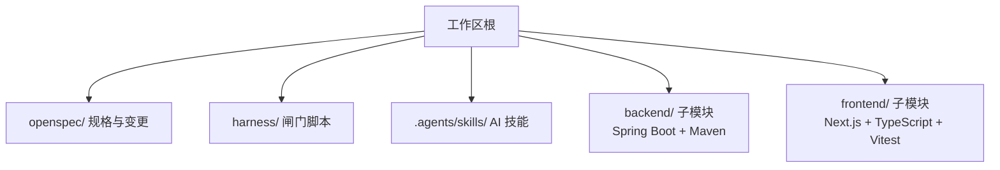
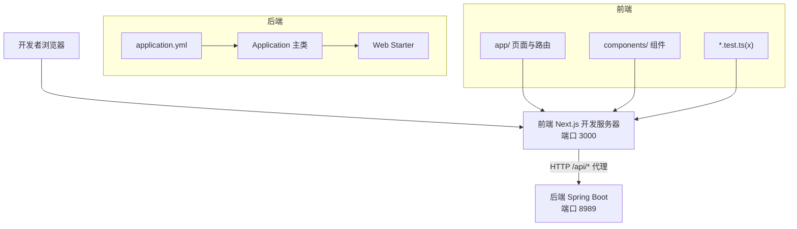
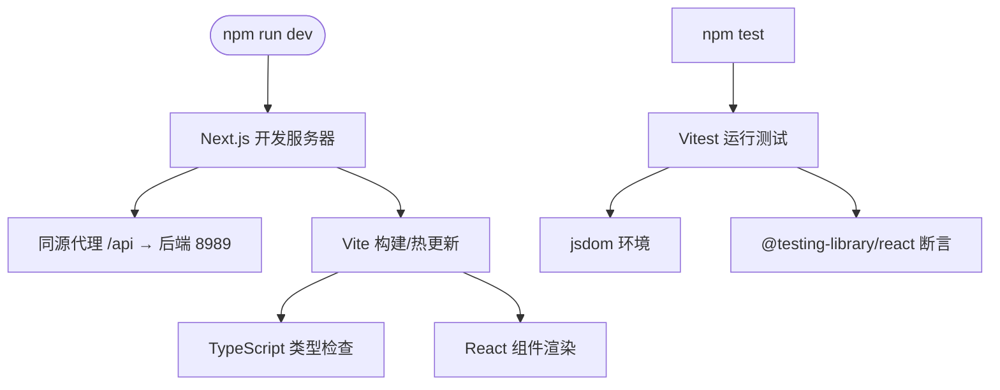
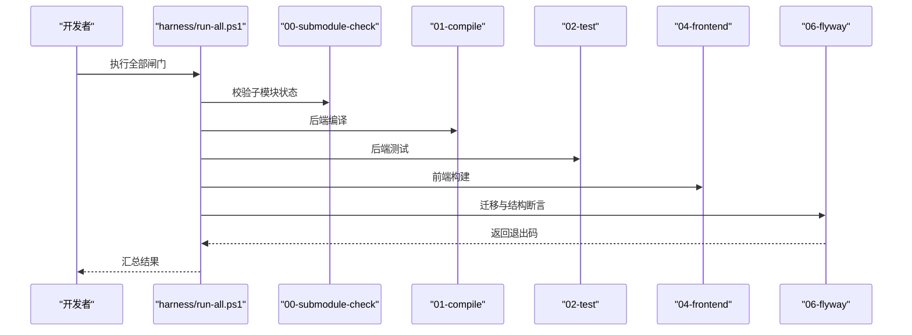

# 技术栈选型决策

<cite>
**本文引用的文件**   
- [backend/pom.xml](file://backend/pom.xml)
- [backend/src/main/java/com/luyi/myfirst/Application.java](file://backend/src/main/java/com/luyi/myfirst/Application.java)
- [backend/src/main/resources/application.yml](file://backend/src/main/resources/application.yml)
- [frontend/package.json](file://frontend/package.json)
- [frontend/next.config.ts](file://frontend/next.config.ts)
- [frontend/vitest.config.ts](file://frontend/vitest.config.ts)
- [frontend/vitest.setup.ts](file://frontend/vitest.setup.ts)
- [README.md](file://README.md)
</cite>

## 目录
1. [引言](#引言)
2. [项目结构](#项目结构)
3. [核心组件](#核心组件)
4. [架构总览](#架构总览)
5. [详细组件分析](#详细组件分析)
6. [依赖与版本策略](#依赖与版本策略)
7. [性能与可维护性考量](#性能与可维护性考量)
8. [环境配置指南](#环境配置指南)
9. [常见依赖冲突与排障](#常见依赖冲突与排障)
10. [结论](#结论)

## 引言
本文件面向工程团队，系统化说明当前工作区在前后端技术栈上的选型依据、版本兼容性、环境与依赖治理策略，以及未来升级路径。后端采用 Java 17+ 与 Spring Boot 3.5.5，构建工具为 Maven；前端采用 TypeScript + React + Next.js 16.4.3，测试使用 Vitest，运行于 Node.js 20.19+。该选择兼顾生态成熟度、长期支持、容器化友好性与团队学习成本，同时通过子模块隔离两个独立仓库的发布节奏。

## 项目结构
工作区由“规格层 + 护栏层 + 技能层”组织，`backend/` 与 `frontend/` 作为 Git 子模块独立存在，分别保留各自的构建身份、提交历史与发布节奏。



**图示来源**
- [README.md:74-85](file://README.md#L74-L85)

**章节来源**
- [README.md:1-10](file://README.md#L1-L10)
- [README.md:74-85](file://README.md#L74-L85)

## 核心组件
- 后端：Spring Boot 应用入口、最小化 Web 启动器、Maven 构建与 Flyway 迁移插件。
- 前端：Next.js 应用（standalone 输出）、React 组件、Vitest 组件与 API 代理测试、TypeScript 类型定义。
- 工作区：Helm 式闸门脚本编排编译、测试、静态检查、前端构建与数据库迁移验证。

**章节来源**
- [backend/src/main/java/com/luyi/myfirst/Application.java:1-13](file://backend/src/main/java/com/luyi/myfirst/Application.java#L1-L13)
- [backend/pom.xml:27-37](file://backend/pom.xml#L27-L37)
- [frontend/package.json:9-31](file://frontend/package.json#L9-L31)
- [frontend/next.config.ts:1-9](file://frontend/next.config.ts#L1-L9)

## 架构总览
后端提供 REST API，前端通过 Next.js 开发服务器进行同源代理访问后端服务；两者通过 HTTP 解耦，便于独立演进与部署。



**图示来源**
- [backend/src/main/java/com/luyi/myfirst/Application.java:1-13](file://backend/src/main/java/com/luyi/myfirst/Application.java#L1-L13)
- [backend/src/main/resources/application.yml:1-13](file://backend/src/main/resources/application.yml#L1-L13)
- [frontend/next.config.ts:1-9](file://frontend/next.config.ts#L1-L9)
- [frontend/package.json:9-18](file://frontend/package.json#L9-L18)

## 详细组件分析

### 后端：Java 17+ 与 Spring Boot 3.5.5
- 语言与运行时：声明 Java 17，兼容现代 JDK（本机已验证 JDK 25）。
- 框架：继承 Spring Boot 3.5.5 父 POM，引入 spring-boot-starter-web 与 spring-boot-starter-test。
- 构建：使用 spring-boot-maven-plugin；Flyway Maven 插件仅作为迁移工具，不引入运行期数据库依赖。
- 运行配置：默认端口 8989，最小化日志级别，保证本地与 CI 开箱即用。

```mermaid
classDiagram
class Application {
+main(args)
}
class SpringBootStarterWeb
class SpringBootStarterTest
class FlywayMavenPlugin
class SpringBootMavenPlugin
Application --> SpringBootStarterWeb : "启动 Web 能力"
Application --> SpringBootStarterTest : "测试依赖"
Build["Maven 构建"] --> SpringBootMavenPlugin
Build --> FlywayMavenPlugin
```

**图示来源**
- [backend/src/main/java/com/luyi/myfirst/Application.java:1-13](file://backend/src/main/java/com/luyi/myfirst/Application.java#L1-L13)
- [backend/pom.xml:27-70](file://backend/pom.xml#L27-L70)

**章节来源**
- [backend/pom.xml:7-25](file://backend/pom.xml#L7-L25)
- [backend/pom.xml:27-37](file://backend/pom.xml#L27-L37)
- [backend/pom.xml:39-70](file://backend/pom.xml#L39-L70)
- [backend/src/main/resources/application.yml:1-13](file://backend/src/main/resources/application.yml#L1-L13)

### 前端：TypeScript + React + Next.js 16.4.3 + Vitest
- 运行时：Node.js >= 20.9.0，满足 Next.js 16 最低要求；工作区 README 建议 Node.js 20.19+。
- 框架与库：Next.js 16.4.3、React 19.3.1、react-dom 19.3.1；TypeScript ~6.0.3。
- 构建与测试：Vite 8.3.4、Vitest 5.0.5、@vitejs/plugin-react 6.1.2；组件测试使用 jsdom 环境，配合 @testing-library/react。
- 部署：Next.js standalone 输出，产物自带 server.js 与最小依赖，利于容器化。



**图示来源**
- [frontend/package.json:6-31](file://frontend/package.json#L6-L31)
- [frontend/vitest.config.ts:1-14](file://frontend/vitest.config.ts#L1-L14)
- [frontend/vitest.setup.ts:1-9](file://frontend/vitest.setup.ts#L1-L9)
- [frontend/next.config.ts:1-9](file://frontend/next.config.ts#L1-L9)

**章节来源**
- [frontend/package.json:6-31](file://frontend/package.json#L6-L31)
- [frontend/vitest.config.ts:1-14](file://frontend/vitest.config.ts#L1-L14)
- [frontend/vitest.setup.ts:1-9](file://frontend/vitest.setup.ts#L1-L9)
- [frontend/next.config.ts:1-9](file://frontend/next.config.ts#L1-L9)

### 工作区与闸门
- 闸门脚本覆盖子模块初始化、编译、测试、静态检查、前端构建与 Flyway 迁移验证。
- 06 闸门复用本机 MySQL 8（默认 127.0.0.1:8806），在专用 schema 上执行迁移与结构断言，避免影响业务库。



**图示来源**
- [README.md:29-46](file://README.md#L29-L46)
- [README.md:98-102](file://README.md#L98-L102)

**章节来源**
- [README.md:29-46](file://README.md#L29-L46)
- [README.md:98-102](file://README.md#L98-L102)

## 依赖与版本策略

### 后端依赖与兼容性
- Java 17 作为目标版本，Spring Boot 3.5.5 作为父 POM，确保生态一致性。
- 仅引入 web 与 test starter，保持运行期轻量；Flyway 插件仅在构建阶段使用。
- 与本机 JDK 25 兼容，提升本地开发与 CI 环境的灵活性。

**章节来源**
- [backend/pom.xml:7-25](file://backend/pom.xml#L7-L25)
- [backend/pom.xml:27-37](file://backend/pom.xml#L27-L37)
- [backend/pom.xml:39-70](file://backend/pom.xml#L39-L70)

### 前端依赖与兼容性
- Node.js 引擎约束 >= 20.9.0，README 推荐 20.19+，满足 Next.js 16 与 Vite/Vitest 生态。
- Next.js 16.4.3 搭配 React 19.3.1，开启 standalone 输出以优化容器镜像体积与启动时间。
- Vitest 5.0.5 与 @vitejs/plugin-react 6.1.2 组合，统一组件测试与构建管线。

**章节来源**
- [frontend/package.json:6-31](file://frontend/package.json#L6-L31)
- [frontend/next.config.ts:1-9](file://frontend/next.config.ts#L1-L9)

### 版本锁定与安全更新
- 前端使用 npm 包管理器并生成 package-lock.json，锁定精确版本，避免源切换导致的不一致。
- 后端使用 Maven，依赖版本集中在 POM 中管理；Flyway 插件与 JDBC 驱动版本显式声明。
- 安全更新建议：定期扫描依赖漏洞（如 npm audit、Maven Dependency Plugin），优先修复高危项；对 LTS 分支（如 Node 20）优先升级补丁版本，大版本升级需评估兼容性。

**章节来源**
- [frontend/package.json:1-31](file://frontend/package.json#L1-L31)
- [backend/pom.xml:46-69](file://backend/pom.xml#L46-L69)
- [README.md:98-102](file://README.md#L98-L102)

### 升级路径规划
- 后端：从 Spring Boot 3.x 平滑升级到后续 3.x 小版本；JDK 17 为目标基线，逐步评估 JDK 21/23 的迁移收益与风险。
- 前端：跟随 Next.js 16 到 17 的升级路径，关注 React 19 的稳定特性与 Breaking Changes；Vitest 与 Vite 升级时先升级 patch，再 minor，最后 major。
- Node.js：保持在 20.x LTS 或切换到新 LTS 分支前，先在本地与 CI 全量回归。

[本节为通用策略说明，不直接分析具体文件]

## 性能与可维护性考量
- 后端：最小化 starter 引入，降低启动开销；日志级别 INFO 适合本地与 CI 平衡可读性与性能。
- 前端：standalone 输出减少镜像体积，提高冷启动速度；Vitest 基于 Vite，具备快速增量构建优势。
- 可维护性：前后端职责清晰，API 契约稳定；闸门脚本强制质量门禁，降低回归风险。

[本节为通用策略说明，不直接分析具体文件]

## 环境配置指南

### 必需环境
- JDK 17+（本机已验证 JDK 25）
- Maven 3.9+
- Node.js 20.19+（Next.js 16 最低要求 20.9.0）
- Git 2.x（子模块需要）
- MySQL 8（默认 127.0.0.1:8806，schema ai_chat_gate）
- Docker CLI（用于闸门发现凭据与结构断言）

**章节来源**
- [README.md:87-96](file://README.md#L87-L96)

### 快速开始
- 克隆包含子模块的工作区。
- 执行 harness/run-all.ps1 验收所有闸门。
- 启动后端：mvn -f backend/pom.xml spring-boot:run。
- 启动前端：cd frontend; npm ci; npm run dev。

**章节来源**
- [README.md:21-46](file://README.md#L21-L46)

### npm 源与镜像
- 若默认源访问慢，可切换镜像（本机验证可用腾讯镜像），但 package-lock.json 会钉住版本不受源切换影响。

**章节来源**
- [README.md:98-99](file://README.md#L98-L99)

## 常见依赖冲突与排障

### 后端常见问题
- 端口占用：默认 8989，若被占用请修改 application.yml 中的 server.port。
- Flyway 迁移失败：检查 FLYWAY_DB_* 环境变量与 MySQL 8 连通性；当前实例为 MySQL 8.3，Flyway 11.7.2 提示上限为 8.1，但迁移与结构断言已通过。
- 构建阶段误引入数据库依赖：确认未在生产依赖中引入 flyway-core/DataSource/JPA，仅使用 flyway-maven-plugin。

**章节来源**
- [backend/src/main/resources/application.yml:1-13](file://backend/src/main/resources/application.yml#L1-L13)
- [backend/pom.xml:45-69](file://backend/pom.xml#L45-L69)
- [README.md:101-102](file://README.md#L101-L102)

### 前端常见问题
- Node 版本不匹配：确保 Node.js >= 20.9.0，推荐 20.19+。
- 组件测试 DOM 缺失：vitest.config.ts 已设置 environment: 'jsdom'，并确保 vitest.setup.ts 注册 cleanup。
- 构建产物过大：确认 next.config.ts 启用 output: 'standalone'。

**章节来源**
- [frontend/package.json:6-8](file://frontend/package.json#L6-L8)
- [frontend/vitest.config.ts:6-13](file://frontend/vitest.config.ts#L6-L13)
- [frontend/vitest.setup.ts:1-9](file://frontend/vitest.setup.ts#L1-L9)
- [frontend/next.config.ts:1-9](file://frontend/next.config.ts#L1-L9)

### 工作区闸门问题
- 子模块未初始化：先执行 git submodule update --init --recursive。
- 数据库凭据缺失：设置 FLYWAY_DB_HOST/PORT/USER/PASSWORD，或确保本机 8806 容器可访问。

**章节来源**
- [README.md:21-27](file://README.md#L21-L27)
- [README.md:101-102](file://README.md#L101-L102)

## 结论
本次技术栈选型以“稳定、可维护、可验证”为核心原则：后端采用 Java 17 + Spring Boot 3.5.5 + Maven，确保企业级生态与构建稳定性；前端采用 TypeScript + React + Next.js 16.4.3 + Vitest，结合 Node.js 20.19+ 与 standalone 输出，兼顾开发体验与部署效率。通过子模块隔离与闸门脚本，实现前后端独立演进与质量门禁。未来升级遵循 LTS 优先、渐进式升级与严格回归的策略，保障长期可维护性与安全性。