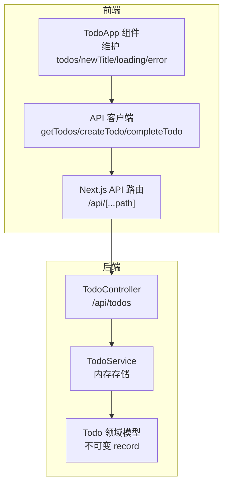
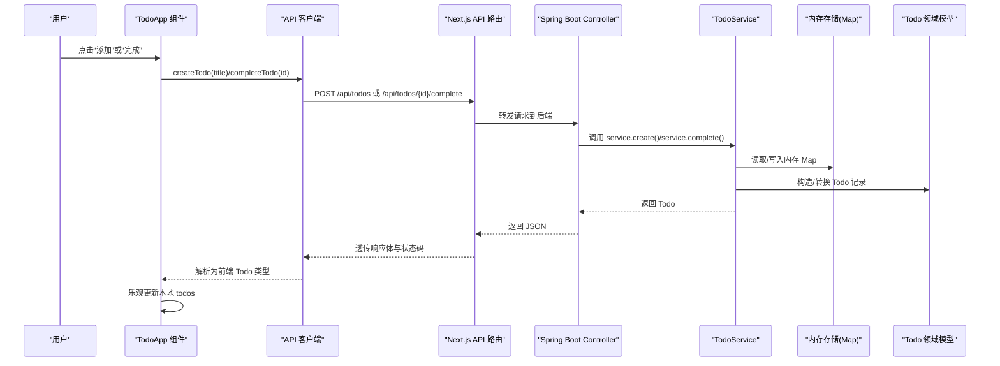
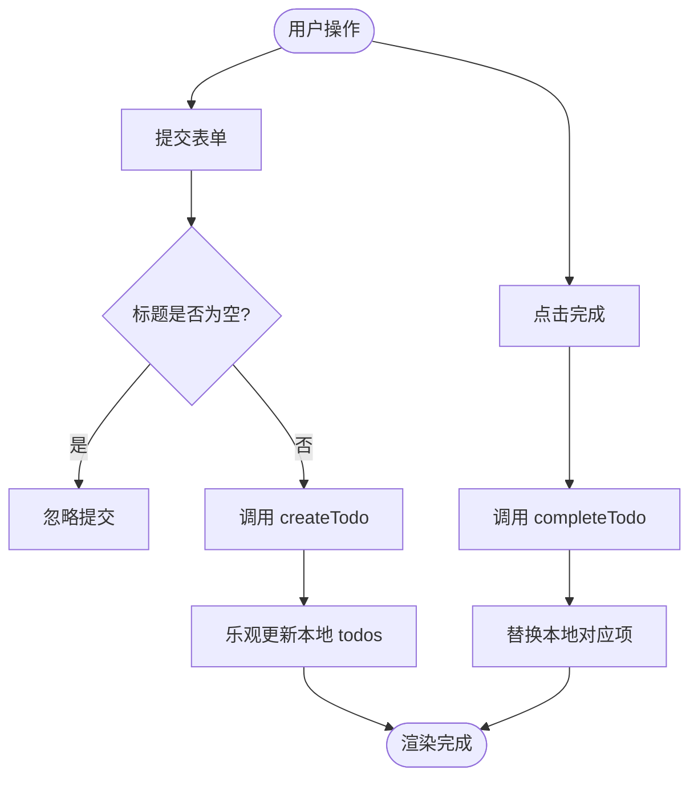
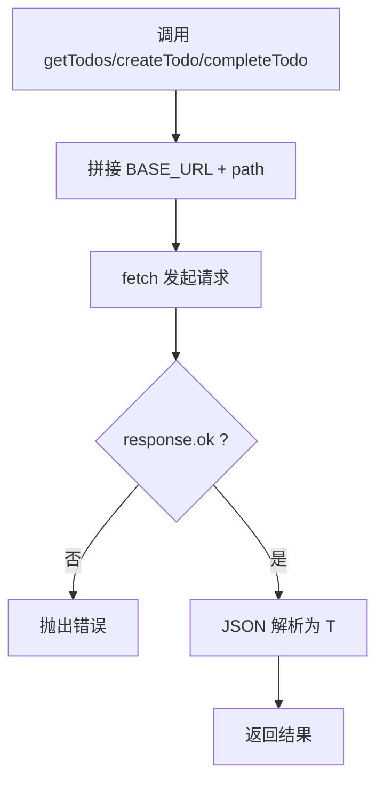
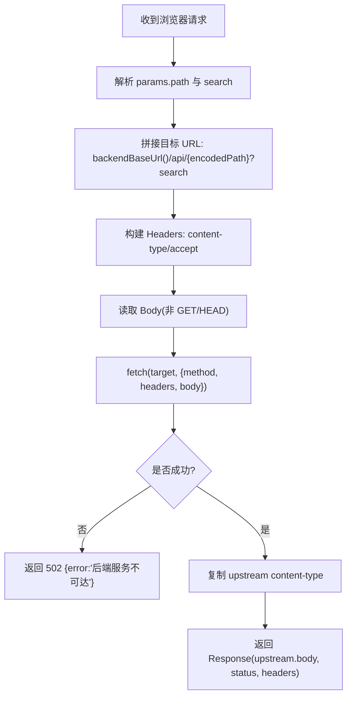
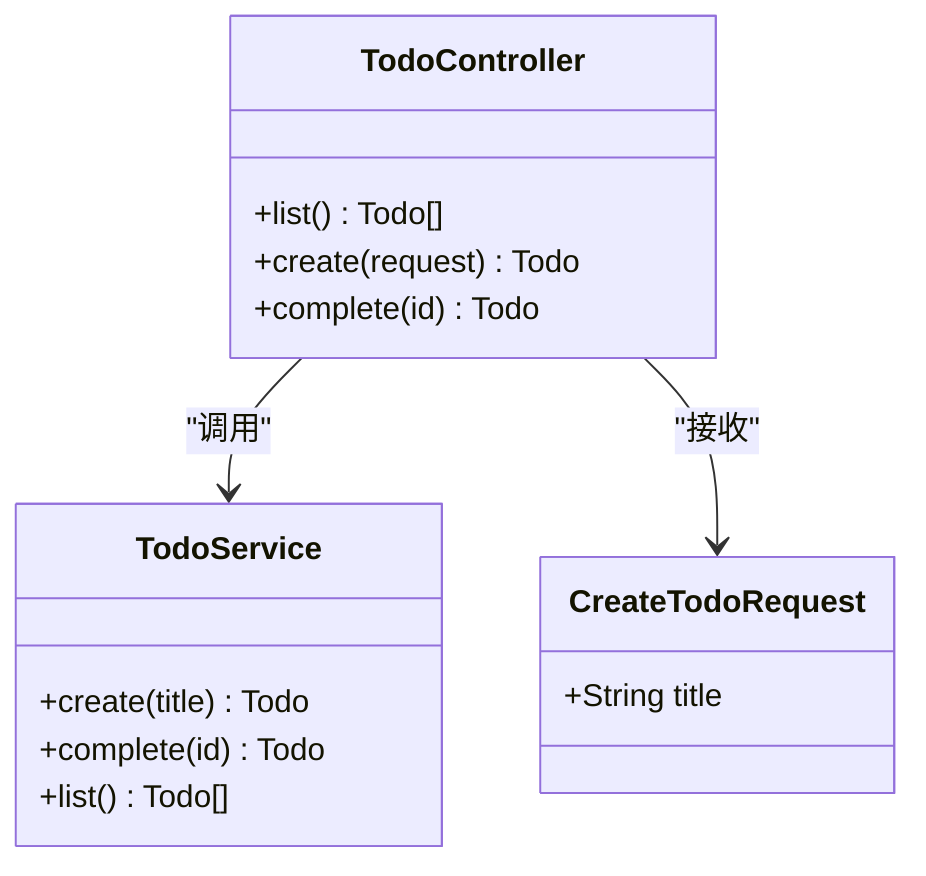
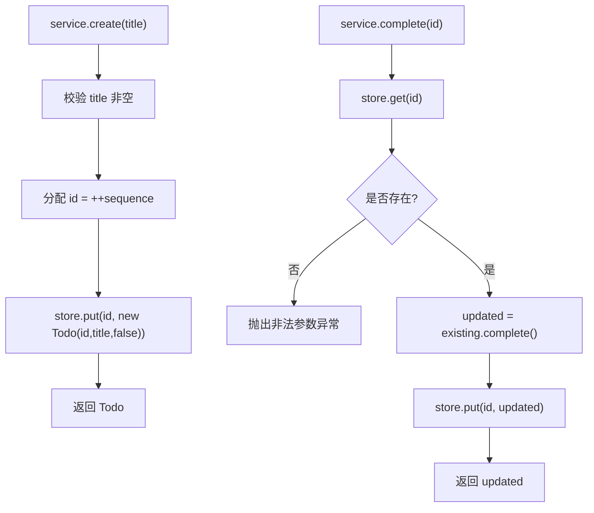
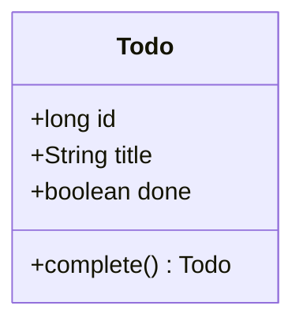
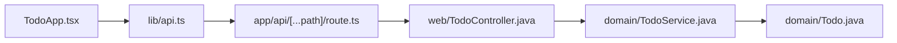
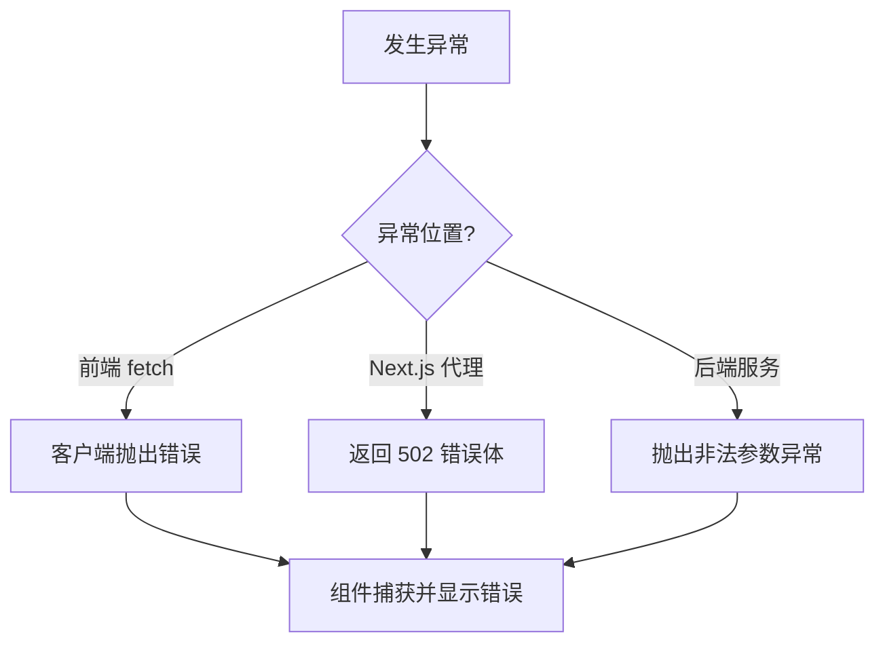

# 数据流设计

<cite>
**本文引用的文件**   
- [frontend/app/api/[...path]/route.ts](file://frontend/app/api/[...path]/route.ts)
- [frontend/components/TodoApp.tsx](file://frontend/components/TodoApp.tsx)
- [frontend/lib/api.ts](file://frontend/lib/api.ts)
- [backend/src/main/java/com/luyi/myfirst/web/TodoController.java](file://backend/src/main/java/com/luyi/myfirst/web/TodoController.java)
- [backend/src/main/java/com/luyi/myfirst/domain/TodoService.java](file://backend/src/main/java/com/luyi/myfirst/domain/TodoService.java)
- [backend/src/main/java/com/luyi/myfirst/domain/Todo.java](file://backend/src/main/java/com/luyi/myfirst/domain/Todo.java)
</cite>

## 目录
1. [引言](#引言)
2. [项目结构](#项目结构)
3. [核心组件](#核心组件)
4. [架构总览](#架构总览)
5. [详细组件分析](#详细组件分析)
6. [依赖关系分析](#依赖关系分析)
7. [性能考虑](#性能考虑)
8. [故障排查指南](#故障排查指南)
9. [结论](#结论)

## 引言
本文面向“用户操作 → React 组件状态更新 → API 客户端调用 → Next.js API 路由 → Spring Boot Controller → Service → 领域模型 → 内存存储”的完整数据路径，系统性说明：
- 每个环节的数据转换与状态管理
- 错误传播机制
- Todo 领域模型的不可变性设计
- DTO 转换模式与响应格式规范
- 数据流图、时序图与异常处理流程图
- 调试技巧与性能优化建议

本仓库采用前后端分离架构：前端基于 Next.js App Router，后端基于 Spring Boot。Next.js 提供同源的 `/api/todos` 代理路由，将请求转发到 Spring Boot 服务；Spring Boot 使用内存 Map 作为临时存储，便于可重复验证。

## 项目结构
本项目包含以下关键目录与文件：
- 前端
  - `frontend/app/api/[...path]/route.ts`：Next.js API 路由，负责代理转发到后端
  - `frontend/components/TodoApp.tsx`：React 客户端组件，维护 UI 状态并触发业务操作
  - `frontend/lib/api.ts`：封装 fetch 的 API 客户端，定义前端 Todo 类型
- 后端
  - `backend/src/main/java/com/luyi/myfirst/web/TodoController.java`：REST 控制器，暴露 `/api/todos` 接口
  - `backend/src/main/java/com/luyi/myfirst/domain/TodoService.java`：内存版待办服务，维护内存存储
  - `backend/src/main/java/com/luyi/myfirst/domain/Todo.java`：不可变领域模型（record）

图表来源
- [frontend/components/TodoApp.tsx:6-10](file://frontend/components/TodoApp.tsx#L6-L10)
- [frontend/lib/api.ts:5-35](file://frontend/lib/api.ts#L5-L35)
- [frontend/app/api/[...path]/route.ts:10-53](file://frontend/app/api/[...path]/route.ts#L10-L53)
- [backend/src/main/java/com/luyi/myfirst/web/TodoController.java:16-43](file://backend/src/main/java/com/luyi/myfirst/web/TodoController.java#L16-L43)
- [backend/src/main/java/com/luyi/myfirst/domain/TodoService.java:14-42](file://backend/src/main/java/com/luyi/myfirst/domain/TodoService.java#L14-L42)
- [backend/src/main/java/com/luyi/myfirst/domain/Todo.java:7-11](file://backend/src/main/java/com/luyi/myfirst/domain/Todo.java#L7-L11)

章节来源
- [frontend/app/api/[...path]/route.ts:1-77](file://frontend/app/api/[...path]/route.ts#L1-L77)
- [frontend/components/TodoApp.tsx:1-109](file://frontend/components/TodoApp.tsx#L1-L109)
- [frontend/lib/api.ts:1-36](file://frontend/lib/api.ts#L1-L36)
- [backend/src/main/java/com/luyi/myfirst/web/TodoController.java:1-45](file://backend/src/main/java/com/luyi/myfirst/web/TodoController.java#L1-L45)
- [backend/src/main/java/com/luyi/myfirst/domain/TodoService.java:1-44](file://backend/src/main/java/com/luyi/myfirst/domain/TodoService.java#L1-L44)
- [backend/src/main/java/com/luyi/myfirst/domain/Todo.java:1-13](file://backend/src/main/java/com/luyi/myfirst/domain/Todo.java#L1-L13)

## 核心组件
- 前端 TodoApp 组件
  - 维护本地状态：todos、newTitle、loading、error
  - 在挂载时刷新列表，并提供新增、完成操作
  - 通过乐观更新策略直接修改本地 todos，提升交互体验
- 前端 API 客户端
  - 统一封装 fetch，定义 Todo 类型
  - 对非 2xx 响应抛出错误，由组件捕获并展示
- Next.js API 路由
  - 将浏览器请求转发到后端服务地址
  - 透传方法、头部与 body，并对网络异常返回 502
- Spring Boot TodoController
  - 暴露 GET /api/todos、POST /api/todos、POST /api/todos/{id}/complete
  - 使用 CreateTodoRequest DTO 接收创建参数
- TodoService
  - 使用 LinkedHashMap 维护内存存储
  - 提供 create、complete、list 三个方法
- Todo 领域模型
  - 使用 Java record 实现不可变对象
  - complete() 返回新实例表达状态变更

章节来源
- [frontend/components/TodoApp.tsx:6-56](file://frontend/components/TodoApp.tsx#L6-L56)
- [frontend/lib/api.ts:5-35](file://frontend/lib/api.ts#L5-L35)
- [frontend/app/api/[...path]/route.ts:10-53](file://frontend/app/api/[...path]/route.ts#L10-L53)
- [backend/src/main/java/com/luyi/myfirst/web/TodoController.java:16-43](file://backend/src/main/java/com/luyi/myfirst/web/TodoController.java#L16-L43)
- [backend/src/main/java/com/luyi/myfirst/domain/TodoService.java:14-42](file://backend/src/main/java/com/luyi/myfirst/domain/TodoService.java#L14-L42)
- [backend/src/main/java/com/luyi/myfirst/domain/Todo.java:7-11](file://backend/src/main/java/com/luyi/myfirst/domain/Todo.java#L7-L11)

## 架构总览
下图展示了从用户操作到内存存储的端到端数据流，以及错误如何沿链路回传至 UI。

图表来源
- [frontend/components/TodoApp.tsx:32-56](file://frontend/components/TodoApp.tsx#L32-L56)
- [frontend/lib/api.ts:21-35](file://frontend/lib/api.ts#L21-L35)
- [frontend/app/api/[...path]/route.ts:10-53](file://frontend/app/api/[...path]/route.ts#L10-L53)
- [backend/src/main/java/com/luyi/myfirst/web/TodoController.java:26-40](file://backend/src/main/java/com/luyi/myfirst/web/TodoController.java#L26-L40)
- [backend/src/main/java/com/luyi/myfirst/domain/TodoService.java:20-38](file://backend/src/main/java/com/luyi/myfirst/domain/TodoService.java#L20-L38)
- [backend/src/main/java/com/luyi/myfirst/domain/Todo.java:7-11](file://backend/src/main/java/com/luyi/myfirst/domain/Todo.java#L7-L11)

## 详细组件分析

### 前端 TodoApp 组件
- 状态管理
  - todos：当前待办列表
  - newTitle：输入框值
  - loading：加载态
  - error：错误信息
- 生命周期与刷新
  - 组件挂载后自动调用 getTodos 刷新列表
- 新增待办
  - 校验标题非空
  - 调用 createTodo，成功后将新 Todo 追加到本地列表
- 完成待办
  - 调用 completeTodo，成功后用返回的新 Todo 替换本地对应项
- 错误处理
  - 统一 showError 包装 Error 对象或默认消息
  - 在 finally 中关闭 loading

图表来源
- [frontend/components/TodoApp.tsx:32-56](file://frontend/components/TodoApp.tsx#L32-L56)

章节来源
- [frontend/components/TodoApp.tsx:6-56](file://frontend/components/TodoApp.tsx#L6-L56)

### 前端 API 客户端
- 类型定义
  - Todo：id、title、done
- 请求封装
  - request<T>(path, init)：发起 fetch，非 2xx 抛错，成功则解析 JSON
- 业务方法
  - getTodos：GET /api/todos
  - createTodo：POST /api/todos，body 为 { title }
  - completeTodo：POST /api/todos/{id}/complete

图表来源
- [frontend/lib/api.ts:13-19](file://frontend/lib/api.ts#L13-L19)
- [frontend/lib/api.ts:21-35](file://frontend/lib/api.ts#L21-L35)

章节来源
- [frontend/lib/api.ts:1-36](file://frontend/lib/api.ts#L1-L36)

### Next.js API 路由
- 代理逻辑
  - 从环境变量 BACKEND_URL 或默认地址获取后端基础 URL
  - 将浏览器请求路径映射为 /api/{pathSegments}
  - 透传 method、content-type、accept 与 body
  - 对网络异常返回 502，错误体为 { error: "后端服务不可达" }
  - 透传上游响应体与 content-type
- 支持方法
  - GET、POST、PUT、PATCH、DELETE

图表来源
- [frontend/app/api/[...path]/route.ts:4-6](file://frontend/app/api/[...path]/route.ts#L4-L6)
- [frontend/app/api/[...path]/route.ts:10-53](file://frontend/app/api/[...path]/route.ts#L10-L53)

章节来源
- [frontend/app/api/[...path]/route.ts:1-77](file://frontend/app/api/[...path]/route.ts#L1-L77)

### Spring Boot TodoController
- 路由定义
  - GET /api/todos：返回列表
  - POST /api/todos：创建待办，HTTP 201 Created
  - POST /api/todos/{id}/complete：标记完成
- DTO 转换
  - 使用 CreateTodoRequest 接收 { title }，再转换为 service.create(title)
- 返回值
  - 直接返回 Todo 记录，由 Jackson 序列化为 JSON

图表来源
- [backend/src/main/java/com/luyi/myfirst/web/TodoController.java:16-43](file://backend/src/main/java/com/luyi/myfirst/web/TodoController.java#L16-L43)

章节来源
- [backend/src/main/java/com/luyi/myfirst/web/TodoController.java:1-45](file://backend/src/main/java/com/luyi/myfirst/web/TodoController.java#L1-L45)

### TodoService 与内存存储
- 数据结构
  - store：LinkedHashMap<Long, Todo>，保持插入顺序
  - sequence：自增 ID 生成器
- 行为
  - create(title)：校验 title，分配 id，构造 Todo 并放入 store
  - complete(id)：查找 todo，若不存在抛错；调用 todo.complete() 得到新实例并覆盖旧值
  - list()：返回 store.values() 的副本，避免外部直接修改内部集合

图表来源
- [backend/src/main/java/com/luyi/myfirst/domain/TodoService.java:20-38](file://backend/src/main/java/com/luyi/myfirst/domain/TodoService.java#L20-L38)

章节来源
- [backend/src/main/java/com/luyi/myfirst/domain/TodoService.java:1-44](file://backend/src/main/java/com/luyi/myfirst/domain/TodoService.java#L1-L44)

### Todo 领域模型与不可变性
- 使用 Java record 声明字段 id、title、done
- complete() 返回新的 Todo 实例，不修改原对象
- 优点
  - 线程安全：无共享可变状态
  - 语义清晰：状态变更以新对象表达
  - 易于测试与推理

图表来源
- [backend/src/main/java/com/luyi/myfirst/domain/Todo.java:7-11](file://backend/src/main/java/com/luyi/myfirst/domain/Todo.java#L7-L11)

章节来源
- [backend/src/main/java/com/luyi/myfirst/domain/Todo.java:1-13](file://backend/src/main/java/com/luyi/myfirst/domain/Todo.java#L1-L13)

## 依赖关系分析
- 前端
  - TodoApp 依赖 api.ts 提供的 getTodos/createTodo/completeTodo
  - api.ts 依赖浏览器 fetch 与 Next.js 同源路由 /api/todos
- Next.js 路由
  - 依赖环境变量 BACKEND_URL，默认 http://localhost:8989
  - 依赖 Spring Boot 的 /api/todos 接口
- 后端
  - TodoController 依赖 TodoService
  - TodoService 依赖 Todo 领域模型与内存 Map

图表来源
- [frontend/components/TodoApp.tsx:4-4](file://frontend/components/TodoApp.tsx#L4-L4)
- [frontend/lib/api.ts:21-35](file://frontend/lib/api.ts#L21-L35)
- [frontend/app/api/[...path]/route.ts:10-53](file://frontend/app/api/[...path]/route.ts#L10-L53)
- [backend/src/main/java/com/luyi/myfirst/web/TodoController.java:16-43](file://backend/src/main/java/com/luyi/myfirst/web/TodoController.java#L16-L43)
- [backend/src/main/java/com/luyi/myfirst/domain/TodoService.java:14-42](file://backend/src/main/java/com/luyi/myfirst/domain/TodoService.java#L14-L42)
- [backend/src/main/java/com/luyi/myfirst/domain/Todo.java:7-11](file://backend/src/main/java/com/luyi/myfirst/domain/Todo.java#L7-L11)

章节来源
- [frontend/components/TodoApp.tsx:1-109](file://frontend/components/TodoApp.tsx#L1-L109)
- [frontend/lib/api.ts:1-36](file://frontend/lib/api.ts#L1-L36)
- [frontend/app/api/[...path]/route.ts:1-77](file://frontend/app/api/[...path]/route.ts#L1-L77)
- [backend/src/main/java/com/luyi/myfirst/web/TodoController.java:1-45](file://backend/src/main/java/com/luyi/myfirst/web/TodoController.java#L1-L45)
- [backend/src/main/java/com/luyi/myfirst/domain/TodoService.java:1-44](file://backend/src/main/java/com/luyi/myfirst/domain/TodoService.java#L1-L44)
- [backend/src/main/java/com/luyi/myfirst/domain/Todo.java:1-13](file://backend/src/main/java/com/luyi/myfirst/domain/Todo.java#L1-L13)

## 性能考虑
- 前端
  - 乐观更新：在成功回调中直接更新本地状态，减少二次渲染等待
  - 列表渲染：使用稳定的 key（todo.id），提高 diff 效率
  - 条件渲染：仅在非 loading 且非 error 时渲染列表，降低无效计算
- 代理层
  - Next.js 路由设置 cache=no-store，避免缓存脏读
  - 仅透传必要头部，减少冗余开销
- 后端
  - 内存 Map 访问 O(1)，适合小规模数据
  - list() 返回副本，避免并发下外部修改导致不一致
  - 使用 record 不可变对象，天然线程安全，无需额外同步

[本节为通用性能建议，不直接分析具体代码文件]

## 故障排查指南
- 常见问题定位
  - 后端不可达：Next.js 路由返回 502，错误体包含 { error: "后端服务不可达" }
  - 请求失败：前端 API 客户端对非 2xx 响应抛出错误，组件显示错误提示
  - 参数校验失败：后端 service 抛出非法参数异常，需检查 title 是否为空
  - 资源不存在：complete 时找不到 id，抛出非法参数异常
- 调试步骤
  - 确认 NEXT_ENV 中 BACKEND_URL 是否正确指向 Spring Boot 服务
  - 在浏览器开发者工具查看 Network 面板，确认请求路径与方法
  - 在后端日志中观察异常堆栈，定位 service 层的校验失败点
  - 前端组件内 setError 的消息用于快速定位失败场景

图表来源
- [frontend/lib/api.ts:13-19](file://frontend/lib/api.ts#L13-L19)
- [frontend/app/api/[...path]/route.ts:30-41](file://frontend/app/api/[...path]/route.ts#L30-L41)
- [backend/src/main/java/com/luyi/myfirst/domain/TodoService.java:20-38](file://backend/src/main/java/com/luyi/myfirst/domain/TodoService.java#L20-L38)

章节来源
- [frontend/lib/api.ts:13-19](file://frontend/lib/api.ts#L13-L19)
- [frontend/app/api/[...path]/route.ts:30-41](file://frontend/app/api/[...path]/route.ts#L30-L41)
- [backend/src/main/java/com/luyi/myfirst/domain/TodoService.java:20-38](file://backend/src/main/java/com/luyi/myfirst/domain/TodoService.java#L20-L38)

## 结论
本系统通过清晰的职责分层与不可变领域模型，实现了稳定、可测试且线程友好的数据流：
- 前端以乐观更新提升用户体验
- Next.js 代理层简化跨域与部署配置
- Spring Boot 控制器专注 HTTP 契约与 DTO 转换
- Service 层聚焦业务规则与内存存储
- 领域模型通过 record 保证不可变性与状态变更的可追溯性

该设计在保证可重复验证的同时，也为后续扩展（如持久化、缓存、鉴权）提供了良好的扩展点。