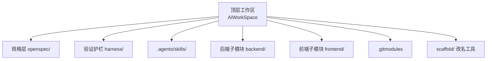
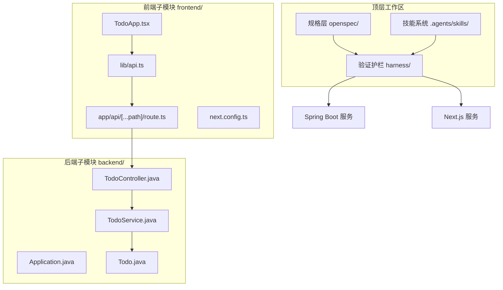
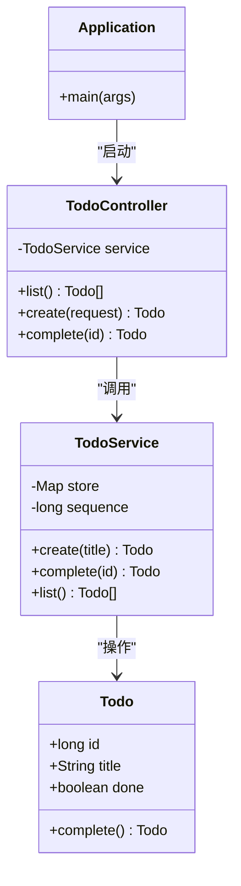
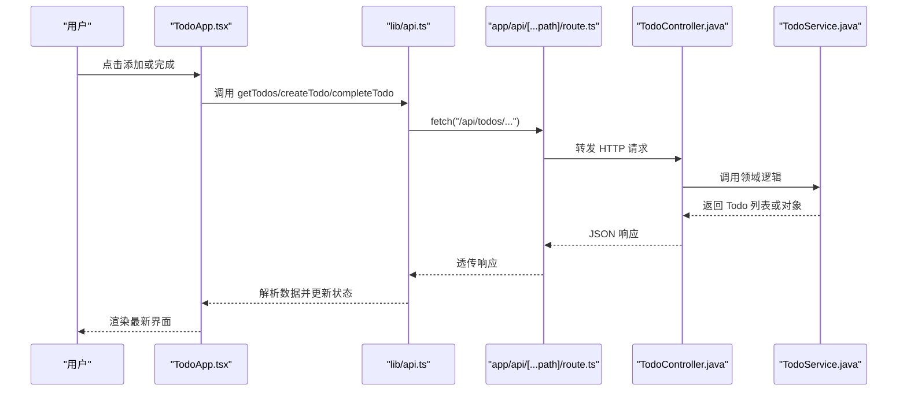
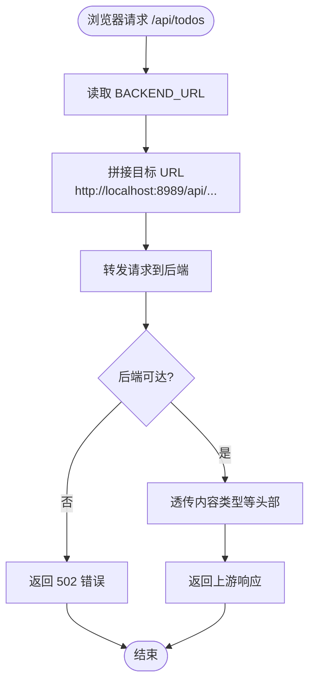
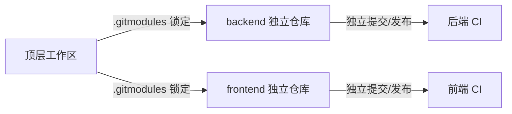
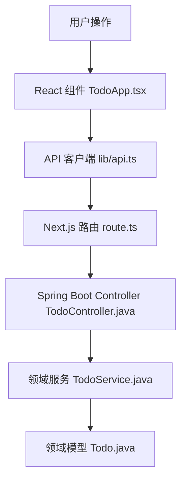
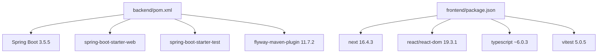

# 架构设计

<cite>
**本文引用的文件**   
- [README.md](file://README.md)
- [.gitmodules](file://.gitmodules)
- [harness/run-all.ps1](file://harness/run-all.ps1)
- [openspec/config.yaml](file://openspec/config.yaml)
- [backend/pom.xml](file://backend/pom.xml)
- [backend/src/main/java/com/luyi/myfirst/Application.java](file://backend/src/main/java/com/luyi/myfirst/Application.java)
- [backend/src/main/java/com/luyi/myfirst/web/TodoController.java](file://backend/src/main/java/com/luyi/myfirst/web/TodoController.java)
- [backend/src/main/java/com/luyi/myfirst/domain/TodoService.java](file://backend/src/main/java/com/luyi/myfirst/domain/TodoService.java)
- [backend/src/main/java/com/luyi/myfirst/domain/Todo.java](file://backend/src/main/java/com/luyi/myfirst/domain/Todo.java)
- [frontend/package.json](file://frontend/package.json)
- [frontend/app/api/[...path]/route.ts](file://frontend/app/api/[...path]/route.ts)
- [frontend/components/TodoApp.tsx](file://frontend/components/TodoApp.tsx)
- [frontend/lib/api.ts](file://frontend/lib/api.ts)
- [frontend/next.config.ts](file://frontend/next.config.ts)
</cite>

## 目录
1. [引言](#引言)
2. [项目结构](#项目结构)
3. [核心组件](#核心组件)
4. [架构总览](#架构总览)
5. [详细组件分析](#详细组件分析)
6. [依赖关系分析](#依赖关系分析)
7. [性能与可维护性考虑](#性能与可维护性考虑)
8. [故障排查指南](#故障排查指南)
9. [结论](#结论)

## 引言
AIWorkSpace 是一个以“规格驱动开发、验证护栏、技能系统”为核心的顶层工作区。它本身不承载业务，而是把 SDD（规格）、Harness（验证护栏）和 Skills（技能）落到真实目录中，并通过 git submodule 管理 `backend/` 与 `frontend/` 两个独立仓库，使前后端各自保留构建身份、提交历史与发布节奏。Todo 只是承载这套工程化流程的最小业务载体。

该文档聚焦三层架构的设计理念、前后端分离决策、同源代理模式、整体数据流、技术栈选择与版本兼容性，并给出架构图表与组件交互说明，帮助读者从高层到代码层理解整个系统。

## 项目结构
工作区采用“顶层编排 + 子模块应用”的结构：
- `openspec/`：规格与变更，定义意图、设计与任务，是 SDD 的核心工件。
- `harness/`：闸门脚本，按固定顺序执行子模块检查、编译、测试、静态红线、前端构建与改名演练，拥有否决权。
- `.agents/skills/`：技能描述，固化 AI 的行为方法。
- `backend/`：Spring Boot 后端，提供 Todo 领域 API。
- `frontend/`：Next.js 前端，提供 Todo 界面与同源 API 代理。
- `.gitmodules`：声明 backend 与 frontend 的远程仓库地址。
- `scaffold/`：工作区身份改名工具，用于分发后快速替换展示名与 slug。

**图表来源**
- [README.md:10-19](file://README.md#L10-L19)
- [README.md:70-81](file://README.md#L70-L81)
- [.gitmodules:1-7](file://.gitmodules#L1-L7)

**章节来源**
- [README.md:1-19](file://README.md#L1-L19)
- [README.md:70-81](file://README.md#L70-L81)

## 核心组件
### 规格驱动开发（SDD）
- 位置：`openspec/`
- 职责：用 proposal、specs、design、tasks 等工件固定“要做什么”，避免 AI 只写代码而不明确意图。
- 配置：`openspec/config.yaml` 指定 schema 为 spec-driven，并要求所有工件使用中文，同时保留英文结构标题与 SHALL/MUST 关键词。

### 验证护栏（Harness）
- 位置：`harness/`
- 职责：通过 `run-all.ps1` 按文件名顺序执行 checks，任一失败立即返回非零退出码；CI 与人工审阅只看退出码。
- 闸门顺序：
  - 00：子模块检查
  - 01：后端编译
  - 02：后端测试与容器装配
  - 03：静态红线
  - 04：前端安装、构建与测试
  - 05：工作区改名演练与残留扫描

### 技能系统（Skills）
- 位置：`.agents/skills/`
- 职责：固化“怎么做才对”的方法，例如系统化调试、完成前验证等，约束 AI 的实现方式。

**章节来源**
- [openspec/config.yaml:1-29](file://openspec/config.yaml#L1-L29)
- [harness/run-all.ps1:1-20](file://harness/run-all.ps1#L1-L20)
- [harness/run-all.ps1:36-62](file://harness/run-all.ps1#L36-L62)
- [README.md:10-19](file://README.md#L10-L19)

## 架构总览
AIWorkSpace 的整体架构由三层编排与两个独立应用组成：

**图表来源**
- [README.md:10-19](file://README.md#L10-L19)
- [backend/src/main/java/com/luyi/myfirst/Application.java:6-11](file://backend/src/main/java/com/luyi/myfirst/Application.java#L6-L11)
- [backend/src/main/java/com/luyi/myfirst/web/TodoController.java:16-44](file://backend/src/main/java/com/luyi/myfirst/web/TodoController.java#L16-L44)
- [backend/src/main/java/com/luyi/myfirst/domain/TodoService.java:14-42](file://backend/src/main/java/com/luyi/myfirst/domain/TodoService.java#L14-L42)
- [backend/src/main/java/com/luyi/myfirst/domain/Todo.java:7-11](file://backend/src/main/java/com/luyi/myfirst/domain/Todo.java#L7-L11)
- [frontend/components/TodoApp.tsx:6-108](file://frontend/components/TodoApp.tsx#L6-L108)
- [frontend/lib/api.ts:1-35](file://frontend/lib/api.ts#L1-L35)
- [frontend/app/api/[...path]/route.ts:1-77](file://frontend/app/api/[...path]/route.ts#L1-L77)
- [frontend/next.config.ts:3-6](file://frontend/next.config.ts#L3-L6)

## 详细组件分析

### 后端 Spring Boot 组件
后端采用最小化的 MVC 分层：
- `Application.java`：Spring Boot 启动入口。
- `TodoController.java`：暴露 `/api/todos` 的 GET、POST 与 `/api/todos/{id}/complete` 接口。
- `TodoService.java`：内存版待办服务，负责创建、完成与列出 Todo。
- `Todo.java`：不可变 record，状态变更通过生成新实例表达。

**图表来源**
- [backend/src/main/java/com/luyi/myfirst/Application.java:6-11](file://backend/src/main/java/com/luyi/myfirst/Application.java#L6-L11)
- [backend/src/main/java/com/luyi/myfirst/web/TodoController.java:16-44](file://backend/src/main/java/com/luyi/myfirst/web/TodoController.java#L16-L44)
- [backend/src/main/java/com/luyi/myfirst/domain/TodoService.java:14-42](file://backend/src/main/java/com/luyi/myfirst/domain/TodoService.java#L14-L42)
- [backend/src/main/java/com/luyi/myfirst/domain/Todo.java:7-11](file://backend/src/main/java/com/luyi/myfirst/domain/Todo.java#L7-L11)

**章节来源**
- [backend/src/main/java/com/luyi/myfirst/Application.java:1-13](file://backend/src/main/java/com/luyi/myfirst/Application.java#L1-L13)
- [backend/src/main/java/com/luyi/myfirst/web/TodoController.java:1-45](file://backend/src/main/java/com/luyi/myfirst/web/TodoController.java#L1-L45)
- [backend/src/main/java/com/luyi/myfirst/domain/TodoService.java:1-44](file://backend/src/main/java/com/luyi/myfirst/domain/TodoService.java#L1-L44)
- [backend/src/main/java/com/luyi/myfirst/domain/Todo.java:1-13](file://backend/src/main/java/com/luyi/myfirst/domain/Todo.java#L1-L13)

### 前端 Next.js 组件
前端采用 React 组件 + API 客户端 + 同源代理的模式：
- `TodoApp.tsx`：用户界面，负责加载、新增、标记完成与错误提示。
- `lib/api.ts`：封装 fetch，统一请求路径 `/api/todos`。
- `app/api/[...path]/route.ts`：Next.js Route Handler，将浏览器请求转发到后端。
- `next.config.ts`：输出 standalone 产物，便于容器运行。

**图表来源**
- [frontend/components/TodoApp.tsx:6-108](file://frontend/components/TodoApp.tsx#L6-L108)
- [frontend/lib/api.ts:1-35](file://frontend/lib/api.ts#L1-L35)
- [frontend/app/api/[...path]/route.ts:1-77](file://frontend/app/api/[...path]/route.ts#L1-L77)
- [backend/src/main/java/com/luyi/myfirst/web/TodoController.java:16-44](file://backend/src/main/java/com/luyi/myfirst/web/TodoController.java#L16-L44)
- [backend/src/main/java/com/luyi/myfirst/domain/TodoService.java:14-42](file://backend/src/main/java/com/luyi/myfirst/domain/TodoService.java#L14-L42)

**章节来源**
- [frontend/components/TodoApp.tsx:1-109](file://frontend/components/TodoApp.tsx#L1-L109)
- [frontend/lib/api.ts:1-36](file://frontend/lib/api.ts#L1-L36)
- [frontend/app/api/[...path]/route.ts:1-77](file://frontend/app/api/[...path]/route.ts#L1-L77)
- [frontend/next.config.ts:1-9](file://frontend/next.config.ts#L1-L9)

### 同源代理模式的设计考虑
- 浏览器只请求同源的 `/api/todos`，避免跨域问题。
- `route.ts` 读取环境变量 `BACKEND_URL`，默认指向 `http://localhost:8989`，换后端只需改环境变量并重启进程。
- 路径逐段编码拼接，防止客户端把请求导向其他主机。
- 透传 Content-Type、Accept 等头部，保持语义一致。
- 后端不可达时返回 502，便于前端与护栏识别。

**图表来源**
- [frontend/app/api/[...path]/route.ts:1-77](file://frontend/app/api/[...path]/route.ts#L1-L77)

**章节来源**
- [frontend/app/api/[...path]/route.ts:1-77](file://frontend/app/api/[...path]/route.ts#L1-L77)

### 前后端分离与 git submodule 决策
- 前后端作为独立仓库，具备独立提交、独立发布与独立构建身份。
- 顶层工作区通过 `.gitmodules` 锁定子模块版本，保证克隆可复现。
- 代价是新克隆必须先初始化子模块，因此 Harness 的 00 闸门先于编译执行。
- 工作区身份与应用身份分离：改名脚本只改顶层文档，不改子模块包名或 artifactId。

**图表来源**
- [.gitmodules:1-7](file://.gitmodules#L1-L7)
- [README.md:94-98](file://README.md#L94-L98)

**章节来源**
- [README.md:94-98](file://README.md#L94-L98)
- [.gitmodules:1-7](file://.gitmodules#L1-L7)

### 整体数据流：用户操作 → React 组件 → API 客户端 → Next.js 路由 → Spring Boot Controller → Service → 领域模型

**图表来源**
- [frontend/components/TodoApp.tsx:6-108](file://frontend/components/TodoApp.tsx#L6-L108)
- [frontend/lib/api.ts:1-35](file://frontend/lib/api.ts#L1-L35)
- [frontend/app/api/[...path]/route.ts:1-77](file://frontend/app/api/[...path]/route.ts#L1-L77)
- [backend/src/main/java/com/luyi/myfirst/web/TodoController.java:16-44](file://backend/src/main/java/com/luyi/myfirst/web/TodoController.java#L16-L44)
- [backend/src/main/java/com/luyi/myfirst/domain/TodoService.java:14-42](file://backend/src/main/java/com/luyi/myfirst/domain/TodoService.java#L14-L42)
- [backend/src/main/java/com/luyi/myfirst/domain/Todo.java:7-11](file://backend/src/main/java/com/luyi/myfirst/domain/Todo.java#L7-L11)

**章节来源**
- [frontend/components/TodoApp.tsx:1-109](file://frontend/components/TodoApp.tsx#L1-L109)
- [frontend/lib/api.ts:1-36](file://frontend/lib/api.ts#L1-L36)
- [frontend/app/api/[...path]/route.ts:1-77](file://frontend/app/api/[...path]/route.ts#L1-L77)
- [backend/src/main/java/com/luyi/myfirst/web/TodoController.java:1-45](file://backend/src/main/java/com/luyi/myfirst/web/TodoController.java#L1-L45)
- [backend/src/main/java/com/luyi/myfirst/domain/TodoService.java:1-44](file://backend/src/main/java/com/luyi/myfirst/domain/TodoService.java#L1-L44)
- [backend/src/main/java/com/luyi/myfirst/domain/Todo.java:1-13](file://backend/src/main/java/com/luyi/myfirst/domain/Todo.java#L1-L13)

## 依赖关系分析
### 后端依赖
- Spring Boot 3.5.5，Java 17，web starter 与 test starter。
- Flyway Maven 插件仅作为迁移工具引入，不引入运行期 flyway-core / DataSource / JPA。

### 前端依赖
- Next.js 16.4.3，React 19.3.1，TypeScript ~6.0.3，Vitest 5.0.5。
- Node 引擎要求 >=20.9.0。

**图表来源**
- [backend/pom.xml:1-69](file://backend/pom.xml#L1-L69)
- [frontend/package.json:1-34](file://frontend/package.json#L1-L34)

**章节来源**
- [backend/pom.xml:1-69](file://backend/pom.xml#L1-L69)
- [frontend/package.json:1-34](file://frontend/package.json#L1-L34)

## 性能与可维护性考虑
- 后端使用内存存储，减少外部依赖抖动，提升 Harness 可重复性；适合演示与验证，不适合生产持久化。
- 前端输出 standalone 产物，减小运行时依赖，便于容器部署。
- 同源代理避免跨域开销与复杂配置，简化本地开发与 CI 环境。
- Harness 按顺序执行检查，失败即停，缩短反馈回路；建议 CI 缓存 npm 与 Maven 依赖以提升速度。
- 规格层与技能层让 AI 行为可追溯、可复用，降低实现偏差与维护成本。

[本节为通用指导，不直接分析具体文件]

## 故障排查指南
- 子模块未初始化：执行 `git submodule update --init --recursive`，确保 00 闸门通过。
- 后端不可达：检查 `BACKEND_URL` 环境变量与后端是否监听 8989 端口；前端代理会返回 502。
- 前端构建失败：确认 Node 版本满足 `engines.node >=20.9.0`，并执行 `npm ci`。
- 后端编译失败：确认 JDK 17+ 与 Maven 3.9+，并检查 `pom.xml` 依赖。
- 测试失败：查看 Harness 输出的各闸门耗时与退出码，定位失败步骤。
- 改名冲突：工作区改名脚本拒绝重复改名，需 git 还原后再试。

**章节来源**
- [harness/run-all.ps1:1-20](file://harness/run-all.ps1#L1-L20)
- [harness/run-all.ps1:36-62](file://harness/run-all.ps1#L36-L62)
- [frontend/app/api/[...path]/route.ts:1-77](file://frontend/app/api/[...path]/route.ts#L1-L77)
- [frontend/package.json:6-8](file://frontend/package.json#L6-L8)
- [backend/pom.xml:21-25](file://backend/pom.xml#L21-L25)
- [README.md:21-42](file://README.md#L21-L42)

## 结论
AIWorkSpace 通过规格层、验证护栏与技能系统形成乘法效应：只有意图清晰、方法正确且护栏有效，结果才可靠。前后端分离与 git submodule 管理保证了独立演进与可复现构建；同源代理简化了本地与 CI 集成。Todo 作为最小业务载体，承载了从 React 组件到 Spring Boot 领域的完整数据流。未来可在不破坏现有护栏的前提下扩展数据库、缓存与更复杂的业务场景，但应优先保障可重复性与可追溯性。

[本节为总结性内容，不直接分析具体文件]