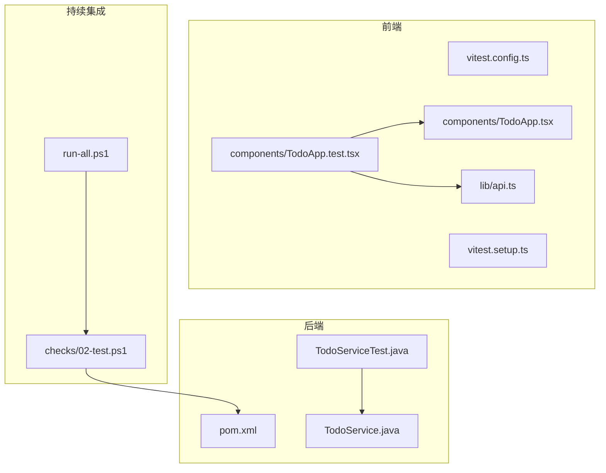
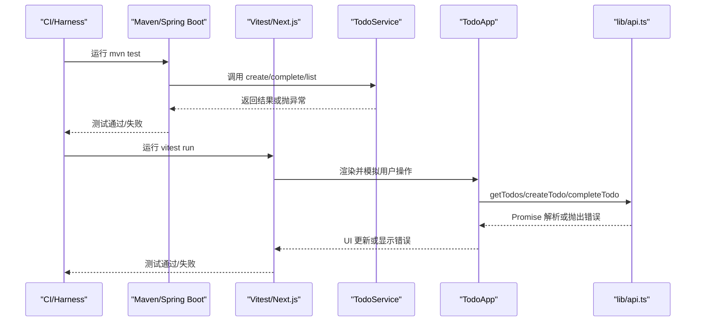
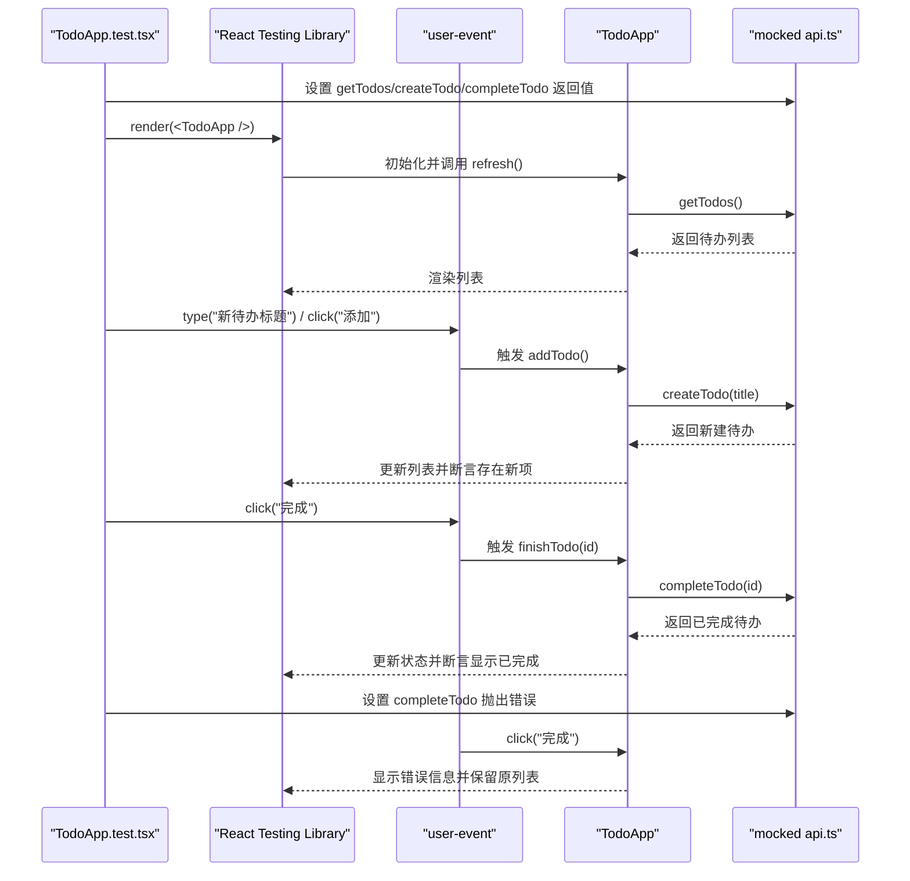
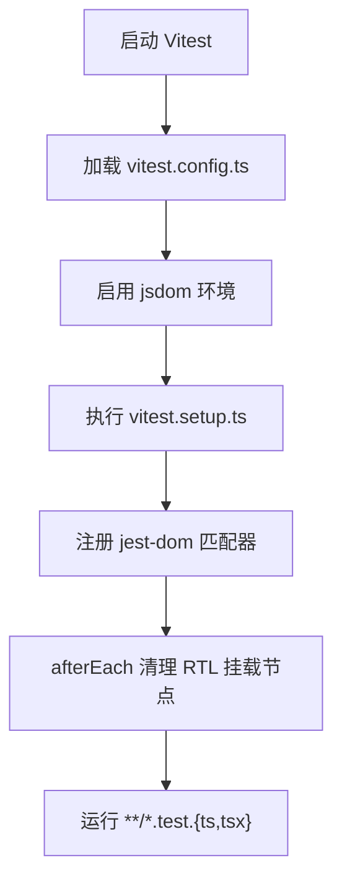
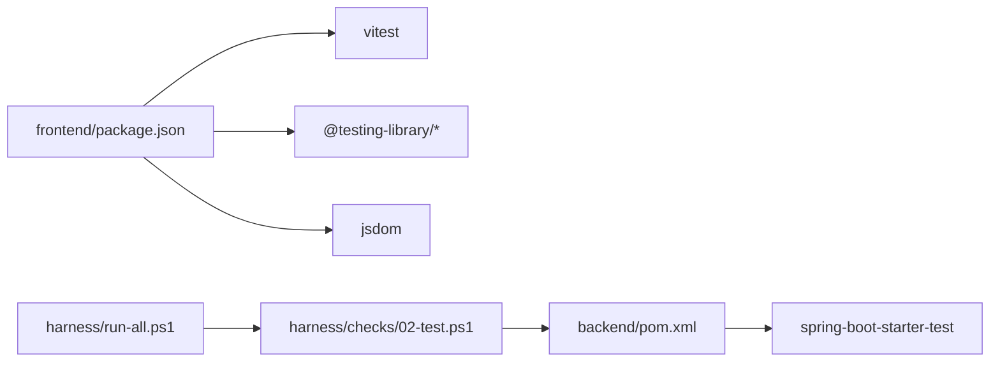

# 测试策略

<cite>
**本文引用的文件**   
- [backend/pom.xml](file://backend/pom.xml)
- [backend/src/main/java/com/luyi/myfirst/domain/TodoService.java](file://backend/src/main/java/com/luyi/myfirst/domain/TodoService.java)
- [backend/src/test/java/com/luyi/myfirst/domain/TodoServiceTest.java](file://backend/src/test/java/com/luyi/myfirst/domain/TodoServiceTest.java)
- [frontend/package.json](file://frontend/package.json)
- [frontend/vitest.config.ts](file://frontend/vitest.config.ts)
- [frontend/vitest.setup.ts](file://frontend/vitest.setup.ts)
- [frontend/lib/api.ts](file://frontend/lib/api.ts)
- [frontend/components/TodoApp.tsx](file://frontend/components/TodoApp.tsx)
- [frontend/components/TodoApp.test.tsx](file://frontend/components/TodoApp.test.tsx)
- [harness/run-all.ps1](file://harness/run-all.ps1)
- [harness/checks/02-test.ps1](file://harness/checks/02-test.ps1)
</cite>

## 目录
1. [引言](#引言)
2. [项目结构](#项目结构)
3. [核心组件](#核心组件)
4. [架构总览](#架构总览)
5. [详细组件分析](#详细组件分析)
6. [依赖关系分析](#依赖关系分析)
7. [性能与稳定性考量](#性能与稳定性考量)
8. [故障排查指南](#故障排查指南)
9. [结论](#结论)
10. [附录：质量门禁与覆盖率建议](#附录质量门禁与覆盖率建议)

## 引言
本测试策略面向当前前后端工程，明确测试分层、框架选型、用例编写规范、集成测试策略、Mock 与数据管理方法、异步测试处理、持续集成执行与报告生成方式。后端采用 JUnit + Spring Test，前端采用 Vitest + React Testing Library；通过 Harness 脚本统一编排编译、测试与前端构建流程，确保“可重复、可验证、可拒绝”的质量闸门。

## 项目结构
仓库采用前后端分离结构，测试代码与源码就近放置：
- 后端单元测试位于 `backend/src/test/java`，使用 Maven 与 Spring Boot 测试依赖。
- 前端组件测试位于 `frontend/components`，使用 Vitest 与 jsdom 环境。
- 全局测试配置位于 `frontend/vitest.config.ts` 与 `frontend/vitest.setup.ts`。
- 持续集成入口为 `harness/run-all.ps1`，测试闸门为 `harness/checks/02-test.ps1`。

**图表来源**
- [backend/pom.xml:27-37](file://backend/pom.xml#L27-L37)
- [backend/src/main/java/com/luyi/myfirst/domain/TodoService.java:1-44](file://backend/src/main/java/com/luyi/myfirst/domain/TodoService.java#L1-L44)
- [backend/src/test/java/com/luyi/myfirst/domain/TodoServiceTest.java:1-64](file://backend/src/test/java/com/luyi/myfirst/domain/TodoServiceTest.java#L1-L64)
- [frontend/vitest.config.ts:1-15](file://frontend/vitest.config.ts#L1-L15)
- [frontend/vitest.setup.ts:1-9](file://frontend/vitest.setup.ts#L1-L9)
- [frontend/lib/api.ts:1-36](file://frontend/lib/api.ts#L1-L36)
- [frontend/components/TodoApp.tsx:1-109](file://frontend/components/TodoApp.tsx#L1-L109)
- [frontend/components/TodoApp.test.tsx:1-81](file://frontend/components/TodoApp.test.tsx#L1-L81)
- [harness/run-all.ps1:1-90](file://harness/run-all.ps1#L1-L90)
- [harness/checks/02-test.ps1:1-23](file://harness/checks/02-test.ps1#L1-L23)

**章节来源**
- [backend/pom.xml:27-37](file://backend/pom.xml#L27-L37)
- [frontend/package.json:9-14](file://frontend/package.json#L9-L14)
- [frontend/vitest.config.ts:1-15](file://frontend/vitest.config.ts#L1-L15)
- [harness/run-all.ps1:1-90](file://harness/run-all.ps1#L1-L90)
- [harness/checks/02-test.ps1:1-23](file://harness/checks/02-test.ps1#L1-L23)

## 核心组件
- 后端领域服务 TodoService：内存存储待办事项，提供创建、完成、查询能力，对外抛出明确的参数校验异常。
- 前端组件 TodoApp：负责渲染列表、提交新增、标记完成、错误提示与加载状态。
- 前端 API 封装 lib/api.ts：基于 fetch 的 HTTP 客户端，统一错误包装。
- 测试基础设施：
  - 后端：JUnit Jupiter + AssertJ + Spring Boot Test（通过 spring-boot-starter-test）。
  - 前端：Vitest + React Testing Library + user-event + jest-dom 扩展 + jsdom。

**章节来源**
- [backend/src/main/java/com/luyi/myfirst/domain/TodoService.java:10-43](file://backend/src/main/java/com/luyi/myfirst/domain/TodoService.java#L10-L43)
- [frontend/components/TodoApp.tsx:6-56](file://frontend/components/TodoApp.tsx#L6-L56)
- [frontend/lib/api.ts:13-35](file://frontend/lib/api.ts#L13-L35)
- [backend/pom.xml:27-37](file://backend/pom.xml#L27-L37)
- [frontend/package.json:20-32](file://frontend/package.json#L20-L32)

## 架构总览
测试架构按层次划分：
- 单元测试层：后端针对领域逻辑，前端针对组件交互与状态更新。
- 集成测试层：API 路由与前端 API 客户端协同；容器装配验证 Spring 上下文。
- 持续集成层：Harness 统一触发后端 Maven 测试与前端 Vitest 测试，失败即阻断。

**图表来源**
- [harness/checks/02-test.ps1:12-18](file://harness/checks/02-test.ps1#L12-L18)
- [backend/src/main/java/com/luyi/myfirst/domain/TodoService.java:20-42](file://backend/src/main/java/com/luyi/myfirst/domain/TodoService.java#L20-L42)
- [frontend/components/TodoApp.tsx:16-56](file://frontend/components/TodoApp.tsx#L16-L56)
- [frontend/lib/api.ts:13-35](file://frontend/lib/api.ts#L13-L35)

## 详细组件分析

### 后端单元测试：TodoServiceTest
- 目标：验证 TodoService 的业务规则，包括标题去空格、空标题拒绝、完成状态翻转、未知 id 报错、列表顺序保持。
- 断言库：AssertJ，用于可读性强的链式断言与异常断言。
- 关键实践：
  - 直接实例化服务，避免引入外部依赖，保证纯单元测试。
  - 对异常路径使用 assertThatThrownBy 进行类型与消息断言。
  - 对集合顺序使用 containsExactly 保证确定性。

**图表来源**
- [backend/src/main/java/com/luyi/myfirst/domain/TodoService.java:20-42](file://backend/src/main/java/com/luyi/myfirst/domain/TodoService.java#L20-L42)
- [backend/src/test/java/com/luyi/myfirst/domain/TodoServiceTest.java:15-62](file://backend/src/test/java/com/luyi/myfirst/domain/TodoServiceTest.java#L15-L62)

**章节来源**
- [backend/src/test/java/com/luyi/myfirst/domain/TodoServiceTest.java:1-64](file://backend/src/test/java/com/luyi/myfirst/domain/TodoServiceTest.java#L1-L64)
- [backend/src/main/java/com/luyi/myfirst/domain/TodoService.java:10-43](file://backend/src/main/java/com/luyi/myfirst/domain/TodoService.java#L10-L43)

### 前端组件测试：TodoApp.test.tsx
- 目标：验证组件挂载后渲染后端数据、表单提交创建新待办、点击完成按钮更新状态、请求失败时展示错误且保留已有列表。
- Mock 策略：使用 vi.mock 对 `../lib/api` 模块进行整体替换，并通过 vi.mocked 获取强类型 mock 函数引用。
- 用户交互：使用 @testing-library/user-event 模拟输入与点击。
- 异步断言：使用 waitFor 与 findBy* 等待异步更新完成后再断言。

**图表来源**
- [frontend/components/TodoApp.test.tsx:1-81](file://frontend/components/TodoApp.test.tsx#L1-L81)
- [frontend/components/TodoApp.tsx:16-56](file://frontend/components/TodoApp.tsx#L16-L56)
- [frontend/lib/api.ts:21-35](file://frontend/lib/api.ts#L21-L35)

**章节来源**
- [frontend/components/TodoApp.test.tsx:1-81](file://frontend/components/TodoApp.test.tsx#L1-L81)
- [frontend/components/TodoApp.tsx:1-109](file://frontend/components/TodoApp.tsx#L1-L109)
- [frontend/lib/api.ts:1-36](file://frontend/lib/api.ts#L1-L36)

### 前端测试环境与配置
- 测试环境：jsdom，使组件测试具备 DOM 能力。
- 全局清理：vitest.setup.ts 中 afterEach 调用 cleanup，防止组件残留影响后续用例。
- 匹配器扩展：引入 @testing-library/jest-dom 以支持 toBeInTheDocument 等语义化断言。
- 包含/排除：仅运行 `**/*.test.{ts,tsx}`，排除 node_modules 与 .next。

**图表来源**
- [frontend/vitest.config.ts:1-15](file://frontend/vitest.config.ts#L1-L15)
- [frontend/vitest.setup.ts:1-9](file://frontend/vitest.setup.ts#L1-L9)

**章节来源**
- [frontend/vitest.config.ts:1-15](file://frontend/vitest.config.ts#L1-L15)
- [frontend/vitest.setup.ts:1-9](file://frontend/vitest.setup.ts#L1-L9)

## 依赖关系分析
- 后端依赖：
  - spring-boot-starter-web：提供 Web 能力。
  - spring-boot-starter-test：包含 JUnit、Spring Test、Mockito、AssertJ 等测试工具。
- 前端依赖：
  - vitest：测试运行器。
  - @testing-library/react、@testing-library/user-event、@testing-library/jest-dom：组件测试生态。
  - jsdom：DOM 环境。
- 持续集成：
  - harness/run-all.ps1：顺序执行子检查，任一失败即退出非 0。
  - harness/checks/02-test.ps1：强制运行 Maven 测试，不允许跳过。

**图表来源**
- [backend/pom.xml:27-37](file://backend/pom.xml#L27-L37)
- [frontend/package.json:20-32](file://frontend/package.json#L20-L32)
- [harness/run-all.ps1:36-62](file://harness/run-all.ps1#L36-L62)
- [harness/checks/02-test.ps1:12-18](file://harness/checks/02-test.ps1#L12-L18)

**章节来源**
- [backend/pom.xml:27-37](file://backend/pom.xml#L27-L37)
- [frontend/package.json:20-32](file://frontend/package.json#L20-L32)
- [harness/run-all.ps1:1-90](file://harness/run-all.ps1#L1-L90)
- [harness/checks/02-test.ps1:1-23](file://harness/checks/02-test.ps1#L1-L23)

## 性能与稳定性考量
- 后端单元测试不引入数据库与网络依赖，使用内存 Map 存储，保证快速、稳定、可重复。
- 前端组件测试在 jsdom 中运行，避免真实浏览器开销；通过 Mock API 隔离网络延迟。
- 测试数据构造尽量轻量，避免复杂对象图；必要时使用工厂函数集中生成。
- 异步测试使用 waitFor 与 findBy*，避免硬编码 sleep，提升鲁棒性与速度。

[本节为通用指导，不涉及具体文件分析]

## 故障排查指南
- 后端测试失败：
  - 检查参数校验异常是否被正确捕获与断言。
  - 确认集合顺序断言与期望一致。
- 前端测试失败：
  - 检查 vitest.setup.ts 是否正确清理 RTL 挂载节点。
  - 确认 vi.mock 的位置与 import 顺序，确保模块被正确替换。
  - 对于异步 UI 更新，优先使用 findBy* 与 waitFor 进行断言。
- 持续集成失败：
  - 确认 harness/run-all.ps1 与 checks/02-test.ps1 未被修改为允许跳过测试。
  - 查看 Maven 与 Vitest 输出日志定位失败用例。

**章节来源**
- [backend/src/test/java/com/luyi/myfirst/domain/TodoServiceTest.java:25-51](file://backend/src/test/java/com/luyi/myfirst/domain/TodoServiceTest.java#L25-L51)
- [frontend/vitest.setup.ts:5-8](file://frontend/vitest.setup.ts#L5-L8)
- [frontend/components/TodoApp.test.tsx:23-26](file://frontend/components/TodoApp.test.tsx#L23-L26)
- [harness/checks/02-test.ps1:6-7](file://harness/checks/02-test.ps1#L6-L7)

## 结论
本测试策略以 JUnit + Spring Test 和 Vitest + React Testing Library 为核心，围绕 TodoService 与 TodoApp 构建了清晰的单元与组件测试范式。通过 Harness 统一编排测试执行，形成“行为契约机器化”的质量闸门。建议在后续迭代中补充 API 集成测试与覆盖率统计，进一步巩固质量基线。

[本节为总结性内容，不涉及具体文件分析]

## 附录：质量门禁与覆盖率建议
- 质量门禁
  - 后端：禁止跳过测试（-DskipTests），由 harness/checks/02-test.ps1 强制执行。
  - 前端：vitest.config.ts 中 passWithNoTests 便于渐进式补测，但应逐步提高用例覆盖。
- 覆盖率要求（建议）
  - 后端：行覆盖率 ≥ 80%，分支覆盖率 ≥ 70%。
  - 前端：行覆盖率 ≥ 80%，分支覆盖率 ≥ 70%。
  - 关键业务类（如 TodoService）与关键组件（如 TodoApp）应达到更高阈值。
- 覆盖率采集
  - 后端：可在 Maven 中集成 JaCoCo 插件，生成 HTML 与 XML 报告。
  - 前端：可在 Vitest 中开启 coverage 选项，生成覆盖率报告。
- 持续集成
  - 将覆盖率阈值作为门禁条件，低于阈值则构建失败。
  - 归档覆盖率报告以便趋势分析与回溯。

[本节为通用建议，不涉及具体文件分析]