# 测试策略

<cite>
**本文引用的文件**   
- [backend/pom.xml](file://backend/pom.xml)
- [backend/src/main/java/com/luyi/myfirst/domain/TodoService.java](file://backend/src/main/java/com/luyi/myfirst/domain/TodoService.java)
- [backend/src/test/java/com/luyi/myfirst/domain/TodoServiceTest.java](file://backend/src/test/java/com/luyi/myfirst/domain/TodoServiceTest.java)
- [frontend/package.json](file://frontend/package.json)
- [frontend/vitest.config.ts](file://frontend/vitest.config.ts)
- [frontend/vitest.setup.ts](file://frontend/vitest.setup.ts)
- [frontend/lib/api.ts](file://frontend/lib/api.ts)
- [frontend/components/home/hash-anchor-restorer.tsx](file://frontend/components/home/hash-anchor-restorer.tsx)
- [frontend/components/home/hash-anchor-restorer.test.tsx](file://frontend/components/home/hash-anchor-restorer.test.tsx)
- [docs/e2e/homepage-anchors.spec.ts](file://docs/e2e/homepage-anchors.spec.ts)
- [docs/e2e/support/helpers.ts](file://docs/e2e/support/helpers.ts)
- [docs/e2e/support/fixtures.ts](file://docs/e2e/support/fixtures.ts)
- [docs/e2e/homepage-u1-auth.spec.ts](file://docs/e2e/homepage-u1-auth.spec.ts)
- [docs/e2e/homepage-u0-contract-mock.spec.ts](file://docs/e2e/homepage-u0-contract-mock.spec.ts)
- [playwright.config.ts](file://playwright.config.ts)
- [package.json](file://package.json)
- [scripts/e2e-run.mjs](file://scripts/e2e-run.mjs)
- [docs/e2e/README.md](file://docs/e2e/README.md)
- [docs/e2e/support/global-setup.ts](file://docs/e2e/support/global-setup.ts)
- [harness/run-all.ps1](file://harness/run-all.ps1)
- [harness/checks/02-test.ps1](file://harness/checks/02-test.ps1)
- [scripts/seed-posts-accounts.ps1](file://scripts/seed-posts-accounts.ps1)
- [backend/tools/SeedPostsAccounts.java](file://backend/tools/SeedPostsAccounts.java)
- [backend/src/main/resources/application.yml](file://backend/src/main/resources/application.yml)
</cite>

## 更新摘要
**所做更改**   
- **重大变更**：E2E测试策略从模拟认证状态迁移到真实的API端点stubbing，使用Playwright的`page.route`拦截所有`/api/auth/*`请求
- 新增`stubAuthApi`和`recordAuthRequests`辅助函数，提供统一的认证API桩和请求录制能力
- 移除所有关于模拟认证状态的参考，改为基于真实HTTP契约的测试方法
- 增强锚点定位验证方法，特别是`expectAnchorLanded`函数的准确性
- 新增首页锚点落位测试套件，包含5个专门针对锚点稳定性的测试用例
- E2E测试总数从154个增加到159个用例
- **新增测试数据种子基础设施**：完整的PowerShell脚本和Java初始化器，用于在本地环境中创建测试账户和帖子数据

## 目录
1. [引言](#引言)
2. [项目结构](#项目结构)
3. [核心组件](#核心组件)
4. [架构总览](#架构总览)
5. [详细组件分析](#详细组件分析)
6. [依赖关系分析](#依赖关系分析)
7. [性能与稳定性考量](#性能与稳定性考量)
8. [故障排查指南](#故障排查指南)
9. [结论](#结论)
10. [附录：质量门禁与覆盖率建议](#附录质量门禁与覆盖率建议)

## 引言
本测试策略面向当前前后端工程，明确测试分层、框架选型、用例编写规范、集成测试策略、Mock 与数据管理方法、异步测试处理、持续集成执行与报告生成方式。后端采用 JUnit + Spring Test，前端采用 Vitest + React Testing Library；**Playwright E2E 测试框架**提供端到端浏览器自动化测试，覆盖首页和搜索功能的 **159个自动化用例**。通过 Harness 脚本统一编排编译、测试与前端构建流程，确保"可重复、可验证、可拒绝"的质量闸门。

**重要更新**：E2E测试策略已发生重大变革，从传统的模拟认证状态迁移到基于真实HTTP契约的API端点stubbing方法，提供更可靠和可维护的测试基础架构。**新增的测试数据种子基础设施**为E2E测试提供了稳定的测试环境支持。

## 项目结构
仓库采用前后端分离结构，测试代码与源码就近放置：
- 后端单元测试位于 `backend/src/test/java`，使用 Maven 与 Spring Boot 测试依赖。
- 前端组件测试位于 `frontend/components`，使用 Vitest 与 jsdom 环境。
- **E2E 端到端测试位于 `docs/e2e`，使用 Playwright 进行浏览器自动化测试。**
- **测试数据种子工具位于 `scripts/seed-posts-accounts.ps1` 和 `backend/tools/SeedPostsAccounts.java`。**
- 全局测试配置位于 `frontend/vitest.config.ts` 与 `frontend/vitest.setup.ts`。
- **Playwright 配置位于根目录 `playwright.config.ts`，测试脚本位于 `scripts/e2e-run.mjs`。**
- 持续集成入口为 `harness/run-all.ps1`，测试闸门为 `harness/checks/02-test.ps1`。

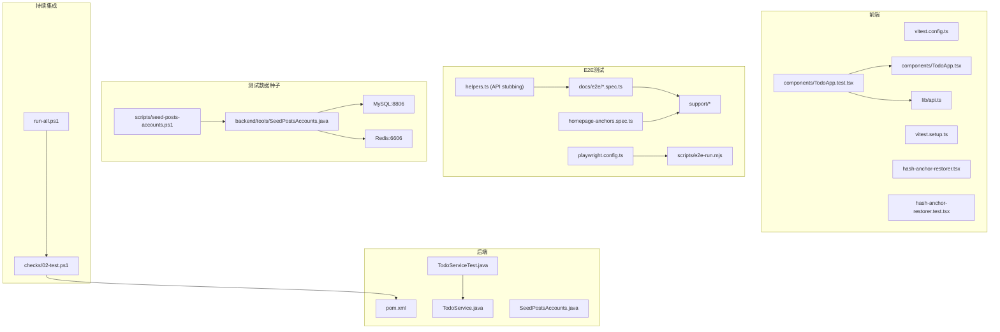

**图表来源**
- [backend/pom.xml:27-37](file://backend/pom.xml#L27-L37)
- [backend/src/main/java/com/luyi/myfirst/domain/TodoService.java:1-44](file://backend/src/main/java/com/luyi/myfirst/domain/TodoService.java#L1-L44)
- [backend/src/test/java/com/luyi/myfirst/domain/TodoServiceTest.java:1-64](file://backend/src/test/java/com/luyi/myfirst/domain/TodoServiceTest.java#L1-L64)
- [scripts/seed-posts-accounts.ps1:1-161](file://scripts/seed-posts-accounts.ps1#L1-L161)
- [backend/tools/SeedPostsAccounts.java:1-160](file://backend/tools/SeedPostsAccounts.java#L1-L160)
- [frontend/vitest.config.ts:1-15](file://frontend/vitest.config.ts#L1-L15)
- [frontend/vitest.setup.ts:1-9](file://frontend/vitest.setup.ts#L1-L9)
- [frontend/lib/api.ts:1-36](file://frontend/lib/api.ts#L1-L36)
- [frontend/components/home/hash-anchor-restorer.tsx:1-149](file://frontend/components/home/hash-anchor-restorer.tsx#L1-L149)
- [frontend/components/home/hash-anchor-restorer.test.tsx:1-113](file://frontend/components/home/hash-anchor-restorer.test.tsx#L1-L113)
- [docs/e2e/homepage-anchors.spec.ts:1-48](file://docs/e2e/homepage-anchors.spec.ts#L1-L48)
- [docs/e2e/support/helpers.ts:226-329](file://docs/e2e/support/helpers.ts#L226-L329)
- [playwright.config.ts:1-55](file://playwright.config.ts#L1-L55)
- [scripts/e2e-run.mjs:1-111](file://scripts/e2e-run.mjs#L1-L111)
- [docs/e2e/README.md:1-90](file://docs/e2e/README.md#L1-L90)
- [harness/run-all.ps1:1-90](file://harness/run-all.ps1#L1-L90)
- [harness/checks/02-test.ps1:1-23](file://harness/checks/02-test.ps1#L1-L23)

**章节来源**
- [backend/pom.xml:27-37](file://backend/pom.xml#L27-L37)
- [frontend/package.json:9-14](file://frontend/package.json#L9-L14)
- [frontend/vitest.config.ts:1-15](file://frontend/vitest.config.ts#L1-L15)
- [playwright.config.ts:1-55](file://playwright.config.ts#L1-L55)
- [scripts/e2e-run.mjs:1-111](file://scripts/e2e-run.mjs#L1-L111)
- [docs/e2e/README.md:1-90](file://docs/e2e/README.md#L1-L90)
- [harness/run-all.ps1:1-90](file://harness/run-all.ps1#L1-L90)
- [harness/checks/02-test.ps1:1-23](file://harness/checks/02-test.ps1#L1-L23)

## 核心组件
- 后端领域服务 TodoService：内存存储待办事项，提供创建、完成、查询能力，对外抛出明确的参数校验异常。
- 前端组件 TodoApp：负责渲染列表、提交新增、标记完成、错误提示与加载状态。
- 前端 API 封装 lib/api.ts：基于 fetch 的 HTTP 客户端，统一错误包装。
- **锚点恢复组件 HashAnchorRestorer：**
  - **功能：校正从搜索页回链或直接带 hash 打开首页时的滚动位置，确保目标区块对齐到吸顶头部下沿。**
  - **特性：支持布局稳定检测、用户交互中断、ResizeObserver 监听内容变化。**
  - **工具函数：hashTargetId、anchorScrollTop、isScrollKey 等辅助方法。**
- **E2E 测试基础设施（重大更新）：**
  - **Playwright：端到端浏览器自动化测试框架，支持 Chrome/Firefox/WebKit。**
  - **API端点Stubbing：使用`stubAuthApi`函数拦截所有`/api/auth/*`请求，提供真实的HTTP契约测试。**
  - **请求录制：`recordAuthRequests`函数记录所有认证相关请求，用于断言请求顺序和字段名。**
  - **测试夹具 fixtures.ts：失败截图、自定义断言和页面操作辅助。**
  - **工具函数 helpers.ts：导航、视口设置、用户模拟、数据准备等通用功能。**
  - **全局设置 global-setup.ts：路由预热和开发服务器初始化。**
- **测试数据种子基础设施（新增）：**
  - **PowerShell脚本 seed-posts-accounts.ps1：完整的测试数据准备流程，包括环境检查、容器发现、凭据注入和数据初始化。**
  - **Java初始化器 SeedPostsAccounts.java：Spring应用上下文中的账户创建逻辑，集成验证码生成和邮箱码验证。**
  - **双重安全保障：防止生产环境误用，强制本地数据库和Redis连接。**
  - **账户隔离：创建两个独立的测试账户A和B，确保测试间的数据隔离。**
- 测试基础设施：
  - 后端：JUnit Jupiter + AssertJ + Spring Boot Test（通过 spring-boot-starter-test）。
  - 前端：Vitest + React Testing Library + user-event + jest-dom 扩展 + jsdom。

**章节来源**
- [backend/src/main/java/com/luyi/myfirst/domain/TodoService.java:10-43](file://backend/src/main/java/com/luyi/myfirst/domain/TodoService.java#L10-L43)
- [frontend/components/home/hash-anchor-restorer.tsx:1-149](file://frontend/components/home/hash-anchor-restorer.tsx#L1-L149)
- [frontend/lib/api.ts:13-35](file://frontend/lib/api.ts#L13-L35)
- [docs/e2e/support/helpers.ts:226-329](file://docs/e2e/support/helpers.ts#L226-L329)
- [docs/e2e/support/fixtures.ts:1-51](file://docs/e2e/support/fixtures.ts#L1-L51)
- [docs/e2e/support/global-setup.ts:1-30](file://docs/e2e/support/global-setup.ts#L1-L30)
- [scripts/seed-posts-accounts.ps1:1-161](file://scripts/seed-posts-accounts.ps1#L1-L161)
- [backend/tools/SeedPostsAccounts.java:1-160](file://backend/tools/SeedPostsAccounts.java#L1-L160)
- [backend/pom.xml:27-37](file://backend/pom.xml#L27-L37)
- [frontend/package.json:20-32](file://frontend/package.json#L20-32)

## 架构总览
测试架构按层次划分：
- **单元测试层：** 后端针对领域逻辑，前端针对组件交互与状态更新。
- **组件测试层：** 前端组件级测试，验证 UI 交互和业务逻辑。
- **E2E 测试层：** 端到端浏览器自动化测试，覆盖完整用户流程和业务场景。
- **集成测试层：** API 路由与前端 API 客户端协同；容器装配验证 Spring 上下文。
- **测试数据准备层：** PowerShell脚本和Java初始化器协作，提供稳定的测试环境。
- **持续集成层：** Harness 统一触发后端 Maven 测试、前端 Vitest 测试和 Playwright E2E 测试，失败即阻断。

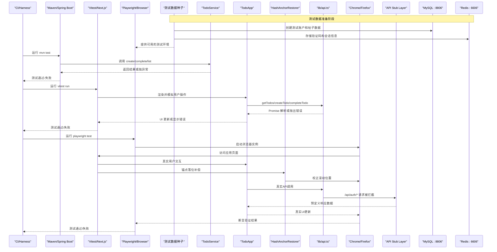

**图表来源**
- [harness/checks/02-test.ps1:12-18](file://harness/checks/02-test.ps1#L12-L18)
- [backend/src/main/java/com/luyi/myfirst/domain/TodoService.java:20-42](file://backend/src/main/java/com/luyi/myfirst/domain/TodoService.java#L20-L42)
- [frontend/components/home/hash-anchor-restorer.tsx:43-64](file://frontend/components/home/hash-anchor-restorer.tsx#L43-L64)
- [frontend/lib/api.ts:13-35](file://frontend/lib/api.ts#L13-L35)
- [docs/e2e/support/helpers.ts:253-276](file://docs/e2e/support/helpers.ts#L253-L276)
- [playwright.config.ts:42-53](file://playwright.config.ts#L42-L53)
- [scripts/seed-posts-accounts.ps1:108-154](file://scripts/seed-posts-accounts.ps1#L108-L154)
- [backend/tools/SeedPostsAccounts.java:45-87](file://backend/tools/SeedPostsAccounts.java#L45-L87)

## 详细组件分析

### 后端单元测试：TodoServiceTest
- 目标：验证 TodoService 的业务规则，包括标题去空格、空标题拒绝、完成状态翻转、未知 id 报错、列表顺序保持。
- 断言库：AssertJ，用于可读性强的链式断言与异常断言。
- 关键实践：
  - 直接实例化服务，避免引入外部依赖，保证纯单元测试。
  - 对异常路径使用 assertThatThrownBy 进行类型与消息断言。
  - 对集合顺序使用 containsExactly 保证确定性。

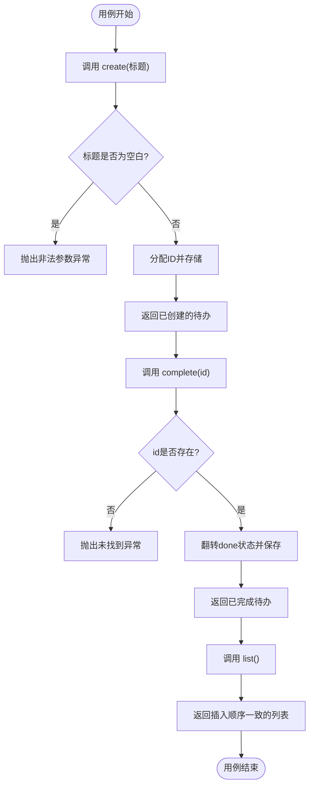

**图表来源**
- [backend/src/main/java/com/luyi/myfirst/domain/TodoService.java:20-42](file://backend/src/main/java/com/luyi/myfirst/domain/TodoService.java#L20-L42)
- [backend/src/test/java/com/luyi/myfirst/domain/TodoServiceTest.java:15-62](file://backend/src/test/java/com/luyi/myfirst/domain/TodoServiceTest.java#L15-L62)

**章节来源**
- [backend/src/test/java/com/luyi/myfirst/domain/TodoServiceTest.java:1-64](file://backend/src/test/java/com/luyi/myfirst/domain/TodoServiceTest.java#L1-L64)
- [backend/src/main/java/com/luyi/myfirst/domain/TodoService.java:10-43](file://backend/src/main/java/com/luyi/myfirst/domain/TodoService.java#L10-L43)

### 前端组件测试：TodoApp.test.tsx
- 目标：验证组件挂载后渲染后端数据、表单提交创建新待办、点击完成按钮更新状态、请求失败时展示错误且保留已有列表。
- Mock 策略：使用 vi.mock 对 `../lib/api` 模块进行整体替换，并通过 vi.mocked 获取强类型 mock 函数引用。
- 用户交互：使用 @testing-library/user-event 模拟输入与点击。
- 异步断言：使用 waitFor 与 findBy* 等待异步更新完成后再断言。

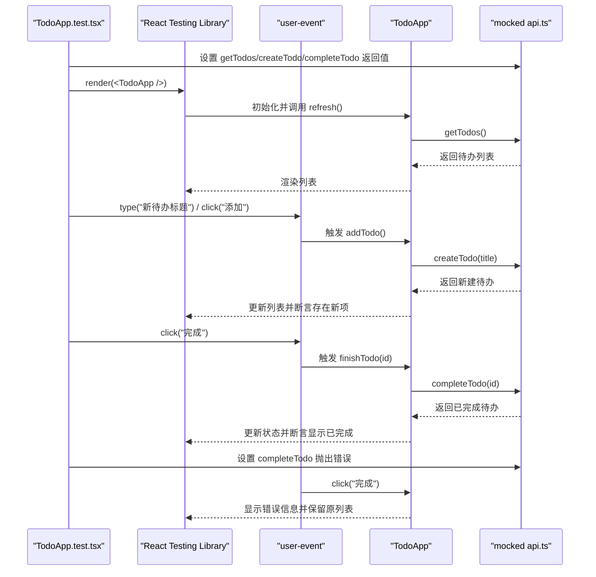

**图表来源**
- [frontend/components/TodoApp.test.tsx:1-81](file://frontend/components/TodoApp.test.tsx#L1-L81)
- [frontend/components/TodoApp.tsx:16-56](file://frontend/components/TodoApp.tsx#L16-L56)
- [frontend/lib/api.ts:21-35](file://frontend/lib/api.ts#L21-L35)

**章节来源**
- [frontend/components/TodoApp.test.tsx:1-81](file://frontend/components/TodoApp.test.tsx#L1-L81)
- [frontend/components/TodoApp.tsx:1-109](file://frontend/components/TodoApp.tsx#L1-L109)
- [frontend/lib/api.ts:1-36](file://frontend/lib/api.ts#L1-L36)

### 锚点恢复组件：HashAnchorRestorer
**新增** 锚点恢复组件提供了从搜索页回链或直接带 hash 打开首页时的滚动位置校正功能。

- **核心功能：**
  - 监听 hashchange 和 popstate 事件，自动校正滚动位置
  - 将目标区块对齐到吸顶头部下沿，考虑动态头部高度
  - 支持布局稳定检测，避免不必要的滚动操作
  - 用户主动交互时立即停止校正，尊重用户操作

- **关键算法：**
  - `hashTargetId`：从 location.hash 解析目标元素 ID，支持 URL 编码解码
  - `anchorScrollTop`：计算目标对齐所需的滚动位置，扣掉头部高度
  - `isScrollKey`：识别方向类按键，作为用户主动滚动的标志

- **稳定性机制：**
  - 最大观察时长 3 秒，超时后交给浏览器原生行为
  - 连续 3 帧位置不变视为布局稳定
  - 2px 偏差容忍度，避免 1px 抖动引发滚动
  - ResizeObserver 监听内容变化，重新计算对齐位置

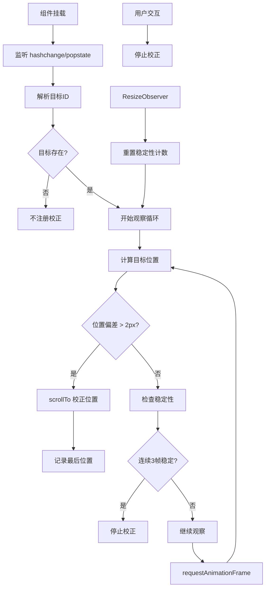

**图表来源**
- [frontend/components/home/hash-anchor-restorer.tsx:43-149](file://frontend/components/home/hash-anchor-restorer.tsx#L43-L149)

**章节来源**
- [frontend/components/home/hash-anchor-restorer.tsx:1-149](file://frontend/components/home/hash-anchor-restorer.tsx#L1-L149)
- [frontend/components/home/hash-anchor-restorer.test.tsx:1-113](file://frontend/components/home/hash-anchor-restorer.test.tsx#L1-L113)

### E2E 端到端测试：Playwright 框架（重大更新）

#### 新的API端点Stubbing架构
**重大更新**：E2E测试策略已从模拟认证状态完全迁移到基于真实HTTP契约的API端点stubbing方法。

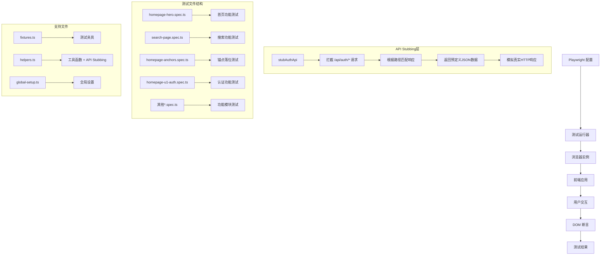

**图表来源**
- [playwright.config.ts:14-41](file://playwright.config.ts#L14-L41)
- [docs/e2e/support/helpers.ts:253-276](file://docs/e2e/support/helpers.ts#L253-L276)
- [docs/e2e/homepage-u1-auth.spec.ts:1-473](file://docs/e2e/homepage-u1-auth.spec.ts#L1-L473)

#### 认证API Stubbing实现
**新增** 完整的认证API stubbing系统，提供以下核心功能：

- **`stubAuthApi`函数**：拦截所有`/api/auth/*`请求，根据路径返回预定义响应
- **`recordAuthRequests`函数**：录制所有认证相关请求，用于断言请求顺序和字段名
- **预定义响应体**：`ME_BODY`、`UNAUTHENTICATED_BODY`、`CAPTCHA_BODY`等标准响应格式
- **动态响应支持**：支持函数形式的响应，可根据调用次数返回不同结果

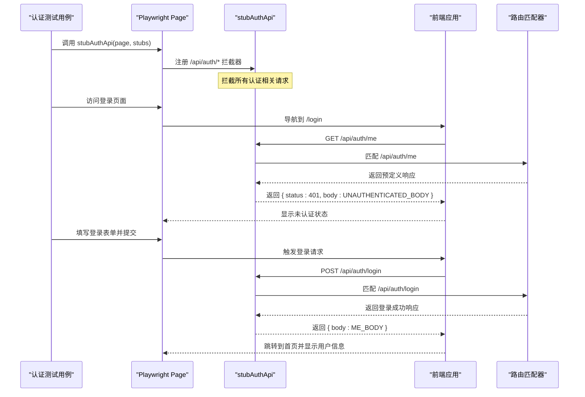

**图表来源**
- [docs/e2e/support/helpers.ts:253-276](file://docs/e2e/support/helpers.ts#L253-L276)
- [docs/e2e/homepage-u1-auth.spec.ts:125-157](file://docs/e2e/homepage-u1-auth.spec.ts#L125-L157)

#### 测试配置与运行
- **配置文件：** `playwright.config.ts` 定义了测试目录、超时设置、浏览器配置、报告生成等。
- **端口管理：** `scripts/e2e-run.mjs` 自动探测可用端口（3000-3010），启动 Next.js 开发服务器。
- **浏览器设置：** 默认使用本地 Chrome，视口 1440×900，启用失败截图和 trace。
- **并行控制：** 串行执行（workers: 1），避免 Mock 存储冲突。

#### 测试夹具与工具函数
- **失败截图：** 自动捕获失败时的全页截图，保存到 `docs/e2e/screenshots/<spec>/<test>.png`。
- **导航辅助：** `gotoHome()`、`gotoSearch()` 等统一页面导航方法。
- **视口管理：** 桌面端 1440×900、移动端 375×667、窄屏 320×667 预设。
- **用户模拟：** 预置管理员和普通用户账号，支持登录状态模拟。
- **数据观察：** MutationObserver 监听 DOM 变化，验证瞬态 UI 行为。
- **锚点验证：** `expectAnchorLanded` 函数验证目标区块对齐到吸顶头部下沿。

#### 新增锚点落位测试
**新增** homepage-anchors.spec.ts 包含5个专门针对锚点落位稳定性的测试用例：

- **直接访问锚点：** 验证 `/#editor-picks`、`/#hot-posts`、`/#hot-attractions` 都能正确定位到目标区块
- **用户滚动让位：** 验证用户主动滚动后，页面不会自动拉回锚点位置
- **无锚点不滚动：** 验证不带 hash 访问首页时，即使内容撑高页面也不会自动滚动

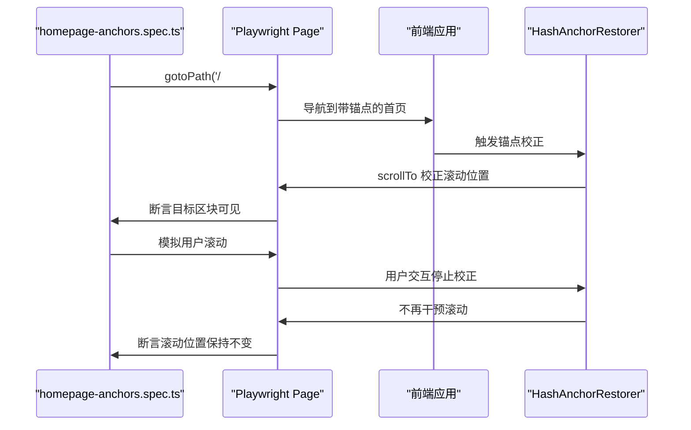

**图表来源**
- [docs/e2e/homepage-anchors.spec.ts:12-47](file://docs/e2e/homepage-anchors.spec.ts#L12-L47)
- [frontend/components/home/hash-anchor-restorer.tsx:43-149](file://frontend/components/home/hash-anchor-restorer.tsx#L43-L149)

**章节来源**
- [playwright.config.ts:1-55](file://playwright.config.ts#L1-L55)
- [scripts/e2e-run.mjs:1-111](file://scripts/e2e-run.mjs#L1-L111)
- [docs/e2e/README.md:1-90](file://docs/e2e/README.md#L1-L90)
- [docs/e2e/support/fixtures.ts:1-51](file://docs/e2e/support/fixtures.ts#L1-L51)
- [docs/e2e/support/helpers.ts:1-329](file://docs/e2e/support/helpers.ts#L1-L329)
- [docs/e2e/support/global-setup.ts:1-30](file://docs/e2e/support/global-setup.ts#L1-L30)
- [docs/e2e/homepage-hero.spec.ts:1-200](file://docs/e2e/homepage-hero.spec.ts#L1-L200)
- [docs/e2e/search-page.spec.ts:1-200](file://docs/e2e/search-page.spec.ts#L1-L200)
- [docs/e2e/homepage-anchors.spec.ts:1-48](file://docs/e2e/homepage-anchors.spec.ts#L1-L48)
- [docs/e2e/homepage-u1-auth.spec.ts:1-473](file://docs/e2e/homepage-u1-auth.spec.ts#L1-L473)

### 测试数据种子基础设施（新增）

#### PowerShell脚本：seed-posts-accounts.ps1
**新增** 完整的测试数据准备脚本，提供以下核心功能：

- **环境安全检查：** 防止在生产环境或错误的数据库配置下运行
- **容器发现：** 自动发现本地运行的MySQL和Redis容器
- **凭据注入：** 从环境变量或容器配置中读取数据库凭据
- **账户创建：** 创建两个独立的测试账户A和B
- **登录验证：** 验证账户创建成功后可以通过API登录

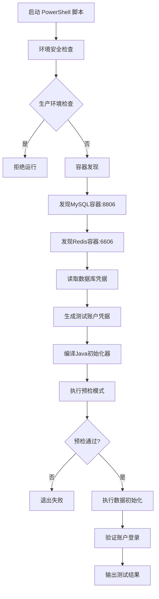

**图表来源**
- [scripts/seed-posts-accounts.ps1:66-154](file://scripts/seed-posts-accounts.ps1#L66-L154)

#### Java初始化器：SeedPostsAccounts.java
**新增** Spring应用上下文中的账户创建逻辑，集成现有后端服务：

- **安全配置验证：** 强制使用本地数据库和Redis，禁止生产环境配置
- **验证码集成：** 使用现有的CaptchaService生成验证码挑战
- **邮箱码流程：** 通过RegisterCodeService和OutboxVerificationCodeSender完成邮箱验证码流程
- **账户注册：** 使用RegisterService创建最终账户
- **双重保障：** 同时检查环境变量和应用配置，确保安全性

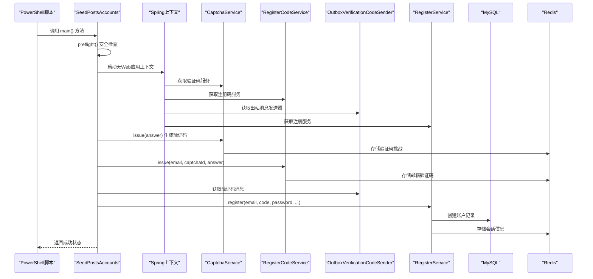

**图表来源**
- [backend/tools/SeedPostsAccounts.java:29-87](file://backend/tools/SeedPostsAccounts.java#L29-L87)

#### 安全设计原则
- **生产环境防护：** 多重检查防止在生产环境误用
- **本地存储强制：** 强制使用本地MySQL和Redis实例
- **凭据隔离：** 所有敏感信息仅存在于进程环境变量中
- **账户隔离：** 每个测试运行创建唯一的测试账户
- **失败保护：** 部分失败时不会留下不一致的状态

**章节来源**
- [scripts/seed-posts-accounts.ps1:1-161](file://scripts/seed-posts-accounts.ps1#L1-L161)
- [backend/tools/SeedPostsAccounts.java:1-160](file://backend/tools/SeedPostsAccounts.java#L1-L160)
- [backend/src/main/resources/application.yml:1-76](file://backend/src/main/resources/application.yml#L1-L76)

### 前端测试环境与配置
- 测试环境：jsdom，使组件测试具备 DOM 能力。
- 全局清理：vitest.setup.ts 中 afterEach 调用 cleanup，防止组件残留影响后续用例。
- 匹配器扩展：引入 @testing-library/jest-dom 以支持 toBeInTheDocument 等语义化断言。
- 包含/排除：仅运行 `**/*.test.{ts,tsx}`，排除 node_modules 与 .next。

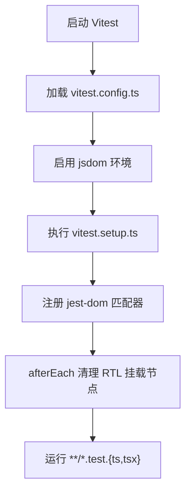

**图表来源**
- [frontend/vitest.config.ts:1-15](file://frontend/vitest.config.ts#L1-L15)
- [frontend/vitest.setup.ts:1-9](file://frontend/vitest.setup.ts#L1-L9)

**章节来源**
- [frontend/vitest.config.ts:1-15](file://frontend/vitest.config.ts#L1-L15)
- [frontend/vitest.setup.ts:1-9](file://frontend/vitest.setup.ts#L1-L9)

## 依赖关系分析
- 后端依赖：
  - spring-boot-starter-web：提供 Web 能力。
  - spring-boot-starter-test：包含 JUnit、Spring Test、Mockito、AssertJ 等测试工具。
- 前端依赖：
  - vitest：测试运行器。
  - @testing-library/react、@testing-library/user-event、@testing-library/jest-dom：组件测试生态。
  - jsdom：DOM 环境。
- **E2E 测试依赖：**
  - **@playwright/test：端到端测试框架。**
  - **TypeScript：类型安全的测试代码。**
- **测试数据种子依赖：**
  - **PowerShell：脚本执行环境。**
  - **Java JDK：编译和执行SeedPostsAccounts。**
  - **Docker：容器管理和配置发现。**
  - **MySQL：测试数据存储。**
  - **Redis：验证码和会话存储。**
- 持续集成：
  - harness/run-all.ps1：顺序执行子检查，任一失败即退出非 0。
  - harness/checks/02-test.ps1：强制运行 Maven 测试，不允许跳过。

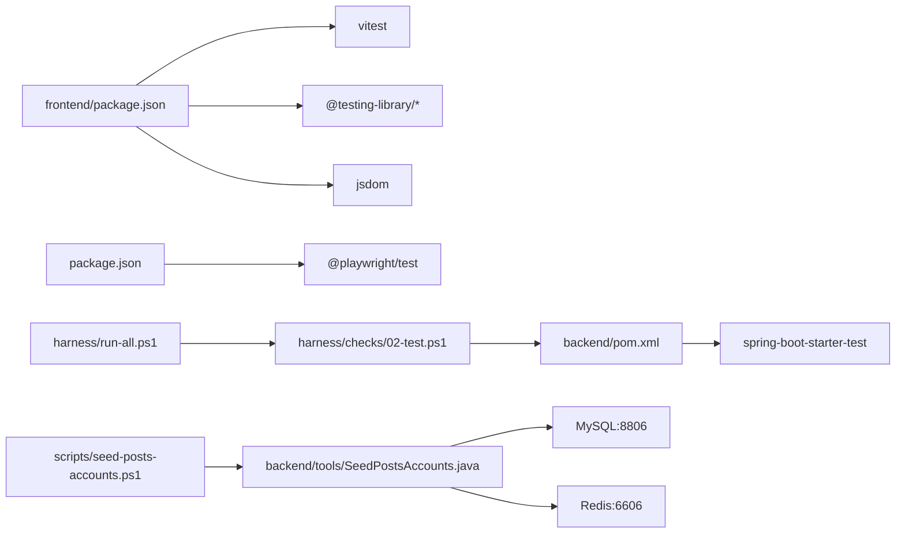

**图表来源**
- [backend/pom.xml:27-37](file://backend/pom.xml#L27-L37)
- [frontend/package.json:20-32](file://frontend/package.json#L20-32)
- [package.json:10-14](file://package.json#L10-L14)
- [scripts/seed-posts-accounts.ps1:1-161](file://scripts/seed-posts-accounts.ps1#L1-L161)
- [backend/tools/SeedPostsAccounts.java:1-160](file://backend/tools/SeedPostsAccounts.java#L1-L160)
- [harness/run-all.ps1:36-62](file://harness/run-all.ps1#L36-L62)
- [harness/checks/02-test.ps1:12-18](file://harness/checks/02-test.ps1#L12-L18)

**章节来源**
- [backend/pom.xml:27-37](file://backend/pom.xml#L27-L37)
- [frontend/package.json:20-32](file://frontend/package.json#L20-32)
- [package.json:1-16](file://package.json#L1-L16)
- [scripts/seed-posts-accounts.ps1:1-161](file://scripts/seed-posts-accounts.ps1#L1-L161)
- [backend/tools/SeedPostsAccounts.java:1-160](file://backend/tools/SeedPostsAccounts.java#L1-L160)
- [harness/run-all.ps1:1-90](file://harness/run-all.ps1#L1-L90)
- [harness/checks/02-test.ps1:1-23](file://harness/checks/02-test.ps1#L1-L23)

## 性能与稳定性考量
- 后端单元测试不引入数据库与网络依赖，使用内存 Map 存储，保证快速、稳定、可重复。
- 前端组件测试在 jsdom 中运行，避免真实浏览器开销；通过 Mock API 隔离网络延迟。
- **E2E 测试优化（重大更新）：**
  - **API Stubbing优势：通过stubAuthApi拦截认证请求，避免依赖MySQL/Redis/后端进程，提升测试稳定性和速度。**
  - **避免共享限流桶：桩掉认证端点后，不会触发后端限流逻辑，避免本地开发机被锁住的问题。**
  - **路由预热：global-setup.ts 预先访问所有路由，避免首次访问编译延迟。**
  - **端口复用：scripts/e2e-run.mjs 检测并复用已有的开发服务器实例。**
  - **浏览器缓存：利用浏览器缓存机制减少资源加载时间。**
  - **失败重试：禁用自动重试（retries: 0），确保测试结果的确定性。**
  - **锚点校正优化：HashAnchorRestorer 使用 requestAnimationFrame 和 ResizeObserver 实现高效的布局稳定检测。**
- **测试数据种子优化（新增）：**
  - **预检模式：支持--check-only参数，只验证环境而不修改数据。**
  - **容器发现：自动发现本地运行的MySQL和Redis容器，无需手动配置。**
  - **凭据注入：从容器配置中自动提取数据库凭据，避免硬编码。**
  - **账户隔离：每次运行创建唯一的测试账户，避免测试间干扰。**
  - **失败保护：部分失败时不会留下不一致的状态，支持幂等操作。**
- 测试数据构造尽量轻量，避免复杂对象图；必要时使用工厂函数集中生成。
- 异步测试使用 waitFor 与 findBy*，避免硬编码 sleep，提升鲁棒性与速度。

## 故障排查指南
- 后端测试失败：
  - 检查参数校验异常是否被正确捕获与断言。
  - 确认集合顺序断言与期望一致。
- 前端测试失败：
  - 检查 vitest.setup.ts 是否正确清理 RTL 挂载节点。
  - 确认 vi.mock 的位置与 import 顺序，确保模块被正确替换。
  - 对于异步 UI 更新，优先使用 findBy* 与 waitFor 进行断言。
- **E2E 测试失败（重大更新）：**
  - **检查 Playwright 浏览器安装和本地 Chrome 可用性。**
  - **查看 docs/e2e/playwright-report 中的 HTML 报告和失败截图。**
  - **确认端口未被占用，检查 scripts/e2e-run.mjs 的端口探测逻辑。**
  - **验证 Next.js 开发服务器正常启动，检查 webServer 配置。**
  - **使用 E2E_USE_EXISTING=1 复用现有服务器进行调试。**
  - **API Stubbing问题：检查stubAuthApi是否正确拦截请求，确认路径匹配和响应格式。**
  - **认证测试失败：检查ME_BODY、UNAUTHENTICATED_BODY等预定义响应体的字段完整性。**
  - **锚点测试失败：检查 expectAnchorLanded 函数的断言逻辑和目标元素 ID。**
- **测试数据种子故障（新增）：**
  - **容器不可用：检查MySQL:8806和Redis:6606容器是否正常运行。**
  - **凭据缺失：确认WANDERCHAIN_DB_USER、WANDERCHAIN_DB_PASSWORD、WANDERCHAIN_REDIS_PASSWORD环境变量。**
  - **生产环境防护：检查SPRING_PROFILES_ACTIVE和SPRING_PROFILES_DEFAULT是否包含prod。**
  - **账户创建失败：检查E2E_POSTS_ACCOUNT_A_EMAIL、E2E_POSTS_ACCOUNT_A_PASSWORD等环境变量。**
  - **登录验证失败：确认后端服务在localhost:3000正常运行。**
  - **权限问题：检查MySQL root用户和Redis密码配置。**
- 持续集成失败：
  - 确认 harness/run-all.ps1 与 checks/02-test.ps1 未被修改为允许跳过测试。
  - 查看 Maven 与 Vitest 输出日志定位失败用例。

**章节来源**
- [backend/src/test/java/com/luyi/myfirst/domain/TodoServiceTest.java:25-51](file://backend/src/test/java/com/luyi/myfirst/domain/TodoServiceTest.java#L25-L51)
- [frontend/vitest.setup.ts:5-8](file://frontend/vitest.setup.ts#L5-L8)
- [frontend/components/TodoApp.test.tsx:23-26](file://frontend/components/TodoApp.test.tsx#L23-L26)
- [docs/e2e/README.md:21-34](file://docs/e2e/README.md#L21-L34)
- [playwright.config.ts:42-53](file://playwright.config.ts#L42-L53)
- [harness/checks/02-test.ps1:6-7](file://harness/checks/02-test.ps1#L6-L7)
- [docs/e2e/support/helpers.ts:55-71](file://docs/e2e/support/helpers.ts#L55-L71)
- [docs/e2e/support/helpers.ts:253-276](file://docs/e2e/support/helpers.ts#L253-L276)
- [scripts/seed-posts-accounts.ps1:66-154](file://scripts/seed-posts-accounts.ps1#L66-L154)
- [backend/tools/SeedPostsAccounts.java:90-113](file://backend/tools/SeedPostsAccounts.java#L90-L113)

## 结论
本测试策略以 JUnit + Spring Test、Vitest + React Testing Library 和 **Playwright E2E 测试框架**为核心，围绕 TodoService 与 TodoApp 构建了清晰的单元、组件和端到端测试范式。**重大更新**：E2E测试策略已从模拟认证状态完全迁移到基于真实HTTP契约的API端点stubbing方法，通过`stubAuthApi`和`recordAuthRequests`等工具函数，提供了更可靠、更可维护的测试基础架构。**新增的 HashAnchorRestorer 组件和5个锚点落位测试用例**进一步完善了用户体验保障，确保从搜索页回链或直接带锚点访问首页时，目标区块能准确对齐到吸顶头部下沿。**全新的测试数据种子基础设施**为E2E测试提供了稳定的本地环境支持，通过PowerShell脚本和Java初始化器的协作，实现了安全的测试账户创建和数据准备。目前 **159个 Playwright 自动化测试用例**覆盖了首页和搜索功能的完整用户流程，确保了从底层业务逻辑到最终用户体验的全方位质量保证。通过 Harness 统一编排测试执行，形成"行为契约机器化"的质量闸门。建议在后续迭代中补充 API 集成测试与覆盖率统计，进一步巩固质量基线。

## 附录：质量门禁与覆盖率建议
- 质量门禁
  - 后端：禁止跳过测试（-DskipTests），由 harness/checks/02-test.ps1 强制执行。
  - 前端：vitest.config.ts 中 passWithNoTests 便于渐进式补测，但应逐步提高用例覆盖。
  - **E2E 测试：Playwright 测试必须全部通过，作为发布前的最终验收关卡。**
  - **测试数据种子：seed-posts-accounts.ps1 必须在E2E测试前成功执行，确保测试环境就绪。**
- 覆盖率要求（建议）
  - 后端：行覆盖率 ≥ 80%，分支覆盖率 ≥ 70%。
  - 前端：行覆盖率 ≥ 80%，分支覆盖率 ≥ 70%。
  - **E2E 测试：关键用户流程覆盖率 ≥ 90%，包括首页、搜索、认证、锚点落位等核心功能。**
  - 关键业务类（如 TodoService）与关键组件（如 TodoApp、HashAnchorRestorer）应达到更高阈值。
  - **测试数据种子：SeedPostsAccounts.java 的安全检查和账户创建逻辑应达到100%覆盖率。**
- 覆盖率采集
  - 后端：可在 Maven 中集成 JaCoCo 插件，生成 HTML 与 XML 报告。
  - 前端：可在 Vitest 中开启 coverage 选项，生成覆盖率报告。
  - **E2E 测试：使用 Playwright 内置的报告系统，生成 HTML 格式的详细测试报告。**
  - **测试数据种子：记录种子脚本的执行日志和成功率，监控测试环境健康状态。**
- 持续集成
  - 将覆盖率阈值作为门禁条件，低于阈值则构建失败。
  - 归档覆盖率报告以便趋势分析与回溯。
  - **E2E 测试报告：自动生成并归档 Playwright HTML 报告，包含失败截图和 trace 文件。**
  - **测试环境准备：在CI流水线中集成seed-posts-accounts.ps1，确保测试前环境就绪。**
- **E2E 测试最佳实践（重大更新）**
  - **每个 SPEC 对应独立的测试文件，保持测试的可维护性和可读性。**
  - **使用统一的工具函数和夹具，避免测试代码重复。**
  - **重视失败截图和 trace，便于问题定位和调试。**
  - **定期审查和更新测试用例，确保与产品需求同步。**
  - **API Stubbing最佳实践：使用stubAuthApi统一管理认证API响应，确保测试的稳定性和可重复性。**
  - **请求录制：利用recordAuthRequests验证请求顺序和字段名，确保前端契约的正确性。**
  - **锚点相关测试：确保在不同视口大小和内容加载状态下都能正确验证锚点落位。**
  - **避免模拟认证状态：始终使用真实的HTTP契约测试，而不是模拟浏览器存储状态。**
- **测试数据种子最佳实践（新增）**
  - **环境安全检查：始终在生产环境防护和环境验证通过后才能执行数据操作。**
  - **容器依赖管理：确保MySQL和Redis容器在测试前启动并可用。**
  - **凭据安全管理：所有敏感信息通过环境变量传递，不写入配置文件。**
  - **账户隔离策略：每个测试运行创建唯一的测试账户，避免数据污染。**
  - **幂等性设计：支持重复执行而不会产生副作用，便于调试和重试。**
  - **失败恢复机制：部分失败时能够恢复到一致状态，不留下脏数据。**
  - **日志记录规范：使用结构化日志记录关键步骤和错误信息，便于问题诊断。**