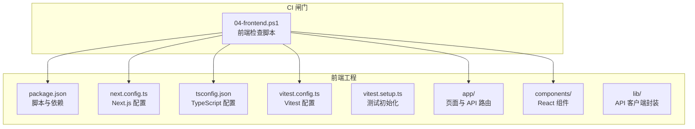
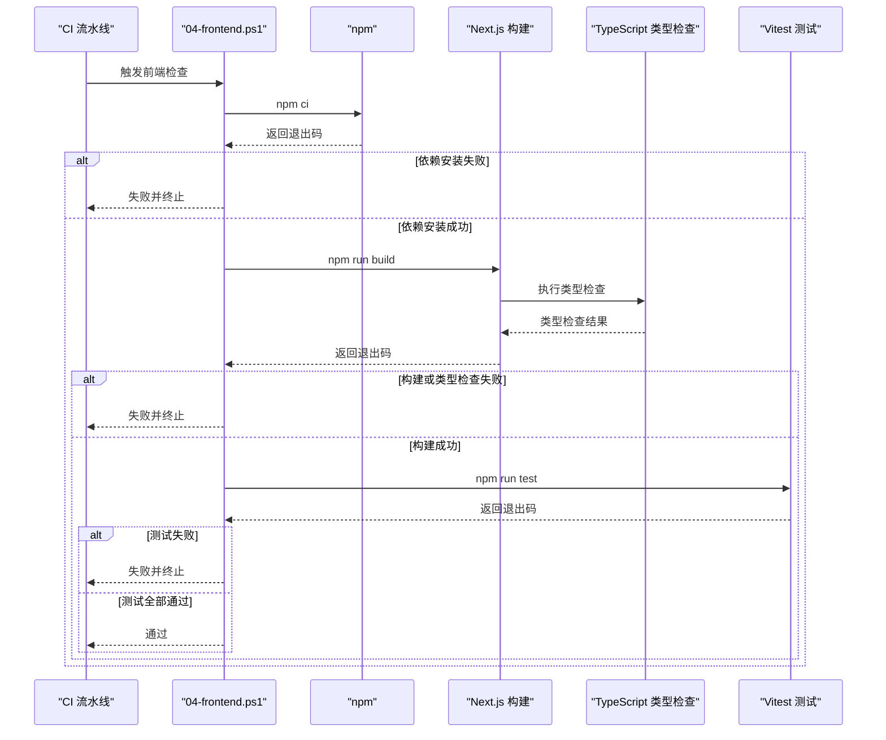
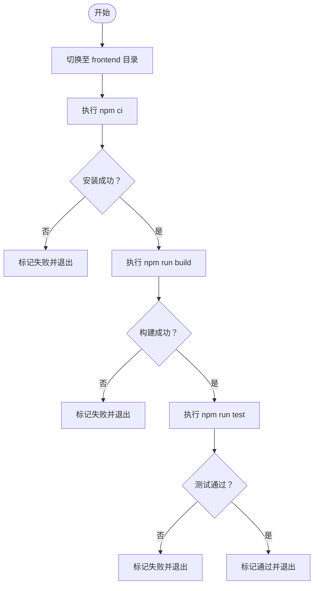
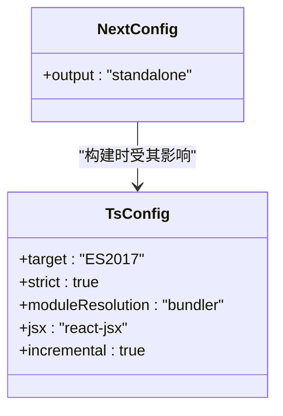
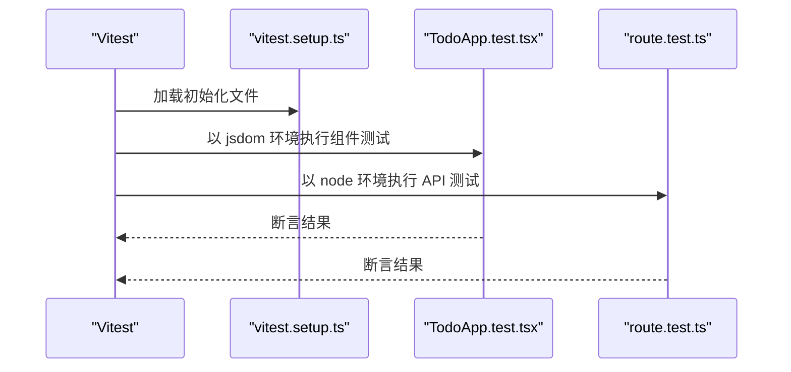
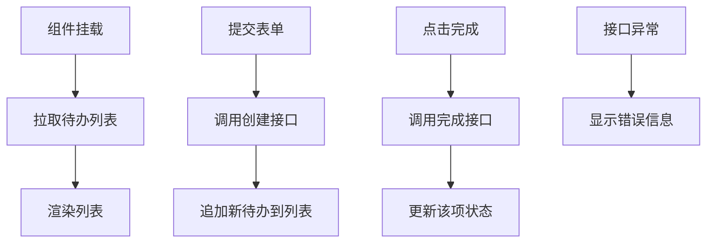
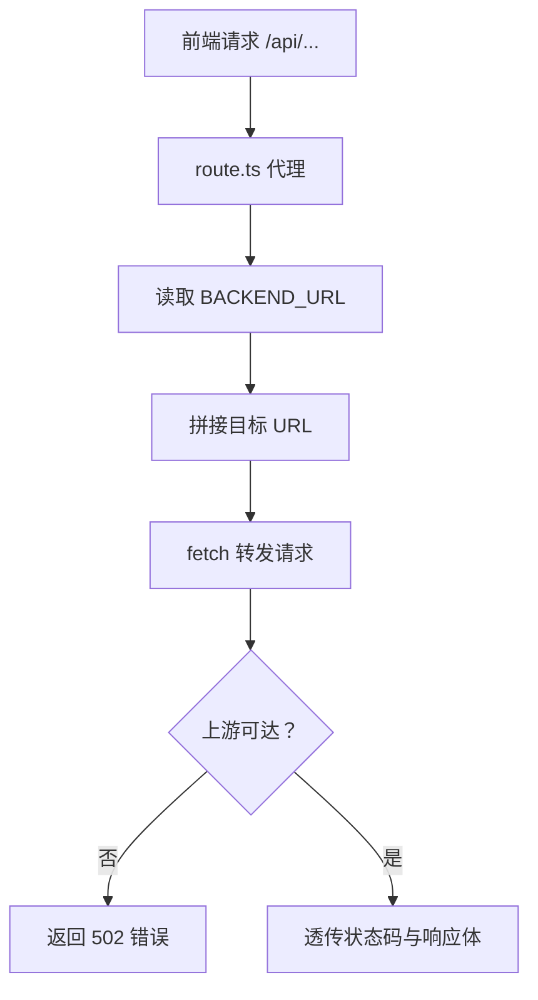
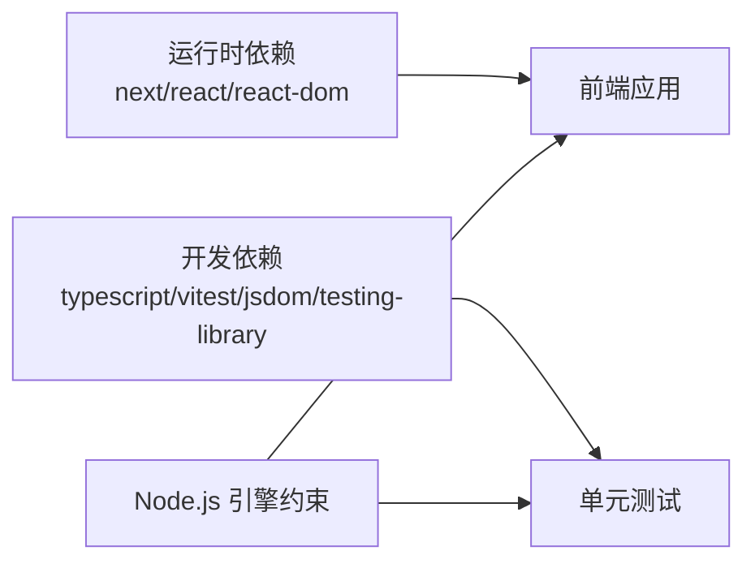

# 前端检查

<cite>
**本文引用的文件**   
- [frontend/package.json](file://frontend/package.json)
- [harness/checks/04-frontend.ps1](file://harness/checks/04-frontend.ps1)
- [frontend/vitest.config.ts](file://frontend/vitest.config.ts)
- [frontend/tsconfig.json](file://frontend/tsconfig.json)
- [frontend/next.config.ts](file://frontend/next.config.ts)
- [frontend/vitest.setup.ts](file://frontend/vitest.setup.ts)
- [frontend/components/TodoApp.tsx](file://frontend/components/TodoApp.tsx)
- [frontend/components/TodoApp.test.tsx](file://frontend/components/TodoApp.test.tsx)
- [frontend/app/api/[...path]/route.ts](file://frontend/app/api/[...path]/route.ts)
- [frontend/app/api/[...path]/route.test.ts](file://frontend/app/api/[...path]/route.test.ts)
</cite>

## 目录
1. [简介](#简介)
2. [项目结构](#项目结构)
3. [核心组件](#核心组件)
4. [架构总览](#架构总览)
5. [详细组件分析](#详细组件分析)
6. [依赖关系分析](#依赖关系分析)
7. [性能与产物验证](#性能与产物验证)
8. [常见问题排查](#常见问题排查)
9. [开发环境与生产环境差异](#开发环境与生产环境差异)
10. [结论](#结论)

## 简介
本文件说明“前端检查”闸门如何对 Next.js 前端应用执行完整构建验证。该闸门负责：
- 使用确定性安装方式恢复 Node.js 依赖
- 执行 Next.js 生产构建，其中包含 TypeScript 类型检查
- 运行基于 Vitest 的单元测试，覆盖 React 组件与 API 代理路由
- 通过退出码控制整体闸门是否通过

前端检查是持续集成流水线中的关键质量门禁，任何一步失败都会导致整体构建失败。

## 项目结构
前端位于 `frontend` 目录，采用 Next.js App Router 组织页面、API 路由和组件；测试使用 Vitest + jsdom 进行组件渲染测试，并使用 node 环境测试服务端 API 路由。

**图表来源**
- [harness/checks/04-frontend.ps1:1-36](file://harness/checks/04-frontend.ps1#L1-L36)
- [frontend/package.json:1-34](file://frontend/package.json#L1-L34)
- [frontend/next.config.ts:1-9](file://frontend/next.config.ts#L1-L9)
- [frontend/tsconfig.json:1-42](file://frontend/tsconfig.json#L1-L42)
- [frontend/vitest.config.ts:1-15](file://frontend/vitest.config.ts#L1-L15)

**章节来源**
- [harness/checks/04-frontend.ps1:1-36](file://harness/checks/04-frontend.ps1#L1-L36)
- [frontend/package.json:1-34](file://frontend/package.json#L1-L34)

## 核心组件
- 前端检查脚本：定义三步链式流程（依赖安装 → 构建 → 测试），任一阶段非零退出码即失败。
- Next.js 构建：启用 standalone 输出，生成最小运行时产物。
- TypeScript 检查：由 Next.js 构建触发，遵循 tsconfig 严格模式。
- 单元测试：Vitest 在 jsdom 环境中测试 React 组件，并在 node 环境中测试 API 代理路由。

**章节来源**
- [harness/checks/04-frontend.ps1:1-36](file://harness/checks/04-frontend.ps1#L1-L36)
- [frontend/next.config.ts:1-9](file://frontend/next.config.ts#L1-L9)
- [frontend/tsconfig.json:1-42](file://frontend/tsconfig.json#L1-L42)
- [frontend/vitest.config.ts:1-15](file://frontend/vitest.config.ts#L1-L15)

## 架构总览
前端检查闸门的执行顺序如下：

**图表来源**
- [harness/checks/04-frontend.ps1:10-35](file://harness/checks/04-frontend.ps1#L10-L35)
- [frontend/package.json:9-14](file://frontend/package.json#L9-L14)

**章节来源**
- [harness/checks/04-frontend.ps1:1-36](file://harness/checks/04-frontend.ps1#L1-L36)
- [frontend/package.json:9-14](file://frontend/package.json#L9-L14)

## 详细组件分析

### 前端检查脚本
- 工作目录：切换到 `frontend` 子目录执行。
- 依赖安装：使用 `npm ci` 确保可复现安装。
- 构建：执行 `npm run build`，Next.js 构建内嵌 TypeScript 类型检查。
- 测试：执行 `npm run test`，调用 Vitest 运行所有匹配规则下的测试文件。
- 退出码：每一步都检查 `$LASTEXITCODE`，非 0 直接失败并输出红色提示。

**图表来源**
- [harness/checks/04-frontend.ps1:7-35](file://harness/checks/04-frontend.ps1#L7-L35)

**章节来源**
- [harness/checks/04-frontend.ps1:1-36](file://harness/checks/04-frontend.ps1#L1-L36)

### Next.js 构建与 TypeScript 类型检查
- 构建命令：`next build`，由 `npm run build` 触发。
- 类型检查：Next.js 构建过程会执行 TypeScript 类型检查，遵循 `tsconfig.json` 配置。
- 严格模式：开启 `strict`，有助于提前发现类型错误。
- 模块解析：使用 `bundler` 解析策略，适配现代打包器行为。
- JSX：使用 `react-jsx` 转换。
- 增量编译：开启 `incremental`，提升本地与 CI 构建速度。

**图表来源**
- [frontend/next.config.ts:1-9](file://frontend/next.config.ts#L1-L9)
- [frontend/tsconfig.json:1-42](file://frontend/tsconfig.json#L1-L42)

**章节来源**
- [frontend/next.config.ts:1-9](file://frontend/next.config.ts#L1-L9)
- [frontend/tsconfig.json:1-42](file://frontend/tsconfig.json#L1-L42)

### Vitest 单元测试
- 组件测试：默认使用 jsdom 环境，适合 DOM 操作与 React 组件渲染。
- 测试入口：`vitest.config.ts` 中指定 include 规则为 `**/*.test.{ts,tsx}`。
- 初始化：`vitest.setup.ts` 引入 jest-dom 断言库，并在每个用例后清理 RTL 挂载节点。
- 组件测试示例：`TodoApp.test.tsx` 模拟 API 客户端，断言列表渲染、表单提交、完成状态更新与错误展示。
- API 路由测试：`route.test.ts` 使用 `@vitest-environment node` 在服务端环境测试代理逻辑，包括路径拼接、查询串透传、请求体透传、上游状态码透传与后端不可达处理。

**图表来源**
- [frontend/vitest.config.ts:1-15](file://frontend/vitest.config.ts#L1-L15)
- [frontend/vitest.setup.ts:1-9](file://frontend/vitest.setup.ts#L1-L9)
- [frontend/components/TodoApp.test.tsx:1-81](file://frontend/components/TodoApp.test.tsx#L1-L81)
- [frontend/app/api/[...path]/route.test.ts:1-102](file://frontend/app/api/[...path]/route.test.ts#L1-L102)

**章节来源**
- [frontend/vitest.config.ts:1-15](file://frontend/vitest.config.ts#L1-L15)
- [frontend/vitest.setup.ts:1-9](file://frontend/vitest.setup.ts#L1-L9)
- [frontend/components/TodoApp.test.tsx:1-81](file://frontend/components/TodoApp.test.tsx#L1-L81)
- [frontend/app/api/[...path]/route.test.ts:1-102](file://frontend/app/api/[...path]/route.test.ts#L1-L102)

### React 组件实现要点
- 组件标记为客户端组件，用于浏览器交互。
- 使用状态管理待办列表、输入框、加载与错误信息。
- 生命周期：挂载时拉取待办列表，提交表单新增待办，点击完成按钮更新状态。
- 错误处理：捕获接口异常并显示错误消息，同时保留已加载数据。

**图表来源**
- [frontend/components/TodoApp.tsx:1-109](file://frontend/components/TodoApp.tsx#L1-L109)

**章节来源**
- [frontend/components/TodoApp.tsx:1-109](file://frontend/components/TodoApp.tsx#L1-L109)

### API 代理路由
- 动态路由：`app/api/[...path]/route.ts` 接收任意路径段，拼接到后端地址。
- 环境变量：支持 `BACKEND_URL` 覆盖默认后端地址，便于不同环境切换。
- 安全设计：逐段编码路径参数，防止客户端将请求导向其他主机。
- 方法支持：GET、POST、PUT、PATCH、DELETE 均转发。
- 响应透传：透传上游 content-type、状态码与响应体；上游不可达时返回 502。

**图表来源**
- [frontend/app/api/[...path]/route.ts:1-77](file://frontend/app/api/[...path]/route.ts#L1-L77)

**章节来源**
- [frontend/app/api/[...path]/route.ts:1-77](file://frontend/app/api/[...path]/route.ts#L1-L77)

## 依赖关系分析
- 运行时依赖：Next.js、React、React DOM。
- 开发依赖：TypeScript、Vitest、Vite、jsdom、Testing Library 系列、Node 类型声明等。
- 引擎要求：Node.js 版本不低于指定版本，保证语言特性与包管理器兼容性。

**图表来源**
- [frontend/package.json:6-32](file://frontend/package.json#L6-L32)

**章节来源**
- [frontend/package.json:1-34](file://frontend/package.json#L1-L34)

## 性能与产物验证
- 构建产物：Next.js 配置为 `output: 'standalone'`，生成最小化运行时产物，便于容器部署。
- 类型检查：由 Next.js 构建触发，避免额外步骤，减少 CI 时间。
- 测试并行：Vitest 默认并发执行测试，提高测试吞吐。
- 增量编译：TypeScript 开启增量编译，缩短二次构建时间。
- 建议的性能指标：
  - 构建耗时：关注首次构建与增量构建差异。
  - 测试耗时：关注单测数量增长对总体时间的线性影响。
  - 产物体积：关注静态资源与客户端代码体积变化趋势。
  - 覆盖率：建议设置阈值，确保新增代码具备测试保护。

[本节为通用指导，不直接分析具体文件]

## 常见问题排查

### 依赖冲突或安装失败
- 现象：`npm ci` 失败或报依赖冲突。
- 可能原因：
  - Node.js 版本不符合 `engines` 约束。
  - 锁文件与当前环境不一致。
- 解决建议：
  - 升级或切换 Node.js 版本以满足最低版本要求。
  - 删除 `node_modules` 与锁文件后重新安装，再提交锁文件。
  - 确认包管理器为 npm，避免混用 yarn/pnpm 导致锁文件不一致。

**章节来源**
- [frontend/package.json:6-8](file://frontend/package.json#L6-L8)
- [harness/checks/04-frontend.ps1:10-16](file://harness/checks/04-frontend.ps1#L10-L16)

### TypeScript 类型错误
- 现象：`npm run build` 失败，报类型错误。
- 可能原因：
  - 变量类型不匹配或未声明。
  - 第三方库类型缺失或不兼容。
- 解决建议：
  - 根据报错定位文件与行号，修正类型定义。
  - 谨慎使用 `any`，优先完善类型。
  - 若第三方类型缺失，考虑补充类型声明或升级依赖。

**章节来源**
- [frontend/tsconfig.json:1-42](file://frontend/tsconfig.json#L1-L42)
- [harness/checks/04-frontend.ps1:18-24](file://harness/checks/04-frontend.ps1#L18-L24)

### React 组件渲染问题
- 现象：测试失败或页面渲染异常。
- 可能原因：
  - 组件依赖 DOM 但测试环境未正确配置。
  - 异步数据未等待完成就断言。
  - RTL 清理未生效导致状态污染。
- 解决建议：
  - 确保测试使用 jsdom 环境。
  - 使用 `waitFor` 等待异步更新后再断言。
  - 检查 `vitest.setup.ts` 是否正确注册清理逻辑。

**章节来源**
- [frontend/vitest.config.ts:6-13](file://frontend/vitest.config.ts#L6-L13)
- [frontend/vitest.setup.ts:1-9](file://frontend/vitest.setup.ts#L1-L9)
- [frontend/components/TodoApp.test.tsx:1-81](file://frontend/components/TodoApp.test.tsx#L1-L81)

### API 代理路由问题
- 现象：代理请求失败或返回 502。
- 可能原因：
  - 后端服务不可达或地址配置错误。
  - 路径拼接或查询串丢失。
  - 请求头或请求体未正确透传。
- 解决建议：
  - 检查 `BACKEND_URL` 环境变量。
  - 确认路径段被正确编码与拼接。
  - 校验请求方法与 body 透传逻辑。

**章节来源**
- [frontend/app/api/[...path]/route.ts:1-77](file://frontend/app/api/[...path]/route.ts#L1-L77)
- [frontend/app/api/[...path]/route.test.ts:1-102](file://frontend/app/api/[...path]/route.test.ts#L1-L102)

## 开发环境与生产环境差异
- 开发环境：
  - 使用 `next dev` 启动开发服务器，提供热重载与调试能力。
  - 类型检查在保存时即时反馈。
  - 测试可通过 `vitest` 的 watch 模式快速迭代。
- 生产环境：
  - 使用 `next build` 生成 standalone 产物，包含最小运行时。
  - 类型检查作为构建的一部分执行，确保类型安全。
  - 测试在 CI 中执行，不随产物发布。
- 环境变量：
  - 通过 `BACKEND_URL` 控制后端地址，无需重建产物即可切换。

**章节来源**
- [frontend/package.json:9-14](file://frontend/package.json#L9-L14)
- [frontend/next.config.ts:1-9](file://frontend/next.config.ts#L1-L9)
- [frontend/app/api/[...path]/route.ts:1-6](file://frontend/app/api/[...path]/route.ts#L1-L6)

## 结论
前端检查闸门通过“依赖安装 → 构建与类型检查 → 单元测试”的三段式流程，确保 Next.js 前端应用在类型安全、组件可用性与 API 代理正确性方面达到质量标准。配合 strict TypeScript 配置、Vitest 多环境测试与 Next.js standalone 产物，既保障开发体验，也满足生产部署的可控性与可观测性。建议在 CI 中记录构建与测试耗时、产物体积与覆盖率等指标，持续优化前端质量与交付效率。