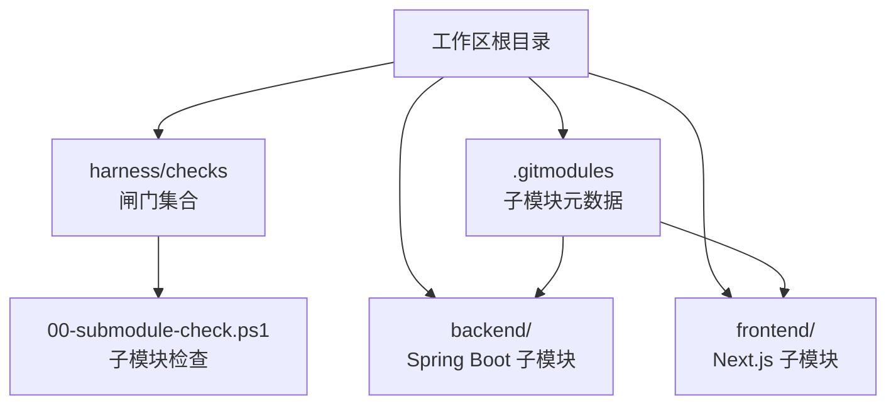
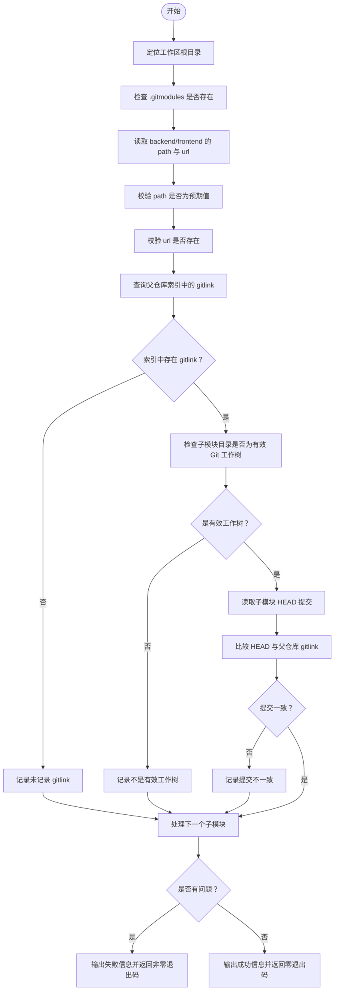
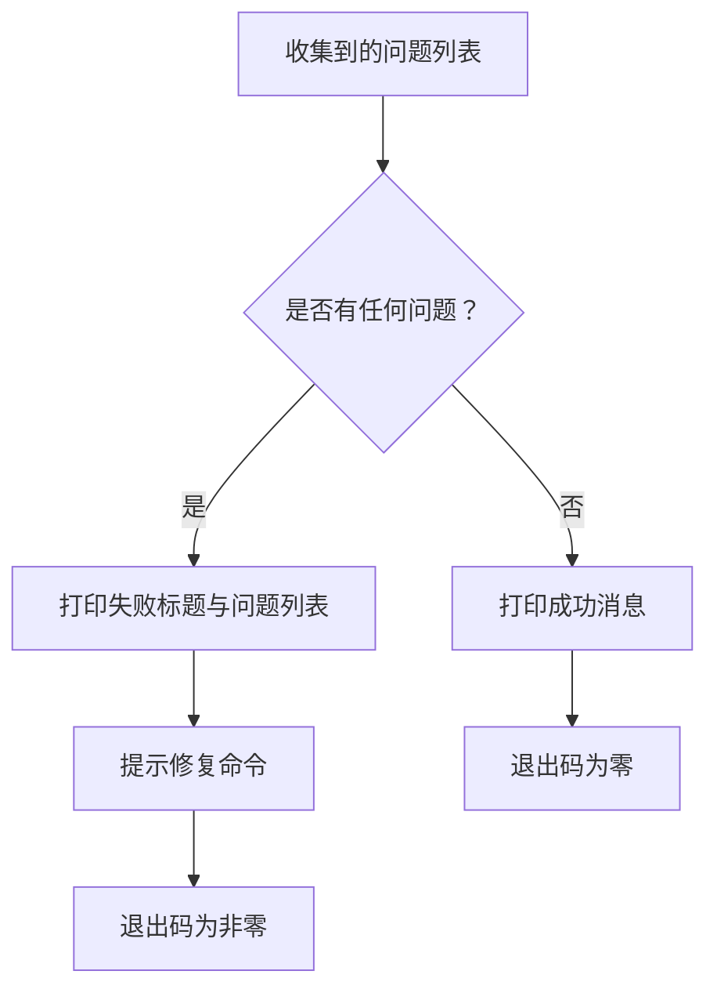
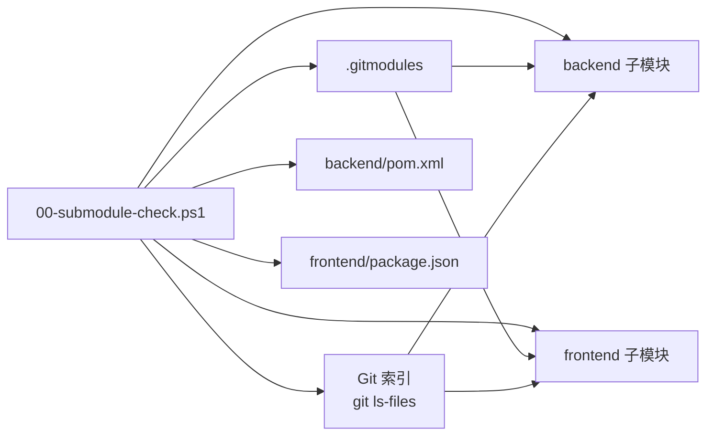

# 子模块检查

<cite>
**本文引用的文件**   
- [.gitmodules](file://.gitmodules)
- [00-submodule-check.ps1](file://harness/checks/00-submodule-check.ps1)
- [README.md](file://README.md)
</cite>

## 目录
1. [简介](#简介)
2. [项目结构定位](#项目结构定位)
3. [核心组件](#核心组件)
4. [架构总览](#架构总览)
5. [详细检测逻辑](#详细检测逻辑)
6. [失败场景与解决方案](#失败场景与解决方案)
7. [依赖关系分析](#依赖关系分析)
8. [性能与执行特性](#性能与执行特性)
9. [故障排除步骤](#故障排除步骤)
10. [最佳实践建议](#最佳实践建议)
11. [结论](#结论)

## 简介
本闸门负责在编译、测试、前端构建等后续流程之前，验证 Git 子模块是否满足以下要求：
- 父仓库存在 `.gitmodules`。
- `backend` 与 `frontend` 两个子模块的 path 与 url 配置正确。
- 父仓库已记录对应 gitlink。
- 子模块目录是有效的 Git 工作树。
- 子模块当前 HEAD 提交与父仓库记录的 gitlink 一致。

该脚本为只读检查：不会自动执行 `git submodule update`，不会访问网络，也不会交互式提问；当发现问题时以非零退出码结束，并输出修复命令。

## 项目结构定位
子模块检查位于 harness 的“七道闸门”中的第一道，编号为 `00`，因此会在其他闸门之前运行。顶层 README 明确说明后端与前端作为独立仓库通过子模块挂载，并由 `.gitmodules` 管理 URL。



**图表来源**
- [00-submodule-check.ps1:1-94](file://harness/checks/00-submodule-check.ps1#L1-L94)
- [.gitmodules:1-7](file://.gitmodules#L1-L7)
- [README.md:1-10](file://README.md#L1-L10)

**章节来源**
- [README.md:1-10](file://README.md#L1-L10)
- [README.md:74-85](file://README.md#L74-L85)

## 核心组件
- **`.gitmodules`**：声明 `backend` 与 `frontend` 两个子模块的 path 与 url。
- **`00-submodule-check.ps1`**：PowerShell 闸门脚本，实现子模块就绪性校验。
- **Git 工作区状态**：包括父仓库索引中的 gitlink、子模块目录的工作树、子模块 HEAD 提交。

关键职责划分：
| 组件 | 职责 |
|---|---|
| `.gitmodules` | 定义子模块名称、路径、远程地址 |
| `00-submodule-check.ps1` | 读取配置、检查工作树、比对提交 |
| Git 索引 | 记录每个子模块对应的 gitlink 提交 |
| 子模块工作树 | 提供实际可构建的代码与包描述文件 |

**章节来源**
- [.gitmodules:1-7](file://.gitmodules#L1-L7)
- [00-submodule-check.ps1:1-94](file://harness/checks/00-submodule-check.ps1#L1-L94)

## 架构总览
子模块检查的执行流程可以理解为“先查配置，再查索引，再查工作树，最后比对提交”。



**图表来源**
- [00-submodule-check.ps1:11-94](file://harness/checks/00-submodule-check.ps1#L11-L94)

## 详细检测逻辑

### 1. 定位工作区根目录
脚本从自身所在目录向上推导工作区根目录，并将当前目录切换到根目录，确保后续所有 Git 操作在工作区根上下文中执行。

**章节来源**
- [00-submodule-check.ps1:11-12](file://harness/checks/00-submodule-check.ps1#L11-L12)

### 2. 检查 `.gitmodules` 是否存在
如果根目录下不存在 `.gitmodules`，则直接记录问题。缺少该文件意味着父仓库没有声明子模块元数据，后续 path/url/gitlink 检查都失去依据。

**章节来源**
- [00-submodule-check.ps1:21-24](file://harness/checks/00-submodule-check.ps1#L21-L24)

### 3. 读取并验证子模块配置
对 `backend` 和 `frontend` 分别执行以下检查：
- 读取 `submodule.<name>.path`。
- 读取 `submodule.<name>.url`。
- 若 path 缺失或为空，记录问题。
- 若 path 不等于预期值，记录不匹配问题。
- 若 url 缺失或为空，记录问题。

这意味着 `.gitmodules` 中必须同时包含正确的 path 与 url，且 path 必须与工作区期望的目录名一致。

**章节来源**
- [00-submodule-check.ps1:26-41](file://harness/checks/00-submodule-check.ps1#L26-L41)
- [.gitmodules:1-7](file://.gitmodules#L1-L7)

### 4. 确认父仓库记录 gitlink
脚本使用 Git 索引查询指定路径的状态，判断父仓库是否记录了该子模块的 gitlink。有效 gitlink 的特征包括：
- 索引条目存在。
- 模式值为 `160000`。
- 第二字段为期望的提交哈希。

如果索引中没有记录，或者模式不是 `160000`，则记录相应问题。

**章节来源**
- [00-submodule-check.ps1:43-55](file://harness/checks/00-submodule-check.ps1#L43-L55)

### 5. 检查子模块工作树是否初始化
脚本通过两种手段判断子模块是否可用：
- 检查业务标记文件是否存在：`backend/pom.xml` 与 `frontend/package.json`。
- 调用 `git -C <子模块> rev-parse --is-inside-work-tree`，确认子模块目录是一个有效的 Git 工作树。

如果标记文件缺失，或子模块不在有效工作树中，则记录“子模块未初始化或工作树为空”类问题。

**章节来源**
- [00-submodule-check.ps1:57-67](file://harness/checks/00-submodule-check.ps1#L57-L67)

### 6. 比对子模块 HEAD 与父仓库 gitlink
当子模块是有效工作树且父仓库存在 gitlink 时，脚本会：
- 读取子模块当前 HEAD。
- 与父仓库记录的 gitlink 提交进行比较。
- 如果不一致，记录“检出提交与父仓库 gitlink 不一致”的问题。

这是保证可复现构建的关键：即使子模块已初始化，也必须与父仓库锁定的提交一致。

**章节来源**
- [00-submodule-check.ps1:69-79](file://harness/checks/00-submodule-check.ps1#L69-L79)

### 7. 汇总结果并退出
脚本将所有问题收集到列表中：
- 如果存在问题，输出失败标题、逐条列出问题、提示修复命令，并以非零退出码结束。
- 如果没有问题，输出成功消息，并以零退出码结束。



**图表来源**
- [00-submodule-check.ps1:82-94](file://harness/checks/00-submodule-check.ps1#L82-L94)

**章节来源**
- [00-submodule-check.ps1:82-94](file://harness/checks/00-submodule-check.ps1#L82-L94)

## 失败场景与解决方案

| 失败原因 | 检测位置 | 典型表现 | 推荐解决方案 |
|---|---|---|---|
| `.gitmodules` 不存在 | 配置文件检查 | 报告 `.gitmodules 不存在` | 恢复或重新添加 `.gitmodules`，确保包含 `backend` 与 `frontend` |
| 缺少 `submodule.backend.path` 或 `submodule.frontend.path` | 配置读取 | 报告对应 path 缺失 | 在 `.gitmodules` 中补全 path |
| path 值与预期不符 | 配置校验 | 报告 path 值不匹配 | 将 path 改为 `backend` 或 `frontend` |
| 缺少 `submodule.backend.url` 或 `submodule.frontend.url` | 配置读取 | 报告对应 url 缺失 | 在 `.gitmodules` 中补全 url |
| 父仓库未记录 gitlink | 索引检查 | 报告未记录 gitlink | 重新添加子模块并提交，确保父仓库索引中包含 `160000` 模式的 gitlink |
| 父仓库中路径不是 gitlink | 索引模式检查 | 报告 mode 不是 `160000` | 修正父仓库索引，使子模块以 gitlink 形式存在 |
| 子模块标记文件不存在 | 工作树检查 | 报告 `pom.xml` 或 `package.json` 不存在 | 执行子模块初始化与更新 |
| 子模块不是有效 Git 工作树 | 工作树检查 | 报告不是有效 git 工作树 | 进入子模块目录检查 `.git`，必要时重新初始化 |
| 无法读取子模块 HEAD | 提交读取 | 报告无法读取 HEAD | 检查子模块 Git 状态，确保 HEAD 可读 |
| 子模块 HEAD 与父仓库 gitlink 不一致 | 提交比对 | 报告检出提交与 gitlink 不一致 | 执行子模块更新，使其指向父仓库锁定的提交 |

**章节来源**
- [00-submodule-check.ps1:21-79](file://harness/checks/00-submodule-check.ps1#L21-L79)

## 依赖关系分析



**图表来源**
- [00-submodule-check.ps1:21-79](file://harness/checks/00-submodule-check.ps1#L21-L79)
- [.gitmodules:1-7](file://.gitmodules#L1-L7)

**章节来源**
- [00-submodule-check.ps1:21-79](file://harness/checks/00-submodule-check.ps1#L21-L79)

## 性能与执行特性
- **只读检查**：脚本明确声明不执行 `git submodule update`，避免在检查阶段触发网络请求或修改工作区。
- **无交互**：脚本不向用户提问，适合在 CI 或自动化流水线中静默运行。
- **早期失败**：一旦检测到问题，立即汇总并退出，避免继续执行后续可能失败的编译或测试。
- **轻量级依赖**：主要依赖 PowerShell、Git 命令与文件系统访问，不引入额外运行时。

这些特性使子模块检查适合作为流水线的第一道闸门，快速暴露环境准备问题。

**章节来源**
- [00-submodule-check.ps1:1-8](file://harness/checks/00-submodule-check.ps1#L1-L8)
- [00-submodule-check.ps1:82-94](file://harness/checks/00-submodule-check.ps1#L82-L94)

## 故障排除步骤

### 第一步：确认克隆方式
如果使用普通 `git clone`，子模块可能未被初始化。应使用递归克隆：
```powershell
git clone --recurse-submodules <工作区仓库地址>
```

如果已有克隆但子模块为空，应执行：
```powershell
git submodule update --init --recursive
```

**章节来源**
- [README.md:21-27](file://README.md#L21-L27)

### 第二步：手动运行子模块检查
在 PowerShell 中执行：
```powershell
powershell -File harness\checks\00-submodule-check.ps1
```
观察输出中的失败问题列表与修复提示。

**章节来源**
- [00-submodule-check.ps1:82-94](file://harness/checks/00-submodule-check.ps1#L82-L94)

### 第三步：检查 `.gitmodules`
确认 `.gitmodules` 包含 `backend` 与 `frontend`，且 path 与 url 正确。

**章节来源**
- [.gitmodules:1-7](file://.gitmodules#L1-L7)

### 第四步：检查父仓库索引中的 gitlink
确认父仓库索引中 `backend` 与 `frontend` 是 `160000` 模式的 gitlink，而不是普通目录。

**章节来源**
- [00-submodule-check.ps1:43-55](file://harness/checks/00-submodule-check.ps1#L43-L55)

### 第五步：检查子模块工作树
确认 `backend/pom.xml` 与 `frontend/package.json` 存在，并且子模块目录是有效 Git 工作树。

**章节来源**
- [00-submodule-check.ps1:57-67](file://harness/checks/00-submodule-check.ps1#L57-L67)

### 第六步：比对提交
确认子模块 HEAD 与父仓库 gitlink 一致。如果不一致，再次执行子模块更新。

**章节来源**
- [00-submodule-check.ps1:69-79](file://harness/checks/00-submodule-check.ps1#L69-L79)

## 最佳实践建议

1. **始终使用递归克隆**  
   新克隆工作区时优先使用 `--recurse-submodules`，减少子模块未初始化的概率。

2. **保持 `.gitmodules` 与工作区布局一致**  
   不要随意修改 `backend` 与 `frontend` 的 path；如需调整，应在父仓库中统一变更并提交。

3. **不要绕过 00 闸门**  
   00 闸门是后续编译、测试、前端构建的前提；跳过它可能导致更晚才暴露子模块问题。

4. **CI 中显式初始化子模块**  
   在持续集成环境中，应在运行 `harness/run-all.ps1` 前确保子模块已初始化。

5. **版本一致性优先于本地修改**  
   如果本地子模块有未提交的修改，应先提交或暂存，再执行子模块更新，避免 HEAD 与 gitlink 不一致。

6. **网络受限环境提前准备凭据**  
   首次初始化子模块需要访问远程仓库；在离线或私有源环境中，应提前配置 Git 凭据或镜像。

7. **失败时优先看第一条问题**  
   脚本会列出所有问题，但通常 `.gitmodules`、gitlink、工作树初始化是最基础的三类错误，修复基础问题后其他问题往往随之消失。

[本节为通用实践建议，不直接分析具体代码文件]

## 结论
子模块检查闸门通过读取 `.gitmodules`、校验父仓库 gitlink、验证子模块工作树、比对 HEAD 提交，形成一套完整的子模块就绪性验证机制。它将常见的子模块环境问题前置暴露，避免把“环境未准备好”误判为“编译失败”或“测试失败”。配合递归克隆与 `git submodule update --init --recursive`，可以在本地开发与 CI 中保持一致的子模块行为。

[本节为总结性内容，不直接分析具体代码文件]