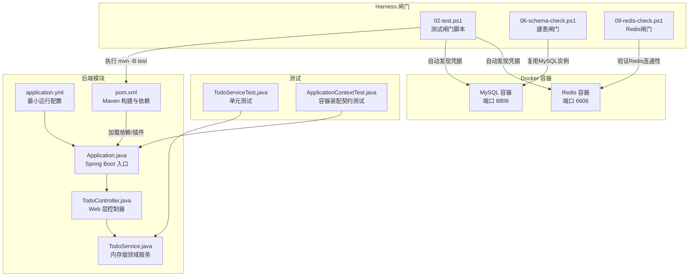
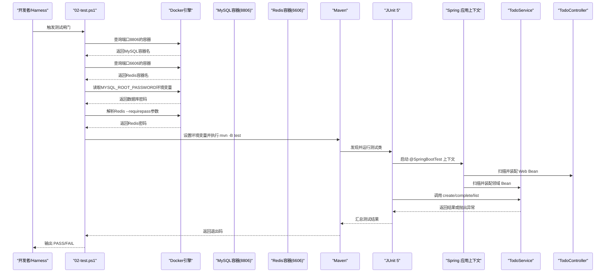
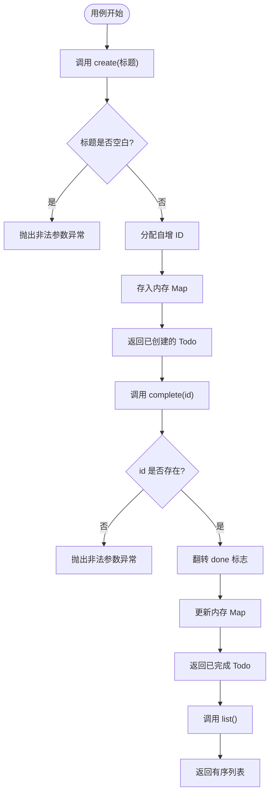
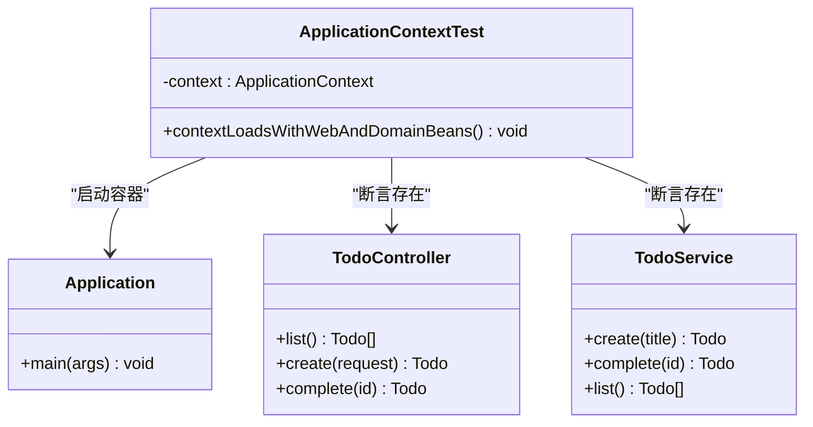
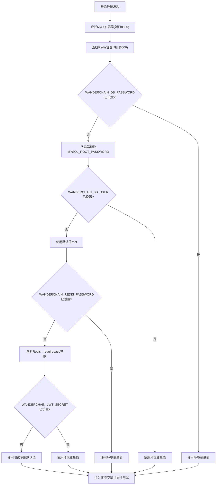
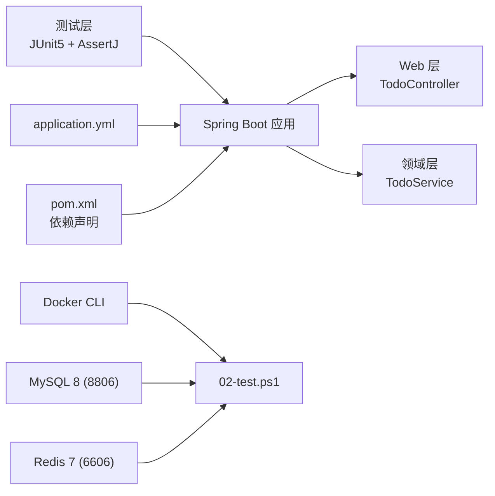

# 测试检查

<cite>
**本文引用的文件**   
- [backend/src/test/java/com/luyi/myfirst/domain/TodoServiceTest.java](file://backend/src/test/java/com/luyi/myfirst/domain/TodoServiceTest.java)
- [backend/src/test/java/com/luyi/myfirst/ApplicationContextTest.java](file://backend/src/test/java/com/luyi/myfirst/ApplicationContextTest.java)
- [backend/pom.xml](file://backend/pom.xml)
- [harness/checks/02-test.ps1](file://harness/checks/02-test.ps1)
- [backend/src/main/resources/application.yml](file://backend/src/main/resources/application.yml)
- [harness/checks/06-schema-check.ps1](file://harness/checks/06-schema-check.ps1)
- [harness/checks/09-redis-check.ps1](file://harness/checks/09-redis-check.ps1)
- [README.md](file://README.md)
</cite>

## 更新摘要
**所做更改**   
- 更新了凭据发现机制，支持从Docker容器自动发现MySQL和Redis凭据
- 新增了复杂凭据解析场景的支持，包括Redis的--requirepass参数解析
- 增强了测试环境配置说明，包含端口映射和环境变量要求
- 更新了故障排查指南，涵盖新的凭据发现失败场景

## 目录
1. [简介](#简介)
2. [项目结构](#项目结构)
3. [核心组件](#核心组件)
4. [架构总览](#架构总览)
5. [详细组件分析](#详细组件分析)
6. [依赖关系分析](#依赖关系分析)
7. [性能与覆盖率要求](#性能与覆盖率要求)
8. [故障排查指南](#故障排查指南)
9. [结论](#结论)

## 简介
本文件面向"测试检查"闸门，说明其职责、执行范围、环境约束、结果判定方式以及常见失败场景的排查方法。该闸门负责：
- 执行后端单元测试，验证领域行为是否正确。
- 执行容器装配契约测试，确保 Spring 应用上下文能真实启动并装配 Web 层与领域层 Bean。
- **新增**：通过Docker容器自动发现MySQL（端口8806）和Redis（端口6606）的凭据，支持复杂的凭据解析场景。
- 在持续集成或本地 Harness 中作为质量门禁，阻止未通过测试的代码进入后续阶段。

## 项目结构
测试相关代码位于后端模块的 test 源集；被测业务代码位于 main 源集；测试执行由 Maven 驱动，并由 PowerShell 闸门脚本统一编排。

图表来源
- [backend/src/main/java/com/luyi/myfirst/Application.java:1-13](file://backend/src/main/java/com/luyi/myfirst/Application.java#L1-L13)
- [backend/src/main/java/com/luyi/myfirst/web/TodoController.java:1-45](file://backend/src/main/java/com/luyi/myfirst/web/TodoController.java#L1-L45)
- [backend/src/main/java/com/luyi/myfirst/domain/TodoService.java:1-44](file://backend/src/main/java/com/luyi/myfirst/domain/TodoService.java#L1-L44)
- [backend/src/main/resources/application.yml:1-70](file://backend/src/main/resources/application.yml#L1-L70)
- [backend/pom.xml:1-74](file://backend/pom.xml#L1-L74)
- [backend/src/test/java/com/luyi/myfirst/domain/TodoServiceTest.java:1-64](file://backend/src/test/java/com/luyi/myfirst/domain/TodoServiceTest.java#L1-L64)
- [backend/src/test/java/com/luyi/myfirst/ApplicationContextTest.java:1-28](file://backend/src/test/java/com/luyi/myfirst/ApplicationContextTest.java#L1-L28)
- [harness/checks/02-test.ps1:1-100](file://harness/checks/02-test.ps1#L1-L100)
- [harness/checks/06-schema-check.ps1:1-227](file://harness/checks/06-schema-check.ps1#L1-L227)
- [harness/checks/09-redis-check.ps1:1-102](file://harness/checks/09-redis-check.ps1#L1-L102)

章节来源
- [backend/src/test/java/com/luyi/myfirst/domain/TodoServiceTest.java:1-64](file://backend/src/test/java/com/luyi/myfirst/domain/TodoServiceTest.java#L1-L64)
- [backend/src/test/java/com/luyi/myfirst/ApplicationContextTest.java:1-28](file://backend/src/test/java/com/luyi/myfirst/ApplicationContextTest.java#L1-L28)
- [backend/pom.xml:1-74](file://backend/pom.xml#L1-L74)
- [harness/checks/02-test.ps1:1-100](file://harness/checks/02-test.ps1#L1-L100)
- [backend/src/main/resources/application.yml:1-70](file://backend/src/main/resources/application.yml#L1-L70)

## 核心组件
- TodoServiceTest：针对 TodoService 的单元测试，覆盖创建、完成、列表等关键路径，包括异常分支。
- ApplicationContextTest：基于 @SpringBootTest 的容器装配契约测试，断言 Web 层与领域层 Bean 可被注入。
- TodoService：内存版待办服务，使用 LinkedHashMap 维护顺序，不引入外部数据库，保证测试可重复且无外部依赖。
- TodoController：REST 控制器，将 HTTP 请求映射到 TodoService 的方法。
- Application：Spring Boot 应用入口，启用自动装配。
- application.yml：最小化运行时配置，端口、日志级别等，不包含外部中间件。
- pom.xml：声明 Spring Boot Starter Web/Test 依赖，以及 Flyway 迁移工具（仅构建期）。
- **新增**：02-test.ps1：增强版 Harness 测试闸门，支持从Docker容器自动发现MySQL和Redis凭据，强制执行 mvn -B test，不允许跳过测试。
- **新增**：06-schema-check.ps1：建表闸门，复用既有MySQL实例进行建表断言。
- **新增**：09-redis-check.ps1：Redis闸门，验证缓存连通性和凭据正确性。

章节来源
- [backend/src/test/java/com/luyi/myfirst/domain/TodoServiceTest.java:1-64](file://backend/src/test/java/com/luyi/myfirst/domain/TodoServiceTest.java#L1-L64)
- [backend/src/test/java/com/luyi/myfirst/ApplicationContextTest.java:1-28](file://backend/src/test/java/com/luyi/myfirst/ApplicationContextTest.java#L1-L28)
- [backend/src/main/java/com/luyi/myfirst/domain/TodoService.java:1-44](file://backend/src/main/java/com/luyi/myfirst/domain/TodoService.java#L1-L44)
- [backend/src/main/java/com/luyi/myfirst/web/TodoController.java:1-45](file://backend/src/main/java/com/luyi/myfirst/web/TodoController.java#L1-L45)
- [backend/src/main/java/com/luyi/myfirst/Application.java:1-13](file://backend/src/main/java/com/luyi/myfirst/Application.java#L1-L13)
- [backend/src/main/resources/application.yml:1-70](file://backend/src/main/resources/application.yml#L1-L70)
- [backend/pom.xml:1-74](file://backend/pom.xml#L1-L74)
- [harness/checks/02-test.ps1:1-100](file://harness/checks/02-test.ps1#L1-L100)
- [harness/checks/06-schema-check.ps1:1-227](file://harness/checks/06-schema-check.ps1#L1-L227)
- [harness/checks/09-redis-check.ps1:1-102](file://harness/checks/09-redis-check.ps1#L1-L102)

## 架构总览
测试闸门的工作流如下：

图表来源
- [harness/checks/02-test.ps1:18-39](file://harness/checks/02-test.ps1#L18-L39)
- [harness/checks/02-test.ps1:62-79](file://harness/checks/02-test.ps1#L62-L79)
- [backend/src/test/java/com/luyi/myfirst/ApplicationContextTest.java:1-28](file://backend/src/test/java/com/luyi/myfirst/ApplicationContextTest.java#L1-L28)
- [backend/src/test/java/com/luyi/myfirst/domain/TodoServiceTest.java:1-64](file://backend/src/test/java/com/luyi/myfirst/domain/TodoServiceTest.java#L1-L64)
- [backend/src/main/java/com/luyi/myfirst/Application.java:1-13](file://backend/src/main/java/com/luyi/myfirst/Application.java#L1-L13)
- [backend/src/main/java/com/luyi/myfirst/web/TodoController.java:1-45](file://backend/src/main/java/com/luyi/myfirst/web/TodoController.java#L1-L45)
- [backend/src/main/java/com/luyi/myfirst/domain/TodoService.java:1-44](file://backend/src/main/java/com/luyi/myfirst/domain/TodoService.java#L1-L44)

## 详细组件分析

### TodoServiceTest：单元测试
- 测试目标：验证 TodoService 的核心行为，包括标题空白校验、创建后状态为未完成、完成操作翻转 done 标志、未知 id 抛错、列表按创建顺序返回。
- 断言风格：使用 AssertJ 进行链式断言和异常断言。
- 数据隔离：每个测试独立实例化 TodoService，避免跨用例污染。

图表来源
- [backend/src/test/java/com/luyi/myfirst/domain/TodoServiceTest.java:1-64](file://backend/src/test/java/com/luyi/myfirst/domain/TodoServiceTest.java#L1-L64)
- [backend/src/main/java/com/luyi/myfirst/domain/TodoService.java:1-44](file://backend/src/main/java/com/luyi/myfirst/domain/TodoService.java#L1-L44)

章节来源
- [backend/src/test/java/com/luyi/myfirst/domain/TodoServiceTest.java:1-64](file://backend/src/test/java/com/luyi/myfirst/domain/TodoServiceTest.java#L1-L64)
- [backend/src/main/java/com/luyi/myfirst/domain/TodoService.java:1-44](file://backend/src/main/java/com/luyi/myfirst/domain/TodoService.java#L1-L44)

### ApplicationContextTest：容器装配契约测试
- 测试目标：确保 Spring 容器能够成功启动，并装配 Web 层与领域层 Bean。
- 断言要点：通过 ApplicationContext.getBean 获取 todoController 与 todoService，断言非空。
- 意义：编译通过不代表容器可用，此测试是"契约"的机器可读版本，防止装配错误逃逸到生产。

图表来源
- [backend/src/test/java/com/luyi/myfirst/ApplicationContextTest.java:1-28](file://backend/src/test/java/com/luyi/myfirst/ApplicationContextTest.java#L1-L28)
- [backend/src/main/java/com/luyi/myfirst/Application.java:1-13](file://backend/src/main/java/com/luyi/myfirst/Application.java#L1-L13)
- [backend/src/main/java/com/luyi/myfirst/web/TodoController.java:1-45](file://backend/src/main/java/com/luyi/myfirst/web/TodoController.java#L1-L45)
- [backend/src/main/java/com/luyi/myfirst/domain/TodoService.java:1-44](file://backend/src/main/java/com/luyi/myfirst/domain/TodoService.java#L1-L44)

章节来源
- [backend/src/test/java/com/luyi/myfirst/ApplicationContextTest.java:1-28](file://backend/src/test/java/com/luyi/myfirst/ApplicationContextTest.java#L1-L28)
- [backend/src/main/java/com/luyi/myfirst/Application.java:1-13](file://backend/src/main/java/com/luyi/myfirst/Application.java#L1-L13)
- [backend/src/main/java/com/luyi/myfirst/web/TodoController.java:1-45](file://backend/src/main/java/com/luyi/myfirst/web/TodoController.java#L1-L45)
- [backend/src/main/java/com/luyi/myfirst/domain/TodoService.java:1-44](file://backend/src/main/java/com/luyi/myfirst/domain/TodoService.java#L1-L44)

### 增强版凭据发现机制
**新增功能**：02-test.ps1 闸门现在支持从Docker容器自动发现MySQL和Redis凭据。

#### MySQL凭据发现流程
- 通过 `Get-ContainerByPort 8806` 函数查找发布端口8806的MySQL容器
- 使用 `Get-ContainerEnvValue` 函数从容器环境变量中读取 `MYSQL_ROOT_PASSWORD`
- 如果环境变量不存在，则使用默认值 `root` 作为用户名

#### Redis凭据发现流程
- 通过 `Get-ContainerByPort 6606` 函数查找发布端口6606的Redis容器
- 使用 `Get-RedisRequirepass` 函数解析Redis容器的 `--requirepass` 参数
- 支持空密码场景（合法部署），允许空字符串作为凭据

#### 凭据注入机制
- 所有发现的凭据都通过 `Set-ProcessEnv` 函数注入到当前进程的环境变量
- 支持回滚机制，测试结束后恢复原始环境变量值
- 提供详细的日志输出，显示凭据的来源和用途

图表来源
- [harness/checks/02-test.ps1:18-39](file://harness/checks/02-test.ps1#L18-L39)
- [harness/checks/02-test.ps1:62-79](file://harness/checks/02-test.ps1#L62-L79)
- [harness/checks/02-test.ps1:43-56](file://harness/checks/02-test.ps1#L43-L56)

章节来源
- [harness/checks/02-test.ps1:18-39](file://harness/checks/02-test.ps1#L18-L39)
- [harness/checks/02-test.ps1:62-79](file://harness/checks/02-test.ps1#L62-L79)
- [harness/checks/02-test.ps1:43-56](file://harness/checks/02-test.ps1#L43-L56)

## 依赖关系分析
- 测试框架：JUnit 5 与 AssertJ，随 spring-boot-starter-test 引入。
- 应用依赖：spring-boot-starter-web 提供 Web 能力；Flyway 插件仅在构建期用于迁移工具，不引入运行期数据库依赖。
- 配置依赖：application.yml 仅包含服务器端口与应用名，日志级别为 INFO，不引入外部中间件。
- **新增**：Docker依赖：需要Docker CLI来访问容器信息，用于凭据发现和容器管理。
- **新增**：外部服务依赖：MySQL 8（端口8806）和 Redis 7（端口6606）的既有实例，闸门不新建/删除容器。

图表来源
- [backend/pom.xml:27-37](file://backend/pom.xml#L27-L37)
- [backend/src/main/resources/application.yml:1-70](file://backend/src/main/resources/application.yml#L1-L70)
- [backend/src/main/java/com/luyi/myfirst/web/TodoController.java:1-45](file://backend/src/main/java/com/luyi/myfirst/web/TodoController.java#L1-L45)
- [backend/src/main/java/com/luyi/myfirst/domain/TodoService.java:1-44](file://backend/src/main/java/com/luyi/myfirst/domain/TodoService.java#L1-L44)
- [harness/checks/02-test.ps1:18-39](file://harness/checks/02-test.ps1#L18-L39)

章节来源
- [backend/pom.xml:27-37](file://backend/pom.xml#L27-L37)
- [backend/src/main/resources/application.yml:1-70](file://backend/src/main/resources/application.yml#L1-L70)
- [harness/checks/02-test.ps1:18-39](file://harness/checks/02-test.ps1#L18-L39)

## 性能与覆盖率要求
- 性能基准：当前 TodoService 使用内存数据结构，不涉及 I/O，测试执行时间极短，适合高频回归。若未来引入持久化或网络调用，应补充慢测试标记与超时策略，避免拖慢流水线。
- 覆盖率要求：仓库未显式配置覆盖率统计插件或阈值。建议后续引入 JaCoCo 并设置最低行覆盖率与分支覆盖率阈值，纳入闸门判定条件。
- 可重复性：TodoService 刻意不接数据库，保证每次测试环境一致，减少外部依赖带来的抖动。
- **新增**：Docker性能考虑：凭据发现过程会增加少量启动开销，但只在测试开始时执行一次，对整体性能影响可忽略不计。

[本节为通用指导，不直接分析具体文件]

## 故障排查指南
- 闸门整体失败
  - 现象：02-test.ps1 输出"Test gate FAILED"。
  - 原因：mvn -B test 返回非零退出码。
  - 处理：查看 Maven 控制台输出，定位失败的测试类与方法，优先修复断言失败或装配异常。

- 容器装配失败
  - 现象：ApplicationContextTest 报 Bean 找不到或上下文启动失败。
  - 可能原因：缺少 @Service/@RestController 注解、包扫描路径不正确、配置文件导致启动失败。
  - 处理：确认 Application 所在包能扫描到 TodoController 与 TodoService；检查 application.yml 是否引入未配置的中间件。

- 单元测试失败
  - 现象：TodoServiceTest 中某用例断言失败或抛出异常不符合预期。
  - 可能原因：业务逻辑变更未同步更新测试；输入边界条件未覆盖；异常信息变化。
  - 处理：对照 TodoService 的实现，确认 create/complete/list 的行为是否符合预期；必要时调整断言或补充用例。

- **新增**：凭据发现失败
  - 现象：闸门报告"unavailable: WANDERCHAIN_DB_PASSWORD is neither set in the environment nor discoverable from the container"。
  - 可能原因：Docker容器未启动、端口映射不正确、环境变量名称不匹配。
  - 处理：检查Docker容器状态，确认端口8806和6606已正确映射；验证容器环境变量名称是否为MYSQL_ROOT_PASSWORD；对于Redis，检查启动命令是否包含--requirepass参数。

- **新增**：Docker连接问题
  - 现象：无法连接到Docker引擎或容器。
  - 可能原因：Docker服务未启动、权限不足、网络连接问题。
  - 处理：检查Docker服务状态，确认当前用户有访问Docker的权限；验证网络连接是否正常。

- **新增**：Redis凭据解析失败
  - 现象：Redis密码解析失败或认证失败。
  - 可能原因：Redis容器启动命令格式不正确、--requirepass参数位置错误、密码包含特殊字符。
  - 处理：检查Redis容器启动命令，确认--requirepass参数格式正确；验证密码是否包含引号或其他特殊字符。

- 外部依赖问题
  - 现象：构建或测试阶段尝试连接数据库或其他服务。
  - 可能原因：引入了运行期依赖或配置了外部服务。
  - 处理：遵循 Harness 约定，测试与构建阶段禁止依赖外部服务；移除不必要的依赖或切换为内存实现。

- 跳过测试
  - 现象：有人通过 -DskipTests 绕过测试。
  - 处理：02-test.ps1 明确不允许跳过测试；在 CI 中禁用该参数，或在脚本层面拒绝传递该参数。

章节来源
- [harness/checks/02-test.ps1:1-100](file://harness/checks/02-test.ps1#L1-L100)
- [backend/src/test/java/com/luyi/myfirst/ApplicationContextTest.java:1-28](file://backend/src/test/java/com/luyi/myfirst/ApplicationContextTest.java#L1-L28)
- [backend/src/test/java/com/luyi/myfirst/domain/TodoServiceTest.java:1-64](file://backend/src/test/java/com/luyi/myfirst/domain/TodoServiceTest.java#L1-L64)
- [backend/src/main/resources/application.yml:1-70](file://backend/src/main/resources/application.yml#L1-L70)

## 结论
测试检查闸门以"行为正确 + 容器可用"为核心目标：
- TodoServiceTest 保障领域行为的正确性与健壮性。
- ApplicationContextTest 保障 Spring 容器能真实装配 Web 与领域 Bean。
- **新增**：增强的凭据发现机制确保测试环境的一致性和可重复性，通过Docker容器自动发现MySQL和Redis凭据，支持复杂的凭据解析场景。
- 02-test.ps1 作为硬性门禁，拒绝跳过测试，确保质量基线不被绕过。
- 当前实现采用内存服务与最小配置，保证测试快速、稳定、可重复。建议在后续迭代中加入覆盖率统计与性能基准，进一步提升质量可见性与回归效率。
- **新增**：Docker集成提供了更好的开发体验，减少了手动配置凭据的繁琐工作，同时保持了安全性，避免明文凭据泄露。