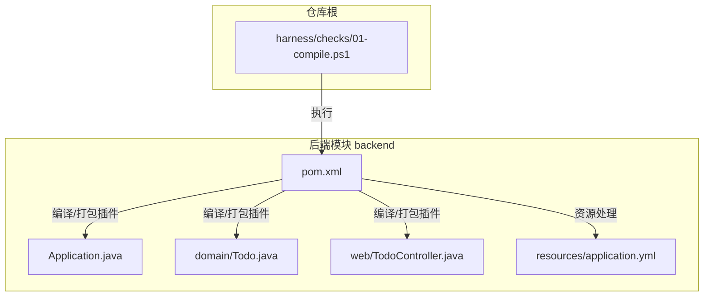
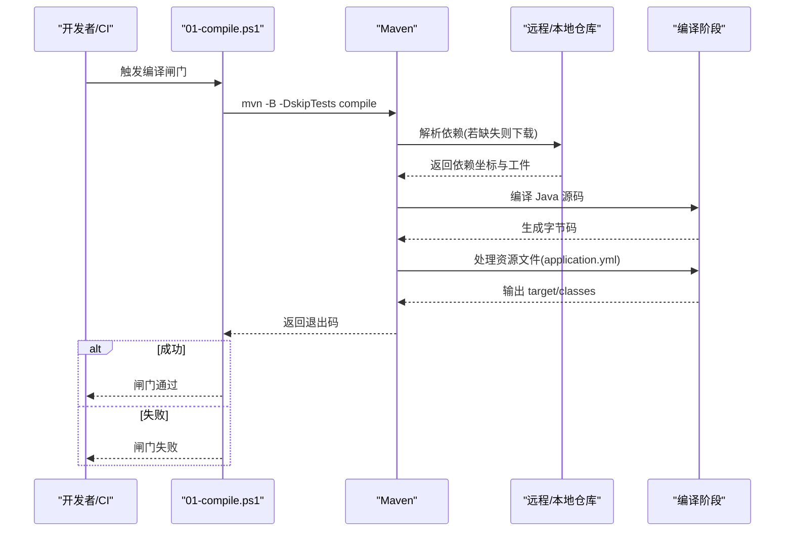
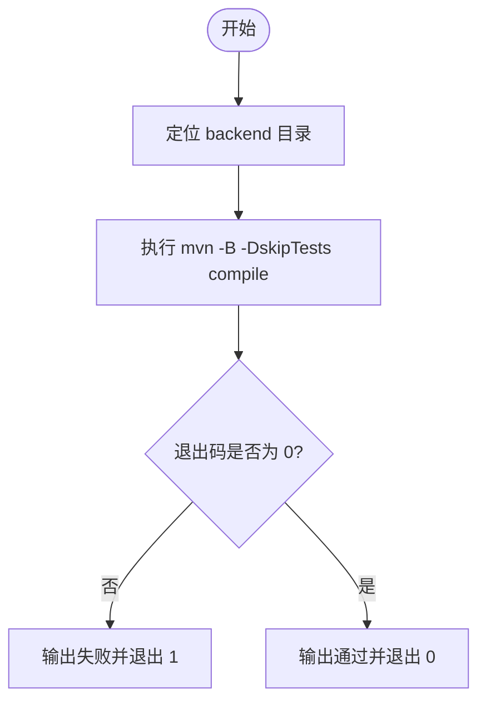
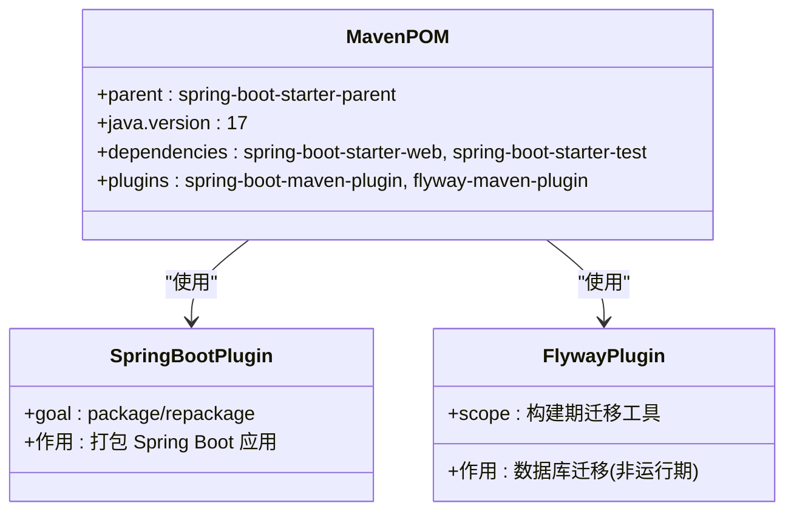
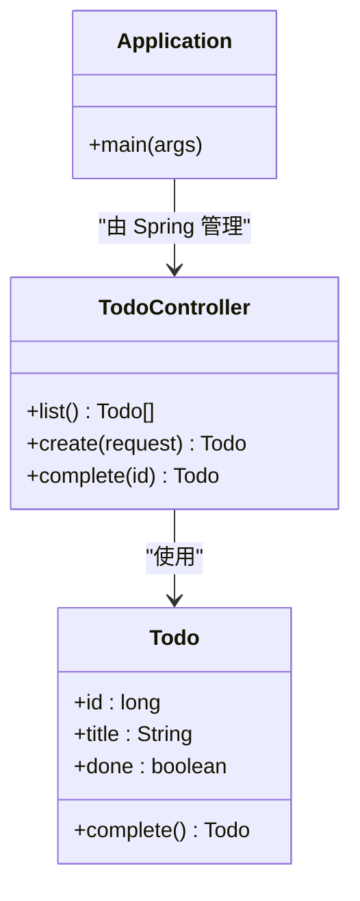
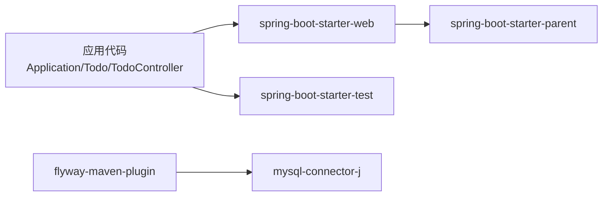

# 编译检查

<cite>
**本文引用的文件**   
- [backend/pom.xml](file://backend/pom.xml)
- [harness/checks/01-compile.ps1](file://harness/checks/01-compile.ps1)
- [backend/src/main/java/com/luyi/myfirst/Application.java](file://backend/src/main/java/com/luyi/myfirst/Application.java)
- [backend/src/main/java/com/luyi/myfirst/domain/Todo.java](file://backend/src/main/java/com/luyi/myfirst/domain/Todo.java)
- [backend/src/main/java/com/luyi/myfirst/web/TodoController.java](file://backend/src/main/java/com/luyi/myfirst/web/TodoController.java)
- [backend/src/main/resources/application.yml](file://backend/src/main/resources/application.yml)
</cite>

## 目录
1. [简介](#简介)
2. [项目结构](#项目结构)
3. [核心组件](#核心组件)
4. [架构总览](#架构总览)
5. [详细组件分析](#详细组件分析)
6. [依赖关系分析](#依赖关系分析)
7. [性能考虑](#性能考虑)
8. [故障排查指南](#故障排查指南)
9. [结论](#结论)

## 简介
本文件面向“编译检查”闸门，说明其如何对后端 Spring Boot 应用进行 Maven 编译验证。该闸门的职责是确保代码可被正确编译，但不验证运行时行为或业务逻辑是否正确。它通过执行 Maven 的 compile 目标完成以下关键步骤：
- 解析并下载 Maven 依赖
- 编译 Java 源代码
- 处理资源文件（如 application.yml）

同时，文档还给出支持的 Java 版本与 Maven 配置要求、常见编译错误诊断方法、解决方案以及性能优化建议。

## 项目结构
后端采用标准 Maven 工程布局，Spring Boot 应用入口位于 backend 模块下；编译闸门脚本位于 harness/checks 目录下，负责调用 Maven 执行编译。

图表来源
- [harness/checks/01-compile.ps1:1-21](file://harness/checks/01-compile.ps1#L1-L21)
- [backend/pom.xml:1-74](file://backend/pom.xml#L1-L74)
- [backend/src/main/java/com/luyi/myfirst/Application.java:1-13](file://backend/src/main/java/com/luyi/myfirst/Application.java#L1-L13)
- [backend/src/main/java/com/luyi/myfirst/domain/Todo.java:1-13](file://backend/src/main/java/com/luyi/myfirst/domain/Todo.java#L1-L13)
- [backend/src/main/java/com/luyi/myfirst/web/TodoController.java:1-45](file://backend/src/main/java/com/luyi/myfirst/web/TodoController.java#L1-L45)
- [backend/src/main/resources/application.yml:1-13](file://backend/src/main/resources/application.yml#L1-L13)

章节来源
- [harness/checks/01-compile.ps1:1-21](file://harness/checks/01-compile.ps1#L1-L21)
- [backend/pom.xml:1-74](file://backend/pom.xml#L1-L74)

## 核心组件
- 编译闸门脚本：harness/checks/01-compile.ps1
  - 定位到 backend 目录
  - 执行 mvn -B -DskipTests compile
  - 根据退出码判断闸门是否通过
- Maven 构建配置：backend/pom.xml
  - 继承 spring-boot-starter-parent
  - 声明 Java 版本为 17
  - 引入 spring-boot-starter-web 与测试 starter
  - 使用 spring-boot-maven-plugin 进行构建
  - 包含 flyway-maven-plugin（仅作为迁移工具，不引入运行期依赖）
- 应用入口与示例类：
  - Application.java：Spring Boot 启动类
  - Todo.java：领域模型 record
  - TodoController.java：REST 控制器
- 资源配置：application.yml
  - 最小化配置，保证构建与测试无需外部服务

章节来源
- [harness/checks/01-compile.ps1:1-21](file://harness/checks/01-compile.ps1#L1-L21)
- [backend/pom.xml:1-74](file://backend/pom.xml#L1-L74)
- [backend/src/main/java/com/luyi/myfirst/Application.java:1-13](file://backend/src/main/java/com/luyi/myfirst/Application.java#L1-L13)
- [backend/src/main/java/com/luyi/myfirst/domain/Todo.java:1-13](file://backend/src/main/java/com/luyi/myfirst/domain/Todo.java#L1-L13)
- [backend/src/main/java/com/luyi/myfirst/web/TodoController.java:1-45](file://backend/src/main/java/com/luyi/myfirst/web/TodoController.java#L1-L45)
- [backend/src/main/resources/application.yml:1-13](file://backend/src/main/resources/application.yml#L1-L13)

## 架构总览
编译检查闸门的工作流如下：

图表来源
- [harness/checks/01-compile.ps1:1-21](file://harness/checks/01-compile.ps1#L1-L21)
- [backend/pom.xml:1-74](file://backend/pom.xml#L1-L74)

## 详细组件分析

### 编译闸门脚本：01-compile.ps1
- 功能要点
  - 将工作目录切换到 backend
  - 以非交互模式执行 Maven 编译，跳过测试
  - 根据 Maven 退出码决定闸门结果
- 关键行为
  - 如果 Maven 返回非零退出码，闸门立即失败并输出失败信息
  - 否则输出通过信息并正常退出

图表来源
- [harness/checks/01-compile.ps1:1-21](file://harness/checks/01-compile.ps1#L1-L21)

章节来源
- [harness/checks/01-compile.ps1:1-21](file://harness/checks/01-compile.ps1#L1-L21)

### Maven 构建配置：pom.xml
- 父 POM
  - 继承 spring-boot-starter-parent，统一依赖与插件管理
- 语言与编码
  - java.version=17
  - 构建与报告编码均为 UTF-8
- 依赖
  - spring-boot-starter-web：提供 Web 能力
  - spring-boot-starter-test：测试范围依赖
- 插件
  - spring-boot-maven-plugin：Spring Boot 构建与打包
  - flyway-maven-plugin：仅用于迁移任务，不引入运行期依赖
- 构建产物
  - 编译后字节码位于 target/classes
  - 资源文件（如 application.yml）会被复制到 target/classes

图表来源
- [backend/pom.xml:1-74](file://backend/pom.xml#L1-L74)

章节来源
- [backend/pom.xml:1-74](file://backend/pom.xml#L1-L74)

### 应用入口与示例类
- Application.java
  - 标注 @SpringBootApplication
  - main 方法启动 Spring 容器
- Todo.java
  - 使用 record 定义不可变领域对象
- TodoController.java
  - REST 控制器，暴露 /api/todos 相关接口
  - 内部包含 CreateTodoRequest record

图表来源
- [backend/src/main/java/com/luyi/myfirst/Application.java:1-13](file://backend/src/main/java/com/luyi/myfirst/Application.java#L1-L13)
- [backend/src/main/java/com/luyi/myfirst/domain/Todo.java:1-13](file://backend/src/main/java/com/luyi/myfirst/domain/Todo.java#L1-L13)
- [backend/src/main/java/com/luyi/myfirst/web/TodoController.java:1-45](file://backend/src/main/java/com/luyi/myfirst/web/TodoController.java#L1-L45)

章节来源
- [backend/src/main/java/com/luyi/myfirst/Application.java:1-13](file://backend/src/main/java/com/luyi/myfirst/Application.java#L1-L13)
- [backend/src/main/java/com/luyi/myfirst/domain/Todo.java:1-13](file://backend/src/main/java/com/luyi/myfirst/domain/Todo.java#L1-L13)
- [backend/src/main/java/com/luyi/myfirst/web/TodoController.java:1-45](file://backend/src/main/java/com/luyi/myfirst/web/TodoController.java#L1-L45)

### 资源配置：application.yml
- 最小化配置，便于开箱即用
- 设置 server.port 与 spring.application.name
- 日志级别设置为 INFO
- 构建与测试阶段不依赖外部服务

章节来源
- [backend/src/main/resources/application.yml:1-13](file://backend/src/main/resources/application.yml#L1-L13)

## 依赖关系分析
- 直接依赖
  - spring-boot-starter-web：提供 Web MVC、Tomcat 等能力
  - spring-boot-starter-test：测试框架依赖
- 间接依赖
  - 由 spring-boot-starter-parent 统一管理版本
  - flyway-maven-plugin 及其 MySQL 驱动仅在构建期使用
- 构建期依赖
  - maven-compiler-plugin（由 parent 管理）
  - spring-boot-maven-plugin（打包与 repackage）

图表来源
- [backend/pom.xml:1-74](file://backend/pom.xml#L1-L74)

章节来源
- [backend/pom.xml:1-74](file://backend/pom.xml#L1-L74)

## 性能考虑
- 启用离线模式（网络受限环境）
  - 首次构建前预拉取依赖，后续使用 -o 减少网络开销
- 并行构建
  - 在大型多模块项目中可使用 -T 参数提升并发度
- 增量编译
  - 保持 Maven 缓存目录 .m2/repository 完整，避免重复下载
- 清理不必要的构建目标
  - 当前闸门仅执行 compile，避免执行 test、package 等额外阶段
- 合理配置 JVM 内存
  - 根据机器性能调整 MAVEN_OPTS，避免频繁 GC

[本节为通用指导，不涉及具体文件]

## 故障排查指南

### 常见编译错误与解决思路
- 依赖冲突
  - 现象：编译时报找不到类或版本冲突
  - 排查：使用 mvn dependency:tree 查看依赖树，定位冲突坐标
  - 解决：在 pom.xml 中显式声明所需版本或使用 <exclusions> 排除
- 语法错误
  - 现象：javac 报错，提示语法问题
  - 排查：根据错误行号检查对应 Java 源文件
  - 解决：修正语法，确保与 Java 17 特性兼容（如 record）
- 配置文件问题
  - 现象：资源文件加载异常或格式错误
  - 排查：检查 application.yml 缩进与键名
  - 解决：修正 YAML 格式，确保 key 存在且值类型正确
- JDK/Maven 版本不匹配
  - 现象：编译阶段报 JDK 版本不支持或编译器插件错误
  - 排查：确认本机 JDK 版本与 pom.xml 中 java.version 一致
  - 解决：安装并切换至 JDK 17，或在 CI 中固定 JDK 版本
- 网络或仓库访问问题
  - 现象：无法解析依赖或下载失败
  - 排查：检查网络连接、代理设置与本地仓库权限
  - 解决：配置镜像仓库或代理，确保能访问中央仓库

章节来源
- [backend/pom.xml:1-74](file://backend/pom.xml#L1-L74)
- [backend/src/main/resources/application.yml:1-13](file://backend/src/main/resources/application.yml#L1-L13)

### 诊断命令参考
- 查看依赖树
  - mvn dependency:tree
- 仅编译（跳过测试）
  - mvn -B -DskipTests compile
- 带详细日志
  - mvn -B -X -DskipTests compile
- 离线模式（需提前下载依赖）
  - mvn -B -o -DskipTests compile

[本节为通用指导，不涉及具体文件]

## 结论
编译检查闸门通过 PowerShell 脚本调用 Maven 的 compile 目标，确保后端 Spring Boot 应用在依赖解析、Java 编译与资源处理三个关键环节均能通过。配合明确的 Java 版本与 Maven 配置，可在本地与 CI 环境中稳定执行。遇到编译问题时，优先从依赖树、JDK 版本、YAML 配置与网络环境入手排查，并结合性能优化策略提升构建效率。