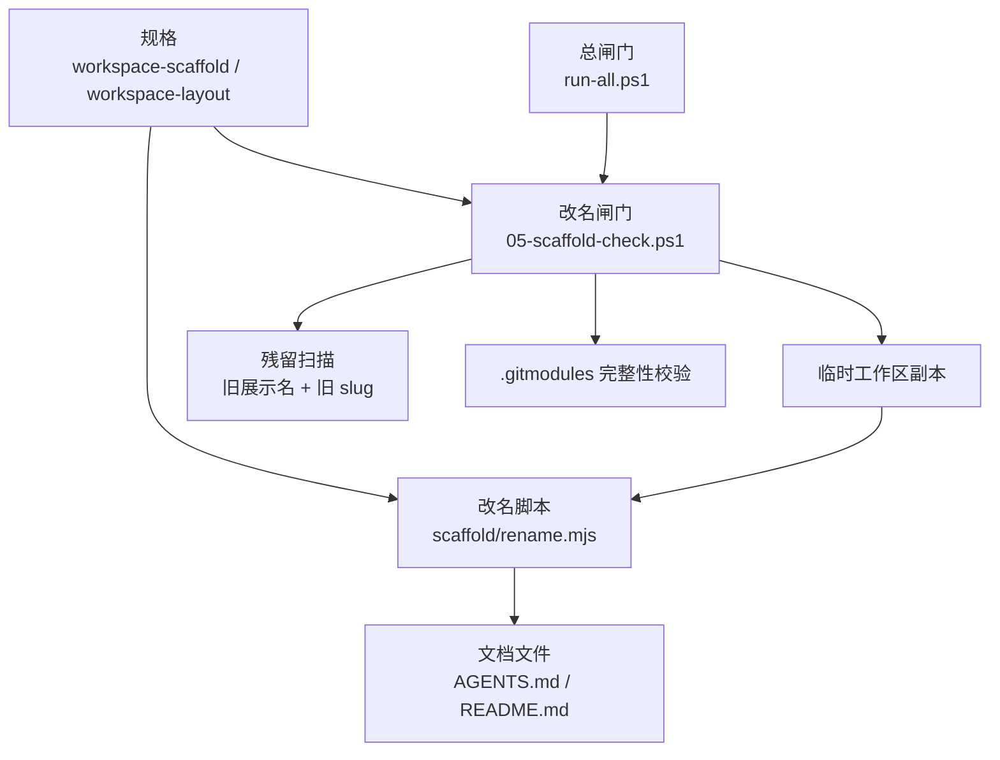
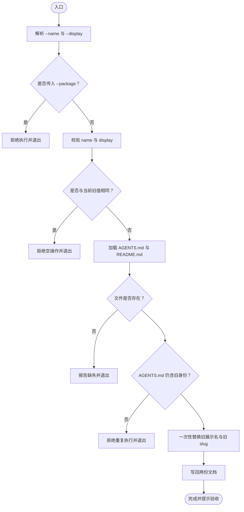
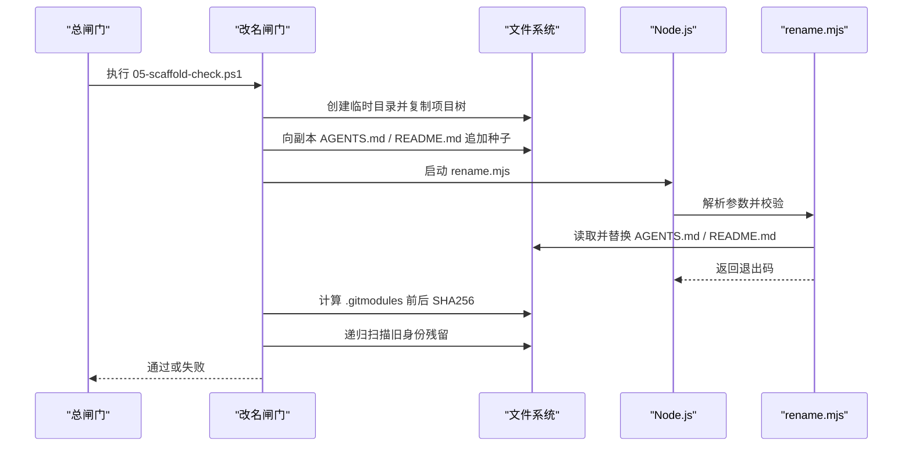
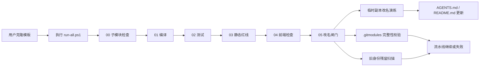
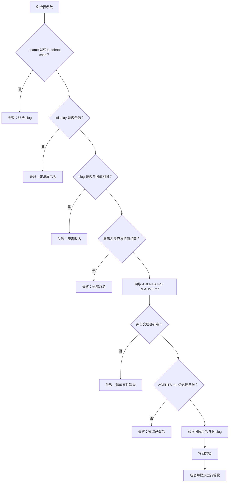
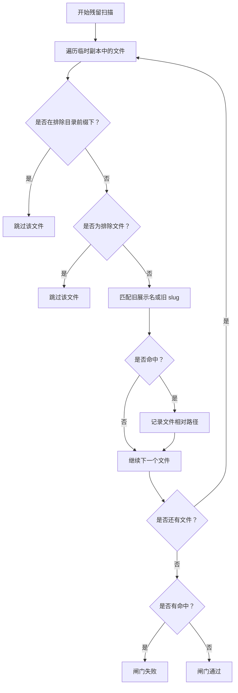
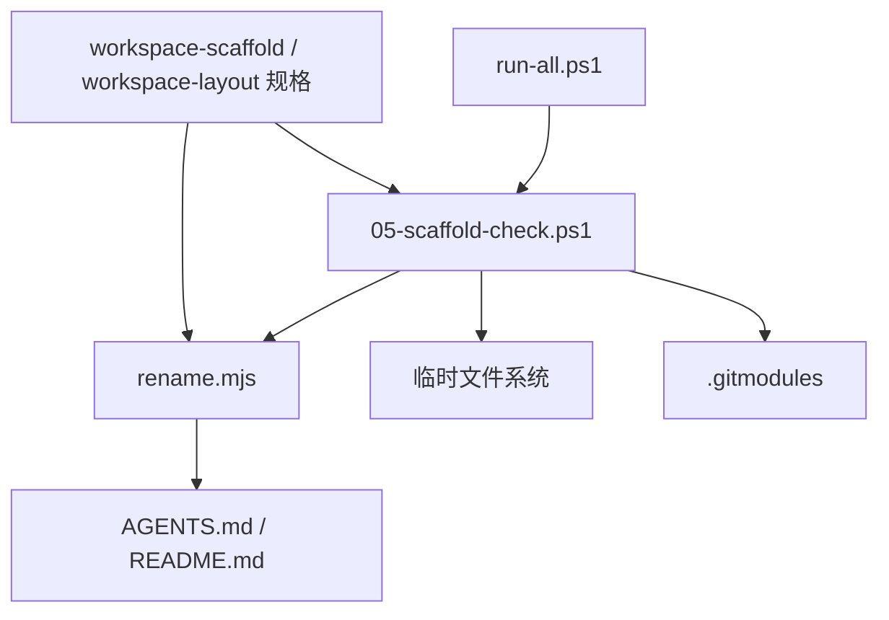

# 脚手架检查

<cite>
**本文引用的文件**   
- [scaffold/rename.mjs](file://scaffold/rename.mjs)
- [harness/checks/05-scaffold-check.ps1](file://harness/checks/05-scaffold-check.ps1)
- [harness/run-all.ps1](file://harness/run-all.ps1)
- [openspec/specs/workspace-scaffold/spec.md](file://openspec/specs/workspace-scaffold/spec.md)
- [openspec/specs/workspace-layout/spec.md](file://openspec/specs/workspace-layout/spec.md)
- [AGENTS.md](file://AGENTS.md)
- [README.md](file://README.md)
- [.gitmodules](file://.gitmodules)
</cite>

## 目录
1. [引言](#引言)
2. [项目结构](#项目结构)
3. [核心组件](#核心组件)
4. [架构总览](#架构总览)
5. [详细组件分析](#详细组件分析)
6. [依赖关系分析](#依赖关系分析)
7. [性能与可维护性](#性能与可维护性)
8. [故障排查指南](#故障排查指南)
9. [结论](#结论)
10. [附录：改名操作清单](#附录改名操作清单)

## 引言
本文件聚焦“脚手架检查闸门”，解释它如何保证工作区身份改名演练和旧身份残留扫描的正确性。该闸门的核心目标是：
- 在临时副本中执行 `scaffold/rename.mjs`，验证改名流程能正确替换工作区展示名与 slug。
- 扫描改名后的副本，确保没有遗留的旧工作区身份。
- 校验 `.gitmodules` 未被改名脚本修改，从而保护子模块远程地址。
- 将改名能力纳入统一验收流水线，使模板态与已改名态都能稳定运行。

## 项目结构
脚手架检查相关代码分布在三个层次：
- 规格层：`openspec/specs/workspace-scaffold/spec.md` 与 `workspace-layout/spec.md` 定义改名契约、子模块边界与验收要求。
- 实现层：`scaffold/rename.mjs` 是改名工具；`harness/checks/05-scaffold-check.ps1` 是改名闸门。
- 编排层：`harness/run-all.ps1` 按文件名顺序执行所有闸门，其中第 05 项负责改名演练与残留扫描。

**图表来源**
- [harness/run-all.ps1:1-21](file://harness/run-all.ps1#L1-L21)
- [harness/checks/05-scaffold-check.ps1:1-11](file://harness/checks/05-scaffold-check.ps1#L1-L11)
- [scaffold/rename.mjs:1-17](file://scaffold/rename.mjs#L1-L17)
- [openspec/specs/workspace-scaffold/spec.md:1-11](file://openspec/specs/workspace-scaffold/spec.md#L1-L11)
- [openspec/specs/workspace-layout/spec.md:9-11](file://openspec/specs/workspace-layout/spec.md#L9-L11)

**章节来源**
- [openspec/specs/workspace-scaffold/spec.md:1-53](file://openspec/specs/workspace-scaffold/spec.md#L1-L53)
- [openspec/specs/workspace-layout/spec.md:1-75](file://openspec/specs/workspace-layout/spec.md#L1-L75)
- [harness/run-all.ps1:1-21](file://harness/run-all.ps1#L1-L21)

## 核心组件
### 改名脚本：`scaffold/rename.mjs`
改名脚本的职责非常克制：只改工作区自身的展示名与 slug，不进入 `backend/`、`frontend/`，不改 `.gitmodules`，也不接受应用身份改名参数。

关键行为包括：
- 解析 `--name` 与 `--display` 参数。
- 强制 `--name` 为 kebab-case，`--display` 去空白后长度为 1 到 60，且不含换行。
- 显式拒绝 `--package`，把应用身份改名责任交给子模块仓库。
- 拒绝与新值相同或无法检测到旧工作区身份的重复执行。
- 仅读取并写入 `AGENTS.md` 与 `README.md`。
- 使用正则一次性匹配旧展示名与旧 slug，避免新值再次被替换。
- 输出替换位置数量与后续验收提示。

**图表来源**
- [scaffold/rename.mjs:36-121](file://scaffold/rename.mjs#L36-L121)

**章节来源**
- [scaffold/rename.mjs:1-122](file://scaffold/rename.mjs#L1-L122)

### 改名闸门：`05-scaffold-check.ps1`
改名闸门不是直接在生产仓库上改名，而是在系统临时目录创建副本，再对副本执行改名与扫描。这样做的好处是：
- 不污染当前工作区。
- 无论仓库处于模板态还是已改名态，都能重复演练。
- 通过哈希比较 `.gitmodules`，确认改名脚本没有越界修改子模块配置。

闸门主要步骤：
1. 构造旧展示名与旧 slug，避免脚本自身成为残留命中源。
2. 复制项目根到临时目录，排除 `.git`、`backend`、`frontend`、`openspec`、`docs`、IDE 目录、构建产物等。
3. 向副本的 `AGENTS.md` 与 `README.md` 追加种子文本，确保改名脚本总能找到旧身份。
4. 执行 `node scaffold/rename.mjs --name scaffold-demo --display "Scaffold Demo"`。
5. 比较 `.gitmodules` 的 SHA256，若变化则失败。
6. 在副本内递归扫描旧展示名与旧 slug，排除改名工具自身、`.gitmodules` 与闸门脚本本身。
7. 发现残留即失败，否则通过。

**图表来源**
- [harness/run-all.ps1:37-63](file://harness/run-all.ps1#L37-L63)
- [harness/checks/05-scaffold-check.ps1:10-110](file://harness/checks/05-scaffold-check.ps1#L10-L110)
- [scaffold/rename.mjs:36-121](file://scaffold/rename.mjs#L36-L121)

**章节来源**
- [harness/checks/05-scaffold-check.ps1:1-111](file://harness/checks/05-scaffold-check.ps1#L1-L111)

### 规格约束
`workspace-scaffold/spec.md` 明确约定：
- 改名只作用于工作区展示名与 slug。
- 不得修改 `backend/`、`frontend/`、`openspec/`、`.gitmodules` 或包目录。
- 收到 `--package` 必须拒绝。
- 改名结果必须能通过残留扫描验证。
- 闸门必须在临时副本中演练，且不要求模板仓库自身已改名。

`workspace-layout/spec.md` 进一步约束：
- 前后端以 git submodule 挂载。
- 子模块保留独立构建身份与应用身份。
- 工作区改名不得修改子模块 URL。
- `.gitmodules` 的 URL 可能包含工作区身份 token，但必须通过哈希比较而非残留扫描判定。

**章节来源**
- [openspec/specs/workspace-scaffold/spec.md:7-53](file://openspec/specs/workspace-scaffold/spec.md#L7-L53)
- [openspec/specs/workspace-layout/spec.md:9-75](file://openspec/specs/workspace-layout/spec.md#L9-L75)

## 架构总览
改名能力由“规格 → 工具 → 闸门 → 总流水线”四层组成。

**图表来源**
- [harness/run-all.ps1:1-21](file://harness/run-all.ps1#L1-L21)
- [harness/checks/05-scaffold-check.ps1:44-104](file://harness/checks/05-scaffold-check.ps1#L44-L104)
- [scaffold/rename.mjs:84-121](file://scaffold/rename.mjs#L84-L121)

## 详细组件分析

### 改名流程：`rename.mjs` 执行路径
改名流程的关键决策点如下：

**图表来源**
- [scaffold/rename.mjs:36-121](file://scaffold/rename.mjs#L36-L121)

#### 目录结构与配置文件更新范围
改名脚本只更新以下工作区自有文件：
- `AGENTS.md`
- `README.md`

它不会：
- 进入 `backend/` 或 `frontend/`。
- 修改 `openspec/`。
- 修改 `.gitmodules`。
- 修改任何包目录或构建产物。

#### 引用路径修正策略
改名脚本采用“旧 token 精确替换”的策略：
- 旧展示名与旧 slug 作为两个固定 token。
- 使用转义后的正则表达式一次性匹配。
- 根据匹配到的 token 决定替换为新展示名还是新 slug。
- 统计每份文件的替换次数，便于调试。

这种方式避免了“新值里包含旧 token”导致的级联替换问题，也保证了改名结果可被残留扫描验证。

**章节来源**
- [scaffold/rename.mjs:24-31](file://scaffold/rename.mjs#L24-L31)
- [scaffold/rename.mjs:45-117](file://scaffold/rename.mjs#L45-L117)

### 残留扫描逻辑
改名闸门的残留扫描关注三类风险：
1. **遗留的文件名**：例如仍包含旧 slug 的文件或目录（虽然改名脚本不重命名目录，但扫描会覆盖整个临时副本）。
2. **过时的引用**：文档、说明、示例中仍出现旧展示名或旧 slug。
3. **废弃的配置项**：例如误把工作区身份写进不应改动的配置文件中。

扫描规则如下：
- 在临时副本中递归查找所有文件。
- 排除不属于改名范围的目录：`.git`、`backend`、`frontend`、`openspec`、`docs`、`.idea`、`.vscode`、`.scaffold-tmp`、`target`、`node_modules`、`dist`、`scaffold`。
- 排除特定文件：`.gitmodules` 与 `harness/checks/05-scaffold-check.ps1`。
- 使用旧展示名与旧 slug 的正则模式进行匹配。
- 只要存在命中，闸门就失败并列出相对路径。

**图表来源**
- [harness/checks/05-scaffold-check.ps1:82-101](file://harness/checks/05-scaffold-check.ps1#L82-L101)

**章节来源**
- [harness/checks/05-scaffold-check.ps1:15-24](file://harness/checks/05-scaffold-check.ps1#L15-L24)
- [harness/checks/05-scaffold-check.ps1:82-101](file://harness/checks/05-scaffold-check.ps1#L82-L101)

### 子模块与 `.gitmodules` 保护
改名闸门不仅做内容扫描，还通过 SHA256 校验 `.gitmodules`：
- 执行改名前计算 `.gitmodules` 的哈希。
- 执行改名后再次计算哈希。
- 如果哈希不同，说明改名脚本越界修改了子模块配置，闸门立即失败。

这与规格中“子模块远程地址可由模板使用者替换，但工作区改名不得改写 URL”的要求一致。

**章节来源**
- [harness/checks/05-scaffold-check.ps1:69-80](file://harness/checks/05-scaffold-check.ps1#L69-L80)
- [openspec/specs/workspace-layout/spec.md:64-75](file://openspec/specs/workspace-layout/spec.md#L64-L75)
- [.gitmodules:1-7](file://.gitmodules#L1-L7)

### 与总流水线的集成
`run-all.ps1` 按文件名排序执行 `harness/checks` 下的 PowerShell 脚本。改名闸门位于第 05 位，顺序为：
1. 子模块检查
2. 后端编译
3. 后端测试
4. 静态红线
5. 前端检查
6. 改名闸门
7. Flyway 迁移

任一闸门失败都会导致整体验收失败，除非显式启用“遇错继续”模式。

**章节来源**
- [harness/run-all.ps1:1-21](file://harness/run-all.ps1#L1-L21)
- [harness/run-all.ps1:37-63](file://harness/run-all.ps1#L37-L63)

## 依赖关系分析
改名能力的依赖关系如下：

**图表来源**
- [harness/run-all.ps1:37-63](file://harness/run-all.ps1#L37-L63)
- [harness/checks/05-scaffold-check.ps1:44-104](file://harness/checks/05-scaffold-check.ps1#L44-L104)
- [scaffold/rename.mjs:84-121](file://scaffold/rename.mjs#L84-L121)
- [openspec/specs/workspace-scaffold/spec.md:7-53](file://openspec/specs/workspace-scaffold/spec.md#L7-L53)
- [openspec/specs/workspace-layout/spec.md:9-75](file://openspec/specs/workspace-layout/spec.md#L9-L75)

**章节来源**
- [harness/run-all.ps1:1-91](file://harness/run-all.ps1#L1-L91)
- [harness/checks/05-scaffold-check.ps1:1-111](file://harness/checks/05-scaffold-check.ps1#L1-L111)
- [scaffold/rename.mjs:1-122](file://scaffold/rename.mjs#L1-L122)

## 性能与可维护性
### 性能特征
- 改名脚本只读写两份 Markdown 文件，时间复杂度接近 O(n)，n 为文件体积。
- 闸门在临时目录操作，避免影响当前工作区状态。
- 残留扫描使用递归遍历与正则匹配，复杂度取决于临时副本中的文件数量。
- `.gitmodules` 使用 SHA256 比较，属于常量时间开销。

### 可维护性建议
- 保持旧身份 token 单一事实源：模板中的旧展示名与旧 slug 应与改名脚本、闸门中的构造值保持一致。
- 新增需要扫描的文件时，优先调整改名脚本的替换范围，而不是扩大残留扫描范围。
- 新增排除目录时，应评估是否会影响真实业务文件；默认排除构建产物和 IDE 目录是合理的。
- 不要在改名脚本中添加交互式输入，闸门与 CI 环境无法应答。

[本节为通用指导，不直接分析具体代码片段]

## 故障排查指南

### 常见改名失败原因
1. **参数缺失或非法**
   - 缺少 `--name` 或 `--display`。
   - `--name` 不符合 kebab-case。
   - `--display` 为空、过长或包含换行。
   - 处理：检查命令参数，参考用法提示。

2. **传入 `--package`**
   - 改名脚本拒绝应用身份改名。
   - 处理：在 `backend` 或 `frontend` 各自仓库内完成应用身份改名。

3. **重复执行**
   - 新值与旧值相同。
   - `AGENTS.md` 中找不到旧展示名或旧 slug。
   - 处理：恢复模板原值后再试，或使用版本控制还原。

4. **清单文件缺失**
   - `AGENTS.md` 或 `README.md` 不存在。
   - 处理：恢复工作区基础文档，不要删除改名脚本依赖的文件。

5. **`.gitmodules` 被修改**
   - 改名脚本越界修改了子模块配置。
   - 处理：检查改名脚本是否被扩展；恢复 `.gitmodules` 后重新运行闸门。

6. **残留扫描失败**
   - 改名后仍有旧展示名或旧 slug。
   - 处理：搜索临时副本或实际仓库中的旧 token，补充替换或删除无关引用。

### 恢复方法
- 使用版本控制还原：如果改名失败且本地未提交，可直接还原 `AGENTS.md`、`README.md` 与 `.gitmodules`。
- 从模板重新初始化：如果多个文件被错误修改，可重新克隆模板并按规范执行改名。
- 手动修复残留：定位残留文件后，将旧展示名与旧 slug 替换为新值，或移除不再适用的引用。

### 数据备份策略
- 改名前提交本地变更，确保可回滚。
- 对重要分支打标签或保存快照。
- 在 CI 环境中，失败时应保留日志与临时目录信息以便复现。
- 对于生产或团队模板仓库，改名前应先在开发分支验证，并通过完整闸门。

**章节来源**
- [scaffold/rename.mjs:45-100](file://scaffold/rename.mjs#L45-L100)
- [harness/checks/05-scaffold-check.ps1:49-104](file://harness/checks/05-scaffold-check.ps1#L49-L104)

## 结论
脚手架检查闸门通过“临时副本改名演练 + 旧身份残留扫描 + `.gitmodules` 完整性校验”的组合，确保工作区身份改名既安全又可验证。改名脚本严格限定作用范围，闸门严格限定扫描范围，规格明确划分工作区与应用身份的边界。这样即使模板被多次分发、多次改名，也能通过统一的验收流水线发现不一致。

要长期维护这套机制，关键是：
- 保持改名脚本与闸门对旧身份的理解一致。
- 保持规格与实际实现同步。
- 不在改名脚本中引入交互、网络请求或子模块修改。
- 在新增模板文件或配置时，主动考虑改名与残留扫描的影响。

[本节为总结性内容，不直接分析具体代码片段]

## 附录：改名操作清单

### 标准改名步骤
1. 克隆模板并初始化子模块。
2. 执行 `node scaffold/rename.mjs --name <新 slug> --display "<新展示名>"`。
3. 运行 `powershell -File harness\run-all.ps1` 验证七道闸门。
4. 如改名闸门失败，先查看失败原因，再决定是否恢复或修复。
5. 成功后提交工作区改动，并在子模块仓库内分别处理应用身份改名。

### 改名失败快速诊断
- 先看改名脚本输出：参数是否合法、是否重复执行、是否缺少文件。
- 再看闸门输出：是否 `.gitmodules` 被修改、是否扫描到残留。
- 最后看规格：是否符合 `workspace-scaffold` 与 `workspace-layout` 的约束。

**章节来源**
- [README.md:48-64](file://README.md#L48-L64)
- [AGENTS.md:139-139](file://AGENTS.md#L139-L139)
- [openspec/specs/workspace-scaffold/spec.md:7-53](file://openspec/specs/workspace-scaffold/spec.md#L7-L53)
- [openspec/specs/workspace-layout/spec.md:22-75](file://openspec/specs/workspace-layout/spec.md#L22-L75)