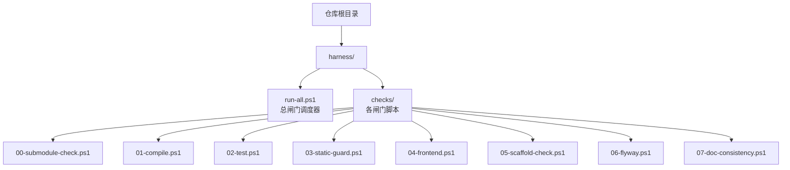
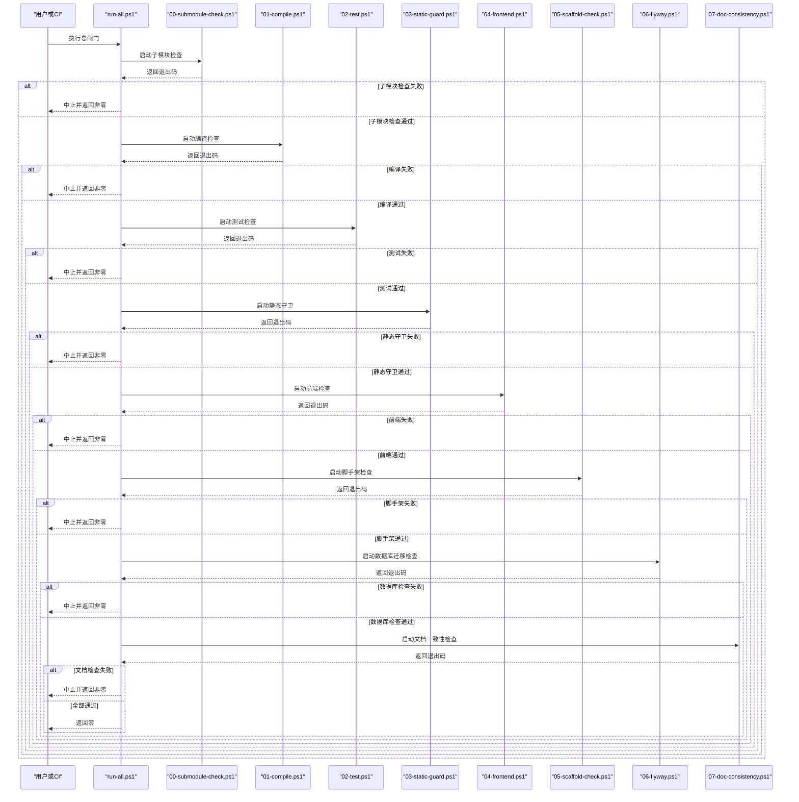
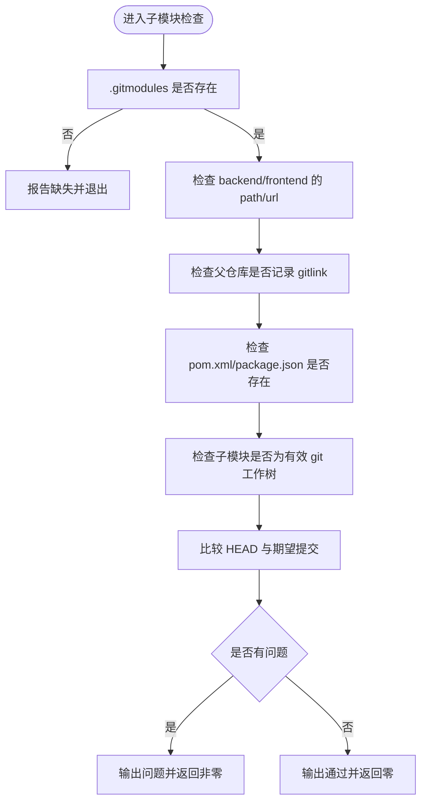
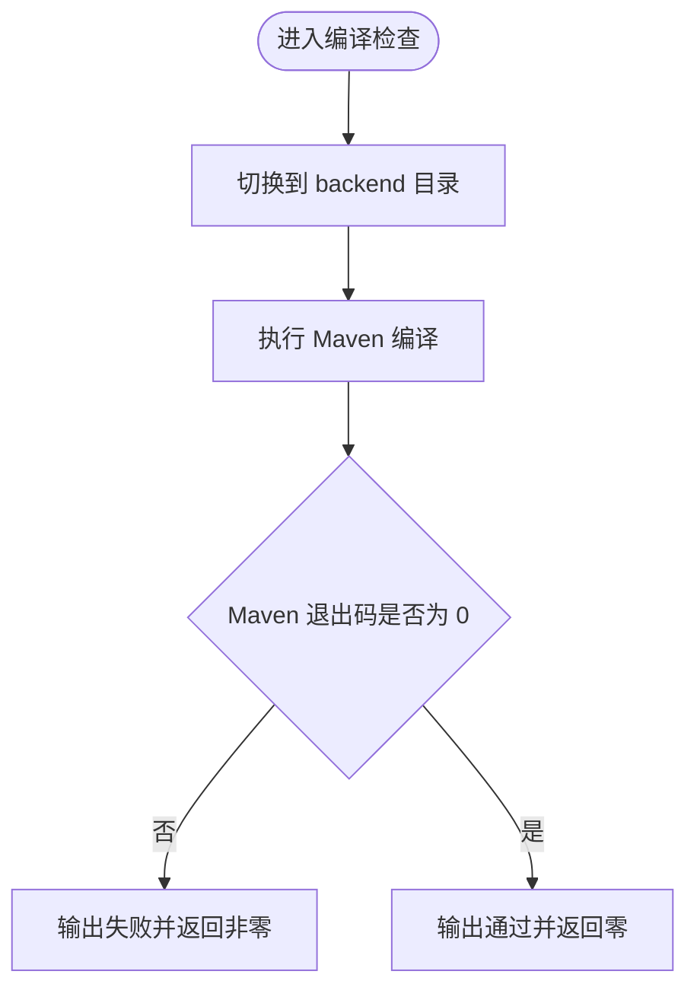
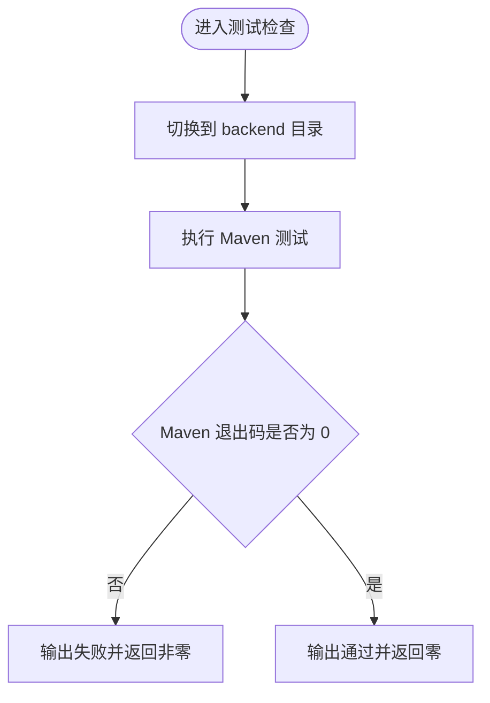
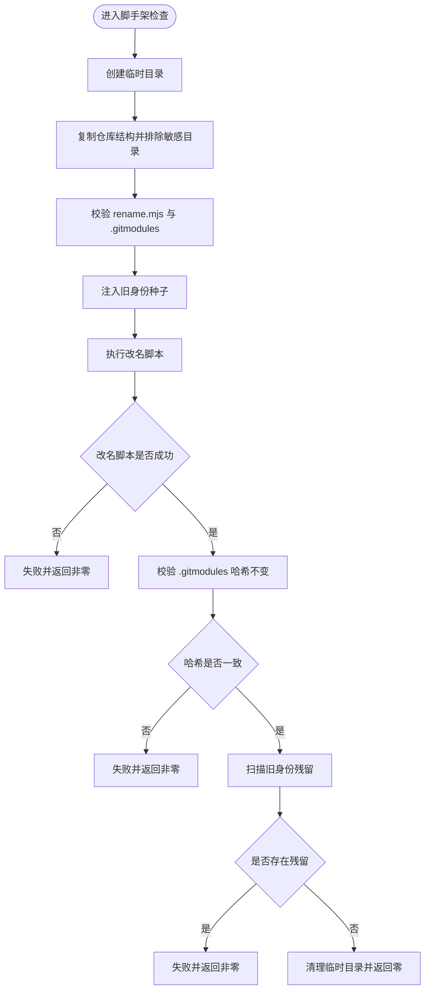
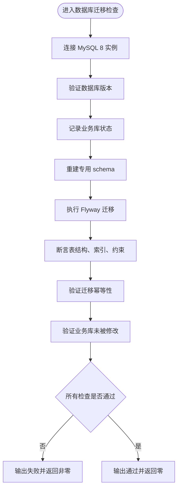
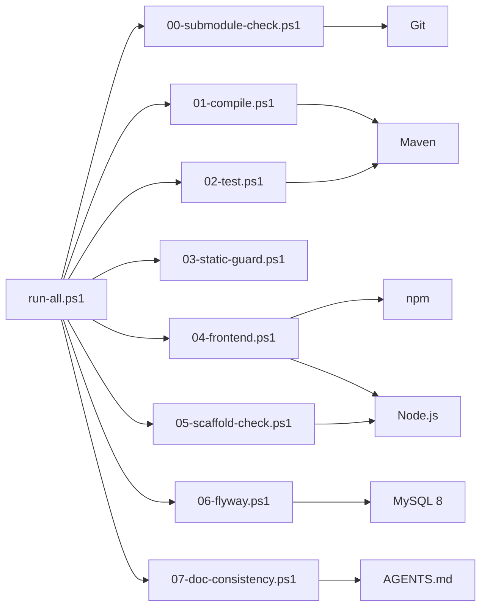

# 自动化验证

<cite>
**本文引用的文件**   
- [harness/run-all.ps1](file://harness/run-all.ps1)
- [harness/checks/00-submodule-check.ps1](file://harness/checks/00-submodule-check.ps1)
- [harness/checks/01-compile.ps1](file://harness/checks/01-compile.ps1)
- [harness/checks/02-test.ps1](file://harness/checks/02-test.ps1)
- [harness/checks/03-static-guard.ps1](file://harness/checks/03-static-guard.ps1)
- [harness/checks/04-frontend.ps1](file://harness/checks/04-frontend.ps1)
- [harness/checks/05-scaffold-check.ps1](file://harness/checks/05-scaffold-check.ps1)
- [harness/checks/06-flyway.ps1](file://harness/checks/06-flyway.ps1)
- [harness/checks/07-doc-consistency.ps1](file://harness/checks/07-doc-consistency.ps1)
- [AGENTS.md](file://AGENTS.md)
</cite>

## 更新摘要
**变更内容**   
- 新增第七道闸门：文档一致性检查（07-doc-consistency.ps1）
- 更新闸门清单和架构图以反映新的闸门数量
- 扩展红线规则说明以包含文档一致性检查
- 更新故障排除指南以涵盖文档不一致问题

## 目录
1. [引言](#引言)
2. [项目结构](#项目结构)
3. [核心组件](#核心组件)
4. [架构总览](#架构总览)
5. [详细闸门分析](#详细闸门分析)
6. [依赖关系分析](#依赖关系分析)
7. [性能与可观测性](#性能与可观测性)
8. [自定义新闸门指南](#自定义新闸门指南)
9. [红线规则说明](#红线规则说明)
10. [故障排除指南](#故障排除指南)
11. [结论](#结论)

## 引言
本仓库的自动化验证系统（Harness）以 PowerShell 脚本为核心，提供七道按序执行的"质量闸门"。其设计目标是：让机器而非人类判断一次提交是否真正完成。只有当所有闸门返回退出码 `0` 时，才视为通过；任一闸门失败都会立即阻断后续检查并返回非零退出码。

七道闸门依次为：
- 子模块检查：确保后端与前端子模块已初始化且提交一致
- 编译检查：仅验证后端能否被 Maven 编译
- 测试检查：运行后端单元测试与容器装配测试
- 静态守卫：扫描 Java 与前端源码中的占位符、调试输出、跳过测试等红线
- 前端检查：安装依赖、构建、运行前端测试
- 脚手架检查：在临时目录演练工作区改名，并扫描旧身份残留
- **文档一致性检查**：确保 AGENTS.md 目录结构与实际仓库状态匹配，防止过时的技术栈引用

这套机制强调"可重复、无交互、可归因"：每个闸门只负责一个职责，失败时给出明确原因，并通过退出码对外暴露结果。

## 项目结构
Harness 位于仓库根目录下的 `harness` 目录中，由总入口脚本和若干按序号命名的检查脚本组成：

**图表来源**
- [harness/run-all.ps1:1-90](file://harness/run-all.ps1#L1-L90)
- [harness/checks/00-submodule-check.ps1:1-94](file://harness/checks/00-submodule-check.ps1#L1-L94)
- [harness/checks/01-compile.ps1:1-21](file://harness/checks/01-compile.ps1#L1-L21)
- [harness/checks/02-test.ps1:1-23](file://harness/checks/02-test.ps1#L1-L23)
- [harness/checks/03-static-guard.ps1:1-89](file://harness/checks/03-static-guard.ps1#L1-L89)
- [harness/checks/04-frontend.ps1:1-36](file://harness/checks/04-frontend.ps1#L1-L36)
- [harness/checks/05-scaffold-check.ps1:1-111](file://harness/checks/05-scaffold-check.ps1#L1-L111)
- [harness/checks/06-flyway.ps1:1-194](file://harness/checks/06-flyway.ps1#L1-L194)
- [harness/checks/07-doc-consistency.ps1:1-79](file://harness/checks/07-doc-consistency.ps1#L1-L79)

**章节来源**
- [harness/run-all.ps1:1-90](file://harness/run-all.ps1#L1-L90)

## 核心组件
Harness 的核心由两部分构成：

1. **总闸门调度器**：负责发现、排序、执行各检查脚本，收集退出码与耗时，并在任意失败时决定是否提前终止。
2. **检查脚本集合**：每个脚本实现单一职责，使用标准输入输出和退出码表达成功或失败。

关键行为包括：
- 自动按文件名排序执行检查
- 为每个检查启动独立 PowerShell 进程，避免环境变量和错误状态互相污染
- 记录每个检查的名称、退出码和执行时间
- 默认遇错即停，支持 `-ContinueOnError` 参数继续跑完全部检查
- 最终汇总 PASS/FAIL 结果，并以 `exit 0` 或 `exit 1` 暴露给 CI 或人类审阅者

**章节来源**
- [harness/run-all.ps1:21-90](file://harness/run-all.ps1#L21-L90)

## 架构总览
下图展示 Harness 的整体执行流程：用户或 CI 调用总闸门，总闸门依次执行七个检查脚本，并根据退出码决定继续或中断。

**图表来源**
- [harness/run-all.ps1:36-62](file://harness/run-all.ps1#L36-L62)
- [harness/run-all.ps1:75-89](file://harness/run-all.ps1#L75-L89)
- [harness/checks/00-submodule-check.ps1:82-93](file://harness/checks/00-submodule-check.ps1#L82-L93)
- [harness/checks/01-compile.ps1:14-20](file://harness/checks/01-compile.ps1#L14-L20)
- [harness/checks/02-test.ps1:16-22](file://harness/checks/02-test.ps1#L16-L22)
- [harness/checks/03-static-guard.ps1:79-88](file://harness/checks/03-static-guard.ps1#L79-L88)
- [harness/checks/04-frontend.ps1:13-35](file://harness/checks/04-frontend.ps1#L13-L35)
- [harness/checks/05-scaffold-check.ps1:73-104](file://harness/checks/05-scaffold-check.ps1#L73-L104)
- [harness/checks/06-flyway.ps1:192-193](file://harness/checks/06-flyway.ps1#L192-L193)
- [harness/checks/07-doc-consistency.ps1:77-78](file://harness/checks/07-doc-consistency.ps1#L77-L78)

## 详细闸门分析

### 闸门 0：子模块检查
该闸门在所有编译、测试和前端检查之前运行，用于保证 `backend` 与 `frontend` 两个子模块已经初始化，并且当前检出提交与父仓库记录的 gitlink 一致。

主要职责：
- 校验 `.gitmodules` 是否存在
- 校验 `backend` 与 `frontend` 的 path 与 url 配置是否符合预期
- 校验父仓库是否记录了这两个路径的 gitlink
- 校验子模块目录是否为有效 git 工作树
- 校验子模块 HEAD 是否与父仓库期望提交一致
- 不执行网络操作，不自动更新子模块，不交互式提问

失败处理：
- 收集所有问题并输出可读提示
- 输出修复命令建议
- 返回退出码 `1`

成功条件：
- 所有检查项均通过
- 返回退出码 `0`

**图表来源**
- [harness/checks/00-submodule-check.ps1:21-80](file://harness/checks/00-submodule-check.ps1#L21-L80)
- [harness/checks/00-submodule-check.ps1:82-93](file://harness/checks/00-submodule-check.ps1#L82-L93)

**章节来源**
- [harness/checks/00-submodule-check.ps1:1-94](file://harness/checks/00-submodule-check.ps1#L1-L94)

### 闸门 1：编译检查
该闸门只验证后端代码能否被 Maven 编译，不验证业务逻辑是否正确。将编译与测试分离，有助于快速定位"语法/依赖/构建配置"类问题。

主要职责：
- 切换到 `backend` 目录
- 执行 Maven 编译命令并跳过测试
- 根据 Maven 退出码判断是否通过

失败处理：
- 输出编译失败提示
- 返回退出码 `1`

成功条件：
- Maven 编译成功
- 返回退出码 `0`

**图表来源**
- [harness/checks/01-compile.ps1:6-20](file://harness/checks/01-compile.ps1#L6-L20)

**章节来源**
- [harness/checks/01-compile.ps1:1-21](file://harness/checks/01-compile.ps1#L1-L21)

### 闸门 2：测试检查
该闸门运行后端单元测试与容器装配测试，作为"契约"的可读机器版本。它不允许跳过测试，因为跳过测试等于移除护栏。

主要职责：
- 切换到 `backend` 目录
- 执行 Maven 测试
- 根据 Maven 退出码判断是否通过

失败处理：
- 输出测试失败提示
- 返回退出码 `1`

成功条件：
- 所有测试通过
- 返回退出码 `0`

**图表来源**
- [harness/checks/02-test.ps1:8-22](file://harness/checks/02-test.ps1#L8-L22)

**章节来源**
- [harness/checks/02-test.ps1:1-23](file://harness/checks/02-test.ps1#L1-L23)

### 闸门 3：静态守卫
该闸门拦截常见的"假通过"行为，包括占位标记、调试输出、禁用测试等。它同时扫描 Java 源码与前端 TypeScript/TSX 源码。

主要职责：
- 校验后端 `src` 目录存在
- 扫描 Java 源码
- 校验前端目录存在
- 扫描前端源码，排除 `node_modules`、`.next`、`dist`
- 检测以下违规：
  - TODO / FIXME / XXX 占位标记
  - System.out 相关输出
  - @Disabled 注解
  - 前端测试跳过模式：`it.skip`、`describe.skip`、`test.skip`、`xit`、`xdescribe`

失败处理：
- 输出每条违规的文件路径、行号与内容摘要
- 返回退出码 `1`

成功条件：
- 未发现违规
- 返回退出码 `0`

**图表来源**
- [harness/checks/03-static-guard.ps1:14-38](file://harness/checks/03-static-guard.ps1#L14-L38)
- [harness/checks/03-static-guard.ps1:42-77](file://harness/checks/03-static-guard.ps1#L42-L77)
- [harness/checks/03-static-guard.ps1:79-88](file://harness/checks/03-static-guard.ps1#L79-L88)

**章节来源**
- [harness/checks/03-static-guard.ps1:1-89](file://harness/checks/03-static-guard.ps1#L1-L89)

### 闸门 4：前端检查
该闸门执行前端三步链：依赖安装、生产构建、测试运行。每一步失败都会立即终止。

主要职责：
- 切换到 `frontend` 目录
- 执行 `npm ci` 进行可复现依赖安装
- 执行 `npm run build` 进行 Next.js 构建与类型检查
- 执行 `npm run test` 运行组件与代理测试

失败处理：
- 在对应步骤输出失败提示
- 返回退出码 `1`

成功条件：
- 三步全部通过
- 返回退出码 `0`

**图表来源**
- [harness/checks/04-frontend.ps1:7-35](file://harness/checks/04-frontend.ps1#L7-L35)

**章节来源**
- [harness/checks/04-frontend.ps1:1-36](file://harness/checks/04-frontend.ps1#L1-L36)

### 闸门 5：脚手架检查
该闸门在工作区改名工具的正确性与安全性上提供保障。它在临时目录复制仓库结构，注入旧身份种子，执行改名脚本，然后扫描是否存在旧身份残留。

主要职责：
- 创建临时目录并复制仓库结构，排除 `.git`、`backend`、`frontend`、`openspec`、`docs`、IDE 配置、构建产物等
- 校验副本中存在 `scaffold/rename.mjs` 与 `.gitmodules`
- 向文档注入旧工作区身份种子，保证改名演练可重复
- 执行改名脚本并校验退出码
- 校验 `.gitmodules` 未被修改
- 扫描副本中是否存在旧显示名或旧 slug 残留
- 清理临时目录

失败处理：
- 在关键步骤失败时输出明确原因
- 返回退出码 `1`

成功条件：
- 改名演练通过
- `.gitmodules` 未被意外修改
- 未检测到旧身份残留
- 返回退出码 `0`

**图表来源**
- [harness/checks/05-scaffold-check.ps1:26-36](file://harness/checks/05-scaffold-check.ps1#L26-L36)
- [harness/checks/05-scaffold-check.ps1:44-80](file://harness/checks/05-scaffold-check.ps1#L44-L80)
- [harness/checks/05-scaffold-check.ps1:82-104](file://harness/checks/05-scaffold-check.ps1#L82-L104)
- [harness/checks/05-scaffold-check.ps1:106-110](file://harness/checks/05-scaffold-check.ps1#L106-L110)

**章节来源**
- [harness/checks/05-scaffold-check.ps1:1-111](file://harness/checks/05-scaffold-check.ps1#L1-L111)

### 闸门 6：数据库迁移检查
该闸门复用既有 MySQL 8 实例，在专用 schema `ai_chat_gate` 上验证 Flyway 迁移的正确性和幂等性。它不创建或删除容器，也不触碰业务库。

主要职责：
- 连接既有 MySQL 8 实例（默认 `127.0.0.1:8806`）
- 验证数据库版本和连接可用性
- 重建专用 schema 并执行 Flyway 迁移
- 断言表结构、索引、约束、生成列和审计时间列
- 验证迁移的幂等性（再次迁移不应改变历史）
- 确保业务库 `green-note` 未被修改

失败处理：
- 在关键步骤失败时输出明确原因
- 返回退出码 `1`

成功条件：
- 数据库连接正常
- 迁移成功执行
- 所有结构断言通过
- 迁移具有幂等性
- 业务库未被修改
- 返回退出码 `0`

**图表来源**
- [harness/checks/06-flyway.ps1:51-81](file://harness/checks/06-flyway.ps1#L51-L81)
- [harness/checks/06-flyway.ps1:120-184](file://harness/checks/06-flyway.ps1#L120-L184)
- [harness/checks/06-flyway.ps1:192-193](file://harness/checks/06-flyway.ps1#L192-L193)

**章节来源**
- [harness/checks/06-flyway.ps1:1-194](file://harness/checks/06-flyway.ps1#L1-L194)

### 闸门 7：文档一致性检查
**新增** 该闸门确保 AGENTS.md 中的闸门清单与实际存在的闸门文件保持一致，并检测文档中是否残留已下线的技术栈标识。这是最后一道防线，防止文档与代码脱节。

主要职责：
- 读取 AGENTS.md 中的 `<!-- harness-checks: ... -->` 标记
- 扫描 `harness/checks/*.ps1` 实际存在的闸门文件
- 比对声明的闸门列表与实际文件集合
- 检测文档中是否包含已下线技术栈的 token（如 `App.vue`、`TodoApp` 等）
- 验证 AGENTS.md 和 README.md 中不包含过时引用

失败处理：
- 输出具体哪些闸门缺失或多余
- 指出文档中包含的过时技术栈 token
- 返回退出码 `1`

成功条件：
- 闸门清单与实际文件完全匹配
- 文档中无过时技术栈引用
- 返回退出码 `0`

**图表来源**
- [harness/checks/07-doc-consistency.ps1:24-51](file://harness/checks/07-doc-consistency.ps1#L24-L51)
- [harness/checks/07-doc-consistency.ps1:53-67](file://harness/checks/07-doc-consistency.ps1#L53-L67)
- [harness/checks/07-doc-consistency.ps1:69-78](file://harness/checks/07-doc-consistency.ps1#L69-L78)

**章节来源**
- [harness/checks/07-doc-consistency.ps1:1-79](file://harness/checks/07-doc-consistency.ps1#L1-L79)

## 依赖关系分析
Harness 的依赖关系可以理解为"调度层 + 检查层"：

- 调度层：`run-all.ps1`
- 检查层：七个检查脚本
- 外部依赖：
  - Git：子模块检查、gitlink 校验
  - Maven：后端编译与测试、Flyway 迁移
  - Node.js 与 npm：前端构建与测试、脚手架改名脚本
  - MySQL：数据库迁移验证
  - PowerShell：脚本运行时

**图表来源**
- [harness/run-all.ps1:36-62](file://harness/run-all.ps1#L36-L62)
- [harness/checks/01-compile.ps1:6-12](file://harness/checks/01-compile.ps1#L6-L12)
- [harness/checks/02-test.ps1:8-13](file://harness/checks/02-test.ps1#L8-L13)
- [harness/checks/04-frontend.ps1:7-27](file://harness/checks/04-frontend.ps1#L7-L27)
- [harness/checks/05-scaffold-check.ps1:71-75](file://harness/checks/05-scaffold-check.ps1#L71-L75)
- [harness/checks/06-flyway.ps1:9-13](file://harness/checks/06-flyway.ps1#L9-L13)
- [harness/checks/07-doc-consistency.ps1:25-27](file://harness/checks/07-doc-consistency.ps1#L25-L27)
- [harness/checks/00-submodule-check.ps1:29-79](file://harness/checks/00-submodule-check.ps1#L29-L79)

**章节来源**
- [harness/run-all.ps1:1-90](file://harness/run-all.ps1#L1-L90)

## 性能与可观测性
Harness 在设计上兼顾了可观测性与执行效率：

- 每个检查使用独立 PowerShell 进程执行，避免状态互相污染
- 使用 Stopwatch 记录每个检查的执行时间
- 默认遇错即停，减少不必要的后续检查成本
- 支持 `-ContinueOnError` 参数，便于一次性收集全部检查结果
- 最终输出汇总表格，包含每个检查的 PASS/FAIL、退出码与耗时

优化建议：
- 如果某个检查特别慢，优先确认是否真的需要每次全量执行
- 对于本地开发，可使用 `-ContinueOnError` 先了解整体情况，再逐个修复
- 在 CI 环境中保持默认行为，确保失败尽早暴露
- 不要为了"更快通过"而绕过检查，例如跳过测试或关闭静态守卫

**章节来源**
- [harness/run-all.ps1:21-25](file://harness/run-all.ps1#L21-L25)
- [harness/run-all.ps1:47-59](file://harness/run-all.ps1#L47-L59)
- [harness/run-all.ps1:61-62](file://harness/run-all.ps1#L61-L62)
- [harness/run-all.ps1:64-89](file://harness/run-all.ps1#L64-L89)

## 自定义新闸门指南

### 新增闸门的步骤
1. 在 `harness/checks/` 目录下新增一个 PowerShell 脚本，文件名以两位数字开头，例如 `08-new-check.ps1`
2. 脚本应遵循以下规范：
   - 使用 `$ErrorActionPreference = 'Stop'` 控制错误行为
   - 计算 `projectRoot` 并切换到合适的工作目录
   - 输出可读的错误信息
   - 成功时返回 `exit 0`，失败时返回 `exit 1`
3. 如果需要访问外部工具，请确保这些工具已在系统中可用
4. **重要**：在 AGENTS.md 的 `<!-- harness-checks: ... -->` 标记中添加新闸门名称
5. 在总闸门中无需手动注册，`run-all.ps1` 会自动按文件名排序执行所有 `*.ps1` 检查

### 脚本规范
- 命名规范：两位数字前缀 + 语义化名称 + `.ps1`
- 执行环境：PowerShell
- 工作目录：脚本内部自行设置，避免依赖调用方当前目录
- 输出格式：使用 `Write-Host` 输出可读信息，颜色可选但不应影响退出码
- 退出码：必须显式使用 `exit 0` 或 `exit 1`
- 交互行为：不应弹出交互式提示，CI 环境无法处理交互

### 错误处理建议
- 对关键路径使用 `Test-Path` 校验
- 对命令执行后读取 `$LASTEXITCODE`
- 对异常使用 try/finally 清理临时资源
- 对可恢复错误输出具体原因，对不可恢复错误直接退出

### 调试方法
- 单独执行目标检查脚本，观察输出与退出码
- 使用 `powershell -File harness\checks\XX-name.ps1` 直接运行
- 在总闸门中使用 `-ContinueOnError` 查看其他检查是否也失败
- 在脚本中加入更多上下文日志，但不要泄露敏感信息

**章节来源**
- [harness/run-all.ps1:36-62](file://harness/run-all.ps1#L36-L62)
- [harness/checks/00-submodule-check.ps1:9-12](file://harness/checks/00-submodule-check.ps1#L9-L12)
- [harness/checks/03-static-guard.ps1:11-18](file://harness/checks/03-static-guard.ps1#L11-L18)
- [harness/checks/05-scaffold-check.ps1:8-10](file://harness/checks/05-scaffold-check.ps1#L8-L10)
- [harness/checks/07-doc-consistency.ps1:24-51](file://harness/checks/07-doc-consistency.ps1#L24-L51)

## 红线规则说明
静态守卫是当前仓库中最关键的"质量红线"，它阻止开发者用表面绿色掩盖实际未完成的状态。**文档一致性检查**则确保文档与代码保持同步。

### Java 红线
- TODO / FIXME / XXX：表示代码尚未完成
- System.out 相关输出：表示使用控制台调试代替日志系统
- @Disabled：表示测试被禁用，可能隐藏失败

### 前端红线
- TODO / FIXME / XXX：同上
- it.skip / describe.skip / test.skip：跳过单个或整组测试
- xit / xdescribe：等价于跳过测试

### 文档红线
- 闸门清单与实际文件不一致：导致 AI agent 执行错误的检查流程
- 过时技术栈引用：如 `App.vue`、`TodoApp` 等已迁移的技术标识
- 文档与仓库状态脱节：误导开发者理解项目结构

### 为什么这些规则重要
这些规则的共同点是：它们可以让测试变绿，但不会提升真实质量。例如：
- 留下 TODO 不代表功能已完成
- 打印到控制台不代表实现了正确日志
- 禁用测试不代表问题已修复
- 跳过测试不代表边界条件已通过
- 文档过时不代表代码正确

因此，静态守卫和文档一致性检查将这些行为视为"红线"，一旦命中就拒绝合并。

**章节来源**
- [harness/checks/03-static-guard.ps1:1-10](file://harness/checks/03-static-guard.ps1#L1-L10)
- [harness/checks/03-static-guard.ps1:42-77](file://harness/checks/03-static-guard.ps1#L42-L77)
- [harness/checks/07-doc-consistency.ps1:3-10](file://harness/checks/07-doc-consistency.ps1#L3-L10)
- [harness/checks/07-doc-consistency.ps1:53-67](file://harness/checks/07-doc-consistency.ps1#L53-L67)

## 故障排除指南

### 总闸门失败
现象：
- 终端输出 `[FAIL] ... (exit X, Ys)`
- 最终输出 `RESULT: BLOCKED`

排查步骤：
1. 查看哪个检查失败
2. 单独执行该检查脚本
3. 根据输出定位具体问题
4. 修复后重新运行总闸门

参考位置：
- [harness/run-all.ps1:64-89](file://harness/run-all.ps1#L64-L89)

### 子模块检查失败
常见原因：
- 子模块未初始化
- 子模块提交与父仓库不一致
- `.gitmodules` 配置不正确

修复建议：
- 使用子模块初始化命令
- 检查 `.gitmodules` 中 backend 与 frontend 的配置
- 确保工作树有效且 HEAD 与期望提交一致

参考位置：
- [harness/checks/00-submodule-check.ps1:21-80](file://harness/checks/00-submodule-check.ps1#L21-L80)
- [harness/checks/00-submodule-check.ps1:82-93](file://harness/checks/00-submodule-check.ps1#L82-L93)

### 编译检查失败
常见原因：
- Java 语法错误
- 依赖缺失
- Maven 配置错误

修复建议：
- 先在 IDE 中修复编译错误
- 确认 Maven 可用
- 检查 `backend/pom.xml`

参考位置：
- [harness/checks/01-compile.ps1:6-20](file://harness/checks/01-compile.ps1#L6-L20)

### 测试检查失败
常见原因：
- 单元测试断言失败
- Spring 容器装配失败
- 测试数据或环境配置问题

修复建议：
- 先运行单个失败测试定位问题
- 检查测试依赖与容器配置
- 不要通过禁用测试来掩盖问题

参考位置：
- [harness/checks/02-test.ps1:8-22](file://harness/checks/02-test.ps1#L8-L22)

### 静态守卫失败
常见原因：
- 代码中包含 TODO / FIXME / XXX
- 使用了 System.out
- 使用了 @Disabled
- 前端测试被跳过

修复建议：
- 删除或替换占位标记
- 使用正式日志框架
- 修复测试而不是禁用测试
- 删除前端测试跳过语句

参考位置：
- [harness/checks/03-static-guard.ps1:42-77](file://harness/checks/03-static-guard.ps1#L42-L77)

### 前端检查失败
常见原因：
- npm 依赖安装失败
- TypeScript 类型检查失败
- 前端测试失败

修复建议：
- 清理并重新安装依赖
- 先解决构建错误，再解决测试错误
- 不要通过跳过测试掩盖问题

参考位置：
- [harness/checks/04-frontend.ps1:10-35](file://harness/checks/04-frontend.ps1#L10-L35)

### 脚手架检查失败
常见原因：
- 缺少 `scaffold/rename.mjs`
- 缺少 `.gitmodules`
- 改名脚本执行失败
- `.gitmodules` 被意外修改
- 改名后仍存在旧工作区身份残留

修复建议：
- 检查工作区模板是否完整
- 检查改名脚本逻辑
- 检查文档中是否残留旧显示名或旧 slug
- 确保 `.gitmodules` 不属于工作区改名范围

参考位置：
- [harness/checks/05-scaffold-check.ps1:44-104](file://harness/checks/05-scaffold-check.ps1#L44-L104)

### 数据库迁移检查失败
常见原因：
- MySQL 连接失败
- 数据库版本不是 MySQL 8
- Flyway 迁移失败
- 表结构断言失败
- 迁移不具有幂等性
- 业务库被意外修改

修复建议：
- 检查 MySQL 服务是否运行在 `127.0.0.1:8806`
- 验证数据库凭据和环境变量
- 检查 Flyway 迁移脚本
- 确认表结构符合预期
- 确保迁移脚本具有幂等性

参考位置：
- [harness/checks/06-flyway.ps1:51-81](file://harness/checks/06-flyway.ps1#L51-L81)
- [harness/checks/06-flyway.ps1:120-184](file://harness/checks/06-flyway.ps1#L120-L184)

### 文档一致性检查失败
**新增** 常见原因：
- AGENTS.md 中的闸门清单与实际文件不匹配
- 新增了闸门但未更新文档标记
- 删除了闸门但文档仍保留引用
- 文档中包含已过时的技术栈 token（如 `App.vue`、`TodoApp`、`Todo 界面` 等）

修复建议：
- 检查 `harness/checks/` 目录下的实际闸门文件
- 更新 AGENTS.md 中的 `<!-- harness-checks: ... -->` 标记
- 搜索并替换文档中的过时技术栈引用
- 确保 AGENTS.md 和 README.md 中的技术描述与实际情况一致

参考位置：
- [harness/checks/07-doc-consistency.ps1:24-51](file://harness/checks/07-doc-consistency.ps1#L24-L51)
- [harness/checks/07-doc-consistency.ps1:53-67](file://harness/checks/07-doc-consistency.ps1#L53-L67)

## 结论
Harness 的七道闸门构成了一个从环境准备到代码质量、从后端到前端、从实现到模板工具、从代码到文档的完整质量门禁体系。它的核心价值不是"制造障碍"，而是"把模糊的完成感变成明确的通过信号"。

最佳实践包括：
- 始终让机器判断完成度，而不是依赖口头承诺
- 每个闸门只负责一个职责，失败时给出明确原因
- 不绕过红线，不跳过测试，不使用占位标记冒充完成
- 保持文档与代码同步，及时更新闸门清单和技术栈描述
- 自定义闸门时遵循统一规范，确保可维护性和可观测性
- 在本地和 CI 中保持一致的行为，避免"本地能过、线上失败"

当所有闸门返回 `0` 时，才意味着这次变更真正通过了项目的质量门槛。特别是新增的文档一致性检查，确保了 AI agent 和开发者能够基于准确的文档进行操作，避免因文档过时导致的错误决策。