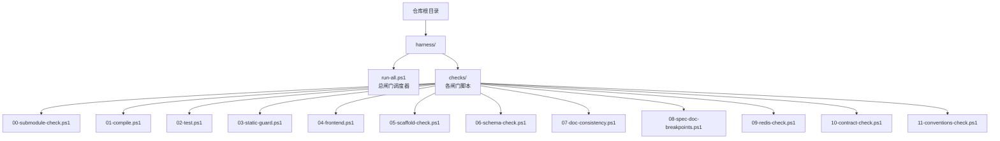
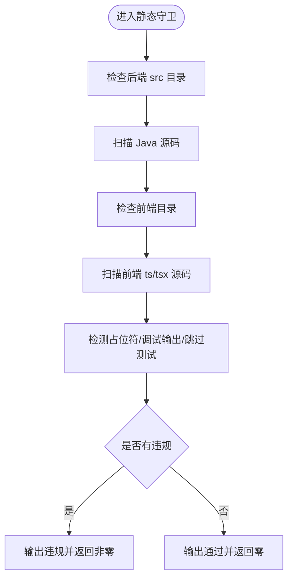
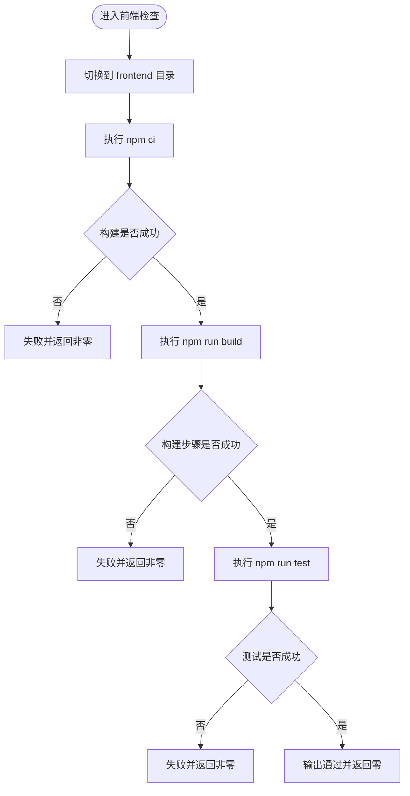
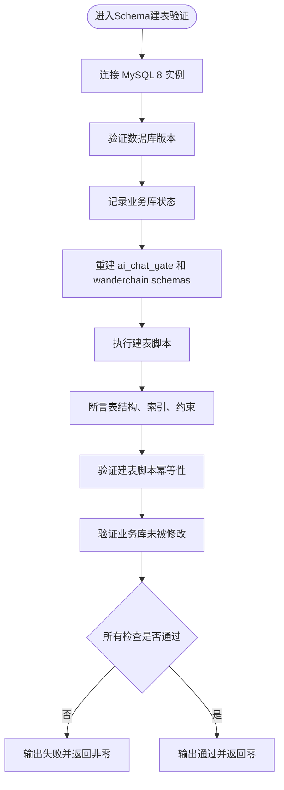
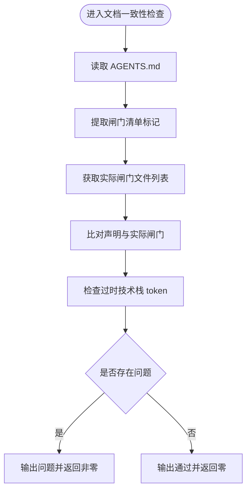
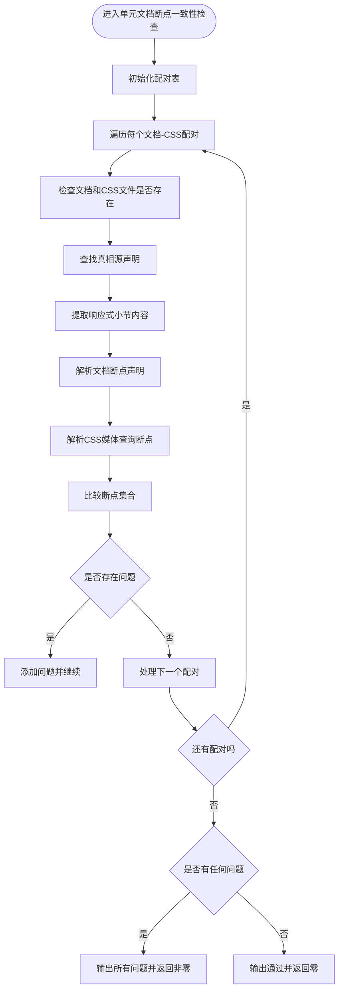
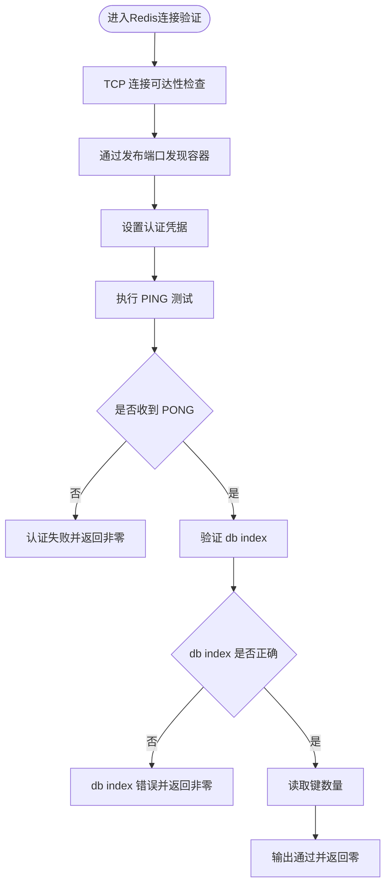
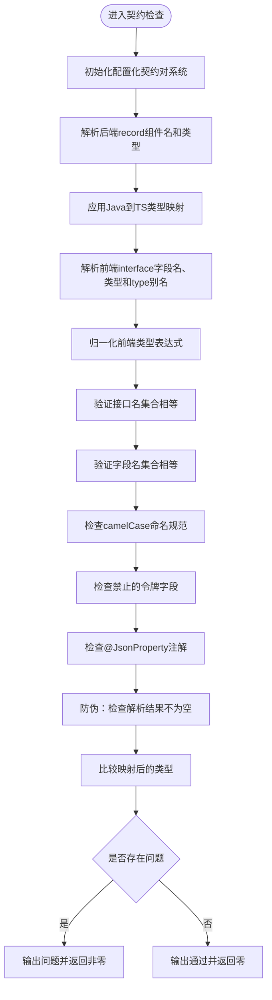
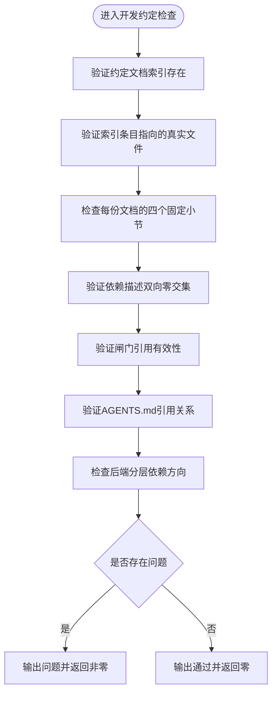
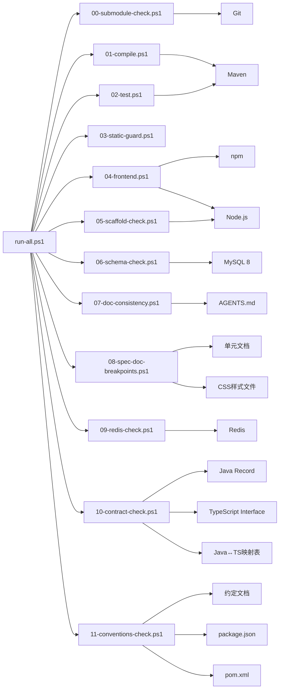

# 自动化验证

<cite>
**本文引用的文件**   
- [harness/run-all.ps1](file://harness/run-all.ps1)
- [harness/checks/00-submodule-check.ps1](file://harness/checks/00-submodule-check.ps1)
- [harness/checks/01-compile.ps1](file://harness/checks/01-compile.ps1)
- [harness/checks/02-test.ps1](file://harness/checks/02-test.ps1)
- [harness/checks/03-static-guard.ps1](file://harness/checks/03-static-guard.ps1)
- [harness/checks/04-frontend.ps1](file://harness/checks/04-frontend.ps1)
- [harness/checks/05-scaffold-check.ps1](file://harness/checks/05-scaffold-check.ps1)
- [harness/checks/06-schema-check.ps1](file://harness/checks/06-schema-check.ps1)
- [harness/checks/07-doc-consistency.ps1](file://harness/checks/07-doc-consistency.ps1)
- [harness/checks/08-spec-doc-breakpoints.ps1](file://harness/checks/08-spec-doc-breakpoints.ps1)
- [harness/checks/09-redis-check.ps1](file://harness/checks/09-redis-check.ps1)
- [harness/checks/10-contract-check.ps1](file://harness/checks/10-contract-check.ps1)
- [harness/checks/11-conventions-check.ps1](file://harness/checks/11-conventions-check.ps1)
- [docs/conventions/README.md](file://docs/conventions/README.md)
- [docs/conventions/backend-conventions.md](file://docs/conventions/backend-conventions.md)
- [docs/conventions/frontend-conventions.md](file://docs/conventions/frontend-conventions.md)
- [AGENTS.md](file://AGENTS.md)
- [frontend/lib/contracts/auth.ts](file://frontend/lib/contracts/auth.ts)
- [backend/src/main/java/com/luyi/myfirst/common/web/ErrorResponse.java](file://backend/src/main/java/com/luyi/myfirst/common/web/ErrorResponse.java)
- [backend/src/main/java/com/luyi/myfirst/web/auth/dto/LoginResponse.java](file://backend/src/main/java/com/luyi/myfirst/web/auth/dto/LoginResponse.java)
- [backend/src/main/java/com/luyi/myfirst/web/auth/dto/RegisterResponse.java](file://backend/src/main/java/com/luyi/myfirst/web/auth/dto/RegisterResponse.java)
- [openspec/changes/archive/2026-10-29-harden-contract-check-gate/design.md](file://openspec/changes/archive/2026-10-29-harden-contract-check-gate/design.md)
- [openspec/changes/archive/2026-10-29-harden-contract-check-gate/verify-contract-check.ps1](file://openspec/changes/archive/2026-10-29-harden-contract-check-gate/verify-contract-check.ps1)
</cite>

## 更新摘要
**变更内容**   
- 新增第11道闸门（11-conventions-check.ps1），专门用于开发约定文档的自洽性验证和后端分层依赖方向检查
- 该闸门拦截四类「约定形同虚设」：索引与目录不一致、依赖描述与实际清单不符、闸门引用不存在、后端分层依赖倒挂
- 实现索引到文件的映射验证、依赖描述双向零交集检查、闸门引用有效性验证、后端包结构单向依赖强制
- 在总闸门调度器中自动集成新闸门，无需手动注册配置

## 目录
1. [引言](#引言)
2. [项目结构](#项目结构)
3. [核心组件](#核心组件)
4. [架构总览](#架构总览)
5. [详细闸门分析](#详细闸门分析)
6. [依赖关系分析](#依赖关系分析)
7. [性能与可观测性](#性能与可观测性)
8. [自定义新闸门指南](#自定义新闸门指南)
9. [红线规则说明](#红线规则说明)
10. [故障排除指南](#故障排除指南)
11. [结论](#结论)

## 引言
本仓库的自动化验证系统（Harness）以 PowerShell 脚本为核心，提供十二道按序执行的"质量闸门"。其设计目标是：让机器而非人类判断一次提交是否真正完成。只有当所有闸门返回退出码 `0` 时，才视为通过；任一闸门失败都会立即阻断后续检查并返回非零退出码。

十二道闸门依次为：
- 子模块检查：确保后端与前端子模块已初始化且提交一致
- 编译检查：仅验证后端能否被 Maven 编译
- 测试检查：运行后端单元测试与容器装配测试
- 静态守卫：扫描 Java 与前端源码中的占位符、调试输出、跳过测试等红线
- 前端检查：安装依赖、构建、运行前端测试
- 脚手架检查：在临时目录演练工作区改名，并扫描旧身份残留
- Schema 建表验证：验证数据库建表脚本的正确性和幂等性
- 文档一致性检查：确保 AGENTS.md 目录结构与实际仓库状态匹配，防止过时的技术栈引用
- 单元文档断点一致性检查：验证单元文档中的响应式断点声明与实际 CSS 媒体查询保持一致，防止文档与实现之间的漂移
- Redis 缓存连接验证：验证 Redis 连接的可达性、认证凭据正确性和指定 db index 的可选择性
- **契约检查**：验证前后端 DTO 与 TypeScript 接口的字段名双向同步及类型映射一致性，防止接口漂移
- **开发约定检查**：验证约定文档的自洽性和后端分层依赖方向，防止约定形同虚设

这套机制强调"可重复、无交互、可归因"：每个闸门只负责一个职责，失败时给出明确原因，并通过退出码对外暴露结果。

## 项目结构
Harness 位于仓库根目录下的 `harness` 目录中，由总入口脚本和若干按序号命名的检查脚本组成：



**图表来源**
- [harness/run-all.ps1:1-95](file://harness/run-all.ps1#L1-L95)
- [harness/checks/00-submodule-check.ps1:1-94](file://harness/checks/00-submodule-check.ps1#L1-L94)
- [harness/checks/01-compile.ps1:1-21](file://harness/checks/01-compile.ps1#L1-L21)
- [harness/checks/02-test.ps1:1-23](file://harness/checks/02-test.ps1#L1-L23)
- [harness/checks/03-static-guard.ps1:1-89](file://harness/checks/03-static-guard.ps1#L1-L89)
- [harness/checks/04-frontend.ps1:1-36](file://harness/checks/04-frontend.ps1#L1-L36)
- [harness/checks/05-scaffold-check.ps1:1-111](file://harness/checks/05-scaffold-check.ps1#L1-L111)
- [harness/checks/06-schema-check.ps1:1-227](file://harness/checks/06-schema-check.ps1#L1-L227)
- [harness/checks/07-doc-consistency.ps1:1-79](file://harness/checks/07-doc-consistency.ps1#L1-L79)
- [harness/checks/08-spec-doc-breakpoints.ps1:1-101](file://harness/checks/08-spec-doc-breakpoints.ps1#L1-L101)
- [harness/checks/09-redis-check.ps1:1-102](file://harness/checks/09-redis-check.ps1#L1-L102)
- [harness/checks/10-contract-check.ps1:1-247](file://harness/checks/10-contract-check.ps1#L1-L247)
- [harness/checks/11-conventions-check.ps1:1-217](file://harness/checks/11-conventions-check.ps1#L1-L217)

**章节来源**
- [harness/run-all.ps1:1-95](file://harness/run-all.ps1#L1-L95)

## 核心组件
Harness 的核心由两部分构成：

1. **总闸门调度器**：负责发现、排序、执行各检查脚本，收集退出码与耗时，并在任意失败时决定是否提前终止。
2. **检查脚本集合**：每个脚本实现单一职责，使用标准输入输出和退出码表达成功或失败。

关键行为包括：
- 自动按文件名排序执行检查
- 为每个检查启动独立 PowerShell 进程，避免环境变量和错误状态互相污染
- 记录每个检查的名称、退出码和执行时间
- 默认遇错即停，支持 `-ContinueOnError` 参数继续跑完全部检查
- 最终汇总 PASS/FAIL 结果，并以 `exit 0` 或 `exit 1` 暴露给 CI 或人类审阅者

**章节来源**
- [harness/run-all.ps1:27-95](file://harness/run-all.ps1#L27-L95)

## 架构总览
下图展示 Harness 的整体执行流程：用户或 CI 调用总闸门，总闸门依次执行十二个检查脚本，并根据退出码决定继续或中断。

```mermaid
sequenceDiagram
participant User as "用户或CI"
participant Harness as "run-all.ps1"
participant G0 as "00-submodule-check.ps1"
participant G1 as "01-compile.ps1"
participant G2 as "02-test.ps1"
participant G3 as "03-static-guard.ps1"
participant G4 as "04-frontend.ps1"
participant G5 as "05-scaffold-check.ps1"
participant G6 as "06-schema-check.ps1"
participant G7 as "07-doc-consistency.ps1"
participant G8 as "08-spec-doc-breakpoints.ps1"
participant G9 as "09-redis-check.ps1"
participant G10 as "10-contract-check.ps1"
participant G11 as "11-conventions-check.ps1"
User->>Harness : 执行总闸门
Harness->>G0 : 启动子模块检查
G0-->>Harness : 返回退出码
alt 子模块检查失败
Harness-->>User : 中止并返回非零
else 子模块检查通过
Harness->>G1 : 启动编译检查
G1-->>Harness : 返回退出码
alt 编译失败
Harness-->>User : 中止并返回非零
else 编译通过
Harness->>G2 : 启动测试检查
G2-->>Harness : 返回退出码
alt 测试失败
Harness-->>User : 中止并返回非零
else 测试通过
Harness->>G3 : 启动静态守卫
G3-->>Harness : 返回退出码
alt 静态守卫失败
Harness-->>User : 中止并返回非零
else 静态守卫通过
Harness->>G4 : 启动前端检查
G4-->>Harness : 返回退出码
alt 前端失败
Harness-->>User : 中止并返回非零
else 前端通过
Harness->>G5 : 启动脚手架检查
G5-->>Harness : 返回退出码
alt 脚手架失败
Harness-->>User : 中止并返回非零
else 脚手架通过
Harness->>G6 : 启动Schema建表验证
G6-->>Harness : 返回退出码
alt Schema检查失败
Harness-->>User : 中止并返回非零
else Schema检查通过
Harness->>G7 : 启动文档一致性检查
G7-->>Harness : 返回退出码
alt 文档检查失败
Harness-->>User : 中止并返回非零
else 文档检查通过
Harness->>G8 : 启动单元文档断点一致性检查
G8-->>Harness : 返回退出码
alt 断点检查失败
Harness-->>User : 中止并返回非零
else 断点检查通过
Harness->>G9 : 启动Redis连接验证
G9-->>Harness : 返回退出码
alt Redis检查失败
Harness-->>User : 中止并返回非零
else Redis检查通过
Harness->>G10 : 启动契约检查
G10-->>Harness : 返回退出码
alt 契约检查失败
Harness-->>User : 中止并返回非零
else 契约检查通过
Harness->>G11 : 启动开发约定检查
G11-->>Harness : 返回退出码
alt 约定检查失败
Harness-->>User : 中止并返回非零
else 全部通过
Harness-->>User : 返回零
end
end
end
end
end
end
end
end
end
end
end
end
end
end
```

**图表来源**
- [harness/run-all.ps1:41-67](file://harness/run-all.ps1#L41-L67)
- [harness/run-all.ps1:80-94](file://harness/run-all.ps1#L80-L94)
- [harness/checks/00-submodule-check.ps1:82-93](file://harness/checks/00-submodule-check.ps1#L82-L93)
- [harness/checks/01-compile.ps1:14-20](file://harness/checks/01-compile.ps1#L14-L20)
- [harness/checks/02-test.ps1:16-22](file://harness/checks/02-test.ps1#L16-L22)
- [harness/checks/03-static-guard.ps1:79-88](file://harness/checks/03-static-guard.ps1#L79-L88)
- [harness/checks/04-frontend.ps1:13-35](file://harness/checks/04-frontend.ps1#L13-L35)
- [harness/checks/05-scaffold-check.ps1:73-104](file://harness/checks/05-scaffold-check.ps1#L73-L104)
- [harness/checks/06-schema-check.ps1:225-226](file://harness/checks/06-schema-check.ps1#L225-L226)
- [harness/checks/07-doc-consistency.ps1:77-78](file://harness/checks/07-doc-consistency.ps1#L77-L78)
- [harness/checks/08-spec-doc-breakpoints.ps1:96-100](file://harness/checks/08-spec-doc-breakpoints.ps1#L96-L100)
- [harness/checks/09-redis-check.ps1:100-101](file://harness/checks/09-redis-check.ps1#L100-L101)
- [harness/checks/10-contract-check.ps1:238-246](file://harness/checks/10-contract-check.ps1#L238-L246)
- [harness/checks/11-conventions-check.ps1:207-216](file://harness/checks/11-conventions-check.ps1#L207-L216)

## 详细闸门分析

### 闸门 0：子模块检查
该闸门在所有编译、测试和前端检查之前运行，用于保证 `backend` 与 `frontend` 两个子模块已经初始化，并且当前检出提交与父仓库记录的 gitlink 一致。

主要职责：
- 校验 `.gitmodules` 是否存在
- 校验 `backend` 与 `frontend` 的 path 与 url 配置是否符合预期
- 校验父仓库是否记录了这两个路径的 gitlink
- 校验子模块目录是否为有效 git 工作树
- 校验子模块 HEAD 是否与父仓库期望提交一致
- 不执行网络操作，不自动更新子模块，不交互式提问

失败处理：
- 收集所有问题并输出可读提示
- 输出修复命令建议
- 返回退出码 `1`

成功条件：
- 所有检查项均通过
- 返回退出码 `0`


**图表来源**
- [harness/checks/00-submodule-check.ps1:21-80](file://harness/checks/00-submodule-check.ps1#L21-L80)
- [harness/checks/00-submodule-check.ps1:82-93](file://harness/checks/00-submodule-check.ps1#L82-L93)

**章节来源**
- [harness/checks/00-submodule-check.ps1:1-94](file://harness/checks/00-submodule-check.ps1#L1-L94)

### 闸门 1：编译检查
该闸门只验证后端代码能否被 Maven 编译，不验证业务逻辑是否正确。将编译与测试分离，有助于快速定位"语法/依赖/构建配置"类问题。

主要职责：
- 切换到 `backend` 目录
- 执行 Maven 编译命令并跳过测试
- 根据 Maven 退出码判断是否通过

失败处理：
- 输出编译失败提示
- 返回退出码 `1`

成功条件：
- Maven 编译成功
- 返回退出码 `0`


**图表来源**
- [harness/checks/01-compile.ps1:6-20](file://harness/checks/01-compile.ps1#L6-L20)

**章节来源**
- [harness/checks/01-compile.ps1:1-21](file://harness/checks/01-compile.ps1#L1-L21)

### 闸门 2：测试检查
该闸门运行后端单元测试与容器装配测试，作为"契约"的可读机器版本。它不允许跳过测试，因为跳过测试等于移除护栏。

主要职责：
- 切换到 `backend` 目录
- 执行 Maven 测试
- 根据 Maven 退出码判断是否通过

失败处理：
- 输出测试失败提示
- 返回退出码 `1`

成功条件：
- 所有测试通过
- 返回退出码 `0`


**图表来源**
- [harness/checks/02-test.ps1:8-22](file://harness/checks/02-test.ps1#L8-L22)

**章节来源**
- [harness/checks/02-test.ps1:1-23](file://harness/checks/02-test.ps1#L1-L23)

### 闸门 3：静态守卫
该闸门拦截常见的"假通过"行为，包括占位标记、调试输出、禁用测试等。它同时扫描 Java 源码与前端 TypeScript/TSX 源码。

主要职责：
- 校验后端 `src` 目录存在
- 扫描 Java 源码
- 校验前端目录存在
- 扫描前端源码，排除 `node_modules`、`.next`、`dist`
- 检测以下违规：
  - TODO / FIXME / XXX 占位标记
  - System.out 相关输出
  - @Disabled 注解
  - 前端测试跳过模式：`it.skip`、`describe.skip`、`test.skip`、`xit`、`xdescribe`

失败处理：
- 输出每条违规的文件路径、行号与内容摘要
- 返回退出码 `1`

成功条件：
- 未发现违规
- 返回退出码 `0`



**图表来源**
- [harness/checks/03-static-guard.ps1:14-38](file://harness/checks/03-static-guard.ps1#L14-L38)
- [harness/checks/03-static-guard.ps1:42-77](file://harness/checks/03-static-guard.ps1#L42-L77)
- [harness/checks/03-static-guard.ps1:79-88](file://harness/checks/03-static-guard.ps1#L79-L88)

**章节来源**
- [harness/checks/03-static-guard.ps1:1-89](file://harness/checks/03-static-guard.ps1#L1-L89)

### 闸门 4：前端检查
该闸门执行前端三步链：依赖安装、生产构建、测试运行。每一步失败都会立即终止。

主要职责：
- 切换到 `frontend` 目录
- 执行 `npm ci` 进行可复现依赖安装
- 执行 `npm run build` 进行 Next.js 构建与类型检查
- 执行 `npm run test` 运行组件与代理测试

失败处理：
- 在对应步骤输出失败提示
- 返回退出码 `1`

成功条件：
- 三步全部通过
- 返回退出码 `0`



**图表来源**
- [harness/checks/04-frontend.ps1:7-35](file://harness/checks/04-frontend.ps1#L7-L35)

**章节来源**
- [harness/checks/04-frontend.ps1:1-36](file://harness/checks/04-frontend.ps1#L1-L36)

### 闸门 5：脚手架检查
该闸门在工作区改名工具的正确性与安全性上提供保障。它在临时目录复制仓库结构，注入旧身份种子，执行改名脚本，然后扫描是否存在旧身份残留。

主要职责：
- 创建临时目录并复制仓库结构，排除 `.git`、`backend`、`frontend`、`openspec`、`docs`、IDE 配置、构建产物等
- 校验副本中存在 `scaffold/rename.mjs` 与 `.gitmodules`
- 向文档注入旧工作区身份种子，保证改名演练可重复
- 执行改名脚本并校验退出码
- 校验 `.gitmodules` 未被修改
- 扫描副本中是否存在旧显示名或旧 slug 残留
- 清理临时目录

失败处理：
- 在关键步骤失败时输出明确原因
- 返回退出码 `1`

成功条件：
- 改名演练通过
- `.gitmodules` 未被意外修改
- 未检测到旧身份残留
- 返回退出码 `0`


**图表来源**
- [harness/checks/05-scaffold-check.ps1:26-36](file://harness/checks/05-scaffold-check.ps1#L26-L36)
- [harness/checks/05-scaffold-check.ps1:44-80](file://harness/checks/05-scaffold-check.ps1#L44-L80)
- [harness/checks/05-scaffold-check.ps1:82-104](file://harness/checks/05-scaffold-check.ps1#L82-L104)
- [harness/checks/05-scaffold-check.ps1:106-110](file://harness/checks/05-scaffold-check.ps1#L106-L110)

**章节来源**
- [harness/checks/05-scaffold-check.ps1:1-111](file://harness/checks/05-scaffold-check.ps1#L1-L111)

### 闸门 6：Schema 建表验证
该闸门替代了原有的 Flyway 迁移检查，专注于验证数据库建表脚本的正确性和幂等性。它复用既有 MySQL 8 实例，在专用 schema `ai_chat_gate` 和 `wanderchain` 上验证表结构、索引、约束、生成列和审计时间列。

主要职责：
- 连接既有 MySQL 8 实例（默认 `127.0.0.1:8806`）
- 验证数据库版本和连接可用性
- 重建专用 schema `ai_chat_gate` 和 `wanderchain`
- 执行对应的建表脚本（`backend/src/main/resources/db/ai-chat/schema.sql` 和 `backend/src/main/resources/schema.sql`）
- 断言表结构、索引、约束、生成列和审计时间列
- 验证建表脚本的幂等性（再次执行不应改变历史）
- 确保业务库 `green-note` 未被修改

失败处理：
- 在关键步骤失败时输出明确原因
- 返回退出码 `1`

成功条件：
- 数据库连接正常
- 建表脚本成功执行
- 所有结构断言通过
- 建表脚本具有幂等性
- 业务库未被修改
- 返回退出码 `0`



**图表来源**
- [harness/checks/06-schema-check.ps1:63-92](file://harness/checks/06-schema-check.ps1#L63-L92)
- [harness/checks/06-schema-check.ps1:148-194](file://harness/checks/06-schema-check.ps1#L148-L194)
- [harness/checks/06-schema-check.ps1:218-226](file://harness/checks/06-schema-check.ps1#L218-L226)

**章节来源**
- [harness/checks/06-schema-check.ps1:1-227](file://harness/checks/06-schema-check.ps1#L1-L227)

### 闸门 7：文档一致性检查
该闸门确保 AGENTS.md 中的闸门清单与实际存在的闸门文件保持一致，并检测文档中是否残留已下线的技术栈标识。这是倒数第二道防线，防止文档与代码脱节。

主要职责：
- 读取 AGENTS.md 中的 `<!-- harness-checks: ... -->` 标记
- 扫描 `harness/checks/*.ps1` 实际存在的闸门文件
- 比对声明的闸门列表与实际文件集合
- 检测文档中是否包含已下线技术栈的 token（如 `App.vue`、`TodoApp` 等）
- 验证 AGENTS.md 和 README.md 中不包含过时引用

失败处理：
- 输出具体哪些闸门缺失或多余
- 指出文档中包含的过时技术栈 token
- 返回退出码 `1`

成功条件：
- 闸门清单与实际文件完全匹配
- 文档中无过时技术栈引用
- 返回退出码 `0`



**图表来源**
- [harness/checks/07-doc-consistency.ps1:24-51](file://harness/checks/07-doc-consistency.ps1#L24-L51)
- [harness/checks/07-doc-consistency.ps1:53-67](file://harness/checks/07-doc-consistency.ps1#L53-L67)
- [harness/checks/07-doc-consistency.ps1:69-78](file://harness/checks/07-doc-consistency.ps1#L69-L78)

**章节来源**
- [harness/checks/07-doc-consistency.ps1:1-79](file://harness/checks/07-doc-consistency.ps1#L1-L79)

### 闸门 8：单元文档断点一致性检查
该闸门专门验证单元文档中的响应式断点声明与实际 CSS 媒体查询保持一致，防止文档与实现之间的漂移。这是倒数第四道防线，确保视觉规范的一致性。

主要职责：
- 维护配对表，登记需要校验的单元文档与对应 CSS 文件
- 验证文档中存在「真相源：`<css 相对路径>`」声明
- 从文档的真相源行到下一个三级标题之间提取断点声明（带 `<`、`>`、`≤`、`≥` 前缀的数字）
- 从对应 CSS 文件中提取 `max-width: NNNpx` 的媒体查询断点
- 比对两个断点集合是否完全一致

失败处理：
- 输出文档或 CSS 文件缺失的错误
- 指出真相源路径不一致的问题
- 报告断点集合差异的具体数值
- 返回退出码 `1`

成功条件：
- 所有登记的单元文档都通过断点一致性验证
- 返回退出码 `0`



**图表来源**
- [harness/checks/08-spec-doc-breakpoints.ps1:22-26](file://harness/checks/08-spec-doc-breakpoints.ps1#L22-L26)
- [harness/checks/08-spec-doc-breakpoints.ps1:35-89](file://harness/checks/08-spec-doc-breakpoints.ps1#L35-L89)
- [harness/checks/08-spec-doc-breakpoints.ps1:91-100](file://harness/checks/08-spec-doc-breakpoints.ps1#L91-L100)

**章节来源**
- [harness/checks/08-spec-doc-breakpoints.ps1:1-101](file://harness/checks/08-spec-doc-breakpoints.ps1#L1-L101)

### 闸门 9：Redis 缓存连接验证
该闸门专门验证 Redis 缓存服务的连接可达性、认证凭据正确性和指定 db index 的可选择性。它不写业务键、不建容器、不清库，仅做只读探测。

主要职责：
- 连接既有 Redis 实例（默认 `127.0.0.1:6606`，db 3）
- 验证 TCP 连接可达性
- 验证认证凭据正确性（支持 PING/PONG 响应）
- 确认连接到正确的 db index（默认为 3）
- 读取键数量作为信息输出（不作为失败条件）

失败处理：
- 连接不可达时输出超时或连接错误
- 认证失败时输出 NOAUTH 或 WRONGPASS 错误
- db index 不正确时输出连接信息
- 返回退出码 `1`

成功条件：
- Redis 服务可达
- 认证凭据正确
- 连接到正确的 db index
- 返回退出码 `0`



**图表来源**
- [harness/checks/09-redis-check.ps1:22-33](file://harness/checks/09-redis-check.ps1#L22-L33)
- [harness/checks/09-redis-check.ps1:41-47](file://harness/checks/09-redis-check.ps1#L41-L47)
- [harness/checks/09-redis-check.ps1:84-93](file://harness/checks/09-redis-check.ps1#L84-L93)
- [harness/checks/09-redis-check.ps1:98-101](file://harness/checks/09-redis-check.ps1#L98-L101)

**章节来源**
- [harness/checks/09-redis-check.ps1:1-102](file://harness/checks/09-redis-check.ps1#L1-L102)

### 闸门 10：契约检查
**重大更新** 该闸门已从简单的字段名比较工具升级为全面的双向契约验证框架，采用接口嵌套比较架构，支持四种新的缺陷检测场景。

#### 核心架构升级

**接口嵌套比较架构**：
- 从扁平字段字典升级为两层嵌套结构：`$backendInterfaces[recordName][fieldName]=type` 和 `$frontendInterfaces[interfaceName][fieldName]=type`
- 先比较接口名集合，再对每个共有接口名比较字段名集合与字段类型
- 避免跨接口覆盖问题，确保类型冲突能被准确定位

**四种新的缺陷检测场景**：

1. **接口名漂移检测**：后端 record 在前端没有对应 interface，或前端 interface 在后端找不到同名 record
2. **跨接口字段类型漂移检测**：同一字段名在不同接口中出现时，能准确识别类型不一致的具体接口
3. **字段名大小写敏感检测**：`userId` 与 `userid` 被视为不同字段，防止大小写混淆导致的契约漂移
4. **前端 camelCase 命名规范验证**：强制前端字段名符合小写开头的驼峰命名规范

**配置化契约对系统**：
- 通过 `$contractPairs` 数组管理后端目录/文件与前端契约文件的配对关系
- 支持多模块扩展，只需在清单中添加新的契约对即可
- 当前配置包含认证模块的 auth 契约对

**Java 到 TypeScript 类型映射**：
- 实现 `Map-JavaToTs` 函数，建立 Java 类型到 TS 类型的映射关系
- 支持基础类型映射：String/CharSequence/UUID → string，时间类型 → string，数值类型 → number，boolean → boolean
- 支持集合类型映射：List/Set/Collection<T> → Array<T>，T[] → Array<T>
- 采用 fail-closed 策略，遇到未覆盖的类型直接判红

**前端类型归一化**：
- 实现 `Normalize-Ts` 函数，处理复杂的 TypeScript 类型表达式
- 支持 Array<T>、联合类型（A | B）、可选字段（T?）、字面量类型等
- 解析同文件中的 type 别名定义，递归展开类型引用
- 限制递归深度防止无限循环

**增强的安全检查**：
- 禁止使用 @JsonProperty 注解，确保字段映射与 Java 组件名一致
- 强制 camelCase 命名规范验证（前后端统一）
- 禁止令牌字段出现在响应体中（token、accessToken、refreshToken、sessionId）
- 防伪保护：任一侧解析结果为空即判红

主要职责：
- 解析后端 `web/auth/dto/*.java` 与 `common/web/ErrorResponse.java` 的 record 组件名和类型
- 解析 `frontend/lib/contracts/auth.ts` 的 interface 字段名、类型和 type 别名
- 确保两侧的接口名集合相等，共有接口的字段名集合相等
- 验证共有字段的类型经映射/归一后一致
- 验证所有字段名符合 camelCase 命名规范
- 禁止使用 @JsonProperty 注解改名
- 禁止令牌字段出现在响应体中
- 对解析结果为空的情况进行防伪保护

失败处理：
- 后端 record 在前端没有对应 interface
- 前端 interface 在后端找不到同名 record
- 字段名缺失或多余
- 字段名不符合 camelCase 规范
- 出现禁止的令牌字段
- 使用 @JsonProperty 注解
- Java 类型不在映射表内（fail-closed）
- 前端类型无法归一化（fail-closed）
- 解析结果为空（防伪保护）
- 返回退出码 `1`

成功条件：
- 前后端接口名完全匹配
- 字段名完全同步
- 类型经映射/归一后一致
- 符合命名规范
- 返回退出码 `0`



**图表来源**
- [harness/checks/10-contract-check.ps1:18-27](file://harness/checks/10-contract-check.ps1#L18-L27)
- [harness/checks/10-contract-check.ps1:29-45](file://harness/checks/10-contract-check.ps1#L29-L45)
- [harness/checks/10-contract-check.ps1:47-75](file://harness/checks/10-contract-check.ps1#L47-L75)
- [harness/checks/10-contract-check.ps1:85-117](file://harness/checks/10-contract-check.ps1#L85-L117)
- [harness/checks/10-contract-check.ps1:119-133](file://harness/checks/10-contract-check.ps1#L119-L133)
- [harness/checks/10-contract-check.ps1:135-167](file://harness/checks/10-contract-check.ps1#L135-L167)
- [harness/checks/10-contract-check.ps1:169-186](file://harness/checks/10-contract-check.ps1#L169-L186)
- [harness/checks/10-contract-check.ps1:188-233](file://harness/checks/10-contract-check.ps1#L188-L233)
- [harness/checks/10-contract-check.ps1:238-246](file://harness/checks/10-contract-check.ps1#L238-L246)

**章节来源**
- [harness/checks/10-contract-check.ps1:1-247](file://harness/checks/10-contract-check.ps1#L1-L247)

### 闸门 11：开发约定检查
**新增** 该闸门专门用于开发约定文档的自洽性验证和后端分层依赖方向检查，拦截四类「约定形同虚设」的行为。

#### 核心功能

**索引到文件映射验证**：
- 验证 `docs/conventions/README.md` 作为唯一入口存在
- 检查「索引」小节中的 Markdown 文件路径是否真实存在
- 确保所有约定文档都被登记在索引中
- 支持相对路径和绝对路径的双重验证

**依赖描述双向零交集检查**：
- 解析 `frontend/package.json` 的 dependencies 和 devDependencies
- 解析 `backend/pom.xml` 的 dependency 块
- 验证「依赖现状」中的所有依赖都存在于实际依赖清单中
- 验证「拟引入」中的所有依赖都不存在于实际依赖清单中
- 确保「依赖现状」和「拟引入」之间没有重复项

**闸门引用有效性验证**：
- 检查每份约定文档的「机械守卫」小节是否存在且非空
- 验证文档中引用的闸门文件（如 `11-conventions-check.ps1`）确实存在
- 确保 AGENTS.md 引用约定入口文档
- 确保 AGENTS.md 目录树包含所有闸门文件

**后端分层依赖方向强制**：
- 定义分层规则：dao 不得 import web，service 不得 import web，common 不得 import dao/service/web
- 扫描 `backend/src/main/java/com/luyi/myfirst` 下的所有 Java 文件
- 检查 import 语句是否违反分层依赖规则
- 精确报告违规文件和行号

主要职责：
- 验证约定文档索引与目录结构的一致性
- 检查依赖描述与实际依赖清单的双向一致性
- 验证闸门引用的有效性
- 强制执行后端分层依赖方向
- 确保 AGENTS.md 与约定文档的相互引用关系

失败处理：
- 输出具体的约定文档名称和问题描述
- 指出缺失的小节、无效的路径、不存在的闸门
- 报告分层依赖违规的具体文件和行号
- 返回退出码 `1`

成功条件：
- 所有约定文档自洽性检查通过
- 依赖描述与实际清单一致
- 闸门引用有效
- 后端分层依赖方向正确
- 返回退出码 `0`



**图表来源**
- [harness/checks/11-conventions-check.ps1:81-101](file://harness/checks/11-conventions-check.ps1#L81-L101)
- [harness/checks/11-conventions-check.ps1:109-165](file://harness/checks/11-conventions-check.ps1#L109-L165)
- [harness/checks/11-conventions-check.ps1:167-181](file://harness/checks/11-conventions-check.ps1#L167-L181)
- [harness/checks/11-conventions-check.ps1:183-205](file://harness/checks/11-conventions-check.ps1#L183-L205)
- [harness/checks/11-conventions-check.ps1:207-216](file://harness/checks/11-conventions-check.ps1#L207-L216)

**章节来源**
- [harness/checks/11-conventions-check.ps1:1-217](file://harness/checks/11-conventions-check.ps1#L1-L217)

## 依赖关系分析
Harness 的依赖关系可以理解为"调度层 + 检查层"：

- 调度层：`run-all.ps1`
- 检查层：十二个检查脚本
- 外部依赖：
  - Git：子模块检查、gitlink 校验
  - Maven：后端编译与测试
  - Node.js 与 npm：前端构建与测试、脚手架改名脚本
  - MySQL：Schema 建表验证
  - Redis：缓存连接验证
  - PowerShell：脚本运行时



**图表来源**
- [harness/run-all.ps1:41-67](file://harness/run-all.ps1#L41-L67)
- [harness/checks/01-compile.ps1:6-12](file://harness/checks/01-compile.ps1#L6-L12)
- [harness/checks/02-test.ps1:8-13](file://harness/checks/02-test.ps1#L8-L13)
- [harness/checks/04-frontend.ps1:7-27](file://harness/checks/04-frontend.ps1#L7-L27)
- [harness/checks/05-scaffold-check.ps1:71-75](file://harness/checks/05-scaffold-check.ps1#L71-L75)
- [harness/checks/06-schema-check.ps1:13-19](file://harness/checks/06-schema-check.ps1#L13-L19)
- [harness/checks/09-redis-check.ps1:11-14](file://harness/checks/09-redis-check.ps1#L11-L14)
- [harness/checks/10-contract-check.ps1:29-45](file://harness/checks/10-contract-check.ps1#L29-L45)
- [harness/checks/11-conventions-check.ps1:59-79](file://harness/checks/11-conventions-check.ps1#L59-L79)
- [harness/checks/07-doc-consistency.ps1:25-27](file://harness/checks/07-doc-consistency.ps1#L25-L27)
- [harness/checks/08-spec-doc-breakpoints.ps1:22-26](file://harness/checks/08-spec-doc-breakpoints.ps1#L22-L26)
- [harness/checks/00-submodule-check.ps1:29-79](file://harness/checks/00-submodule-check.ps1#L29-L79)

**章节来源**
- [harness/run-all.ps1:1-95](file://harness/run-all.ps1#L1-L95)

## 性能与可观测性
Harness 在设计上兼顾了可观测性与执行效率：

- 每个检查使用独立 PowerShell 进程执行，避免状态互相污染
- 使用 Stopwatch 记录每个检查的执行时间
- 默认遇错即停，减少不必要的后续检查成本
- 支持 `-ContinueOnError` 参数，便于一次性收集全部检查结果
- 最终输出汇总表格，包含每个检查的 PASS/FAIL、退出码与耗时

优化建议：
- 如果某个检查特别慢，优先确认是否真的需要每次全量执行
- 对于本地开发，可使用 `-ContinueOnError` 先了解整体情况，再逐个修复
- 在 CI 环境中保持默认行为，确保失败尽早暴露
- 不要为了"更快通过"而绕过检查，例如跳过测试或关闭静态守卫

**章节来源**
- [harness/run-all.ps1:27-31](file://harness/run-all.ps1#L27-L31)
- [harness/run-all.ps1:52-67](file://harness/run-all.ps1#L52-L67)
- [harness/run-all.ps1:69-94](file://harness/run-all.ps1#L69-L94)

## 自定义新闸门指南

### 新增闸门的步骤
1. 在 `harness/checks/` 目录下新增一个 PowerShell 脚本，文件名以两位数字开头，例如 `12-new-check.ps1`
2. 脚本应遵循以下规范：
   - 使用 `$ErrorActionPreference = 'Stop'` 控制错误行为
   - 计算 `projectRoot` 并切换到合适的工作目录
   - 输出可读的错误信息
   - 成功时返回 `exit 0`，失败时返回 `exit 1`
3. 如果需要访问外部工具，请确保这些工具已在系统中可用
4. **重要**：在 AGENTS.md 的 `<!-- harness-checks: ... -->` 标记中添加新闸门名称
5. 在总闸门中无需手动注册，`run-all.ps1` 会自动按文件名排序执行所有 `*.ps1` 检查

### 脚本规范
- 命名规范：两位数字前缀 + 语义化名称 + `.ps1`
- 执行环境：PowerShell
- 工作目录：脚本内部自行设置，避免依赖调用方当前目录
- 输出格式：使用 `Write-Host` 输出可读信息，颜色可选但不应影响退出码
- 退出码：必须显式使用 `exit 0` 或 `exit 1`
- 交互行为：不应弹出交互式提示，CI 环境无法处理交互

### 错误处理建议
- 对关键路径使用 `Test-Path` 校验
- 对命令执行后读取 `$LASTEXITCODE`
- 对异常使用 try/finally 清理临时资源
- 对可恢复错误输出具体原因，对不可恢复错误直接退出

### 调试方法
- 单独执行目标检查脚本，观察输出与退出码
- 使用 `powershell -File harness\checks\XX-name.ps1` 直接运行
- 在总闸门中使用 `-ContinueOnError` 查看其他检查是否也失败
- 在脚本中加入更多上下文日志，但不要泄露敏感信息

**章节来源**
- [harness/run-all.ps1:41-67](file://harness/run-all.ps1#L41-L67)
- [harness/checks/00-submodule-check.ps1:9-12](file://harness/checks/00-submodule-check.ps1#L9-L12)
- [harness/checks/03-static-guard.ps1:11-18](file://harness/checks/03-static-guard.ps1#L11-L18)
- [harness/checks/05-scaffold-check.ps1:8-10](file://harness/checks/05-scaffold-check.ps1#L8-L10)
- [harness/checks/07-doc-consistency.ps1:24-51](file://harness/checks/07-doc-consistency.ps1#L24-L51)
- [harness/checks/08-spec-doc-breakpoints.ps1:17-26](file://harness/checks/08-spec-doc-breakpoints.ps1#L17-L26)

## 红线规则说明
静态守卫是当前仓库中最关键的"质量红线"，它阻止开发者用表面绿色掩盖实际未完成的状态。**文档一致性检查**则确保文档与代码保持同步，**单元文档断点一致性检查**进一步确保视觉规范的准确性，**Schema 建表验证**确保数据库结构的正确性，**Redis 连接验证**确保缓存服务的可用性，**契约检查**确保前后端接口的字段同步和类型一致性，**开发约定检查**确保约定文档的自洽性和后端分层依赖方向。

### Java 红线
- TODO / FIXME / XXX：表示代码尚未完成
- System.out 相关输出：表示使用控制台调试代替日志系统
- @Disabled：表示测试被禁用，可能隐藏失败

### 前端红线
- TODO / FIXME / XXX：同上
- it.skip / describe.skip / test.skip：跳过单个或整组测试
- xit / xdescribe：等价于跳过测试

### 契约红线
- **接口名漂移**：前后端接口名不一致：后端 record 在前端没有对应 interface，或前端 interface 在后端找不到同名 record
- **跨接口字段类型漂移**：同一字段名在不同接口中出现时，类型不一致会被准确识别
- **字段名大小写敏感**：`userId` 与 `userid` 被视为不同字段，防止大小写混淆
- **前端 camelCase 验证**：前端字段名必须符合小写开头的驼峰命名规范
- 字段名不同步：后端有而前端没有的字段，或前端有而后端没有的字段
- 使用 @JsonProperty 注解：靠注解改名会让契约与源码脱钩
- 令牌字段出现在响应体中：token、accessToken、refreshToken、sessionId 只能通过 Set-Cookie 传递
- Java 类型不在映射表内：fail-closed 策略，未知类型直接判红
- 前端类型无法归一化：复杂类型表达式无法解析时判红

### 约定红线
- **索引与目录不一致**：约定文档未在索引中登记，或索引指向不存在的文件
- **依赖描述与实际不符**：「依赖现状」写了不存在的依赖，或「拟引入」写了已存在的依赖
- **闸门引用不存在**：约定文档声称被某道闸门守住，但该闸门并不存在
- **分层依赖倒挂**：dao/service 层 import web 层，common 层 import 业务层
- **约定文档缺少固定小节**：缺少「真源声明」、「依赖现状」、「拟引入」或「机械守卫」小节
- **AGENTS.md 未引用约定入口**：约定文档的唯一入口未被主文档引用

### 文档红线
- 闸门清单与实际文件不一致：导致 AI agent 执行错误的检查流程
- 过时技术栈引用：如 `App.vue`、`TodoApp` 等已迁移的技术标识
- 文档与仓库状态脱节：误导开发者理解项目结构
- 单元文档断点与CSS实现不一致：导致视觉规范漂移

### 为什么这些规则重要
这些规则的共同点是：它们可以让测试变绿，但不会提升真实质量。例如：
- 留下 TODO 不代表功能已完成
- 打印到控制台不代表实现了正确日志
- 禁用测试不代表问题已修复
- 跳过测试不代表边界条件已通过
- 文档过时不代表代码正确
- 断点不一致不代表视觉效果正确
- 数据库结构不正确不代表应用能正常运行
- Redis 连接不可用不代表缓存功能正常
- 前后端字段名不同步不代表编译能通过，但会导致运行时 undefined
- 类型不一致不代表编译能通过，但会导致运行时类型错误
- **接口名漂移不代表编译能通过，但会导致运行时接口缺失**
- **跨接口类型漂移不代表编译能通过，但会导致运行时类型错误**
- **大小写敏感问题可能导致前后端数据无法正确匹配**
- **约定文档自相矛盾不代表代码能编译，但会导致团队开发混乱**
- **分层依赖倒挂不代表代码能运行，但会导致架构腐化和重构困难**

因此，静态守卫、文档一致性检查、单元文档断点一致性检查、Schema 建表验证、Redis 连接验证、契约检查和开发约定检查将这些行为视为"红线"，一旦命中就拒绝合并。

**章节来源**
- [harness/checks/03-static-guard.ps1:1-10](file://harness/checks/03-static-guard.ps1#L1-L10)
- [harness/checks/03-static-guard.ps1:42-77](file://harness/checks/03-static-guard.ps1#L42-L77)
- [harness/checks/07-doc-consistency.ps1:3-10](file://harness/checks/07-doc-consistency.ps1#L3-L10)
- [harness/checks/07-doc-consistency.ps1:53-67](file://harness/checks/07-doc-consistency.ps1#L53-L67)
- [harness/checks/08-spec-doc-breakpoints.ps1:1-16](file://harness/checks/08-spec-doc-breakpoints.ps1#L1-L16)
- [harness/checks/10-contract-check.ps1:1-19](file://harness/checks/10-contract-check.ps1#L1-L19)
- [harness/checks/11-conventions-check.ps1:1-15](file://harness/checks/11-conventions-check.ps1#L1-L15)

## 故障排除指南

### 总闸门失败
现象：
- 终端输出 `[FAIL] ... (exit X, Ys)`
- 最终输出 `RESULT: BLOCKED`

排查步骤：
1. 查看哪个检查失败
2. 单独执行该检查脚本
3. 根据输出定位具体问题
4. 修复后重新运行总闸门

参考位置：
- [harness/run-all.ps1:69-94](file://harness/run-all.ps1#L69-L94)

### 子模块检查失败
常见原因：
- 子模块未初始化
- 子模块提交与父仓库不一致
- `.gitmodules` 配置不正确

修复建议：
- 使用子模块初始化命令
- 检查 `.gitmodules` 中 backend 与 frontend 的配置
- 确保工作树有效且 HEAD 与期望提交一致

参考位置：
- [harness/checks/00-submodule-check.ps1:21-80](file://harness/checks/00-submodule-check.ps1#L21-L80)
- [harness/checks/00-submodule-check.ps1:82-93](file://harness/checks/00-submodule-check.ps1#L82-L93)

### 编译检查失败
常见原因：
- Java 语法错误
- 依赖缺失
- Maven 配置错误

修复建议：
- 先在 IDE 中修复编译错误
- 确认 Maven 可用
- 检查 `backend/pom.xml`

参考位置：
- [harness/checks/01-compile.ps1:6-20](file://harness/checks/01-compile.ps1#L6-L20)

### 测试检查失败
常见原因：
- 单元测试断言失败
- Spring 容器装配失败
- 测试数据或环境配置问题

修复建议：
- 先运行单个失败测试定位问题
- 检查测试依赖与容器配置
- 不要通过禁用测试来掩盖问题

参考位置：
- [harness/checks/02-test.ps1:8-22](file://harness/checks/02-test.ps1#L8-L22)

### 静态守卫失败
常见原因：
- 代码中包含 TODO / FIXME / XXX
- 使用了 System.out
- 使用了 @Disabled
- 前端测试被跳过

修复建议：
- 删除或替换占位标记
- 使用正式日志框架
- 修复测试而不是禁用测试
- 删除前端测试跳过语句

参考位置：
- [harness/checks/03-static-guard.ps1:42-77](file://harness/checks/03-static-guard.ps1#L42-L77)

### 前端检查失败
常见原因：
- npm 依赖安装失败
- TypeScript 类型检查失败
- 前端测试失败

修复建议：
- 清理并重新安装依赖
- 先解决构建错误，再解决测试错误
- 不要通过跳过测试掩盖问题

参考位置：
- [harness/checks/04-frontend.ps1:10-35](file://harness/checks/04-frontend.ps1#L10-L35)

### 脚手架检查失败
常见原因：
- 缺少 `scaffold/rename.mjs`
- 缺少 `.gitmodules`
- 改名脚本执行失败
- `.gitmodules` 被意外修改
- 改名后仍存在旧工作区身份残留

修复建议：
- 检查工作区模板是否完整
- 检查改名脚本逻辑
- 检查文档中是否残留旧显示名或旧 slug
- 确保 `.gitmodules` 不属于工作区改名范围

参考位置：
- [harness/checks/05-scaffold-check.ps1:44-104](file://harness/checks/05-scaffold-check.ps1#L44-L104)

### Schema 建表验证失败
常见原因：
- MySQL 连接失败
- 数据库版本不是 MySQL 8
- 建表脚本执行失败
- 表结构断言失败（缺少表、索引、约束、生成列或审计列）
- 建表脚本不具有幂等性
- 业务库被意外修改

修复建议：
- 检查 MySQL 服务是否运行在 `127.0.0.1:8806`
- 验证数据库凭据和环境变量（`SCHEMA_DB_PASSWORD`）
- 检查建表脚本 `backend/src/main/resources/schema.sql` 和 `backend/src/main/resources/db/ai-chat/schema.sql`
- 确认表结构符合预期
- 确保建表脚本具有幂等性（重复执行不会产生副作用）

参考位置：
- [harness/checks/06-schema-check.ps1:63-92](file://harness/checks/06-schema-check.ps1#L63-L92)
- [harness/checks/06-schema-check.ps1:148-194](file://harness/checks/06-schema-check.ps1#L148-L194)
- [harness/checks/06-schema-check.ps1:218-226](file://harness/checks/06-schema-check.ps1#L218-L226)

### 文档一致性检查失败
常见原因：
- AGENTS.md 中的闸门清单与实际文件不匹配
- 新增了闸门但未更新文档标记
- 删除了闸门但文档仍保留引用
- 文档中包含已过时的技术栈 token（如 `App.vue`、`TodoApp`、`Todo 界面` 等）

修复建议：
- 检查 `harness/checks/` 目录下的实际闸门文件
- 更新 AGENTS.md 中的 `<!-- harness-checks: ... -->` 标记
- 搜索并替换文档中的过时技术栈引用
- 确保 AGENTS.md 和 README.md 中的技术描述与实际情况一致

参考位置：
- [harness/checks/07-doc-consistency.ps1:24-51](file://harness/checks/07-doc-consistency.ps1#L24-L51)
- [harness/checks/07-doc-consistency.ps1:53-67](file://harness/checks/07-doc-consistency.ps1#L53-L67)

### 单元文档断点一致性检查失败
常见原因：
- 文档中缺少「真相源：`<css 路径>`」声明
- 真相源路径与配对表登记的路径不一致
- 文档响应式小节中没有带 `<`、`>`、`≤`、`≥` 前缀的断点声明
- CSS 文件中没有 `max-width` 媒体查询断点
- 文档断点集合与 CSS 断点集合不一致

修复建议：
- 在文档中添加正确的「真相源：`<css 路径>`」声明
- 确保真相源路径与配对表中登记的路径一致
- 在响应式小节中使用正确的断点声明格式（如 `> 900px`、`≤ 640px`）
- 确保 CSS 文件中有对应的 `@media (max-width: NNNpx)` 规则
- 调整文档或CSS使断点集合完全匹配

参考位置：
- [harness/checks/08-spec-doc-breakpoints.ps1:51-88](file://harness/checks/08-spec-doc-breakpoints.ps1#L51-L88)

### Redis 连接验证失败
常见原因：
- Redis 服务不可达
- 认证凭据不正确
- 连接到错误的 db index
- Redis CLI 工具不可用

修复建议：
- 检查 Redis 服务是否运行在 `127.0.0.1:6606`
- 设置 `SCHEMA_REDIS_PASSWORD` 环境变量
- 如果使用 Docker 容器，闸门会自动从容器启动命令中提取密码
- 确认连接到正确的 db index（默认为 3）
- 确保 redis-cli 工具可用或通过 Docker 容器访问

参考位置：
- [harness/checks/09-redis-check.ps1:22-33](file://harness/checks/09-redis-check.ps1#L22-L33)
- [harness/checks/09-redis-check.ps1:41-47](file://harness/checks/09-redis-check.ps1#L41-L47)
- [harness/checks/09-redis-check.ps1:84-93](file://harness/checks/09-redis-check.ps1#L84-L93)

### 契约检查失败
**重大更新** 常见原因：
- **接口名漂移**：后端 record 在前端没有对应 interface，或前端 interface 在后端找不到同名 record
- **跨接口字段类型漂移**：同一字段名在不同接口中出现时，类型不一致
- **字段名大小写敏感**：字段名仅大小写不同（如 `userId` vs `userid`）
- **前端 camelCase 验证失败**：前端字段名不符合小写开头的驼峰命名规范
- 字段名缺失或多余
- 使用了 @JsonProperty 注解
- 响应体中出现了禁止的令牌字段（token、accessToken、refreshToken、sessionId）
- Java 类型不在映射表内（fail-closed）
- 前端类型无法归一化（fail-closed）
- 正则解析失败导致解析结果为空（防伪保护）

修复建议：
- 确保后端 `web/auth/dto/*.java` 中的 record 与前端 `frontend/lib/contracts/auth.ts` 中的 interface 一一对应
- 确保字段名完全同步，包括新增和删除字段
- 使用标准的 camelCase 命名规范（小写开头，不带下划线）
- 不要在 record 上使用 @JsonProperty 注解改名
- 确保令牌字段只通过 Set-Cookie 传递，不出现在响应体中
- 对于新的 Java 类型，需要在 `Map-JavaToTs` 函数中添加映射规则
- 对于复杂的前端类型表达式，确保能被 `Normalize-Ts` 函数正确解析
- 检查 `$contractPairs` 配置是否正确指向后端目录和前端契约文件

**新增功能说明**：
- **接口嵌套比较架构**：从扁平字段字典升级为两层嵌套结构，避免跨接口覆盖问题
- **四种缺陷检测场景**：接口名漂移、跨接口字段类型漂移、字段名大小写敏感、前端camelCase验证
- **配置化契约对系统**：通过 `$contractPairs` 数组管理契约关系，支持多模块扩展
- **Java 到 TypeScript 类型映射**：支持基础类型、集合类型的自动映射
- **前端类型归一化**：处理 Array<T>、联合类型、可选字段等复杂场景
- **增强的安全检查**：包括命名规范、注解使用、令牌字段等多维度验证
- **参数化错误消息**：每个错误都包含具体的接口名和字段名定位

**验证机制**：
- 使用 `verify-contract-check.ps1` 脚本进行四类变异验证
- 支持对比旧版闸门行为，确保回归测试
- 在临时副本中进行变异测试，不污染真实代码

参考位置：
- [harness/checks/10-contract-check.ps1:18-27](file://harness/checks/10-contract-check.ps1#L18-L27)
- [harness/checks/10-contract-check.ps1:29-45](file://harness/checks/10-contract-check.ps1#L29-L45)
- [harness/checks/10-contract-check.ps1:47-75](file://harness/checks/10-contract-check.ps1#L47-L75)
- [harness/checks/10-contract-check.ps1:85-117](file://harness/checks/10-contract-check.ps1#L85-L117)
- [harness/checks/10-contract-check.ps1:119-133](file://harness/checks/10-contract-check.ps1#L119-L133)
- [harness/checks/10-contract-check.ps1:135-167](file://harness/checks/10-contract-check.ps1#L135-L167)
- [harness/checks/10-contract-check.ps1:169-186](file://harness/checks/10-contract-check.ps1#L169-L186)
- [harness/checks/10-contract-check.ps1:188-233](file://harness/checks/10-contract-check.ps1#L188-L233)
- [harness/checks/10-contract-check.ps1:238-246](file://harness/checks/10-contract-check.ps1#L238-L246)
- [openspec/changes/archive/2026-10-29-harden-contract-check-gate/verify-contract-check.ps1:52-132](file://openspec/changes/archive/2026-10-29-harden-contract-check-gate/verify-contract-check.ps1#L52-L132)

### 开发约定检查失败
**新增** 常见原因：
- **索引与目录不一致**：约定文档未在 `docs/conventions/README.md` 的「索引」小节中登记，或索引指向的文件不存在
- **依赖描述与实际不符**：「依赖现状」中写了 `frontend/package.json` 或 `backend/pom.xml` 中不存在的依赖，或「拟引入」中写了已存在的依赖
- **闸门引用不存在**：约定文档的「机械守卫」小节引用了不存在的闸门文件
- **分层依赖倒挂**：`dao/` 层 import 了 `web/`，`service/` 层 import 了 `web/`，或 `common/` 层 import 了 `dao/`、`service/`、`web/`
- **约定文档缺少固定小节**：缺少「真源声明」、「依赖现状」、「拟引入」或「机械守卫」小节
- **AGENTS.md 未引用约定入口**：主文档未引用 `docs/conventions/README.md`
- **AGENTS.md 目录树缺少闸门**：主文档的目录树未包含所有闸门文件

修复建议：
- 确保 `docs/conventions/README.md` 的「索引」小节包含所有约定文档的 Markdown 文件路径
- 检查约定文档的「依赖现状」和「拟引入」小节，确保与实际的 `frontend/package.json` 和 `backend/pom.xml` 一致
- 验证约定文档的「机械守卫」小节中引用的闸门文件确实存在
- 检查后端 Java 代码的 import 语句，确保遵守分层依赖规则
- 确保每份约定文档都包含四个固定小节：「真源声明」、「依赖现状」、「拟引入」、「机械守卫」
- 在 AGENTS.md 中引用约定入口文档 `docs/conventions/README.md`
- 确保 AGENTS.md 的目录树包含所有闸门文件

**新增功能说明**：
- **索引到文件映射验证**：确保约定文档索引与实际目录结构一致
- **依赖描述双向零交集检查**：验证「依赖现状」和「拟引入」与实际依赖清单的双向一致性
- **闸门引用有效性验证**：确保约定文档中引用的闸门文件存在
- **后端分层依赖方向强制**：强制执行 dao/service 不得 import web，common 不得 import 业务层的规则
- **AGENTS.md 与约定文档的相互引用检查**：确保主文档与约定入口文档的引用关系正确

参考位置：
- [harness/checks/11-conventions-check.ps1:81-101](file://harness/checks/11-conventions-check.ps1#L81-L101)
- [harness/checks/11-conventions-check.ps1:109-165](file://harness/checks/11-conventions-check.ps1#L109-L165)
- [harness/checks/11-conventions-check.ps1:167-181](file://harness/checks/11-conventions-check.ps1#L167-L181)
- [harness/checks/11-conventions-check.ps1:183-205](file://harness/checks/11-conventions-check.ps1#L183-L205)

## 结论
Harness 的十二道闸门构成了一个从环境准备到代码质量、从后端到前端、从模板工具到基础设施、从代码到文档、从文档到视觉规范、从数据库到缓存、从接口到契约、从契约到约定的完整质量门禁体系。它的核心价值不是"制造障碍"，而是"把模糊的完成感变成明确的通过信号"。

最佳实践包括：
- 始终让机器判断完成度，而不是依赖口头承诺
- 每个闸门只负责一个职责，失败时给出明确原因
- 不绕过红线，不跳过测试，不使用占位标记冒充完成
- 保持文档与代码同步，及时更新闸门清单和技术栈描述
- 确保单元文档的视觉规范与实际实现保持一致
- 验证数据库结构和缓存服务的可用性
- 确保前后端接口的字段名完全同步，防止运行时 undefined
- 利用契约检查的类型映射功能，确保 Java 和 TypeScript 类型的正确对应
- 确保约定文档的自洽性和后端分层依赖方向的正确性
- 自定义闸门时遵循统一规范，确保可维护性和可观测性
- 在本地和 CI 中保持一致的行为，避免"本地能过、线上失败"

当所有闸门返回 `0` 时，才意味着这次变更真正通过了项目的质量门槛。特别是新增的 Schema 建表验证、Redis 连接验证、全面升级的契约检查和全新的开发约定检查，确保了基础设施层的可靠性和接口契约的完整性，以及约定文档的自洽性和后端分层依赖方向的正确性。

**开发约定检查闸门的引入**代表了质量门禁体系的进一步完善。它不仅验证约定文档的自洽性，还强制执行后端分层依赖方向，防止约定形同虚设。通过索引到文件映射验证、依赖描述双向零交集检查、闸门引用有效性验证和后端分层依赖方向强制，该闸门确保开发约定不仅仅是文档中的文字，而是真正被机械校验的规则。这种设计延续了现有「约定不能只是纸上谈兵」的理念，让开发约定真正成为团队开发的约束力。

新增的开发约定检查功能特别强调了约定文档的结构化要求，通过四个固定小节（「真源声明」、「依赖现状」、「拟引入」、「机械守卫」）确保每份约定文档都具备完整的元数据和可验证性。结合后端分层依赖方向的强制检查，该闸门为项目的长期可维护性提供了强有力的保障。