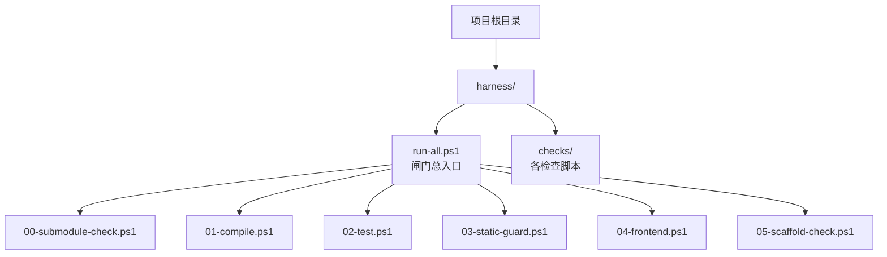
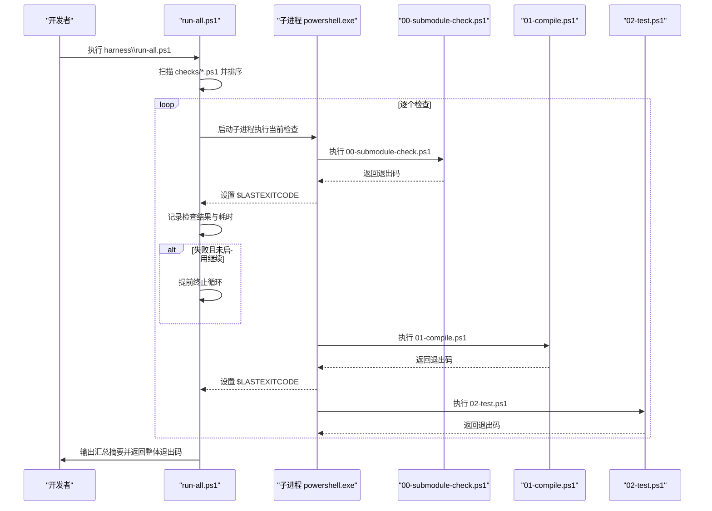
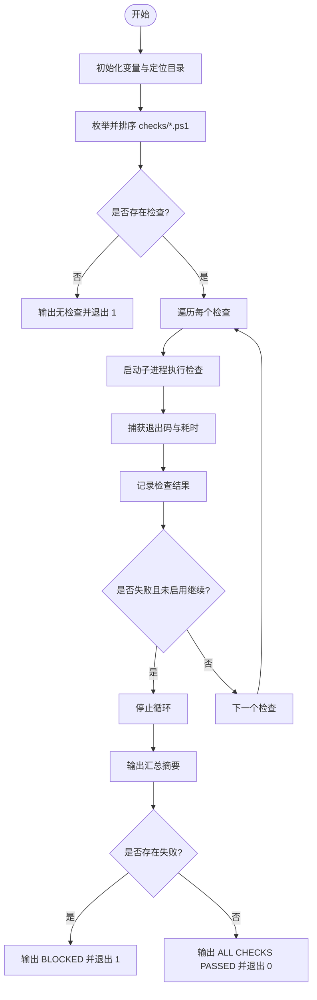
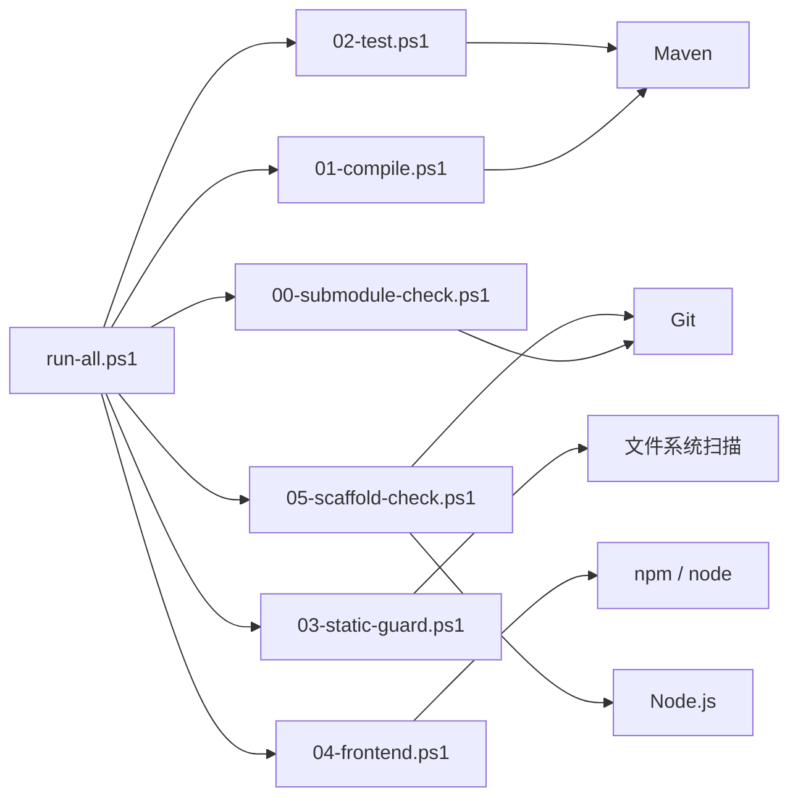

# 自定义闸门开发

<cite>
**本文引用的文件**   
- [harness/run-all.ps1](file://harness/run-all.ps1)
- [harness/checks/00-submodule-check.ps1](file://harness/checks/00-submodule-check.ps1)
- [harness/checks/01-compile.ps1](file://harness/checks/01-compile.ps1)
- [harness/checks/02-test.ps1](file://harness/checks/02-test.ps1)
- [harness/checks/03-static-guard.ps1](file://harness/checks/03-static-guard.ps1)
- [harness/checks/04-frontend.ps1](file://harness/checks/04-frontend.ps1)
- [harness/checks/05-scaffold-check.ps1](file://harness/checks/05-scaffold-check.ps1)
</cite>

## 目录
1. [引言](#引言)
2. [项目结构](#项目结构)
3. [核心组件](#核心组件)
4. [架构总览](#架构总览)
5. [详细组件分析](#详细组件分析)
6. [依赖关系分析](#依赖关系分析)
7. [性能考虑](#性能考虑)
8. [故障排查指南](#故障排查指南)
9. [结论](#结论)
10. [附录：闸门开发模板与清单](#附录闸门开发模板与清单)

## 引言
本指南面向需要为本仓库的“闸门”体系编写或扩展检查脚本的开发者。闸门是持续集成中的“否决权”环节：只要任一检查返回非零退出码，整个流水线即被阻断。现有实现以 PowerShell 脚本为主，由统一入口按文件名顺序执行各检查，并通过子进程隔离退出码、收集结果并输出汇总报告。

本指南覆盖以下主题：
- 闸门脚本的开发规范：PowerShell 格式、退出码约定、日志输出格式、错误处理模式。
- 如何编写新的检查脚本：参数传递、环境变量使用、外部命令调用。
- 如何集成到现有流程：文件命名规范、执行顺序控制、依赖管理。
- 完整开发示例：从需求分析到脚本实现再到测试验证。
- 调试技巧、性能优化建议与部署注意事项。

## 项目结构
闸门相关代码集中在 `harness` 目录下：
- `harness/run-all.ps1`：闸门总入口，负责发现、排序、串行执行所有检查，并汇总结果。
- `harness/checks/*.ps1`：具体检查脚本，每个文件代表一个独立闸门。

**图表来源**
- [harness/run-all.ps1:1-91](file://harness/run-all.ps1#L1-L91)
- [harness/checks/00-submodule-check.ps1:1-94](file://harness/checks/00-submodule-check.ps1#L1-L94)
- [harness/checks/01-compile.ps1:1-21](file://harness/checks/01-compile.ps1#L1-L21)
- [harness/checks/02-test.ps1:1-23](file://harness/checks/02-test.ps1#L1-L23)
- [harness/checks/03-static-guard.ps1:1-89](file://harness/checks/03-static-guard.ps1#L1-L89)
- [harness/checks/04-frontend.ps1:1-36](file://harness/checks/04-frontend.ps1#L1-L36)
- [harness/checks/05-scaffold-check.ps1:1-111](file://harness/checks/05-scaffold-check.ps1#L1-L111)

**章节来源**
- [harness/run-all.ps1:1-91](file://harness/run-all.ps1#L1-L91)

## 核心组件
- 闸门总入口 `run-all.ps1`：
  - 扫描 `harness/checks` 下所有 `.ps1` 文件并按文件名排序。
  - 对每个检查启动独立 PowerShell 子进程执行，读取 `$LASTEXITCODE`。
  - 记录每个检查的名称、退出码和耗时；遇到失败时默认立即停止（可通过开关继续）。
  - 输出汇总摘要，最终根据是否有失败项决定整体退出码。
- 检查脚本集合：
  - 每个检查脚本是一个自包含任务，负责完成单一职责的验证或构建步骤。
  - 通过标准输出向控制台打印人类可读信息，并通过退出码向总入口传达成功或失败。

关键行为要点：
- 执行顺序由文件名排序决定，因此编号前缀用于显式表达依赖顺序。
- 每个检查在独立进程中运行，避免共享状态污染。
- 总入口默认“遇错即停”，但支持 `-ContinueOnError` 参数跑完全部检查以便一次性收集问题。

**章节来源**
- [harness/run-all.ps1:22-26](file://harness/run-all.ps1#L22-L26)
- [harness/run-all.ps1:37-63](file://harness/run-all.ps1#L37-L63)
- [harness/run-all.ps1:65-90](file://harness/run-all.ps1#L65-L90)

## 架构总览
下图展示闸门总入口与各检查之间的调用关系与数据流。

**图表来源**
- [harness/run-all.ps1:37-63](file://harness/run-all.ps1#L37-L63)
- [harness/checks/00-submodule-check.ps1:82-93](file://harness/checks/00-submodule-check.ps1#L82-L93)
- [harness/checks/01-compile.ps1:10-20](file://harness/checks/01-compile.ps1#L10-L20)
- [harness/checks/02-test.ps1:12-22](file://harness/checks/02-test.ps1#L12-L22)

## 详细组件分析

### 闸门总入口 run-all.ps1
职责：
- 解析参数（如 `-ContinueOnError`）。
- 定位项目根目录与检查目录。
- 枚举并排序检查脚本。
- 为每个检查启动独立 PowerShell 子进程，捕获退出码与耗时。
- 汇总结果并输出摘要，最后根据失败数量决定整体退出码。

关键实现点：
- 使用 `Get-ChildItem ... Sort-Object Name` 保证执行顺序稳定。
- 使用 `powershell.exe -NoProfile -ExecutionPolicy Bypass -File` 启动子进程，确保检查之间互不污染。
- 使用 `[Diagnostics.Stopwatch]` 统计每个检查的执行时间。
- 当某个检查失败且未启用继续模式时，立即中断后续检查。
- 汇总阶段区分 PASS/FAIL，并在存在失败时输出阻塞提示。

**图表来源**
- [harness/run-all.ps1:22-35](file://harness/run-all.ps1#L22-L35)
- [harness/run-all.ps1:37-63](file://harness/run-all.ps1#L37-L63)
- [harness/run-all.ps1:65-90](file://harness/run-all.ps1#L65-L90)

**章节来源**
- [harness/run-all.ps1:22-26](file://harness/run-all.ps1#L22-L26)
- [harness/run-all.ps1:37-63](file://harness/run-all.ps1#L37-L63)
- [harness/run-all.ps1:65-90](file://harness/run-all.ps1#L65-L90)

### 子模块检查 00-submodule-check.ps1
职责：
- 校验 `.gitmodules` 是否存在。
- 校验 `backend` 与 `frontend` 两个子模块的配置路径与 URL。
- 校验父仓库中对应 gitlink 是否存在且提交一致。
- 校验子模块工作树有效，并检查标记文件（后端 `pom.xml`、前端 `package.json`）是否存在。
- 若存在问题，输出修复命令并以退出码 1 结束。

关键点：
- 只读操作，不执行更新或网络访问。
- 使用 `git config -f .gitmodules --get` 读取配置。
- 使用 `git ls-files --stage` 校验 gitlink。
- 使用 `git -C <path> rev-parse HEAD` 获取实际提交并与预期比较。

**图表来源**
- [harness/checks/00-submodule-check.ps1:21-80](file://harness/checks/00-submodule-check.ps1#L21-L80)
- [harness/checks/00-submodule-check.ps1:82-93](file://harness/checks/00-submodule-check.ps1#L82-L93)

**章节来源**
- [harness/checks/00-submodule-check.ps1:1-94](file://harness/checks/00-submodule-check.ps1#L1-L94)

### 编译检查 01-compile.ps1
职责：
- 切换到后端目录。
- 执行 Maven 编译（跳过测试），仅验证可编译性。
- 根据 Maven 返回的退出码判断成功或失败。

关键点：
- 明确将“编译失败”与“逻辑错误”分离，便于归因。
- 使用 `-B` 构建模式，减少交互输出。

**章节来源**
- [harness/checks/01-compile.ps1:1-21](file://harness/checks/01-compile.ps1#L1-L21)

### 测试检查 02-test.ps1
职责：
- 切换到后端目录。
- 执行 Maven 测试，包括单元测试与容器装配测试。
- 不允许跳过测试；任何失败都视为闸门失败。

关键点：
- 强调测试是“契约”的机器可读版本，必须保持严格。

**章节来源**
- [harness/checks/02-test.ps1:1-23](file://harness/checks/02-test.ps1#L1-L23)

### 静态红线检查 03-static-guard.ps1
职责：
- 扫描后端 Java 源码与前端的 TypeScript/TSX 源码。
- 拦截常见“假通过”模式：占位标记、禁用日志、禁用测试等。
- 输出违规明细，存在任意违规即失败。

关键点：
- 排除 `node_modules`、`.next`、`dist` 等目录。
- 使用正则匹配识别违规模式。
- 分别统计扫描的文件数量并输出。

**图表来源**
- [harness/checks/03-static-guard.ps1:14-38](file://harness/checks/03-static-guard.ps1#L14-L38)
- [harness/checks/03-static-guard.ps1:42-77](file://harness/checks/03-static-guard.ps1#L42-L77)
- [harness/checks/03-static-guard.ps1:79-88](file://harness/checks/03-static-guard.ps1#L79-L88)

**章节来源**
- [harness/checks/03-static-guard.ps1:1-89](file://harness/checks/03-static-guard.ps1#L1-L89)

### 前端检查 04-frontend.ps1
职责：
- 切换到前端目录。
- 依次执行依赖安装、生产构建、测试。
- 任一步失败即整体失败。

关键点：
- 使用 `npm ci` 确保依赖可复现。
- 构建过程包含类型检查（Next.js）。
- 测试使用 Vitest + jsdom。

**章节来源**
- [harness/checks/04-frontend.ps1:1-36](file://harness/checks/04-frontend.ps1#L1-L36)

### 改名演练检查 05-scaffold-check.ps1
职责：
- 在临时目录复制仓库内容（排除敏感或大体积目录）。
- 注入旧工作区身份种子，确保改名演练可重复。
- 执行改名脚本，并校验 `.gitmodules` 未被修改。
- 在副本中进行旧身份残留扫描，发现残留即失败。
- 清理临时目录。

关键点：
- 不直接改写当前仓库，保证安全。
- 明确排除目录与文件，避免误报。
- 使用 SHA256 校验 `.gitmodules` 完整性。

**图表来源**
- [harness/checks/05-scaffold-check.ps1:26-36](file://harness/checks/05-scaffold-check.ps1#L26-L36)
- [harness/checks/05-scaffold-check.ps1:44-80](file://harness/checks/05-scaffold-check.ps1#L44-L80)
- [harness/checks/05-scaffold-check.ps1:82-104](file://harness/checks/05-scaffold-check.ps1#L82-L104)
- [harness/checks/05-scaffold-check.ps1:106-110](file://harness/checks/05-scaffold-check.ps1#L106-L110)

**章节来源**
- [harness/checks/05-scaffold-check.ps1:1-111](file://harness/checks/05-scaffold-check.ps1#L1-L111)

## 依赖关系分析
- 总入口依赖检查脚本的存在与正确命名；检查脚本之间相互独立，但通过编号隐式表达执行顺序。
- 检查脚本依赖外部工具：
  - Git（子模块检查、改名演练）。
  - Maven（编译与测试）。
  - Node.js 与 npm（前端构建与测试、改名脚本）。
- 检查脚本内部可能调用系统命令或第三方工具，需确保环境已安装并可用。

**图表来源**
- [harness/run-all.ps1:37-63](file://harness/run-all.ps1#L37-L63)
- [harness/checks/00-submodule-check.ps1:21-80](file://harness/checks/00-submodule-check.ps1#L21-L80)
- [harness/checks/01-compile.ps1:6-12](file://harness/checks/01-compile.ps1#L6-L12)
- [harness/checks/02-test.ps1:8-14](file://harness/checks/02-test.ps1#L8-L14)
- [harness/checks/03-static-guard.ps1:14-38](file://harness/checks/03-static-guard.ps1#L14-L38)
- [harness/checks/04-frontend.ps1:7-27](file://harness/checks/04-frontend.ps1#L7-L27)
- [harness/checks/05-scaffold-check.ps1:44-80](file://harness/checks/05-scaffold-check.ps1#L44-L80)

**章节来源**
- [harness/run-all.ps1:37-63](file://harness/run-all.ps1#L37-L63)

## 性能考虑
- 总入口为串行执行，适合大多数 CI 场景；如需并行化，应谨慎评估检查间的依赖与副作用。
- 前端检查包含依赖安装、构建与测试，通常是最耗时的步骤；建议在 CI 中缓存依赖与构建产物。
- 静态红线检查会递归扫描源码文件，应避免扫描无关目录（已有排除策略）。
- 子模块检查与改名演练涉及大量文件系统操作，应尽量复用已有路径与对象，减少重复 IO。

[本节为通用指导，不涉及具体文件分析]

## 故障排查指南
常见问题与定位方法：
- 子模块未初始化或提交不一致：
  - 查看 00-submodule-check 的输出，通常会给出修复命令。
  - 确认 `.gitmodules` 配置与父仓库 gitlink 一致。
- 编译或测试失败：
  - 查看 01-compile 与 02-test 的输出，定位 Maven 构建或测试失败的具体原因。
  - 注意不要使用跳过测试的方式掩盖问题。
- 静态红线触发：
  - 查看 03-static-guard 输出的违规明细，修正占位标记、禁用日志或禁用测试的代码。
- 前端构建或测试失败：
  - 查看 04-frontend 的输出，确认依赖安装、构建与测试哪一步失败。
  - 确保 Node.js 与 npm 版本满足要求。
- 改名演练失败：
  - 查看 05-scaffold-check 的输出，确认改名脚本执行是否成功、`.gitmodules` 是否被意外修改、是否存在旧身份残留。
  - 检查临时目录的复制排除策略是否符合预期。

**章节来源**
- [harness/checks/00-submodule-check.ps1:82-93](file://harness/checks/00-submodule-check.ps1#L82-L93)
- [harness/checks/01-compile.ps1:14-20](file://harness/checks/01-compile.ps1#L14-L20)
- [harness/checks/02-test.ps1:16-22](file://harness/checks/02-test.ps1#L16-L22)
- [harness/checks/03-static-guard.ps1:79-88](file://harness/checks/03-static-guard.ps1#L79-L88)
- [harness/checks/04-frontend.ps1:13-35](file://harness/checks/04-frontend.ps1#L13-L35)
- [harness/checks/05-scaffold-check.ps1:72-104](file://harness/checks/05-scaffold-check.ps1#L72-L104)

## 结论
本仓库的闸门体系以 PowerShell 脚本为核心，通过统一入口集中调度、按文件名顺序执行、子进程隔离退出码，形成清晰、可审计、可维护的质量门禁。新增闸门时应遵循现有规范：明确的单职责、严格的退出码约定、清晰的日志输出、稳健的错误处理，并确保外部依赖与环境准备就绪。

[本节为总结性内容，不涉及具体文件分析]

## 附录：闸门开发模板与清单

### 闸门脚本开发规范
- PowerShell 脚本格式：
  - 使用文件头注释说明闸门目的、输入输出与约束。
  - 使用 `Set-Location` 明确工作目录，避免路径歧义。
  - 使用 `Write-Host` 输出人类可读信息，颜色可用于区分状态。
- 退出码约定：
  - 成功返回 0，失败返回非 0。
  - 外部命令失败时，读取 `$LASTEXITCODE` 并据此返回。
- 日志输出格式：
  - 每条关键步骤输出一行，包含动作与结果。
  - 失败时输出明确的问题描述与修复建议。
- 错误处理模式：
  - 使用 `try/finally` 清理临时资源。
  - 对外部命令失败进行显式判断，避免静默失败。
  - 对必要依赖缺失进行早期检测并给出友好提示。

**章节来源**
- [harness/run-all.ps1:28-35](file://harness/run-all.ps1#L28-L35)
- [harness/checks/01-compile.ps1:6-20](file://harness/checks/01-compile.ps1#L6-L20)
- [harness/checks/04-frontend.ps1:7-35](file://harness/checks/04-frontend.ps1#L7-L35)
- [harness/checks/05-scaffold-check.ps1:8-42](file://harness/checks/05-scaffold-check.ps1#L8-L42)

### 新检查脚本编写指南
- 参数传递：
  - 如需支持开关，使用 `[CmdletBinding()] param(...)` 定义参数。
  - 参考总入口的参数设计，保持风格一致。
- 环境变量使用：
  - 可在检查脚本中读取环境变量以适配不同环境（如 CI 标志、路径覆盖）。
  - 对缺失的环境变量进行校验并提供默认值或错误提示。
- 外部命令调用：
  - 使用 `&` 调用外部程序，并检查 `$LASTEXITCODE`。
  - 对命令输出进行过滤或截断，避免过多日志影响可读性。
  - 对命令失败进行明确报错与退出。

**章节来源**
- [harness/run-all.ps1:22-26](file://harness/run-all.ps1#L22-L26)
- [harness/checks/01-compile.ps1:10-17](file://harness/checks/01-compile.ps1#L10-L17)
- [harness/checks/04-frontend.ps1:10-32](file://harness/checks/04-frontend.ps1#L10-L32)

### 集成到现有流程
- 文件命名规范：
  - 放在 `harness/checks/` 下，命名为 `<两位序号>-<名称>.ps1`。
  - 序号决定执行顺序，应与依赖关系一致。
- 执行顺序控制：
  - 总入口按文件名排序，因此序号必须递增且语义明确。
  - 新增检查应插入合适位置，必要时调整既有检查序号。
- 依赖管理：
  - 在脚本开头声明所需外部工具与环境。
  - 对依赖缺失进行早期检测，避免中途失败难以定位。

**章节来源**
- [harness/run-all.ps1:37-41](file://harness/run-all.ps1#L37-L41)
- [harness/checks/00-submodule-check.ps1:1-8](file://harness/checks/00-submodule-check.ps1#L1-L8)
- [harness/checks/04-frontend.ps1:1-6](file://harness/checks/04-frontend.ps1#L1-L6)

### 完整开发示例
假设需要新增一个“数据库迁移预检”闸门：
- 需求分析：
  - 检查本地 MySQL 服务是否可达。
  - 检查目标 schema 是否存在。
  - 检查迁移脚本目录是否完整。
- 脚本实现：
  - 创建 `harness/checks/06-flyway-precheck.ps1`。
  - 使用外部命令连接数据库并查询 schema。
  - 对缺失的迁移脚本进行告警并返回失败。
- 测试验证：
  - 在本地启动 MySQL 并创建 schema，验证通过。
  - 关闭 MySQL 或删除 schema，验证失败分支。
  - 在 CI 环境中模拟相同场景，确保行为一致。

[本节为概念性示例，不涉及具体文件分析]

### 调试技巧
- 使用 `-ContinueOnError` 跑完全部检查，一次性收集问题。
- 单独执行某个检查脚本，快速定位问题。
- 在检查脚本中加入临时日志输出，帮助定位外部命令返回值与输出。
- 使用临时目录与最小化数据集，降低调试成本。

**章节来源**
- [harness/run-all.ps1:24-26](file://harness/run-all.ps1#L24-L26)
- [harness/run-all.ps1:44-63](file://harness/run-all.ps1#L44-L63)

### 性能优化建议
- 前端依赖与构建产物缓存。
- 静态红线检查避免扫描无关目录。
- 子模块检查与改名演练减少重复 IO。
- 合理拆分长耗时检查，必要时引入并行执行（需谨慎评估依赖）。

[本节为通用指导，不涉及具体文件分析]

### 部署注意事项
- 确保 CI 环境安装 Git、Maven、Node.js、npm。
- 确保子模块已初始化并可访问。
- 确保前端依赖可安装（网络可达）。
- 确保外部服务（如 MySQL）在需要时可访问。
- 对闸门的失败输出进行持久化，便于回溯与分析。

[本节为通用指导，不涉及具体文件分析]