基于我对代码的分析，现在我可以更新文档。新增的Flyway数据库迁移验证闸门（06-flyway.ps1）是一个重要的新组件，它专门验证数据库迁移的正确性、完整性和幂等性。让我更新现有文档：

# 闸门系统概述

<cite>
**本文引用的文件**   
- [harness/run-all.ps1](file://harness/run-all.ps1)
- [harness/checks/00-submodule-check.ps1](file://harness/checks/00-submodule-check.ps1)
- [harness/checks/01-compile.ps1](file://harness/checks/01-compile.ps1)
- [harness/checks/02-test.ps1](file://harness/checks/02-test.ps1)
- [harness/checks/03-static-guard.ps1](file://harness/checks/03-static-guard.ps1)
- [harness/checks/04-frontend.ps1](file://harness/checks/04-frontend.ps1)
- [harness/checks/05-scaffold-check.ps1](file://harness/checks/05-scaffold-check.ps1)
- [harness/checks/06-flyway.ps1](file://harness/checks/06-flyway.ps1)
- [backend/src/main/resources/db/migration/V1__init_ai_chat.sql](file://backend/src/main/resources/db/migration/V1__init_ai_chat.sql)
- [backend/pom.xml](file://backend/pom.xml)
</cite>

## 更新摘要
**所做更改**   
- 新增第七个闸门：Flyway 数据库迁移验证（06-flyway.ps1）
- 更新执行流程从 6 个闸门扩展到 7 个闸门
- 添加数据库架构验证、索引约束检查和幂等性测试
- 更新架构图和流程图以包含新的数据库验证闸门

## 目录
1. [引言](#引言)
2. [项目结构](#项目结构)
3. [核心组件](#核心组件)
4. [架构总览](#架构总览)
5. [详细组件分析](#详细组件分析)
6. [依赖关系分析](#依赖关系分析)
7. [性能与执行特性](#性能与执行特性)
8. [故障排查指南](#故障排查指南)
9. [结论](#结论)
10. [附录：快速开始与常见场景](#附录快速开始与常见场景)

## 引言
本仓库的自动化验证系统（Harness）是一个"拥有否决权"的质量门禁。它的核心设计理念非常明确：AI 可以声称自己完成了工作，但只有 Harness 返回退出码 `0`，才算真正通过；任何非零退出码都会直接阻断后续流程。人类审阅和持续集成都只认退出码，不依赖日志措辞或主观判断。

执行顺序按 `harness/checks/` 下脚本的文件名排序，依次执行：
1. 子模块检查
2. 编译检查
3. 测试检查
4. 静态守卫
5. 前端检查
6. 脚手架改名演练检查
7. **Flyway 数据库迁移验证**（新增）

任一阶段失败且未启用 `-ContinueOnError` 时，总闸门会立即停止并返回非零退出码。

## 项目结构
Harness 位于 `harness/` 目录下，采用"总闸门 + 分检查"的结构：
- `run-all.ps1`：总闸门入口，负责发现、调度、汇总所有检查，并输出最终结果。
- `checks/`：每个检查一个 PowerShell 脚本，命名以数字前缀保证执行顺序。

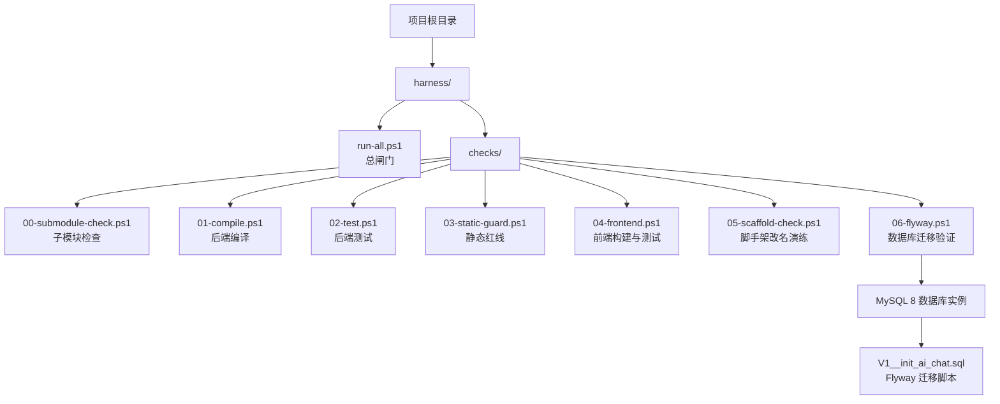

**图表来源**
- [harness/run-all.ps1:1-91](file://harness/run-all.ps1#L1-L91)
- [harness/checks/00-submodule-check.ps1:1-94](file://harness/checks/00-submodule-check.ps1#L1-L94)
- [harness/checks/01-compile.ps1:1-21](file://harness/checks/01-compile.ps1#L1-L21)
- [harness/checks/02-test.ps1:1-23](file://harness/checks/02-test.ps1#L1-L23)
- [harness/checks/03-static-guard.ps1:1-89](file://harness/checks/03-static-guard.ps1#L1-L89)
- [harness/checks/04-frontend.ps1:1-36](file://harness/checks/04-frontend.ps1#L1-L36)
- [harness/checks/05-scaffold-check.ps1:1-111](file://harness/checks/05-scaffold-check.ps1#L1-L111)
- [harness/checks/06-flyway.ps1:1-194](file://harness/checks/06-flyway.ps1#L1-L194)

**章节来源**
- [harness/run-all.ps1:1-91](file://harness/run-all.ps1#L1-L91)

## 核心组件
### 总闸门：run-all.ps1
总闸门是质量门禁的中央控制器，职责包括：
- 定位项目根目录。
- 扫描 `harness/checks/*.ps1` 并按文件名排序。
- 逐个启动子进程执行检查脚本。
- 收集每个检查的退出码和执行耗时。
- 根据 `-ContinueOnError` 决定是否提前中断。
- 输出结构化摘要，并以最终退出码表达整体状态。

关键行为：
- 默认遇错即停：第一个失败的检查会让总闸门返回非零退出码。
- 调试模式：传入 `-ContinueOnError` 后，会继续跑完所有检查，便于一次性看到全部失败项。
- 结果汇总：打印 `[PASS]` 或 `[FAIL]`，并在最后输出 `RESULT: BLOCKED` 或 `RESULT: ALL CHECKS PASSED`。

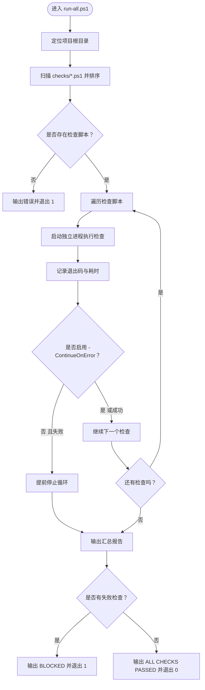

**图表来源**
- [harness/run-all.ps1:22-91](file://harness/run-all.ps1#L22-L91)

**章节来源**
- [harness/run-all.ps1:1-91](file://harness/run-all.ps1#L1-L91)

### 检查 00：子模块检查
该检查确保 `backend` 和 `frontend` 两个子模块已初始化，并且当前检出提交与父仓库记录的 gitlink 一致。它只做只读校验，不会自动更新子模块，也不会访问网络或发起交互式提问。

主要校验点：
- `.gitmodules` 存在且包含 `backend`、`frontend` 的 path 与 url。
- 父仓库中对应路径为 gitlink。
- 子模块目录中存在 `pom.xml` 或 `package.json`。
- 子模块目录是有效的 git 工作树。
- 子模块 HEAD 与父仓库期望提交一致。

如果发现问题，会输出修复建议命令，并返回退出码 `1`。

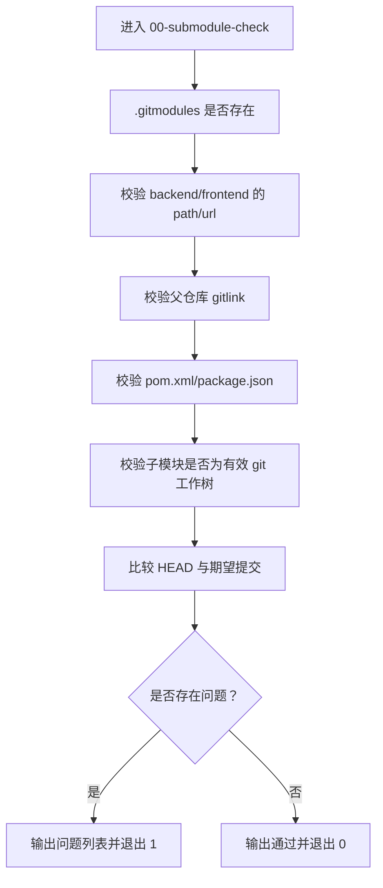

**图表来源**
- [harness/checks/00-submodule-check.ps1:1-94](file://harness/checks/00-submodule-check.ps1#L1-L94)

**章节来源**
- [harness/checks/00-submodule-check.ps1:1-94](file://harness/checks/00-submodule-check.ps1#L1-L94)

### 检查 01：编译检查
该检查仅验证后端代码能否被 Maven 编译，不运行测试。这样可以把"语法/依赖/配置类编译错误"和"逻辑/契约类测试失败"分开归因。

执行步骤：
- 切换到 `backend` 目录。
- 执行 Maven 编译命令。
- 若退出码非零，标记编译闸门失败并返回 `1`。
- 否则返回 `0`。

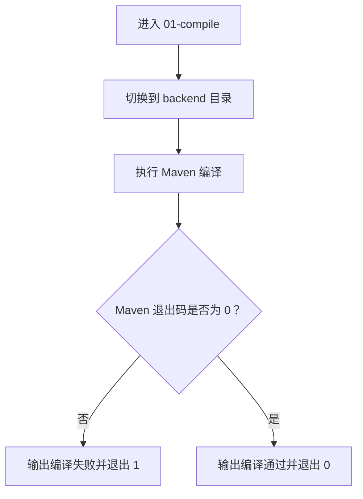

**图表来源**
- [harness/checks/01-compile.ps1:1-21](file://harness/checks/01-compile.ps1#L1-L21)

**章节来源**
- [harness/checks/01-compile.ps1:1-21](file://harness/checks/01-compile.ps1#L1-L21)

### 检查 02：测试检查
该检查运行后端单元测试和容器装配测试，作为 spec 的机器可读契约层。脚本明确不允许跳过测试，因为跳过测试等于拆掉护栏。

执行步骤：
- 切换到 `backend` 目录。
- 执行 Maven 测试命令。
- 若退出码非零，标记测试闸门失败并返回 `1`。
- 否则返回 `0`。

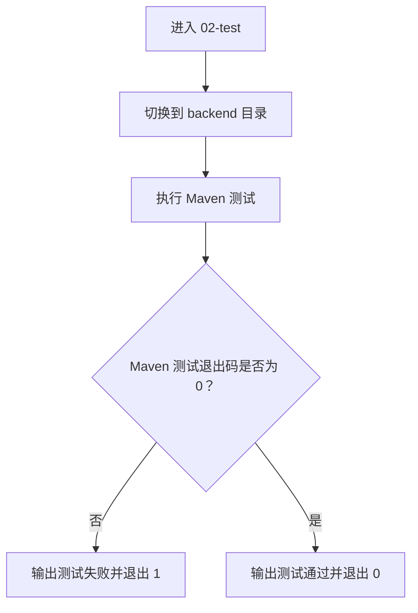

**图表来源**
- [harness/checks/02-test.ps1:1-23](file://harness/checks/02-test.ps1#L1-L23)

**章节来源**
- [harness/checks/02-test.ps1:1-23](file://harness/checks/02-test.ps1#L1-L23)

### 检查 03：静态守卫
静态守卫拦截 AI 编码中最常见的"假通过"现象，例如用占位标记代替实现、用 `System.out.println` 代替日志、用注解或框架跳过机制让测试变绿但不真实运行。

扫描范围：
- `backend/src` 下的 Java 源文件。
- `frontend` 下的 TypeScript/TSX 源文件，排除 `node_modules`、`.next`、`dist`。

检测规则：
- Java 侧禁止 TODO/FIXME/XXX、`System.out.print`、`@Disabled`。
- 前端侧禁止 TODO/FIXME/XXX，以及测试跳过相关写法。

如果检测到违规，会列出具体文件和行号，并返回 `1`。

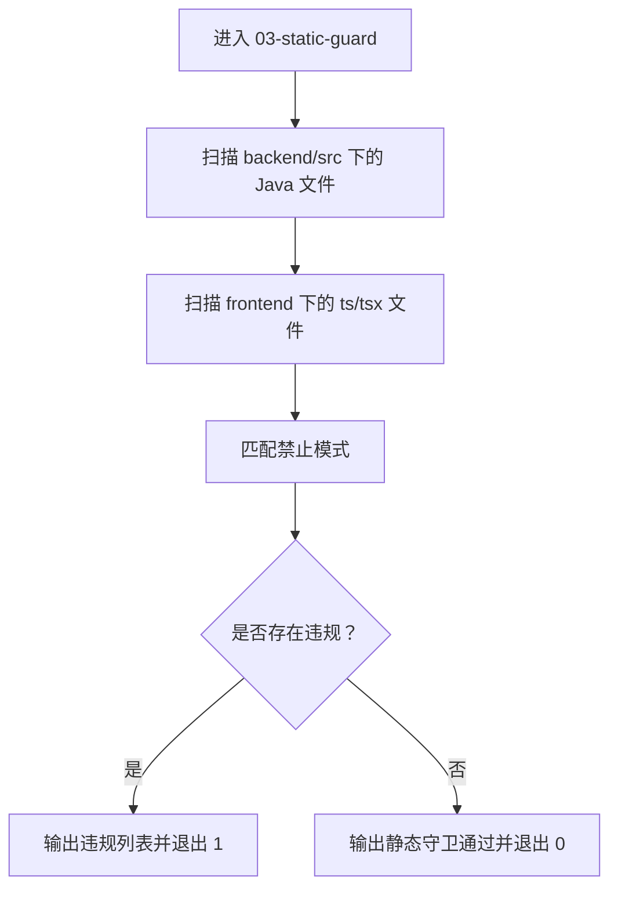

**图表来源**
- [harness/checks/03-static-guard.ps1:1-89](file://harness/checks/03-static-guard.ps1#L1-L89)

**章节来源**
- [harness/checks/03-static-guard.ps1:1-89](file://harness/checks/03-static-guard.ps1#L1-L89)

### 检查 04：前端检查
前端检查遵循三步链：依赖安装、生产构建、测试。每一步都必须成功，否则整个前端闸门失败。

执行步骤：
- 切换到 `frontend` 目录。
- 执行依赖安装。
- 执行生产构建。
- 执行测试。
- 任一步失败则立即返回 `1`，全部成功返回 `0`。

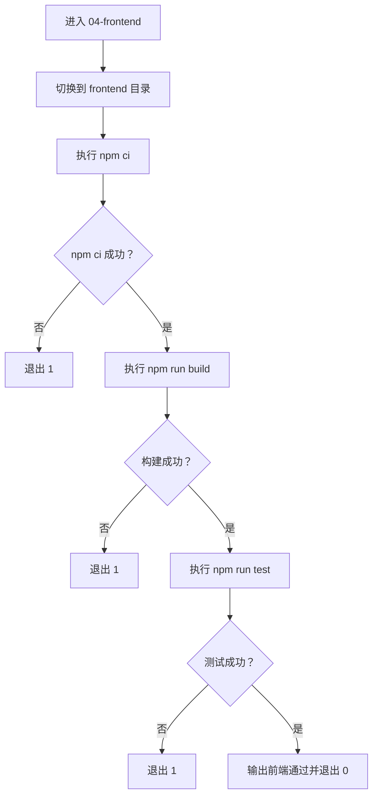

**图表来源**
- [harness/checks/04-frontend.ps1:1-36](file://harness/checks/04-frontend.ps1#L1-L36)

**章节来源**
- [harness/checks/04-frontend.ps1:1-36](file://harness/checks/04-frontend.ps1#L1-L36)

### 检查 05：脚手架改名演练
该检查在临时目录中复制仓库内容，模拟 scaffold 改名流程，并扫描旧工作区身份残留。它不会修改当前仓库，而是操作临时副本，完成后清理临时目录。

主要流程：
- 创建临时目录并复制仓库内容。
- 校验必要文件存在。
- 注入旧工作区身份种子，确保改名演练可重复。
- 执行改名脚本。
- 校验 `.gitmodules` 未被改名工具修改。
- 扫描副本中是否仍存在旧身份 token。
- 清理临时目录。

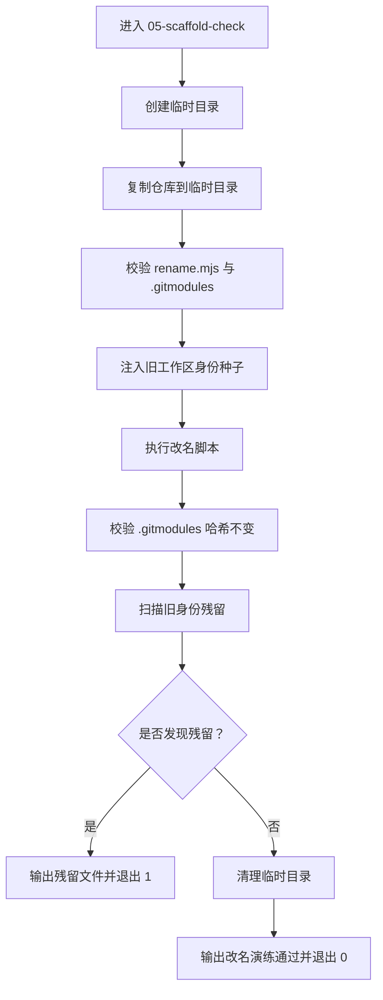

**图表来源**
- [harness/checks/05-scaffold-check.ps1:1-111](file://harness/checks/05-scaffold-check.ps1#L1-L111)

**章节来源**
- [harness/checks/05-scaffold-check.ps1:1-111](file://harness/checks/05-scaffold-check.ps1#L1-L111)

### 检查 06：Flyway 数据库迁移验证（新增）
这是新增的第七个闸门，专门验证数据库迁移的正确性、完整性和幂等性。该检查复用既有 MySQL 8 实例，在专用 schema `ai_chat_gate` 上验证 Flyway 迁移，不创建或删除容器，也不修改业务库。

主要验证流程：
1. **环境检查**：验证 TCP 连接可达性，检测 Docker 容器或本地 MySQL 客户端。
2. **版本验证**：确认使用 MySQL 8，记录业务库表集合以确保不被修改。
3. **迁移执行**：重建专用 schema 并执行 Flyway 迁移。
4. **结构断言**：验证预期的表、索引、约束、生成列和审计时间列。
5. **历史验证**：检查 flyway_schema_history 表中的迁移记录。
6. **幂等性测试**：再次执行迁移，确保历史成功条数不变。
7. **业务库保护**：确认业务库未被意外修改。

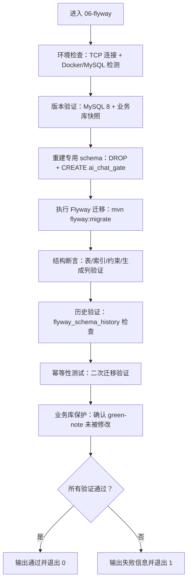

**图表来源**
- [harness/checks/06-flyway.ps1:47-194](file://harness/checks/06-flyway.ps1#L47-L194)

**章节来源**
- [harness/checks/06-flyway.ps1:1-194](file://harness/checks/06-flyway.ps1#L1-L194)

## 架构总览
从系统视角看，Harness 是一个"总闸门驱动的检查流水线"。总闸门不关心每个检查的具体实现，只关心其退出码和耗时；每个检查脚本也不关心其他检查，只关注自身职责。

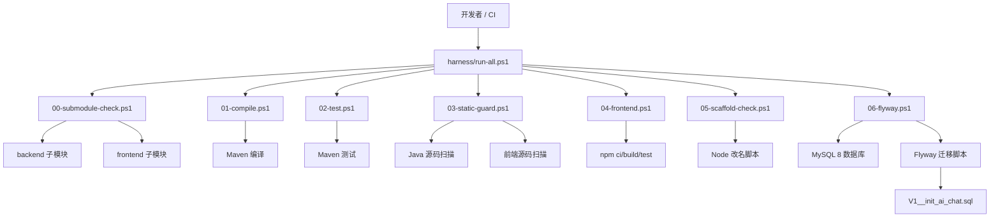

**图表来源**
- [harness/run-all.ps1:1-91](file://harness/run-all.ps1#L1-L91)
- [harness/checks/00-submodule-check.ps1:1-94](file://harness/checks/00-submodule-check.ps1#L1-L94)
- [harness/checks/01-compile.ps1:1-21](file://harness/checks/01-compile.ps1#L1-L21)
- [harness/checks/02-test.ps1:1-23](file://harness/checks/02-test.ps1#L1-L23)
- [harness/checks/03-static-guard.ps1:1-89](file://harness/checks/03-static-guard.ps1#L1-L89)
- [harness/checks/04-frontend.ps1:1-36](file://harness/checks/04-frontend.ps1#L1-L36)
- [harness/checks/05-scaffold-check.ps1:1-111](file://harness/checks/05-scaffold-check.ps1#L1-L111)
- [harness/checks/06-flyway.ps1:1-194](file://harness/checks/06-flyway.ps1#L1-L194)
- [backend/src/main/resources/db/migration/V1__init_ai_chat.sql:1-112](file://backend/src/main/resources/db/migration/V1__init_ai_chat.sql#L1-L112)

## 详细组件分析

### 退出码机制：质量门禁的唯一标准
Harness 的设计把"完成"定义为"退出码为 0"，而不是"日志里写了通过"。这意味着：
- 对 CI 而言，只要总闸门返回非零，就视为构建失败。
- 对人工审阅而言，即使日志看起来友好，只要退出码非零，也不能合并。
- 对 AI 而言，声称完成只是口头承诺，只有总闸门返回 0 才是事实。

总闸门的退出码规则：
- 所有检查通过：返回 `0`。
- 至少一个检查失败：返回 `1`。
- 没有发现检查脚本：返回 `1`。

各检查脚本也遵循同一约定：成功返回 `0`，失败返回 `1`。

**章节来源**
- [harness/run-all.ps1:22-91](file://harness/run-all.ps1#L22-L91)
- [harness/checks/01-compile.ps1:14-20](file://harness/checks/01-compile.ps1#L14-L20)
- [harness/checks/02-test.ps1:16-22](file://harness/checks/02-test.ps1#L16-L22)
- [harness/checks/03-static-guard.ps1:79-88](file://harness/checks/03-static-guard.ps1#L79-L88)
- [harness/checks/04-frontend.ps1:13-35](file://harness/checks/04-frontend.ps1#L13-L35)
- [harness/checks/05-scaffold-check.ps1:38-42](file://harness/checks/05-scaffold-check.ps1#L38-L42)
- [harness/checks/06-flyway.ps1:42-45](file://harness/checks/06-flyway.ps1#L42-L45)

### 结果汇总与状态报告格式
总闸门会为每个检查输出两行关键信息：
- 单行状态：`[PASS]` 或 `[FAIL]`，附带检查名称、耗时。
- 最终结果：`RESULT: BLOCKED` 或 `RESULT: ALL CHECKS PASSED`。

当有检查失败且启用了 `-ContinueOnError` 时，还会提示有多少检查因提前停止而未运行。

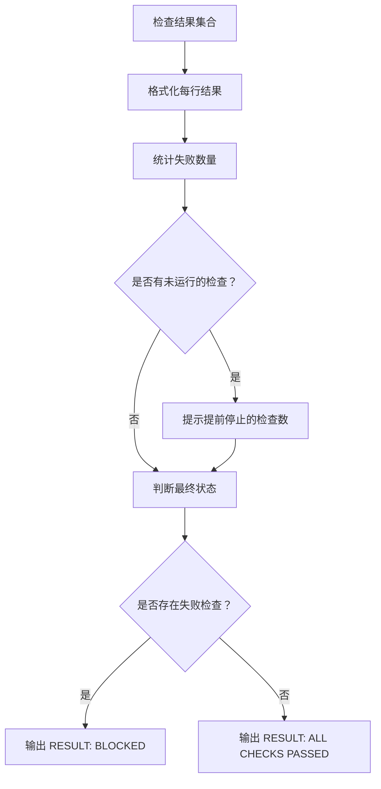

**图表来源**
- [harness/run-all.ps1:65-91](file://harness/run-all.ps1#L65-L91)

**章节来源**
- [harness/run-all.ps1:43-91](file://harness/run-all.ps1#L43-L91)

### 执行流程时序
总闸门按文件名顺序执行检查，形成一条稳定的流水线。下图展示典型调用链：

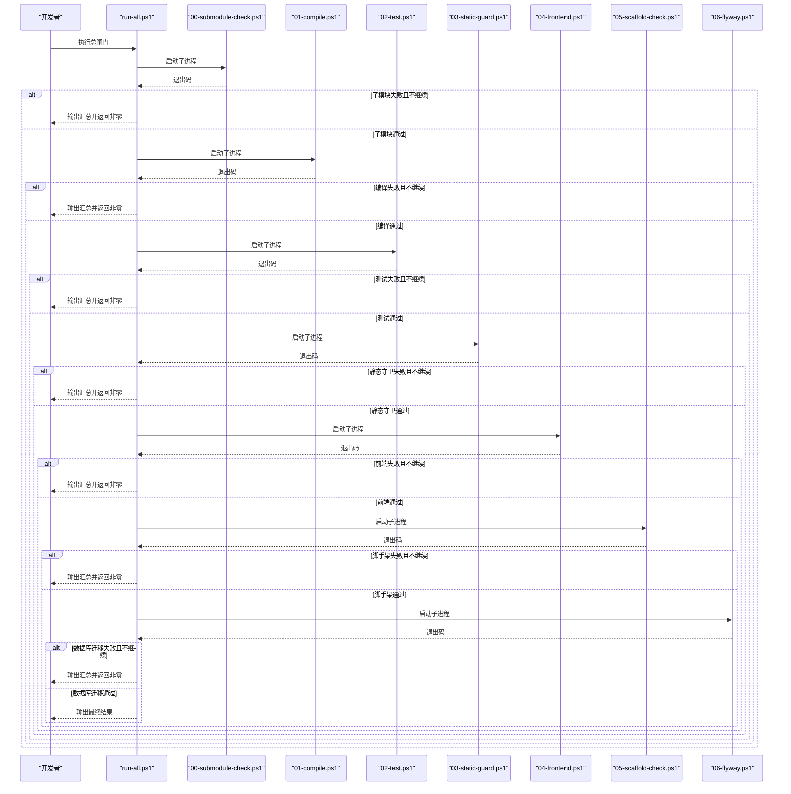

**图表来源**
- [harness/run-all.ps1:44-63](file://harness/run-all.ps1#L44-L63)
- [harness/checks/00-submodule-check.ps1:82-93](file://harness/checks/00-submodule-check.ps1#L82-L93)
- [harness/checks/01-compile.ps1:10-20](file://harness/checks/01-compile.ps1#L10-L20)
- [harness/checks/02-test.ps1:12-22](file://harness/checks/02-test.ps1#L12-L22)
- [harness/checks/03-static-guard.ps1:79-88](file://harness/checks/03-static-guard.ps1#L79-L88)
- [harness/checks/04-frontend.ps1:10-35](file://harness/checks/04-frontend.ps1#L10-L35)
- [harness/checks/05-scaffold-check.ps1:46-104](file://harness/checks/05-scaffold-check.ps1#L46-L104)
- [harness/checks/06-flyway.ps1:47-194](file://harness/checks/06-flyway.ps1#L47-L194)

## 依赖关系分析
Harness 的依赖关系具有"低耦合、高内聚"的特点：
- 总闸门只依赖检查脚本的退出码，不依赖其内部实现。
- 检查脚本之间没有相互调用，各自独立。
- 外部依赖包括：PowerShell、Git、Maven、Node.js、npm、MySQL 8、Docker。

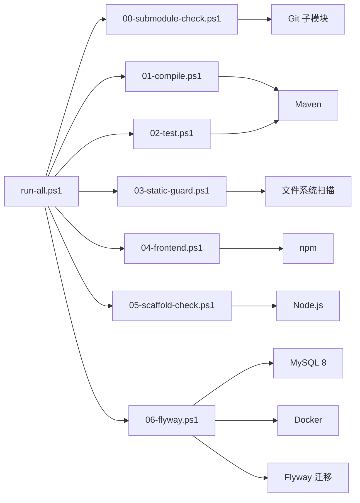

**图表来源**
- [harness/run-all.ps1:44-63](file://harness/run-all.ps1#L44-L63)
- [harness/checks/00-submodule-check.ps1:21-79](file://harness/checks/00-submodule-check.ps1#L21-L79)
- [harness/checks/01-compile.ps1:6-12](file://harness/checks/01-compile.ps1#L6-L12)
- [harness/checks/02-test.ps1:8-14](file://harness/checks/02-test.ps1#L8-L14)
- [harness/checks/03-static-guard.ps1:14-38](file://harness/checks/03-static-guard.ps1#L14-L38)
- [harness/checks/04-frontend.ps1:7-11](file://harness/checks/04-frontend.ps1#L7-L11)
- [harness/checks/05-scaffold-check.ps1:44-75](file://harness/checks/05-scaffold-check.ps1#L44-L75)
- [harness/checks/06-flyway.ps1:51-118](file://harness/checks/06-flyway.ps1#L51-L118)

**章节来源**
- [harness/run-all.ps1:44-63](file://harness/run-all.ps1#L44-L63)

## 性能与执行特性
- 每个检查都在独立 PowerShell 进程中执行，避免检查之间的环境变量和退出码互相污染。
- 总闸门使用计时器记录每个检查的执行耗时，便于定位慢检查。
- 默认行为是"快速失败"，减少不必要的后续检查开销。
- 前端检查包含依赖安装、构建和测试，通常是最耗时的阶段之一。
- 脚手架检查会在临时目录复制仓库内容，适合模板完整性验证，但会增加磁盘 I/O 和 CPU 开销。
- **新增**：Flyway 检查需要连接 MySQL 数据库并执行多次 SQL 查询，可能成为新的性能瓶颈。

优化建议：
- 在本地开发时，可以先单独运行某个检查，再运行总闸门。
- 如果只想确认某一层质量，可以暂时调整检查顺序或拆分执行，但不应改变总闸门的语义。
- 对于大型前端项目，应优先关注 `npm ci`、`npm run build`、`npm run test` 的性能瓶颈。
- **新增**：对于数据库密集型检查，确保 MySQL 8 实例响应迅速，避免网络延迟影响整体性能。

[本节为通用指导，不直接分析具体文件]

## 故障排查指南
### 常见问题与定位思路
1. **子模块未初始化或版本不一致**
   - 现象：`00-submodule-check` 失败，提示缺少 `.gitmodules`、gitlink 不一致或子模块不是有效工作树。
   - 处理：根据脚本输出的修复建议命令初始化子模块，并确保父仓库与子模块提交一致。

2. **后端编译失败**
   - 现象：`01-compile` 失败。
   - 处理：查看 Maven 编译输出，优先解决依赖缺失、包名错误、配置文件问题。

3. **后端测试失败**
   - 现象：`02-test` 失败。
   - 处理：查看具体测试用例失败原因，不要通过跳过测试掩盖问题。

4. **静态守卫报警**
   - 现象：`03-static-guard` 列出 TODO/FIXME/XXX、`System.out.print`、`@Disabled` 或前端测试跳过。
   - 处理：补全实现、替换日志方式、恢复测试，而不是绕过静态守卫。

5. **前端安装、构建或测试失败**
   - 现象：`04-frontend` 在 `npm ci`、`npm run build` 或 `npm run test` 任意一步失败。
   - 处理：先确认依赖锁文件可用，再检查 TypeScript 类型检查和测试环境。

6. **脚手架改名演练失败**
   - 现象：`05-scaffold-check` 提示改名脚本失败、`.gitmodules` 被修改或存在旧身份残留。
   - 处理：检查改名脚本逻辑、排除目录配置和旧身份扫描规则。

7. **Flyway 数据库迁移失败（新增）**
   - 现象：`06-flyway` 失败，可能原因包括：
     - MySQL 8 实例不可达或端口 8806 未开放
     - 数据库密码未设置或无法从 Docker 容器获取
     - 迁移脚本执行失败
     - 表结构、索引或约束不完整
     - 幂等性检查失败（二次迁移后历史记录变化）
     - 业务库 `green-note` 被意外修改
   - 处理：
     - 确认 MySQL 8 实例在 `127.0.0.1:8806` 上运行
     - 设置 `FLYWAY_DB_PASSWORD` 环境变量或确保 Docker 容器暴露了 `MYSQL_ROOT_PASSWORD`
     - 检查 `backend/src/main/resources/db/migration/V1__init_ai_chat.sql` 是否正确
     - 验证预期表结构、索引和约束是否完整
     - 确认业务库未被迁移脚本修改

### 调试参数：-ContinueOnError
当总闸门遇到第一个失败时会提前停止，这在复杂变更中可能只看到部分问题。使用 `-ContinueOnError` 可以让总闸门跑完所有检查，便于一次性收集全部失败项。

注意：
- 该参数主要用于调试和问题收集。
- 在生产 CI 中，通常应保持默认"遇错即停"的行为，以便快速失败。
- 即使启用该参数，最终结果仍会根据是否有失败检查决定退出码。

**章节来源**
- [harness/run-all.ps1:24-25](file://harness/run-all.ps1#L24-L25)
- [harness/run-all.ps1:62-91](file://harness/run-all.ps1#L62-L91)
- [harness/checks/00-submodule-check.ps1:82-93](file://harness/checks/00-submodule-check.ps1#L82-L93)
- [harness/checks/03-static-guard.ps1:79-88](file://harness/checks/03-static-guard.ps1#L79-L88)
- [harness/checks/04-frontend.ps1:10-35](file://harness/checks/04-frontend.ps1#L10-L35)
- [harness/checks/05-scaffold-check.ps1:46-104](file://harness/checks/05-scaffold-check.ps1#L46-L104)
- [harness/checks/06-flyway.ps1:47-194](file://harness/checks/06-flyway.ps1#L47-L194)

## 结论
Harness 的核心价值在于把"完成"的定义从主观语言变成客观退出码。它通过固定顺序的多层检查，覆盖子模块一致性、后端编译、后端测试、代码静态红线、前端构建与测试、脚手架改名完整性，以及**数据库迁移正确性**。总闸门拥有否决权：只要任一检查失败，整体结果就是 BLOCKED。

这套设计特别适合 AI 辅助开发场景：AI 可以生成代码、写文档、改配置，但最终必须接受 Harness 的裁决。只有 `exit 0` 才是真正的完成标志。新增的 Flyway 检查进一步确保了数据库架构的一致性和迁移的可重复性，为数据驱动的 AI 应用提供了坚实的数据层保障。

[本节为总结性内容，不直接分析具体文件]

## 附录：快速开始与常见场景

### 快速开始
1. 在项目根目录执行总闸门脚本。
2. 观察控制台输出中的 `[PASS]` / `[FAIL]` 和最终 `RESULT`。
3. 如果失败，根据具体检查的输出定位问题。
4. 修复后再次执行总闸门，直到返回 `0`。

参考入口：
- [harness/run-all.ps1:19-21](file://harness/run-all.ps1#L19-L21)

### 常见使用场景
- **本地提交前自检**：运行总闸门，确保子模块、编译、测试、静态守卫、前端、脚手架和数据库迁移都通过。
- **CI 质量门禁**：CI 只关心总闸门退出码，非零即失败。
- **AI 任务验收**：AI 完成任务后，由总闸门判定是否真正完成。
- **模板维护**：通过 `05-scaffold-check` 验证改名脚本和旧身份残留扫描是否符合预期。
- **数据库变更验证**：通过 `06-flyway` 确保 Flyway 迁移脚本的正确性和幂等性。
- **分层调试**：先用 `-ContinueOnError` 收集全部失败，再逐个修复。

**章节来源**
- [harness/run-all.ps1:19-25](file://harness/run-all.ps1#L19-L25)
- [harness/checks/05-scaffold-check.ps1:1-7](file://harness/checks/05-scaffold-check.ps1#L1-L7)
- [harness/checks/06-flyway.ps1:1-3](file://harness/checks/06-flyway.ps1#L1-L3)