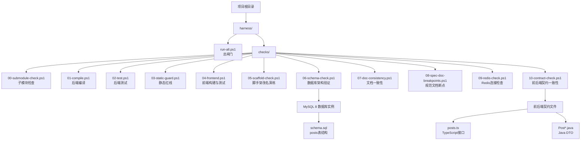
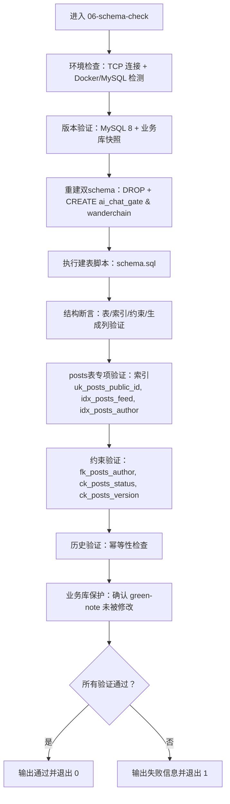
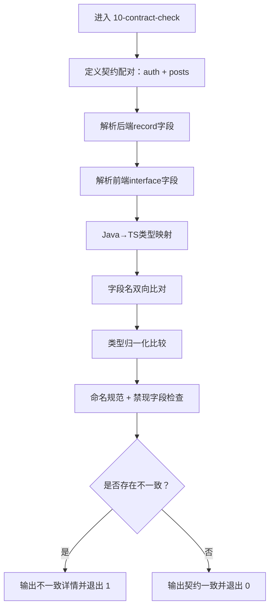
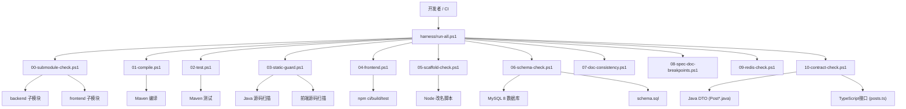
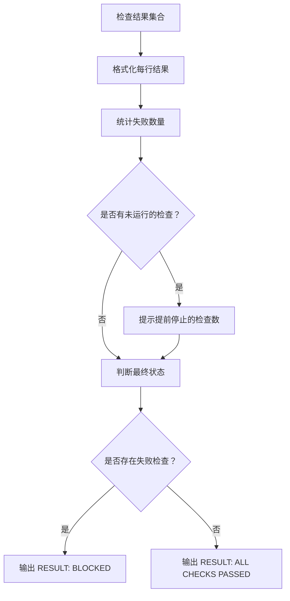
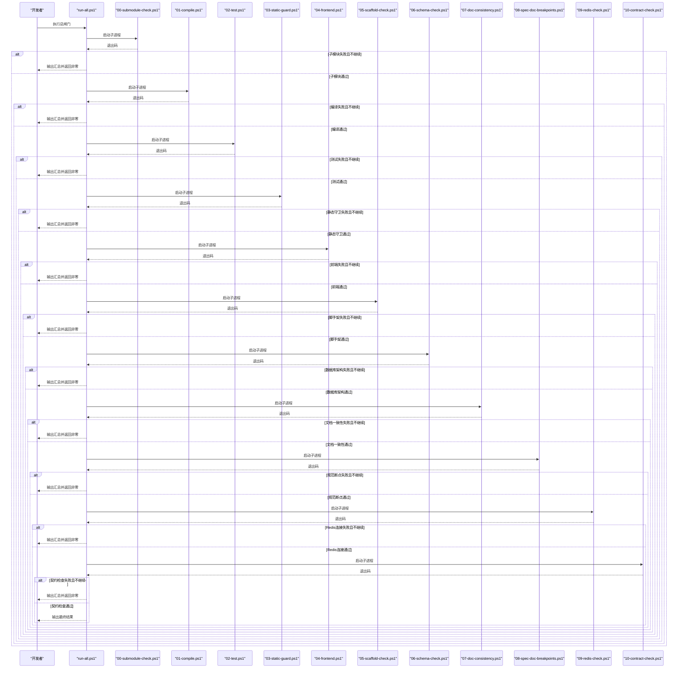
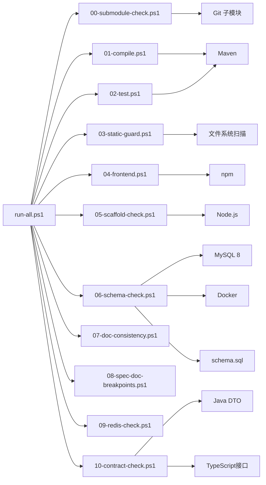

# 闸门系统概述

<cite>
**本文引用的文件**   
- [harness/run-all.ps1](file://harness/run-all.ps1)
- [harness/checks/00-submodule-check.ps1](file://harness/checks/00-submodule-check.ps1)
- [harness/checks/01-compile.ps1](file://harness/checks/01-compile.ps1)
- [harness/checks/02-test.ps1](file://harness/checks/02-test.ps1)
- [harness/checks/03-static-guard.ps1](file://harness/checks/03-static-guard.ps1)
- [harness/checks/04-frontend.ps1](file://harness/checks/04-frontend.ps1)
- [harness/checks/05-scaffold-check.ps1](file://harness/checks/05-scaffold-check.ps1)
- [harness/checks/06-schema-check.ps1](file://harness/checks/06-schema-check.ps1)
- [harness/checks/10-contract-check.ps1](file://harness/checks/10-contract-check.ps1)
- [backend/src/main/resources/schema.sql](file://backend/src/main/resources/schema.sql)
- [frontend/lib/contracts/posts.ts](file://frontend/lib/contracts/posts.ts)
- [backend/src/main/java/com/luyi/myfirst/web/post/dto/PostCreateRequest.java](file://backend/src/main/java/com/luyi/myfirst/web/post/dto/PostCreateRequest.java)
- [backend/src/main/java/com/luyi/myfirst/web/post/dto/PostResponse.java](file://backend/src/main/java/com/luyi/myfirst/web/post/dto/PostResponse.java)
- [backend/src/main/java/com/luyi/myfirst/web/post/dto/PostSummaryResponse.java](file://backend/src/main/java/com/luyi/myfirst/web/post/dto/PostSummaryResponse.java)
</cite>

## 更新摘要
**所做更改**   
- 更新了数据库架构验证闸门（06-schema-check.ps1），增强对posts表的结构验证
- 扩展了契约一致性检查（10-contract-check.ps1），新增对posts域的Java到TypeScript类型映射支持
- 更新了执行流程从7个闸门扩展到11个闸门
- 添加了posts表索引和约束的详细验证说明
- 更新了架构图和流程图以包含新的契约检查闸门

## 目录
1. [引言](#引言)
2. [项目结构](#项目结构)
3. [核心组件](#核心组件)
4. [架构总览](#架构总览)
5. [详细组件分析](#详细组件分析)
6. [依赖关系分析](#依赖关系分析)
7. [性能与执行特性](#性能与执行特性)
8. [故障排查指南](#故障排查指南)
9. [结论](#结论)
10. [附录：快速开始与常见场景](#附录快速开始与常见场景)

## 引言
本仓库的自动化验证系统（Harness）是一个"拥有否决权"的质量门禁。它的核心设计理念非常明确：AI 可以声称自己完成了工作，但只有 Harness 返回退出码 `0`，才算真正通过；任何非零退出码都会直接阻断后续流程。人类审阅和持续集成都只认退出码，不依赖日志措辞或主观判断。

执行顺序按 `harness/checks/` 下脚本的文件名排序，依次执行：
1. 子模块检查
2. 编译检查
3. 测试检查
4. 静态守卫
5. 前端检查
6. 脚手架改名演练检查
7. **数据库架构验证**（增强版）
8. 文档一致性检查
9. 规范文档断点检查
10. Redis连接检查
11. **前后端契约一致性检查**（新增posts域支持）

任一阶段失败且未启用 `-ContinueOnError` 时，总闸门会立即停止并返回非零退出码。

## 项目结构
Harness 位于 `harness/` 目录下，采用"总闸门 + 分检查"的结构：
- `run-all.ps1`：总闸门入口，负责发现、调度、汇总所有检查，并输出最终结果。
- `checks/`：每个检查一个 PowerShell 脚本，命名以数字前缀保证执行顺序。

**图表来源**
- [harness/run-all.ps1:1-95](file://harness/run-all.ps1#L1-L95)
- [harness/checks/06-schema-check.ps1:1-237](file://harness/checks/06-schema-check.ps1#L1-L237)
- [harness/checks/10-contract-check.ps1:1-262](file://harness/checks/10-contract-check.ps1#L1-L262)

**章节来源**
- [harness/run-all.ps1:1-95](file://harness/run-all.ps1#L1-L95)

## 核心组件
### 总闸门：run-all.ps1
总闸门是质量门禁的中央控制器，职责包括：
- 定位项目根目录。
- 扫描 `harness/checks/*.ps1` 并按文件名排序。
- 逐个启动子进程执行检查脚本。
- 收集每个检查的退出码和执行耗时。
- 根据 `-ContinueOnError` 决定是否提前中断。
- 输出结构化摘要，并以最终退出码表达整体状态。

关键行为：
- 默认遇错即停：第一个失败的检查会让总闸门返回非零退出码。
- 调试模式：传入 `-ContinueOnError` 后，会继续跑完所有检查，便于一次性看到全部失败项。
- 结果汇总：打印 `[PASS]` 或 `[FAIL]`，并在最后输出 `RESULT: BLOCKED` 或 `RESULT: ALL CHECKS PASSED`。

**图表来源**
- [harness/run-all.ps1:41-95](file://harness/run-all.ps1#L41-L95)

**章节来源**
- [harness/run-all.ps1:1-95](file://harness/run-all.ps1#L1-L95)

### 检查 06：数据库架构验证（增强版）
这是增强的第七个闸门，专门验证数据库架构的正确性、完整性和幂等性。该检查现在支持两个独立的schema：ai_chat_gate（AI会话四表）和wanderchain（认证两表+posts表）。

**新增功能**：
- **posts表结构验证**：验证posts表的索引（uk_posts_public_id, idx_posts_feed, idx_posts_author）和约束（fk_posts_author, ck_posts_status, ck_posts_version）
- **双schema支持**：同时验证AI聊天和认证系统的数据库结构
- **增强索引验证**：确保posts表的复合索引正确创建，支持首页feed和作者查询优化

主要验证流程：
1. **环境检查**：验证TCP连接可达性，检测Docker容器或本地MySQL客户端。
2. **版本验证**：确认使用MySQL 8，记录业务库表集合以确保不被修改。
3. **双schema重建**：重建ai_chat_gate和wanderchain专用schema。
4. **结构断言**：验证预期的表、索引、约束、生成列和审计时间列。
5. **幂等性测试**：再次执行建表脚本，确保历史成功条数不变。
6. **业务库保护**：确认业务库green-note未被意外修改。

**图表来源**
- [harness/checks/06-schema-check.ps1:26-64](file://harness/checks/06-schema-check.ps1#L26-L64)
- [harness/checks/06-schema-check.ps1:174-202](file://harness/checks/06-schema-check.ps1#L174-L202)

**章节来源**
- [harness/checks/06-schema-check.ps1:1-237](file://harness/checks/06-schema-check.ps1#L1-L237)

### 检查 10：前后端契约一致性检查（新增posts域支持）
这是新增的第十一个闸门，专门验证前后端契约的一致性。该检查现在支持auth和posts两个域的Java到TypeScript类型映射。

**新增功能**：
- **posts域支持**：新增对posts域的契约验证，包括PostCreateRequest、PostResponse、PostSummaryResponse等DTO
- **Java到TypeScript类型映射**：支持复杂的类型转换，如List<String> → string[]，Instant → string等
- **双向字段比对**：确保前后端接口名称和字段完全一致
- **类型归一化**：自动处理TypeScript中的联合类型、可选字段等复杂情况

主要验证流程：
1. **受管契约清单**：定义auth和posts两个域的契约配对。
2. **后端record解析**：解析Java record组件的字段和类型。
3. **前端interface解析**：解析TypeScript interface字段的类型。
4. **类型映射验证**：使用Java↔TS映射表进行类型归一化比较。
5. **字段名校验**：确保camelCase命名规范和禁止字段检查。
6. **防伪机制**：防止解析规则失效导致的误判。

**图表来源**
- [harness/checks/10-contract-check.ps1:18-34](file://harness/checks/10-contract-check.ps1#L18-L34)
- [harness/checks/10-contract-check.ps1:36-88](file://harness/checks/10-contract-check.ps1#L36-L88)

**章节来源**
- [harness/checks/10-contract-check.ps1:1-262](file://harness/checks/10-contract-check.ps1#L1-L262)

## 架构总览
从系统视角看，Harness 是一个"总闸门驱动的检查流水线"。总闸门不关心每个检查的具体实现，只关心其退出码和耗时；每个检查脚本也不关心其他检查，只关注自身职责。

**图表来源**
- [harness/run-all.ps1:1-95](file://harness/run-all.ps1#L1-L95)
- [harness/checks/06-schema-check.ps1:1-237](file://harness/checks/06-schema-check.ps1#L1-L237)
- [harness/checks/10-contract-check.ps1:1-262](file://harness/checks/10-contract-check.ps1#L1-L262)

## 详细组件分析

### 退出码机制：质量门禁的唯一标准
Harness 的设计把"完成"定义为"退出码为 0"，而不是"日志里写了通过"。这意味着：
- 对 CI 而言，只要总闸门返回非零，就视为构建失败。
- 对人工审阅而言，即使日志看起来友好，只要退出码非零，也不能合并。
- 对 AI 而言，声称完成只是口头承诺，只有总闸门返回 0 才是事实。

总闸门的退出码规则：
- 所有检查通过：返回 `0`。
- 至少一个检查失败：返回 `1`。
- 没有发现检查脚本：返回 `1`。

各检查脚本也遵循同一约定：成功返回 `0`，失败返回 `1`。

**章节来源**
- [harness/run-all.ps1:41-95](file://harness/run-all.ps1#L41-L95)

### 结果汇总与状态报告格式
总闸门会为每个检查输出两行关键信息：
- 单行状态：`[PASS]` 或 `[FAIL]`，附带检查名称、耗时。
- 最终结果：`RESULT: BLOCKED` 或 `RESULT: ALL CHECKS PASSED`。

当有检查失败且启用了 `-ContinueOnError` 时，还会提示有多少检查因提前停止而未运行。

**图表来源**
- [harness/run-all.ps1:69-95](file://harness/run-all.ps1#L69-L95)

**章节来源**
- [harness/run-all.ps1:41-95](file://harness/run-all.ps1#L41-L95)

### 执行流程时序
总闸门按文件名顺序执行检查，形成一条稳定的流水线。下图展示典型调用链：

**图表来源**
- [harness/run-all.ps1:41-67](file://harness/run-all.ps1#L41-L67)

## 依赖关系分析
Harness 的依赖关系具有"低耦合、高内聚"的特点：
- 总闸门只依赖检查脚本的退出码，不依赖其内部实现。
- 检查脚本之间没有相互调用，各自独立。
- 外部依赖包括：PowerShell、Git、Maven、Node.js、npm、MySQL 8、Docker、Redis。

**图表来源**
- [harness/run-all.ps1:41-67](file://harness/run-all.ps1#L41-L67)
- [harness/checks/06-schema-check.ps1:102-153](file://harness/checks/06-schema-check.ps1#L102-L153)
- [harness/checks/10-contract-check.ps1:101-171](file://harness/checks/10-contract-check.ps1#L101-L171)

**章节来源**
- [harness/run-all.ps1:41-67](file://harness/run-all.ps1#L41-L67)

## 性能与执行特性
- 每个检查都在独立 PowerShell 进程中执行，避免检查之间的环境变量和退出码互相污染。
- 总闸门使用计时器记录每个检查的执行耗时，便于定位慢检查。
- 默认行为是"快速失败"，减少不必要的后续检查开销。
- 前端检查包含依赖安装、构建和测试，通常是最耗时的阶段之一。
- 脚手架检查会在临时目录复制仓库内容，适合模板完整性验证，但会增加磁盘 I/O 和 CPU 开销。
- **增强**：数据库架构检查需要连接 MySQL 数据库并执行多次 SQL 查询，可能成为新的性能瓶颈。
- **新增**：契约检查进行静态文本解析，不需要数据库或服务启动，性能开销较小。

优化建议：
- 在本地开发时，可以先单独运行某个检查，再运行总闸门。
- 如果只想确认某一层质量，可以暂时调整检查顺序或拆分执行，但不应改变总闸门的语义。
- 对于大型前端项目，应优先关注 `npm ci`、`npm run build`、`npm run test` 的性能瓶颈。
- **新增**：对于数据库密集型检查，确保 MySQL 8 实例响应迅速，避免网络延迟影响整体性能。
- **新增**：契约检查作为纯文本解析，可以在CI中频繁运行而不影响性能。

## 故障排查指南
### 常见问题与定位思路
1. **子模块未初始化或版本不一致**
   - 现象：`00-submodule-check` 失败，提示缺少 `.gitmodules`、gitlink 不一致或子模块不是有效工作树。
   - 处理：根据脚本输出的修复建议命令初始化子模块，并确保父仓库与子模块提交一致。

2. **后端编译失败**
   - 现象：`01-compile` 失败。
   - 处理：查看 Maven 编译输出，优先解决依赖缺失、包名错误、配置文件问题。

3. **后端测试失败**
   - 现象：`02-test` 失败。
   - 处理：查看具体测试用例失败原因，不要通过跳过测试掩盖问题。

4. **静态守卫报警**
   - 现象：`03-static-guard` 列出 TODO/FIXME/XXX、`System.out.print`、`@Disabled` 或前端测试跳过。
   - 处理：补全实现、替换日志方式、恢复测试，而不是绕过静态守卫。

5. **前端安装、构建或测试失败**
   - 现象：`04-frontend` 在 `npm ci`、`npm run build` 或 `npm run test` 任意一步失败。
   - 处理：先确认依赖锁文件可用，再检查 TypeScript 类型检查和测试环境。

6. **脚手架改名演练失败**
   - 现象：`05-scaffold-check` 提示改名脚本失败、`.gitmodules` 被修改或存在旧身份残留。
   - 处理：检查改名脚本逻辑、排除目录配置和旧身份扫描规则。

7. **数据库架构验证失败（增强版）**
   - 现象：`06-schema-check` 失败，可能原因包括：
     - MySQL 8 实例不可达或端口 8806 未开放
     - 数据库密码未设置或无法从 Docker 容器获取
     - posts表索引缺失（uk_posts_public_id, idx_posts_feed, idx_posts_author）
     - posts表约束不完整（fk_posts_author, ck_posts_status, ck_posts_version）
     - 双schema验证失败（ai_chat_gate 或 wanderchain）
     - 幂等性检查失败（二次建表后create_time变化）
     - 业务库 `green-note` 被意外修改
   - 处理：
     - 确认 MySQL 8 实例在 `127.0.0.1:8806` 上运行
     - 设置 `SCHEMA_DB_PASSWORD` 环境变量或确保 Docker 容器暴露了 `MYSQL_ROOT_PASSWORD`
     - 检查 `backend/src/main/resources/schema.sql` 中posts表结构是否正确
     - 验证预期索引和约束是否完整
     - 确认双schema都能正常创建和验证

8. **前后端契约一致性检查失败（新增）**
   - 现象：`10-contract-check` 失败，可能原因包括：
     - posts域契约文件缺失（frontend/lib/contracts/posts.ts）
     - Java DTO与TypeScript接口字段不一致
     - 类型映射失败（Java类型不在映射表中）
     - 字段命名不符合camelCase规范
     - 出现禁止字段（如token、accessToken等）
     - 类型归一化失败（TypeScript联合类型或别名解析失败）
   - 处理：
     - 确保frontend/lib/contracts/posts.ts与后端DTO保持同步
     - 检查Java到TypeScript的类型映射是否正确
     - 验证字段命名是否符合camelCase规范
     - 移除或替换禁止字段
     - 简化TypeScript类型定义以符合映射规则

### 调试参数：-ContinueOnError
当总闸门遇到第一个失败时会提前停止，这在复杂变更中可能只看到部分问题。使用 `-ContinueOnError` 可以让总闸门跑完所有检查，便于一次性收集全部失败项。

注意：
- 该参数主要用于调试和问题收集。
- 在生产 CI 中，通常应保持默认"遇错即停"的行为，以便快速失败。
- 即使启用该参数，最终结果仍会根据是否有失败检查决定退出码。

**章节来源**
- [harness/run-all.ps1:27-30](file://harness/run-all.ps1#L27-L30)
- [harness/run-all.ps1:66-95](file://harness/run-all.ps1#L66-L95)
- [harness/checks/06-schema-check.ps1:21-24](file://harness/checks/06-schema-check.ps1#L21-L24)
- [harness/checks/10-contract-check.ps1:253-262](file://harness/checks/10-contract-check.ps1#L253-L262)

## 结论
Harness 的核心价值在于把"完成"的定义从主观语言变成客观退出码。它通过固定顺序的多层检查，覆盖子模块一致性、后端编译、后端测试、代码静态红线、前端构建与测试、脚手架改名完整性、**数据库架构正确性**、文档一致性、规范文档断点、Redis连接可靠性，以及**前后端契约一致性**。总闸门拥有否决权：只要任一检查失败，整体结果就是 BLOCKED。

这套设计特别适合 AI 辅助开发场景：AI 可以生成代码、写文档、改配置，但最终必须接受 Harness 的裁决。只有 `exit 0` 才是真正的完成标志。**增强的数据库架构验证**确保了posts表等核心数据结构的索引和约束完整性，而**新增的契约一致性检查**则保证了Java后端与TypeScript前端的类型安全，为现代前后端分离架构提供了坚实的质量保障。

## 附录：快速开始与常见场景

### 快速开始
1. 在项目根目录执行总闸门脚本。
2. 观察控制台输出中的 `[PASS]` / `[FAIL]` 和最终 `RESULT`。
3. 如果失败，根据具体检查的输出定位问题。
4. 修复后再次执行总闸门，直到返回 `0`。

参考入口：
- [harness/run-all.ps1:23-25](file://harness/run-all.ps1#L23-L25)

### 常见使用场景
- **本地提交前自检**：运行总闸门，确保子模块、编译、测试、静态守卫、前端、脚手架、数据库架构、文档、规范、Redis和契约都通过。
- **CI 质量门禁**：CI 只关心总闸门退出码，非零即失败。
- **AI 任务验收**：AI 完成任务后，由总闸门判定是否真正完成。
- **模板维护**：通过 `05-scaffold-check` 验证改名脚本和旧身份残留扫描是否符合预期。
- **数据库变更验证**：通过 `06-schema-check` 确保数据库架构的正确性和幂等性，特别是posts表的索引和约束。
- **前后端契约维护**：通过 `10-contract-check` 确保Java DTO与TypeScript接口的类型一致性。
- **分层调试**：先用 `-ContinueOnError` 收集全部失败，再逐个修复。

**章节来源**
- [harness/run-all.ps1:23-30](file://harness/run-all.ps1#L23-L30)
- [harness/checks/06-schema-check.ps1:1-7](file://harness/checks/06-schema-check.ps1#L1-L7)
- [harness/checks/10-contract-check.ps1:1-6](file://harness/checks/10-contract-check.ps1#L1-L6)