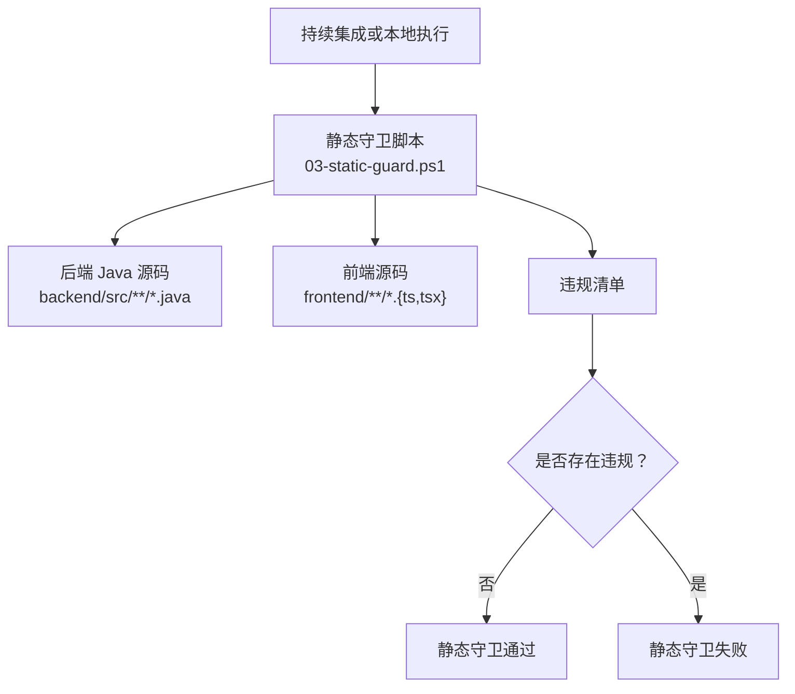
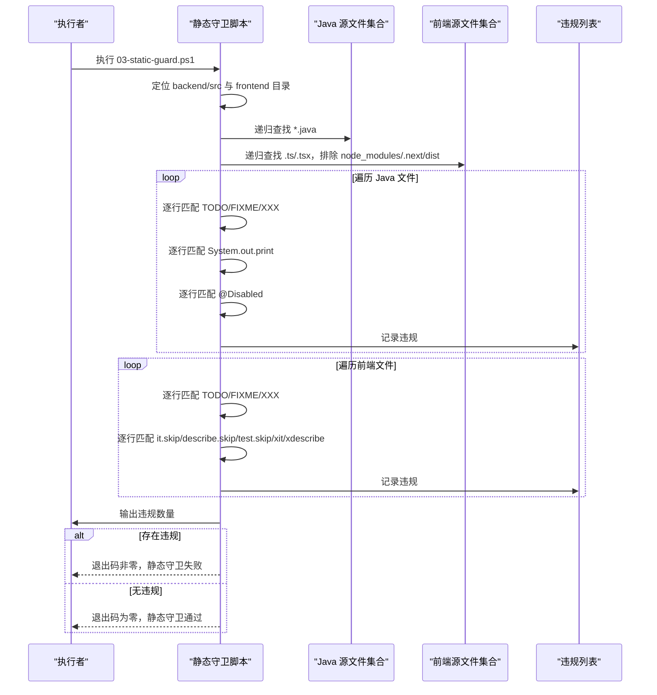
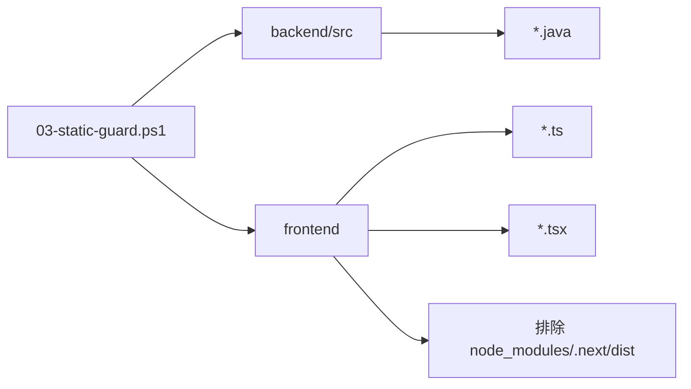

# 静态守卫

<cite>
**本文引用的文件**   
- [harness/checks/03-static-guard.ps1](file://harness/checks/03-static-guard.ps1)
- [backend/src/main/java/com/luyi/myfirst/domain/Todo.java](file://backend/src/main/java/com/luyi/myfirst/domain/Todo.java)
- [backend/src/main/java/com/luyi/myfirst/web/TodoController.java](file://backend/src/main/java/com/luyi/myfirst/web/TodoController.java)
- [backend/src/test/java/com/luyi/myfirst/domain/TodoServiceTest.java](file://backend/src/test/java/com/luyi/myfirst/domain/TodoServiceTest.java)
- [frontend/app/api/[...path]/route.ts](file://frontend/app/api/[...path]/route.ts)
</cite>

## 目录
1. [简介](#简介)
2. [项目结构中的静态守卫位置](#项目结构中的静态守卫位置)
3. [核心检测规则](#核心检测规则)
4. [架构与执行流程](#架构与执行流程)
5. [详细规则分析](#详细规则分析)
6. [依赖关系分析](#依赖关系分析)
7. [性能与扫描范围](#性能与扫描范围)
8. [误报处理与白名单建议](#误报处理与白名单建议)
9. [扩展自定义红线规则](#扩展自定义红线规则)
10. [阈值调整与配置化建议](#阈值调整与配置化建议)
11. [代码重构建议与最佳实践](#代码重构建议与最佳实践)
12. [故障排查指南](#故障排查指南)
13. [结论](#结论)

## 简介
静态守卫是本项目质量红线检查的核心闸门之一，负责在提交或构建阶段拦截低质量代码，防止“假通过”进入主分支。当前实现以 PowerShell 脚本形式运行，对后端 Java 源码和前端 TypeScript/TSX 源码进行文本级扫描，重点覆盖以下问题：
- TODO / FIXME / XXX 占位符残留
- System.out 输出语句
- @Disabled 测试跳过注解
- 前端测试跳过（it.skip、describe.skip、test.skip、xit、xdescribe）

该文档说明这些规则的触发条件、误报处理方式、如何添加自定义规则，以及如何结合现有代码给出重构建议和最佳实践。

## 项目结构中的静态守卫位置
静态守卫由 harness 下的 PowerShell 脚本驱动，属于持续集成流水线的一部分。它不依赖外部工具链，直接读取源码目录并逐行匹配正则表达式。

**图示来源**
- [harness/checks/03-static-guard.ps1:1-89](file://harness/checks/03-static-guard.ps1#L1-L89)

**章节来源**
- [harness/checks/03-static-guard.ps1:1-89](file://harness/checks/03-static-guard.ps1#L1-L89)

## 核心检测规则
当前静态守卫实现包含以下核心规则：

| 规则类别 | 触发条件 | 适用语言 | 典型修复方式 |
|---|---|---|---|
| 占位符检查 | 行中包含 TODO、FIXME、XXX | Java、前端 TS/TSX | 完成实现、创建任务、删除无效注释 |
| System.out 输出 | 行中包含 System.out.print | Java | 使用日志框架，如 SLF4J、Logback |
| 测试跳过注解 | 行中包含 @Disabled | Java | 修复测试、补充断言、启用测试 |
| 前端测试跳过 | 行中包含 it.skip、describe.skip、test.skip、xit、xdescribe | 前端 TS/TSX | 修复测试、补充断言、启用测试 |

注意：当前脚本未实现硬编码密码识别和魔法数字检测。这两项可作为后续扩展规则加入。

**章节来源**
- [harness/checks/03-static-guard.ps1:42-77](file://harness/checks/03-static-guard.ps1#L42-L77)

## 架构与执行流程
静态守卫的执行流程如下：

**图示来源**
- [harness/checks/03-static-guard.ps1:11-88](file://harness/checks/03-static-guard.ps1#L11-L88)

**章节来源**
- [harness/checks/03-static-guard.ps1:11-88](file://harness/checks/03-static-guard.ps1#L11-L88)

## 详细规则分析

### 占位符检查（TODO / FIXME / XXX）
- 触发条件：任意行中出现 TODO、FIXME、XXX。
- 影响范围：Java 源码与前端 TS/TSX 源码。
- 目的：避免开发者用占位注释代替真实实现，导致“看似完成但实际未完成”。
- 误报场景：
  - 注释中讨论技术债务但不代表未完成。
  - 第三方库或生成代码中包含 TODO。
- 建议处理：
  - 将有效技术债务转为任务跟踪系统条目。
  - 对确需保留的注释，评估是否应纳入白名单策略。

**章节来源**
- [harness/checks/03-static-guard.ps1:50-52](file://harness/checks/03-static-guard.ps1#L50-L52)
- [harness/checks/03-static-guard.ps1:70-72](file://harness/checks/03-static-guard.ps1#L70-L72)

### System.out 输出语句检测
- 触发条件：行中包含 System.out.print。
- 影响范围：Java 源码。
- 目的：禁止使用控制台输出替代结构化日志，便于生产环境日志收集与分析。
- 误报场景：
  - 调试临时输出未清理。
  - 示例代码或脚手架模板中包含 System.out。
- 建议处理：
  - 替换为日志框架调用，例如 SLF4J 的 logger.info/debug/error。
  - 对测试辅助类可考虑单独策略，但默认仍应统一日志规范。

**章节来源**
- [harness/checks/03-static-guard.ps1:53-55](file://harness/checks/03-static-guard.ps1#L53-L55)

### @Disabled 注解扫描
- 触发条件：行中包含 @Disabled。
- 影响范围：Java 测试代码。
- 目的：防止测试被静默跳过，造成“测试全绿但覆盖率虚高”。
- 误报场景：
  - 依赖外部环境的测试暂时禁用。
  - 第三方集成测试需要隔离。
- 建议处理：
  - 优先修复测试断言或准备测试数据。
  - 若确实需要跳过，应改为显式标记原因并纳入技术债务管理。

**章节来源**
- [harness/checks/03-static-guard.ps1:56-58](file://harness/checks/03-static-guard.ps1#L56-L58)

### 前端测试跳过检测
- 触发条件：行中包含 it.skip、describe.skip、test.skip、xit、xdescribe。
- 影响范围：前端 TS/TSX 源码。
- 目的：防止前端测试被静默跳过，保证前端行为变更有测试保障。
- 误报场景：
  - 浏览器兼容测试暂不启用。
  - 第三方 UI 组件测试暂时跳过。
- 建议处理：
  - 补充最小可用断言。
  - 将跳过原因写入任务系统，而非仅靠注释。

**章节来源**
- [harness/checks/03-static-guard.ps1:73-75](file://harness/checks/03-static-guard.ps1#L73-L75)

### 硬编码密码识别（当前未实现）
- 现状：当前脚本未包含硬编码密码检测逻辑。
- 建议触发条件：
  - 变量名包含 password、secret、token、key 等关键字。
  - 字符串字面量出现在配置类、常量类或业务类中。
- 建议修复方式：
  - 使用环境变量、密钥管理服务或配置文件注入。
  - 禁止将敏感信息提交到版本控制。

[本节为概念性扩展建议，不直接分析具体文件]

### 魔法数字检测（当前未实现）
- 现状：当前脚本未包含魔法数字检测逻辑。
- 建议触发条件：
  - 数值字面量出现在业务逻辑中且未提取为命名常量。
  - 常见阈值如 0、1、2、100、3600 等重复出现。
- 建议修复方式：
  - 提取为枚举或常量类。
  - 对业务阈值增加注释说明来源。

[本节为概念性扩展建议，不直接分析具体文件]

## 依赖关系分析
静态守卫脚本依赖以下路径与文件类型：
- 后端源码目录：backend/src
- 前端源码目录：frontend
- Java 文件后缀：.java
- 前端文件后缀：.ts、.tsx
- 排除目录：node_modules、.next、dist

**图示来源**
- [harness/checks/03-static-guard.ps1:14-38](file://harness/checks/03-static-guard.ps1#L14-L38)

**章节来源**
- [harness/checks/03-static-guard.ps1:14-38](file://harness/checks/03-static-guard.ps1#L14-L38)

## 性能与扫描范围
- 扫描方式：逐文件读取所有行，逐行正则匹配。
- 时间复杂度：近似 O(N)，N 为被扫描文件的总行数。
- 空间复杂度：主要取决于违规列表大小，通常远小于源码总量。
- 优化建议：
  - 对大型仓库可先过滤可疑文件再深入扫描。
  - 将高频匹配模式编译为正则对象复用。
  - 对只读扫描结果做缓存，避免重复扫描未变更文件。

[本节提供通用性能指导，不直接分析具体文件]

## 误报处理与白名单建议
当前脚本没有内置白名单机制，因此误报需要通过以下方式处理：
- 修改源码：移除 TODO、System.out、@Disabled、前端测试跳过。
- 改进注释：将占位注释转化为任务条目，避免直接使用 TODO/FIXME/XXX。
- 未来扩展：可在脚本中引入配置文件，定义允许的文件路径、包名或注释前缀白名单。

**章节来源**
- [harness/checks/03-static-guard.ps1:79-88](file://harness/checks/03-static-guard.ps1#L79-L88)

## 扩展自定义红线规则
若要新增硬编码密码识别与魔法数字检测，可参考以下思路：

- 硬编码密码识别
  - 在 Java 扫描循环中加入匹配敏感变量名或敏感字面量的正则。
  - 忽略测试类或配置类中的特定字段，避免误报。
  - 输出违规时附带文件路径、行号、匹配内容。

- 魔法数字检测
  - 在 Java 扫描循环中加入匹配数值字面量的正则。
  - 排除常见合法场景，如数组索引、状态码、常量值。
  - 输出违规时附带上下文行，帮助定位业务阈值。

- 配置化阈值
  - 将阈值从脚本硬编码迁移到配置文件。
  - 支持按模块、包、文件类型设置不同规则强度。

[本节为扩展设计建议，不直接分析具体文件]

## 阈值调整与配置化建议
当前脚本未暴露阈值参数，因此阈值调整需要修改脚本逻辑。建议采用以下配置化方案：
- 新增配置文件，定义：
  - 允许的 TODO 注释前缀。
  - 允许的 System.out 使用场景。
  - 允许的 @Disabled 测试类别。
  - 魔法数字阈值与豁免列表。
  - 硬编码密码关键词与豁免路径。
- 脚本启动时加载配置，动态应用规则。
- 支持按环境区分阈值，例如开发环境与生产环境严格度不同。

[本节为配置化设计建议，不直接分析具体文件]

## 代码重构建议与最佳实践

### 后端 Java 代码
- Todo 领域模型
  - 当前 Todo 使用 record 表达不可变数据，符合良好实践。
  - 建议在业务层继续遵循不可变更新模式，避免隐式共享状态。

- 控制器层
  - TodoController 职责清晰，仅转发请求到服务层。
  - 建议保持控制器薄，业务逻辑集中在 Service 层。

- 测试代码
  - TodoServiceTest 使用 JUnit 5 与 AssertJ，断言明确。
  - 避免使用 @Disabled；若测试依赖外部资源，应改为 Mock 或 TestContainer。

**章节来源**
- [backend/src/main/java/com/luyi/myfirst/domain/Todo.java:1-13](file://backend/src/main/java/com/luyi/myfirst/domain/Todo.java#L1-L13)
- [backend/src/main/java/com/luyi/myfirst/web/TodoController.java:1-45](file://backend/src/main/java/com/luyi/myfirst/web/TodoController.java#L1-L45)
- [backend/src/test/java/com/luyi/myfirst/domain/TodoServiceTest.java:1-64](file://backend/src/test/java/com/luyi/myfirst/domain/TodoServiceTest.java#L1-L64)

### 前端路由代理
- route.ts 作为 Next.js API Route，负责将请求代理到后端。
- 建议：
  - 继续使用环境变量配置后端地址，避免硬编码 URL。
  - 对错误响应增加重试与降级策略。
  - 对敏感请求增加鉴权校验。

**章节来源**
- [frontend/app/api/[...path]/route.ts:1-77](file://frontend/app/api/[...path]/route.ts#L1-L77)

## 故障排查指南
当静态守卫失败时，可按以下步骤排查：
1. 查看脚本输出的违规清单，确认具体文件与行号。
2. 根据违规类型定位问题：
   - 占位符：检查 TODO/FIXME/XXX 是否为未完成实现。
   - System.out：检查是否遗漏日志框架替换。
   - @Disabled：检查测试是否被静默跳过。
   - 前端测试跳过：检查 it.skip/describe.skip/test.skip/xit/xdescribe。
3. 修复后重新执行静态守卫脚本，确认退出码为零。

**章节来源**
- [harness/checks/03-static-guard.ps1:79-88](file://harness/checks/03-static-guard.ps1#L79-L88)

## 结论
静态守卫通过简单而严格的文本扫描，有效拦截常见的低质量代码模式，确保主分支代码具备基本的质量底线。当前实现已覆盖占位符、System.out、@Disabled 与前端测试跳过四类规则。未来可扩展硬编码密码识别与魔法数字检测，并通过配置化提升灵活性与可维护性。配合本项目的后端与前端代码结构，静态守卫可作为持续交付流程中的关键质量门禁。