# OpenSpec 工具使用

<cite>
**本文引用的文件**   
- [openspec/config.yaml](file://openspec/config.yaml)
- [openspec/changes/add-wanderchain-auth-frontend/.openspec.yaml](file://openspec/changes/add-wanderchain-auth-frontend/.openspec.yaml)
- [openspec/changes/add-wanderchain-auth/.openspec.yaml](file://openspec/changes/add-wanderchain-auth/.openspec.yaml)
- [openspec/changes/archive/2026-10-30-add-wanderchain-posts-backend/.openspec.yaml](file://openspec/changes/archive/2026-10-30-add-wanderchain-posts-backend/.openspec.yaml)
- [openspec/changes/archive/2026-10-30-add-wanderchain-posts-backend/proposal.md](file://openspec/changes/archive/2026-10-30-add-wanderchain-posts-backend/proposal.md)
- [openspec/changes/archive/2026-10-30-add-wanderchain-posts-backend/design.md](file://openspec/changes/archive/2026-10-30-add-wanderchain-posts-backend/design.md)
- [openspec/changes/archive/2026-10-30-add-wanderchain-posts-backend/tasks.md](file://openspec/changes/archive/2026-10-30-add-wanderchain-posts-backend/tasks.md)
- [openspec/changes/archive/2026-10-30-add-wanderchain-posts-backend/specs/wanderchain-posts/spec.md](file://openspec/changes/archive/2026-10-30-add-wanderchain-posts-backend/specs/wanderchain-posts/spec.md)
- [openspec/changes/archive/2026-10-30-add-wanderchain-posts-backend/requirement-mapping.md](file://openspec/changes/archive/2026-10-30-add-wanderchain-posts-backend/requirement-mapping.md)
- [openspec/specs/wanderchain-posts/spec.md](file://openspec/specs/wanderchain-posts/spec.md)
- [.agents/skills/openspec-propose/SKILL.md](file://.agents/skills/openspec-propose/SKILL.md)
- [.agents/skills/openspec-explore/SKILL.md](file://.agents/skills/openspec-explore/SKILL.md)
- [.agents/skills/openspec-apply-change/SKILL.md](file://.agents/skills/openspec-apply-change/SKILL.md)
- [.agents/skills/openspec-archive-change/SKILL.md](file://.agents/skills/openspec-archive-change/SKILL.md)
- [.agents/skills/openspec-sync-specs/SKILL.md](file://.agents/skills/openspec-sync-specs/SKILL.md)
</cite>

## 更新摘要
**已进行的更改**   
- 新增"WanderChain 帖子后端变更：`add-wanderchain-posts-backend`"章节，展示完整的业务功能开发流程
- 在"项目结构"和"架构总览"中补充 `2026-10-30-add-wanderchain-posts-backend` 归档目录
- 在"归档变更示例"部分增加 `add-wanderchain-posts-backend` 的完整工件分析，包括 proposal、design、tasks、spec.md 与 requirement-mapping.md
- 在"依赖关系分析"和"故障排查指南"中补充业务功能变更的典型风险与处理建议
- 新增 requirement-mapping.md 作为需求追踪的最佳实践示例

## 目录
1. [引言](#引言)
2. [项目结构](#项目结构)
3. [核心组件](#核心组件)
4. [架构总览](#架构总览)
5. [详细组件分析](#详细组件分析)
6. [依赖关系分析](#依赖关系分析)
7. [性能与可维护性建议](#性能与可维护性建议)
8. [故障排查指南](#故障排查指南)
9. [结论](#结论)
10. [附录：常用命令与配置模板](#附录常用命令与配置模板)

## 引言
本指南面向希望在本仓库中使用 OpenSpec 进行"规格驱动"开发的开发者。OpenSpec 通过 `openspec/` 目录组织变更提案、规格说明和归档记录，配合 CLI 完成从立项、审阅、实现到归档的全流程管理。仓库中已包含一个基于 `spec-driven` 工作流的项目示例，以及一套 Agent Skill 文档，用于指导如何调用 OpenSpec CLI 完成提议、探索、实现、同步和归档等操作。

本次更新重点反映多个已归档变更和一个新的活跃变更，并新增对最新归档变更 `fix-doc-drift` 的分析，同时新增了完整的业务功能开发示例：
- `extract-home-hero`：将首页主视觉从 `app/page.tsx` 的内联 JSX 抽取为独立 Server Component，并通过 delta spec 向 `wanderchain-homepage` 能力补入"首页主视觉"需求。
- `close-frontend-test-gaps`：以测试补齐与文档对齐为主，外部行为不变；通过 mock 数据源验证排序与截断、用真实 render 期抛错验证 SectionBoundary、按 desktop-first 实际断点修正单元文档响应式小节，并扩充 `harness/checks/08-spec-doc-breakpoints.ps1` 配对表。
- **新增归档** `fix-doc-drift`：修复 `README.md` 与 `AGENTS.md` 两份人读文档的漂移，明确不引入新能力、不修改代码或闸门，也不产生 delta spec，而是通过 `skip_specs: true` 走标准归档流程。
- **新增归档** `add-wanderchain-posts-backend`：WanderChain 社区帖子的完整后端功能实现，展示了从变更创建到归档的完整生命周期，包括 196 行的 comprehensive spec documentation 定义业务规则、场景和安全边界，以及 requirement-mapping.md 的需求追踪机制。
- **新增** `add-wanderchain-auth-frontend`：WanderChain 认证前端的活跃变更，建立了 schema-driven 规格格式的入口点，与后端的 `add-wanderchain-auth` 变更形成完整的前后端认证功能。

## 项目结构
仓库中与 OpenSpec 直接相关的根级目录是 `openspec/`，其典型子目录如下：
- `openspec/config.yaml`：项目级 OpenSpec 配置，声明工作流 schema、上下文语言与规则提示等。
- `openspec/specs/`：主规格（main specs）存放位置，按能力路径组织，例如 `workspace-layout`、`workspace-scaffold`、`skill-distribution`、`frontend-nextjs`、`wanderchain-homepage`、`wanderchain-posts`。
- `openspec/changes/`：活跃变更目录，每个变更是一个以短横线命名的小目录，内部包含 `.openspec.yaml`、`proposal.md`、`design.md`、`tasks.md` 以及 `specs/<capability-path>/spec.md` 等工件。
- `openspec/changes/archive/`：已归档变更目录，通常以 `YYYY-MM-DD-<change-name>` 形式命名；`extract-home-hero`、`close-frontend-test-gaps`、`fix-doc-drift` 与最新的 `add-wanderchain-posts-backend` 均归档于该目录。

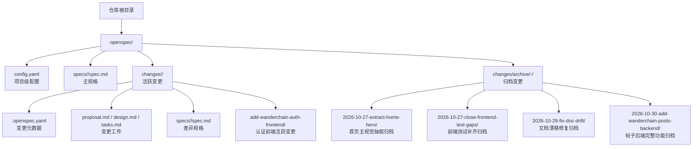

**图示来源**
- [openspec/config.yaml:1-29](file://openspec/config.yaml#L1-L29)
- [openspec/changes/add-wanderchain-auth-frontend/.openspec.yaml:1-3](file://openspec/changes/add-wanderchain-auth-frontend/.openspec.yaml#L1-L3)
- [openspec/changes/add-wanderchain-auth/.openspec.yaml:1-3](file://openspec/changes/add-wanderchain-auth/.openspec.yaml#L1-L3)
- [openspec/changes/archive/2026-10-27-extract-home-hero/.openspec.yaml:1-3](file://openspec/changes/archive/2026-10-27-extract-home-hero/.openspec.yaml#L1-L3)
- [openspec/changes/archive/2026-10-27-close-frontend-test-gaps/.openspec.yaml:1-4](file://openspec/changes/archive/2026-10-27-close-frontend-test-gaps/.openspec.yaml#L1-L4)
- [openspec/changes/archive/2026-10-29-fix-doc-drift/.openspec.yaml:1-4](file://openspec/changes/archive/2026-10-29-fix-doc-drift/.openspec.yaml#L1-L4)
- [openspec/changes/archive/2026-10-30-add-wanderchain-posts-backend/.openspec.yaml:1-3](file://openspec/changes/archive/2026-10-30-add-wanderchain-posts-backend/.openspec.yaml#L1-L3)
- [.agents/skills/openspec-propose/SKILL.md:17-24](file://.agents/skills/openspec-propose/SKILL.md#L17-L24)
- [.agents/skills/openspec-archive-change/SKILL.md:176-184](file://.agents/skills/openspec-archive-change/SKILL.md#L176-L184)

**章节来源**
- [openspec/config.yaml:1-29](file://openspec/config.yaml#L1-L29)
- [openspec/changes/add-wanderchain-auth-frontend/.openspec.yaml:1-3](file://openspec/changes/add-wanderchain-auth-frontend/.openspec.yaml#L1-L3)
- [openspec/changes/add-wanderchain-auth/.openspec.yaml:1-3](file://openspec/changes/add-wanderchain-auth/.openspec.yaml#L1-L3)
- [openspec/changes/archive/2026-10-27-extract-home-hero/.openspec.yaml:1-3](file://openspec/changes/archive/2026-10-27-extract-home-hero/.openspec.yaml#L1-L3)
- [openspec/changes/archive/2026-10-27-close-frontend-test-gaps/.openspec.yaml:1-4](file://openspec/changes/archive/2026-10-27-close-frontend-test-gaps/.openspec.yaml#L1-L4)
- [openspec/changes/archive/2026-10-29-fix-doc-drift/.openspec.yaml:1-4](file://openspec/changes/archive/2026-10-29-fix-doc-drift/.openspec.yaml#L1-L4)
- [openspec/changes/archive/2026-10-30-add-wanderchain-posts-backend/.openspec.yaml:1-3](file://openspec/changes/archive/2026-10-30-add-wanderchain-posts-backend/.openspec.yaml#L1-L3)
- [.agents/skills/openspec-propose/SKILL.md:17-24](file://.agents/skills/openspec-propose/SKILL.md#L17-L24)
- [.agents/skills/openspec-archive-change/SKILL.md:176-184](file://.agents/skills/openspec-archive-change/SKILL.md#L176-L184)

## 核心组件
OpenSpec 在本仓库中的核心组件包括：
- **项目配置**：`openspec/config.yaml` 定义 schema、上下文语言、可选的工件规则与操作建议。
- **变更工件**：每个变更目录下的 `.openspec.yaml`、`proposal.md`、`design.md`、`tasks.md`，以及 `specs/<capability-path>/spec.md`。
- **主规格**：`openspec/specs/<capability-path>/spec.md`，由差异规格合并而来，描述系统应满足的能力契约。
- **CLI 工作流**：通过 `openspec new change`、`openspec status`、`openspec instructions`、`openspec list`、`openspec show`、`openspec validate`、`openspec sync specs`、`openspec archive` 等命令串联。
- **Agent Skill 指引**：`.agents/skills/openspec-*` 提供标准化的命令行操作流程，帮助开发者或 AI 助手正确调用 OpenSpec。

**章节来源**
- [openspec/config.yaml:1-29](file://openspec/config.yaml#L1-L29)
- [.agents/skills/openspec-propose/SKILL.md:17-24](file://.agents/skills/openspec-propose/SKILL.md#L17-L24)
- [.agents/skills/openspec-apply-change/SKILL.md:41-63](file://.agents/skills/openspec-apply-change/SKILL.md#L41-L63)
- [.agents/skills/openspec-archive-change/SKILL.md:73-100](file://.agents/skills/openspec-archive-change/SKILL.md#L73-L100)
- [.agents/skills/openspec-sync-specs/SKILL.md:86-177](file://.agents/skills/openspec-sync-specs/SKILL.md#L86-L177)

## 架构总览
下图展示 OpenSpec 在仓库中的整体协作关系：开发者通过 CLI 创建变更、编写工件；CLI 根据 schema 生成并校验工件；差异规格可以同步到主规格；实现完成后归档变更。`extract-home-hero` 展示了从活跃变更到归档变更的完整生命周期，`close-frontend-test-gaps` 展示了"不修改主规格、只补齐测试与文档"的归档路径，`fix-doc-drift` 展示了"仅修改人读文档、不产生 delta spec"的归档路径，`add-wanderchain-posts-backend` 展示了完整的业务功能开发流程，而 `add-wanderchain-auth-frontend` 则展示了新的认证前端功能的活跃变更状态。

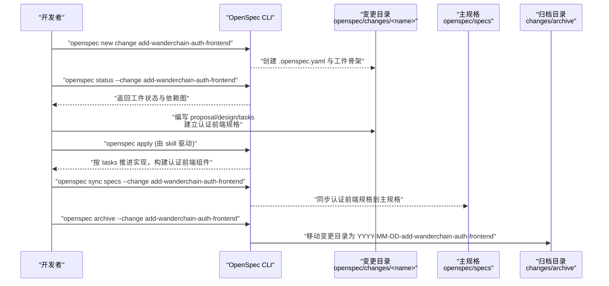

**图示来源**
- [.agents/skills/openspec-propose/SKILL.md:77-137](file://.agents/skills/openspec-propose/SKILL.md#L77-L137)
- [.agents/skills/openspec-sync-specs/SKILL.md:47-177](file://.agents/skills/openspec-sync-specs/SKILL.md#L47-L177)
- [.agents/skills/openspec-apply-change/SKILL.md:41-129](file://.agents/skills/openspec-apply-change/SKILL.md#L41-L129)
- [.agents/skills/openspec-archive-change/SKILL.md:169-184](file://.agents/skills/openspec-archive-change/SKILL.md#L169-L184)

## 详细组件分析

### 项目配置：`openspec/config.yaml`
该文件是 OpenSpec 在项目级的入口配置，当前仓库中的关键内容包括：
- `schema: spec-driven`：指定使用"规格驱动"工作流。
- `context`：声明语言与约束，例如要求所有工件使用中文，但保留 OpenSpec 的结构标题与 SHALL/MUST 关键词为英文。
- 可选的 `rules` 与 `operations`：用于对特定工件或 apply/archive 操作给出指导性建议。

实际使用中，你可以：
- 修改 `context` 来统一团队的语言风格与写作约束。
- 添加 `rules.proposal`、`rules.tasks` 等条目，限制提案长度、任务拆分粒度等。
- 添加 `operations.apply.guidance`、`operations.archive.guidance`，为实施与归档阶段补充建议。

**章节来源**
- [openspec/config.yaml:1-29](file://openspec/config.yaml#L1-L29)

### 变更元数据：`.openspec.yaml`
每个变更目录下都有一个 `.openspec.yaml`，用于声明变更的基本元信息。仓库中既有活跃变更示例，也有归档变更示例：
- 活跃变更示例：`openspec/changes/add-wanderchain-auth-frontend/.openspec.yaml`
- 活跃变更示例：`openspec/changes/add-wanderchain-auth/.openspec.yaml`
- 归档变更示例：`openspec/changes/archive/2026-10-27-extract-home-hero/.openspec.yaml`
- 归档变更示例：`openspec/changes/archive/2026-10-27-close-frontend-test-gaps/.openspec.yaml`
- 归档变更示例：`openspec/changes/archive/2026-10-29-fix-doc-drift/.openspec.yaml`
- 归档变更示例：`openspec/changes/archive/2026-10-30-add-wanderchain-posts-backend/.openspec.yaml`

这些文件都包含：
- `schema: spec-driven`
- `created: YYYY-MM-DD`

对于 `add-wanderchain-auth-frontend`，这是一个新的活跃变更，建立了 WanderChain 认证前端的 OpenSpec 配置入口。对于 `add-wanderchain-auth`，这是对应的后端认证功能变更。对于 `close-frontend-test-gaps`，归档后的元数据额外包含 `skip_specs: true`，表明该变更不产生也不需要同步 delta spec，而是聚焦于测试补齐与文档对齐。对于 `extract-home-hero`，归档后的元数据表明该变更已于 2026-10-27 创建并完成归档，不再处于活跃状态。对于 `fix-doc-drift`，归档后的元数据同样包含 `skip_specs: true`，因为该变更只修改 `README.md` 与 `AGENTS.md` 两份人读文档，不改变任何 spec 级行为、代码或闸门脚本。对于 `add-wanderchain-posts-backend`，这是完整的业务功能归档变更，展示了标准的 spec-driven 工作流。在实际项目中，你可能还需要根据工作流扩展字段，例如：
- `skip_specs`：跳过某些工件（如 delta spec）。
- `retire_capabilities`：允许在归档时移除整个能力的主规格。

**章节来源**
- [openspec/changes/add-wanderchain-auth-frontend/.openspec.yaml:1-3](file://openspec/changes/add-wanderchain-auth-frontend/.openspec.yaml#L1-L3)
- [openspec/changes/add-wanderchain-auth/.openspec.yaml:1-3](file://openspec/changes/add-wanderchain-auth/.openspec.yaml#L1-L3)
- [openspec/changes/archive/2026-10-27-extract-home-hero/.openspec.yaml:1-3](file://openspec/changes/archive/2026-10-27-extract-home-hero/.openspec.yaml#L1-L3)
- [openspec/changes/archive/2026-10-27-close-frontend-test-gaps/.openspec.yaml:1-4](file://openspec/changes/archive/2026-10-27-close-frontend-test-gaps/.openspec.yaml#L1-L4)
- [openspec/changes/archive/2026-10-29-fix-doc-drift/.openspec.yaml:1-4](file://openspec/changes/archive/2026-10-29-fix-doc-drift/.openspec.yaml#L1-L4)
- [openspec/changes/archive/2026-10-30-add-wanderchain-posts-backend/.openspec.yaml:1-3](file://openspec/changes/archive/2026-10-30-add-wanderchain-posts-backend/.openspec.yaml#L1-L3)
- [.agents/skills/openspec-archive-change/SKILL.md:122-124](file://.agents/skills/openspec-archive-change/SKILL.md#L122-L124)

### WanderChain 认证前端变更：`add-wanderchain-auth-frontend`
`add-wanderchain-auth-frontend` 是一个活跃的认证前端变更，与后端的 `add-wanderchain-auth` 变更形成完整的前后端认证功能。这个变更建立了 schema-driven 规格格式的入口点，为 WanderChain 应用的前端认证界面提供规范化的开发流程。

该变更的关键特点包括：
- 使用标准的 `schema: spec-driven` 工作流
- 创建于 2026-10-27，目前仍处于活跃状态
- 与后端认证变更保持独立的规格管理
- 遵循 OpenSpec 的工件结构规范

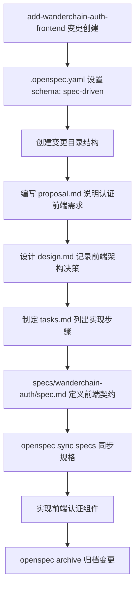

**图示来源**
- [openspec/changes/add-wanderchain-auth-frontend/.openspec.yaml:1-3](file://openspec/changes/add-wanderchain-auth-frontend/.openspec.yaml#L1-L3)
- [openspec/changes/add-wanderchain-auth/.openspec.yaml:1-3](file://openspec/changes/add-wanderchain-auth/.openspec.yaml#L1-L3)

**章节来源**
- [openspec/changes/add-wanderchain-auth-frontend/.openspec.yaml:1-3](file://openspec/changes/add-wanderchain-auth-frontend/.openspec.yaml#L1-L3)
- [openspec/changes/add-wanderchain-auth/.openspec.yaml:1-3](file://openspec/changes/add-wanderchain-auth/.openspec.yaml#L1-L3)

### 归档变更示例：extract-home-hero
`extract-home-hero` 是一个已归档的前端结构重构变更，核心目标是把首页主视觉从 `app/page.tsx` 的内联 JSX 抽取为独立组件，并把行为写进 `wanderchain-homepage` 能力的规格层。

该变更的关键工件如下：
- `.openspec.yaml`：声明 `schema: spec-driven` 与 `created: 2026-10-27`。
- `proposal.md`：说明为什么需要抽取主视觉、变更范围、影响面、是否破坏向后兼容等。
- `design.md`：记录设计决策，包括抽成 Server Component、沿用 CSS Modules、`stats` 非法整组回退、样式迁走不留别名、不接收 `city`、用 DOM 结构比对证明视觉零变化等。
- `tasks.md`：列出组件与样式落位、页面接线与清理、测试、规格与文档同步、验收等任务，全部勾选表示已实现。
- `specs/wanderchain-homepage/spec.md`：delta spec，新增"首页主视觉" Requirement 与多个 Scenario。

归档后，`openspec/specs/wanderchain-homepage/spec.md` 中已经出现"Requirement: 首页主视觉"及其场景，说明 delta spec 已成功同步到主规格。

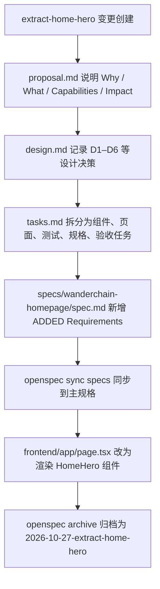

**图示来源**
- [openspec/changes/archive/2026-10-27-extract-home-hero/proposal.md:1-40](file://openspec/changes/archive/2026-10-27-extract-home-hero/proposal.md#L1-L40)
- [openspec/changes/archive/2026-10-27-extract-home-hero/design.md:1-76](file://openspec/changes/archive/2026-10-27-extract-home-hero/design.md#L1-L76)
- [openspec/changes/archive/2026-10-27-extract-home-hero/tasks.md:1-37](file://openspec/changes/archive/2026-10-27-extract-home-hero/tasks.md#L1-L37)
- [openspec/changes/archive/2026-10-27-extract-home-hero/specs/wanderchain-homepage/spec.md:1-36](file://openspec/changes/archive/2026-10-27-extract-home-hero/specs/wanderchain-homepage/spec.md#L1-L36)
- [frontend/app/page.tsx:1-71](file://frontend/app/page.tsx#L1-L71)

**章节来源**
- [openspec/changes/archive/2026-10-27-extract-home-hero/.openspec.yaml:1-3](file://openspec/changes/archive/2026-10-27-extract-home-hero/.openspec.yaml#L1-L3)
- [openspec/changes/archive/2026-10-27-extract-home-hero/proposal.md:1-40](file://openspec/changes/archive/2026-10-27-extract-home-hero/proposal.md#L1-L40)
- [openspec/changes/archive/2026-10-27-extract-home-hero/design.md:1-76](file://openspec/changes/archive/2026-10-27-extract-home-hero/design.md#L1-L76)
- [openspec/changes/archive/2026-10-27-extract-home-hero/tasks.md:1-37](file://openspec/changes/archive/2026-10-27-extract-home-hero/tasks.md#L1-L37)
- [openspec/changes/archive/2026-10-27-extract-home-hero/specs/wanderchain-homepage/spec.md:1-36](file://openspec/changes/archive/2026-10-27-extract-home-hero/specs/wanderchain-homepage/spec.md#L1-L36)
- [frontend/app/page.tsx:1-71](file://frontend/app/page.tsx#L1-L71)

### 归档变更示例：close-frontend-test-gaps
`close-frontend-test-gaps` 是一个以测试补齐与文档对齐为核心的归档变更，外部行为保持不变。其设计约束来自三处：
- 主规格 `openspec/specs/wanderchain-homepage/` 声明界面为英文，单元文档中的中文文案不能反过来约束实现。
- 前端测试跑在 jsdom 上，没有布局引擎与真实图片加载，布局类场景不可在此层验证。
- `08-spec-doc-breakpoints.ps1` 要求文档响应式小节与 CSS 的 `max-width` 集合完全相等。

该变更的关键设计决策包括：
- 排序与截断用 mock 数据源验证，不用真实 Mock 数据自证。
- `SectionBoundary` 用真实 render 期抛错验证，断言只降级该区块、文案为 `<title> could not load. Please try again later.`。
- 无 `document` 场景只验证 `open()` 的安全分支。
- 断点闸门扩充采用「文档跟实现」，U3/U5/U7 的文档改写为 desktop-first 实际断点，并把三对登记进 08 配对表。
- 文档漂移以主规格与代码为准，补双语字段、修正 `alt` 文案、调整覆盖声明。

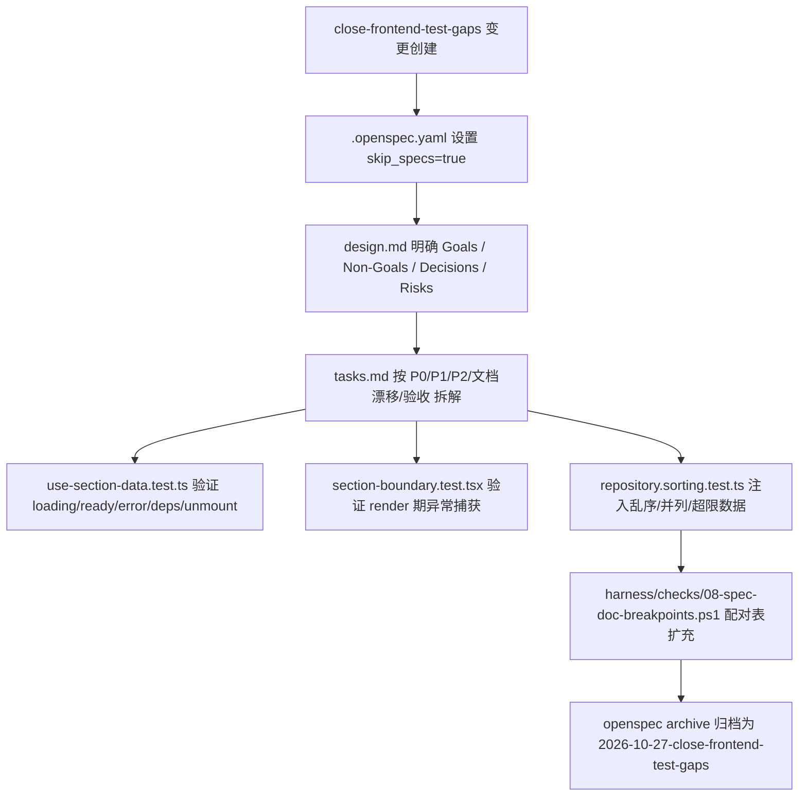

**图示来源**
- [openspec/changes/archive/2026-10-27-close-frontend-test-gaps/.openspec.yaml:1-4](file://openspec/changes/archive/2026-10-27-close-frontend-test-gaps/.openspec.yaml#L1-L4)
- [openspec/changes/archive/2026-10-27-close-frontend-test-gaps/design.md:1-63](file://openspec/changes/archive/2026-10-27-close-frontend-test-gaps/design.md#L1-L63)
- [openspec/changes/archive/2026-10-27-close-frontend-test-gaps/tasks.md:1-46](file://openspec/changes/archive/2026-10-27-close-frontend-test-gaps/tasks.md#L1-L46)
- [frontend/components/home/use-section-data.test.ts:1-114](file://frontend/components/home/use-section-data.test.ts#L1-L114)
- [frontend/components/home/section-boundary.test.tsx:1-69](file://frontend/components/home/section-boundary.test.tsx#L1-L69)
- [frontend/lib/home/repository.sorting.test.ts:1-169](file://frontend/lib/home/repository.sorting.test.ts#L1-L169)

**章节来源**
- [openspec/changes/archive/2026-10-27-close-frontend-test-gaps/.openspec.yaml:1-4](file://openspec/changes/archive/2026-10-27-close-frontend-test-gaps/.openspec.yaml#L1-L4)
- [openspec/changes/archive/2026-10-27-close-frontend-test-gaps/design.md:1-63](file://openspec/changes/archive/2026-10-27-close-frontend-test-gaps/design.md#L1-L63)
- [openspec/changes/archive/2026-10-27-close-frontend-test-gaps/tasks.md:1-46](file://openspec/changes/archive/2026-10-27-close-frontend-test-gaps/tasks.md#L1-L46)
- [frontend/components/home/use-section-data.test.ts:1-114](file://frontend/components/home/use-section-data.test.ts#L1-L114)
- [frontend/components/home/section-boundary.test.tsx:1-69](file://frontend/components/home/section-boundary.test.tsx#L1-L69)
- [frontend/lib/home/repository.sorting.test.ts:1-169](file://frontend/lib/home/repository.sorting.test.ts#L1-L169)

### 归档变更示例：fix-doc-drift
`fix-doc-drift` 是一个专门修复人读文档漂移的归档变更，核心目标是让 `README.md` 与 `AGENTS.md` 两份面向人的文档重新对齐仓库现状，而不是修改代码、闸门或规格。该变更明确不引入新能力，也不产生 delta spec，因此 `.openspec.yaml` 中设置了 `skip_specs: true`。

该变更的关键背景是：`AGENTS.md` 已经跟随认证模块改造过业务描述、目录树、命令与闸门清单，但 `README.md` 仍停留在 Todo 演示与 Flyway 迁移的旧描述中，导致使用者可能配置不存在的 `FLYWAY_DB_PASSWORD` / `FLYWAY_DB_HOST`，或误以为运行期不接数据库与缓存。同时，`AGENTS.md` 的 backend 目录树也缺少 `service/auth`、`web/auth`、`common/id`、`common/security` 等层级。

该变更的关键设计决策包括：
- **凭据说明按用途分组**：将环境变量拆为 `SCHEMA_DB_*`（闸门建表断言）、`SCHEMA_REDIS_*`（闸门缓存连通）与 `WANDERCHAIN_*`（应用启动与 `02-test`），避免读者按端口混用两套变量。
- **设计取舍改写为可验证事实**：把原来过时的"运行期不接数据库/缓存"改写为"依赖 8806 与 6606 两个实例，连不上即失败，不存在内存兜底"，使下次漂移更容易被发现。
- **目录树写职责不写类名**：对 `service/auth` 下接口、`impl/`、`support/`、`model/` 以及 `web/auth` 下 Controller、`AuthCookie`、`dto/`、`interceptor/` 各给一句话职责，避免类名列表很快过期。
- **严格保护闸门清单标记行**：`AGENTS.md` 中 `<!-- harness-checks: ... -->` 一行必须逐字节不动，否则 `07-doc-consistency` 会直接退出码 1。
- **不引入新闸门或迁移框架**：本变更只让文档追上脚本，不反向改脚本。

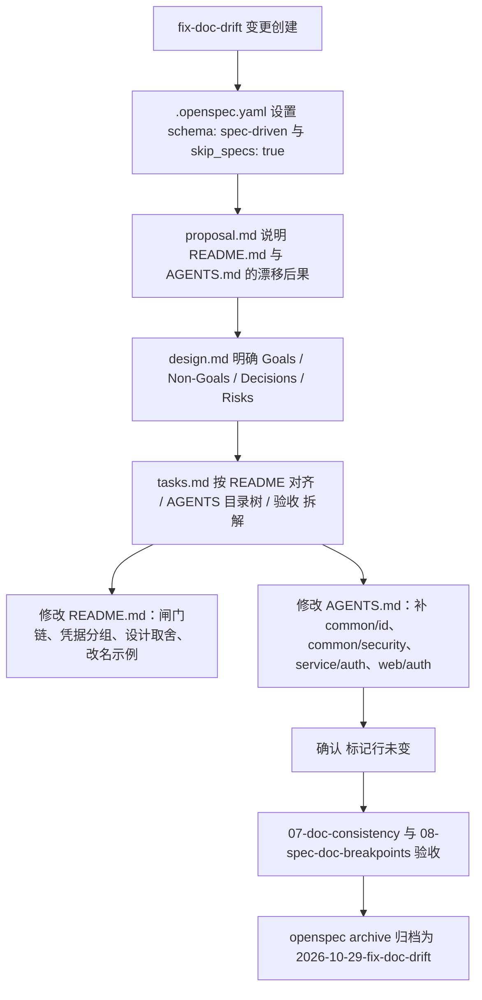

**图示来源**
- [openspec/changes/archive/2026-10-29-fix-doc-drift/.openspec.yaml:1-4](file://openspec/changes/archive/2026-10-29-fix-doc-drift/.openspec.yaml#L1-L4)
- [openspec/changes/archive/2026-10-29-fix-doc-drift/proposal.md:1-57](file://openspec/changes/archive/2026-10-29-fix-doc-drift/proposal.md#L1-L57)
- [openspec/changes/archive/2026-10-29-fix-doc-drift/design.md:1-51](file://openspec/changes/archive/2026-10-29-fix-doc-drift/design.md#L1-L51)
- [openspec/changes/archive/2026-10-29-fix-doc-drift/tasks.md:1-26](file://openspec/changes/archive/2026-10-29-fix-doc-drift/tasks.md#L1-L26)

**章节来源**
- [openspec/changes/archive/2026-10-29-fix-doc-drift/.openspec.yaml:1-4](file://openspec/changes/archive/2026-10-29-fix-doc-drift/.openspec.yaml#L1-L4)
- [openspec/changes/archive/2026-10-29-fix-doc-drift/proposal.md:1-57](file://openspec/changes/archive/2026-10-29-fix-doc-drift/proposal.md#L1-L57)
- [openspec/changes/archive/2026-10-29-fix-doc-drift/design.md:1-51](file://openspec/changes/archive/2026-10-29-fix-doc-drift/design.md#L1-L51)
- [openspec/changes/archive/2026-10-29-fix-doc-drift/tasks.md:1-26](file://openspec/changes/archive/2026-10-29-fix-doc-drift/tasks.md#L1-L26)

### 归档变更示例：add-wanderchain-posts-backend
`add-wanderchain-posts-backend` 是一个完整的业务功能归档变更，核心目标是实现 WanderChain 社区帖子的后端功能，包括帖子的持久化模型、发布编辑删除、列表详情五条对外行为，以及"读公开、写需登录"的访问边界。这个变更展示了从变更创建到归档的完整生命周期，包括 196 行的 comprehensive spec documentation 定义业务规则、场景和安全边界，以及 requirement-mapping.md 的需求追踪机制。

该变更的关键背景是：认证能力已归档并全绿，但认证当初的引入动因是"社区分享帖子/经验"的前置门禁——门禁装好了，被门禁保护的东西还一个都不存在。帖子是这个仓库第一个**读公开、写需登录**的资源，它会把两件至今没被验证过的事摆上台面：三层架构与 DTO 分离能否复制到第二条业务线，以及"同一路径的 GET 公开、POST 受保护"在当前纯路径拦截器下到底能不能表达。

该变更的关键设计决策包括：
- **新增能力 `wanderchain-posts`**：帖子的数据模型 + 发布、编辑、删除、列表、详情五条对外行为，以及"读公开、写需登录"的访问边界。
- **持久化**：`backend/src/main/resources/schema.sql` 增加 `posts` 表（`CREATE TABLE IF NOT EXISTS`，落在既有 `wanderchain` 库）。沿用"手写 DDL + 启动幂等执行"，不引入迁移框架。
- **公共实体基类**：新增 `common/persistence/BaseEntity`（`@MappedSuperclass`），字段照 `docs/db-design-spec.md` §4.1 取全 8 列（`id`、`public_id`、`created_at`、`updated_at`、`deleted_at`、`version`、`created_by`、`updated_by`）。`Post` 是第一个继承者。
- **响应基类型**：把既有 `AuthResponseBody` 的标记接口模式泛化为 `common/web/ApiResponse`，`AuthResponseBody` 保留为其子接口。**不**引入全站响应包装，**不**改动 `AuthResponseGuard` 的作用域。
- **拦截器口径改造**：`AuthInterceptor` 从"只注册 `/api/auth/**` + 六个排除路径"改为"注册 `/api/**` + 内部方法感知的公开读清单 + 默认拒绝"。这是让"同一路径 GET 公开、POST 需认证"成为可表达事实的唯一低成本路径；纯路径的 `excludePathPatterns` 没有 HTTP 方法维度。
- **错误码**：新增独立固定集合（`PostErrorEnum`）。认证的 7 个错误码**不变**——`wanderchain-auth` 的"统一错误结构"一条明确限定在认证端点范围内。
- **闸门覆盖**：`06-schema-check.ps1` 的断言清单加入 posts 的表名/索引/约束，`10-contract-check.ps1` 的受管清单追加 posts 一对，并新建 `frontend/lib/contracts/posts.ts`。

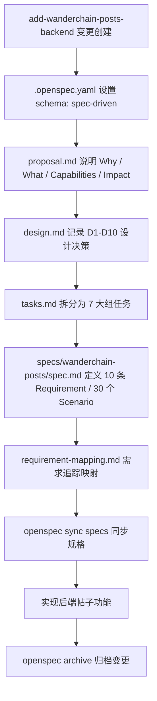

**图示来源**
- [openspec/changes/archive/2026-10-30-add-wanderchain-posts-backend/.openspec.yaml:1-3](file://openspec/changes/archive/2026-10-30-add-wanderchain-posts-backend/.openspec.yaml#L1-L3)
- [openspec/changes/archive/2026-10-30-add-wanderchain-posts-backend/proposal.md:1-39](file://openspec/changes/archive/2026-10-30-add-wanderchain-posts-backend/proposal.md#L1-L39)
- [openspec/changes/archive/2026-10-30-add-wanderchain-posts-backend/design.md:1-224](file://openspec/changes/archive/2026-10-30-add-wanderchain-posts-backend/design.md#L1-L224)
- [openspec/changes/archive/2026-10-30-add-wanderchain-posts-backend/tasks.md:1-57](file://openspec/changes/archive/2026-10-30-add-wanderchain-posts-backend/tasks.md#L1-L57)
- [openspec/changes/archive/2026-10-30-add-wanderchain-posts-backend/specs/wanderchain-posts/spec.md:1-198](file://openspec/changes/archive/2026-10-30-add-wanderchain-posts-backend/specs/wanderchain-posts/spec.md#L1-L198)
- [openspec/changes/archive/2026-10-30-add-wanderchain-posts-backend/requirement-mapping.md:1-53](file://openspec/changes/archive/2026-10-30-add-wanderchain-posts-backend/requirement-mapping.md#L1-L53)

**章节来源**
- [openspec/changes/archive/2026-10-30-add-wanderchain-posts-backend/.openspec.yaml:1-3](file://openspec/changes/archive/2026-10-30-add-wanderchain-posts-backend/.openspec.yaml#L1-L3)
- [openspec/changes/archive/2026-10-30-add-wanderchain-posts-backend/proposal.md:1-39](file://openspec/changes/archive/2026-10-30-add-wanderchain-posts-backend/proposal.md#L1-L39)
- [openspec/changes/archive/2026-10-30-add-wanderchain-posts-backend/design.md:1-224](file://openspec/changes/archive/2026-10-30-add-wanderchain-posts-backend/design.md#L1-L224)
- [openspec/changes/archive/2026-10-30-add-wanderchain-posts-backend/tasks.md:1-57](file://openspec/changes/archive/2026-10-30-add-wanderchain-posts-backend/tasks.md#L1-L57)
- [openspec/changes/archive/2026-10-30-add-wanderchain-posts-backend/specs/wanderchain-posts/spec.md:1-198](file://openspec/changes/archive/2026-10-30-add-wanderchain-posts-backend/specs/wanderchain-posts/spec.md#L1-L198)
- [openspec/changes/archive/2026-10-30-add-wanderchain-posts-backend/requirement-mapping.md:1-53](file://openspec/changes/archive/2026-10-30-add-wanderchain-posts-backend/requirement-mapping.md#L1-L53)

### 规格存储位置与差异规格
- 主规格位于 `openspec/specs/<capability-path>/spec.md`。
- 差异规格位于变更目录下的 `openspec/changes/<name>/specs/<capability-path>/spec.md`。
- 差异规格使用 `ADDED Requirements`、`MODIFIED Requirements`、`REMOVED Requirements`、`RENAMED Requirements` 等章节描述变更意图。
- 通过 `openspec sync specs` 或归档流程，差异规格会被智能合并到主规格中。
- 如果变更声明 `skip_specs: true`，则不期望存在 delta spec，也不会触发主规格同步逻辑。

`extract-home-hero` 的 delta spec 仅包含 `ADDED Requirements`，新增"首页主视觉" Requirement，并在归档后出现在 `openspec/specs/wanderchain-homepage/spec.md` 末尾；`close-frontend-test-gaps` 与 `fix-doc-drift` 都通过 `skip_specs: true` 明确表示本轮不修改主规格，前者补齐测试与文档，后者修复人读文档漂移；`add-wanderchain-posts-backend` 的 delta spec 包含完整的 10 条 Requirement 和 30 个 Scenario，定义了帖子功能的业务规则、安全边界和交互场景，并在归档后同步到 `openspec/specs/wanderchain-posts/spec.md`；`add-wanderchain-auth-frontend` 作为新的活跃变更，正在建立认证前端的规格定义。

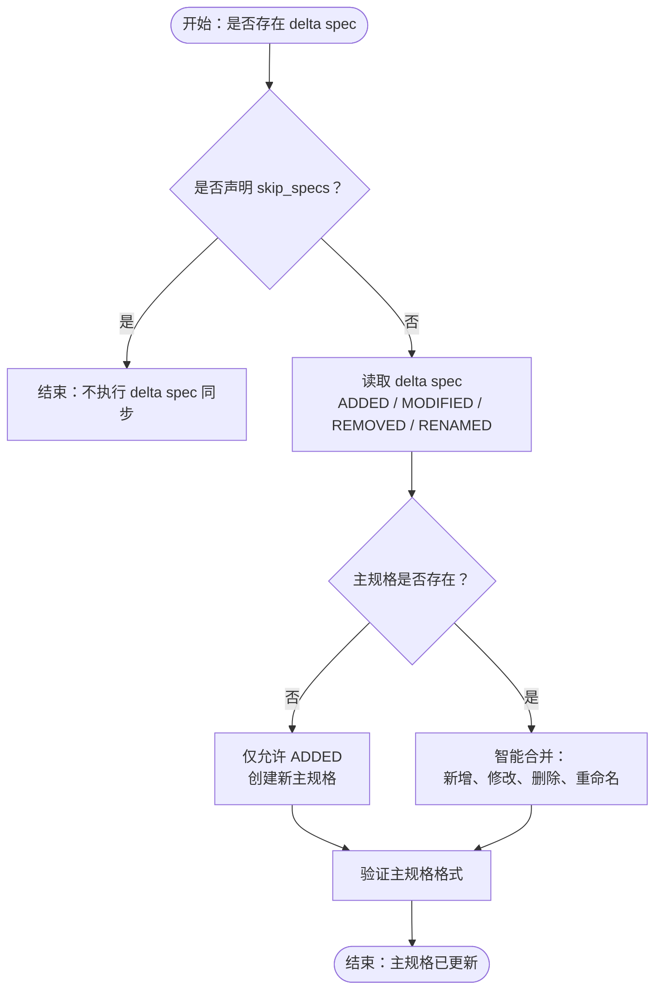

**图示来源**
- [.agents/skills/openspec-sync-specs/SKILL.md:78-177](file://.agents/skills/openspec-sync-specs/SKILL.md#L78-L177)
- [openspec/changes/archive/2026-10-27-close-frontend-test-gaps/.openspec.yaml:1-4](file://openspec/changes/archive/2026-10-27-close-frontend-test-gaps/.openspec.yaml#L1-L4)
- [openspec/changes/archive/2026-10-29-fix-doc-drift/.openspec.yaml:1-4](file://openspec/changes/archive/2026-10-29-fix-doc-drift/.openspec.yaml#L1-L4)
- [openspec/changes/archive/2026-10-30-add-wanderchain-posts-backend/specs/wanderchain-posts/spec.md:1-198](file://openspec/changes/archive/2026-10-30-add-wanderchain-posts-backend/specs/wanderchain-posts/spec.md#L1-L198)

**章节来源**
- [.agents/skills/openspec-sync-specs/SKILL.md:78-177](file://.agents/skills/openspec-sync-specs/SKILL.md#L78-L177)

### 变更提案：创建、审阅与归档
变更提案的生命周期包括：
1. **创建变更**：使用 `openspec new change "<name>"`，CLI 会生成 `.openspec.yaml` 与工件骨架。
2. **查看状态**：使用 `openspec status --change "<name>" --json` 查看工件依赖图、`applyRequires`、`planningHome`、`changeRoot`、`artifactPaths` 等。
3. **获取工件指令**：使用 `openspec instructions <artifact-id> --change "<name>" --json` 获取模板、规则、输出路径与依赖。
4. **编写工件**：按 schema 要求编写 `proposal.md`、`design.md`、`tasks.md`、`specs/<capability-path>/spec.md`；若不需要 delta spec，可在 `.openspec.yaml` 中设置 `skip_specs: true`。
5. **同步规格**：使用 `openspec sync specs --change "<name>"` 将 delta spec 合并到主规格；若 `skip_specs: true`，则跳过该步骤。
6. **实现任务**：通过 skill 驱动的 apply 流程逐步完成 tasks。
7. **归档变更**：使用 `openspec archive --change "<name>"`，归档目录名遵循 `YYYY-MM-DD-<change-name>` 规则。

`extract-home-hero`、`close-frontend-test-gaps`、`fix-doc-drift` 与 `add-wanderchain-posts-backend` 的 `tasks.md` 都展示了完整的任务拆解与验收步骤：前者侧重组件抽取与 delta spec 同步，后者侧重测试补齐、文档对齐与闸门验证，`fix-doc-drift` 则侧重 README 与 AGENTS 文档的人读一致性，`add-wanderchain-posts-backend` 展示了完整的业务功能开发流程，包括 7 大组任务、10 条 Requirement 和 30 个 Scenario 的全面覆盖。`add-wanderchain-auth-frontend` 作为新的活跃变更，正在建立认证前端的完整工件结构。

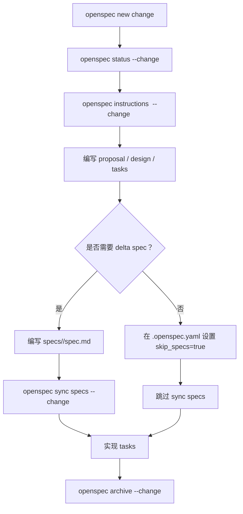

**图示来源**
- [.agents/skills/openspec-propose/SKILL.md:77-137](file://.agents/skills/openspec-propose/SKILL.md#L77-L137)
- [.agents/skills/openspec-sync-specs/SKILL.md:47-177](file://.agents/skills/openspec-sync-specs/SKILL.md#L47-L177)
- [.agents/skills/openspec-archive-change/SKILL.md:169-184](file://.agents/skills/openspec-archive-change/SKILL.md#L169-L184)
- [openspec/changes/archive/2026-10-27-close-frontend-test-gaps/.openspec.yaml:1-4](file://openspec/changes/archive/2026-10-27-close-frontend-test-gaps/.openspec.yaml#L1-L4)
- [openspec/changes/archive/2026-10-29-fix-doc-drift/.openspec.yaml:1-4](file://openspec/changes/archive/2026-10-29-fix-doc-drift/.openspec.yaml#L1-L4)
- [openspec/changes/archive/2026-10-30-add-wanderchain-posts-backend/tasks.md:1-57](file://openspec/changes/archive/2026-10-30-add-wanderchain-posts-backend/tasks.md#L1-L57)

**章节来源**
- [.agents/skills/openspec-propose/SKILL.md:77-137](file://.agents/skills/openspec-propose/SKILL.md#L77-L137)
- [.agents/skills/openspec-apply-change/SKILL.md:41-129](file://.agents/skills/openspec-apply-change/SKILL.md#L41-L129)
- [.agents/skills/openspec-archive-change/SKILL.md:169-184](file://.agents/skills/openspec-archive-change/SKILL.md#L169-L184)

### 规格同步：delta spec 到 main spec
`openspec sync specs` 的核心逻辑是：
- 从 `openspec status --change "<name>" --json` 的 `artifactPaths.specs.existingOutputPaths` 中读取 delta spec。
- 根据 delta spec 的章节内容，智能合并到 `openspec/specs/<capability-path>/spec.md`。
- 如果主规格不存在，则只允许应用 ADDED requirements，并创建新的主规格。
- 如果 delta 只包含 REMOVED requirements，且变更未声明 `retire_capabilities: true`，则归档时会报错；若已声明，则可视为已退休。
- 同步后需验证主规格格式，确保没有残留 delta 专用章节头。
- 如果变更声明 `skip_specs: true`，则不应存在 delta spec，同步流程应被跳过。

`extract-home-hero` 的 delta spec 仅新增"首页主视觉"，因此同步后主规格末尾追加了该 Requirement 与对应 Scenario；`close-frontend-test-gaps` 与 `fix-doc-drift` 因 `skip_specs: true`，本轮不修改主规格，前者通过单元测试与文档闸门保证实现质量，后者通过 `README.md` 与 `AGENTS.md` 的措辞对齐保证人读一致性；`add-wanderchain-posts-backend` 的 delta spec 包含完整的 10 条 Requirement 和 30 个 Scenario，定义了帖子功能的业务规则、安全边界和交互场景，同步后成为 `openspec/specs/wanderchain-posts/spec.md` 的主规格；`add-wanderchain-auth-frontend` 作为新的活跃变更，正在建立认证前端的规格定义。

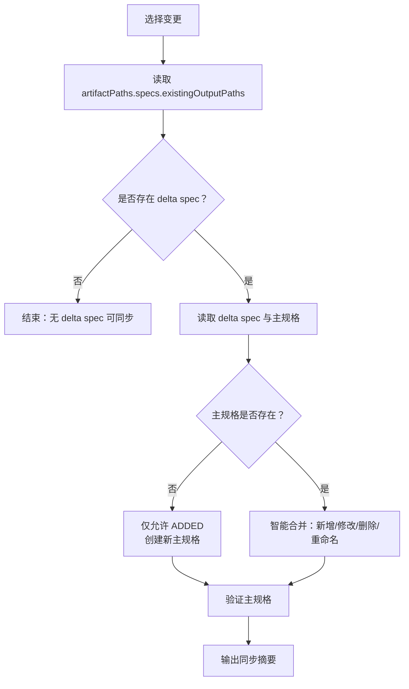

**图示来源**
- [.agents/skills/openspec-sync-specs/SKILL.md:47-177](file://.agents/skills/openspec-sync-specs/SKILL.md#L47-L177)

**章节来源**
- [.agents/skills/openspec-sync-specs/SKILL.md:47-177](file://.agents/skills/openspec-sync-specs/SKILL.md#L47-L177)

### 实现流程：apply 与任务跟踪
apply 流程由 skill 驱动，核心步骤包括：
- 选择变更。
- 通过 `openspec status --change "<name>" --json` 了解 schema、规划根、工件路径。
- 通过 `openspec instructions apply --change "<name>" --json` 获取 contextFiles、任务列表、动态指令。
- 按任务顺序实现代码，并在 tasks 中标记 `- [ ]` 为 `- [x]`。
- 遇到阻塞、歧义或超出规格范围的需求时暂停，建议更新工件。

`extract-home-hero` 的 tasks 明确区分了"组件与样式落位""页面接线与清理""测试""规格与文档同步""验收"五个阶段；`close-frontend-test-gaps` 的 tasks 则按 P0 系统性盲区、P1 测试遗漏、P2 断言强度、文档漂移与断点闸门、验收五类展开，其中测试阶段特别强调用注入数据集验证排序与截断、用 React 错误边界验证 SectionBoundary、用 `URLSearchParams` 解析 URL 参数，并通过 `harness/run-all.ps1` 完成全量闸门验收；`fix-doc-drift` 的 tasks 则按 README 对齐、AGENTS 目录树补全与闸门验收展开，特别强调 `07-doc-consistency` 对 `<!-- harness-checks: ... -->` 标记行的逐字节保护；`add-wanderchain-posts-backend` 的 tasks 展示了完整的业务功能开发流程，包括 7 大组任务：基线取证与表结构、公共基类型与实体、拦截器口径改造（波及已归档能力，独立成组）、服务层、Web 层与 DTO、契约闸门与前端契约文件、集成验收，特别强调第 3 组是唯一会波及已归档能力的改动，必须独立成组并单列基线比对。`add-wanderchain-auth-frontend` 作为新的活跃变更，正在建立认证前端的完整实现流程。

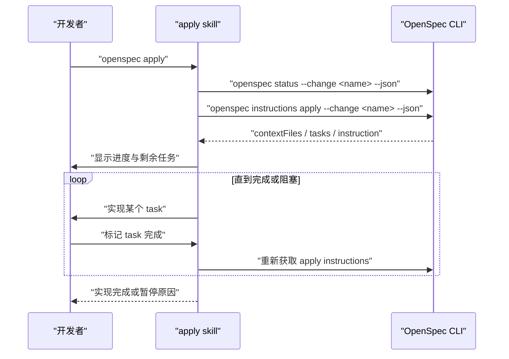

**图示来源**
- [.agents/skills/openspec-apply-change/SKILL.md:41-129](file://.agents/skills/openspec-apply-change/SKILL.md#L41-L129)

**章节来源**
- [.agents/skills/openspec-apply-change/SKILL.md:41-129](file://.agents/skills/openspec-apply-change/SKILL.md#L41-L129)

### 归档流程：archive 与规格一致性检查
归档流程不仅移动变更目录，还会评估 delta spec 是否已同步到主规格：
- 检查工件完成状态。
- 检查任务完成状态。
- 评估 delta spec 与主规格的同步状态。
- 可选择先同步再归档，或直接归档。
- 归档目标目录为 `openspec/changes/archive/YYYY-MM-DD-<change-name>`。

`extract-home-hero` 归档后的目录名为 `2026-10-27-extract-home-hero`，符合日期前缀命名规范；`close-frontend-test-gaps` 归档后的目录名为 `2026-10-27-close-frontend-test-gaps`，同样符合命名规范，且因 `skip_specs: true`，归档时不依赖 delta spec 同步结果；`fix-doc-drift` 归档后的目录名为 `2026-10-29-fix-doc-drift`，同样遵循 `YYYY-MM-DD-<change-name>` 命名约定，并且因 `skip_specs: true`，归档流程直接跳过 delta spec 同步，转而依赖 `07-doc-consistency` 等闸门验证文档一致性；`add-wanderchain-posts-backend` 归档后的目录名为 `2026-10-30-add-wanderchain-posts-backend`，展示了完整的业务功能归档流程，包括 requirement-mapping.md 的需求追踪和 comprehensive spec documentation 的完整性验证。`add-wanderchain-auth-frontend` 作为新的活跃变更，尚未进入归档阶段。

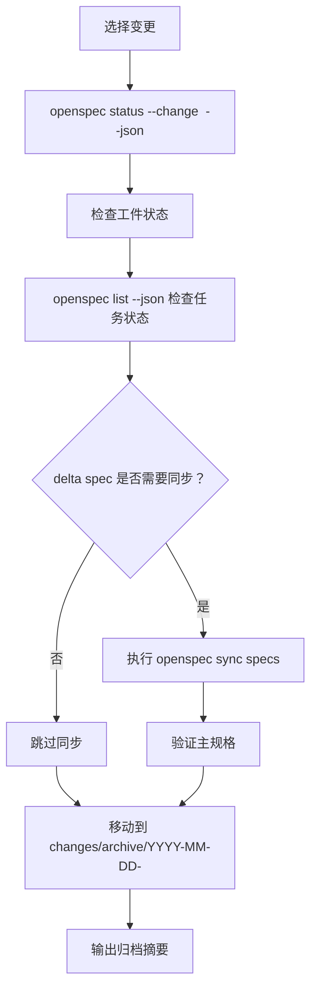

**图示来源**
- [.agents/skills/openspec-archive-change/SKILL.md:73-184](file://.agents/skills/openspec-archive-change/SKILL.md#L73-L184)

**章节来源**
- [.agents/skills/openspec-archive-change/SKILL.md:73-184](file://.agents/skills/openspec-archive-change/SKILL.md#L73-L184)

## 依赖关系分析
OpenSpec 在本仓库中的依赖关系可以概括为：
- `openspec/config.yaml` 决定工作流 schema 与上下文约束。
- `.openspec.yaml` 描述单个变更的元数据，包括是否跳过 delta spec。
- `proposal.md`、`design.md`、`tasks.md`、`specs/<capability>/spec.md` 构成变更工件集合。
- `openspec/specs/<capability>/spec.md` 是主规格，由 delta spec 同步而来。
- Agent Skill 文档定义了 CLI 命令的标准调用顺序与错误处理策略。

`extract-home-hero` 体现了"规格先行、实现跟进、归档固化"的依赖链：delta spec 定义"首页主视觉"契约，`tasks.md` 驱动前端组件与样式迁移，`frontend/app/page.tsx` 消费 `HomeHero` 组件，最终归档变更并保留主规格作为真相层。`close-frontend-test-gaps` 则体现了"测试与文档对齐优先"的依赖链：`design.md` 明确不引入真实浏览器测试基建、不为布局伪断言，`tasks.md` 驱动 `use-section-data.test.ts`、`section-boundary.test.tsx`、`repository.sorting.test.ts` 等测试落地，并通过 `harness/checks/08-spec-doc-breakpoints.ps1` 锁定文档与 CSS 断点的一致性。`fix-doc-drift` 体现了"人读文档对齐优先"的依赖链：`proposal.md` 指出 README 与 AGENTS 的漂移后果，`design.md` 明确凭据分组、设计取舍改写与目录树职责写法，`tasks.md` 驱动 README 与 AGENTS 修改，并以 `07-doc-consistency` 作为主要验收闸门。`add-wanderchain-posts-backend` 体现了"完整业务功能开发"的依赖链：`proposal.md` 说明认证能力已就绪但帖子功能缺失的背景，`design.md` 记录 D1-D10 的设计决策，`tasks.md` 按 7 大组任务推进实现，`specs/wanderchain-posts/spec.md` 定义 10 条 Requirement 和 30 个 Scenario，`requirement-mapping.md` 建立需求与测试的精确映射，最终归档变更并保留主规格作为真相层。`add-wanderchain-auth-frontend` 作为新的活跃变更，正在建立认证前后端分离的依赖关系，与后端的 `add-wanderchain-auth` 变更形成完整的功能闭环。

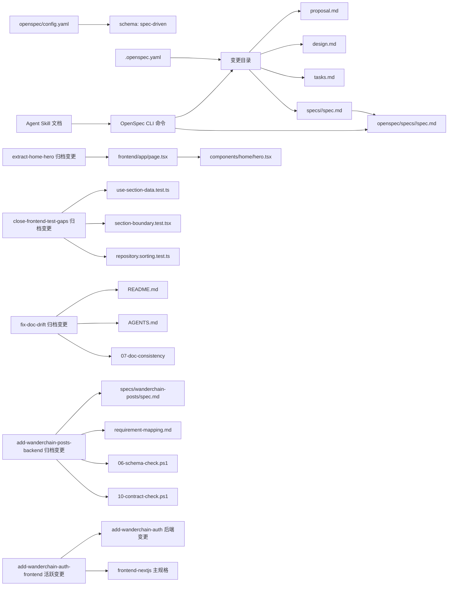

**图示来源**
- [openspec/config.yaml:1-29](file://openspec/config.yaml#L1-L29)
- [openspec/changes/add-wanderchain-auth-frontend/.openspec.yaml:1-3](file://openspec/changes/add-wanderchain-auth-frontend/.openspec.yaml#L1-L3)
- [openspec/changes/add-wanderchain-auth/.openspec.yaml:1-3](file://openspec/changes/add-wanderchain-auth/.openspec.yaml#L1-L3)
- [openspec/changes/archive/2026-10-27-extract-home-hero/tasks.md:1-37](file://openspec/changes/archive/2026-10-27-extract-home-hero/tasks.md#L1-L37)
- [openspec/changes/archive/2026-10-27-close-frontend-test-gaps/tasks.md:1-46](file://openspec/changes/archive/2026-10-27-close-frontend-test-gaps/tasks.md#L1-L46)
- [openspec/changes/archive/2026-10-29-fix-doc-drift/tasks.md:1-26](file://openspec/changes/archive/2026-10-29-fix-doc-drift/tasks.md#L1-L26)
- [openspec/changes/archive/2026-10-30-add-wanderchain-posts-backend/tasks.md:1-57](file://openspec/changes/archive/2026-10-30-add-wanderchain-posts-backend/tasks.md#L1-L57)
- [openspec/changes/archive/2026-10-30-add-wanderchain-posts-backend/specs/wanderchain-posts/spec.md:1-198](file://openspec/changes/archive/2026-10-30-add-wanderchain-posts-backend/specs/wanderchain-posts/spec.md#L1-L198)
- [openspec/changes/archive/2026-10-30-add-wanderchain-posts-backend/requirement-mapping.md:1-53](file://openspec/changes/archive/2026-10-30-add-wanderchain-posts-backend/requirement-mapping.md#L1-L53)
- [frontend/components/home/use-section-data.test.ts:1-114](file://frontend/components/home/use-section-data.test.ts#L1-L114)
- [frontend/components/home/section-boundary.test.tsx:1-69](file://frontend/components/home/section-boundary.test.tsx#L1-L69)
- [frontend/lib/home/repository.sorting.test.ts:1-169](file://frontend/lib/home/repository.sorting.test.ts#L1-L169)
- [.agents/skills/openspec-propose/SKILL.md:17-24](file://.agents/skills/openspec-propose/SKILL.md#L17-L24)
- [.agents/skills/openspec-sync-specs/SKILL.md:86-177](file://.agents/skills/openspec-sync-specs/SKILL.md#L86-L177)

**章节来源**
- [openspec/config.yaml:1-29](file://openspec/config.yaml#L1-L29)
- [openspec/changes/add-wanderchain-auth-frontend/.openspec.yaml:1-3](file://openspec/changes/add-wanderchain-auth-frontend/.openspec.yaml#L1-L3)
- [openspec/changes/add-wanderchain-auth/.openspec.yaml:1-3](file://openspec/changes/add-wanderchain-auth/.openspec.yaml#L1-L3)
- [openspec/changes/archive/2026-10-27-extract-home-hero/tasks.md:1-37](file://openspec/changes/archive/2026-10-27-extract-home-hero/tasks.md#L1-L37)
- [openspec/changes/archive/2026-10-27-close-frontend-test-gaps/tasks.md:1-46](file://openspec/changes/archive/2026-10-27-close-frontend-test-gaps/tasks.md#L1-L46)
- [openspec/changes/archive/2026-10-29-fix-doc-drift/tasks.md:1-26](file://openspec/changes/archive/2026-10-29-fix-doc-drift/tasks.md#L1-L26)
- [openspec/changes/archive/2026-10-30-add-wanderchain-posts-backend/tasks.md:1-57](file://openspec/changes/archive/2026-10-30-add-wanderchain-posts-backend/tasks.md#L1-L57)
- [openspec/changes/archive/2026-10-30-add-wanderchain-posts-backend/specs/wanderchain-posts/spec.md:1-198](file://openspec/changes/archive/2026-10-30-add-wanderchain-posts-backend/specs/wanderchain-posts/spec.md#L1-L198)
- [openspec/changes/archive/2026-10-30-add-wanderchain-posts-backend/requirement-mapping.md:1-53](file://openspec/changes/archive/2026-10-30-add-wanderchain-posts-backend/requirement-mapping.md#L1-L53)
- [frontend/components/home/use-section-data.test.ts:1-114](file://frontend/components/home/use-section-data.test.ts#L1-L114)
- [frontend/components/home/section-boundary.test.tsx:1-69](file://frontend/components/home/section-boundary.test.tsx#L1-L69)
- [frontend/lib/home/repository.sorting.test.ts:1-169](file://frontend/lib/home/repository.sorting.test.ts#L1-L169)
- [.agents/skills/openspec-propose/SKILL.md:17-24](file://.agents/skills/openspec-propose/SKILL.md#L17-L24)
- [.agents/skills/openspec-sync-specs/SKILL.md:86-177](file://.agents/skills/openspec-sync-specs/SKILL.md#L86-L177)

## 性能与可维护性建议
- **保持工件最小化**：只在必要时创建工件，避免重复描述同一需求。
- **优先使用 delta spec**：通过 delta spec 表达增量变更，减少主规格的大段重写；若确实不需要 delta spec，应在 `.openspec.yaml` 中显式设置 `skip_specs: true`。
- **及时同步主规格**：在归档前执行 `openspec sync specs`，确保主规格反映最新契约。
- **明确变更边界**：在 `proposal.md` 中清晰说明范围、不在范围项与假设。
- **任务可追踪**：在 `tasks.md` 中将大任务拆分为可独立完成的子任务，便于 apply 流程跟踪进度。
- **归档命名规范**：归档目录建议使用 `YYYY-MM-DD-<change-name>`，避免日期重复或命名冲突。
- **结构重构需证明视觉零变化**：参考 `extract-home-hero` 的 DOM 结构比对思路，在不改变用户可见行为的前提下降低回归风险。
- **测试补齐应避免代理断言**：参考 `close-frontend-test-gaps` 的 `repository.sorting.test.ts`，用注入数据集直接验证排序键、并列分支与字面上限，而不是依赖真实 Mock 数据的巧合顺序。
- **文档与实现保持一致**：参考 `close-frontend-test-gaps` 对 U3/U5/U7 响应式小节的改写，让单元文档描述实际 CSS 断点，并通过 `08-spec-doc-breakpoints.ps1` 强制配对。
- **文档漂移应尽早修复**：参考 `fix-doc-drift`，当 README 与 AGENTS 出现过时环境变量、过时业务示例或缺失目录层级时，应单独开变更对齐，而不是等到后续变更继续累积欠账。
- **业务功能变更需全面覆盖**：参考 `add-wanderchain-posts-backend`，完整的业务功能应包括 proposal、design、tasks、comprehensive spec documentation（定义业务规则、场景和安全边界）、requirement-mapping.md（需求追踪映射），以及完整的测试覆盖和闸门验证。
- **前后端分离变更**：参考 `add-wanderchain-auth-frontend` 与 `add-wanderchain-auth` 的模式，将前后端功能拆分为独立的变更，便于并行开发与独立部署。

[本节为通用建议，不直接分析具体文件]

## 故障排查指南
常见问题与处理方式：
- **找不到 OpenSpec 根目录**：运行 `openspec list --json`，如果返回 `"root": null`，说明当前目录不是 OpenSpec 项目根。可通过 `openspec init` 初始化，或通过 `--store <id>` 指向已注册的 store。
- **store 声明无法解析**：如果错误消息以 `Declared in` 或 `Invalid store declaration in` 开头，说明项目通过 store 声明了 OpenSpec，但当前机器未注册该 store。应先注册 store 或修正 `store:` 配置。
- **工件缺失导致阻塞**：使用 `openspec status --change "<name>" --json` 查看 `applyRequires` 与 `artifacts.requires`，然后按依赖顺序创建缺失工件。
- **delta spec 无法同步**：如果主规格不存在，只有 ADDED requirements 可被应用；如果 delta 只包含 REMOVED requirements，需要确认变更是否声明 `retire_capabilities: true`；如果变更声明 `skip_specs: true`，则不应尝试同步 delta spec。
- **归档时报错**：检查工件是否全部完成、任务是否全部勾选、delta spec 是否已同步到主规格。
- **归档后仍看到活跃变更**：确认变更目录是否已从 `openspec/changes/<name>` 移动到 `openspec/changes/archive/YYYY-MM-DD-<name>`；`extract-home-hero` 已归档至 `2026-10-27-extract-home-hero`，`close-frontend-test-gaps` 已归档至 `2026-10-27-close-frontend-test-gaps`，`fix-doc-drift` 已归档至 `2026-10-29-fix-doc-drift`，`add-wanderchain-posts-backend` 已归档至 `2026-10-30-add-wanderchain-posts-backend`，而 `add-wanderchain-auth-frontend` 仍为活跃变更。
- **文档类变更误伤闸门清单**：参考 `fix-doc-drift`，修改 `AGENTS.md` 时应特别注意 `<!-- harness-checks: ... -->` 标记行必须逐字节不动，否则 `07-doc-consistency` 会直接退出码 1；建议在 tasks 中单独复跑该闸门取证。
- **业务功能变更遗漏需求覆盖**：参考 `add-wanderchain-posts-backend` 的 requirement-mapping.md，确保每条 Requirement 和 Scenario 都有具体的测试或闸门覆盖，避免"仅口头覆盖"的情况。
- **拦截器改造影响既有功能**：参考 `add-wanderchain-posts-backend` 的第 3 组任务，当修改认证拦截器时，必须先跑基线测试，再改注册口径，最后跑全量测试并与基线逐条比对，确保既有端点的公开/受保护归属保持不变。

**章节来源**
- [.agents/skills/openspec-explore/SKILL.md:19-30](file://.agents/skills/openspec-explore/SKILL.md#L19-L30)
- [.agents/skills/openspec-apply-change/SKILL.md:15-26](file://.agents/skills/openspec-apply-change/SKILL.md#L15-L26)
- [.agents/skills/openspec-archive-change/SKILL.md:15-26](file://.agents/skills/openspec-archive-change/SKILL.md#L15-L26)
- [.agents/skills/openspec-sync-specs/SKILL.md:108-171](file://.agents/skills/openspec-sync-specs/SKILL.md#L108-L171)
- [openspec/changes/archive/2026-10-29-fix-doc-drift/tasks.md:19-25](file://openspec/changes/archive/2026-10-29-fix-doc-drift/tasks.md#L19-L25)
- [openspec/changes/archive/2026-10-30-add-wanderchain-posts-backend/requirement-mapping.md:1-53](file://openspec/changes/archive/2026-10-30-add-wanderchain-posts-backend/requirement-mapping.md#L1-L53)
- [openspec/changes/archive/2026-10-30-add-wanderchain-posts-backend/tasks.md:20-25](file://openspec/changes/archive/2026-10-30-add-wanderchain-posts-backend/tasks.md#L20-L25)

## 结论
OpenSpec 在本仓库中以 `spec-driven` 工作流为核心，通过 `openspec/config.yaml` 与 `.openspec.yaml` 管理项目与变更配置，通过 `openspec/changes` 与 `openspec/specs` 管理变更工件与主规格，并通过 Agent Skill 文档标准化 CLI 调用流程。`extract-home-hero` 展示了从提案、设计、任务拆解、delta spec 同步到归档的完整闭环，同时体现了"规格先行、实现跟进、归档固化"的最佳实践；`close-frontend-test-gaps` 则展示了另一种常见场景：外部行为不变，但通过 mock 数据源、SectionBoundary 错误边界验证与 desktop-first 断点策略补齐测试与文档缺口，并以 `skip_specs: true` 明确本轮不修改主规格；`fix-doc-drift` 进一步展示了第三类常见场景：仅修改人读文档、不引入新能力、不产生 delta spec，而是通过 `README.md` 与 `AGENTS.md` 的对齐以及 `07-doc-consistency` 闸门验收完成归档；`add-wanderchain-posts-backend` 展示了第四类常见场景：完整的业务功能开发，包括 196 行的 comprehensive spec documentation 定义业务规则、场景和安全边界，requirement-mapping.md 建立需求与测试的精确映射，7 大组任务覆盖从基线取证到集成验收的完整流程，最终通过 `06-schema-check.ps1`、`10-contract-check.ps1` 等闸门验证实现质量；`add-wanderchain-auth-frontend` 作为新的活跃变更，展示了现代前后端分离架构下认证功能的规范化开发流程，与后端的 `add-wanderchain-auth` 变更形成完整的功能闭环。推荐开发者按照"创建变更 → 编写工件 → 同步规格（如需要）→ 实现任务 → 归档变更"的顺序开展工作，以保持规格、实现与人读文档的持续一致。

[本节为总结性内容，不直接分析具体文件]

## 附录：常用命令与配置模板

### 常用 CLI 命令
- 初始化项目：`openspec init`
- 创建变更：`openspec new change "<name>"`
- 查看变更状态：`openspec status --change "<name>" --json`
- 获取工件指令：`openspec instructions <artifact-id> --change "<name>" --json`
- 列出变更与规格：`openspec list --json`、`openspec list --specs --json`
- 查看规格详情：`openspec show "<spec-id>" --type spec --json --no-scenarios`
- 同步规格：`openspec sync specs --change "<name>"`
- 归档变更：`openspec archive --change "<name>"`
- 验证规格：`openspec validate --specs`

**章节来源**
- [.agents/skills/openspec-explore/SKILL.md:125-141](file://.agents/skills/openspec-explore/SKILL.md#L125-L141)
- [.agents/skills/openspec-propose/SKILL.md:77-137](file://.agents/skills/openspec-propose/SKILL.md#L77-L137)
- [.agents/skills/openspec-sync-specs/SKILL.md:178-181](file://.agents/skills/openspec-sync-specs/SKILL.md#L178-L181)

### 配置文件模板参考
- 项目配置：`openspec/config.yaml`
  - 关键字段：`schema`、`context`、可选 `rules`、可选 `operations`
- 变更元数据：`.openspec.yaml`
  - 关键字段：`schema`、`created`
  - 可选字段：`skip_specs`、`retire_capabilities`
- 活跃变更示例：
  - `openspec/changes/add-wanderchain-auth-frontend/.openspec.yaml`：体现新的认证前端活跃变更元数据形态。
  - `openspec/changes/add-wanderchain-auth/.openspec.yaml`：体现后端认证功能活跃变更元数据形态。
- 归档变更示例：
  - `openspec/changes/archive/2026-10-27-extract-home-hero/.openspec.yaml`：体现带 delta spec 的归档变更元数据形态。
  - `openspec/changes/archive/2026-10-27-close-frontend-test-gaps/.openspec.yaml`：体现 `skip_specs: true` 的归档变更元数据形态，可用于对比不同变更类型在 `.openspec.yaml` 上的差异。
  - `openspec/changes/archive/2026-10-29-fix-doc-drift/.openspec.yaml`：体现仅修改人读文档、不产生 delta spec 的归档变更元数据形态，适合参考文档类变更的配置写法。
  - `openspec/changes/archive/2026-10-30-add-wanderchain-posts-backend/.openspec.yaml`：体现完整业务功能归档变更元数据形态，展示了标准的 spec-driven 工作流配置。

**章节来源**
- [openspec/config.yaml:1-29](file://openspec/config.yaml#L1-L29)
- [openspec/changes/add-wanderchain-auth-frontend/.openspec.yaml:1-3](file://openspec/changes/add-wanderchain-auth-frontend/.openspec.yaml#L1-L3)
- [openspec/changes/add-wanderchain-auth/.openspec.yaml:1-3](file://openspec/changes/add-wanderchain-auth/.openspec.yaml#L1-L3)
- [openspec/changes/archive/2026-10-27-extract-home-hero/.openspec.yaml:1-3](file://openspec/changes/archive/2026-10-27-extract-home-hero/.openspec.yaml#L1-L3)
- [openspec/changes/archive/2026-10-27-close-frontend-test-gaps/.openspec.yaml:1-4](file://openspec/changes/archive/2026-10-27-close-frontend-test-gaps/.openspec.yaml#L1-L4)
- [openspec/changes/archive/2026-10-29-fix-doc-drift/.openspec.yaml:1-4](file://openspec/changes/archive/2026-10-29-fix-doc-drift/.openspec.yaml#L1-L4)
- [openspec/changes/archive/2026-10-30-add-wanderchain-posts-backend/.openspec.yaml:1-3](file://openspec/changes/archive/2026-10-30-add-wanderchain-posts-backend/.openspec.yaml#L1-L3)