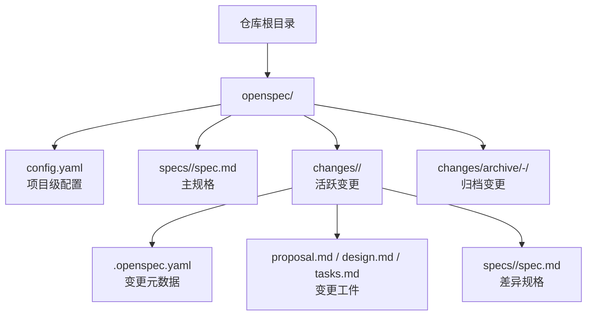
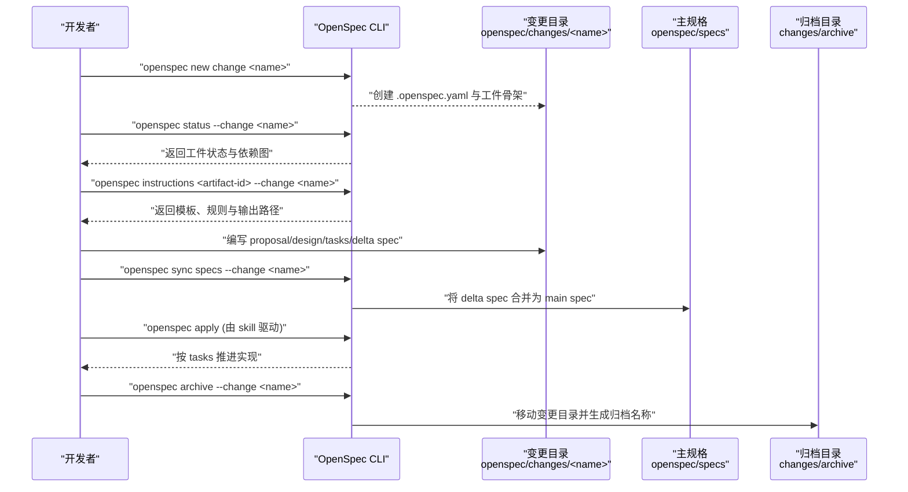
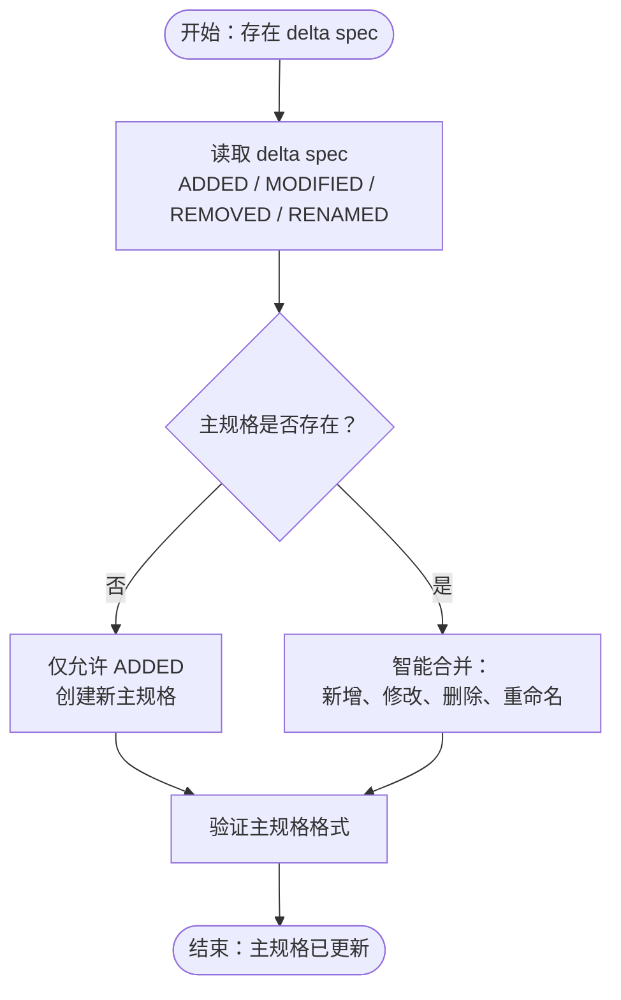
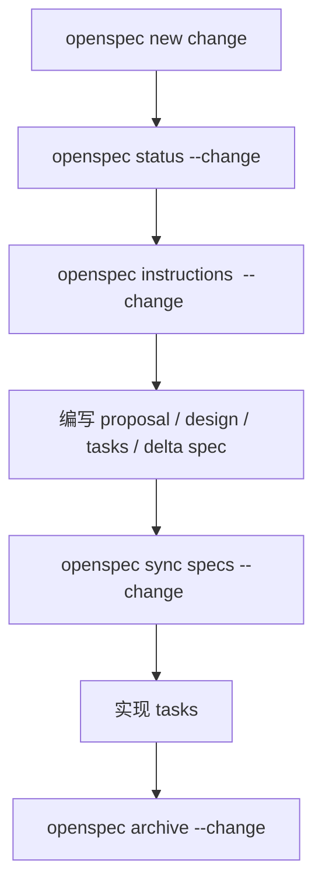
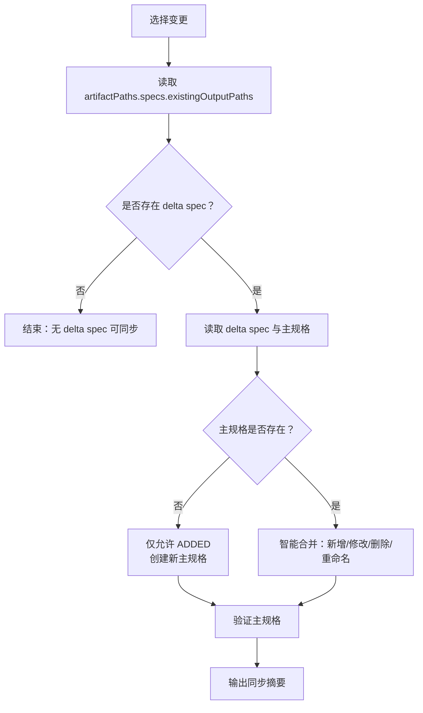
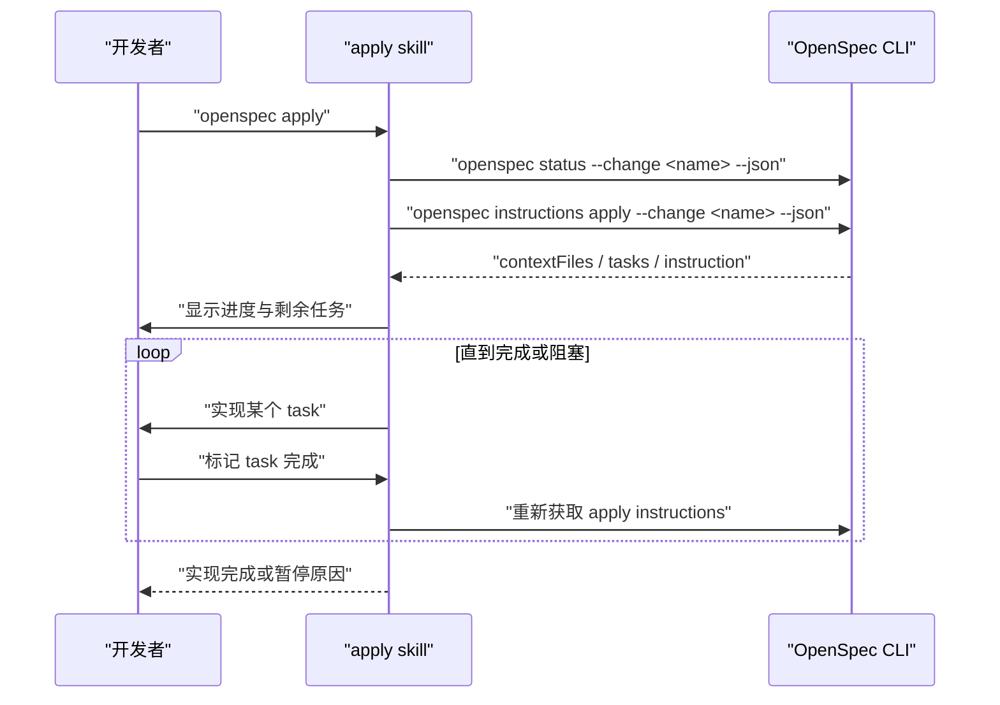
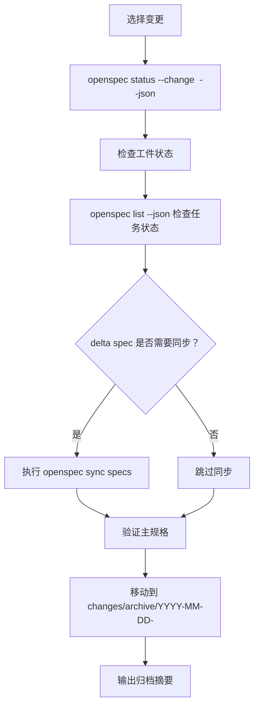
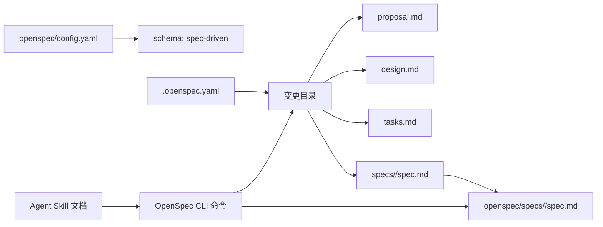

# OpenSpec 工具使用

<cite>
**本文引用的文件**   
- [openspec/config.yaml](file://openspec/config.yaml)
- [openspec/changes/add-db-baseline-and-flyway-gate/.openspec.yaml](file://openspec/changes/add-db-baseline-and-flyway-gate/.openspec.yaml)
- [openspec/changes/archive/2026-10-24-add-frontend-template/.openspec.yaml](file://openspec/changes/archive/2026-10-24-add-frontend-template/.openspec.yaml)
- [.agents/skills/openspec-propose/SKILL.md](file://.agents/skills/openspec-propose/SKILL.md)
- [.agents/skills/openspec-explore/SKILL.md](file://.agents/skills/openspec-explore/SKILL.md)
- [.agents/skills/openspec-apply-change/SKILL.md](file://.agents/skills/openspec-apply-change/SKILL.md)
- [.agents/skills/openspec-archive-change/SKILL.md](file://.agents/skills/openspec-archive-change/SKILL.md)
- [.agents/skills/openspec-sync-specs/SKILL.md](file://.agents/skills/openspec-sync-specs/SKILL.md)
</cite>

## 目录
1. [引言](#引言)
2. [项目结构](#项目结构)
3. [核心组件](#核心组件)
4. [架构总览](#架构总览)
5. [详细组件分析](#详细组件分析)
6. [依赖关系分析](#依赖关系分析)
7. [性能与可维护性建议](#性能与可维护性建议)
8. [故障排查指南](#故障排查指南)
9. [结论](#结论)
10. [附录：常用命令与配置模板](#附录常用命令与配置模板)

## 引言
本指南面向希望在本仓库中使用 OpenSpec 进行“规格驱动”开发的开发者。OpenSpec 通过 `openspec/` 目录组织变更提案、规格说明和归档记录，配合 CLI 完成从立项、审阅、实现到归档的全流程管理。仓库中已包含一个基于 `spec-driven` 工作流的项目示例，以及一套 Agent Skill 文档，用于指导如何调用 OpenSpec CLI 完成提议、探索、实现、同步和归档等操作。

## 项目结构
仓库中与 OpenSpec 直接相关的根级目录是 `openspec/`，其典型子目录如下：
- `openspec/config.yaml`：项目级 OpenSpec 配置，声明工作流 schema、上下文语言与规则提示等。
- `openspec/specs/`：主规格（main specs）存放位置，按能力路径组织，例如 `workspace-layout`、`workspace-scaffold`、`skill-distribution`、`frontend-nextjs`。
- `openspec/changes/`：活跃变更目录，每个变更是一个以短横线命名的小目录，内部包含 `.openspec.yaml`、`proposal.md`、`design.md`、`tasks.md` 以及 `specs/<capability-path>/spec.md` 等工件。
- `openspec/changes/archive/`：已归档变更目录，通常以 `YYYY-MM-DD-<change-name>` 形式命名。

**图示来源**
- [openspec/config.yaml:1-29](file://openspec/config.yaml#L1-L29)
- [.agents/skills/openspec-propose/SKILL.md:17-24](file://.agents/skills/openspec-propose/SKILL.md#L17-L24)
- [.agents/skills/openspec-archive-change/SKILL.md:176-184](file://.agents/skills/openspec-archive-change/SKILL.md#L176-L184)

**章节来源**
- [openspec/config.yaml:1-29](file://openspec/config.yaml#L1-L29)
- [.agents/skills/openspec-propose/SKILL.md:17-24](file://.agents/skills/openspec-propose/SKILL.md#L17-L24)
- [.agents/skills/openspec-archive-change/SKILL.md:176-184](file://.agents/skills/openspec-archive-change/SKILL.md#L176-L184)

## 核心组件
OpenSpec 在本仓库中的核心组件包括：
- **项目配置**：`openspec/config.yaml` 定义 schema、上下文语言、可选的工件规则与操作建议。
- **变更工件**：每个变更目录下的 `.openspec.yaml`、`proposal.md`、`design.md`、`tasks.md`，以及 `specs/<capability-path>/spec.md`。
- **主规格**：`openspec/specs/<capability-path>/spec.md`，由差异规格合并而来，描述系统应满足的能力契约。
- **CLI 工作流**：通过 `openspec new change`、`openspec status`、`openspec instructions`、`openspec list`、`openspec show`、`openspec validate`、`openspec sync specs`、`openspec archive` 等命令串联。
- **Agent Skill 指引**：`.agents/skills/openspec-*` 提供标准化的命令行操作流程，帮助开发者或 AI 助手正确调用 OpenSpec。

**章节来源**
- [openspec/config.yaml:1-29](file://openspec/config.yaml#L1-L29)
- [.agents/skills/openspec-propose/SKILL.md:17-24](file://.agents/skills/openspec-propose/SKILL.md#L17-L24)
- [.agents/skills/openspec-apply-change/SKILL.md:41-63](file://.agents/skills/openspec-apply-change/SKILL.md#L41-L63)
- [.agents/skills/openspec-archive-change/SKILL.md:73-100](file://.agents/skills/openspec-archive-change/SKILL.md#L73-L100)
- [.agents/skills/openspec-sync-specs/SKILL.md:86-177](file://.agents/skills/openspec-sync-specs/SKILL.md#L86-L177)

## 架构总览
下图展示 OpenSpec 在仓库中的整体协作关系：开发者通过 CLI 创建变更、编写工件；CLI 根据 schema 生成并校验工件；差异规格可以同步到主规格；实现完成后归档变更。

**图示来源**
- [.agents/skills/openspec-propose/SKILL.md:77-137](file://.agents/skills/openspec-propose/SKILL.md#L77-L137)
- [.agents/skills/openspec-sync-specs/SKILL.md:47-177](file://.agents/skills/openspec-sync-specs/SKILL.md#L47-L177)
- [.agents/skills/openspec-apply-change/SKILL.md:41-129](file://.agents/skills/openspec-apply-change/SKILL.md#L41-L129)
- [.agents/skills/openspec-archive-change/SKILL.md:169-184](file://.agents/skills/openspec-archive-change/SKILL.md#L169-L184)

## 详细组件分析

### 项目配置：`openspec/config.yaml`
该文件是 OpenSpec 在项目级的入口配置，当前仓库中的关键内容包括：
- `schema: spec-driven`：指定使用“规格驱动”工作流。
- `context`：声明语言与约束，例如要求所有工件使用中文，但保留 OpenSpec 的结构标题与 SHALL/MUST 关键词为英文。
- 可选的 `rules` 与 `operations`：用于对特定工件或 apply/archive 操作给出指导性建议。

实际使用中，你可以：
- 修改 `context` 来统一团队的语言风格与写作约束。
- 添加 `rules.proposal`、`rules.tasks` 等条目，限制提案长度、任务拆分粒度等。
- 添加 `operations.apply.guidance`、`operations.archive.guidance`，为实施与归档阶段补充建议。

**章节来源**
- [openspec/config.yaml:1-29](file://openspec/config.yaml#L1-L29)

### 变更元数据：`.openspec.yaml`
每个变更目录下都有一个 `.openspec.yaml`，用于声明变更的基本元信息。仓库中已有两个示例：
- 活跃变更：`openspec/changes/add-db-baseline-and-flyway-gate/.openspec.yaml`
- 归档变更：`openspec/changes/archive/2026-10-24-add-frontend-template/.openspec.yaml`

这两个文件都包含：
- `schema: spec-driven`
- `created: YYYY-MM-DD`

在实际项目中，你可能还需要根据工作流扩展字段，例如：
- `skip_specs`：跳过某些工件（如 delta spec）。
- `retire_capabilities`：允许在归档时移除整个能力的主规格。

**章节来源**
- [openspec/changes/add-db-baseline-and-flyway-gate/.openspec.yaml:1-3](file://openspec/changes/add-db-baseline-and-flyway-gate/.openspec.yaml#L1-L3)
- [openspec/changes/archive/2026-10-24-add-frontend-template/.openspec.yaml:1-3](file://openspec/changes/archive/2026-10-24-add-frontend-template/.openspec.yaml#L1-L3)
- [.agents/skills/openspec-archive-change/SKILL.md:122-124](file://.agents/skills/openspec-archive-change/SKILL.md#L122-L124)

### 规格存储位置与差异规格
- 主规格位于 `openspec/specs/<capability-path>/spec.md`。
- 差异规格位于变更目录下的 `openspec/changes/<name>/specs/<capability-path>/spec.md`。
- 差异规格使用 `ADDED Requirements`、`MODIFIED Requirements`、`REMOVED Requirements`、`RENAMED Requirements` 等章节描述变更意图。
- 通过 `openspec sync specs` 或归档流程，差异规格会被智能合并到主规格中。

**图示来源**
- [.agents/skills/openspec-sync-specs/SKILL.md:78-177](file://.agents/skills/openspec-sync-specs/SKILL.md#L78-L177)

**章节来源**
- [.agents/skills/openspec-sync-specs/SKILL.md:78-177](file://.agents/skills/openspec-sync-specs/SKILL.md#L78-L177)

### 变更提案：创建、审阅与归档
变更提案的生命周期包括：
1. **创建变更**：使用 `openspec new change "<name>"`，CLI 会生成 `.openspec.yaml` 与工件骨架。
2. **查看状态**：使用 `openspec status --change "<name>" --json` 查看工件依赖图、`applyRequires`、`planningHome`、`changeRoot`、`artifactPaths` 等。
3. **获取工件指令**：使用 `openspec instructions <artifact-id> --change "<name>" --json` 获取模板、规则、输出路径与依赖。
4. **编写工件**：按 schema 要求编写 `proposal.md`、`design.md`、`tasks.md`、`specs/<capability-path>/spec.md`。
5. **同步规格**：使用 `openspec sync specs --change "<name>"` 将 delta spec 合并到主规格。
6. **实现任务**：通过 skill 驱动的 apply 流程逐步完成 tasks。
7. **归档变更**：使用 `openspec archive --change "<name>"`，归档目录名遵循 `YYYY-MM-DD-<change-name>` 规则。

**图示来源**
- [.agents/skills/openspec-propose/SKILL.md:77-137](file://.agents/skills/openspec-propose/SKILL.md#L77-L137)
- [.agents/skills/openspec-sync-specs/SKILL.md:47-177](file://.agents/skills/openspec-sync-specs/SKILL.md#L47-L177)
- [.agents/skills/openspec-archive-change/SKILL.md:169-184](file://.agents/skills/openspec-archive-change/SKILL.md#L169-L184)

**章节来源**
- [.agents/skills/openspec-propose/SKILL.md:77-137](file://.agents/skills/openspec-propose/SKILL.md#L77-L137)
- [.agents/skills/openspec-apply-change/SKILL.md:41-129](file://.agents/skills/openspec-apply-change/SKILL.md#L41-L129)
- [.agents/skills/openspec-archive-change/SKILL.md:169-184](file://.agents/skills/openspec-archive-change/SKILL.md#L169-L184)

### 规格同步：delta spec 到 main spec
`openspec sync specs` 的核心逻辑是：
- 从 `openspec status --change "<name>" --json` 的 `artifactPaths.specs.existingOutputPaths` 中读取 delta spec。
- 根据 delta spec 的章节内容，智能合并到 `openspec/specs/<capability-path>/spec.md`。
- 如果主规格不存在，则只允许应用 ADDED requirements，并创建新的主规格。
- 如果 delta 只包含 REMOVED requirements，且变更未声明 `retire_capabilities: true`，则归档时会报错；若已声明，则可视为已退休。
- 同步后需验证主规格格式，确保没有残留 delta 专用章节头。

**图示来源**
- [.agents/skills/openspec-sync-specs/SKILL.md:47-177](file://.agents/skills/openspec-sync-specs/SKILL.md#L47-L177)

**章节来源**
- [.agents/skills/openspec-sync-specs/SKILL.md:47-177](file://.agents/skills/openspec-sync-specs/SKILL.md#L47-L177)

### 实现流程：apply 与任务跟踪
apply 流程由 skill 驱动，核心步骤包括：
- 选择变更。
- 通过 `openspec status --change "<name>" --json` 了解 schema、规划根、工件路径。
- 通过 `openspec instructions apply --change "<name>" --json` 获取 contextFiles、任务列表、动态指令。
- 按任务顺序实现代码，并在 tasks 中标记 `- [ ]` 为 `- [x]`。
- 遇到阻塞、歧义或超出规格范围的需求时暂停，建议更新工件。

**图示来源**
- [.agents/skills/openspec-apply-change/SKILL.md:41-129](file://.agents/skills/openspec-apply-change/SKILL.md#L41-L129)

**章节来源**
- [.agents/skills/openspec-apply-change/SKILL.md:41-129](file://.agents/skills/openspec-apply-change/SKILL.md#L41-L129)

### 归档流程：archive 与规格一致性检查
归档流程不仅移动变更目录，还会评估 delta spec 是否已同步到主规格：
- 检查工件完成状态。
- 检查任务完成状态。
- 评估 delta spec 与主规格的同步状态。
- 可选择先同步再归档，或直接归档。
- 归档目标目录为 `openspec/changes/archive/YYYY-MM-DD-<change-name>`。

**图示来源**
- [.agents/skills/openspec-archive-change/SKILL.md:73-184](file://.agents/skills/openspec-archive-change/SKILL.md#L73-L184)

**章节来源**
- [.agents/skills/openspec-archive-change/SKILL.md:73-184](file://.agents/skills/openspec-archive-change/SKILL.md#L73-L184)

## 依赖关系分析
OpenSpec 在本仓库中的依赖关系可以概括为：
- `openspec/config.yaml` 决定工作流 schema 与上下文约束。
- `.openspec.yaml` 描述单个变更的元数据。
- `proposal.md`、`design.md`、`tasks.md`、`specs/<capability>/spec.md` 构成变更工件集合。
- `openspec/specs/<capability>/spec.md` 是主规格，由 delta spec 同步而来。
- Agent Skill 文档定义了 CLI 命令的标准调用顺序与错误处理策略。

**图示来源**
- [openspec/config.yaml:1-29](file://openspec/config.yaml#L1-L29)
- [.agents/skills/openspec-propose/SKILL.md:17-24](file://.agents/skills/openspec-propose/SKILL.md#L17-L24)
- [.agents/skills/openspec-sync-specs/SKILL.md:86-177](file://.agents/skills/openspec-sync-specs/SKILL.md#L86-L177)

**章节来源**
- [openspec/config.yaml:1-29](file://openspec/config.yaml#L1-L29)
- [.agents/skills/openspec-propose/SKILL.md:17-24](file://.agents/skills/openspec-propose/SKILL.md#L17-L24)
- [.agents/skills/openspec-sync-specs/SKILL.md:86-177](file://.agents/skills/openspec-sync-specs/SKILL.md#L86-L177)

## 性能与可维护性建议
- **保持工件最小化**：只在必要时创建工件，避免重复描述同一需求。
- **优先使用 delta spec**：通过 delta spec 表达增量变更，减少主规格的大段重写。
- **及时同步主规格**：在归档前执行 `openspec sync specs`，确保主规格反映最新契约。
- **明确变更边界**：在 `proposal.md` 中清晰说明范围、不在范围项与假设。
- **任务可追踪**：在 `tasks.md` 中将大任务拆分为可独立完成的子任务，便于 apply 流程跟踪进度。
- **归档命名规范**：归档目录建议使用 `YYYY-MM-DD-<change-name>`，避免日期重复或命名冲突。

[本节为通用建议，不直接分析具体文件]

## 故障排查指南
常见问题与处理方式：
- **找不到 OpenSpec 根目录**：运行 `openspec list --json`，如果返回 `"root": null`，说明当前目录不是 OpenSpec 项目根。可通过 `openspec init` 初始化，或通过 `--store <id>` 指向已注册的 store。
- **store 声明无法解析**：如果错误消息以 `Declared in` 或 `Invalid store declaration in` 开头，说明项目通过 store 声明了 OpenSpec，但当前机器未注册该 store。应先注册 store 或修正 `store:` 配置。
- **工件缺失导致阻塞**：使用 `openspec status --change "<name>" --json` 查看 `applyRequires` 与 `artifacts.requires`，然后按依赖顺序创建缺失工件。
- **delta spec 无法同步**：如果主规格不存在，只有 ADDED requirements 可被应用；如果 delta 只包含 REMOVED requirements，需要确认变更是否声明 `retire_capabilities: true`。
- **归档时报错**：检查工件是否全部完成、任务是否全部勾选、delta spec 是否已同步到主规格。

**章节来源**
- [.agents/skills/openspec-explore/SKILL.md:19-30](file://.agents/skills/openspec-explore/SKILL.md#L19-L30)
- [.agents/skills/openspec-apply-change/SKILL.md:15-26](file://.agents/skills/openspec-apply-change/SKILL.md#L15-L26)
- [.agents/skills/openspec-archive-change/SKILL.md:15-26](file://.agents/skills/openspec-archive-change/SKILL.md#L15-L26)
- [.agents/skills/openspec-sync-specs/SKILL.md:108-171](file://.agents/skills/openspec-sync-specs/SKILL.md#L108-L171)

## 结论
OpenSpec 在本仓库中以 `spec-driven` 工作流为核心，通过 `openspec/config.yaml` 与 `.openspec.yaml` 管理项目与变更配置，通过 `openspec/changes` 与 `openspec/specs` 管理变更工件与主规格，并通过 Agent Skill 文档标准化 CLI 调用流程。推荐开发者按照“创建变更 → 编写工件 → 同步规格 → 实现任务 → 归档变更”的顺序开展工作，以保持规格与实现的持续一致。

[本节为总结性内容，不直接分析具体文件]

## 附录：常用命令与配置模板

### 常用 CLI 命令
- 初始化项目：`openspec init`
- 创建变更：`openspec new change "<name>"`
- 查看变更状态：`openspec status --change "<name>" --json`
- 获取工件指令：`openspec instructions <artifact-id> --change "<name>" --json`
- 列出变更与规格：`openspec list --json`、`openspec list --specs --json`
- 查看规格详情：`openspec show "<spec-id>" --type spec --json --no-scenarios`
- 同步规格：`openspec sync specs --change "<name>"`
- 归档变更：`openspec archive --change "<name>"`
- 验证规格：`openspec validate --specs`

**章节来源**
- [.agents/skills/openspec-explore/SKILL.md:125-141](file://.agents/skills/openspec-explore/SKILL.md#L125-L141)
- [.agents/skills/openspec-propose/SKILL.md:77-137](file://.agents/skills/openspec-propose/SKILL.md#L77-L137)
- [.agents/skills/openspec-sync-specs/SKILL.md:178-181](file://.agents/skills/openspec-sync-specs/SKILL.md#L178-L181)

### 配置文件模板参考
- 项目配置：`openspec/config.yaml`
  - 关键字段：`schema`、`context`、可选 `rules`、可选 `operations`
- 变更元数据：`.openspec.yaml`
  - 关键字段：`schema`、`created`
  - 可选字段：`skip_specs`、`retire_capabilities`

**章节来源**
- [openspec/config.yaml:1-29](file://openspec/config.yaml#L1-L29)
- [openspec/changes/add-db-baseline-and-flyway-gate/.openspec.yaml:1-3](file://openspec/changes/add-db-baseline-and-flyway-gate/.openspec.yaml#L1-L3)
- [openspec/changes/archive/2026-10-24-add-frontend-template/.openspec.yaml:1-3](file://openspec/changes/archive/2026-10-24-add-frontend-template/.openspec.yaml#L1-L3)