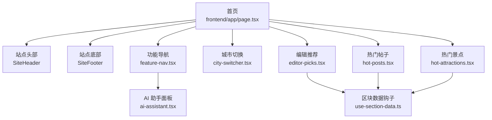
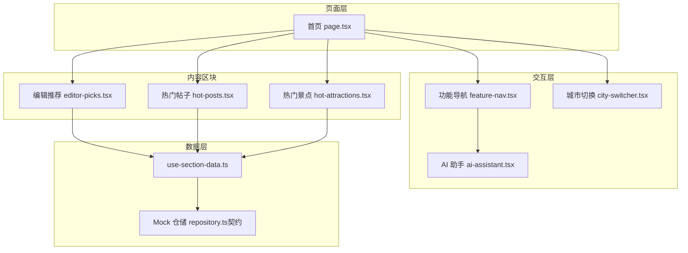
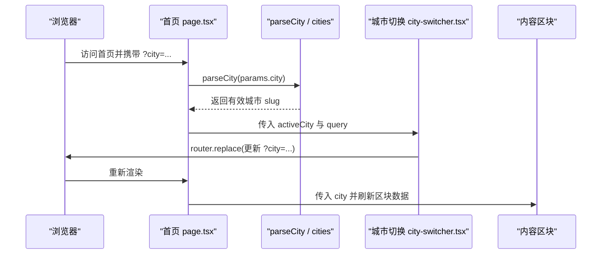
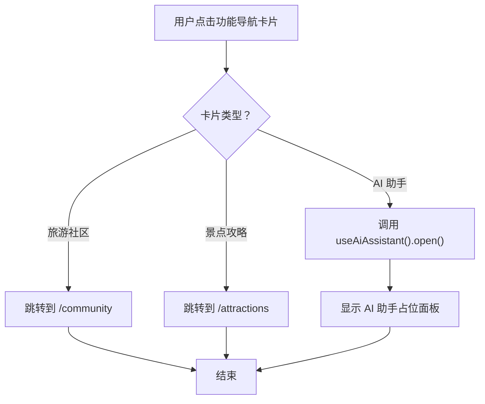
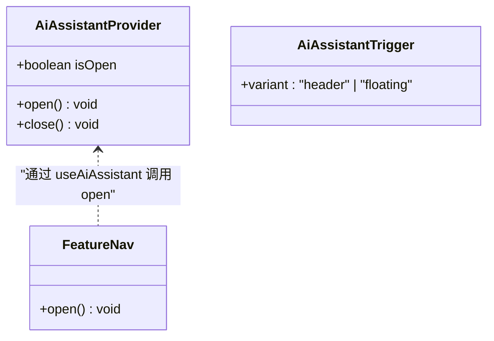
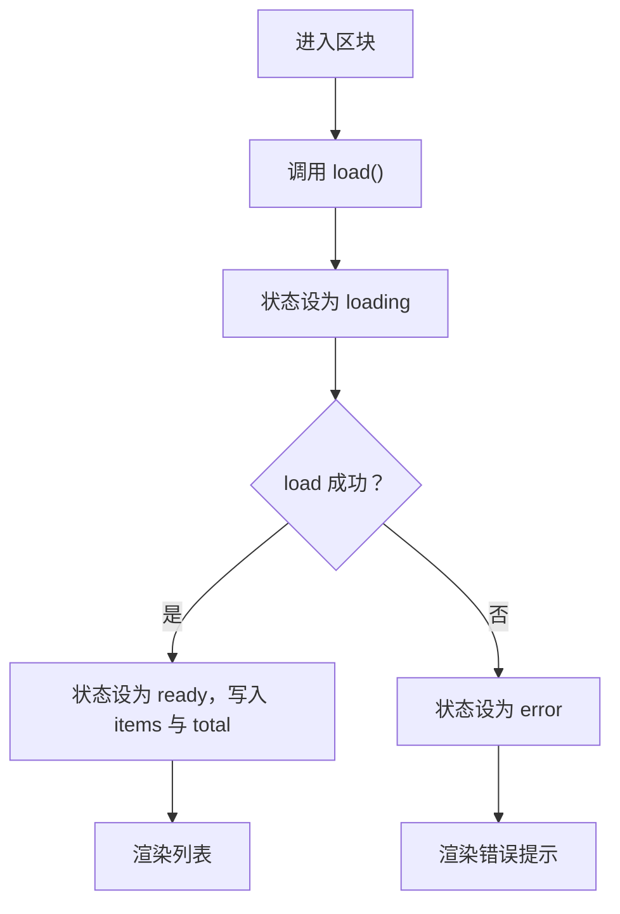
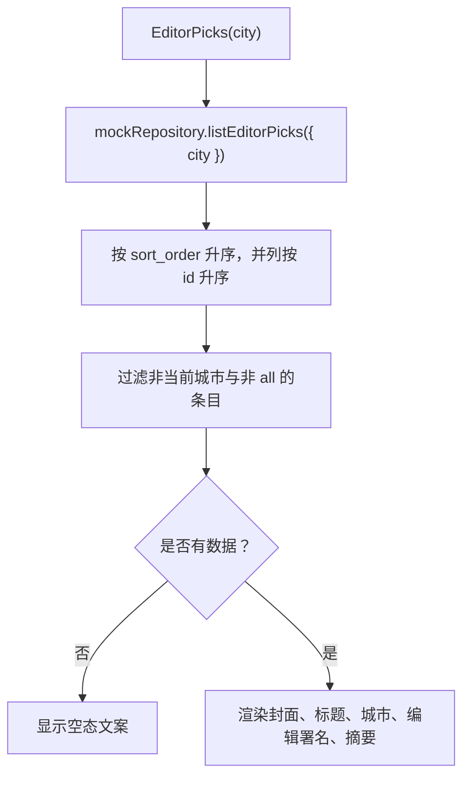
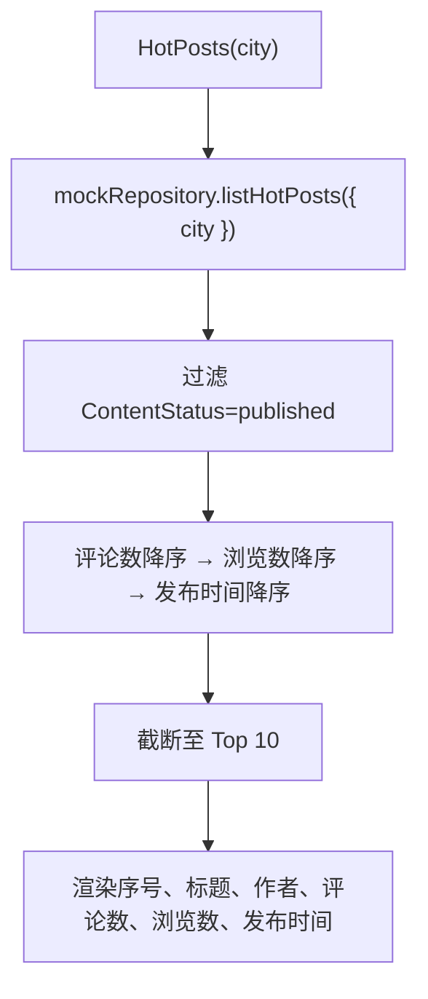
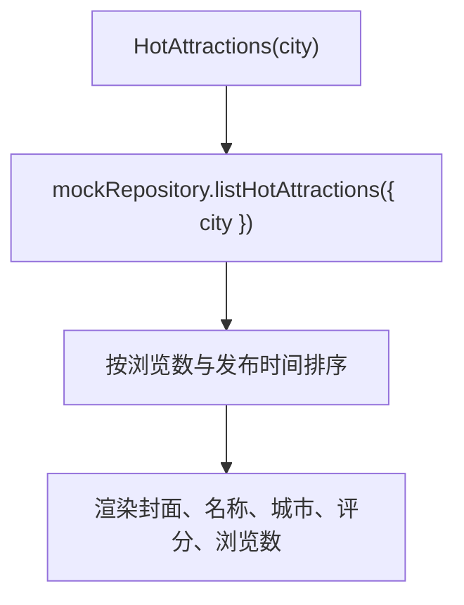
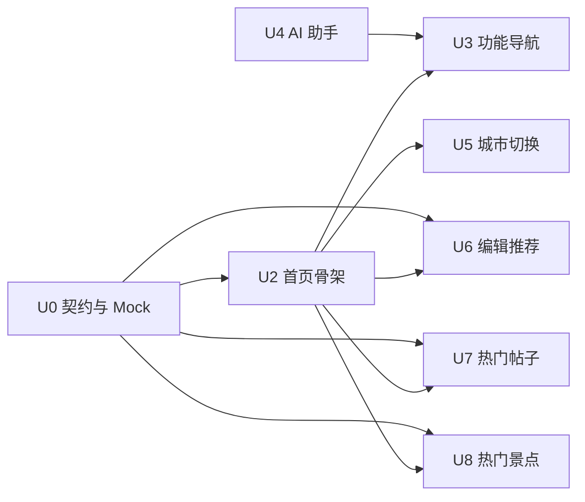

# WanderChain 首页规格文档

<cite>
**本文引用的文件**   
- [README.md](file://README.md)
- [homepage-u0-contract-mock.md](file://docs/specs/wanderchain/homepage-u0-contract-mock.md)
- [homepage-u3-feature-nav.md](file://docs/specs/wanderchain/homepage-u3-feature-nav.md)
- [homepage-u4-ai-assistant.md](file://docs/specs/wanderchain/homepage-u4-ai-assistant.md)
- [homepage-u6-editor-picks.md](file://docs/specs/wanderchain/homepage-u6-editor-picks.md)
- [homepage-u7-hot-posts.md](file://docs/specs/wanderchain/homepage-u7-hot-posts.md)
- [frontend/app/page.tsx](file://frontend/app/page.tsx)
- [frontend/components/home/use-section-data.ts](file://frontend/components/home/use-section-data.ts)
- [frontend/components/home/feature-nav.tsx](file://frontend/components/home/feature-nav.tsx)
- [frontend/components/home/ai-assistant.tsx](file://frontend/components/home/ai-assistant.tsx)
- [frontend/components/home/editor-picks.tsx](file://frontend/components/home/editor-picks.tsx)
- [frontend/components/home/hot-posts.tsx](file://frontend/components/home/hot-posts.tsx)
- [frontend/components/home/hot-attractions.tsx](file://frontend/components/home/hot-attractions.tsx)
- [frontend/components/home/city-switcher.tsx](file://frontend/components/home/city-switcher.tsx)
- [frontend/app/community/page.tsx](file://frontend/app/community/page.tsx)
- [frontend/app/attractions/page.tsx](file://frontend/app/attractions/page.tsx)
</cite>

## 目录
1. [引言](#引言)
2. [项目结构](#项目结构)
3. [核心组件](#核心组件)
4. [架构总览](#架构总览)
5. [详细组件分析](#详细组件分析)
6. [依赖关系分析](#依赖关系分析)
7. [性能与可维护性](#性能与可维护性)
8. [故障排查指南](#故障排查指南)
9. [结论](#结论)

## 引言
本规格文档聚焦 WanderChain 首页能力，围绕“城市旅行指南”的入口、导航、内容与交互契约进行说明。当前实现以 Next.js 前端为主，后端接口尚未接入；所有数据通过 Mock 仓储提供，确保 UI 与业务逻辑可在零网络请求下独立开发与验收。

该仓库采用“规格 + 护栏 + 技能”三层工作区模式：`openspec/` 定义意图与主规格，`harness/` 用闸门链保证构建、迁移与一致性，`.agents/skills/` 固化 AI 编码方法。WanderChain 首页属于 `wanderchain-homepage` 能力，其子单元契约位于 `docs/specs/wanderchain/`。

**章节来源**
- [README.md:1-111](file://README.md#L1-L111)

## 项目结构
WanderChain 首页由一个页面级路由和多个可复用区块组成：

- 页面层：`frontend/app/page.tsx` 作为首页入口，负责解析 URL 城市参数、组装 Hero 区域与区块容器。
- 区块组件：功能导航、城市切换、编辑推荐、热门帖子、热门景点分别位于 `components/home/*`。
- 共享 Hook：`useSectionData` 统一封装加载、就绪、错误三态。
- 占位面板：AI 助手通过上下文 Provider 暴露打开/关闭能力，供多处触发。
- 占位页：`/community` 与 `/attractions` 为板块建设中的占位页面。

**图表来源**
- [frontend/app/page.tsx:1-126](file://frontend/app/page.tsx#L1-L126)
- [frontend/components/home/feature-nav.tsx:1-116](file://frontend/components/home/feature-nav.tsx#L1-L116)
- [frontend/components/home/city-switcher.tsx:1-74](file://frontend/components/home/city-switcher.tsx#L1-L74)
- [frontend/components/home/editor-picks.tsx:1-62](file://frontend/components/home/editor-picks.tsx#L1-L62)
- [frontend/components/home/hot-posts.tsx:1-59](file://frontend/components/home/hot-posts.tsx#L1-L59)
- [frontend/components/home/hot-attractions.tsx:1-66](file://frontend/components/home/hot-attractions.tsx#L1-L66)
- [frontend/components/home/use-section-data.ts:1-44](file://frontend/components/home/use-section-data.ts#L1-L44)
- [frontend/components/home/ai-assistant.tsx:1-157](file://frontend/components/home/ai-assistant.tsx#L1-L157)

**章节来源**
- [frontend/app/page.tsx:1-126](file://frontend/app/page.tsx#L1-L126)

## 核心组件
- 首页聚合器：解析 `searchParams`，调用 `parseCity` 得到当前城市，并将城市与查询参数透传给各区块。Hero 区域展示本期统计上限，区块按“功能入口 → 城市入口 → 内容列表”顺序渲染。
- 区块数据钩子：`useSectionData` 将异步数据源包装为 `{loading, error, ready}` 三态，避免重复拉取并处理组件卸载后的状态更新。
- 功能导航：包含旅游社区、景点攻略两个链接卡片，以及 AI 助手按钮；后两者分别跳转到占位页或唤起同一面板。
- AI 助手：Provider 管理面板开关、焦点恢复、Esc 关闭与遮罩点击关闭；触发器支持头部与悬浮两种形态。
- 城市切换：根据 URL `?city=` 渲染选中项，点击时替换查询参数，保持其他查询键不变。
- 内容区块：编辑推荐、热门帖子、热门景点均通过 `mockRepository` 获取数据，并按各自排序与过滤规则展示。

**章节来源**
- [frontend/app/page.tsx:24-40](file://frontend/app/page.tsx#L24-L40)
- [frontend/components/home/use-section-data.ts:6-43](file://frontend/components/home/use-section-data.ts#L6-L43)
- [frontend/components/home/feature-nav.tsx:50-115](file://frontend/components/home/feature-nav.tsx#L50-L115)
- [frontend/components/home/ai-assistant.tsx:41-120](file://frontend/components/home/ai-assistant.tsx#L41-L120)
- [frontend/components/home/city-switcher.tsx:13-31](file://frontend/components/home/city-switcher.tsx#L13-L31)

## 架构总览
WanderChain 首页采用“页面装配 + 区块消费 + Mock 仓储”的分层结构。当前阶段不依赖真实后端，所有数据契约以类型与 Mock 数据固定，后续替换为真实 API 时，组件与测试无需重写。

**图表来源**
- [frontend/app/page.tsx:37-118](file://frontend/app/page.tsx#L37-L118)
- [frontend/components/home/feature-nav.tsx:71-115](file://frontend/components/home/feature-nav.tsx#L71-L115)
- [frontend/components/home/city-switcher.tsx:13-31](file://frontend/components/home/city-switcher.tsx#L13-L31)
- [frontend/components/home/editor-picks.tsx:10-12](file://frontend/components/home/editor-picks.tsx#L10-L12)
- [frontend/components/home/hot-posts.tsx:11-12](file://frontend/components/home/hot-posts.tsx#L11-L12)
- [frontend/components/home/hot-attractions.tsx:11-12](file://frontend/components/home/hot-attractions.tsx#L11-L12)
- [frontend/components/home/use-section-data.ts:15-42](file://frontend/components/home/use-section-data.ts#L15-L42)

## 详细组件分析

### 首页聚合器与城市参数流
首页是数据与交互的装配点：它从 Next.js 的 `searchParams` 中读取城市，使用 `parseCity` 做非法值归一化，再构造稳定查询对象传递给城市切换与内容区块。Hero 区域展示城市数量与各区块上限，强调“本地 Mock 契约，未来接口替换不重写界面”。

**图表来源**
- [frontend/app/page.tsx:24-40](file://frontend/app/page.tsx#L24-L40)
- [frontend/app/page.tsx:104-118](file://frontend/app/page.tsx#L104-L118)
- [frontend/components/home/city-switcher.tsx:13-31](file://frontend/components/home/city-switcher.tsx#L13-L31)

**章节来源**
- [frontend/app/page.tsx:24-40](file://frontend/app/page.tsx#L24-L40)
- [frontend/app/page.tsx:42-96](file://frontend/app/page.tsx#L42-L96)
- [frontend/app/page.tsx:99-118](file://frontend/app/page.tsx#L99-L118)

### 功能导航与 AI 助手入口
功能导航承载三个平台入口：旅游社区、景点攻略、AI 助手。前两者为路由跳转，后者通过 `useAiAssistant().open()` 唤起同一面板。U3 规格要求移动端纵向排列，且 `/community`、`/attractions` 必须存在占位页。

**图表来源**
- [frontend/components/home/feature-nav.tsx:50-115](file://frontend/components/home/feature-nav.tsx#L50-L115)
- [frontend/app/community/page.tsx:9-15](file://frontend/app/community/page.tsx#L9-L15)
- [frontend/app/attractions/page.tsx:9-15](file://frontend/app/attractions/page.tsx#L9-L15)

**章节来源**
- [homepage-u3-feature-nav.md:10-50](file://docs/specs/wanderchain/homepage-u3-feature-nav.md#L10-L50)
- [frontend/components/home/feature-nav.tsx:71-115](file://frontend/components/home/feature-nav.tsx#L71-L115)
- [frontend/app/community/page.tsx:1-18](file://frontend/app/community/page.tsx#L1-L18)
- [frontend/app/attractions/page.tsx:1-18](file://frontend/app/attractions/page.tsx#L1-L18)

### AI 助手面板与无障碍
AI 助手是纯前端占位：Provider 管理面板开关、焦点恢复、Esc 关闭与遮罩点击关闭；触发器支持头部与悬浮两种形态。U4 规格强制“打开与关闭期间不得出现 fetch/XHR”，测试需 mock 全局 `fetch` 并断言调用次数为 0。

**图表来源**
- [frontend/components/home/ai-assistant.tsx:14-28](file://frontend/components/home/ai-assistant.tsx#L14-L28)
- [frontend/components/home/ai-assistant.tsx:41-120](file://frontend/components/home/ai-assistant.tsx#L41-L120)
- [frontend/components/home/ai-assistant.tsx:123-156](file://frontend/components/home/ai-assistant.tsx#L123-L156)
- [frontend/components/home/feature-nav.tsx:71-115](file://frontend/components/home/feature-nav.tsx#L71-L115)

**章节来源**
- [homepage-u4-ai-assistant.md:10-52](file://docs/specs/wanderchain/homepage-u4-ai-assistant.md#L10-L52)
- [frontend/components/home/ai-assistant.tsx:41-120](file://frontend/components/home/ai-assistant.tsx#L41-L120)

### 区块数据加载三态
所有数据区块共用 `useSectionData`，将异步数据源包装为 loading、error、ready 三种状态。组件只关心最终渲染结果，从而在 Mock 与真实 API 之间平滑切换。

**图表来源**
- [frontend/components/home/use-section-data.ts:6-43](file://frontend/components/home/use-section-data.ts#L6-L43)

**章节来源**
- [frontend/components/home/use-section-data.ts:1-44](file://frontend/components/home/use-section-data.ts#L1-L44)

### 编辑推荐区块
编辑推荐按 `sort_order` 升序、并列时按 `id` 升序排序，并仅展示当前城市与全城通用的精选。空态文案不报错，加载与错误态沿用区块三态。

**图表来源**
- [frontend/components/home/editor-picks.tsx:10-61](file://frontend/components/home/editor-picks.tsx#L10-L61)
- [homepage-u6-editor-picks.md:10-54](file://docs/specs/wanderchain/homepage-u6-editor-picks.md#L10-L54)

**章节来源**
- [homepage-u6-editor-picks.md:10-54](file://docs/specs/wanderchain/homepage-u6-editor-picks.md#L10-L54)
- [frontend/components/home/editor-picks.tsx:1-62](file://frontend/components/home/editor-picks.tsx#L1-L62)

### 热门帖子区块
热门帖子最多展示 10 条已发布帖子，三级排序为评论数降序 → 浏览数降序 → 发布时间降序。草稿与已删除帖子一律排除。

**图表来源**
- [frontend/components/home/hot-posts.tsx:11-58](file://frontend/components/home/hot-posts.tsx#L11-L58)
- [homepage-u7-hot-posts.md:10-56](file://docs/specs/wanderchain/homepage-u7-hot-posts.md#L10-L56)

**章节来源**
- [homepage-u7-hot-posts.md:10-56](file://docs/specs/wanderchain/homepage-u7-hot-posts.md#L10-L56)
- [frontend/components/home/hot-posts.tsx:1-59](file://frontend/components/home/hot-posts.tsx#L1-L59)

### 热门景点区块
热门景点按浏览量与发布时间排序，展示封面、名称、城市与评分、浏览数。空态与错误态沿用通用区块状态。

**图表来源**
- [frontend/components/home/hot-attractions.tsx:11-65](file://frontend/components/home/hot-attractions.tsx#L11-L65)

**章节来源**
- [frontend/components/home/hot-attractions.tsx:1-66](file://frontend/components/home/hot-attractions.tsx#L1-L66)

### 契约与 Mock 数据层
U0 明确类型定义、城市白名单、Mock 数据规模与 `HomeRepository` 接口边界。它是其余区块的地基，组件与单元测试应通过替换 `mockRepository` 来验证未来真实 API 的兼容性。

- 类型与常量：`CitySlug`、`EditorPick`、`Post`、`Attraction`、`ContentStatus`、`ListQuery`、`ListResult<T>`。
- 城市白名单：`all` 加北京、上海、广州、成都、西安、杭州、三亚。
- 行为约束：`parseCity` 对非法或缺失值归一化为 `all`；Mock 数据覆盖全部 7 城，并包含草稿与已删除样本。
- 验收重点：重复调用顺序一致、非法城市 slug 归一、替换数据源时组件与测试无需修改。

**章节来源**
- [homepage-u0-contract-mock.md:10-53](file://docs/specs/wanderchain/homepage-u0-contract-mock.md#L10-L53)

## 依赖关系分析
WanderChain 首页的依赖关系遵循“页面装配 → 区块消费 → 数据契约”的单向依赖，避免循环耦合：

- 页面依赖：城市解析、区块组件、站点头尾。
- 区块依赖：`useSectionData`、`mockRepository`、城市名称格式化。
- AI 助手依赖：Provider 上下文，被功能导航与站点头部触发。
- 契约依赖：U0 是 U2/U3/U4/U6/U7 的基础，但 U0 不反向依赖任何 UI 组件。

**图表来源**
- [homepage-u0-contract-mock.md:34-40](file://docs/specs/wanderchain/homepage-u0-contract-mock.md#L34-L40)
- [homepage-u3-feature-nav.md:32-36](file://docs/specs/wanderchain/homepage-u3-feature-nav.md#L32-L36)
- [homepage-u4-ai-assistant.md:33-38](file://docs/specs/wanderchain/homepage-u4-ai-assistant.md#L33-L38)
- [homepage-u6-editor-picks.md:35-40](file://docs/specs/wanderchain/homepage-u6-editor-picks.md#L35-L40)
- [homepage-u7-hot-posts.md:36-41](file://docs/specs/wanderchain/homepage-u7-hot-posts.md#L36-L41)

**章节来源**
- [homepage-u0-contract-mock.md:34-40](file://docs/specs/wanderchain/homepage-u0-contract-mock.md#L34-L40)
- [homepage-u3-feature-nav.md:32-36](file://docs/specs/wanderchain/homepage-u3-feature-nav.md#L32-L36)
- [homepage-u4-ai-assistant.md:33-38](file://docs/specs/wanderchain/homepage-u4-ai-assistant.md#L33-L38)
- [homepage-u6-editor-picks.md:35-40](file://docs/specs/wanderchain/homepage-u6-editor-picks.md#L35-L40)
- [homepage-u7-hot-posts.md:36-41](file://docs/specs/wanderchain/homepage-u7-hot-posts.md#L36-L41)

## 性能与可维护性
- 零网络请求：当前所有区块通过 Mock 仓储提供数据，避免首屏阻塞与跨域问题；真实 API 接入时只需替换数据源。
- 三态加载：`useSectionData` 统一管理 loading/error/ready，减少重复请求与竞态条件。
- 城市参数稳定：首页对 `searchParams` 做单值归一，避免数组参数导致的不必要重渲染。
- 图片懒加载：封面图使用 `loading="lazy"`，降低首屏带宽压力。
- 可替换数据层：类型与 `ListResult<T>` 契约使 Mock 与真实 API 可互换，组件与测试无需改动。

[本节为通用指导，不直接分析具体文件]

## 故障排查指南
- AI 助手面板未打开：检查是否包裹在 `AiAssistantProvider` 内；确认触发按钮调用了 `open()` 而非跳转。
- 面板无法关闭：确认遮罩点击、关闭按钮与 Esc 事件监听未被阻止；检查焦点归还逻辑。
- 城市切换无效：确认 URL 查询参数格式为 `?city=slug`，且 `parseCity` 能识别该 slug。
- 区块为空：检查 Mock 数据是否包含对应城市的条目；确认编辑器精选与帖子的状态过滤逻辑。
- 网络请求异常：当前实现不应发起任何请求；若出现 fetch/XHR，优先检查是否误接真实 API 或未正确替换 `mockRepository`。

**章节来源**
- [homepage-u4-ai-assistant.md:40-52](file://docs/specs/wanderchain/homepage-u4-ai-assistant.md#L40-L52)
- [frontend/components/home/ai-assistant.tsx:60-75](file://frontend/components/home/ai-assistant.tsx#L60-L75)
- [frontend/components/home/city-switcher.tsx:17-31](file://frontend/components/home/city-switcher.tsx#L17-L31)

## 结论
WanderChain 首页在当前阶段以清晰的契约与 Mock 数据为基础，实现了城市筛选、功能导航、AI 助手入口与三类内容区块。架构上坚持“UI 与数据解耦、Mock 与真实 API 可替换”，并通过三态加载与无障碍设计提升可维护性与可用性。后续接入真实后端时，应优先替换 `mockRepository`，并保持类型与响应形状不变，以确保最小改动成本与最大回归安全性。

[本节为总结性内容，不直接分析具体文件]