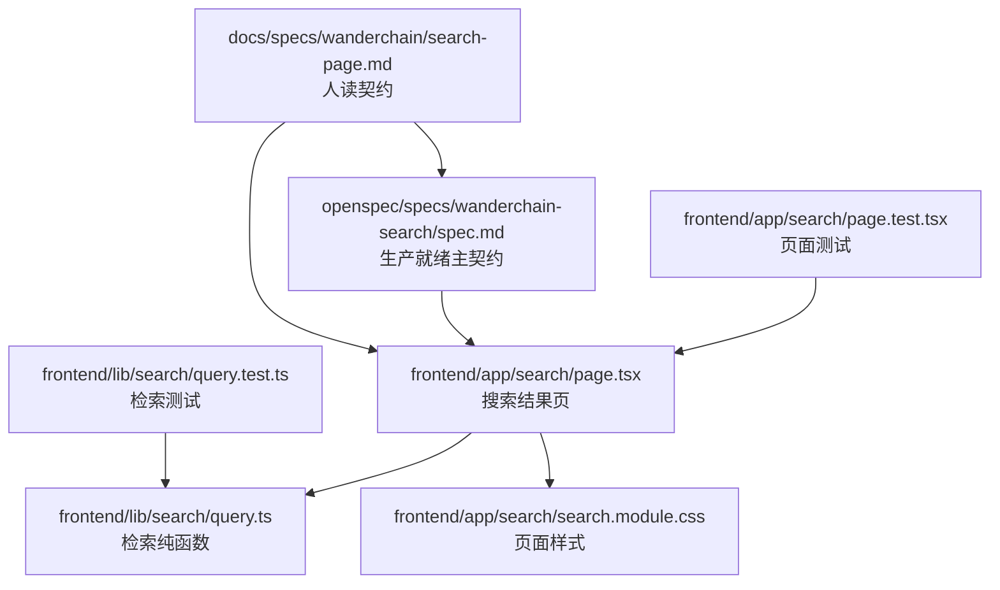
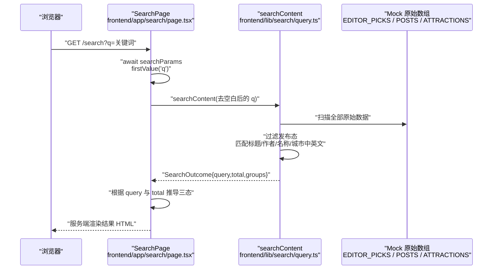
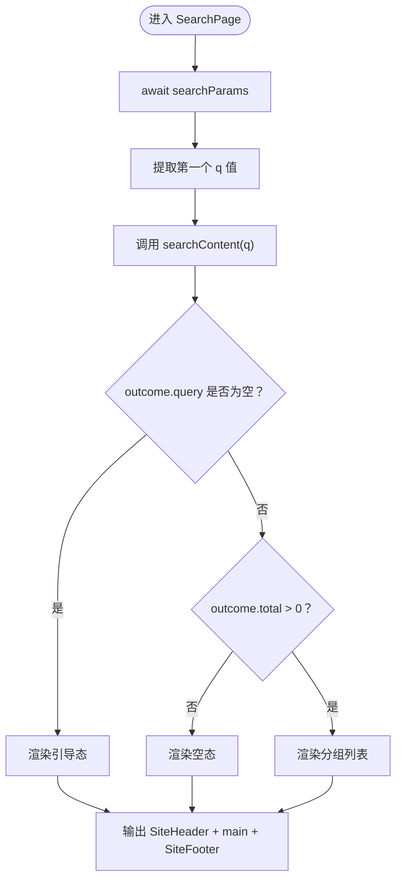
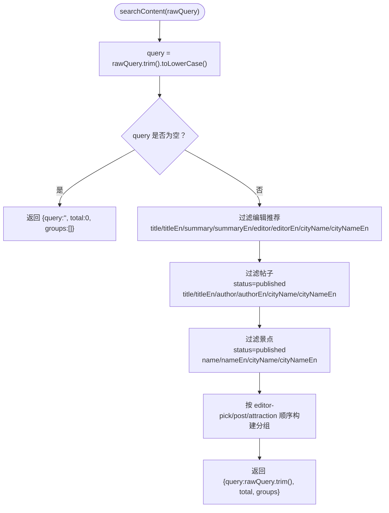
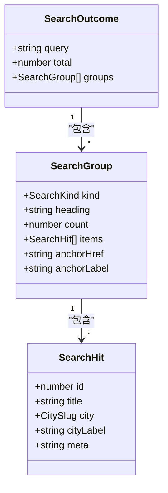
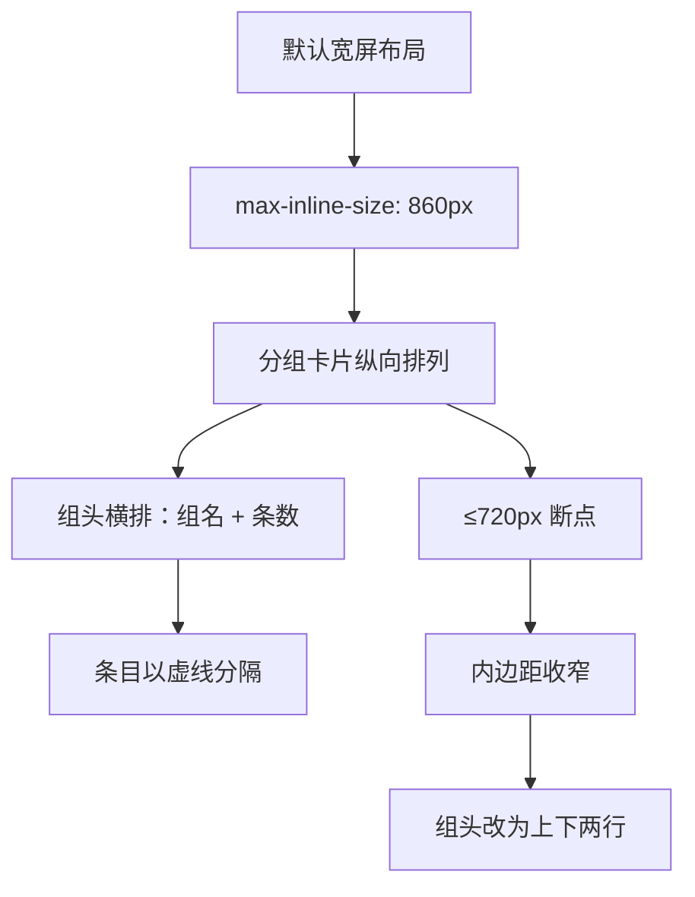
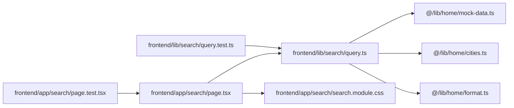

# WanderChain 搜索页面规格

<cite>
**本文引用的文件**   
- [search-page.md](file://docs/specs/wanderchain/search-page.md)
- [spec.md（wanderchain-search 生产规格）](file://openspec/specs/wanderchain-search/spec.md)
- [page.tsx（搜索结果页）](file://frontend/app/search/page.tsx)
- [search.module.css（搜索结果页样式）](file://frontend/app/search/search.module.css)
- [page.test.tsx（搜索结果页测试）](file://frontend/app/search/page.test.tsx)
- [query.ts（检索纯函数）](file://frontend/lib/search/query.ts)
- [query.test.ts（检索纯函数测试）](file://frontend/lib/search/query.test.ts)
</cite>

## 更新摘要
**变更内容**   
- 更新了 GROUP_META 配置部分，说明英文常量的标准化处理
- 强化了分组标题和回链文本的英文一致性要求
- 补充了关于消除中英文标签歧义的说明
- 更新了相关章节以反映标准化的实现方式

## 目录
1. [引言](#引言)
2. [项目结构定位](#项目结构定位)
3. [核心组件与职责](#核心组件与职责)
4. [架构总览](#架构总览)
5. [详细组件分析](#详细组件分析)
6. [依赖关系分析](#依赖关系分析)
7. [性能与渲染特性](#性能与渲染特性)
8. [验收清单与断点规范](#验收清单与断点规范)
9. [故障排查指南](#故障排查指南)
10. [结论](#结论)

## 引言
本规格文档聚焦 WanderChain 的站内搜索结果页，说明该页面的目标、边界、数据流、交互状态、响应式行为以及工程约束。搜索能力承接首页首屏搜索框提交，将用户关键词落到编辑推荐、帖子与景点三类内容上，按固定分组返回可读结果；当无关键词或零命中时，分别展示引导态与空态，并提供回首页入口。

该模块属于新增能力 `wanderchain-search`，其主契约已归档并迁移至生产就绪规格 `openspec/specs/wanderchain-search/spec.md`，而 `docs/specs/wanderchain/search-page.md` 作为人读契约补充了页面级细节、断点与验收项。

**更新摘要**
- 搜索引擎现已支持中英文双语查询，具备双语匹配逻辑
- 搜索现在同时匹配标题、摘要、作者和名称字段的中英文版本
- 显示层更新为展示英文字段值，并提供本地化的空态消息
- **GROUP_META 配置已标准化**：所有分组标题和回链文本统一使用英文常量，消除了中文分类名称与英文显示标签之间的歧义

## 项目结构定位
搜索相关代码集中在前端 Next.js App Router 下：

- 路由页面：`frontend/app/search/page.tsx`
- 页面样式：`frontend/app/search/search.module.css`
- 页面测试：`frontend/app/search/page.test.tsx`
- 检索逻辑：`frontend/lib/search/query.ts`
- 检索测试：`frontend/lib/search/query.test.ts`
- 规格契约：`docs/specs/wanderchain/search-page.md`
- OpenSpec 生产规格：`openspec/specs/wanderchain-search/spec.md`

**图表来源**
- [search-page.md:1-10](file://docs/specs/wanderchain/search-page.md#L1-L10)
- [spec.md:1-122](file://openspec/specs/wanderchain-search/spec.md#L1-L122)
- [page.tsx:1-113](file://frontend/app/search/page.tsx#L1-L113)
- [search.module.css:1-127](file://frontend/app/search/search.module.css#L1-L127)
- [page.test.tsx:1-131](file://frontend/app/search/page.test.tsx#L1-L131)
- [query.ts:1-170](file://frontend/lib/search/query.ts#L1-L170)
- [query.test.ts:1-145](file://frontend/lib/search/query.test.ts#L1-L145)

**章节来源**
- [search-page.md:1-10](file://docs/specs/wanderchain/search-page.md#L1-L10)
- [spec.md:1-122](file://openspec/specs/wanderchain-search/spec.md#L1-L122)

## 核心组件与职责
| 组件 | 路径 | 职责 |
|---|---|---|
| 搜索结果页 | `frontend/app/search/page.tsx` | 解析查询参数、调用检索纯函数、渲染三态、复用站点头尾、导出元信息 |
| 检索纯函数 | `frontend/lib/search/query.ts` | 扫描原始数据、过滤发布态、匹配字段、构造分组与条目 |
| 页面样式 | `frontend/app/search/search.module.css` | 定义容器、分组卡片、组头、条目、回链与 720px 断点 |
| 页面测试 | `frontend/app/search/page.test.tsx` | 验证引导态、空态、分组顺序、锚点链接、唯一 h1、零 fetch |
| 检索测试 | `frontend/lib/search/query.test.ts` | 验证截断内容可见、草稿不可见、城市中文名匹配、slug 不匹配、分组顺序与总数一致 |

**章节来源**
- [page.tsx:1-113](file://frontend/app/search/page.tsx#L1-L113)
- [query.ts:1-170](file://frontend/lib/search/query.ts#L1-L170)
- [search.module.css:1-127](file://frontend/app/search/search.module.css#L1-L127)
- [page.test.tsx:1-131](file://frontend/app/search/page.test.tsx#L1-L131)
- [query.test.ts:1-145](file://frontend/lib/search/query.test.ts#L1-L145)

## 架构总览
搜索页面采用服务端渲染的 React Server Component，打开页面时不发起任何网络请求；查询参数由 Next.js 传入，页面先归一化出单值 `q`，再交给纯函数 `searchContent` 计算结果，最后根据 `query` 与 `total` 推导三态。

**图表来源**
- [page.tsx:20-35](file://frontend/app/search/page.tsx#L20-L35)
- [page.tsx:32-104](file://frontend/app/search/page.tsx#L32-L104)
- [query.ts:118-169](file://frontend/lib/search/query.ts#L118-L169)

**章节来源**
- [page.tsx:1-113](file://frontend/app/search/page.tsx#L1-L113)
- [query.ts:1-170](file://frontend/lib/search/query.ts#L1-L170)

## 详细组件分析

### 搜索结果页组件
搜索结果页是一个异步默认导出的 Server Component，没有 `'use client'`。它负责：

- 导出 `metadata`，设置页面标题为「Search」并附带描述。
- 从 `searchParams` 中取第一个 `q` 值，避免数组参数干扰。
- 调用 `searchContent` 得到 `SearchOutcome`。
- 根据是否提问和命中总数渲染三种界面：
  - 引导态：未提问时显示引导文案与回首页链接。
  - 空态：有提问但零命中时显示空态文案与回首页链接。
  - 结果态：显示关键词、总条数、分组列表与每组回链。
- 每个分组使用 `<section aria-labelledby>`，组名使用 `<h2>`，条目使用 `<li>`，条目本身不是链接。
- 复用 `SiteHeader` 与 `SiteFooter`，保证全页唯一 `h1`。

**图表来源**
- [page.tsx:32-104](file://frontend/app/search/page.tsx#L32-L104)

**章节来源**
- [page.tsx:1-113](file://frontend/app/search/page.tsx#L1-L113)

### 检索纯函数
`searchContent` 是搜索能力的核心纯函数，职责包括：

- 接收原始关键词，去除首尾空白并转为小写用于匹配。
- 若归一化后为空，直接返回空结果。
- 分别扫描编辑推荐、帖子、景点三类原始数据。
- 对帖子和景点只保留 `status === 'published'` 的数据。
- **双语匹配字段**：
  - 编辑推荐：标题、英文标题、摘要、英文摘要、编辑署名、英文编辑署名、城市中英文名。
  - 帖子：标题、英文标题、作者、英文作者、城市中英文名。
  - 景点：名称、英文名称、城市中英文名。
- 城市 slug 不作为匹配依据；`city === 'all'` 不参与匹配，但显示为「All cities」。
- 按固定顺序组装分组：编辑推荐 → 帖子 → 景点，且只包含有命中的分组。
- 返回 `SearchOutcome`，其中 `query` 保留原始去空白后的字符串用于回显，`total` 为所有命中条目之和。

**更新** 搜索引擎现已支持中英文双语查询，能够同时匹配字段的中英文版本。

**图表来源**
- [query.ts:118-169](file://frontend/lib/search/query.ts#L118-L169)

**章节来源**
- [query.ts:1-170](file://frontend/lib/search/query.ts#L1-L170)

### 数据结构与类型
检索层定义了稳定的数据契约，便于页面与测试共同理解结果形态：

| 类型 | 关键字段 | 含义 |
|---|---|---|
| `SearchKind` | `'editor-pick' \| 'post' \| 'attraction'` | 搜索结果分组类型 |
| `SearchHit` | `id`、`title`、`city`、`cityLabel`、`meta` | 单个命中条目 |
| `SearchGroup` | `kind`、`heading`、`count`、`items`、`anchorHref`、`anchorLabel` | 一个分组及其回链 |
| `SearchOutcome` | `query`、`total`、`groups` | 一次检索的最终结果 |

**图表来源**
- [query.ts:11-39](file://frontend/lib/search/query.ts#L11-L39)

**章节来源**
- [query.ts:11-39](file://frontend/lib/search/query.ts#L11-L39)

### 分组配置与英文常量标准化
**更新** 分组配置通过 `GROUP_META` 常量进行集中管理，确保所有分组标题和回链文本都使用统一的英文常量：

| 分组类型 | 标题常量 | 回链文案常量 | 锚点链接 |
|---|---|---|---|
| `editor-pick` | `"Editor's picks"` | `"See editor picks on the homepage"` | `"/#editor-picks"` |
| `post` | `"Posts"` | `"See trending posts on the homepage"` | `"/#hot-posts"` |
| `attraction` | `"Attractions"` | `"See popular attractions on the homepage"` | `"/#hot-attractions"` |

这种设计消除了之前可能存在的中文分类名称与英文显示标签之间的歧义，确保整个搜索界面使用一致的英文标签。所有分组的显示文本都来自这些预定义的英文常量，避免了硬编码字符串分散在各个文件中导致的不一致问题。

**章节来源**
- [query.ts:41-60](file://frontend/lib/search/query.ts#L41-L60)

### 页面样式与响应式
页面样式遵循 desktop-first 策略，主要约定如下：

- 页面容器使用 `.wc-container` 与设计 token。
- 内容区域最大内联尺寸为 860px。
- 分组卡片间距为 24px，条目之间用虚线分隔。
- 在 720px 及以下：
  - 分组卡片内边距收窄。
  - 组头由横排改为上下两行。
- 颜色仅使用设计 token，如 `--wc-*`，不引入新的十六进制字面量。
- 结果条目为纯文本卡片，不引入图片，避免为不可点击条目加载封面。

**图表来源**
- [search.module.css:12-16](file://frontend/app/search/search.module.css#L12-L16)
- [search.module.css:52-127](file://frontend/app/search/search.module.css#L52-L127)

**章节来源**
- [search.module.css:1-127](file://frontend/app/search/search.module.css#L1-L127)

### 测试覆盖要点
页面测试与检索测试共同保障搜索行为：

- 页面测试验证：
  - 无关键词或只有空白时渲染引导态。
  - 多类命中时分组顺序固定。
  - 关键词回显去空白。
  - 零命中渲染空态。
  - 每组回链指向首页对应区块。
  - 结果条目不是链接。
  - 唯一 `h1`、含页头页脚、零 `fetch`。
  - 英文关键词的结果页不含中文字符。
- 检索测试验证：
  - 能看到被首页上限截断的帖子与景点。
  - 草稿与已删除内容不出现在结果中。
  - 城市中文名能命中三类内容。
  - 城市英文名也能命中三类内容。
  - 城市 slug 不作为匹配依据。
  - 忽略大小写与首尾空白。
  - 内容字段同时匹配中英文。
  - 分组顺序固定、组内保持数据源顺序。
  - 命中条数与总数一致，每组带回首页锚点。
  - 输出文案全为英文。

**更新** 测试用例现已涵盖双语匹配场景，确保中英文查询都能正确工作，并验证了分组标题和回链文本的英文一致性。

**章节来源**
- [page.test.tsx:38-130](file://frontend/app/search/page.test.tsx#L38-L130)
- [query.test.ts:24-144](file://frontend/lib/search/query.test.ts#L24-L144)

## 依赖关系分析
搜索页面与检索纯函数之间存在清晰单向依赖：页面负责 UI 与参数处理，检索纯函数负责数据过滤与分组构造。页面不直接读取首页仓储，以避免首页条数上限影响搜索结果。

**图表来源**
- [page.tsx:1-7](file://frontend/app/search/page.tsx#L1-L7)
- [query.ts:1-4](file://frontend/lib/search/query.ts#L1-L4)
- [page.test.tsx:1-6](file://frontend/app/search/page.test.tsx#L1-L6)
- [query.test.ts:1-3](file://frontend/lib/search/query.test.ts#L1-L3)

**章节来源**
- [page.tsx:1-113](file://frontend/app/search/page.tsx#L1-L113)
- [query.ts:1-170](file://frontend/lib/search/query.ts#L1-L170)

## 性能与渲染特性
- 搜索页为 Server Component，首次访问在服务端完成检索与渲染。
- 打开页面期间不发起任何 `fetch` 或 XHR 请求。
- 不使用客户端状态钩子，三态由服务端计算结果推导。
- 检索直接扫描原始数组，避免首页仓储的 `*_LIMIT` 截断带来的漏检。
- 结果条目为纯文本卡片，不加载图片，减少不必要的资源请求。
- **双语匹配优化**：虽然支持中英文查询，但显示层统一使用英文字段值，确保界面语言一致性。
- **常量优化**：分组标题和回链文本使用预定义的英文常量，避免了运行时字符串拼接的性能开销。

这些特性使搜索页在无客户端脚本环境下仍可正常展示结果，同时保证首屏可访问性与稳定性。

**章节来源**
- [page.tsx:1-113](file://frontend/app/search/page.tsx#L1-L113)
- [query.ts:6-9](file://frontend/lib/search/query.ts#L6-L9)
- [page.test.tsx:113-123](file://frontend/app/search/page.test.tsx#L113-L123)

## 验收清单与断点规范
搜索页面的人读契约明确列出了结构与交互验收项，部分工程与无障碍项仍待完善：

- 已完成的结构与数据验收：
  - 全页唯一 `h1`。
  - 含站点头尾。
  - 分组使用语义化结构。
  - 无 `q` 或空白 `q` 渲染引导态。
  - `q=成都` 命中三类并按固定顺序呈现。
  - 能看到被首页上限截断的内容。
  - 草稿与已删除内容零命中。
  - 关键词回显去空白，slug 不匹配。
  - **双语查询支持**：中英文关键词都能正确匹配内容字段。
  - **英文显示**：结果标题、城市标与元信息均为英文。
  - **分组标题标准化**：所有分组标题使用预定义的英文常量，确保界面一致性。
  - **回链文本标准化**：所有回链文案使用预定义的英文常量，避免歧义。
- 待完善项：
  - 键盘 Tab 顺序与焦点环。
  - 首页区块确实存在对应 `id`。
  - 320px 下无横向滚动。
  - 720px 以下组头改上下排列、内边距收窄。
  - 正文与元信息对比度满足无障碍要求。
  - 构建通过。
  - 断点检查闸门退出码为 0。

断点规范以 `frontend/app/search/search.module.css` 为准，当前实现包含 720px 断点，闸门脚本会校验规格文档与 CSS 断点的一致性。

**更新** 验收清单现已包含双语查询、英文显示以及分组标题和回链文本标准化的验证项。

**章节来源**
- [search-page.md:156-193](file://docs/specs/wanderchain/search-page.md#L156-L193)
- [search-page.md:211-221](file://docs/specs/wanderchain/search-page.md#L211-L221)
- [search.module.css:117-126](file://frontend/app/search/search.module.css#L117-L126)

## 故障排查指南
| 现象 | 可能原因 | 排查建议 |
|---|---|---|
| 搜索结果为空但首页有相关内容 | 内容状态不是 `published` | 检查帖子或景点的 `status` 字段 |
| 搜索不到被首页隐藏的内容 | 误用首页仓储而非原始数组 | 确认调用的是 `searchContent`，未复用 `mockRepository.list*` |
| 输入城市 slug 无结果 | slug 不作为匹配字段 | 改用城市中文名或英文名，例如"成都"或"Chengdu"而非"chengdu" |
| 搜索结果顺序不符合预期 | 数据源顺序变化或错误重排 | 确认分组只过滤不排序，保持数据源顺序 |
| 页面出现多个一级标题 | 模板或外层布局重复渲染标题 | 检查页面与布局是否都设置了 `h1` |
| 移动端组头错位 | 断点样式未生效或自定义样式覆盖 | 检查 720px 媒体查询与 CSS Modules 类名 |
| 测试结果失败 | Mock 数据或关键词假设变化 | 更新 `query.test.ts` 中的关键词与期望 |
| **中文查询无结果** | 内容字段不包含中文 | 检查数据源是否包含对应的中文内容字段 |
| **英文查询无结果** | 内容字段不包含英文 | 检查数据源是否包含对应的英文内容字段 |
| **结果显示中文** | 显示层使用了错误的字段 | 确认 `toEditorHit`、`toPostHit`、`toAttractionHit` 使用英文字段 |
| **分组标题不一致** | 修改了 GROUP_META 配置 | 检查所有分组标题是否使用预定义的英文常量 |
| **回链文案异常** | 回链文本未使用标准常量 | 确认所有回链文案来自 GROUP_META 中的预定义字符串 |

**更新** 故障排查指南新增了双语查询相关的常见问题和解决方案，以及分组标题和回链文本标准化的相关问题。

**章节来源**
- [query.ts:118-169](file://frontend/lib/search/query.ts#L118-L169)
- [query.test.ts:24-144](file://frontend/lib/search/query.test.ts#L24-L144)
- [search.module.css:117-126](file://frontend/app/search/search.module.css#L117-L126)

## 结论
WanderChain 搜索页面以清晰的模块边界、稳定的数据契约与服务端渲染策略，实现了从首页搜索框到全站内容的直达检索。它不依赖客户端状态与网络请求，通过纯函数完成全量过滤与分组，确保被首页上限截断的内容重新可达，同时在无关键词与零命中场景提供明确的引导与空态。

**更新** 随着双语匹配逻辑的引入和 GROUP_META 配置的标准化，搜索引擎现在能够同时处理中文和英文查询，匹配标题、摘要、作者和名称字段的中英文版本。所有分组标题和回链文本都使用统一的英文常量，消除了中文分类名称与英文显示标签之间的歧义，确保界面语言的一致性和可维护性。

随着主规格已从开发时的 delta 迁移至生产就绪规格 `openspec/specs/wanderchain-search/spec.md`，该功能现已具备完整的生产环境支持。后续改进应优先补齐无障碍交互、极端窄屏体验与构建闸门验收，使规格文档与实际实现保持一致。